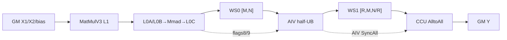

# MatmulAlltoAll 950 ACLNN 算子知识

## 算子速览

| 项目 | 内容 |
|---|---|
| 实际入口 | `aclnnMatmulAlltoAllV2GetWorkspaceSize` / `aclnnMatmulAlltoAllV2`，公开 ACLNN V2；固定提交中最新非量化入口 |
| 计算语义 | `C=X1@X2+bias`，再把 `[M,N]` 重排为 `[R,M,N/R]` 并执行 AlltoAll，输出 `[R*M,N/R]` |
| 输入输出 | ND FP16/BF16；`x1[M,K]`、`x2[K,N]` 或 `[N,K]`、可选 `bias[N]`、`y[R*M,N/R]` |
| 执行类型 | 单 Kernel `MIX_CV`：AIC ASW MatMulV3，AIV GM↔UB 重排，AIV block 0 控制 CCU 或 AI_CPU HCCL AlltoAll |
| Kernel 路线 | R-001 CCU pipeline；R-002 AI_CPU pipeline；每条内按 B transpose 与 bias dtype 展开具体 key |
| 核心资源 | ACLNN/system workspace；512B 对齐的 MatMul 与 permute GM slices；MatMulV3 L1/L0；半 UB重排队列；HCCL handles |
| 来源闭包 | `source_closed`：ACLNN、参数处理、arch35 selector/POD、gen-task、单 MIX_CV entry、ASW MatMul/重排/HCCL wrapper闭合；HCCL engine与 generated通信POD是固定仓外边界 |
| 验证状态 | 已完成源码闭包检查；本次知识提取未执行编译、真机、数值或性能测试。 |

## 接口与语义

### 计算语义

令 `M=BS,K=H1,N=H2,R=rankSize`：

```text
C[M,N] = X1[M,K] @ X2[K,N] + bias[N]        // bias 可空
P[R,M,N/R] = view(C,[M,R,N/R]).permute(1,0,2)
Y[R*M,N/R] = AlltoAll(P)
```

非量化场景中 x1/x2/y dtype 相同。MatMul 的 bias 融合发生在 AIC MatMulV3 内，随后 AIV 只做无算术的 layout copy，HCCL 以相同 dtype 通信。

### 输入、输出与属性

| 参数 | shape/layout | dtype | 约束、默认值与语义 |
|---|---|---|---|
| `x1` | `[M,K]` ND | FP16/BF16 | 必选；`M=0` 是唯一支持的空 tensor 情况，直接返回空 executor；`1<=K<=65535` |
| `x2` | `[K,N]` 或 transpose view `[N,K]` ND | 与 x1 相同 | 连续输入支持显式 `transposeX2`；仅 950 支持符合最后两轴转置 stride 的非连续 view |
| `biasOptional` | `[N]` ND | 与 x1 相同或 FP32 | 可空；FP16/BF16 均允许 same-X 或 FP32 bias |
| `alltoAllAxesOptional` | 空或 `[-1,-2]` | int64 list | 其它值失败 |
| `group` | 1..127 字节 | string | 通信域；公开 V2 的 R 从 group/inner attr 得到 |
| `commMode` | `"ccu"` 或 `"ai_cpu"` | string | 决定 TilingKey、HCCL server type与 gen-task server/stream |
| `transposeX1` / `transposeX2` | 标量 | bool | X1 不可转置；X2 转置改变 MatMul B 模板 |
| `output` | `[R*M,N/R]` ND | 与 x1 相同 | R∈{2,4,8,16}，`N%R=0`，M*R与N不超过INT32_MAX |

### 入口与版本

V2 相对 `aclnnMatmulAlltoAll` 增加 `commMode`，公开文档明确 950 同时支持 `ai_cpu` 与 `ccu`。V2 wrapper 复用 `aclnnMatmulAlltoAllBase*`：第一段完成校验、950 x2 view 处理和 executor/workspace 生成，第二段从 executor user handle 恢复通信模式并设置 HCCL server type。量化 V2 虽共享 inner OpDef，属于 `QuantMatmulAlltoAll`，不并入本卡。

## Host/Launcher 执行流程

### 参数校验与前处理

先检查 x2 非空/非空 tensor/二维。950 若 `IsTransposeLastTwoDims(x2)` 且用户未同时置 `transposeX2=true`，`TransX2Tensor` 只交换 view shape/stride并翻转 `transposeX2`，不搬数据；若非连续 view与显式 transpose 同时存在则报错。之后依次检查必选指针、空域、矩阵/bias shape、FP16/BF16 dtype、非私有 format、axes、X1 transpose、group，以及 `commMode` 非空。`M=0` 时 `DealWithEmptyTensor` 立即返回 `workspaceSize=0` 的空 executor，不进入 `CheckAndHandleCommMode`、Tiling 或 Kernel；因此固定实现不会在空域路线校验通信模式字符串、rank、`N%R` 和 output/rank 的形状关系。

### 参数、Workspace 与生命周期

非空路线：

```text
mmResultLen = AlignUp(M*N*sizeof(Y), 512)
permuteLen  = mmResultLen
biasLen     = 0  // A5 非量化路径保留该 POD 字段，但 producer 不写额外 bias slice
workspace[0]= libApiWorkSpaceSize + mmResultLen + permuteLen
```

Kernel 令 `tempComputeOutGM=workspaceGM`、`transOutGM=workspaceGM+mmResultLen`。inner/runtime 把总 workspace 的 system prefix 映射为 kernel 所见 user pointer的细节不在固定仓；`TilingInferredInfo::biasLen` 默认初始化为 0，950 非量化子类不覆盖 `SetUserWorkSpace`，故 POD 中该保留字段也为 0。executor 持有通信 mode user handle；workspace、executor和tensor必须存活到传入 stream 执行完成。

### 启动图与失败传播

```text
V2 GetWorkspaceSize
  -> base validation / optional x2 view rewrite
  -> generated inner GetWorkspaceSize
  -> MatmulAlltoAllTilingFunc(DAV_3510)
  -> FpMatmulAllToAllTilingBase
     -> fit-balance or formulaic M split
     -> MatMulV3 tile/tail POD
     -> HCCL CCU/AICPU POD and tiling key
  -> executor
V2 execute
  -> server type CCU or AICPU
  -> generated inner launch
  -> one matmul_all_to_all MIX_CV kernel
     -> AIC MatMul -> AIV transpose -> HCCL AlltoAll
```

`MatmulAlltoAllCalcOpParamFunc/GenTaskFunc` 对 CCU 选择 `ccu server/ccu_stream` 与 arch35 gen-task callback，对 AI_CPU 选择 `aicpu kfc server/kfc_stream` 与通用 callback。API/tiling/gen-task/launch失败均终止；base 将 inner执行失败返回 `ACLNN_ERR_INNER`。

## Route 与参数设计

### 分核与资源计算

`SetAttrsInfo/SetShapeInfo/SetDataTypeInfo` 生成 M/K/N/R、transpose、bias和元素字节数。`GetArch35TilingResult` 对 standard-card 4P或8P使用 fit-balance，其余拓扑走公式化切分；AI_CPU 把最大 tile 数限制为6，并在任一估算阶段小于80μs时倾向不切，M>N*10时最多3片。每种长/短 M tile再调用 `Mc2MMTilingRegistry`，按平台优先级生成完整 `Mc2MatMulV3TilingData`。

Kernel blockDim=`aicCoreNum`，entry声明 AIC:AIV=1:2。AIC ASW scheduler按 M/N base tile、窗口蛇形扫描和尾块拆分分核；AIV transpose最多使用 `2*blockDim` 个block，把 `[tileM,N]` 按 `64×256` 子块复制为 rank-major布局。

### Route 选择

| 顺序 | Route | Key/模板 | 精确选择条件与优先级 | 不适用去向 |
|---:|---|---|---|---|
| 1 | R-001 CCU pipeline | `(NON_QUANT_MODE,transB,biasKind,COMMMODE_CCU)` | DAV_3510；M>0；commMode=ccu；公开非量化 dtype/shape合法 | 参数/Tiling失败；无Device fallback |
| 2 | R-002 AI_CPU pipeline | `(NON_QUANT_MODE,transB,biasKind,COMMMODE_AICPU)` | DAV_3510；M>0；commMode=ai_cpu；其余同上 | 参数/Tiling失败；无Device fallback |
| 3 | 空域终点 | 无 key/无 kernel | M=0；API基础校验通过且`commMode`非空；通信模式字符串与Tiling级rank/output约束尚未校验 | workspace=0空executor成功 |

```text
M==0 -> basic API checks -> empty executor（跳过commMode字符串/rank/Tiling校验）
M>0 -> NON_QUANT selector
  -> commMode ccu/ai_cpu
    -> transposeX2 0/1
      -> bias kind SAME_WITH_X（含无bias）/FP32
        -> 8个具体非量化key之一
```

### 模板/实现执行矩阵

| Route | key/selector | dtype/shape/platform 完整命中条件 | 执行族与 kernel 节点 | 实际模板/body | 内存与同步特征 | tail/fallback |
|---|---|---|---|---|---|---|
| R-001a | `(0,transB=0,bias=0,comm=CCU)` | FP16/BF16；bias空或same-X；B不转置；CCU | 单 MIX_CV | `MC2FpMatmul<Mc2MatmulAswKernel<ND,ND,...,ASWBlock,NO_PRELOAD>>` + transpose + CCU communicator | WS0/WS1；flags8/9；AIV SyncAll | tile/tail POD；无fallback |
| R-001b | `(0,transB=1,bias=0,comm=CCU)` | FP16/BF16；bias空或same-X；B转置；CCU | 同上 | 同一ASW body，B transpose template=true | 同上 | 同上 |
| R-001c | `(0,transB=0,bias=FP32,comm=CCU)` | FP16/BF16；bias FP32；B不转置；CCU | 同上 | `DtypeBias=float` | 同上 | 同上 |
| R-001d | `(0,transB=1,bias=FP32,comm=CCU)` | FP16/BF16；bias FP32；B转置；CCU | 同上 | `DtypeBias=float`，B transpose template=true | 同上 | 同上 |
| R-002a | `(0,transB=0,bias=0,comm=AICPU)` | FP16/BF16；bias空或same-X；B不转置；AI_CPU | 单 MIX_CV | 同一计算/transpose，`HCCL_SERVER_TYPE_AICPU` | 同上；AI_CPU max tile=6 | 同上 |
| R-002b | `(0,transB=1,bias=0,comm=AICPU)` | FP16/BF16；bias空或same-X；B转置；AI_CPU | 同上 | 同上，B transpose template=true | 同上 | 同上 |
| R-002c | `(0,transB=0,bias=FP32,comm=AICPU)` | FP16/BF16；bias FP32；B不转置；AI_CPU | 同上 | `DtypeBias=float` | 同上 | 同上 |
| R-002d | `(0,transB=1,bias=FP32,comm=AICPU)` | FP16/BF16；bias FP32；B转置；AI_CPU | 同上 | `DtypeBias=float`，B transpose template=true | 同上 | 同上 |

### 隐藏性能 Guard

| Guard | Host/Tiling 条件 | Device/资源原因 | 影响 Route | 不满足时去向 | 源码符号 |
|---|---|---|---|---|---|
| rank | R∈{2,4,8,16}；N%R=0 | AlltoAll每rank切片必须整数 | 两者 | Tiling失败 | `GetAndValidateRankSize/Check2DMatrixMulShapes` |
| AI_CPU tile | maxTileCnt=6；任一stage估时<80μs时不切；M>10N时max=3 | KFC任务展开开销与handle数量 | R-002 | 调整切分，不是另一kernel | `MatmulAlltoAllFitBalanceTiling::SetShortTileLen` |
| L2工作集 | `M*K*sizeA + K*N*sizeB >128 MiB` | 大于L2时提高最小tile长度 | 两者 | fit-balance增加min tile | 同上 |
| 小M/低并行 | `M*N<=core*baseM*baseN*2` 时不切；`M<=4096`，或 `K<=minTile && M>=8K && M<K*K` 时把最小tile抬到 `ceil(M/3)` 后再对齐 | 防止过切开销/低Cube利用 | fit-balance两路线 | 最多3片或不切 | `SetShortTileLen` |
| 计算/通信失衡 | `ratioCalcComm>1.5` 时将 long tile 向下对齐256并重新分配余数 | 计算bound路线需要稳定的长块粒度 | fit-balance两路线 | 产生新的long/short计数；不切换Kernel | `AdjustLongShortTileLenWhenCalcBound` |
| transpose UB | `totalBlocks=ceil(tileM/64)*ceil((N/R)/256)` | 一个AIV block处理一个或多个copy块 | 两者 | usedCore=min(totalBlocks,2*AIC)；真实tail copy | `MC2VecTranspose::getSplitCnt` |
| HCCL handles | fixed array 63；task数由上述切分限制 | `PrepareAll`逐task占一个handle | 两者 | Host保证小于上界；无Device检查 | `HcclCommunicator::MAX_HCCL_HANDLE_` |
| FP32 split-K | 当前非量化输出不是FP32，故 `isFp32=false` | ASW的>8192 split-K保精度分支不可达 | 两者 | `splitKRound=1` | `Mc2MatmulAswBlock::Init` |

### POD/ABI

| 结构 | 字段 | 类型/位宽 | ABI 布局 | 单位 | Host/launcher producer | Device consumer | 边界 |
|---|---|---|---|---|---|---|---|
| `MatmulAlltoAllTilingInfo` | `rankDim` | uint32 | offset0；info sizeof=64,align=8 | rank | `SetTilingInfo` | transpose/HCCL context | 2/4/8/16 |
| 同上 | `tileM` | uint32 | offset4 | 元素 | `TileCommAndCompute` | `ProcessTile` | 主 tile M |
| 同上 | `tileCnt` | uint32 | offset8 | 次数 | 同上 | `Process` | 主 tile 次数 |
| 同上 | `tailM` | uint32 | offset12 | 元素 | 同上 | `ProcessTail` | 尾 tile M |
| 同上 | `tailCnt` | uint32 | offset16 | 次数 | 同上 | `Process` | 为0时tail POD inactive |
| 同上 | `rankM` | uint32 | offset20 | 元素 | `SetTilingInfo` | 地址/count/stride公式 | 写入前Host范围校验 |
| 同上 | `rankN` | uint32 | offset24 | 元素 | 同上 | 同上 | 写入前Host范围校验 |
| 同上 | `rankK` | uint32 | offset28 | 元素 | 同上 | MatMul维度 | 写入前Host范围校验 |
| 同上 | `mmResultLen` | uint64 | offset32 | 字节 | `SetUserWorkSpace` | `Init` | 512B对齐 |
| 同上 | `permuteLen` | uint64 | offset40 | 字节 | 同上 | 同上 | 与`mmResultLen`相等 |
| 同上 | `biasLen` | uint32 | offset48 | 字节 | `TilingInferredInfo` 默认值0，经 `SetTilingInfo`复制 | 无显式Device reader | 950非量化有/无bias均为0；保留字段inactive |
| 同上 | `aicCoreNum` | uint32 | offset52 | 核 | `GetPlatformInfo` | blockDim/AIV分核 | 平台AIC核数 |
| 同上 | `hcclDataType` | uint64 | offset56 | enum | `ConvertGeTypeToHcclType` | `MC2AlltoAllPrimitives` | RESERVED失败 |
| `MatmulAlltoAllTilingData` | `mc2InitTiling` | generated POD | fixed仓未给出`sizeof/alignof/offsetof` | HCCL初始化配置 | `Mc2CcTilingConfig::GetTiling` | `Hccl::InitV2` | 外部SDK ABI边界，禁止自造字段 |
| 同上 | `mc2CcTiling` | generated POD | 同上 | HCCL CC配置 | 同上 | `SetCcTilingV2` | 同一外部SDK ABI边界 |
| 同上 | `matmulAlltoAllTilingInfo` | 上述64-byte struct | outer offset依赖generated前缀，固定仓不可见 | 混合 | `PostTiling memcpy_s` | scheduler | tiling buffer容量先检查 |
| 同上 | `mc2MmV3TileTilingData` | `Mc2MatMulV3TilingData` | 仓内定义；outer offset依赖generated前缀 | tile/core/层级 | `DoMatmulV3Tiling` | `Mc2MatmulAswKernel/Block` | 主tile active |
| 同上 | `mc2MmV3TailTilingData` | `Mc2MatMulV3TilingData` | 同上 | tile/core/层级 | 同上 | 同上 | `tailCnt=0`时inactive |
| `MC2AlltoAllContext` | `taskCnt,send/recvBuffer,send/recvOffset,sendCount,strideCount,hcclDataType,repeat` | 32/64 bit混合 | Device运行时context，非launch ABI；精确布局由header | 指针/字节/元素 | `ProcessTile/ProcessTail` | primitive `AlltoAll` | repeat默认1 |

### Route 源码闭包

| Route | Key/selector | Host/Tiling producer | POD/参数 | Kernel entry/router | Kernel body/直接依赖 | 构建接线 |
|---|---|---|---|---|---|---|
| R-001 CCU | `comm=COMMMODE_CCU`四key | `FpMatmulAllToAllTilingBase` + fit/formulaic | `MatmulAlltoAllTilingData` | `matmul_allto_all_apt.cpp::matmul_all_to_all` | `MatmulAlltoAllArch35`、pipeline、ASW MatMul、transpose、`Hccl<CCU>` | OpDef `opFile=matmul_allto_all_apt`；gen-task arch35；CMake ascend950 |
| R-002 AI_CPU | `comm=COMMMODE_AICPU`四key | 同上，max tile=6 | 同上 | 同一entry | 相同计算/重排，`Hccl<AICPU>` | 通用 KFC gen-task；同一CMake target |

## Kernel 实现

### 公共执行流程

entry 固定 `KERNEL_TYPE_MIX_AIC_1_2`，通过 `QUANTMODE/X2TRANSPOSE/DTYPEBIAS/COMMMODE` 编译期实例化。非量化分支使用 `MatmulAlltoAllTilingData`；`DtypeBias`选择 same-X或float，是否实际加bias由MatMul tiling的`isBias`字段决定。R-001/R-002只更换 `HcclServerType`，地址、计算、transpose和pipeline同步相同。

### Route R-001：CCU MatMul→重排→AlltoAll

#### 适用条件

##### 选择证据

| 层级 | 文件 | 符号 | 源码谓词/参数 | 结果/下一跳 |
|---|---|---|---|---|
| API | `op_api/matmul_allto_all_util.cpp` | `CheckAndHandleCommMode` | DAV_3510 且字符串`ccu` | executor handle=COMM_MODE_CCU |
| Tiling | `arch35/fp_matmul_allto_all_tiling_base.cpp` | `GetTilingKey` | engine=A5_CCU_ENGINE | COMMMODE_CCU key |
| GenTask | `op_graph/matmul_allto_all_gen_task.cpp` | `CalcOpParam/GenTaskFunc` | commMode=CCU | ccu server/stream与arch35 callback |
| entry | `op_kernel/arch35/matmul_allto_all_apt.cpp` | `commServerType` | COMMMODE==CCU | `Hccl<CCU>` pipeline |

#### Device 数据流

##### 函数级调用链

```text
matmul_all_to_all
  -> MATMUL_ALL_TO_ALL_APT_FP_IMPL
  -> MatmulAlltoAllArch35::Init/Process
  -> ProcessTile [then ProcessTail if any]
  -> MatmulAlltoAllPipeLine::ProcessDefault
     -> MC2FpMatmul::Process
        -> Mc2MatmulAswKernel::Process [AIC]
     -> MC2VecTranspose::Process [AIV]
     -> HcclCommunicator<...,HCCL_SERVER_TYPE_CCU>::Process [AIV0]
  -> HcclCommunicator::End
```

##### 源码等价伪码

```text
伪码：
WS0=workspace; WS1=workspace+mmResultLen
for main/tail tile class:
  Prepare AlltoAll handles for all tasks
  for task:
    AIC: ASW map block->(m,n), MatMulV3(X1tile,X2[,bias])->WS0tile
         set/wait flag8; set flag9
    AIV: wait flag9
         copy [tileM,N] to WS1 [R,tileM,N/R] via half-UB 64x256 blocks
         SyncAll<true>
         AIV block0 Commit CCU AlltoAll(WS1tile,Ytile)
wait outstanding handles; finalize CCU
```

#### 内存与数据搬运

##### 资源与搬运表

| 层级/缓冲区 | offset/地址公式 | extent/容量公式 | dtype/layout | producer | consumer | owner/lifetime | 对齐/复用 |
|---|---|---|---|---|---|---|---|
| GM X1/X2/bias | task base + MatMul block offsets | M*K、K*N、N | ND；B trans模板 | caller | AIC | caller | ASW/tail |
| WS0 | `task*tileM*N*sizeof(T)`；tail起点`tileCnt*tileM*N*sizeof(T)` | `mmResultLen` | `[M,N]` | AIC | AIV | executor | 512B总片对齐 |
| WS1 | base=`mmResultLen`；每rank dst stride=`M*N/R` elements | `permuteLen` | `[R,M,N/R]` | AIV | CCU HCCL | executor | 与WS0不别名 |
| L1/L0A/L0B/L0C | `tCubeTiling base/step/depth` | shape-specific POD | Cube internal | GM/MatMul | WS0 | task | `MM_CFG_NO_PRELOAD`; ASW窗口调度 |
| AIV UB | depth-1 queue | `TOTAL_UB_SIZE/2` | T | GM2UB | UB2GM | transpose task | 64×256+tail |
| Y | `task*tileM*(N/R)*sizeof(T)` | M*N elements | `[R*M,N/R]` | CCU HCCL | caller | caller | same dtype |

##### 分层内存布局



##### 字节账、交接边与复用顺序

```text
workspace_total = libApiWorkSpaceSize + 2*AlignUp(M*N*sizeof(T),512)
WS0 = AlignUp(M*N*sizeof(T),512)
WS1 = WS0
UB = TOTAL_UB_SIZE/2
L1/L0 = 当前 main/tail Mc2MatMulV3TilingData 的 base/step/depth 物理容量
```

| 边/复用子区 | producer | offset/extent | dtype/layout | consumer | ordering/sync | owner/lifetime | 安全条件 |
|---|---|---|---|---|---|---|---|
| AIC→AIV | ASW MatMul | WS0 task，tileM*N | T/ND | transpose | flag9；flag8 PIPE_FIX handshake | executor | AIV wait后读 |
| AIV→CCU | transpose | WS1 task；sendCount=tileM*N/R，stride=M*N/R | T/rank-major | `AlltoAll<false>` | `SyncAll<true>` then Commit | HCCL handle | 所有AIV完成该task |
| CCU→Y | HCCL | recvOffset=sendOffset | T/output ND | caller | `End`等待未完成handle | caller | stream完成前不可释放 |

#### 同步、精度与尾块

##### 同步与数值边界表

| 阶段 | primitive/机制 | producer | consumer/等待点 | 保护对象 | 精度/尾块 |
|---|---|---|---|---|---|
| MatMul内部 | MatmulImpl Iterate/GetTensorC；`SetMMLayoutTransform(true)` | L0C | Fixpipe→WS0 | output tile | FP16/BF16输出；bias按MatMul POD；splitK不可达 |
| AIC→AIV | flags8/9 | AIC | AIV wait9 | WS0 | main/tail各自POD |
| transpose | `DataCopyPad`+PIPE_ALL | MTE2 | MTE3 | half UB queue | blockCount=min(64,remaining M)，blockLen=min(256,remaining N/R) |
| HCCL | Prepare/Commit/Wait/Finalize | AIV0 | CCU server | WS1/Y | dtype不变，repeat=1 |

#### 关键实现

##### 符号证据表

| 阶段 | 文件 | 符号/模板实例 | 实现事实 |
|---|---|---|---|
| Host/Tiling producer | `op_host/op_tiling/arch35/fp_matmul_allto_all_tiling_base.cpp` | `GetTilingResult/DoMMTiling/GetTilingKey` | CCU fit/formulaic切分、POD与key |
| Kernel entry/router | `op_kernel/arch35/matmul_allto_all_apt.cpp` | `MATMUL_ALL_TO_ALL_APT_FP_IMPL` | CCU server template实例 |
| Device body/helper | `matmul_allto_all_arch35.h`、pipeline、common templates | `ProcessTile/ProcessDefault/Mc2MatmulAswKernel/MC2VecTranspose/HcclCommunicator` | 计算、地址、同步、通信闭环 |

### Route R-002：AI_CPU MatMul→重排→AlltoAll

#### 适用条件

##### 选择证据

| 层级 | 文件 | 符号 | 源码谓词/参数 | 结果/下一跳 |
|---|---|---|---|---|
| API | `op_api/matmul_allto_all_util.cpp` | `CheckAndHandleCommMode` | DAV_3510 且`ai_cpu` | executor handle=AICPU |
| Tiling | `fp_matmul_allto_all_tiling_base.cpp` | `GetArch35TilingResult/GetTilingKey` | engine非CCU | maxTileCnt=6，AICPU key |
| GenTask | `matmul_allto_all_gen_task.cpp` | callbacks | commMode=AICPU | aicpu kfc server/kfc_stream |
| entry | `matmul_allto_all_apt.cpp` | `commServerType` | COMMMODE_AICPU | `Hccl<AICPU>` |

#### Device 数据流

##### 函数级调用链

```text
matmul_all_to_all
  -> same ASW MatMul + transpose pipeline as R-001
  -> HcclCommunicator<...,HCCL_SERVER_TYPE_AICPU>::PrepareAll/Process/End
```

##### 源码等价伪码

```text
伪码与R-001相同；差异仅为：
Host将tile数限制为<=6，并选择AICPU gen-task server/stream；
entry把CommunicationType实例化为Hccl<HCCL_SERVER_TYPE_AICPU>；
每轮仍在AIV block0 Commit，End统一Wait并Finalize。
```

#### 内存与数据搬运

##### 资源与搬运表

| 层级/缓冲区 | offset/地址公式 | extent/容量公式 | dtype/layout | producer | consumer | owner/lifetime | 对齐/复用 |
|---|---|---|---|---|---|---|---|
| WS0/WS1 | 与R-001完全相同 | 各AlignUp(M*N*sizeof(T),512) | ND→rank-major | AIC/AIV | AIV/AI_CPU HCCL | executor | 不别名 |
| L1/L0/UB | 与R-001的shape-specific MatMul POD和half-UB相同 | 同R-001 | 同R-001 | 同R-001 | 同R-001 | task | 同R-001 |
| Y | 与R-001相同 | M*N elements | ND | AI_CPU HCCL | caller | caller | stream lifetime |

##### 分层内存布局


##### 字节账、交接边与复用顺序

```text
workspace_total、WS0、WS1、UB、L1/L0 与 R-001 相同；
AI_CPU route 的 taskCnt <= 6，且特殊开销guard可进一步降为1或3。
```

| 边/复用子区 | producer | offset/extent | dtype/layout | consumer | ordering/sync | owner/lifetime | 安全条件 |
|---|---|---|---|---|---|---|---|
| AIC→AIV | ASW MatMul | WS0 task | T/ND | transpose | flags8/9 | executor | 同R-001 |
| AIV→AI_CPU | transpose | WS1 task/sendCount/stride同R-001 | T/rank-major | AICPU HCCL | AIV SyncAll→Commit | handle | taskCnt<=6 |
| HCCL→Y | AI_CPU server | recvOffset | T/ND | caller | End Wait | caller | stream完成 |

#### 同步、精度与尾块

##### 同步与数值边界表

| 阶段 | primitive/机制 | producer | consumer/等待点 | 保护对象 | 精度/尾块 |
|---|---|---|---|---|---|
| 计算/重排 | 与R-001相同 | AIC/AIV | 下一阶段 | WS0/WS1 | same-X输出，真实main/tail |
| 通信 | `Hccl<AICPU>::Commit/Wait` | AIV0 | AI_CPU server/End | WS1/Y | dtype与count不变 |
| 任务限制 | Host max tile 6/3/1 | Tiling | communicator | handle数组 | 不改变数值，只改变M切分 |

#### 关键实现

##### 符号证据表

| 阶段 | 文件 | 符号/模板实例 | 实现事实 |
|---|---|---|---|
| Host/Tiling producer | `matmul_allto_all_fit_balance_tiling.{h,cpp}` | `AICPU_MAX_TILE_CNT/SetShortTileLen` | AI_CPU任务数与过切guard |
| Kernel entry/router | `matmul_allto_all_apt.cpp` | `HCCL_SERVER_TYPE_AICPU` | 只替换通信server类型 |
| Device body/helper | 与R-001相同 + `HcclCommunicator<AICPU>` | `PrepareAll/Process/End` | AIV0提交、统一等待 |

## 算子特定优化

### Trick T-001：非连续转置 view 只改描述符与模板位

#### 触发与源码依据

- 适用 Route：R-001、R-002
- 触发条件：950；x2最后两轴stride呈转置view；调用者未再置`transposeX2=true`
- Golden 来源：[`op_api/matmul_allto_all_base.cpp:314-330`](../../../../../../../cann-ops-raw/ascendc/ops-transformer/be33d95bb755cedec3108f70805c1874d1792540/mc2/matmul_allto_all/op_api/matmul_allto_all_base.cpp#L314-L330)

**官方源码（固定 Commit 连续逐字摘录）**：

```cpp
if (notContiguous) {
    transposeX2 = !transposeX2;
    // 把非连续x2转成连续
    transX2 = TransX2Tensor(x2);
    CHECK_RET(transX2 != nullptr, ACLNN_ERR_INNER_NULLPTR);
```

#### 机制与设计原因

`TransX2Tensor` 交换 view shape/stride但保留原storage地址，把PyTorch式 `.t()` view归一为连续语义加B转置模板，不产生额外Device copy或workspace slice。

#### 迁移边界

- 适用：恰好满足最后两轴转置stride的2D x2 view。
- 前提：950；不能同时显式要求`transposeX2=true`。
- 失效：其它非连续布局、A2/A3均报参数错误。
- 未验证：本次知识提取未执行编译、真机、数值或性能测试。

#### 错误做法

非连续view与`transposeX2=true`同时传入会被明确拒绝，避免双重转置。

### Trick T-002：ASW蛇形窗口分核并启用Fixpipe layout transform

#### 触发与源码依据

- 适用 Route：R-001、R-002全部非量化key
- 触发条件：950 `Mc2MatmulAswKernel<...,Mc2MatmulAswBlock,MM_CFG_NO_PRELOAD>`
- Golden 来源：[`mc2/3rd/mat_mul_v3/op_kernel/arch35/mat_mul_asw_kernel.h:109-128`](../../../../../../../cann-ops-raw/ascendc/ops-transformer/be33d95bb755cedec3108f70805c1874d1792540/mc2/3rd/mat_mul_v3/op_kernel/arch35/mat_mul_asw_kernel.h#L109-L128)

**官方源码（固定 Commit 连续逐字摘录）**：

```cpp
SetAtomicNone();
mm_.SetHF32(block_.matmulTilingData_->isHf32, 1);
SetMMLayoutTransform(true); // fixp使用n搬出，达到cube和fixp并行的效果
for (uint64_t j = 0; j < block_.params_.round; j++) {
    uint64_t newBlockIdx = block_.GetNewBlockIdx(j);
    block_.UpdateBasicIndex(j, newBlockIdx); // update asw index
```

#### 机制与设计原因

Host MatMulV3 POD确定base与ASW window；Device按窗口蛇形扫描N，降低相邻M块对B数据的替换，并让Fixpipe按N搬出以与Cube并行。末轮还能把M/N尾base拆给空闲核，但非量化输出不命中FP32 split-K分支。

#### 迁移边界

- 适用：950 ND MatMul作为流水producer。
- 前提：必须复用完整MatMulV3 POD、ASW block与`SetMMLayoutTransform`协议。
- 失效：A3使用`Mc2MatmulBaseKernel`，A2使用Catlass；不可只迁移蛇形索引。
- 未验证：本次知识提取未执行编译、真机、数值或性能测试。

#### 错误做法

固定仓未提供可验证反例。

### Trick T-003：通信模式参与切分与编译期 communicator 实例

#### 触发与源码依据

- 适用 Route：R-001/R-002
- 触发条件：commMode分别为ccu/ai_cpu
- Golden 来源：[`op_host/op_tiling/arch35/fp_matmul_allto_all_tiling_base.cpp:278-287`](../../../../../../../cann-ops-raw/ascendc/ops-transformer/be33d95bb755cedec3108f70805c1874d1792540/mc2/matmul_allto_all/op_host/op_tiling/arch35/fp_matmul_allto_all_tiling_base.cpp#L278-L287)

**官方源码（固定 Commit 连续逐字摘录）**：

```cpp
uint8_t commMode = (engineType == mc2tiling::A5_CCU_ENGINE) ? COMMMODE_CCU : COMMMODE_AICPU;

const uint64_t tilingKey = GET_TPL_TILING_KEY(NON_QUANT_MODE, x2TransposeFlag, biasDType, commMode);
```

#### 机制与设计原因

同一个数学route不在运行时分支HCCL对象，而是让Host同时把engine传给切分器、key和gen-task，Device得到类型化的`Hccl<CCU/AICPU>`；AI_CPU额外限制任务展开数量。

#### 迁移边界

- 适用：平台同时提供两种HCCL server且Host/gen-task/Device三处可一致选择。
- 前提：engine枚举、key、server type和stream接线必须一致。
- 失效：A2/A3只公开单一commMode。
- 未验证：本次知识提取未执行编译、真机、数值或性能测试。

#### 错误做法

只改ACLNN server type而不改TilingKey/gen-task，会让Host资源与Device communicator specialization不一致。

## 模板与实现对比

| 对比维度 | R-001 CCU | R-002 AI_CPU | 设计选择依据 |
|---|---|---|---|
| 命中条件/优先级 | commMode=ccu | commMode=ai_cpu | API字符串→engine→key |
| 执行族/节点图 | AIC ASW→AIV transpose→CCU HCCL | AIC ASW→AIV transpose→AI_CPU HCCL | 只替换通信server/gen-task |
| M/N/K、tile 与 scheduler | fit/formulaic，无AI_CPU上限 | max6；小任务不切；M>10N最多3 | 通信展开开销 |
| workspace/L1/L0/UB | 相同WS0/WS1、ASW、half-UB | 相同 | 数学和布局相同 |
| AIC/AIV 或 kernel 交接 | flags8/9+SyncAll | 相同 | 单MIX pipeline |
| 同步、精度与 tail | CCU Commit/Wait | AI_CPU Commit/Wait | communicator类型不同 |
| fallback/失败边界 | 非法模式/tiling失败 | 同左 | 无Device fallback |

## 平台差异

| 项目 | A2 | A3 | 950 |
|---|---|---|---|
| 支持状态 | 支持，见无后缀卡 | 支持，见无后缀卡 | 本卡支持 Ascend 950PR/950DT |
| Host/Launcher | aiv/MTE，R=2/4/8 | ai_cpu，R=2/4/8/16 | ai_cpu或ccu；R=2/4/8/16；M=0空executor |
| Kernel/资源 | Catlass直写HCCL window | MatMulBase+WS0/WS1 | ASW MatMulV3+WS0/WS1；两种HCCL server |

## 限制与失败边界

- 仅非量化 FP16/BF16；X1不可转置；除了950规范的x2转置view外均要求连续；不支持并发通算融合调用或跨超节点通信。CCU只支持单机UB域内互联，AI_CPU可覆盖跨机UB域内互联，但仍限超节点内。
- `M=0`不会启动Kernel，卡内Route/资源公式只适用于M>0。空域早退发生在 `CheckAndHandleCommMode` 和Tiling之前，所以非空的非法通信模式字符串、rank、`N%R` 与 output/rank 关系在该路线不会被固定实现检查；M>0时这些约束任一不合法均失败。
- generated inner launch、system workspace到user pointer映射、`Mc2InitTiling/Mc2CcTiling`逐字段ABI和HCCL engine内部位于固定仓外；不能从本卡推测。950非量化的`biasLen`是值恒为0且Device不读取的保留字段，不得按A3实现外推额外bias workspace。
- 本次知识提取未执行编译、真机、数值或性能测试。

## 源码索引

### 链路索引

| 链路阶段 | 文件 | 关键符号 | 支撑内容 |
|---|---|---|---|
| 入口声明/约束 | `mc2/matmul_allto_all/docs/aclnnMatmulAlltoAllV2.md` | V2原型/约束 | 950平台、空域、非连续、commMode |
| 入口实现 | `mc2/matmul_allto_all/op_api/aclnn_matmul_allto_all_v2.cpp` | V2两个函数 | base转发 |
| API base | `mc2/matmul_allto_all/op_api/matmul_allto_all_base.cpp` | `BaseGetWorkspaceSize/Base` | x2 view、空executor、engine handle、失败传播 |
| API 公共校验 | `mc2/matmul_allto_all/op_api/matmul_allto_all_util.cpp` | `CheckAndHandleCommMode/TransX2Tensor` | 950通信模式与转置view描述符归一化 |
| 平台注册 | `mc2/matmul_allto_all/op_host/matmul_allto_all_def.cpp` | `aicoreConfig_950` | ACLNN、multi-kernel标志、apt opFile |
| GenTask | `mc2/matmul_allto_all/op_graph/matmul_allto_all_gen_task.cpp` | `CalcOpParam/GenTaskFunc` | CCU/AI_CPU server与stream |
| Host/Tiling | `mc2/matmul_allto_all/op_host/op_tiling/arch35/fp_matmul_allto_all_tiling_base.cpp` | `FpMatmulAllToAllTilingBase` | selector、MatMul/HCCL POD、key与commMode切分 |
| 公共 workspace | `mc2/matmul_allto_all/op_host/op_tiling/matmul_allto_all_tiling_base.cpp` | `SetUserWorkSpace/GetWorkspaceSize` | 950两块512B对齐M*N slice且无bias slice |
| 切分入口 | `mc2/matmul_allto_all/op_host/op_tiling/arch35/matmul_allto_all_fit_balance_tiling.h` | `GetArch35TilingResult` | 4P/8P fit-balance、其它拓扑formulaic与AI_CPU max6 |
| 切分 | `mc2/matmul_allto_all/op_host/op_tiling/arch35/matmul_allto_all_fit_balance_tiling.cpp` | `SetShortTileLen` | 950资源/开销guard |
| 公式切分 | `mc2/matmul_allto_all/op_host/op_tiling/common/allto_all_formulaic_tiling.cpp` | `AlltoAllMM` | 非fit拓扑的M切分与通信估算 |
| Kernel entry | `mc2/matmul_allto_all/op_kernel/arch35/matmul_allto_all_apt.cpp` | `matmul_all_to_all` | 非量化router、server template、1:2 MIX |
| Scheduler/body | `mc2/matmul_allto_all/op_kernel/arch35/matmul_allto_all_arch35.h` | `Init/ProcessTile/ProcessTail` | WS地址和context字段 |
| Pipeline | `mc2/matmul_allto_all/op_kernel/arch35/matmul_allto_all_pipeline.h` | `ProcessDefault` | AIC/AIV/HCCL顺序与同步 |
| POD | `mc2/matmul_allto_all/op_kernel/arch35/matmul_allto_all_tiling_data.h` | `MatmulAlltoAllTilingInfo/Data` | 64-byte info、main/tail MatMul与HCCL POD顺序 |
| Kernel key | `mc2/matmul_allto_all/op_kernel/arch35/matmul_allto_all_tiling_key.h` | `ASCENDC_TPL_ARGS_DECL/SEL` | 非量化transpose、bias kind与CCU/AI_CPU组合 |
| MatMul instance | `mc2/common/op_kernel/mc2_templates/computation/matmul/mc2_fp_matmul.h` | 950 FP macros | ASW MatMul完整类型实例 |
| ASW MatMul body | `mc2/3rd/mat_mul_v3/op_kernel/arch35/mat_mul_asw_kernel.h` | `Mc2MatmulAswKernel::Process` | layout transform、ASW索引、Matmul/Fixpipe与bias顺序 |
| ASW block | `mc2/3rd/mat_mul_v3/op_kernel/arch35/mat_mul_asw_block.h` | `Mc2MatmulAswBlock` | block映射、tail与FP32 split-K guard |
| 重排 | `mc2/common/op_kernel/mc2_templates/computation/math/mc2_vec_transpose.h` | `MC2VecTranspose` | UB、DataCopy、分核与tail |
| 通信 | `mc2/common/op_kernel/mc2_templates/communication/communicator/hccl_communicator.h` | `HcclCommunicator` | Prepare/Commit/Wait/Finalize |
| 通信 primitive | `mc2/common/op_kernel/mc2_templates/communication/primitives/hccl_primitives.h` | `MC2AlltoAllPrimitives` | AlltoAll send/recv offset、count、stride与repeat |
| 构建接线 | `mc2/matmul_allto_all/op_host/CMakeLists.txt` | ascend950 compile options | apt依赖、auto-sync关闭、SSBUF通信开关 |
| 950 binary 接线 | `mc2/matmul_allto_all/op_host/config/ascend950/matmul_allto_all_binary.json` | `MatmulAlltoAll` binary entries | 950非量化/量化dtype与format实例边界 |

### 实现复用检查

| 检查项 | 可复用事实 | 不得改变的约束 | 源码符号 |
|---|---|---|---|
| ABI/POD | 64-byte info、main/tail MatMul POD、HCCL POD producer/consumer | outer generated ABI不可猜测；tail inactive条件 | `MatmulAlltoAllTilingData/SetTilingInfo` |
| 调用顺序 | 空域终点；非空单Kernel三阶段 | MatMul→flags→transpose→SyncAll→Commit→End Wait | `BaseGetWorkspaceSize/ProcessDefault` |
| workspace/内存 | 两个512B对齐M*N slice | WS1 offset=mmResultLen，rank stride/count不可变；不得增加A3专有bias slice | `SetUserWorkSpace/ProcessTile` |
| 同步 | flags8/9、AIV SyncAll、HCCL handle Wait | producer完成前不可读，stream完成前不可释放 | pipeline、`HcclCommunicator::End` |
| 精度与尾块 | same-X/FP32 bias key、ASW MatMul POD、64×256 copy tail | B transpose、bias dtype、有效tail；非量化splitK=1 | key、ASW block、transpose |
| 失败边界 | M>0的Host/Tiling/GenTask明确失败；M=0为空executor终点 | 不得把非空路线非法commMode、rank、shape或外部engine失败改为静默成功；也不得误称空域执行了Tiling级校验 | API util、`DealWithEmptyTensor`、Tiling、GenTask、base execute |