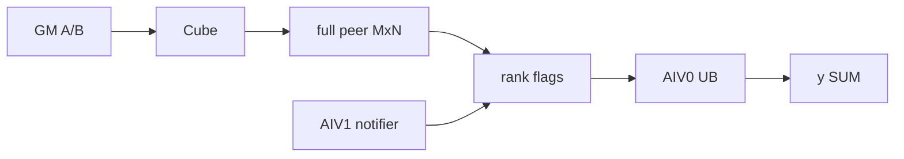
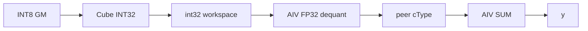

# MatmulReduceScatter A2/A3 ACLNN 算子知识

## 算子速览

| 项目 | 内容 |
|---|---|
| 实际入口 | `aclnnMatmulReduceScatterV2GetWorkspaceSize` / `aclnnMatmulReduceScatterV2`，公开 ACLNN V2 |
| 计算语义 | `y=ReduceScatterSUM(x1@x2+bias?)`；INT8 先 INT32 累加，再 per-channel/可选 per-token 反量化 |
| 输入输出 | `x1:[M,K]` ND，`x2:[K,N]` ND/NZ（可转置），`y:[M/rankSize,N]` ND |
| 执行类型 | 单 Kernel MIX_CV：AIC/Cube MatMul + AIV padding/dequant/非 Vector 通信搬运与 SUM |
| Kernel 路线 | R-001 大 M 高精度；R-002 A2 小 M 高精度；R-003 INT8 反量化 |
| 核心资源 | GM/HCCL window，`16MiB+aAlignSize+bAlignSize+dequantSize` workspace，L1/L0A/L0B/L0C，160KiB UB |
| 来源闭包 | `source_closed`：公开 API→generated inner bridge 边界→Tiling/POD→MIX_CV entry/body→构建接线 |
| 验证状态 | 已完成源码闭包检查；本次知识提取未执行编译、真机、数值或性能测试。 |

## 接口与语义

### 计算语义

高精度路线先计算 `Z=x1@x2+bias?`，再在 `group` 中 SUM 并输出本 rank 的 M 轴分片。INT8 路线以 INT32 累加，乘 `x2Scale` per-channel scale；`x1Scale` 存在时再乘 per-token scale，加 bias 后 cast 为 FP16/BF16，然后进行 cType SUM。

### 输入、输出与属性

| 参数 | shape/layout | dtype | 约束、默认值与语义 |
|---|---|---|---|
| `x1` | `[M,K]` / ND | FP16/BF16/INT8 | 2D，不转置，不支持空 tensor |
| `x2` | `[K,N]` 或末两轴转置 view / ND、FRACTAL_NZ | 与 x1 一致 | K 匹配，无转置时必须连续 |
| `bias` | `[N]` ND，可空 | FP16/BF16/FP32 | 精确组合由 OpDef 与 Tiling dtype 表约束 |
| `x1Scale` | `[M,1]`，可空 | FP32 | INT8 per-token |
| `x2Scale` | `[1,N]` | FP32；仅 y=FP16 允许 INT64 | INT8 per-channel；INT64 路线由 Fixpipe dequant |
| `quantScale`,`amaxOutOptional` | optional | FP32 | 当前 A2/A3 body 不生成 amax |
| `group`,`reduceOp` | string | - | group 非空，`reduceOp="sum"` |
| 属性 | scalar/string | - | `commTurn=0`,`streamMode=1`,`groupSize=0`,`commMode="aiv"` |
| `output` | `[M/rankSize,N]` ND | FP16/BF16 | `M%rankSize==0`，rankSize 2/4/8 |

### 入口与版本

旧目录公开 `aclnnMatmulReduceScatter*`，V2 README 明确 V2 是旧入口的功能扩展，并为 A2/A3 增加 INT8 per-token/per-channel；固定提交没有更高公开版本，因此同平台最新公开版本是 `aclnnMatmulReduceScatterV2*`。第一段创建 executor 并返回 workspace，第二段在用户 stream 上调 generated inner bridge。

## Host/Launcher 执行流程

### 参数校验与前处理

API 在 `DAV_2201` 进入 `matmulReduceScatterV2GetWorkSpaceSizeAivMode`：检查非空指针、dtype 表、`streamMode==1`、2D、x1 不转置、`256<=K<65535`。x2 只允许末两轴转置 view；不转置时必须 contiguous。Tiling wrapper 再强制 `commMode="aiv"`。

### 参数、Workspace 与生命周期

Tiling 设 schedule mode 1，`blockDim=CalcTschBlockDim(aivNum,aicNum,aivNum)`。`nElemAlign=512/sizeof(x1)`，只为未对齐 A/B 分配 padding slice。

```text
workspace_total = 16MiB + aAlignSize + bAlignSize + dequantSize
dequantSize = 0 (FP16/BF16)
dequantSize = pValue*blockNum*m0*n0*2*sizeof(int32) (INT8 large-M)
```

HCCL window 不属于 workspace；可查询时 Host 要求至少 200MiB，body 在 180MiB 偏移放通信 flag。executor、workspace 和 HCCL context 覆盖 stream 完成期。

### 启动图与失败传播

```text
ACLNN GetWorkspaceSize -> generated inner bridge -> MatmulReduceScatterTilingV2Func
 -> MatmulReduceScatterTilingV2AivModeFunc -> key/POD/workspace/blockDim
ACLNN execute -> one matmul_reduce_scatter_v2 MIX_CV kernel
 AIC: Catlass MatMul -> local peer window / INT32 workspace
 AIV: padding/dequant -> cross-rank read + SUM -> y
```

API/Host/Tiling 任一失败即返回；inner launch 非零转 `ACLNN_ERR_INNER`。AIC/AIV 以 CrossCore flag/event、`SyncAll`和 window flag 交接。

## Route 与参数设计

### 分核与资源计算

`m0/n0` 为 128×256 或 256×128；FP16/BF16 的 L1/L0 K tile 为 256/64，INT8 为 512/128。`mLoop=ceil(M/m0),nLoop=ceil(N/n0),kLoop=ceil(K/k0)`。`pValue/swizzle/ubMoveNum/comm*Split` 由 SoC×rank×dtype×M/K/N 表选择。AIV 分配 160KiB `TBuf`，通信 ping-pong 单槽为 `floor((ubMoveNum/2)/n0)*n0` 元素。

### Route 选择

| 顺序 | Route | Key/模板 | 精确选择条件与优先级 | 不适用去向 |
|---:|---|---|---|---|
| 1 | R-001 大 M 高精度 | `(bias,transA=0,transB,smallM=0,biasDType)` | FP16/BF16，不命中 R-002；A3 始终为此类 | INT8 转 R-003 |
| 2 | R-002 A2 小 M 高精度 | `smallM=1` | `M<=2048 && N>512 && !is910C && !quantFlag && M*N*2<180MiB` | R-001 |
| 3 | R-003 INT8 | `smallM=0` + INT8 binary | INT8×INT8→FP16/BF16，scale 合法 | 失败 |

```text
commMode != aiv -> fail
dtype/shape/rank/window invalid -> fail
INT8 -> R-003
FP16/BF16 && exact small-M predicate -> R-002
FP16/BF16 otherwise -> R-001
```

### 模板/实现执行矩阵

| Route | key/selector | dtype/shape/platform 完整命中条件 | 执行族与 kernel 节点 | 实际模板/body | 内存与同步特征 | tail/fallback |
|---|---|---|---|---|---|---|
| R-001 | base key | A2/A3 FP16/BF16 | one MIX_CV | `MatmulReduceScatterAivMode`; `MmadAtlasA2PingpongBias`/`MmadAtlasA2Preload` | AIC→two-slot peer window→AIV atomic SUM | Catlass K tail + AIV actual M/N |
| R-002 | small-M key | 仅 A2，完整 small-M 谓词 | one MIX_CV | `MatmulReduceScatterAivModeSmallM`; `GemmIdentityBlockSwizzle<3,0>` | full M×N peer window；AIV1 notify/AIV0 reduce | 失配回 R-001 |
| R-003 | base key + INT8 dtype | INT8→FP16/BF16 | one MIX_CV | INT32 Catlass + `DequantRunner`/Fixpipe | INT32 double-slot WS→dequant→peer→SUM | 非法 scale 失败 |

### 隐藏性能 Guard

| Guard | Host/Tiling 条件 | Device/资源原因 | 影响 Route | 不满时去向 | 源码符号 |
|---|---|---|---|---|---|
| small-M | 上述五项布尔式 | full result 必须容入 flag 之前的 peer memory | R-002 | R-001 | `GetAlgorithmPolicy` |
| 512B 行对齐 | `dim%(512/elementSize)` | Cube GM→L1 物理行 | all | padding slice | `GetUsrWorkSpaceSize`,`Padding` |
| HCCL window | 可取时 `>=200MiB` | payload + 180MiB flags | all | fail；无法查询则 warning | `MatmulReduceScatterTilingV2AivModeFunc` |
| rank | 2/4/8 | `buff[8]` 和调优表 | all | fail | 同上 |
| small-M parameters | m0∈{128,256}, swizzle/p/split ranges | UB/分核安全 | R-002 | fail | `checkAndResetTilingData_SmallM` |
| INT8 scales | x2Scale FP32，或 y=FP16 时 INT64；x1Scale 可选 FP32 | 选 AIV/Fixpipe dequant | R-003 | fail | `CheckDtype_X1`,`CheckDtype_X2` |

### POD/ABI

固定仓未提供 `sizeof/offsetof` static assertion；以声明顺序为 ABI，不猜测 compiler padding。

| 结构 | 字段 | 类型/位宽 | ABI 布局 | 单位 | Host/launcher producer | Device consumer | 边界 |
|---|---|---|---|---|---|---|---|
| top | `mc2InitTiling` | `Mc2InitTiling` | field 0；offset 未固化 | HCCL POD | `Mc2CcTilingConfig` | context init | A2/A3 config differs |
| top | `mc2CcTiling` | `Mc2CcTiling` | field 1 | HCCL POD | 同上 | comm body | A3 RS，A2 MultiPut |
| top | `matmulReduceScatterV2AivModeInfo` | struct | field 2 | aggregate | Host | `CommBase` | 下列 |
| info | `M` | `uint32_t` | declaration order；精确 offset 未固化 | elements | shape parser | M/rank 分块与地址 | u32 narrow |
| info | `K` | `uint32_t` | declaration order；精确 offset 未固化 | elements | shape parser | K loop/layout | `256<=K<65535` |
| info | `N` | `uint32_t` | declaration order；精确 offset 未固化 | elements | shape parser | N loop/layout | u32 narrow |
| info | `aivNum` | `uint32_t` | declaration order；精确 offset 未固化 | cores | platform query | 固定仓未见 Device 读取 | 仅 Host 元数据 |
| info | `totalUbSize` | `uint32_t` | declaration order；精确 offset 未固化 | bytes | platform query | 固定仓未见 Device 读取 | 仅 Host 元数据 |
| info | `isTransposeA` | `bool` | declaration order；精确 offset 未固化 | bool | attrs | A layout | 固定为 false |
| info | `isTransposeB` | `bool` | declaration order；精确 offset 未固化 | bool | attrs/view | B layout | true/false |
| info | `aAlignSize` | `uint64_t` | declaration order；精确 offset 未固化 | bytes | `GetUsrWorkSpaceSize` | `Init` 的 A slice | 0 表示不分配 |
| info | `bAlignSize` | `uint64_t` | declaration order；精确 offset 未固化 | bytes | `GetUsrWorkSpaceSize` | `Init` 的 B slice | 0 表示不分配 |
| info | `dequantSize` | `uint64_t` | declaration order；精确 offset 未固化 | bytes | `GetUsrWorkSpaceSize` | INT32 accumulator slice | 非量化为 0 |
| info | `hasAAlign` | `bool` | declaration order；精确 offset 未固化 | bool | Host 对齐检查 | A pointer guard/padding | false 时不得读 A slice |
| info | `hasBAlign` | `bool` | declaration order；精确 offset 未固化 | bool | Host 对齐检查 | B pointer guard/padding | NZ B 强制 false |
| info | `quantFlag` | `bool` | declaration order；精确 offset 未固化 | bool | dtype check | INT8 accumulator/epilogue | 高精度为 false |
| info | `is910C` | `bool` | declaration order；精确 offset 未固化 | bool | SoC string | HCCL context ABI | A3=true，A2=false |
| info | `isX2ScaleTypeInt64` | `bool` | declaration order；精确 offset 未固化 | bool | scale dtype check | Fixpipe branch | 仅 INT8→FP16 可 true |
| info | `dequant_type` | enum/int | declaration order | enum | scale checks | epilogue | INT8 only |
| top | `cocTiling` | `CoCTiling` | field 3 | aggregate | tuning | body | 下列 |
| CoC | `m0` | `int32_t` | declaration order；精确 offset 未固化 | elements | `SetTilingData*` | M tile/scheduler | 128/256 |
| CoC | `k0` | `int32_t` | declaration order；精确 offset 未固化 | elements | `SetTilingData*` | K tile | Host 写 256；Device specialization 的 L1 K 由 dtype 定为 256/512 |
| CoC | `n0` | `int32_t` | declaration order；精确 offset 未固化 | elements | `SetTilingData*` | N tile/scheduler | 256/128 |
| CoC | `mLoop` | `int32_t` | declaration order；精确 offset 未固化 | loops | Host | 调度元数据 | Device 会按 M/rank 重算部分 loop |
| CoC | `kLoop` | `int32_t` | declaration order；精确 offset 未固化 | loops | Host | 调度元数据 | Device 按 `ceil(K/k0)` 重算 |
| CoC | `nLoop` | `int32_t` | declaration order；精确 offset 未固化 | loops | Host | 调度元数据 | Device 按 `ceil(N/n0)` 重算 |
| CoC | `swizzlCount` | `int32_t` | declaration order；精确 offset 未固化 | tiles | tuning table | `GetSwizzledBlockIdx` | 范围由 small-M checker/表约束 |
| CoC | `swizzlDirect` | `int32_t` | declaration order；精确 offset 未固化 | enum | tuning table | Zn/Nz swizzle | 0/1 |
| CoC | `pValue` | `int32_t` | declaration order；精确 offset 未固化 | batches | tuning table | `loop_num_per_comm` | 正值且受 checker/表约束 |
| CoC | `ubMoveNum` | `int32_t` | declaration order；精确 offset 未固化 | bytes | bitcode×512 | UB ping-pong size | small-M 4..100 后乘 512 |
| CoC | `commNpuSplit` | `int32_t` | declaration order；精确 offset 未固化 | mode/count | tuning decode | rank/core 切分 | 0/1 |
| CoC | `commDataSplit` | `int32_t` | declaration order；精确 offset 未固化 | cores | tuning decode | data split | 8/16 |
| CoC | `lenPerLoop` | `int32_t` | declaration order；精确 offset 未固化 | bytes | Host=`ubMoveNum` | AIV 搬运长度 | 与 UB slice 一致 |
| CoC | `commDirect` | `int32_t` | declaration order；精确 offset 未固化 | enum | bitcode decode | 固定仓未见 Device 读取 | 不外推行为 |

### Route 源码闭包

| Route | Key/selector | Host/Tiling producer | POD/参数 | Kernel entry/router | Kernel body/直接依赖 | 构建接线 |
|---|---|---|---|---|---|---|
| R-001 | policy + template key | `op_host/op_tiling/arch22/matmul_reduce_scatter_v2_aiv_mode_tiling.cpp` | `MatmulReduceScatterV2AivModeTilingData` | `op_kernel/arch22/matmul_reduce_scatter_v2.cpp` | `op_kernel/matmul_reduce_scatter_aiv_mode.h`,`op_kernel/matmul.hpp`,`op_kernel/matmul_reduce_scatter_aiv_mode_util.h` | `op_host/CMakeLists.txt` |
| R-002 | small-M key/tree | 上述 tiling + `op_host/op_tiling/arch22/matmul_reduce_scatter_v2_aiv_mode_smallm_tiling.h` | 同一 POD | 同一 entry | `op_kernel/matmul_reduce_scatter_aiv_mode_smallM.h`,`op_kernel/matmul_smallM.hpp` | 同上 |
| R-003 | INT8 dtype + `quantFlag` | 主 tiling | 同一 POD + dequant 字段 | 同一 entry | base + `op_kernel/matmul_reduce_scatter_aiv_mode_dequant.h`,`op_kernel/matmul_reduce_scatter_aiv_mode_block_epilogue_dequant.h` | 同上 |

## Kernel 实现

### 公共执行流程

entry 声明 `KERNEL_TYPE_MIX_AIC_1_2`，解包同一 POD。`Init` 绑定 padding/accumulator slices，从 HCCL context 取 `rank/rankSize/buff[]`，AIV 创建 160KiB UB。AIV 先 padding，AIC 在 `ASCEND_IS_AIC` 执行 Catlass，AIV 在 `ASCEND_IS_AIV` 执行 dequant/通信。

### Route R-001：大 M 高精度

#### 适用条件

##### 选择证据

| 层级 | 文件 | 符号 | 源码谓词/参数 | 结果/下一跳 |
|---|---|---|---|---|
| Host | `mc2/matmul_reduce_scatter_v2/op_host/op_tiling/arch22/matmul_reduce_scatter_v2_aiv_mode_tiling.cpp` | `GetAlgorithmPolicy` | small-M predicate false | `smallM=0` |
| Key | `mc2/matmul_reduce_scatter_v2/op_kernel/matmul_reduce_scatter_v2_tiling_key.h` | template args | A=false，B/bias variants | legal key |
| Router | `mc2/matmul_reduce_scatter_v2/op_kernel/arch22/matmul_reduce_scatter_v2.cpp` | `!TPL_IS_SMALLM` | bias dtype branch | base body |

#### Device 数据流

##### 函数级调用链

```text
entry -> Init -> [AIV]Padding -> [AIC]CatlassMatmul
 -> local peer window -> [AIV]AIVComm -> FirstStepInOut -> y
```

##### 源码等价伪码

```text
AIC: GM A/B -> L1 -> L0A/L0B -> MMAD -> L0C -> peer slot
AIV: wait Cube; for each two-slot batch, wait rank flags,
     remote GM -> UB ping/pong -> atomic-add valid rectangle to y; publish completion
```

#### 内存与数据搬运

##### 资源与搬运表

| 层级/缓冲区 | offset/地址公式 | extent/容量公式 | dtype/layout | producer | consumer | owner/lifetime | 对齐/复用 |
|---|---|---|---|---|---|---|---|
| GM A/B | tile logical offset | M×K/K×N | cType ND/NZ | caller/padding | Catlass | executor | 512B row |
| L1/L0A/B/C | runtime tile | `(m0,n0,Ktile)` symbolic | Cube fractal | copies/MMAD | Fixpipe | tile | preload/pingpong |
| peer window | `buff[rank]+flagIdx*gm_c_pingpong_size` | `2*m0*n0*pValue*coreNum` elems | cType/tile order | AIC | AIV | HCCL | 2 slots |
| UB | two halves | 160KiB total | cType | remote read | output write | AIV | event 0/1 |
| y | rank-local offset | M/rank×N | ND | atomic SUM | caller | caller | actual M/N |

##### 分层内存布局


##### 字节账、交接边与复用顺序

```text
workspace = 16MiB + A/B padding
UB = 160KiB; each ping/pong half <=80KiB
peer_slot = m0*n0*pValue*coreNum*sizeof(cType)
L1 logical stage = m0*256*sizeof(AType) + 256*n0*sizeof(BType)
L0 logical stage = m0*64*sizeof(AType) + 64*n0*sizeof(BType) + m0*n0*sizeof(float accumulator)
```

L1/L0 式子记录当前高精度 specialization 的单个逻辑 stage；Catlass `BlockMmad` 内部的物理 depth/别名没有在算子仓固化，不能把逻辑 stage 擅自乘成 double buffer 物理分配。

| 边/复用子区 | producer | offset/extent | dtype/layout | consumer | ordering/sync | owner/lifetime | 安全条件 |
|---|---|---|---|---|---|---|---|
| AIC→AIV | Catlass | peer slot | cType tiles | `AIVComm` | `WaitEvent(flagIdx)` | HCCL | slot recycled after `SetAicSync` |
| remote→y | rank window | data/rank split | cType | `FirstStepInOut` | window flags + MTE events | output | atomic bracket |

#### 同步、精度与尾块

##### 同步与数值边界表

| 阶段 | primitive/机制 | producer | consumer/等待点 | 保护对象 | 精度/尾块 |
|---|---|---|---|---|---|
| padding | barrier + flag 12 | AIV | AIC | aligned A/B | zero pad |
| Cube→AIV | mode-2 flag | AIC | WaitEvent | peer slot | cType |
| rank sync | 180MiB flags | ranks | pollers | readiness/lifetime | cType atomic SUM |
| tail | actual_m/n + DataCopyPad | AIV | y | valid rectangle | no OOB |

#### 关键实现

##### 符号证据表

| 阶段 | 文件 | 符号/模板实例 | 实现事实 |
|---|---|---|---|
| Host/Tiling producer | `mc2/matmul_reduce_scatter_v2/op_host/op_tiling/arch22/matmul_reduce_scatter_v2_aiv_mode_tiling.cpp` | `SetTilingData`,`GetUsrWorkSpaceSize` | tuning/workspace |
| Kernel entry/router | `mc2/matmul_reduce_scatter_v2/op_kernel/arch22/matmul_reduce_scatter_v2.cpp` | base instantiation | key→body |
| Device body/helper | `mc2/matmul_reduce_scatter_v2/op_kernel/matmul_reduce_scatter_aiv_mode.h`,`mc2/matmul_reduce_scatter_v2/op_kernel/matmul_reduce_scatter_aiv_mode_util.h` | `CatlassMatmul`,`AIVComm` | Cube→peer→SUM |

### Route R-002：A2 小 M 高精度

#### 适用条件

##### 选择证据

| 层级 | 文件 | 符号 | 源码谓词/参数 | 结果/下一跳 |
|---|---|---|---|---|
| Host | `mc2/matmul_reduce_scatter_v2/op_host/op_tiling/arch22/matmul_reduce_scatter_v2_aiv_mode_tiling.cpp` | `GetAlgorithmPolicy` | exact small-M predicate | `smallM=1` |
| Tiling | `mc2/matmul_reduce_scatter_v2/op_host/op_tiling/arch22/matmul_reduce_scatter_v2_aiv_mode_smallm_tiling.h` | decision tree | rank+M/K/N | CoC values |
| Router | `mc2/matmul_reduce_scatter_v2/op_kernel/arch22/matmul_reduce_scatter_v2.cpp` | `TPL_IS_SMALLM` | bias dtype | SmallM body |

#### Device 数据流

##### 函数级调用链

```text
entry -> base Init -> SmallM::CatlassMatmul
 -> SmallM::AIVComm -> InitOutputMatrixCToZero
 -> NotifyRemoteDataCopy(AIV1) / CompleteRemoteDataCopy(AIV0)
```

##### 源码等价伪码

```text
AIC writes full MxN local peer window
AIV clears y; AIV1 publishes N-column readiness
AIV0 reads each rank through UB and atomic-adds y
completion flags prevent window release before remote readers finish
```

#### 内存与数据搬运

##### 资源与搬运表

| 层级/缓冲区 | offset/地址公式 | extent/容量公式 | dtype/layout | producer | consumer | owner/lifetime | 对齐/复用 |
|---|---|---|---|---|---|---|---|
| peer | block `gmOffsetC` | full M×N | cType | AIC | remote AIV | HCCL | <180MiB |
| L1/L0 | runtime tile | 128/256 tile | Cube | Catlass | peer | tile | identity swizzle |
| UB | ping/pong | 160KiB | cType | remote MTE2 | atomic MTE3 | AIV | events |
| y | distributed | M/rank×N | ND | zero+SUM | caller | caller | 32B tail-safe |

##### 分层内存布局



##### 字节账、交接边与复用顺序

```text
peer=M*N*sizeof(cType)<180MiB
workspace=16MiB+padding; UB=160KiB
L1/L0 logical stage 与 R-001 相同；small-M 改变 scheduler 与 peer 物化范围，不改变 dtype 对应 K tile
```

| 边/复用子区 | producer | offset/extent | dtype/layout | consumer | ordering/sync | owner/lifetime | 安全条件 |
|---|---|---|---|---|---|---|---|
| Cube→notify | AIC | N-column batch | cType | AIV1 | WaitEvent mod 4 | peer | no early overwrite |
| remote→sum | rank | formula in `CompleteRemoteDataCopy` | cType | AIV0 | flag+SyncAll | y | all ranks ready |

#### 同步、精度与尾块

##### 同步与数值边界表

| 阶段 | primitive/机制 | producer | consumer/等待点 | 保护对象 | 精度/尾块 |
|---|---|---|---|---|---|
| y init | Duplicate+DataCopy | AIV | SUM | y | aligned tail |
| ready | Set/CheckBuffFlag | AIV1/remote | AIV0 | columns | cType |
| finish | send/confirm flags | readers | window owner | lifetime | DataCopyPad N tail |

#### 关键实现

##### 符号证据表

| 阶段 | 文件 | 符号/模板实例 | 实现事实 |
|---|---|---|---|
| Host/Tiling producer | `mc2/matmul_reduce_scatter_v2/op_host/op_tiling/arch22/matmul_reduce_scatter_v2_aiv_mode_tiling.cpp` | `SetTilingData_SmallM` | small-M params |
| Kernel entry/router | `mc2/matmul_reduce_scatter_v2/op_kernel/arch22/matmul_reduce_scatter_v2.cpp` | `MatmulReduceScatterAivModeSmallM` | dispatch |
| Device body/helper | `mc2/matmul_reduce_scatter_v2/op_kernel/matmul_reduce_scatter_aiv_mode_smallM.h` | `AIVComm` | notifier/reader protocol |

### Route R-003：INT8 反量化

#### 适用条件

##### 选择证据

| 层级 | 文件 | 符号 | 源码谓词/参数 | 结果/下一跳 |
|---|---|---|---|---|
| Host | `mc2/matmul_reduce_scatter_v2/op_host/op_tiling/arch22/matmul_reduce_scatter_v2_aiv_mode_tiling.cpp` | `quantFlag` | A/B INT8，C FP16/BF16 | quant=true |
| Policy | 同上 | `GetAlgorithmPolicy` | `!isQuant` false | large-M only |
| Router | `mc2/matmul_reduce_scatter_v2/op_kernel/arch22/matmul_reduce_scatter_v2.cpp` | dtype binary | scales valid | base quant body |

#### Device 数据流

##### 函数级调用链

```text
entry -> Init -> AIC Catlass<int8,int8,int32>
 -> AIV DequantRunner / Fixpipe special case -> peer -> AIVComm -> y
```

##### 源码等价伪码

```text
acc=int32_matmul
if x2Scale=int64 && y=fp16: Fixpipe dequant
else: fp32(acc)*perChannel*(optional perToken)+bias -> cast cType
write peer; run cross-rank cType SUM
```

#### 内存与数据搬运

##### 资源与搬运表

| 层级/缓冲区 | offset/地址公式 | extent/容量公式 | dtype/layout | producer | consumer | owner/lifetime | 对齐/复用 |
|---|---|---|---|---|---|---|---|
| INT32 WS | `aAlign+bAlign+slot` | `pValue*cores*m0*n0*2*4` | int32 tiles | Cube | dequant | executor | 2 slots |
| L1/L0 | K=512/128 tiles | runtime | INT8/INT32 | copy/MMAD | output | tile | aligned |
| scales/bias | logical M/N | vectors | FP32/INT64 | caller | epilogue | caller | guarded |
| peer | slot | cType | FP16/BF16 | epilogue | AIVComm | HCCL | after sync |
| UB | route buffers | 160KiB comm + epilogue resource | FP32/cType | GM | mul/add/cast | AIV | masked tail |

##### 分层内存布局



##### 字节账、交接边与复用顺序

```text
dequantSize=pValue*blockNum*m0*n0*2*sizeof(int32)
workspace=16MiB+aAlign+bAlign+dequantSize
L1 logical stage=m0*512*sizeof(int8)+512*n0*sizeof(int8)
L0 logical stage=m0*128*sizeof(int8)+128*n0*sizeof(int8)+m0*n0*sizeof(int32)
```

| 边/复用子区 | producer | offset/extent | dtype/layout | consumer | ordering/sync | owner/lifetime | 安全条件 |
|---|---|---|---|---|---|---|---|
| Cube→dequant | Catlass | INT32 slot | int32 | `Dequant` | WaitEvent + AIV barrier | workspace | no early recycle |
| dequant→comm | epilogue | peer slot | cType | `AIVComm` | SetAndWaitAivSync | HCCL | valid scales |

#### 同步、精度与尾块

##### 同步与数值边界表

| 阶段 | primitive/机制 | producer | consumer/等待点 | 保护对象 | 精度/尾块 |
|---|---|---|---|---|---|
| MMAD | Cube | L0A/B | L0C | acc | INT32 |
| dequant | block epilogue/Fixpipe | INT32 | peer | scale/bias | AIV path FP32 intermediate |
| SUM | window protocol | ranks | y | slice | cast precedes SUM |

#### 关键实现

##### 符号证据表

| 阶段 | 文件 | 符号/模板实例 | 实现事实 |
|---|---|---|---|
| Host/Tiling producer | `mc2/matmul_reduce_scatter_v2/op_host/op_tiling/arch22/matmul_reduce_scatter_v2_aiv_mode_tiling.cpp` | `quantFlag`,`GetUsrWorkSpaceSize` | mode/workspace |
| Kernel entry/router | `mc2/matmul_reduce_scatter_v2/op_kernel/arch22/matmul_reduce_scatter_v2.cpp` | dtype specialization | INT8 route |
| Device body/helper | `mc2/matmul_reduce_scatter_v2/op_kernel/matmul_reduce_scatter_aiv_mode.h`,`mc2/matmul_reduce_scatter_v2/op_kernel/matmul_reduce_scatter_aiv_mode_dequant.h` | `Dequant` | INT32→scaled cType |

## 算子特定优化

### Trick T-001：小 M 整矩阵 peer-window 路线

#### 触发与源码依据

- 适用 Route：R-002
- 触发条件：`M<=2048 && N>512 && !is910C && !quantFlag && M*N*2<180MiB`
- Golden 来源：[`matmul_reduce_scatter_v2_aiv_mode_tiling.cpp:641`](../../../../../../../cann-ops-raw/ascendc/ops-transformer/be33d95bb755cedec3108f70805c1874d1792540/mc2/matmul_reduce_scatter_v2/op_host/op_tiling/arch22/matmul_reduce_scatter_v2_aiv_mode_tiling.cpp#L641)

**官方源码（固定 Commit 连续逐字摘录）**：

```cpp
if (isOptimizationScenario && isExcludeTuningScenario && isMatrixSizeWithinPeermem) {
    return AlgorithmStrategy::SMALL_M_OPTIMIZED;
}
```

#### 机制与设计原因

完整 M×N 可放 peer window 时，Cube 直写整体结果，AIV 按 N 列批次远程读取并归约，取代大 M 的两槽流水。

#### 迁移边界

- 适用：A2 FP16/BF16 小 M、大 N。
- 前提：payload <180MiB，非 INT8，非 910_93。
- 失效：任一谓词为 false 回 R-001。
- 未验证：本次知识提取未执行编译、真机、数值或性能测试。

#### 错误做法

强制放宽 180MiB guard 会使 payload 与 180MiB flag 区冲突。

### Trick T-002：条件化 512B padding

#### 触发与源码依据

- 适用 Route：R-001/R-002/R-003
- 触发条件：A/B 物理行未按 `512/elementSize` 对齐；NZ B 除外
- Golden 来源：[`matmul_reduce_scatter_aiv_mode.h:123`](../../../../../../../cann-ops-raw/ascendc/ops-transformer/be33d95bb755cedec3108f70805c1874d1792540/mc2/matmul_reduce_scatter_v2/op_kernel/matmul_reduce_scatter_aiv_mode.h#L123)

**官方源码（固定 Commit 连续逐字摘录）**：

```cpp
gm_a_src = reinterpret_cast<__gm__ AType *>(hasAAlign ? gm_a_align : aGM_);
gm_b_src = reinterpret_cast<__gm__ BType *>(hasBAlign ? gm_b_align : bGM_);
```

#### 机制与设计原因

Host 只为失对齐矩阵计算 slice，AIV 补零后 Catlass 按 guard 选原 tensor 或 aligned copy，已对齐时没有多余搬运。

#### 迁移边界

- 适用：Cube 路径的 ND 行对齐。
- 前提：Host `has*Align/size` 与 Device pointer guard 一致。
- 失效：NZ B 或已对齐输入不得读零指针 slice。
- 未验证：本次知识提取未执行编译、真机、数值或性能测试。

#### 错误做法

固定仓反例是无条件使用 aligned pointer：已对齐 route 对应指针为 0。

## 模板与实现对比

| 对比维度 | R-001 大 M | R-002 小 M | R-003 INT8 | 设计选择依据 |
|---|---|---|---|---|
| 命中条件/优先级 | high precision fallback | exact full-window guard | INT8 | dtype 后 capacity |
| 执行族/节点图 | MIX_CV one kernel | MIX_CV one kernel | MIX_CV one kernel | body/precision differ |
| M/N/K、tile 与 scheduler | 128×256/256×128 | same + identity swizzle | K tile doubled | dtype |
| workspace/L1/L0/UB | padding + UB | padding + full peer | padding+INT32 WS+UB | physical intermediates |
| AIC/AIV 或 kernel 交接 | two-slot peer | full peer | INT32→dequant→peer | flags/windows |
| 同步、精度与 tail | cType SUM | atomic cType SUM | INT32→FP32→cType SUM | cast order |
| fallback/失败边界 | unsupported fail | R-001 | scale fail | no silent fallback |

## 平台差异

| 项目 | A2 | A3 | 950 |
|---|---|---|---|
| 支持状态 | 公开 V2 支持 | 公开 V2 支持 | 见 `_950` 卡 |
| Host/Launcher | 910B，可 small-M | 910_93，`is910C=true` | 不在本卡 |
| Kernel/资源 | `MultiPut=fullmesh`, A2 context | `ReduceScatter=fullmesh`, V2 context | 不在本卡 |

## 限制与失败边界

- `M%rankSize==0`,`256<=K<65535`,rank 2/4/8,`commMode=aiv`,HCCL buffer 至少 200MiB，不支持空 tensor。
- M/K/N 存为 u32；固定仓未见每个维度的显式 u32 溢出防护，不外推超范围 shape。
- generated bridge、HCCL primitive 和未实例化 Catlass 为框架/库边界。
- 本次知识提取未执行编译、真机、数值或性能测试。

## 源码索引

### 链路索引

| 链路阶段 | 文件 | 关键符号 | 支撑内容 |
|---|---|---|---|
| 入口声明/约束 | `mc2/matmul_reduce_scatter_v2/README.md` | product/API table | 版本/平台 |
| 版本对照 | `mc2/matmul_reduce_scatter/README.md` | `aclnnMatmulReduceScatter*` | 旧公开接口与 V2 语义基线 |
| 版本对照 | `mc2/matmul_reduce_scatter/op_api/aclnn_matmul_reduce_scatter.cpp` | 旧 ACLNN 实现 | A2/A3 旧入口仍走旧 inner op，未覆盖 V2 新能力 |
| 入口声明/约束 | `mc2/matmul_reduce_scatter_v2/op_api/aclnn_matmul_reduce_scatter_v2.h` | ACLNN prototypes | two-stage API |
| 入口实现 | `mc2/matmul_reduce_scatter_v2/op_api/aclnn_matmul_reduce_scatter_v2.cpp` | AIV-mode workspace function | API checks/dispatch |
| Host/Tiling/Launcher | `mc2/matmul_reduce_scatter_v2/op_host/matmul_reduce_scatter_v2_def.cpp` | OpDef | dtype/format/opFile |
| Host/Tiling/Launcher | `mc2/matmul_reduce_scatter_v2/op_host/op_tiling/arch22/matmul_reduce_scatter_v2_a2a3.cpp` | wrapper | aiv guard |
| Host/Tiling/Launcher | `mc2/matmul_reduce_scatter_v2/op_host/op_tiling/arch22/matmul_reduce_scatter_v2_aiv_mode_tiling.cpp` | main tiling | key/workspace/HCCL |
| Host/Tiling/Launcher | `mc2/matmul_reduce_scatter_v2/op_host/op_tiling/arch22/matmul_reduce_scatter_v2_aiv_mode_smallm_tiling.h` | `Tiling_Rank*_A2` | small-M decision tables |
| Host/Tiling/Launcher | `mc2/matmul_reduce_scatter_v2/op_kernel/matmul_reduce_scatter_v2_aiv_mode_tiling.h` | POD | ABI |
| Host/Tiling/Launcher | `mc2/matmul_reduce_scatter_v2/op_kernel/matmul_reduce_scatter_v2_tiling_key.h` | key args | legal key set |
| Kernel entry/body | `mc2/matmul_reduce_scatter_v2/op_kernel/arch22/matmul_reduce_scatter_v2.cpp` | entry | router |
| Kernel entry/body | `mc2/matmul_reduce_scatter_v2/op_kernel/matmul_reduce_scatter_aiv_mode.h` | base body | large-M |
| Kernel entry/body | `mc2/matmul_reduce_scatter_v2/op_kernel/matmul_reduce_scatter_aiv_mode_smallM.h` | SmallM body | small-M |
| Kernel entry/body | `mc2/matmul_reduce_scatter_v2/op_kernel/matmul_reduce_scatter_aiv_mode_util.h` | `CommBase` | flags/UB/window |
| Kernel entry/body | `mc2/matmul_reduce_scatter_v2/op_kernel/matmul_reduce_scatter_aiv_mode_dequant.h` | `DequantRunner` | INT8 dequant |
| Kernel entry/body | `mc2/matmul_reduce_scatter_v2/op_kernel/matmul_reduce_scatter_aiv_mode_block_epilogue_dequant.h` | `BlockEpilogueDequant` | INT32→FP32 scale/bias/cast 的 UB tile |
| Kernel entry/body | `mc2/matmul_reduce_scatter_v2/op_kernel/matmul_reduce_scatter_aiv_mode_padding.h` | `PaddingRunner` | A/B 512B 对齐补零与 flag 12 |
| Kernel entry/body | `mc2/matmul_reduce_scatter_v2/op_kernel/matmul.hpp` | `Gemm::Kernel::MatmulReduceScatterAivMode` | large-M Cube scheduler/body |
| Kernel entry/body | `mc2/matmul_reduce_scatter_v2/op_kernel/matmul_smallM.hpp` | small-M MatMul kernel | small-M Cube scheduler/body |
| Kernel entry/body | `mc2/3rd/template_linear_algebra/op_kernel/template_linear_algebra/gemm/helper.hpp` | `ElementAccumulatorSelector` | FP16/BF16→FP32、INT8→INT32 Cube accumulator trait |
| 构建接线 | `mc2/matmul_reduce_scatter_v2/op_host/CMakeLists.txt` | dependencies/options | MC2/common/3rd, auto-sync off |

### 实现复用检查

| 检查项 | 可复用事实 | 不得改变的约束 | 源码符号 |
|---|---|---|---|
| ABI/POD | top/info/CoC 链 | order/width/unit/inactive guards | declarations/`SetTiling` |
| 调用顺序 | padding→Cube/dequant→SUM | no early read | `Process` |
| workspace/内存 | system+A+B+dequant | offsets/512B alignment | `GetUsrWorkSpaceSize`,`Init` |
| 同步 | IDs 0/1/2+,12; 180MiB flags | mode/pipe/id/round | `CommBase`,`AIVComm` |
| 精度与尾块 | INT32→FP32→cType；valid M/N | Fixpipe special case/cast order | `Dequant`,`FirstStepInOut` |
| 失败边界 | invalid selector fails | no silent unsupported route | Host checks |