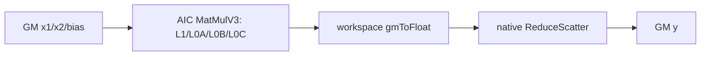
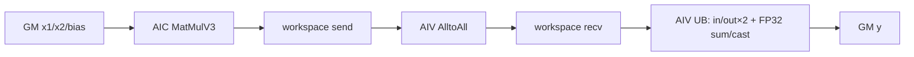
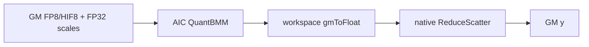
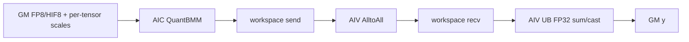
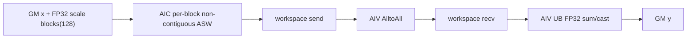

# MatmulReduceScatter 950 ACLNN 算子知识

## 算子速览

| 项目 | 内容 |
|---|---|
| 实际入口 | `aclnnMatmulReduceScatterV2GetWorkspaceSize` / `aclnnMatmulReduceScatterV2` |
| 计算语义 | 先计算 `C = x1 × x2 + bias`，再在通信域对 `C` 做 `sum` ReduceScatter；本 rank 得到 `[M/rankSize, N]` |
| 输入输出 | `x1:[M,K]`、`x2:[K,N]`/转置 view；FP16/BF16，或 FP8/HIF8 + per-tensor/per-block/MX scale；`y:[M/rankSize,N]` |
| 执行类型 | `KERNEL_TYPE_MIX_AIC_1_2`，AIC MatMul、AIV 通信/归约协作 |
| Kernel 路线 | R-001/R-002 高精度 native/A2A；R-003~R-005 量化 native；R-006~R-008 量化 A2A |
| 核心资源 | GM、按 512B 对齐的 `cToFloatLen` workspace slices、MatMulV3 L1/L0A/L0B/L0C、AIV 六缓冲 UB |
| 来源闭包 | `source_closed`：公开 API、Host 模板、POD/key、四个 Device body、公共 ReduceSum helper 与构建接线均固定到提交 `be33d95bb755cedec3108f70805c1874d1792540` |
| 验证状态 | 已完成源码闭包检查；本次知识提取未执行编译、真机、数值或性能测试。 |

## 接口与语义

### 计算语义

对通信组中每个 rank 的二维矩阵 `x1:[M,K]` 与共享/本地 `x2:[K,N]` 做矩阵乘；`x2` 可转置，`x1` 不可转置。可选 `bias:[N]` 在 MatMul 中融合。各 rank 的完整结果按 `sum` 归约后沿 M 轴等分，本 rank 输出 `y:[M/rankSize,N]`。进入 Device Route 时要求 `256 <= K < 65535`、`M % rankSize == 0`、非空 tensor、`reduceOp="sum"`、`commTurn=0`、`streamMode=1`；高精度全空输入由 ACLNN 在建 executor 后直接返回，不启动本卡 Kernel Route。

高精度路线以 FP16/BF16 输入输出。量化路线的 `x1/x2` 为 FP8_E4M3FN、FP8_E5M2 或 HIFLOAT8，输出为 FP16/BF16/FP32；scale 先服务 QuantBatchMatmulV3，通信归约发生在解量化后的输出类型上。源码中 tiling key 枚举名 `OUTPUT_TYPE_IS_FP8` 是编码常量名，不表示 API 输出为 FP8。

### 输入、输出与属性

| 参数 | shape/layout | dtype | 950 约束与语义 |
|---|---|---|---|
| `x1` | 2D `[M,K]`，ND | FP16/BF16；或 FP8_E4M3FN/FP8_E5M2/HIFLOAT8 | `transposeX1=false`；量化输入类型需与 `x2` 匹配 |
| `x2` | 2D `[K,N]` 或转置视图 `[N,K]` | 与路线匹配 | `transposeX2` 允许；API 在 950 路径按属性交换 view descriptor 的末两维 |
| `bias` | 可空；非空时 `[N]` | 高精度/量化 tiling 所允许类型 | MatMul 融合；其存在性和 dtype 编入 key/嵌套 tiling |
| `x1Scale/x2Scale` | per-tensor: 1D；per-block: 2D；MX: 3D | per-tensor/per-block 为 FP32；MX 为 FLOAT8_E8M0 | per-block group 为 `128×128×128`；MX group 为 `1×1×32`，公开约束下 `x2` 仅转置形态 |
| `group` | 通信域字符串 | 字符串 | 由 ACLNN executor 传给内部 MC2 算子 |
| `reduceOp` | 标量属性 | 字符串 | 仅 `sum` |
| `commMode` | 标量属性 | 字符串 | 仅 `ai_cpu` 或 `ccu`；`ai_cpu` 强制 native ReduceScatter |
| `commTurn` / `streamMode` | 标量属性 | int64 | 固定 `0` / `1` |
| `y` | `[M/rankSize,N]` | 高精度同输入；量化为 FP16/BF16/FP32 | rankSize 支持 2/4/8/16/32/64 |
| `amax` / `quantScale` | 可选输出/输入 | — | 本算子公开 V2 量化场景要求 amax 为空/空 tensor，quantScale 为空；不形成额外输出路线 |

### 入口与版本

`README.md` 将 V2 定义为原接口的扩展，并同时覆盖 A2/A3 与 Ascend 950；旧 `aclnnMatmulReduceScatterGetWorkspaceSize` 在 `IsAscend950()` 分支直接调用 V2（固定参数 `commMode="ai_cpu"`），执行段同样转发 V2，因此固定提交中 950 的最新公开实现是 V2。`aclnnMatmulReduceScatterV2GetWorkspaceSize` 在 `IsAscend950()` 为真时进入 `matmulReduceScatterV2GetWorkSpaceSizeA5`：高精度允许空输入快速返回，量化路径按 scale 类型和输出 dtype 校验，必要时为 `x2/x2Scale` 创建转置 view，再调用 generated inner op。第二段 `aclnnMatmulReduceScatterV2` 对零 workspace 使用空 tensor，取 executor 中保存的 950 `commMode`，inner launch 非成功映射为 `ACLNN_ERR_INNER`。generated inner 是 ACLNN→算子框架的允许边界，后续 Host/Tiling 与 Kernel 在本仓闭合。

## Host/Launcher 执行流程

### 参数校验与前处理

`matmulReduceScatterV2GetWorkSpaceSizeA5` 区分 FP16/BF16 与 FP8/HIF8：前者检查高精度组合，后者检查 scale、输出类型及量化形态。`MatmulReduceScatterTilingBase` 再校验二维 shape、K 范围、M 可整除 rank、rankSize 集合、`sum`、`commTurn=0`、`streamMode=1`、不转置 A，以及 `ai_cpu/ccu`。950 wrapper `MatmulReduceScatterTilingV2Func` 按注册优先级尝试 `MatmulReduceScatterV2Tiling`（priority 0，高精度）与 `QuantBmmReduceScatterTiling`（priority 1，量化），二者都只接受 `DAV_3510`。

量化 selector 的 `CheckScale` 将场景精确分为：FP32 1D per-tensor、FP32 2D per-block（group 128）、FLOAT8_E8M0 3D MX（group 32）；shape、维数或 group 不匹配直接失败。`CheckPerblockM` 还记录 `orgM` 是否可按 `128*rankSize` 切分，决定是否能采用流水切片。

### 参数、Workspace 与生命周期

高精度 `MatmulReduceScatterV2TilingData` 包含 MC2 init/CC 参数、`RCSTiling`、`dataType/debugMode` 和 MatMulV3 的 tile/tail 两套 tiling。其 workspace 是 MatMulV3 库 workspace 与通信/归约区之和：POD 中 `rankM=M`、`rankN=N`，`cToFloatLen=align512(M*N*sizeof(output))`；native 总计一个 `cToFloatLen`，A2A 总计两个 `cToFloatLen`。

量化 `QuantBatchMatmulV3ReduceScatterTilingData` 的嵌套参数与 quant tile/tail 由 QuantBatchMatmulV3 helper 生成。workspace 取量化 MatMul 库 workspace 上界；native 另加一个 `cToFloatLen`，A2A 另加三个 `cToFloatLen`。A2A Device 依次把这些区段解释为 send、recv 和 MatMul workspace；切片仅在当前 executor/stream launch 生命周期内有效。

### 启动图与失败传播

```text
GetWorkspaceSize
  -> matmulReduceScatterV2GetWorkSpaceSizeA5
  -> generated inner MatmulReduceScatterV2
  -> MatmulReduceScatterTilingV2Func
       priority 0: MatmulReduceScatterV2Tiling
       priority 1: QuantBmmReduceScatterTiling
  -> matmul_reduce_scatter_v2_apt (MIX AIC:1/AIV:2)
  -> native RS body 或 A2A + AIV ReduceSum body
```

API、Host 参数校验、MC2 配置、MatMul/QuantBMM tiling、workspace 或 launch 任一步失败都会返回错误；源码未提供 Device 侧改选另一路线的 fallback。native body 的 block0 AIC、A2A body 的 block0 AIV在完成等待后调用 HCCL `Finalize`。

## Route 与参数设计

### 分核与资源计算

高精度 Host 把 `blockDim` 设为平台 `aicCoreNum`；量化 Host 则设为主/tail 两套 `TCubeTiling.usedCoreNum` 的最大值；两者都设置 schedule mode 1。`RCSTiling.rankM=M`、`rankN=N`，输出行数才是 `M/rankSize`；MatMulV3/QuantBatchMatmulV3 库分别为普通 tile 与 tail 生成 Cube tiling。`RCSTiling` 冻结 rank、tile/tail 计数、通信次数、AIC/AIV 协作信息；实际 Cube tile 尺寸保存在嵌套 `TCubeTiling`中，Device 不重新推导 shape。通信策略由 `IsUseA2APath(rankSize,npuArch)` 与 fit-balance 结果产生，但 `commMode=ai_cpu` 无条件覆写为 native；源码把 A2A 快路限制到 Ascend 950 标准 4P/8P 能力域。

Cube specialization 不是固定常量 tile：Host 把 MatMulV3 结果逐字段写入 main/tail `TCubeTiling`，其中 `baseM/baseN/baseK`、`depthA1/depthB1`、`stepM/stepN/stepKa/stepKb`、`dbL0C` 和 `usedCoreNum` 唯一确定当前实例。公式化候选的容量检查按下式计数，最终数值仍以对应 nested POD 为准：

```text
L1_A_bytes = depthA1 * baseM * baseK * sizeof(A)
L1_B_bytes = depthB1 * baseN * baseK * sizeof(B)
L0A_logical = baseM * baseK * sizeof(A)
L0B_logical = baseN * baseK * sizeof(B)
L0C_logical = dbL0C * baseM * baseN * sizeof(ElementAccumulator)
```

`new_mc2_matmul_tiling_cfg.cpp` 将 MatMulV3 的上述字段复制到 MC2 nested POD；算子仓没有把任一 runtime tile 外推为所有 shape 的固定值。

### Route 选择

| 顺序 | Route | Key/模板 | 精确选择条件与优先级 | 不适用去向 |
|---:|---|---|---|---|
| 1 | R-001 高精度 native RS | `TPL_CCU_REDUCESUM` / `MatmulReduceScatterFP16BF16` | priority 0 命中 FP16/BF16，且 `!isA2APath_`；`ai_cpu` 强制此条件 | A2A 转 R-002；低精度继续 priority 1 |
| 2 | R-002 高精度 A2A+Vec | `TPL_CCU_ALL2ALL_VEC_REDUCE` / `MatmulA2AVecReduceFP16BF16` | priority 0 命中 FP16/BF16，`commMode=ccu && IsUseA2APath(rankDim,DAV_3510)` | 不满足 A2A 回 R-001 |
| 3 | R-003 per-tensor 量化 native | 非 per-block、FP32 scale、`TPL_CCU_REDUCESUM` / `QuantBMMReduceScatter<MatMulASWKernel>` | priority 1；FP8/HIF8、FP32 1D scales、`!isA2APath_` | A2A 转 R-006；其它 scale scene 转 R-004/R-005 |
| 4 | R-004 MX 量化 native | E8M0 scale、`TPL_CCU_REDUCESUM` / `QuantBMMReduceScatter<MatMulASWKernel>` | priority 1；FP8、FLOAT8_E8M0 3D scales、group `1×1×32`、`!isA2APath_` | A2A 转 R-007；校验不符失败 |
| 5 | R-005 per-block 量化 native | per-block、`TPL_CCU_REDUCESUM` / `QuantBMMReduceScatter<MatMulPerBlockASWNonContiguous>` | priority 1；FP8/HIF8、FP32 2D scales、group `128×128×128`、`!isA2APath_` | A2A 转 R-008；校验不符失败 |
| 6 | R-006 per-tensor 量化 A2A+Vec | 非 per-block、FP32 scale、`TPL_CCU_ALL2ALL_VEC_REDUCE` / `QuantBmmA2AVecReduceFP8HiF8<MatMulASWKernel>` | R-003 scale scene 且 `commMode=ccu && isA2APath_` | 不满足 A2A 回 R-003 |
| 7 | R-007 MX 量化 A2A+Vec | E8M0 scale、`TPL_CCU_ALL2ALL_VEC_REDUCE` / `QuantBmmA2AVecReduceFP8HiF8<MatMulASWKernel>` | R-004 scale scene 且 `commMode=ccu && isA2APath_` | 不满足 A2A 回 R-004 |
| 8 | R-008 per-block 量化 A2A+Vec | per-block、`TPL_CCU_ALL2ALL_VEC_REDUCE` / `QuantBmmA2AVecReduceFP8HiF8<MatMulPerBlockASWNonContiguous>` | R-005 scale scene 且 `commMode=ccu && isA2APath_` | 不满足 A2A 回 R-005 |

```text
DAV_3510 && FP16/BF16 -> priority 0 high-precision tiling
  ai_cpu or !IsUseA2APath -> R-001
  ccu && IsUseA2APath     -> R-002
otherwise FP8/HIF8 -> priority 1 quant tiling -> scale scene
  per-tensor -> native R-003 / A2A R-006
  MX         -> native R-004 / A2A R-007
  per-block  -> native R-005 / A2A R-008
otherwise -> tiling failure
```

### 模板/实现执行矩阵

| Route | key/selector | dtype/shape/platform 完整命中条件 | 执行族与 kernel 节点 | 实际模板/body | 内存与同步特征 | tail/fallback |
|---|---|---|---|---|---|---|
| R-001 | high + `TPL_CCU_REDUCESUM` | 950 FP16/BF16，native 条件 | 单 Kernel MIX_CV：AIC MatMul+通信 | `MC2MatmulAswKernelDerive` + `MatmulReduceScatterFP16BF16` | `1*cToFloatLen`，flag3，RS handles | nested tail tiling；无 Device fallback |
| R-002 | high + `TPL_CCU_ALL2ALL_VEC_REDUCE` | 950 FP16/BF16，标准 4P/8P，CCU | 单 Kernel MIX_CV：AIC→AIV | `MC2MatmulAswKernelDerive` + `MatmulA2AVecReduceFP16BF16` | `2*cToFloatLen`，flag4/8，A2A+FP32 sum | nested tail；能力失配由 Host 选 R-001 |
| R-003 | per-tensor + native | FP8/HIF8、1D FP32 scale | 单 Kernel MIX_CV | `MatMulASWKernel` + `QuantBMMReduceScatter` | `1*cToFloatLen` + quant lib workspace，RS | quant tail tiling；无 Device fallback |
| R-004 | MX + native | FP8、3D E8M0 scale、group 1×1×32 | 单 Kernel MIX_CV | `MatMulASWKernel` + `QuantBMMReduceScatter` | 同 R-003，MX scale addressing | quant tail；校验失配失败 |
| R-005 | per-block + native | FP8/HIF8、2D FP32 scale、group 128³ | 单 Kernel MIX_CV | `MatMulPerBlockASWNonContiguous` + `QuantBMMReduceScatter` | 同 R-003；可切时流水 | M 不可切时同 body 串行 |
| R-006 | per-tensor + A2A | R-003 scale scene + A2A 条件 | 单 Kernel MIX_CV：AIC→AIV | `MatMulASWKernel` + `QuantBmmA2AVecReduceFP8HiF8` | `3*cToFloatLen` + quant lib workspace，flag4/8 | quant tail；能力失配由 Host 选 R-003 |
| R-007 | MX + A2A | R-004 scale scene + A2A 条件 | 单 Kernel MIX_CV：AIC→AIV | `MatMulASWKernel` + `QuantBmmA2AVecReduceFP8HiF8` | 同 R-006，A2A+FP32 sum | quant tail；能力失配由 Host 选 R-004 |
| R-008 | per-block + A2A | R-005 scale scene + A2A 条件 | 单 Kernel MIX_CV：AIC→AIV | `MatMulPerBlockASWNonContiguous` + `QuantBmmA2AVecReduceFP8HiF8` | 同 R-006；per-block scale | M 不可切时同 body 串行 |

### 隐藏性能 Guard

| Guard | Host/Tiling 条件 | Device/资源原因 | 影响 Route | 不满足时去向 | 源码符号 |
|---|---|---|---|---|---|
| AICPU 强制 native | `commMode=="ai_cpu"` | A2A+Vec 路线绑定 CCU/AIV 协作 | R-001/R-003~R-005 | 禁止 R-002/R-006~R-008 | `MatmulReduceScatterTilingBase::GetPlatformInfo` |
| A2A 拓扑 | `IsUseA2APath(rankDim,DAV_3510)`，固定仓注释为 4P/8P | fullmesh AlltoAll 要求匹配拓扑 | R-002/R-006~R-008 | 回对应 native Route | `IsUseA2APath`、`MMReduceScatterFitBalanceTiling` |
| per-block M | `orgM % (128*rankSize) != 0` | scale M group 与 rank 分片不可公式化对齐 | R-005/R-008 | 同 Route 内串行 MatMul→通信 | `QuantBmmReduceScatterTiling::CheckPerblockM` |
| tile/tail | `tailMValue_ != 0` | 尾块需要独立 Cube tiling/count | all | 无 tail 时只消费 main tiling | `DoAllMatmulTiling` / quant helper |
| A2A UB 分块 | `perBlockNum=min(15360,floor32B(TOTAL_UB_SIZE/6)/sizeof(dtype))` | 两个队列各双缓冲，加 FP32 sum/cast 两个 TBuf | A2A Routes | 公式直接缩小 block；无独立 Route fallback | `ReduceSumForAlltoAll::InitParams/InitBuffers` |

### POD/ABI

| 结构 | 字段 | 类型/位宽 | ABI 布局 | 单位 | Host/launcher producer | Device consumer | 边界 |
|---|---|---|---|---|---|---|---|
| `MatmulReduceScatterV2TilingData` | `mc2InitTiling` | `Mc2InitTiling` | field 0；嵌套类型大小/offset 未由 static assertion 固化 | HCCL init POD | `SetMc2Hcomm` | `hccl_.InitV2` | launch 内有效 |
| 同上 | `mc2CcTiling` | `Mc2CcTiling` | 紧随 init POD；精确 offset 由 `offsetof(MatmulReduceScatterV2TilingData, mc2CcTiling)` 在 Device 取得 | HCCL CC POD | `SetMc2Hcomm` | `SetCcTilingV2` | native/A2A 不同 |
| 同上 | `param` | `RCSTiling` | declaration order | aggregate | base tiling | 四个 body | 下列字段 |
| 同上 | `dataType` | `uint32_t` | declaration order | HCCL dtype enum | `SetTilingResult` | HCCL call | key/dtype 一致 |
| 同上 | `debugMode` | `uint32_t` | declaration order | bit mode | `SetTilingResult` | 四个 body | 仅调测分支 |
| 同上 | `mC2Mmv3TileTilingData` | `Mc2MatMulV3TilingData` | declaration order | nested POD | `DoAllMatmulTiling` | 高精度 MatMul body | main tile |
| 同上 | `mC2Mmv3TailTilingData` | `Mc2MatMulV3TilingData` | declaration order | nested POD | `DoAllMatmulTiling` | 高精度 MatMul body | `tailM>0` 才消费 |
| `QuantBatchMatmulV3ReduceScatterTilingData` | `mc2InitTiling` | `Mc2InitTiling` | field 0 | HCCL init POD | quant tiling | quant bodies | launch 内有效 |
| 同上 | `mc2CcTiling` | `Mc2CcTiling` | `offsetof` 由 Device 计算 | HCCL CC POD | quant tiling | HCCL | native/A2A 不同 |
| 同上 | `param` | `RCSTiling` | declaration order | aggregate | base/quant tiling | quant bodies | 下列字段 |
| 同上 | `dataType` | `uint32_t` | declaration order | HCCL dtype enum | quant tiling | HCCL | output dtype |
| 同上 | `debugMode` | `uint32_t` | declaration order | bit mode | quant tiling | quant bodies | inactive 时普通执行 |
| 同上 | `quantBmmV3TileTiling` | `Mc2QuantBatchMatmulV3TilingDataParams` | declaration order | nested POD | quant helper | QuantBMM body | main tile |
| 同上 | `quantBmmV3TailTiling` | `Mc2QuantBatchMatmulV3TilingDataParams` | declaration order | nested POD | quant helper | QuantBMM body | `tailM>0` 才消费 |
| `RCSTiling` | `rankDim` | `uint32_t` | natural layout offset 0；仓内无 static assertion | ranks | `SetRcsTilingData` | HCCL/归约 | 2/4/8/16/32/64 |
| 同上 | `rankID` | `uint32_t` | natural layout offset 4 | rank | Device 从 context 回写 | MatMul/地址 | `<rankDim` |
| 同上 | `commtype` | `uint32_t` | natural layout offset 8 | HCCL cmd enum | `SetRcsTilingData` | 通信 | 语义为 RS；实际 A2A 由 key/CC POD |
| 同上 | `subtype` | `uint32_t` | natural layout offset 12 | reduce enum | attrs `sum` | 通信 | SUM |
| 同上 | `tileCnt` | `uint32_t` | natural layout offset 16 | count | split tiling | body loops/handle index | 可为 0；per-block 串行会修正 |
| 同上 | `tailM` | `uint32_t` | natural layout offset 20 | rows/rank | split tiling | tail address/count | 0 表示无 tail |
| 同上 | `tailCnt` | `uint32_t` | natural layout offset 24 | count | split tiling | tail loops | 0/1 或公式化结果 |
| 同上 | `biasLen` | `uint32_t` | natural layout offset 28 | elements | `SetStorageAWorkSpaceSize` | MatMul helper | 本算子写 0 |
| 同上 | `isAdd` | `uint32_t` | natural layout offset 32 | bool-as-u32 | fixed repo 未见本算子赋值 | shared helper | inactive storage |
| 同上 | `rankM` | `uint32_t` | natural layout offset 36 | elements | original M | MatMul/通信 stride | M 可整除 rank |
| 同上 | `rankN` | `uint32_t` | natural layout offset 40 | elements | original N | MatMul/通信 stride | 非零 |
| 同上 | `rankK` | `uint32_t` | natural layout offset 44 | elements | original K | MatMul | `[256,65535)` |
| 同上 | `gatherIndex` | `uint32_t` | natural layout offset 48 | index | fixed repo 未见本算子赋值 | shared helper | inactive storage |
| 同上 | `isTransposeA` | `uint32_t` | natural layout offset 52 | bool-as-u32 | attrs | MatMul | 固定 0 |
| 同上 | `isTransposeB` | `uint32_t` | natural layout offset 56 | bool-as-u32 | attrs/view | MatMul | 0/1 |
| 同上 | `storageGather` | `uint32_t` | natural layout offset 60 | flag | fixed repo 未见本算子赋值 | shared helper | inactive storage |
| 同上 | `nd2NzWorkLen` | `uint64_t` | natural layout offset 64 | bytes | `SetStorageAWorkSpaceSize` | workspace helper | 本算子写 0 |
| 同上 | `cToFloatLen` | `uint64_t` | natural layout offset 72 | bytes | `align512(M*N*sizeof(y))` | workspace slicing | native/A2A 共同基准 |
| 同上 | `gatherLen` | `uint64_t` | natural layout offset 80 | bytes | fixed repo 未见本算子赋值 | shared helper | inactive storage |
| 同上 | `workspaceAddr4` | `uint32_t` | natural layout offset 88 | offset/index | fixed repo 未见本算子赋值 | shared helper | inactive storage |
| 同上 | `aicCoreNum` | `uint32_t` | natural layout offset 92 | cores | platform | A2A AIV 数/MatMul | 高精度为全 AIC；量化 body 用 nested usedCoreNum |
| 同上 | `needUbBuffer` | `uint32_t` | natural layout offset 96 | flag | nested helper | quant body | route-specific |
| 同上 | `addX3UbCnt` | `uint32_t` | natural layout offset 100 | count | fixed repo 未见本算子赋值 | shared helper | inactive storage |
| 同上 | `commWorkSpaceSize` | `uint32_t` | natural layout offset 104 | bytes | shared MC2 tiling | communication helper | 受 HCCL limit |
| 同上 | `isInputCommQuantScale` | `uint32_t` | natural layout offset 108 | flag | fixed repo 未见本算子赋值 | shared helper | inactive storage |
| 同上 | `dataType` | `uint32_t` | natural layout offset 112 | dtype enum | tiling | shared helper | 与顶层/HCCL 一致 |
| 同上 | `commInt8WorkSpace` | `uint32_t` | natural layout offset 116 | bytes | fixed repo 未见本算子赋值 | shared helper | 本卡量化通信已解量化 |
| 同上 | `dynamicQuantTempBuffSize` | `uint32_t` | natural layout offset 120；natural `sizeof` 预期 128，仓内无 static assertion | bytes | fixed repo 未见本算子赋值 | shared helper | inactive storage |

### Route 源码闭包

| Route | Key/selector | Host/Tiling producer | POD/参数 | Kernel entry/router | Kernel body/直接依赖 | 构建接线 |
|---|---|---|---|---|---|---|
| R-001 | high + native | `MatmulReduceScatterV2Tiling` | `MatmulReduceScatterV2TilingData` | `matmul_reduce_scatter_v2_apt.cpp` | `matmul_reduce_scatter_fp16_bf16.h` | `op_host/CMakeLists.txt` |
| R-002 | high + A2A | `MatmulReduceScatterV2Tiling` + fit-balance | 同上 | 同上 | `matmul_a2a_vec_reduce_fp16_bf16.h`、`reduce_sum_cast_fp32.h` | 同上 |
| R-003 | per-tensor + native | `QuantBmmReduceScatterTiling` | `QuantBatchMatmulV3ReduceScatterTilingData` | 同上 | `quant_bmm_reduce_scatter_fp8_hif8.h` | 同上 |
| R-004 | MX + native | 同上，`MxfpSceneParamCheck` | 同上 | 同上 | 同上 | 同上 |
| R-005 | per-block + native | 同上，`PerblockSceneParamCheck/CheckPerblockM` | 同上 | 同上 | 同上 + `MatMulPerBlockASWNonContiguous` | 同上 |
| R-006 | per-tensor + A2A | quant tiling + fit-balance | 同一 quant POD | 同上 | `quant_bmm_a2a_vec_reduce_fp8_hif8.h`、`reduce_sum_cast_fp32.h` | 同上 |
| R-007 | MX + A2A | 同上，MX selector | 同一 quant POD | 同上 | 同上 | 同上 |
| R-008 | per-block + A2A | 同上，per-block selector/guard | 同一 quant POD | 同上 | 同上 + `MatMulPerBlockASWNonContiguous` | 同上 |

## Kernel 实现

### 公共执行流程

`matmul_reduce_scatter_v2_apt.cpp` 用 `ASCENDC_TPL_ARGS_DECL/SEL` 定义 key 维：per-block、transA/transB、input/output/scale/bias、通信算法和通信引擎。MIX entry 解包对应 POD 后实例化四个实现类之一。所有 body 的 `Init` 绑定输入、输出、workspace 与 HCCL，`Process=InnerProcess+PostProcess`；AIC 负责 MatMul，AIV 在 A2A 路线负责 AlltoAll 和向量 ReduceSum。普通 tile 和 tail 由 Host 已生成的两套 tiling 驱动。

### Route R-001：高精度 native ReduceScatter

#### 适用条件

##### 选择证据

Host `MatmulReduceScatterV2Tiling::GetTilingResult` 生成 native cut result，`MatmulReduceScatterTilingBase::GetTilingKey` 编码 `TPL_CCU_REDUCESUM`；`commMode=ai_cpu` 必然落入此路。entry 的非 A2A 分支实例化 `MatmulReduceScatterFP16BF16`。

#### Device 数据流

##### 函数级调用链

```text
apt entry -> MatmulReduceScatterFP16BF16::Init
          -> Process -> InnerProcess -> Compute -> MC2MatmulAswKernelDerive::Process
                     -> CrossCoreSetFlag<3> -> hccl.ReduceScatter<true>
          -> PostProcess -> wait handles -> hccl.Finalize (block0 AIC)
```

##### 源码等价伪码

```text
for tile/tail: AIC MatMul(output=gmToFloat slice); flag3; launch native RS to y slice
block0_AIC: wait every RS handle; Finalize
```

#### 内存与数据搬运

##### 资源与搬运表

| 区域 | 地址/extent | producer→consumer | 生命周期 |
|---|---|---|---|
| `gmToFloat` | workspace 起点，`cToFloatLen` | MatMul→HCCL RS | 当前 launch |
| Host 预留 lib workspace | `workspace+cToFloatLen` 后、容量 `libApiWorkSpaceSize` | 当前高精度 body 未把该地址作为显式参数传给 `MC2MatmulAswKernelDerive` | executor/launch；真实库侧隐式消费固定仓不可见 |
| `y` | rank 输出 slice | HCCL RS→用户 | stream 完成后 |

##### 分层内存布局



##### 字节账、交接边与复用顺序

`cToFloatLen=align512(rankM*rankN*sizeof(y))`。每片 MatMul 完成并发出 flag3 后才能作为 RS 输入；RS handle 完成后该片才可结束生命周期。

#### 同步、精度与尾块

##### 同步与数值边界表

| 边 | 机制 | 数值/尾块 |
|---|---|---|
| AIC MatMul→HCCL | CrossCore flag 3 | FP16/BF16 MatMulV3 输出；tail 用 tail tiling |
| HCCL→Finalize | handle wait | `sum` RS；只提交本 rank 有效行 |

#### 关键实现

##### 符号证据表

| 文件 | 符号 | 事实 |
|---|---|---|
| `matmul_reduce_scatter_fp16_bf16.h` | `MatmulReduceScatterFP16BF16::InnerProcess/PostProcess` | 分片 MatMul、native RS 与完成等待 |

### Route R-002：高精度 AlltoAll + AIV ReduceSum

#### 适用条件

##### 选择证据

高精度、`commMode=ccu` 且 4P/8P 标准场景通过 `IsUseA2APath`/fit-balance 时 key 取 `TPL_CCU_ALL2ALL_VEC_REDUCE`；entry 实例化 `MatmulA2AVecReduceFP16BF16`。

#### Device 数据流

##### 函数级调用链

```text
Process -> ExecuteAicMatMulPipeline -> MatMulV3Compute -> CubeNotifyVector(flag4 then flag8)
        -> ExecuteAivCommReducePipeline -> VecWaitCube -> hccl.AlltoAll
        -> ReduceSumForAlltoAll::ExecuteReduceSum -> y -> PostProcess/Finalize
```

##### 源码等价伪码

```text
AIC: MatMul to sendBuf; all-AIC flag4; AIC/AIV flag8
AIV: wait flag8; AlltoAll(sendBuf,recvBuf); overlap next communication with previous FP32 ReduceSum; cast y
```

#### 内存与数据搬运

##### 资源与搬运表

| 区域 | 地址/extent | producer→consumer | 生命周期 |
|---|---|---|---|
| sendBuf | workspace 起点，full `M*N` 结果区 | AIC MatMul→AIV AlltoAll | pipeline slot |
| recvBuf | sendBuf 后一个完整 `M*N` 区，容量同为 `cToFloatLen` | AlltoAll→AIV ReduceSum | pipeline slot |
| UB 六缓冲 | 每块 `<=min(15360, floor32B(TOTAL_UB_SIZE/6)/sizeof(C_DTYPE))` elements | GM→FP32 accumulate→cast→GM | 当前 vector block |

##### 分层内存布局



##### 字节账、交接边与复用顺序

Host 为 A2A 增加两个 `cToFloatLen`；send 的完整 M*N 逻辑区与 recv rank slice 不别名。flag8 后 AIV 才读 send；上一片 ReduceSum 完成后 recv/UB 槽才复用。

#### 同步、精度与尾块

##### 同步与数值边界表

| 边 | 机制 | 数值/尾块 |
|---|---|---|
| 全部 AIC 完成 | `SYNC_AIC_ONLY_ALL_DET_FLAG=4`，mode0，PIPE_FIX | 防止 A2A 读取半成品 |
| AIC→AIV | flag8，mode2；AIV `PIPE_MTE2` wait | 每 rank 输入转 FP32、FP32 sum、`CAST_RINT` 回 y dtype |

#### 关键实现

##### 符号证据表

| 文件 | 符号 | 事实 |
|---|---|---|
| `matmul_a2a_vec_reduce_fp16_bf16.h` | `ExecuteAicMatMulPipeline/ExecuteAivCommReducePipeline` | 通算双流水及 flag 协议 |
| `reduce_sum_cast_fp32.h` | `ReduceSumForAlltoAll` | AIV FP32 归约与回写 |

### Route R-003：per-tensor 量化 native ReduceScatter

#### 适用条件

##### 选择证据

`PertensorSceneParamCheck` 接受 FP32 1D scale，`GetTilingKey` 编码非 per-block、对应 scale type 和 `TPL_CCU_REDUCESUM`，entry 选择 `QuantBMMReduceScatter` 的普通 `MatMulASWKernel` 实例。

#### Device 数据流

##### 函数级调用链

```text
QuantBMMReduceScatter::Process -> InnerProcess -> MatMulASWKernel::Process
 -> native hccl.ReduceScatter<true> -> PostProcess
```

##### 源码等价伪码

```text
for tile/tail: quant_matmul(perTensor scales,bias)->gmToFloat; launch RS; wait/finalize
```

#### 内存与数据搬运

##### 资源与搬运表

| 区域 | 公式 | 交接 |
|---|---|---|
| gmToFloat | first `cToFloatLen` | QuantBMM→native RS |
| quant MM workspace | 后续库 workspace | `MatMulASWKernel` 私有 |

##### 分层内存布局



##### 字节账、交接边与复用顺序

workspace 为 quant library 上界加 `cToFloatLen`；scale 只由 QuantBMM 消费，RS 输入是已解量化输出。

#### 同步、精度与尾块

##### 同步与数值边界表

| 边 | 机制 | 数值/尾块 |
|---|---|---|
| QuantBMM→RS | AIC/通信同步 | scale/bias 顺序由 quant tiling 固定；tile/tail 分开 |

#### 关键实现

##### 符号证据表

| 文件 | 符号 | 事实 |
|---|---|---|
| `quant_bmm_reduce_scatter_fp8_hif8.h` | `QuantBMMReduceScatter::InnerProcess` | 普通量化 MatMul 与 native RS 流水 |

### Route R-004：MX 量化 native ReduceScatter

#### 适用条件

##### 选择证据

`MxfpSceneParamCheck/CheckMxScaleDim` 要求 FLOAT8_E8M0 三维 scale、group `1×1×32`；公开约束下 x2 为转置形态。native key 仍选择 `QuantBMMReduceScatter`，但 scale key 与 R-003 不同。

#### Device 数据流

##### 函数级调用链

```text
QuantBMMReduceScatter -> MatMulASWKernel(MX scale tiling) -> native RS -> PostProcess
```

##### 源码等价伪码

```text
validate/key-freeze MX groups; quant_matmul_MX(tile/tail); RS(dequantized result)
```

#### 内存与数据搬运

##### 资源与搬运表

| 区域 | 公式 | 交接 |
|---|---|---|
| MX scale GM | Host 校验的 3D shape | `MatMulASWKernel` scale load |
| gmToFloat | `cToFloatLen` | QuantBMM→RS |

##### 分层内存布局


##### 字节账、交接边与复用顺序

与 R-003 相同的 native 附加区，但 scale 地址步进来自 MX 嵌套 tiling，不可套用 per-tensor 步进。

#### 同步、精度与尾块

##### 同步与数值边界表

| 边 | 机制 | 数值/尾块 |
|---|---|---|
| MX MM→RS | AIC/通信同步 | 32 元素 scale group；tail 由 quant tail tiling |

#### 关键实现

##### 符号证据表

| 文件 | 符号 | 事实 |
|---|---|---|
| `quant_bmm_reduce_scatter_tiling.cpp` | `MxfpSceneParamCheck/CheckMxScaleDim` | MX shape/type/group 边界 |
| `quant_bmm_reduce_scatter_fp8_hif8.h` | `QuantBMMReduceScatter` | MX native 实例 |

### Route R-005：per-block 量化 native ReduceScatter

#### 适用条件

##### 选择证据

`PerblockSceneParamCheck` 要求 FP32 二维 scale 与 128 group，key 的 `TPL_ISPERBLOCK=true` 选择 `MatMulPerBlockASWNonContiguous`。若 `CheckPerblockM` 失败，body 进入 `MatMulReduceScatterSerial`。

#### Device 数据流

##### 函数级调用链

```text
QuantBMMReduceScatter::InnerProcess
  -> splittable: MatMulPerBlockASWNonContiguous tile pipeline + RS
  -> unsplittable: MatMulReduceScatterSerial -> op.Process -> RS
```

##### 源码等价伪码

```text
if orgM % (128*rankSize): full per-block MatMul then communication
else: for tile/tail run per-block MatMul and overlap native RS
```

#### 内存与数据搬运

##### 资源与搬运表

| 区域 | 公式 | 交接 |
|---|---|---|
| per-block scales | Host group tiling | non-contiguous per-block loader |
| gmToFloat | `cToFloatLen` | QuantBMM→RS |

##### 分层内存布局


##### 字节账、交接边与复用顺序

native 附加区仍为一个 `cToFloatLen`；不可切场景禁止在 MatMul 完成前复用为通信读区。

#### 同步、精度与尾块

##### 同步与数值边界表

| 边 | 机制 | 数值/尾块 |
|---|---|---|
| block-scale→MM | group-128 tiling | 不完整 M 分组走串行保护 |
| MM→RS | pipeline 或串行完成点 | 输出 dtype FP16/BF16/FP32 |

#### 关键实现

##### 符号证据表

| 文件 | 符号 | 事实 |
|---|---|---|
| `quant_bmm_reduce_scatter_fp8_hif8.h` | `MatMulReduceScatterSerial` | per-block M 不可切时串行 |

### Route R-006：per-tensor 量化 AlltoAll + AIV ReduceSum

#### 适用条件

##### 选择证据

per-tensor scale 校验通过且 A2A 能力成立，key 取非 per-block、per-tensor scale、`TPL_CCU_ALL2ALL_VEC_REDUCE`；entry 选择 `QuantBmmA2AVecReduceFP8HiF8` 普通 ASW 实例。

#### Device 数据流

##### 函数级调用链

```text
QuantBmmA2AVecReduceFP8HiF8 -> MatMulASWKernel -> CubeNotifyVector
 -> AIV AlltoAll -> ReduceSumForAlltoAll::ExecuteReduceSum -> y -> PostProcess
```

##### 源码等价伪码

```text
AIC quant MM(perTensor)->send; flag4/8; AIV A2A->recv; FP32 reduce/cast y
```

#### 内存与数据搬运

##### 资源与搬运表

| 区域 | 公式 | 交接 |
|---|---|---|
| send/recv | first/second `cToFloatLen` | AIC→A2A→AIV |
| quant MM workspace | `workspaceGM_=workspace+2*cToFloatLen`；Host 保证余量 `cToFloatLen+myWorkSpaceSize` | QuantBMM library |

##### 分层内存布局



##### 字节账、交接边与复用顺序

A2A 量化 Host 总量为 `myWorkSpaceSize+3*cToFloatLen`；Device 把前两段绑定为 send/recv，并把 `workspace+2*cToFloatLen` 传给 QuantBMM，因此第三段是 MatMul workspace 的容量下限而非独立 staging tensor。flag8 前 AIV 不读 send，ReduceSum 完成前不复用 recv。

#### 同步、精度与尾块

##### 同步与数值边界表

| 边 | 机制 | 数值/尾块 |
|---|---|---|
| AIC→AIV | flag4/mode0、flag8/mode2 | 已解量化结果在 AIV 转 FP32 累加，`CAST_RINT` 输出 |

#### 关键实现

##### 符号证据表

| 文件 | 符号 | 事实 |
|---|---|---|
| `quant_bmm_a2a_vec_reduce_fp8_hif8.h` | `QuantBmmA2AVecReduceFP8HiF8::InnerProcess` | per-tensor 通算流水 |

### Route R-007：MX 量化 AlltoAll + AIV ReduceSum

#### 适用条件

##### 选择证据

MX 三维 E8M0 scale 校验与 A2A 能力同时满足；key 的 scale 类型区别于 R-006，entry 使用同类的 MX 模板实例。

#### Device 数据流

##### 函数级调用链

```text
QuantBmmA2AVecReduceFP8HiF8(MX) -> MatMulASWKernel -> A2A -> ReduceSumForAlltoAll::ExecuteReduceSum
```

##### 源码等价伪码

```text
load MX grouped scales; quant MM; cube/vector handshake; A2A; FP32 sum; cast y
```

#### 内存与数据搬运

##### 资源与搬运表

| 区域 | 公式 | 交接 |
|---|---|---|
| E8M0 scale | group 32 | MX MatMul loader |
| send/recv/staging | `3*cToFloatLen` | Cube→A2A→AIV |

##### 分层内存布局


##### 字节账、交接边与复用顺序

字节账同 R-006；MX scale 的三维步进独立，不得以 send/recv 元素偏移替代。

#### 同步、精度与尾块

##### 同步与数值边界表

| 边 | 机制 | 数值/尾块 |
|---|---|---|
| Cube→AIV | flag4/8 | MX group tail 由 quant tail tiling；rank sum 为 FP32 |

#### 关键实现

##### 符号证据表

| 文件 | 符号 | 事实 |
|---|---|---|
| `quant_bmm_a2a_vec_reduce_fp8_hif8.h` | MX key 对应模板实例 | MX A2A 与向量归约 |

### Route R-008：per-block 量化 AlltoAll + AIV ReduceSum

#### 适用条件

##### 选择证据

per-block FP32 二维 scale、group 128 且 A2A 能力成立；`TPL_ISPERBLOCK=true` 选 non-contiguous MatMul。M 不可按 `128*rankSize` 切分时 `MatMulReduceScatterSerial` 抑制公式化流水。

#### Device 数据流

##### 函数级调用链

```text
QuantBmmA2AVecReduceFP8HiF8
  -> MatMulPerBlockASWNonContiguous
  -> CubeNotifyVector -> AlltoAll -> ReduceSumForAlltoAll::ExecuteReduceSum
  -> or MatMulReduceScatterSerial when per-block M is unsplittable
```

##### 源码等价伪码

```text
if perblockM illegal: serial per-block MM then communication/reduce
else: pipeline per-block MM, A2A, previous-tile FP32 reduce
```

#### 内存与数据搬运

##### 资源与搬运表

| 区域 | 公式 | 交接 |
|---|---|---|
| per-block scale | group 128 | non-contiguous MatMul loader |
| send/recv/staging | `3*cToFloatLen` | AIC→A2A→AIV |

##### 分层内存布局



##### 字节账、交接边与复用顺序

三段通信区不能别名；串行 guard 生效时，全部 MatMul 写完成后通信 consumer 才可读取。

#### 同步、精度与尾块

##### 同步与数值边界表

| 边 | 机制 | 数值/尾块 |
|---|---|---|
| per-block MM→AIV | flag4/8 或串行完成点 | group-128 边界；FP32 rank sum 后 cast |

#### 关键实现

##### 符号证据表

| 文件 | 符号 | 事实 |
|---|---|---|
| `quant_bmm_a2a_vec_reduce_fp8_hif8.h` | `MatMulReduceScatterSerial`、`InnerProcess` | per-block 串行 guard 与 A2A 流水 |

## 算子特定优化

### Trick T-001：4P/8P AlltoAll + AIV FP32 Reduce 替代 native ReduceScatter

#### 触发与源码依据

- 适用 Route：R-002/R-006/R-007/R-008
- 触发条件：`commMode=ccu && IsUseA2APath(rankSize,npuArch)`；`ai_cpu` 强制覆写为 native。
- Golden 来源：[`matmul_reduce_scatter_tiling_base.cpp:277`](../../../../../../../cann-ops-raw/ascendc/ops-transformer/be33d95bb755cedec3108f70805c1874d1792540/mc2/matmul_reduce_scatter_v2/op_host/op_tiling/matmul_reduce_scatter_tiling_base.cpp#L277)

**官方源码（固定 Commit 连续逐字摘录）**：

```cpp
isA2APath_ = mc2tiling::IsUseA2APath(args_.rankDim, npuArch_); // 判断是否走 All2All + Vec Reduce 通路（4P 或 8P）
auto commMode = context_->GetAttrs()->GetAttrPointer<char>(COMMMODE_INDEX);
bool isAicpu = (strncmp(commMode, "ai_cpu", AICPU_STRLEN) == 0);
commMode_ = isAicpu ? TPL_AICPU_COMM_MODE : TPL_CCU_COMM_MODE;
// AICPU时不走All2All + Vec Reduce通路
if (commMode_ == TPL_AICPU_COMM_MODE) {
    isA2APath_ = false;
}
```

#### 机制与设计原因

AIC 把完整 MatMul 分片写入 sendBuf，通过 flag4/flag8 通知 AIV；AIV 执行 AlltoAll，把下一片通信与上一片 ReduceSum 重叠。`ReduceSumForAlltoAll` 将各 rank 输入转 FP32 后累加，最后 `CAST_RINT` 回输出 dtype，既拆开通信拓扑与归约，也保留较高累加精度。

#### 迁移边界

必须同时迁移 Host 的 A2A capability 判定、2/3 段 workspace 账、MIX 核比例、flag id/mode/pipe、HCCL A2A 参数和 FP32 ReduceSum helper；非 4P/8P 或 AICPU 通信不能只改 key 强开。

- 未验证：本次知识提取未执行编译、真机、数值或性能测试。

#### 错误做法

不能把 send/recv 设为同一地址，不能删除 AIC 全完成 flag4 或 AIC→AIV flag8，也不能在上一片 ReduceSum 未完成时覆盖 recv/UB；这些都会造成跨 rank 读取半成品或缓冲复用竞争。

### Trick T-002：per-block M 不可切时退化为串行通算

#### 触发与源码依据

- 适用 Route：R-005/R-008
- 触发条件：per-block 且 `orgM % (128*rankSize) != 0`。
- Golden 来源：[`quant_bmm_reduce_scatter_tiling.cpp:433`](../../../../../../../cann-ops-raw/ascendc/ops-transformer/be33d95bb755cedec3108f70805c1874d1792540/mc2/matmul_reduce_scatter_v2/op_host/op_tiling/arch35/quant_bmm_reduce_scatter_tiling.cpp#L433)

**官方源码（固定 Commit 连续逐字摘录）**：

```cpp
bool QuantBmmReduceScatterTiling::CheckPerblockM()
{
    return args_.orgMValue % (PERBLOCK_SIZE * args_.rankDim) == 0;
}
```

不满足时 Host 不执行公式化 `DoSplitMTiling`，Device 由 `tileCnt/tailCnt` 状态进入 `MatMulReduceScatterSerial`。

#### 机制与设计原因

per-block scale 的 M group 与 ReduceScatter rank 分片边界必须一致。无法公式化切片时，先完成完整 non-contiguous per-block MatMul，再启动通信，避免 tile 在 scale group 或 rank 行边界中间断开。

#### 迁移边界

必须保留 group=128、原始 M、rankSize 三者的联合 guard 和串行 workspace 生命周期；不能只迁移 Device 分支而漏掉 Host 生成的场景字段。

- 未验证：本次知识提取未执行编译、真机、数值或性能测试。

#### 错误做法

不能把普通 tile/tail 的 M 长度直接用于非法 per-block M，也不能为了流水并行强行向上取整并让通信读取 padding；padding 不属于公开结果域。

### Trick T-003：tile/tail 双 MatMul tiling 与通信流水

#### 触发与源码依据

- 适用 Route：全部 Route。
- 触发条件：`tailMValue_ != 0` 时额外生成 tail tiling；否则只消费 main tile。
- Golden 来源：[`matmul_reduce_scatter_v2_tiling.cpp:162`](../../../../../../../cann-ops-raw/ascendc/ops-transformer/be33d95bb755cedec3108f70805c1874d1792540/mc2/matmul_reduce_scatter_v2/op_host/op_tiling/arch35/matmul_reduce_scatter_v2_tiling.cpp#L162)

**官方源码（固定 Commit 连续逐字摘录）**：

```cpp
mmV3Args_.mValue = tileMValue_ * args_.rankDim;
Mc2MatmulHelper::Mc2MatmulTilingCfg tileTilingCfg(static_cast<const void*>(&compileInfo_),
                                 static_cast<const void*>(&mmV3Args_), tileMValue_);
MC2_CHECK_LOG_RET(opName_, DoMatmulV3Tiling(tileTilingCfg, registerCfg, MutableMC2MmV3TileTilingData()));
if (tailMValue_ != 0UL) {
    mmV3Args_.mValue = tailMValue_ * args_.rankDim;
```

高精度 `DoAllMatmulTiling` 和量化 helper 都生成主 tile 与 tail 两套嵌套 tiling；`RCSTiling` 记录 `tileCnt/tailM/tailCnt`，实际 tile M/N/K 位于对应 nested tiling，Device 根据末片选择 tail。

#### 机制与设计原因

正常分片使用统一 Cube tile，末片使用独立参数，并让 MatMul、通信、AIV 归约按片交接；这样不把尾部扩成满块，也能在前后片间形成通算重叠。

#### 迁移边界

主/尾嵌套 POD、片长度、workspace offset 和 HCCL count 必须成套迁移。模板中的 `isLast` 只控制最后一次处理，不能替代 tail tiling。

- 未验证：本次知识提取未执行编译、真机、数值或性能测试。

#### 错误做法

不能用主 tile tiling 解释尾块，不能用字节长度填入元素 count，也不能在通信 count 中包含对齐 padding。

## 模板与实现对比

| 实现 | 共用骨架 | 独有状态/路径 | 不可互换原因 |
|---|---|---|---|
| 高精度 native | ASW MatMul→通信→wait/finalize | `MC2MatmulAswKernelDerive`、一个通信区、native RS handles | 不含 scale/group 与 AIV ReduceSum |
| 高精度 A2A | ASW tile/tail | send/recv、flag4/8、AIV AlltoAll+FP32 reduce | workspace 和 MIX 同步契约不同 |
| 量化 native | tile/tail→通信 | quant nested tiling；per-tensor/MX 普通 ASW，per-block non-contiguous ASW | scale ABI、输出 dtype 与串行 guard 不同 |
| 量化 A2A | quant tile/tail | 三个 `cToFloatLen`、AIV reduce、per-block 串行分支 | 不能复用高精度两段 workspace 或 native HCCL path |

## 平台差异

| 项目 | A2/A3 | Ascend 950（本卡） |
|---|---|---|
| 最新公开入口 | 同为 V2 | 同为 V2 |
| 通信模式 | 仅 `aiv`；rank 2/4/8 | `ai_cpu`/`ccu`；rank 2/4/8/16/32/64 |
| 高精度 Kernel | arch22 Catlass/Cube+AIV，HCCL window 协作 | arch35 MatMulV3；native RS 或 A2A+AIV FP32 Reduce |
| 量化能力 | INT8 per-token/per-channel，FP16/BF16 输出 | FP8/HIF8 的 per-tensor/per-block/MX，FP16/BF16/FP32 输出 |
| 快路 | small-M/large-M | 标准 4P/8P A2A+Vec；per-block M 非法则串行 |
| workspace | 16 MiB system + align/dequant 等区 | MatMul library workspace + 1/2/3 个 `cToFloatLen` |

## 限制与失败边界

- 仅发布固定提交公开 V2 ACLNN 的 950 能力；不把旧 `matmul_reduce_scatter` 或非公开 direct invoke 合并进来。
- Device Route 只支持二维 x1/x2、`transposeX1=false`、`256<=K<65535`、M 可整除 rank、非空 tensor、`sum`、`commTurn=0`、`streamMode=1`，以及 Host 明确接受的 dtype/scale/bias 组合；高精度空域只走 ACLNN 快速返回。
- A2A 不是通用 fallback；AICPU 强制 native，非标准 4P/8P 能力域走 native 或在 Host 失败。
- workspace 的 512B 对齐、通信区数量、POD 字段、key 维、MIX 核比例和 flag 协议属于 ABI/同步契约，不能由调用者修改。
- 固定源码未给出编译、真机、数值与性能结果；这些结论保持“源码实现事实”，不声称已验证硬件行为。

## 源码索引

### 链路索引

| 链路 | 文件 | 关键符号 | 支撑事实 |
|---|---|---|---|
| 公开说明 | `mc2/matmul_reduce_scatter_v2/README.md` | 接口/约束章节 | V2 语义、平台、shape/dtype/属性范围 |
| 版本对照 | `mc2/matmul_reduce_scatter/README.md` | 旧公开接口 | 旧版 FP16/BF16 语义与公开产品表 |
| 版本对照 | `mc2/matmul_reduce_scatter/op_api/aclnn_matmul_reduce_scatter.cpp` | `IsAscend950` 分支 | 950 旧 API 的 workspace/execute 均转发 V2 |
| ACLNN 声明 | `op_api/aclnn_matmul_reduce_scatter_v2.h` | `aclnnMatmulReduceScatterV2*` | 两段式公开签名 |
| ACLNN 实现 | `op_api/aclnn_matmul_reduce_scatter_v2.cpp` | `IsAscend950`、`matmulReduceScatterV2GetWorkSpaceSizeA5`、execute | 950 分流、view 前处理、executor 与错误传播 |
| OpDef | `op_host/matmul_reduce_scatter_v2_def.cpp` | `MatmulReduceScatterV2` / `AddConfig("ascend950")` | I/O 属性和 950 opFile 注册 |
| 公共 Host | `op_host/op_tiling/matmul_reduce_scatter_tiling_base.cpp` | `MatmulReduceScatterTilingBase` | rank/shape/属性检查、通信算法选择 |
| 950 wrapper | `op_host/op_tiling/arch35/matmul_reduce_scatter_v2_a5.cpp` | `MatmulReduceScatterTilingV2Func` | priority registry 调度 |
| 高精度 tiling | `op_host/op_tiling/arch35/matmul_reduce_scatter_v2_tiling.cpp` | `MatmulReduceScatterV2Tiling::*` | MC2、MatMulV3 tile/tail、key/workspace |
| 量化 tiling | `op_host/op_tiling/arch35/quant_bmm_reduce_scatter_tiling.cpp` | `QuantBmmReduceScatterTiling::*` | 三种 scale、per-block guard、quant key/workspace |
| A2A fit-balance | `op_host/op_tiling/arch35/reduce_scatter_fit_balance_tiling.cpp` | `MMReduceScatterFitBalanceTiling` | 标准 4P/8P 的切分结果 |
| 公共 POD | `mc2/common/op_kernel/mc2_tiling_struct.h` | `RCSTiling` | rank、tile/tail、通信与 workspace 字段定义 |
| MatMul POD 适配 | `mc2/common/op_host/op_tiling/new_mc2_matmul_tiling_cfg.cpp` | `NewMc2MatmulTilingCfg` | 把 MatMulV3 base/depth/step/dbL0C/usedCoreNum 写入 MC2 nested POD |
| Cube 公式 tiling | `mc2/common/op_host/op_tiling/matmul_formulaic_tiling.cpp` | `CalcBaseBlockTiling`、`UpdateDepth` | baseM/N/K、L1 容量与 depth 候选公式 |
| POD | `op_kernel/arch35/matmul_reduce_scatter_v2_c_tiling.h` | 两个顶层 TilingData | Host/Device ABI |
| key | `op_kernel/matmul_reduce_scatter_v2_apt_tiling_key.h` | `ASCENDC_TPL_ARGS_DECL/SEL` | 编译期路由维度与合法组合 |
| entry | `op_kernel/arch35/matmul_reduce_scatter_v2_apt.cpp` | MIX kernel / dispatch macros | POD 解包与四类模板实例化 |
| 高精度 native | `op_kernel/arch35/matmul_reduce_scatter_fp16_bf16.h` | `MatmulReduceScatterFP16BF16` | MatMul+native RS |
| 高精度 A2A | `op_kernel/arch35/matmul_a2a_vec_reduce_fp16_bf16.h` | `MatmulA2AVecReduceFP16BF16` | AIC/AIV 通算流水 |
| 量化 native | `op_kernel/arch35/quant_bmm_reduce_scatter_fp8_hif8.h` | `QuantBMMReduceScatter` | 三量化模式与 native RS/串行分支 |
| 量化 A2A | `op_kernel/arch35/quant_bmm_a2a_vec_reduce_fp8_hif8.h` | `QuantBmmA2AVecReduceFP8HiF8` | 三量化模式 A2A/Reduce 与串行分支 |
| AIV helper | `mc2/common/op_kernel/reduce_sum_cast_fp32.h` | `ReduceSumForAlltoAll` | FP32 rank sum、cast 与 UB 分块 |
| 构建聚合 | `mc2/matmul_reduce_scatter_v2/CMakeLists.txt` | subdirectory aggregation | 纳入 op_api/op_host/op_kernel 子目录 |
| 构建选项 | `mc2/matmul_reduce_scatter_v2/op_host/CMakeLists.txt` | `add_modules_sources_with_soc`、`add_ops_compile_options` | arch35 source dependency、auto-sync/DCCI/CV 通信选项 |

### 实现复用检查

| 检查项 | 可复用事实 | 不得改变 | 证据符号 |
|---|---|---|---|
| ACLNN 生命周期 | GetWorkspaceSize→用户分配→execute | executor、workspace 与 stream 顺序 | `aclnnMatmulReduceScatterV2*` |
| Host route | 高精度/量化优先级、native/A2A、scale scene | AICPU 强制 native、4P/8P guard、per-block M guard | `MatmulReduceScatterTilingV2Func`、`GetTilingKey` |
| ABI | 两个顶层 POD 与 `RCSTiling` | 字段顺序、位宽、元素/字节单位、tile/tail 配对 | `matmul_reduce_scatter_v2_c_tiling.h` |
| workspace | native 1、高精度 A2A 2、量化 A2A 3 个对齐通信区 | 512B 对齐、send/recv/staging 不别名 | `GetWorkspaceSize`、各 `Init` |
| 同步 | native handle wait；A2A flag4/8 + HCCL + AIV queue | flag id/mode/pipe、producer/consumer 顺序 | 四个 Device body |
| 精度 | QuantBMM scale/bias 后通信；AIV FP32 sum + `CAST_RINT` | scale group、累加/round 顺序、有效尾块 | quant tiling、`ReduceSumForAlltoAll` |
| 构建 | MIX AIC:1/AIV:2 与 950 编译选项 | 不可脱离同一 opFile/compile definitions | entry、OpDef、CMake |

- [ReduceScatter](../../../../apis/simd_api/adv_api/hccl_communication/hccl_kernel/reduce_scatter.md)
