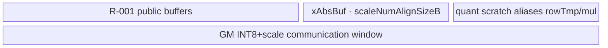
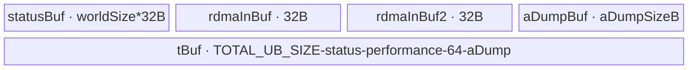
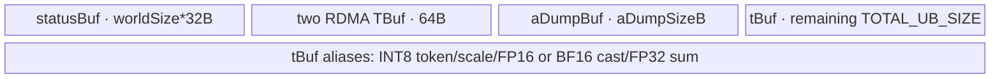

# MoeDistributeCombine A2/A3 ACLNN 算子知识

## 算子速览

| 项目 | 内容 |
|---|---|
| 实际入口 | A2：公开两段式 `aclnnMoeDistributeCombineV4*`；A3：公开两段式 `aclnnMoeDistributeCombineV5*` |
| 计算语义 | 按 Dispatch 产生的 rank/token/top-k 辅助信息收回专家输出，以 `expertScales` 加权并恢复 `[BS,H]` token 顺序 |
| 输入输出 | 核心为 `expandX[A,H]`、`expertIds[BS,K]`、辅助/计数/scale；输出 `x[BS,H]`，ND，FP16/BF16 |
| 执行类型 | 每条 Route 均为单 Kernel：`AIV_VECTOR + 非 Cube 通信/Hybrid`；A3 为 MTE/context window，A2 为 HCCL/AICPU 或 AIV-RDMA |
| Kernel 路线 | R-001 A3 非TP非量化；R-002 A3 INT8；R-003 A3 TP2；R-004 A2 fullmesh；R-005 A2 hierarchy-AICPU；R-006 A2 hierarchy-AIV；R-007 A2 hierarchy-AIV-INT8 |
| 核心资源 | GM 通信窗、workspace、UB `TQue/TBuf`、32 B 状态块、HCCL context；L1/L0A/L0B/L0C 不使用 |
| 来源闭包 | source_closed：ACLNN/文档→inner Op/Host tiling→key/POD→Kernel entry/body→CMake 闭合到固定 Commit |
| 验证状态 | 已完成源码闭包检查；本次知识提取未执行编译、真机、数值或性能测试。 |

## 接口与语义

### 计算语义

普通专家主路径等价于 `x[b,h]=Cast_RINT(Σ_k expertScales[b,k]*recv(b,k,h))`。`recv` 由 `assistInfoForCombine` 中 `{rankId,tokenId,topkId}` 与通信窗到达状态定位；零专家跳过，拷贝专家取 `oriX`，常量专家按 alpha 参数形成权重，共享专家结果在最终 cast 前加入。Device 将 FP16/BF16 或解量化值转 FP32 乘加；A3 TP2 先合并 TP 窗数据，再做 EP combine。

### 输入、输出与属性

| 参数 | shape/layout | dtype | 约束、默认值与语义 |
|---|---|---|---|
| `context`（V5） | 1D、ND | INT32 | A3 V5 必需；OpDef 明确 INT32，携带通信域上下文 |
| `expandX` | `[A,H]`、ND | FP16/BF16 | 必需；专家输出展开张量 |
| `expertIds` | `[BS,K]`、ND | INT32 | 必需；A3 V5 `1<=K<=16` |
| `assistInfoForCombine` | Dispatch 对应输出、ND | INT32 | 必需；Device 按三元组 rank/token/topk 消费 |
| `epSendCounts` | 1D、ND | INT32 | 必需；必须与同版本 Dispatch 配对 |
| `expertScales` | `[BS,K]`、ND | FP32 | 必需；FP32 加权因子 |
| `tpSendCounts` | TP 时 `[tpWorldSize]` | INT32 | A3 TP2 使用；A2 传空 |
| `xActiveMask` | `[BS]` 或 `[BS,K]` | BOOL | 可选；1D active 要前置，2D 为专家粒度 mask |
| 量化/特殊专家可选输入 | 文档/OpDef 规定、ND | 对应 dtype | 只在相应 route 使用；缺省时不得构造虚假地址 |
| `epWorldSize` | 标量 | INT64 | A2 fullmesh：2～8或16/32/64/128/192/256/384；hierarchy：16/32/64；A3 V5：8/16/32/64/128/144/256/288 |
| `tpWorldSize` | 标量 | INT64 | A2 为0；A3 为0/1（无TP）或2 |
| `commQuantMode` | 标量 | INT64 | A2 fullmesh仅0，hierarchy 0/2；A3为0/2且INT8要求无TP |
| `commAlg` | 字符串 | string | A2 fullmesh/hierarchy，空值由环境解析；A3 V5 不支持，传空 |
| `cclBufferSize`（V5） | 标量 | INT64 | 与 context 配套，Host 校验通信窗容量 |
| `x` | `[BS,H]`、ND | FP16/BF16 | A3 `H∈[1024,8192], BS∈[1,512]`；A2 `0<H<=10240,H%32=0`，fullmesh `BS<=256`、hierarchy `BS<=512` |

### 入口与版本

A2 同平台最新公开入口为 V4，声明/实现位于 `moe_distribute_combine_v2/op_api`，wrapper 经 base 进入 inner V2。A3 同平台最新公开入口为 V5；`moe_distribute_combine_v3/README.md` 仅勾选 A3，实现直接进入 inner V3。固定仓没有 V5 公共头，故声明可追溯性只到 README、实现符号与 OpDef，不补造头文件。V5 新增 `context/cclBufferSize`。README 明确 V5 不支持 Ascend 950DT，950 因而仍用 V4并另卡描述。

## Host/Launcher 执行流程

### 参数校验与前处理

A2 V4 的 base 先用 `CombineCheckNotNull` 检查核心 tensor、输出与非空 `groupEp`，再校验 group 名长度；A2 将 `groupTp` 固定为空。A2 tiling 顺序检查通信算法、shape/attr、平台资源和 window size。A3 V5 直接转 inner V3；V3 config 置 `isMc2Context=true`，复用 V2 common tiling 完成 context、shape/dtype/attr、通信窗检查，并禁止 context route 选择 hierarchy。

### 参数、Workspace 与生命周期

A2 workspace 为 `16 MiB + 2*moeExpertNum*sizeof(uint32_t)`，两个 user slice 分别保存 expert receive count 和 window offset。A3 workspace 为 `16 MiB + aivNum*10 KiB`，Device 每核 mask scratch 为 `coreIdx*10 KiB`。GetWorkspaceSize 产生 executor/task graph/POD/workspaceSize；运行入口必须使用同一 executor、足量 workspace 和 stream。HCCL/context window 必须存活到 Kernel 完成。

### 启动图与失败传播

```text
A2 V4 GetWorkspaceSize -> base -> inner V2 -> A2 tiling -> moe_distribute_combine_v2
A3 V5 GetWorkspaceSize -> inner V3 -> V3/common tiling -> moe_distribute_combine_v3
```

| 平台/节点 | Host producer | Kernel entry | blockDim/POD | 输入输出与 workspace | ordering、owner/lifetime、失败传播 |
|---|---|---|---|---|---|
| A2 K-001 | `MoeDistributeCombineA2TilingFuncImpl` | `moe_distribute_combine_v2` | `CalcTschBlockDim(aivNum,0,aivNum)`；`MoeDistributeCombineA2TilingData` | ACLNN 输入→`x`；user workspace 两个 `moeExpertNum*4B` 数组 | 单 stream 单 Kernel；executor 拥有任务图，调用方拥有 workspace；API/tiling 失败阻断 launch |
| A3 K-001 | `MoeDistributeCombineV2TilingFuncNew` | `moe_distribute_combine_v3` | `CalcTschBlockDim(aivNum,0,aivNum)`；`MoeDistributeCombineV2TilingData` | `context`+ACLNN 输入→`x`；每核 `10KiB` mask workspace | 单 stream 单 Kernel；context 拥有通信 window；API/tiling 失败阻断 launch |

不存在跨 Kernel workspace 边；唯一 Device 节点内部以通信 window 的 data→flag→consumer 顺序交接。两平台均设置 batch schedule mode 1，保证涉及 `SyncAll` 的所有核同时启动。A2 hierarchy 的 dataplane 在 Kernel 内二次选择；INT8+AICPU dataplane没有 body，不能视为 fallback。

## Route 与参数设计

### 分核与资源计算

A3 按有效 token 数用商余切分 `[beginIndex,endIndex)`；每核 10 KiB mask scratch。通信窗用 `dataState` 选择前/后半区，token 数据按 Host `hAlignWinSize` 排列，状态按 32 B 对齐。A2 fullmesh 的每-rank窗由 `(halfWinSize-ADUMP_WIN_SIZE)/worldSize` 后 32 B 对齐；hierarchy 固定每 server 8 rank，先机内归约再跨机同位置 rank 传输。

### Route 选择

| 顺序 | Route | Key/模板 | 精确选择条件与优先级 | 不适用去向 |
|---:|---|---|---|---|
| 1 | R-001 A3非TP非量化 | `<false,0,MTE,A3>` | A3 context，`tpWorldSize<2,commQuantMode=0` | quant去R-002，TP去R-003 |
| 2 | R-002 A3 INT8 | `<false,2,MTE,A3>` | A3 context，`tpWorldSize<2,commQuantMode=2` 且scale合法 | 校验失败 |
| 3 | R-003 A3 TP2 | `<true,0,MTE,A3>` | A3 context，`tpWorldSize=2,commQuantMode=0` | TP+INT8失败 |
| 4 | R-004 A2 fullmesh | `<false,0,MTE,A2>` | A2算法解析为fullmesh且quant=0 | hierarchy去R-005～007 |
| 5 | R-005 A2 hierarchy-AICPU | `<false,0,AICPU,A2>`+dataplane=AICPU | hierarchy、非量化、AICPU dataplane | AIV去R-006 |
| 6 | R-006 A2 hierarchy-AIV | 同key+dataplane=AIV | hierarchy、非量化、AIV dataplane | quant去R-007 |
| 7 | R-007 A2 hierarchy-AIV-INT8 | `<false,2,AICPU,A2>`+dataplane=AIV | hierarchy、INT8、AIV dataplane | AICPU无body |

```text
A3: tp==2 ? R-003 : quant==2 ? R-002 : quant==0 ? R-001 : fail
A2: resolve commAlg; fullmesh -> quant==0 ? R-004 : fail
    hierarchy -> quant==2 ? (AIV ? R-007 : no-body)
                         : (AICPU ? R-005 : AIV ? R-006 : no-body)
```

### 模板/实现执行矩阵

| Route | key/selector | dtype/shape/platform 完整命中条件 | 执行族与 kernel 节点 | 实际模板/body | 内存与同步特征 | tail/fallback |
|---|---|---|---|---|---|---|
| R-001 | `<0,0,0,1>` | A3 V5、FP16/BF16、无TP、非量化 | 单AIV Hybrid | `MoeDistributeCombineV2<...,false,0,false>` | context EP窗+32B flag | 商余token tail；失败终止 |
| R-002 | `<0,2,0,1>` | 同上且INT8 scale合法 | 单AIV Hybrid | 同模板QuantMode=2 | INT8窗、FP32解量化/累加 | TP不允许 |
| R-003 | `<1,0,0,1>` | A3 V5、TP=2、非量化 | 单AIV Hybrid | 同模板HasTp=true | TP status后EP combine | BF16 TP用FP32 add |
| R-004 | `<0,0,0,0>` | A2 V4 fullmesh、BS<=256 | 单AIV+HCCL | `MoeDistributeCombineA2` | ping/pong；copy或BatchWrite | token tail |
| R-005 | `<0,0,1,0>`+AICPU | A2 hierarchy非量化 | AIV body+AICPU通信 | `MoeDistributeCombineA2LayeredAicpu` | layered status/BatchWrite | 仅AICPU |
| R-006 | 同key+AIV | A2 hierarchy非量化 | 单AIV+AIV RDMA | `MoeDistributeCombineA2Layered<...,T>` | GM2IPC/SyncAll/RDMA flag | 仅AIV |
| R-007 | `<0,2,1,0>`+AIV | A2 hierarchy INT8 | 单AIV+AIV RDMA | `MoeDistributeCombineA2Layered<...,int8_t>` | dynamic quant/FP32 sum | AICPU无fallback |

### 隐藏性能 Guard

| Guard | Host/Tiling 条件 | Device/资源原因 | 影响 Route | 不满足时去向 | 源码符号 |
|---|---|---|---|---|---|
| context非hierarchy | `isMc2Context && !isLayered` | V5直接消费context窗 | R-001～003 | Host失败 | `GetAttrAndSetTilingData` |
| TP/INT8互斥 | `commQuantMode==2 -> tpWorldSize<2` | 无公开TP+INT8实例 | R-002/003 | Host失败 | README；`CalTilingKey` |
| A2 H对齐 | `H%32==0` | MTE/UB stride | R-004～007 | Host失败 | A2 shape check |
| A2 hierarchy rank | `epWorldSize∈{16,32,64}` | 8 rank/server布局 | R-005～007 | Host失败 | `MoeDistributeCombineCheckCommAlg` |
| window容量 | `CheckWinSize==success` | 防数据/flag越界 | 全部 | Host失败 | A2 `CheckWinSize`；common context check |

### POD/ABI

固定仓没有 `sizeof/alignof/offsetof` 断言；表中只记录声明顺序与位宽。`Mc2InitTiling/Mc2CcTiling` 的内部 ABI 在本算子源码不可见。

| 结构 | 字段 | 类型/位宽 | ABI 布局 | 单位 | Host/launcher producer | Device consumer | 边界 |
|---|---|---|---|---|---|---|---|
| `MoeDistributeCombineV2TilingData` | `mc2InitTiling` | `Mc2InitTiling` | 第1字段；offset不可见 | opaque | comm config | context init | 外部布局 |
| 同上 | `mc2CcTiling1` | `Mc2CcTiling` | 第2字段 | opaque | Host | EP context | 外部布局 |
| 同上 | `mc2CcTiling2` | `Mc2CcTiling` | 第3字段 | opaque | Host | TP context | 无TP inactive |
| 同上 | `moeDistributeCombineV2Info` | struct | 第4字段 | N/A | common tiling | A3 body | 顺序固定 |
| `MoeDistributeCombineV2Info` | `epWorldSize` | uint32/32 | 第1字段；offset不可见 | rank | `GetAttrAndSetTilingData` | EP循环/地址 | 公开rank集合 |
| 同上 | `tpWorldSize` | uint32/32 | 第2字段；offset不可见 | rank | 同上 | TP分支 | 0/1/2 |
| 同上 | `epRankId` | uint32/32 | 第3字段；offset不可见 | rank id | 同上 | 窗地址/发送重排 | `<epWorldSize` |
| 同上 | `tpRankId` | uint32/32 | 第4字段；offset不可见 | rank id | 同上 | TP窗 | TP2时有效 |
| 同上 | `expertShardType` | uint32/32 | 第5字段；offset不可见 | enum | 同上 | 专家分片分支 | 文档枚举 |
| 同上 | `sharedExpertNum` | uint32/32 | 第6字段；offset不可见 | expert | 同上 | shared槽数 | 合法组合 |
| 同上 | `sharedExpertRankNum` | uint32/32 | 第7字段；offset不可见 | rank | 同上 | local expert派生 | `<epWorldSize` |
| 同上 | `moeExpertNum` | uint32/32 | 第8字段；offset不可见 | expert | 同上 | expert循环 | `<=1024` |
| 同上 | `moeExpertPerRankNum` | uint32/32 | 第9字段；offset不可见 | expert/rank | Host整除派生 | 地址计算 | 整除约束 |
| 同上 | `zeroExpertNum` | uint32/32 | 第10字段；offset不可见 | expert | attrs | 零专家跳过 | 范围guard |
| 同上 | `copyExpertNum` | uint32/32 | 第11字段；offset不可见 | expert | attrs | `ProcessCopyExpert` | 需`oriX` |
| 同上 | `constExpertNum` | uint32/32 | 第12字段；offset不可见 | expert | attrs | `ProcessConstantExpert` | 需alpha/V |
| 同上 | `globalBs` | uint32/32 | 第13字段；offset不可见 | token | attrs/派生 | window上界 | 0有派生语义 |
| 同上 | `bs` | uint32/32 | 第14字段；offset不可见 | token | shape | `LocalWindowCopy`分核 | `1..512` |
| 同上 | `k` | uint32/32 | 第15字段；offset不可见 | expert/token | shape | top-k循环/flag数 | `1..16` |
| 同上 | `h` | uint32/32 | 第16字段；offset不可见 | element | shape | DMA/Vector长度 | `1024..8192` |
| 同上 | `a` | uint32/32 | 第17字段；offset不可见 | token | shape | expandX范围 | 文档公式 |
| 同上 | `aivNum` | uint32/32 | 第18字段；offset不可见 | core | platform `GetCoreNumAiv` | 商余分核 | 非0 |
| 同上 | `isTokenMask` | bool/实现位宽 | 第19字段；offset不可见 | flag | mask shape check | 1D mask路径 | inactive时false |
| 同上 | `isExpertMask` | bool/实现位宽 | 第20字段；offset不可见 | flag | mask shape check | 2D mask路径 | inactive时false |
| 同上 | `hasSharedExpertX` | bool/实现位宽 | 第21字段；offset不可见 | flag | optional输入检查 | shared add | inactive时false |
| 同上 | `hasElasticInfo` | bool/实现位宽 | 第22字段；offset不可见 | flag | optional输入检查 | rank remap | inactive时false |
| 同上 | `isPerformance` | bool/实现位宽 | 第23字段；offset不可见 | flag | optional输入检查 | AtomicMax | V5公开不支持 |
| 同上 | `isMc2Context` | bool/实现位宽 | 第24字段；offset不可见 | flag | V3 config=true | `Init`选择context | V5为true |
| 同上 | `reserved1` | bool/实现位宽 | 第25字段；offset不可见 | N/A | 保留 | 不读取 | ABI保留 |
| 同上 | `reserved2` | bool/实现位宽 | 第26字段；offset不可见 | N/A | 保留 | 不读取 | ABI保留 |
| 同上 | `totalUbSize` | uint64/64 | 第27字段；offset不可见 | byte | platform UB size | buffer上界 | 不得超平台值 |
| 同上 | `totalWinSizeEp` | uint64/64 | 第28字段；offset不可见 | byte | context/tiling | EP半窗 | capacity guard |
| 同上 | `totalWinSizeTp` | uint64/64 | 第29字段；offset不可见 | byte | context/tiling | TP半窗 | 无TP inactive |
| 同上 | `armAvgFactor` | float/32 | 第30字段；offset不可见 | factor | attrs | AddRmsNorm路线 | 本算子inactive |
| 同上 | `epsilon` | float/32 | 第31字段；offset不可见 | scalar | attrs | AddRmsNorm路线 | 本算子inactive |
| 同上 | `bufferNum` | uint32/32 | 第32字段 | buffer | Host UB计算 | queues | 资源guard |
| `MoeDistributeCombineA2TilingData` | `mc2InitTiling` | `Mc2InitTiling` | 第1字段；offset不可见 | opaque | `Mc2CcTilingConfig::GetTiling` | `hccl_.InitV2` | 外部布局 |
| 同上 | `mc2CcTiling` | `Mc2CcTiling` | 第2字段；offset不可见 | opaque | 同上 | `SetCcTilingV2` | 外部布局 |
| 同上 | `moeDistributeCombineInfo` | struct | 第3字段 | N/A | A2 Host | A2 body | 顺序固定 |
| `MoeDistributeCombineA2Info` | `epWorldSize` | uint32/32 | 第1字段；offset不可见 | rank | A2 attr check | HCCL/world循环 | 公开集合 |
| 同上 | `tpWorldSize` | uint32/32 | 第2字段；offset不可见 | rank | A2 attr check | route init | 固定0 |
| 同上 | `epRankId` | uint32/32 | 第3字段；offset不可见 | rank id | A2 attr check | window地址 | `<epWorldSize` |
| 同上 | `tpRankId` | uint32/32 | 第4字段；offset不可见 | rank id | A2 attr check | inactive | 固定0 |
| 同上 | `expertSharedType` | uint32/32 | 第5字段；offset不可见 | enum | attrs | expert分支 | A2无共享 |
| 同上 | `sharedExpertRankNum` | uint32/32 | 第6字段；offset不可见 | rank | attrs | local expert计算 | 固定0 |
| 同上 | `moeExpertNum` | uint32/32 | 第7字段；offset不可见 | expert | attrs | count/window | range guard |
| 同上 | `zeroExpertNum` | uint32/32 | 第8字段；offset不可见 | expert | attrs | fullmesh特殊专家 | 合法区间 |
| 同上 | `copyExpertNum` | uint32/32 | 第9字段；offset不可见 | expert | attrs | `oriX`分支 | 需oriX |
| 同上 | `constExpertNum` | uint32/32 | 第10字段；offset不可见 | expert | attrs | inactive | 固定0 |
| 同上 | `globalBs` | uint32/32 | 第11字段；offset不可见 | token | attrs/派生 | hierarchy地址 | 0有派生语义 |
| 同上 | `bs` | uint32/32 | 第12字段；offset不可见 | token | shape | token分核 | BS guard |
| 同上 | `k` | uint32/32 | 第13字段；offset不可见 | expert/token | shape | top-k循环 | API guard |
| 同上 | `h` | uint32/32 | 第14字段；offset不可见 | element | shape | DMA/Vector | 32对齐 |
| 同上 | `aivNum` | uint32/32 | 第15字段；offset不可见 | core | `GetCoreNumAiv` | SplitCore | 非0 |
| 同上 | `totalUbSize` | uint64/64 | 第16字段 | byte | platform | UB规划 | 上界 |
| 同上 | `isTokenMask` | bool/实现位宽 | 第17字段；offset不可见 | flag | mask shape check | token mask | hierarchy不支持 |
| 同上 | `isExpertMask` | bool/实现位宽 | 第18字段；offset不可见 | flag | mask shape check | expert mask | hierarchy不支持 |
| 同上 | `reserved` | int8[7]/56 | 第19字段 | pad | Host | 不消费 | 必须保留 |

### Route 源码闭包

| Route | Key/selector | Host/Tiling producer | POD/参数 | Kernel entry/router 节点 | Kernel body/直接依赖 | 构建接线 |
|---|---|---|---|---|---|---|
| R-001～003 | MTE/A3，TP/quant区分 | V3 config + common tiling | V2 tiling data | V3 entry | `moe_distribute_combine_v2.h` | V3 CMake依赖V2 |
| R-004 | MTE/noquant/A2 | arch22 tiling | A2 tiling data | V2 entry | `moe_distribute_combine_a2.h` | V2 CMake |
| R-005 | AICPU/noquant/A2+AICPU | arch22 tiling | A2 tiling data | V2 runtime router | layered AICPU header | V2 CMake |
| R-006～007 | AICPU/(0或2)/A2+AIV | arch22 tiling | A2 tiling data | V2 runtime router | layered AIV header | V2 CMake |

## Kernel 实现

### 公共执行流程

全部 route 都是单 AIV Kernel 中的通信+Vector combine；Host 生产 tiling/key/workspace，entry 读取相同 POD 后实例化 body。发送端先写 token 数据，再写状态；接收端轮询状态、读取并 FP32 加权累加、清状态、最终 `CAST_RINT` 输出。L1/L0 为 N/A。

### Route R-001：A3 非TP非量化

#### 适用条件

##### 选择证据

| 层级 | 文件 | 符号 | 源码谓词/参数 | 结果/下一跳 |
|---|---|---|---|---|
| API/Host | `mc2/moe_distribute_combine_v3/op_api/aclnn_moe_distribute_combine_v5.cpp`；common tiling | V5 workspace；`CalTilingKey` | context、TP<2、quant=0 | MTE/A3 key |
| Router | `mc2/moe_distribute_combine_v3/op_kernel/moe_distribute_combine_v3.cpp` | `ExecMoeDistributeCombineV3` | A3 | V2 body `<false,0>` |

#### Device 数据流

##### 函数级调用链

```text
V3 entry -> ExecMoeDistributeCombineV3 -> Init -> Process -> BuffInit
 -> SetWaitTpStatusAndDisPatch -> AlltoAllBuffInitAndMaskCal -> LocalWindowCopy
 -> WaitDispatch -> ProcessExpert -> Cast_RINT -> x
```

##### 源码等价伪码

```text
decode each {rank,token,topk}; copy H to destination EP window; publish 32B flag
for assigned active token: wait all expert flags; sum_fp32 += value*expertScale; clear; cast_rint/store
```

#### 内存与数据搬运

##### 资源与搬运表

| 层级/缓冲区 | offset/地址公式 | extent/容量公式 | dtype/layout | producer | consumer | owner/lifetime | 对齐/复用 |
|---|---|---|---|---|---|---|---|
| EP data/flag | `rankWin+epOffset*hAlignWinSize`；state按token/topk stride | H对齐区+32B/arrival | XType/float[8] | dispatch | combine | context/kernel | 数据后flag，clear后复用 |
| workspace | `coreIdx*10KiB` | 10KiB/core | mask | mask calc | body | executor/kernel | 每核独占 |
| UB | TQue/TBuf | `<=totalUbSize` | XType/FP32/status | MTE2 | Vector/MTE3 | kernel | ping/pong |

##### 分层内存布局


##### 字节账与复用顺序

```text
UB_total=maxToken+maxRow+max(hFloatAlign256,Align32(BS*K*4))+hFloatAlign32
         +bufferNum*hExpandXAlign32+2*(K+shared)*32+32+conditional_mask/status
UB_total<=totalUbSize; dynamic_ub=N/A; workspace=16MiB+aivNum*10KiB; flag=32B/arrival
```

| 复用子区 | 写入者 | 读取者/消费点 | 下一次覆盖 | 同步或释放依据 | 安全条件 |
|---|---|---|---|---|---|
| EP token/state window | dispatch | `WaitDispatch/ProcessExpert` | 下一 `dataState` 世代 | MTE3数据先于32B flag；消费后clear | Host/Device stride相同且context存活 |

#### 同步、精度与尾块

##### 同步与数值边界表

| 阶段 | primitive/机制 | producer | consumer/等待点 | 保护对象 | 精度/尾块 |
|---|---|---|---|---|---|
| 发布/消费 | MTE barrier+flag poll/clear | sender | receiver | EP token | FP32 sum；商余token tail；RINT |

#### 关键实现

##### 符号证据表

| 阶段 | 文件 | 符号/模板实例 | 实现事实 |
|---|---|---|---|
| Host/Tiling producer | common tiling | `SetWorkspace/CalTilingKey` | workspace/key |
| Kernel entry/router | V3 entry | `ExecMoeDistributeCombineV3` | 复用V2 body |
| Device body/helper | `moe_distribute_combine_v2.h` | `ExpertAlltoAllDispatchCopyAdd/LocalWindowCopy` | flag与FP32 combine |

### Route R-002：A3 INT8

#### 适用条件

##### 选择证据

| 层级 | 文件 | 符号 | 源码谓词/参数 | 结果/下一跳 |
|---|---|---|---|---|
| Host/Router | README；common tiling；V3 entry | `CalTilingKey/ExecMoeDistributeCombineV3` | quant=2、TP<2 | `<false,2,MTE,A3>` |

#### Device 数据流

##### 函数级调用链

```text
entry -> V2 body<false,2> -> quantized dispatch -> WaitDispatch -> dequant -> FP32 sum -> RINT
```

##### 源码等价伪码

```text
publish INT8 token+scale+flag; receive only after flag; fp32=int8*scale; weighted sum; cast_rint/store
```

#### 内存与数据搬运

##### 资源与搬运表

| 层级/缓冲区 | offset/地址公式 | extent/容量公式 | dtype/layout | producer | consumer | owner/lifetime | 对齐/复用 |
|---|---|---|---|---|---|---|---|
| GM/UB | Host window stride；quant TBuf | window+`totalUbSize` | INT8+scale→FP32 | quant dispatch | dequant/combine | context/kernel | flag保护 |

##### 分层内存布局



##### 字节账与复用顺序

```text
UB_total=R-001_base+xAbsBuf(scaleNumAlignSize)+conditional_mask/status<=totalUbSize
dynamic_ub=N/A; workspace=16MiB+aivNum*10KiB; window extent由Host tiling给出
```

| 复用子区 | 写入者 | 读取者/消费点 | 下一次覆盖 | 同步或释放依据 | 安全条件 |
|---|---|---|---|---|---|
| quant payload window | quant sender | dequant/combine | 下一世代 | 32B arrival flag/clear | scale与token配对 |

#### 同步、精度与尾块

##### 同步与数值边界表

| 阶段 | primitive/机制 | producer | consumer/等待点 | 保护对象 | 精度/尾块 |
|---|---|---|---|---|---|
| quant combine | flag+Vector | sender | WaitDispatch | token+scale | FP32解量化/累加，RINT，商余tail |

#### 关键实现

##### 符号证据表

| 阶段 | 文件 | 符号/模板实例 | 实现事实 |
|---|---|---|---|
| Host/Tiling producer | common tiling | `CalTilingKey` | quant=2/TP=false |
| Kernel entry/router | V3 entry | body `<false,2>` | quant实例 |
| Device body/helper | V2 body | `MoeDistributeCombineQuant`使用点 | 解量化后FP32 sum |

### Route R-003：A3 TP2

#### 适用条件

##### 选择证据

| 层级 | 文件 | 符号 | 源码谓词/参数 | 结果/下一跳 |
|---|---|---|---|---|
| Host/Router | README；common tiling；V3 entry | TP check/key/router | `tpWorldSize=2,quant=0` | `<true,0,MTE,A3>` |

#### Device 数据流

##### 函数级调用链

```text
entry -> Process -> ReduceScatterTrans -> SetWaitTpStatusAndDisPatch -> EP combine -> x
```

##### 源码等价伪码

```text
wait/copy peer TP token; BF16 converts FP32 before add, FP16 Add directly; publish EP token; combine as R-001
```

#### 内存与数据搬运

##### 资源与搬运表

| 层级/缓冲区 | offset/地址公式 | extent/容量公式 | dtype/layout | producer | consumer | owner/lifetime | 对齐/复用 |
|---|---|---|---|---|---|---|---|
| TP/EP windows | context rank address；dataState半窗 | `totalWinSizeTp/Ep` | XType+flag | peer/TP add | EP combine | context | status保护 |
| UB | TP operands+FP32 sum | `<=totalUbSize` | XType/FP32 | MTE2 | Vector | kernel | buffer复用 |

##### 分层内存布局


##### 字节账与复用顺序

```text
TP_stage_UB=3*2*hExpandXAlign32+(BF16?2*hFloatAlign32:0)+32
EP_stage_UB=R-001_base; TPipe Reset使两阶段取max而非求和；dynamic_ub=N/A
workspace=16MiB+aivNum*10KiB; TP/EP window由context拥有
```

| 复用子区 | 写入者 | 读取者/消费点 | 下一次覆盖 | 同步或释放依据 | 安全条件 |
|---|---|---|---|---|---|
| TP window→EP window | TP peer/`ReduceScatterTrans` | EP dispatch/combine | 下一 `dataState` | TP status后EP flag | TP=2且quant=0 |

#### 同步、精度与尾块

##### 同步与数值边界表

| 阶段 | primitive/机制 | producer | consumer/等待点 | 保护对象 | 精度/尾块 |
|---|---|---|---|---|---|
| TP/EP | 两级status | TP peer/sender | TP add/EP combine | 两个通信窗 | BF16 TP FP32 add；最终FP32/RINT；token tail |

#### 关键实现

##### 符号证据表

| 阶段 | 文件 | 符号/模板实例 | 实现事实 |
|---|---|---|---|
| Host/Tiling producer | common tiling | `CalTilingKey` | HasTp=true |
| Kernel entry/router | V3 entry | body `<true,0>` | TP实例 |
| Device body/helper | V2 body | `ReduceScatterTrans` | TP先于EP |

### Route R-004：A2 fullmesh

#### 适用条件

##### 选择证据

| 层级 | 文件 | 符号 | 源码谓词/参数 | 结果/下一跳 |
|---|---|---|---|---|
| Host/Router | arch22 tiling；V2 entry | commAlg/key；A2 MTE分支 | fullmesh、quant=0 | `MoeDistributeCombineA2` |

#### Device 数据流

##### 函数级调用链

```text
Process -> AllocTensorForComm -> CalTokenActiveMask -> AlltoAllDispatch
 -> CalRecvCountsAndOffsets -> WaitDispatch -> LocalWindowCopy -> Finalize
```

##### 源码等价伪码

```text
histogram expertIds/atomic counts; single-server direct copy, multi-server HCCL BatchWrite; flag; FP32 weighted sum; RINT
```

#### 内存与数据搬运

##### 资源与搬运表

| 层级/缓冲区 | offset/地址公式 | extent/容量公式 | dtype/layout | producer | consumer | owner/lifetime | 对齐/复用 |
|---|---|---|---|---|---|---|---|
| workspace | 0；`experts*4` | two `experts*4` arrays | uint32 | histogram/prefix | dispatch | executor | 独立slice |
| HCCL window/UB | per-rank aligned slice | `(halfWin-ADUMP)/world`；UB remainder | XType/FP32 | copy/BatchWrite | combine | HCCL/kernel | ping/pong/32B flag |

##### 分层内存布局


##### 字节账与复用顺序

```text
UB/LCM window-copy live extent ends at expertMaskLocalAddr+512B; each preceding offset is the sum shown in AllocTensorForWindowCopy
UB_total<=totalUbSize by Host platform resource; dynamic_ub=N/A
workspace=16MiB+2*moeExpertNum*4B; rankWin=Align32((halfWin-ADUMP)/world)
```

| 复用子区 | 写入者 | 读取者/消费点 | 下一次覆盖 | 同步或释放依据 | 安全条件 |
|---|---|---|---|---|---|
| workspace count/offset | histogram/prefix | dispatch/combine | Kernel结束 | Atomic+`SyncAll` | 全核写完后读取 |
| HCCL rank window | copy/BatchWrite | receiver | bufferId切换 | flag+DCCI/clear | window容量通过Host检查 |

#### 同步、精度与尾块

##### 同步与数值边界表

| 阶段 | primitive/机制 | producer | consumer/等待点 | 保护对象 | 精度/尾块 |
|---|---|---|---|---|---|
| count/comm/output | Atomic+barrier；FLAG+DCCI；pipe | send cores | receiver | ws/window/x | FP32 sum、RINT、token tail |

#### 关键实现

##### 符号证据表

| 阶段 | 文件 | 符号/模板实例 | 实现事实 |
|---|---|---|---|
| Host/Tiling producer | arch22 tiling | A2 tiling func | workspace/key/window |
| Kernel entry/router | V2 entry | A2 MTE branch | fullmesh body |
| Device body/helper | `moe_distribute_combine_a2.h` | `Process/AlltoAllDispatch` | direct copy/BatchWrite |

### Route R-005：A2 hierarchy-AICPU

#### 适用条件

##### 选择证据

| 层级 | 文件 | 符号 | 源码谓词/参数 | 结果/下一跳 |
|---|---|---|---|---|
| Host/Router | arch22 tiling；V2 entry | hierarchy key；`GetDataplaneMode` | quant0、AICPU | layered AICPU body |

#### Device 数据流

##### 函数级调用链

```text
LayeredAicpu::Process -> AlltoAllDispatch -> SumToWindow -> AlltoAllServerDispatch(BatchWrite)
 -> SetStatus -> Preload -> WaitDispatch -> SumToServer -> Finalize
```

##### 源码等价伪码

```text
sum same-server token into layered window; HCCL BatchWrite cross-server; status; preload/wait; FP32 sum; RINT
```

#### 内存与数据搬运

##### 资源与搬运表

| 层级/缓冲区 | offset/地址公式 | extent/容量公式 | dtype/layout | producer | consumer | owner/lifetime | 对齐/复用 |
|---|---|---|---|---|---|---|---|
| layered GM/UB | hierarchy helper | Host window/`totalUbSize` | XType/status/FP32 | local sum/BatchWrite | server sum | HCCL/kernel | server=8 ranks |

##### 分层内存布局


##### 字节账与复用顺序

```text
UB_total=16*maxLocalBs + 4*(H*sizeof(X)+32) + worldSize*32 + 3*H*4
         +Align32(moeExpertNum)*4 + worldSize*32 + Align32(maxLocalBs*max(K,serverNum)*4)
         +2*(maxLocalBs+8)*4 + 4B <= totalUbSize; dynamic_ub=N/A
workspace=16MiB+2*moeExpertNum*4B
```

| 复用子区 | 写入者 | 读取者/消费点 | 下一次覆盖 | 同步或释放依据 | 安全条件 |
|---|---|---|---|---|---|
| layered server window | `SumToWindow/BatchWrite` | `WaitDispatch/SumToServer` | bufferId切换 | `SetStatus/WaitDispatch` | 8-rank server topology合法 |

#### 同步、精度与尾块

##### 同步与数值边界表

| 阶段 | primitive/机制 | producer | consumer/等待点 | 保护对象 | 精度/尾块 |
|---|---|---|---|---|---|
| 跨机/输出 | BatchWrite+status；pipe | AICPU dataplane/Vector | Wait/MTE3 | window/x | XType通信、FP32 sum、RINT、循环tail |

#### 关键实现

##### 符号证据表

| 阶段 | 文件 | 符号/模板实例 | 实现事实 |
|---|---|---|---|
| Host/Tiling producer | arch22 tiling | calc key | hierarchy key |
| Kernel entry/router | V2 entry | dataplane=AICPU | 二级路由 |
| Device body/helper | layered AICPU header | `Process` | HCCL BatchWrite |

### Route R-006：A2 hierarchy-AIV

#### 适用条件

##### 选择证据

| 层级 | 文件 | 符号 | 源码谓词/参数 | 结果/下一跳 |
|---|---|---|---|---|
| Host/Router | arch22 tiling；V2 entry | hierarchy key；dataplane | quant0、AIV | layered AIV body |

#### Device 数据流

##### 函数级调用链

```text
Layered::Process -> GM2IPC -> SumToWindow/AlltoAllServerDispatch(AIV RDMA)
 -> SyncAll -> Preload -> WaitDispatch -> SumToServer -> x
```

##### 源码等价伪码

```text
publish 12345+magic; first 32 cores local-sum, next serverNum cores post RDMA; SyncAll; wait 123+magic; FP32 sum/RINT
```

#### 内存与数据搬运

##### 资源与搬运表

| 层级/缓冲区 | offset/地址公式 | extent/容量公式 | dtype/layout | producer | consumer | owner/lifetime | 对齐/复用 |
|---|---|---|---|---|---|---|---|
| GM/UB hierarchy | helper；status first | window；`worldSize*32B+64B+scratch` | XType/status/WQE/FP32 | local/RDMA | server sum | context/kernel | two 32B RDMA TBuf |

##### 分层内存布局



##### 字节账与复用顺序

```text
UB_total=worldSize*32+2*32+aDumpSize+performanceAlign+tBuf=TOTAL_UB_SIZE
dynamic_ub=N/A; workspace=16MiB+2*moeExpertNum*4B
```

| 复用子区 | 写入者 | 读取者/消费点 | 下一次覆盖 | 同步或释放依据 | 安全条件 |
|---|---|---|---|---|---|
| `tBuf` scratch | GM2IPC/local sum/RDMA helpers | 下一阶段helper | 阶段推进后 | `GM2IPC/SyncAll/arrival magic` | core角色与magic匹配 |

#### 同步、精度与尾块

##### 同步与数值边界表

| 阶段 | primitive/机制 | producer | consumer/等待点 | 保护对象 | 精度/尾块 |
|---|---|---|---|---|---|
| hierarchy | GM2IPC/SyncAll/WQE/doorbell/flag | local/RDMA cores | server sum | windows | XType传输、FP32 sum、RINT、循环tail |

#### 关键实现

##### 符号证据表

| 阶段 | 文件 | 符号/模板实例 | 实现事实 |
|---|---|---|---|
| Host/Tiling producer | arch22 tiling | hierarchy key | quant0 |
| Kernel entry/router | V2 entry | dataplane=AIV | AIV body |
| Device body/helper | layered AIV header | `GM2IPC/AlltoAllServerDispatch` | RDMA协议 |

### Route R-007：A2 hierarchy-AIV-INT8

#### 适用条件

##### 选择证据

| 层级 | 文件 | 符号 | 源码谓词/参数 | 结果/下一跳 |
|---|---|---|---|---|
| Host/Router | arch22 tiling；V2 entry | INT8 key/dataplane | hierarchy、quant2、AIV | layered `<...,int8_t>`；AICPU无body |

#### Device 数据流

##### 函数级调用链

```text
Layered<int8_t>::Process -> dynamic quant -> GM2IPC/RDMA -> WaitDispatch -> dequant/FP32 sum -> RINT
```

##### 源码等价伪码

```text
per group dmax; scale=dmax/127; quantize int8; RDMA q+scale; dequantize; weighted FP32 sum; cast_rint
```

#### 内存与数据搬运

##### 资源与搬运表

| 层级/缓冲区 | offset/地址公式 | extent/容量公式 | dtype/layout | producer | consumer | owner/lifetime | 对齐/复用 |
|---|---|---|---|---|---|---|---|
| hierarchy GM/UB | helper | quant token+scale+flag；UB上界 | INT8/scale/FP32 | quant/RDMA | dequant | context/kernel | FP16组16、BF16组8 |

##### 分层内存布局



##### 字节账与复用顺序

```text
UB_total=worldSize*32+64+aDumpSize+performanceAlign+tBuf=TOTAL_UB_SIZE
quant/dequant temporaries are offset aliases inside tBuf; dynamic_ub=N/A
workspace=16MiB+2*moeExpertNum*4B
```

| 复用子区 | 写入者 | 读取者/消费点 | 下一次覆盖 | 同步或释放依据 | 安全条件 |
|---|---|---|---|---|---|
| `tBuf` quant aliases | dynamic quant | RDMA/dequant/FP32 sum | 当前阶段消费后 | pipe barrier+arrival flag | FP16组16、BF16组8且offset不重叠 |

#### 同步、精度与尾块

##### 同步与数值边界表

| 阶段 | primitive/机制 | producer | consumer/等待点 | 保护对象 | 精度/尾块 |
|---|---|---|---|---|---|
| quant/RDMA | magic/flag+Vector | sender | receiver | q+scale | dmax/127；FP32累加；RINT；循环tail |

#### 关键实现

##### 符号证据表

| 阶段 | 文件 | 符号/模板实例 | 实现事实 |
|---|---|---|---|
| Host/Tiling producer | arch22 tiling | INT8 hierarchy key | quant2 |
| Kernel entry/router | V2 entry | dataplane=AIV | AICPU无实现 |
| Device body/helper | layered AIV header | quant/dequant helpers | group dynamic quant |

## 算子特定优化

### Trick T-001：A3 数据与 32 B 状态分离发布

#### 触发与源码依据

- 适用 Route：R-001～R-003
- 触发条件：A3 MTE/context dispatch
- Golden 来源：[`mc2/moe_distribute_combine_v2/op_kernel/moe_distribute_combine_v2.h:949-960`](../../../../../../../cann-ops-raw/ascendc/ops-transformer/be33d95bb755cedec3108f70805c1874d1792540/mc2/moe_distribute_combine_v2/op_kernel/moe_distribute_combine_v2.h#L949-L960)

**官方源码（固定 Commit 连续逐字摘录）**：

```cpp
GM_ADDR stateGMFirst = GetWinStateAddrByRankId(toRankIdFirst, EP_DOMAIN) +
                tokenIdFirst * flagRcvCount_ * stateOffset_ + topkIdFirst * stateOffset_;
GlobalTensor<float> stateGMTensorFirst;
stateGMTensorFirst.SetGlobalBuffer((__gm__ float*)stateGMFirst);
DataCopy<float>(stateGMTensorFirst, statusTensor, FLOAT_PER_UB_ALIGN);
```

#### 机制与设计原因

H 向量与控制状态分址，状态用一个 32 B MTE 对齐块提交；接收端把它作为数据可读条件，清除后允许 window 复用。

#### 迁移边界

- 适用：稳定远端 GM window 的 A3 MTE 通信。
- 前提：数据写严格先于状态写，双方 stride 一致。
- 失效：A2 hierarchy 使用 magic/RDMA 协议。
- 未验证：本次知识提取未执行编译、真机、数值或性能测试。

#### 错误做法

状态先于数据会暴露未完成 token；不得颠倒固定的 MTE 顺序。

### Trick T-002：A2 hierarchy 运行时 dataplane 二级路由

#### 触发与源码依据

- 适用 Route：R-005～R-007
- 触发条件：Host 已生成 `LayeredMode=AICPU` 的 A2 key
- Golden 来源：[`mc2/moe_distribute_combine_v2/op_kernel/moe_distribute_combine_v2.cpp:107-134`](../../../../../../../cann-ops-raw/ascendc/ops-transformer/be33d95bb755cedec3108f70805c1874d1792540/mc2/moe_distribute_combine_v2/op_kernel/moe_distribute_combine_v2.cpp#L107-L134)

**官方源码（固定 Commit 连续逐字摘录）**：

```cpp
auto contextGM0 = AscendC::GetHcclContext<HCCL_GROUP_ID_0>();
DataplaneMode dataplaneMode = GetDataplaneMode(contextGM0);
if (dataplaneMode == DataplaneMode::AICPU) {
    MoeDistributeCombineA2LayeredAicpu<DTYPE_EXPAND_X, int32_t> op;
    op.Init(expandX, expertIds, assistInfoForCombine, epSendCount, expandScales,
            XOut, workspaceGM, &pipe, &tilingData, contextGM0);
    op.Process();
} else if (dataplaneMode == DataplaneMode::AIV) {
    MoeDistributeCombineA2Layered<DTYPE_EXPAND_X, int32_t, DTYPE_EXPAND_X> op;
```

#### 机制与设计原因

Host key 表达 hierarchy，Device 再从 context 选择 HCCL/AICPU BatchWrite 或 AIV RDMA，使 POD 共用而通信同步协议保持各自实现。

#### 迁移边界

- 适用：A2 hierarchy 非量化。
- 前提：context 返回已实现 dataplane。
- 失效：INT8 只实现 AIV。
- 未验证：本次知识提取未执行编译、真机、数值或性能测试。

#### 错误做法

不能仅凭 key 名中的 AICPU 断言实际 dataplane；固定入口显式二次判断。

### Trick T-003：INT8 hierarchy 无 AICPU fallback

#### 触发与源码依据

- 适用 Route：R-007
- 触发条件：A2 hierarchy、`QuantMode=2`
- Golden 来源：[`mc2/moe_distribute_combine_v2/op_kernel/moe_distribute_combine_v2.cpp:123-134`](../../../../../../../cann-ops-raw/ascendc/ops-transformer/be33d95bb755cedec3108f70805c1874d1792540/mc2/moe_distribute_combine_v2/op_kernel/moe_distribute_combine_v2.cpp#L123-L134)

**官方源码（固定 Commit 连续逐字摘录）**：

```cpp
DataplaneMode dataplaneMode = GetDataplaneMode(contextGM0);
if (dataplaneMode == DataplaneMode::AIV) {
    MoeDistributeCombineA2Layered<DTYPE_EXPAND_X, int32_t, int8_t> op;
    op.Init(expandX, expertIds, assistInfoForCombine, epSendCount, expandScales, performanceInfo,
            XOut, workspaceGM, &pipe, &tilingData, contextGM0);
    op.Process();
}
```

#### 机制与设计原因

模板将通信元素固定为 INT8，body 按 FP16 16 元素或 BF16 8 元素分组求 `dmax/127` scale；入口只在 AIV dataplane 构造该实例。

#### 迁移边界

- 适用：A2 hierarchy、AIV dataplane、commQuantMode=2。
- 前提：scale 与同版 Dispatch 配对。
- 失效：fullmesh或AICPU dataplane。
- 未验证：本次知识提取未执行编译、真机、数值或性能测试。

#### 错误做法

把 AICPU dataplane 当作自动非量化 fallback 会导致实际无 body 执行。

## 模板与实现对比

| 对比维度 | R-001～003 A3 context-MTE | R-004 A2 fullmesh | R-005～007 A2 hierarchy | 设计选择依据 |
|---|---|---|---|---|
| 命中条件/优先级 | V5，TP/INT8互斥 | V4，quant0 | V4，dataplane二级选择 | 公开版本+Host key |
| 模板与 dtype | HasTp/QuantMode区分，FP16/BF16，INT8仅通信域 | `MoeDistributeCombineA2<X,int32_t>` | AICPU body或AIV body，AIV可`int8_t` | dtype和通信方式共同定模板 |
| 循环与分核 | token商余、K专家循环、H段 | expert histogram；token按核和每tile最多512 routed项 | 8 rank/server；32核local reduce + serverNum核RDMA | 通信拓扑决定core角色 |
| Queue/TBuf/寄存器/dynamic UB/通信 window | `TQue/TBuf`+context EP/TP半窗；dynamic UB N/A | 手工LCM LocalTensor+HCCL ping/pong窗 | AICPU多Queue/TBuf或AIV单大`tBuf`+layered窗 | 固定仓未给寄存器字节数 |
| 内存总占用与复用 | 逐阶段Reset，TP/EP UB取阶段最大值；workspace 16MiB+aivNum*10KiB | LCM按连续offset重排复用；workspace 16MiB+2*experts*4B | AIV `tBuf`吃掉剩余UB；AICPU逐Buffer求和 | mask/count用途不同 |
| 搬运/Vector/SIMT/NDDMA/通信 API | DataCopyPad、Cast/Mul/Add、MTE window flag | DataCopy/BatchWrite、Histograms、Atomic | HCCL BatchWrite或AIV RDMA WQE/doorbell | 无SIMT/NDDMA/Cube节点 |
| 同步、精度与 tail | 32B flag；FP32/RINT | FLAG+DCCI；FP32/RINT | magic/RDMA；INT8可选 | 防提前复用 |
| fallback/失败边界 | TP+INT8失败 | quant失败 | INT8+AICPU无body | 无静默fallback |

## 平台差异

| 项目 | A2 | A3 | 950 |
|---|---|---|---|
| 支持状态 | 最新公开V4 | 最新公开V5 | 本卡不覆盖；V5 README明确不支持 |
| Host/Launcher | groupEp→inner V2；fullmesh/hierarchy | context+cclBufferSize→inner V3；仅MTE | 最新公开V4；本任务未生成950目标文件 |
| Kernel/资源 | A2 POD；fullmesh或8-rank/server hierarchy | V2 POD；context EP/TP窗 | V4内部context桥接到950 MTE body |

## 限制与失败边界

- A2 不支持 TP、共享专家、常量专家；fullmesh 仅非量化，hierarchy INT8 仅 AIV dataplane。
- A3 V5 的 `commAlg/performanceInfo` 公开文档不支持；TP=2 不能通信量化。
- Dispatch 产生的辅助/计数/scale 必须与 Combine 同版本，不能依赖跨版本元素值。
- shape/rank/expert/window guard 失败直接终止，无通用 fallback。
- 固定仓缺少 V5 公共头和 POD offset/size 断言；均标为不可见，未推测。
- 本卡未执行编译、真机、数值或性能验证。

## 源码索引

### 链路索引

| 链路阶段 | 文件 | 关键符号 | 支撑内容 |
|---|---|---|---|
| 入口声明/约束 | `mc2/moe_distribute_combine_v2/docs/aclnnMoeDistributeCombineV4.md` | V4文档 | A2约束 |
| 入口声明 | `mc2/moe_distribute_combine_v2/op_api/aclnn_moe_distribute_combine_v4.h` | V4 | 签名 |
| 入口实现 | `mc2/moe_distribute_combine_v2/op_api/aclnn_moe_distribute_combine_v4.cpp` | V4 wrappers | base调用 |
| 入口实现 | `mc2/moe_distribute_combine_v2/op_api/moe_distribute_combine_v2_base.cpp` | base | 校验/inner路由 |
| 入口约束 | `mc2/moe_distribute_combine_v3/README.md` | V5说明 | A3/context约束 |
| 入口实现 | `mc2/moe_distribute_combine_v3/op_api/aclnn_moe_distribute_combine_v5.cpp` | V5 wrappers | inner V3 |
| Host定义 | `mc2/moe_distribute_combine_v3/op_host/moe_distribute_combine_v3_def.cpp` | OpDef | context INT32 |
| Host/Tiling | `mc2/moe_distribute_combine_v3/op_host/op_tiling/moe_distribute_combine_v3_tiling.cpp` | V3 config | context route |
| Host/Tiling | `mc2/moe_distribute_combine_v2/op_host/op_tiling/moe_distribute_combine_v2_tiling.cpp` | common tiling | A3 key/ws |
| Host/Tiling | `mc2/moe_distribute_combine_v2/op_host/op_tiling/arch22/moe_distribute_combine_tiling_arch22.cpp` | A2 tiling | key/ws/alg |
| POD/key | `mc2/moe_distribute_combine_v2/op_kernel/moe_distribute_combine_v2_tiling_key.h` | template key | route编码 |
| POD | `mc2/moe_distribute_combine_v2/op_kernel/moe_distribute_combine_v2_tiling.h` | V2 POD | A3 ABI |
| POD | `mc2/moe_distribute_combine_v2/op_kernel/moe_distribute_combine_tiling.h` | A2 POD | A2 ABI |
| Kernel entry | `mc2/moe_distribute_combine_v3/op_kernel/moe_distribute_combine_v3.cpp` | V3 entry | A3 body |
| Kernel router | `mc2/moe_distribute_combine_v2/op_kernel/moe_distribute_combine_v2.cpp` | V2 entry | A2路由 |
| Kernel body | `mc2/moe_distribute_combine_v2/op_kernel/moe_distribute_combine_v2.h` | V2 class | A3实现 |
| Kernel body | `mc2/moe_distribute_combine_v2/op_kernel/moe_distribute_combine_v2_quant.h` | `MoeDistributeCombineQuant` | A3 INT8量化/反量化 helper |
| Kernel body | `mc2/moe_distribute_combine_v2/op_kernel/moe_distribute_combine_a2.h` | A2 class | fullmesh |
| Kernel body | `mc2/moe_distribute_combine_v2/op_kernel/moe_distribute_combine_a2_layered.h` | layered AIV | RDMA/INT8 |
| Kernel body | `mc2/moe_distribute_combine_v2/op_kernel/moe_distribute_combine_a2_layered_aicpu.h` | layered AICPU | BatchWrite |
| 构建接线 | `mc2/moe_distribute_combine_v2/CMakeLists.txt` | V2 target | A2实现 |
| 构建接线 | `mc2/moe_distribute_combine_v3/CMakeLists.txt` | V3 target | A3/V2依赖 |
| 构建接线 | `mc2/moe_distribute_combine_v3/op_host/CMakeLists.txt` | `ascend910_93` branch | V5公开A3 Host binary接线 |

### 实现复用检查

| 检查项 | 可复用事实 | 不得改变的约束 | 源码符号 |
|---|---|---|---|
| ABI/POD | A3 V5复用V2 POD/body | `isMc2Context=true`及字段顺序不变 | V2 tiling data |
| 调用顺序 | dispatch→flag→wait→combine | TP先于EP，不能flag先于数据 | `Process` |
| workspace/内存 | A3每核10KiB；A2双expert数组 | 两平台offset不可混用 | `SetWorkspace`/A2 tiling |
| 同步 | A3 32B状态；A2 flag/magic | route协议不可替换 | `WaitDispatch/GM2IPC` |
| 精度与尾块 | FP32 sum+RINT | INT8分组与BF16 TP FP32 add不可省 | `ProcessExpert/ReduceScatterTrans` |
| 失败边界 | Host guard直接失败 | INT8+AICPU无fallback | V2 entry |