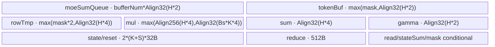
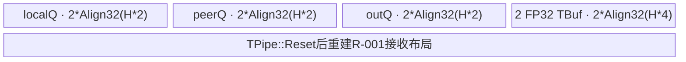

# MoeDistributeCombineAddRmsNorm A3 ACLNN 算子知识

## 算子速览

| 项目 | 内容 |
|---|---|
| 实际入口 | `aclnnMoeDistributeCombineAddRmsNormV2GetWorkspaceSize` / `aclnnMoeDistributeCombineAddRmsNormV2`，公开 ACLNN V2 |
| 计算语义 | 可选 TP 两卡 ReduceScatterV，再做 EP AllToAllV；按权重聚合后执行 Add+RmsNorm |
| 输入输出 | BF16 `expandX/residualX/gamma`，INT32 路由，FP32 权重；输出 BF16 `y/x` 与 FP32 `rstd`，ND |
| 执行类型 | 单 AICore task：`AIV_VECTOR + 非 Cube MTE/远端 window 通信`；无 AIC/Cube 或 MIX_CV |
| Kernel 路线 | R-001 无 TP；R-002 `tpWorldSize=2` |
| 核心资源 | GM/HCCL window、每核 10 KiB mask workspace、UB `TQue/TBuf`；L1/L0/dynamic UB N/A |
| 来源闭包 | `source_closed`：公开入口、A3 Tiling/POD、模板 key、单 AIV entry/body、HCOM task 改写和构建接线闭合 |
| 验证状态 | 已完成源码闭包检查；本次知识提取未执行编译、真机、数值或性能测试。 |

## 接口与语义

### 计算语义

有 TP 时先合并本卡与对端相同 token，再发往 EP 目标 window；无 TP 时直接发送。接收侧等待每个 token 的状态槽齐全，在 FP32 中累加 `expertScales*expertResult`；zero expert 不贡献，copy expert 使用 `oriX`，const expert 用两个 alpha 的 softmax 组合 `oriX/constExpertV`。随后 `x=combine+residualX`，`rstd=1/sqrt(sum(x²)/H+eps)`，源码实现的 `y` 顺序是 `BF16(BF16(x*rstd)*gamma)`。

### 输入、输出与属性

| 参数 | shape/layout | dtype | 约束、默认值与语义 |
|---|---|---|---|
| `expandX` | `[max(tpWorldSize,1)*A,H]` / ND | BF16 | `H∈[1024,8192]` |
| `expertIds/expertScales` | `[Bs,K]` / ND | INT32/FP32 | `0<Bs≤512`，`0<K≤16` |
| `assistInfoForCombine` | `[A*128]` / ND | INT32 | 记录目标 rank/token/top-k；与 DispatchV3 配套 |
| `epSendCounts` | `[epWorldSize*max(tpWorldSize,1)*localExpertNum]` | INT32 | 末项产生 `selfSendCnt` |
| `residualX/gamma` | `[Bs,1,H]` / `[H]` | BF16 | Add 与 RMSNorm 输入 |
| `tpSendCountsOptional` | TP 时 `[2]`，否则空 | INT32 | A3 仅 TP=2；无 TP 时 rank=0 |
| `xActiveMaskOptional` | `[Bs]` 或 `[Bs,K]` | BOOL | 1D token mask；2D token-expert mask |
| 特殊专家输入 | `oriX[Bs,H]` 与 alpha/v | BF16 | copy/const expert 非零时必传 |
| 属性 | 标量 | INT64/FLOAT/STRING | 公开 V2：`expertShardType/outDtype/commQuantMode/groupListType=0`、`commAlg=""`、`normEps=1e-6` |
| `yOut/rstdOut/xOut` | `[Bs,1,H]` / `[Bs,1,1]` / `[Bs,1,H]` | BF16/FP32/BF16 | 状态齐全后提交 |

### 入口与版本

固定提交同时有 V1/V2，V2 增加 zero/copy/const expert，且 README/API 文档公开支持 A3，因此选择 V2。V2 薄封装进入 Base API；Base 检查必选指针和 group 长度、拒绝 910B，再调用 generated inner。inner bridge/AutoContiguous 是框架边界，算子自有 Tiling、entry 与 body 已闭合。

## Host/Launcher 执行流程

### 参数校验与前处理

OpDef 为输入声明 `AutoContiguous`。Host 依次读取 ARN 专用 tensor/attr 索引，检查 BF16/INT32/FP32、ND、rank、shape、EP/TP 属性、special expert 和 HCCL window；失败返回 `GRAPH_FAILED`，不 launch。

### 参数、Workspace 与生命周期

A3 `workspace=16 MiB+aivNum*10 KiB`；Device 显式使用 `workspaceGM+coreIdx*10 KiB` 对齐二维 mask，16 MiB 为 system workspace。EP/TP window 来自 `GetHcclContext<0/1>`，不属于 executor workspace；executor、workspace、HCOM hidden input 与 window 必须活到调用 stream 完成。

### 启动图与失败传播

```text
ACLNN V2 -> generated inner -> A3 Tiling
  -> Mc2MoeGenTaskCallbackV2（给既有 task 插入两个 HCOM hidden inputs）
    -> 单节点 moe_distribute_combine_add_rms_norm<HasTp,0,MTE,A3>
```

本 op 在 callback V2 中不插 AICPU/wait/record task，故为单 Kernel。Host/Tiling/launch 错误逐层返回；Device 的远端状态轮询无源码可见超时或 fallback。

## Route 与参数设计

### 分核与资源计算

`aivNum=GetCoreNumAiv()`，`blockDim=CalcTschBlockDim(aivNum,0,aivNum)`，batch schedule mode。发送 `selfSendCnt`、接收 `activeMaskBsCnt` 均按商/余数分核，前余数个核多一 token。`hBytes=H*2`，UB 按 32 B、window token 槽按 `Align512(hBytes)`；window 由 `dataState*(totalWinSize/2)` 双半区复用。Host 发现 `InitBuffer` 总量超过 UB 时令 `bufferNum=1`，否则为 2。

### Route 选择

| 顺序 | Route | Key/模板 | 精确选择条件与优先级 | 不适用去向 |
|---:|---|---|---|---|
| 1 | R-001 无 TP | key `(false,0,MTE,A3)`；`MoeDistributeCombineV2<BF16,BF16,int32,false,0,true>` | A3、公开校验通过、TP=0/1、rank=0、quant=0、空 commAlg | TP=2 转 R-002；其它失败 |
| 2 | R-002 TP+EP | key `(true,0,MTE,A3)`；同模板但 `IsNeedReduceScatter=true` | TP=2、group/rank 合法、`localExpertNum≤1` | 失败 |

```text
A3 V2 -> tpWorldSize==2 ? R-002 : tpWorldSize in {0,1} ? R-001 : error
```

### 模板/实现执行矩阵

| Route | key/selector | dtype/shape/platform 完整命中条件 | 执行拓扑与 Kernel 节点 | 实际模板/body | 内存与同步特征 | tail/fallback |
|---|---|---|---|---|---|---|
| R-001 | HasTp=0/MTE/A3 | BF16/ND 与公开 shape/attr/window/UB guard | 单 AIV Kernel+EP remote window | `Process` 的无 TP实例 | data→EP slot→32 B flag；轮询后 FP32 聚合 | 余数分核；空核返回；无 fallback |
| R-002 | HasTp=1/MTE/A3 | R-001 加 TP=2 | 单 AIV Kernel内 TP→EP | `Process` 的 TP实例 | TP flag握手；FP32 add后发EP | 非两卡失败 |

### 隐藏性能 Guard

| Guard | Host/Tiling 条件 | Device/资源原因 | 影响 Route | 不满足时去向 | 源码符号 |
|---|---|---|---|---|---|
| shape | `1024≤H≤8192, 0<K≤16, 0<Bs≤512` | UB全行计算 | 全部 | Tiling失败 | `CheckTensorShape` |
| window | `CheckAndCalWinSize==SUCCESS` | 每槽 `Align512(H*2)` 加状态双半区 | 全部 | Tiling失败 | 同名函数 |
| UB depth | `totalBufferSize>ubSize ? 1:2` | 防止 queue 超 UB | 全部 | 同Route降depth | `UbUsedCal` |
| TP | TP=2且quant=0 | body以 `1-tpRankId` 寻址 | R-002 | Tiling失败 | `GetTpAndEpAttr...` |
| 到达状态 | `WaitDispatch` 总和落入 `target±0.5` | 禁止读取未完成remote slot | 全部 | 继续轮询 | `WaitDispatch` |

### POD/ABI

`MoeDistributeCombineV2Info` 为标准布局、`alignof=8`、`sizeof=120`；offset 相对此结构。外层前置 `Mc2InitTiling/Mc2CcTiling` 的 ABI 来自固定仓外公共头，只记录顺序。

| 结构 | 字段 | 类型/位宽 | ABI 布局 | 单位 | Host/launcher producer | Device consumer | 边界 |
|---|---|---|---|---|---|---|---|
| outer | `mc2InitTiling` | 外部POD | 首字段，大小不可见 | comm | `SetHCommCfg` | HCOM runtime | 两Route |
| outer | `mc2CcTiling1` | 外部POD | 次字段，offset不可见 | EP comm | 同上 | EP context | 两Route |
| outer | `mc2CcTiling2` | 外部POD | 三字段，offset不可见 | TP comm | TP=2时写 | TP context | R-002有效 |
| info | `epWorldSize` | u32 | off 0 | rank | attrs | `InitTilingAttrs` | >1 |
| info | `tpWorldSize` | u32 | off 4 | rank | attrs | TP分支 | 0/1/2 |
| info | `epRankId` | u32 | off 8 | id | attrs | window寻址 | `<world` |
| info | `tpRankId` | u32 | off 12 | id | attrs | `1-id` | 0/1 |
| info | `expertShardType` | u32 | off 16 | enum | attrs | 保留 | 0 |
| info | `sharedExpertNum` | u32 | off 20 | expert | Host | `flagRcvCount` | 公开0 |
| info | `sharedExpertRankNum` | u32 | off 24 | rank | Host | rank映射 | 公开0 |
| info | `moeExpertNum` | u32 | off 28 | expert | Host | 特殊专家边界 | ≤1024 |
| info | `moeExpertPerRankNum` | u32 | off 32 | expert/rank | Host除法 | rank映射 | 整除 |
| info | `zeroExpertNum` | u32 | off 36 | expert | V2 attr | `ProcessExpert` | 总和<INT32_MAX |
| info | `copyExpertNum` | u32 | off 40 | expert | V2 attr | 同上 | 同上 |
| info | `constExpertNum` | u32 | off 44 | expert | V2 attr | 同上 | 同上 |
| info | `globalBs` | u32 | off 48 | token | attrs | window上界 | rank一致 |
| info | `bs` | u32 | off 52 | token | expertIds dim0 | 接收分核 | ≤512 |
| info | `k` | u32 | off 56 | expert/token | dim1 | top-k循环 | ≤16 |
| info | `h` | u32 | off 60 | element | expandX dim1 | Vector长度 | 1024..8192 |
| info | `a` | u32 | off 64 | token | expandX dim0/TP | window上界 | docs下界 |
| info | `aivNum` | u32 | off 68 | core | platform | 分核 | >0 |
| info | `isTokenMask` | bool | off 72 | flag | optional rank=1 | mask | 缺省false |
| info | `isExpertMask` | bool | off 73 | flag | optional rank=2 | mask | 缺省false |
| info | `hasSharedExpertX` | bool | off 74 | flag | optional input | 聚合 | 缺省false |
| info | `hasElasticInfo` | bool | off 75 | flag | optional input | elastic helper | 公开不支持 |
| info | `isPerformance` | bool | off 76 | flag | ARN虚拟索引 | DFX | 恒false |
| info | `isMc2Context` | bool | off 77 | flag | config | context分支 | ACLNN false |
| info | `reserved1` | bool | off 78 | reserved | zero-init | 无 | 不读 |
| info | `reserved2` | bool | off 79 | reserved | zero-init | 无 | 不读 |
| info | `totalUbSize` | u64 | off 80 | byte | platform | UB记录 | 容量 |
| info | `totalWinSizeEp` | u64 | off 88 | byte | win helper | EP半区 | 容量guard |
| info | `totalWinSizeTp` | u64 | off 96 | byte | win helper | TP半区 | R-002 |
| info | `armAvgFactor` | f32 | off 104 | 1/H | ARN Host | RMS | 有限 |
| info | `epsilon` | f32 | off 108 | scalar | normEps | RMS | 1e-6 |
| info | `bufferNum` | u32 | off 112 | depth | `UbUsedCal` | queue | 1/2；尾4B padding |

### Route 源码闭包

| Route | Key/selector | Host/Tiling producer | POD/参数 | Kernel entry/router 节点 | Kernel body/直接依赖 | 构建接线 |
|---|---|---|---|---|---|---|
| R-001 | false/0/MTE/A3 | shared A3 Tiling | V2 POD | entry `<false,0,0,1>` | body `<...,false,0,true>` | op_host CMake/910_93 config |
| R-002 | true/0/MTE/A3 | 同上+TP tiling | 同POD，cc2有效 | entry `<true,0,0,1>` | body `<...,true,0,true>` | 同上 |

## Kernel 实现

### 公共执行流程

entry 解包 POD；`Init` 绑定 GM/HCOM context、选择 window 半区、分核。`Process` 仅 `ASCEND_IS_AIV`：远端发送→重建 UB/mask→轮询接收→FP32 聚合→Add→写 x→RMSNorm→写 rstd/y。无 AIC 分支或第二个 Kernel。

### Route R-001：无 TP 的 EP AllToAllV

#### 适用条件

##### 选择证据

| 层级 | 文件 | 符号 | 源码谓词/参数 | 结果/下一跳 |
|---|---|---|---|---|
| API | V2 docs | 产品/参数表 | A3、TP=0/1、quant=0、空commAlg | Host |
| Host | shared Tiling | `CalTilingKey` | `tpWorldSize!=2` | HasTp=0 |
| Router | entry cpp | `Exec...` | BF16 compile guard | R-001 |

#### Device 数据流

##### 函数级调用链

```text
entry<false> -> Init -> Process
  -> BuffInit -> SetWaitTpStatusAndDisPatch -> ExpertAlltoAllDispatchCopyAdd
  -> AlltoAllBuffInitAndMaskCal
  -> LocalWindowCopy -> WaitDispatch -> ProcessExpert -> AddRmsNormAddCompute -> AddRmsNormRmsNormCompute
```

##### 源码等价伪码

```text
伪码：发送区间按商余数分核；每轮最多处理两条 assistInfo 记录；
expandX[token,0:H] -> UB -> remoteEP[tokenId,topk]；MTE3完成后写32B flag；
接收区间按商余数分核；轮询并归约K个flag；齐全则清flag；
FP32 sum(weight*remoteToken)，加residual；RINT写x；算rstd；按源码舍入顺序写y。
```

#### 内存与数据搬运

##### 资源与搬运表

| 层级/缓冲区 | offset/地址公式 | extent/容量公式 | dtype/layout | producer | consumer | owner/lifetime | 对齐/复用 |
|---|---|---|---|---|---|---|---|
| EP data window | `half+(token*(K+S)+topk)*Align512(H*2)` | 槽 `Align512(H*2)` | BF16 | remote sender | `ProcessMoeExpert` | HCOM周期 | 512B/双半区 |
| EP state | `stateHalf+token*(K+S)*32+topk*32` | 32B/flag | FP32 | sender | `WaitDispatch` | 消费后清零 | 32B |
| mask workspace | `coreIdx*10KiB` | 10KiB/core | BOOL | `MaskAlign` | mask reload | executor | 条件使用 |
| `moeSumQueue` | TPipe | `bufferNum*Align32(H*2)` | BF16 | window | FP32 Cast | token | depth1/2 |
| FP32/aux TBuf | 独立 | row/mul/sum/gamma/reduce/state，公式见字节账 | mixed | CopyIn/Vector | Vector/CopyOut | token | 分阶段复用 |
| L1/L0/dynamic UB | N/A | N/A | N/A | N/A | N/A | N/A | GM↔UB替代 |

##### 分层内存布局



##### 字节账与复用顺序

```text
UB_total = tokenMax + rowMax + mulMax + Align32(H*4) + Align32(H*2)
         + 512 + bufferNum*Align32(H*2) + 2*(K+S)*32 + 32 + conditional_mask_bytes
workspace_total = 16 MiB + aivNum*10 KiB; dynamic_ub=N/A
```

| 复用子区 | 写入者 | 读取者/消费点 | 下一次覆盖 | 同步或释放依据 | 安全条件 |
|---|---|---|---|---|---|
| tokenBuf | mask/residual/special/final cast | 当前Vector阶段 | 下一阶段 | barriers/events | 阶段完成 |
| queue slot | CopyIn | `ProcessExpert` | `FreeTensor`后 | queue协议 | depth guard |
| EP half | sender | receiver | 下次dataState | flag+reset | rank一致 |

#### 同步、精度与尾块

##### 同步与数值边界表

| 阶段 | primitive/机制 | producer | consumer/等待点 | 保护对象 | 精度/尾块 |
|---|---|---|---|---|---|
| data→flag | `PIPE_MTE3` | remote copy | flag write | EP slot | H有效、槽512B |
| flag→read | `WaitDispatch`+MTE2/V/S | remote rank | receiver | K状态 | mask调整target |
| 聚合 | Cast/Muls/Add+PIPE_V | BF16 token | FP32 sum | row/mul/sum | H全长 |
| Add/RMS | HardEvent+RINT | FP32 | outputs | token | x/y BF16，rstd FP32 |
| tail | 商余数+空核return | POD | loops | token区间 | 不越界 |

#### 关键实现

##### 符号证据表

| 阶段 | 文件 | 符号/模板实例 | 实现事实 |
|---|---|---|---|
| Host/Tiling producer | shared Tiling cpp | A3 Tiling/UbUsedCal | key、资源、workspace |
| Kernel entry/router | add-rms kernel cpp | `Exec<...,false,0,true>` | 模板实例 |
| Device body/helper | combine_v2.h | dispatch/wait/process/AddRms | 完整数据流 |

### Route R-002：TP ReduceScatterV 后 EP AllToAllV

#### 适用条件

##### 选择证据

| 层级 | 文件 | 符号 | 源码谓词/参数 | 结果/下一跳 |
|---|---|---|---|---|
| API | V2 docs | A3 TP约束 | TP=2、rank/group合法 | Host |
| Host | shared Tiling | `CalTilingKey` | TP=2且quant=0 | HasTp=1 |
| Router | entry | HasTp模板 | BF16 | R-002 |

#### Device 数据流

##### 函数级调用链

```text
entry<true> -> Init -> TpGroupInit -> Process
  -> ReduceScatterTrans -> BuffInit -> TP flag handshake
  -> ExpertAlltoAllDispatchInnerCopyAdd -> CustomAdd
  -> 与R-001相同的接收、聚合和AddRmsNorm
```

##### 源码等价伪码

```text
伪码：对端TP片段写peer TP window；写flag并轮询本地flag；
每个发送token同时载入本地与peer BF16，转FP32相加，RINT回BF16后写EP window并发EP flag；
其余接收与AddRmsNorm同R-001。
```

#### 内存与数据搬运

##### 资源与搬运表

| 层级/缓冲区 | offset/地址公式 | extent/容量公式 | dtype/layout | producer | consumer | owner/lifetime | 对齐/复用 |
|---|---|---|---|---|---|---|---|
| TP window | `half+token*Align512(H*2)` | token槽 | BF16 | peer | `CustomAdd` | TP HCOM周期 | 双半区 |
| TP status | `rank*512+coreIdx*512` | copy 32B | INT32 | peer | poll | TP state | 清零复用 |
| TP queues | TPipe | 三个 `2*Align32(H*2)` + 两个 `Align32(H*4)` | BF16/FP32 | local/peer | CustomAdd | TP阶段 | Reset后复用 |
| EP/receive | 同R-001 | 同R-001 | 同R-001 | reduced sender | receiver | 同R-001 | 同R-001 |

##### 分层内存布局



##### 字节账与复用顺序

```text
UB_TP = 6*Align32(H*2)+2*Align32(H*4)+Align32(sendCntNum*3*4)+32
UB_peak = max(UB_TP, R-001 UB_total); workspace同R-001
```

| 复用子区 | 写入者 | 读取者/消费点 | 下一次覆盖 | 同步或释放依据 | 安全条件 |
|---|---|---|---|---|---|
| TP queue | two CopyIn | CustomAdd | Free后 | queue | 两输入DeQue |
| 整体TP UB | BuffInit | TP发送 | Reset后接收布局 | PIPE_ALL | TP完成 |
| TP half | peer | local | 下次state | flag | TP=2 |

#### 同步、精度与尾块

##### 同步与数值边界表

| 阶段 | primitive/机制 | producer | consumer/等待点 | 保护对象 | 精度/尾块 |
|---|---|---|---|---|---|
| TP到达 | remote copy+flag poll | peer | local | TP slot | 余数分核 |
| 合并 | Queue+CustomAdd | 两BF16 | EP writer | outQ | FP32 add→RINT BF16 |
| TP→EP | MTE3+EP flag | reduced token | remote receiver | EP slot | data先flag |
| 后续 | 同R-001 | EP | outputs | token | 同R-001 |

#### 关键实现

##### 符号证据表

| 阶段 | 文件 | 符号/模板实例 | 实现事实 |
|---|---|---|---|
| Host/Tiling producer | shared Tiling | `SetHCommCfg/CalTilingKey` | TP POD/key |
| Kernel entry/router | entry cpp | `Exec<...,true,0,true>` | TP实例 |
| Device body/helper | combine_v2.h | `TpGroupInit/ReduceScatterTrans/CustomAdd` | TP window与合并 |

## 算子特定优化

### Trick T-001：通信数据先写、状态后发布

#### 触发与源码依据

- 适用 Route：R-001、R-002
- 触发条件：发送核处理一个或两个有效 token
- Golden 来源：[`moe_distribute_combine_v2.h:948`](../../../../../../../cann-ops-raw/ascendc/ops-transformer/be33d95bb755cedec3108f70805c1874d1792540/mc2/moe_distribute_combine_v2/op_kernel/moe_distribute_combine_v2.h#L948)

**官方源码（固定 Commit 连续逐字摘录）**：

```cpp
PipeBarrier<PIPE_MTE3>();
GM_ADDR stateGMFirst = GetWinStateAddrByRankId(toRankIdFirst, EP_DOMAIN) +
                tokenIdFirst * flagRcvCount_ * stateOffset_ + topkIdFirst * stateOffset_;
GlobalTensor<float> stateGMTensorFirst;
stateGMTensorFirst.SetGlobalBuffer((__gm__ float*)stateGMFirst);
DataCopy<float>(stateGMTensorFirst, statusTensor, FLOAT_PER_UB_ALIGN);
```

#### 机制与设计原因

先完成远端 token 的 MTE3 写入，再发布 32 B 状态；接收端只在所有状态求和达标时读数据。它同时支持每轮两 token 的批量发布，避免把 flag 当作不带可见性保证的普通标量。

#### 迁移边界

- 适用：远端 window 数据+状态协议。
- 前提：状态槽和数据槽不别名，消费后状态清零。
- 失效：缺少数据完成 barrier 时协议不成立。
- 未验证：本次知识提取未执行编译、真机、数值或性能测试。

#### 错误做法

状态先于数据可见会让 `WaitDispatch` 提前消费未完成数据，固定源码明确以 MTE3 barrier 禁止该顺序。

### Trick T-002：RMSNorm 保留 BF16 中间舍入

#### 触发与源码依据

- 适用 Route：R-001、R-002
- 触发条件：`HasAddRmsNorm=true`
- Golden 来源：[`moe_distribute_combine_v2.h:1165`](../../../../../../../cann-ops-raw/ascendc/ops-transformer/be33d95bb755cedec3108f70805c1874d1792540/mc2/moe_distribute_combine_v2/op_kernel/moe_distribute_combine_v2.h#L1165)

**官方源码（固定 Commit 连续逐字摘录）**：

```cpp
Muls(xFp32, xFp32, rstdValue, numCol);
PipeBarrier<PIPE_V>();
LocalTensor<XType> yLocal = rowTmpFloatBuf_.Get<XType>();
Cast(yLocal, xFp32, RoundMode::CAST_RINT, numCol);
PipeBarrier<PIPE_V>();
Cast(xFp32, yLocal, RoundMode::CAST_NONE, numCol);
```

#### 机制与设计原因

归约用 FP32，但 `x*rstd` 在乘 gamma 前显式 RINT 到 BF16再升回 FP32，锁定输出数值顺序；不能合并为一次最终 cast。

#### 迁移边界

- 适用：复现该 BF16 API。
- 前提：BF16 X/gamma 与全H归约。
- 失效：其它 dtype/舍入语义需独立路线。
- 未验证：本次知识提取未执行编译、真机、数值或性能测试。

#### 错误做法

删除中间 BF16 cast 会改变 gamma 乘法输入，不与固定源码等价。

## 模板与实现对比

| 对比维度 | R-001 无 TP | R-002 TP+EP | 设计选择依据 |
|---|---|---|---|
| 命中条件/优先级 | TP=0/1 | TP=2 | HasTp位 |
| 模板与 dtype | BF16,HasTp=false | BF16,HasTp=true | 仅TP编译期分支不同 |
| 循环与分核 | send/recv商余数 | 加TP商余数 | 连续token区间 |
| Queue/TBuf/寄存器/dynamic UB/通信 window | EP+接收UB | TP阶段后Reset为接收UB | 分时复用 |
| 内存总占用与复用 | 接收峰值 | `max(TP,接收)` | Reset避免相加 |
| 搬运/Vector/SIMT/NDDMA/通信 API | MTE window+Vector | TP MTE+Vector Add+EP | 无Cube/SIMT/NDDMA |
| 同步、精度与 tail | EP flag、FP32、RINT | 加TP flag | 数据先flag |
| fallback/失败边界 | Host失败 | 非两卡失败 | 无Device fallback |

## 平台差异

| 项目 | A2 | A3 | 950 |
|---|---|---|---|
| 支持状态 | README明确不支持 | 支持，本卡 | 支持，见 `_950` |
| Host/Launcher | Base拒绝910B | arch22 wrapper→A3 Tiling | arch35 selector |
| Kernel/资源 | 不发布 | AIV_ENGINE，可选TP | 无TP；默认MTE |

## 限制与失败边界

- 必须与 DispatchV3 配套；EP/TP、expert/mask/globalBs/special expert/HCCL_BUFFSIZE 在各 rank 和各层一致。
- 正式路线仅公开 BF16、quant=0、空 commAlg；源码存在的 quant/hierarchy specialization 不等于公开支持。
- Device 轮询无源码可见超时；通信/window/Tiling 失败无 fallback。
- 外层 MC2 POD ABI、generated inner 与通信 runtime 属明确外部边界，不推测其内部布局。

## 源码索引

### 链路索引

| 链路阶段 | 文件 | 关键符号 | 支撑内容 |
|---|---|---|---|
| 公开约束 | `mc2/moe_distribute_combine_add_rms_norm/README.md` | 产品表/公式 | 平台与语义 |
| 入口声明/约束 | `mc2/moe_distribute_combine_add_rms_norm/docs/aclnnMoeDistributeCombineAddRmsNormV2.md` | V2文档 | 最新API约束 |
| 入口实现 | `mc2/moe_distribute_combine_add_rms_norm/op_api/aclnn_moe_distribute_combine_add_rms_norm_v2.cpp` | V2 symbols | Base转发 |
| API Base | `mc2/moe_distribute_combine_add_rms_norm/op_api/moe_distribute_combine_add_rms_norm_base.cpp` | Check/Base | 校验/inner |
| 平台注册 | `mc2/moe_distribute_combine_add_rms_norm/op_host/moe_distribute_combine_add_rms_norm_def.cpp` | AddConfig | A3/950 |
| A3 wrapper | `mc2/moe_distribute_combine_add_rms_norm/op_host/op_tiling/arch22/moe_distribute_combine_add_rms_norm_tiling_a2a3.cpp` | TilingFunc | 共享Tiling入口 |
| Host/Tiling | `mc2/moe_distribute_combine_v2/op_host/op_tiling/moe_distribute_combine_v2_tiling.cpp` | A3 Tiling/key/UB | POD producer |
| POD | `mc2/moe_distribute_combine_v2/op_kernel/moe_distribute_combine_v2_tiling.h` | structs | ABI |
| key | `mc2/moe_distribute_combine_v2/op_kernel/moe_distribute_combine_v2_tiling_key.h` | TPL | specialization |
| Kernel entry | `mc2/moe_distribute_combine_add_rms_norm/op_kernel/moe_distribute_combine_add_rms_norm.cpp` | entry/Exec | router |
| Device body | `mc2/moe_distribute_combine_v2/op_kernel/moe_distribute_combine_v2.h` | class/process | 实现 |
| launch注册 | `mc2/moe_distribute_combine_add_rms_norm/op_graph/moe_distribute_combine_add_rms_norm_gen_task.cpp` | CalcParam/GenTask | callback选择 |
| task | `mc2/common/op_graph/mc2_moe_gen_task_ops_utils.cpp` | callback V2 | HCOM hidden inputs |
| 构建接线 | `mc2/moe_distribute_combine_add_rms_norm/op_host/CMakeLists.txt` | module sources | 构建依赖 |

### 实现复用检查

| 检查项 | 可复用事实 | 不得改变的约束 | 源码符号 |
|---|---|---|---|
| ABI/POD | info 120B及相对offset | 外层POD不得臆造 | tiling.h |
| 调用顺序 | TP可选→EP→接收→Add→x→RMS→rstd/y | 数据先flag | `Process` |
| workspace/内存 | 16MiB+10KiB/core，window双半区 | window非workspace | `SetWorkspace/GetWinAddr*` |
| 同步 | TP/EP flags、HardEvent、Queue | 等待/清零/Free | `WaitDispatch`等 |
| 精度与尾块 | FP32聚合、两次RINT、商余数分核 | 保留中间BF16舍入 | `AddRmsNorm*` |
| 失败边界 | Host失败即终止 | 不发布dormant路线 | Base/Tiling |