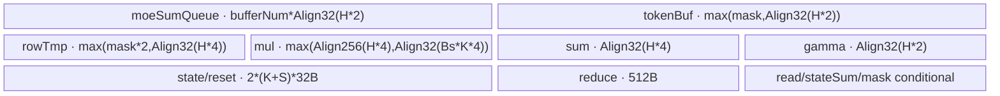

# MoeDistributeCombineAddRmsNorm 950 ACLNN 算子知识

## 算子速览

| 项目 | 内容 |
|---|---|
| 实际入口 | `aclnnMoeDistributeCombineAddRmsNormV2GetWorkspaceSize` / `aclnnMoeDistributeCombineAddRmsNormV2`，公开 ACLNN V2 |
| 计算语义 | EP AllToAllV 后按权重聚合普通/特殊专家结果，再执行 Add+RmsNorm；公开 950 不支持 TP |
| 输入输出 | BF16 `expandX/residualX/gamma`、INT32 路由、FP32 权重；输出 BF16 `y/x` 与 FP32 `rstd`，ND |
| 执行类型 | 单 AICore task：`AIV_VECTOR + 非 Cube MTE/远端 window 通信`；无 AIC/Cube 或 MIX_CV |
| Kernel 路线 | R-001 950-MTE（公开 `commAlg=""`） |
| 核心资源 | GM/HCCL window、每核 10 KiB mask workspace、UB `TQue/TBuf`；L1/L0/dynamic UB N/A |
| 来源闭包 | `source_closed`：V2 ACLNN、950 selector到复用A3-MTE Tiling、950 key、单 AIV entry/body、task改写和构建接线闭合 |
| 验证状态 | 已完成源码闭包检查；本次知识提取未执行编译、真机、数值或性能测试。 |

## 接口与语义

### 计算语义

950 公开路线把 `expandX` 按 `assistInfoForCombine` 写入 EP 目标 window；接收侧等待 `K+sharedExpertNum` 个状态槽到齐，FP32 加权聚合普通专家。zero expert 跳过，copy expert使用 `oriX`，const expert用 `softmax(alpha1,alpha2)` 组合 `oriX/constExpertV`。然后 `x=combine+residualX`，`rstd=1/sqrt(sum(x²)/H+eps)`，`y=BF16(BF16(x*rstd)*gamma)`。

### 输入、输出与属性

| 参数 | shape/layout | dtype | 约束、默认值与语义 |
|---|---|---|---|
| `expandX` | `[A,H]` / ND | BF16 | `H∈[1024,8192]`；A满足全局容量约束 |
| `expertIds/expertScales` | `[Bs,K]` | INT32/FP32 | `0<Bs≤512`、`0<K≤16` |
| `assistInfoForCombine` | `[A*128]` | INT32 | 目标 rank/token/top-k，配套 DispatchV3 |
| `epSendCounts` | `[epWorldSize*localExpertNum]` | INT32 | 末项给 `selfSendCnt` |
| `residualX/gamma` | `[Bs,1,H]` / `[H]` | BF16 | Add/RMSNorm |
| `xActiveMaskOptional` | `[Bs]` 或 `[Bs,K]` | BOOL | token或token-expert有效域 |
| 特殊专家输入 | `oriX[Bs,H]` 与 alpha/v | BF16 | copy/const非零时必传 |
| `groupTp/tpWorldSize/tpRankId` | 空/0/0 | STRING/INT64 | 950公开版本不支持TP |
| 其余属性 | 标量 | INT64/FLOAT/STRING | `commQuantMode=0`、`commAlg=""`、`expertShardType/outDtype/groupListType=0`、`normEps=1e-6` |
| `yOut/rstdOut/xOut` | `[Bs,1,H]` / `[Bs,1,1]` / `[Bs,1,H]` | BF16/FP32/BF16 | 状态到齐后提交 |

### 入口与版本

V2 是 950 最新公开接口，较 V1 新增 zero/copy/const expert。README 与 V2 文档均明确支持 Ascend 950DT。V2→Base→generated inner；Base 设置 MTE server type。generated inner/AutoContiguous 为框架边界，950 selector、POD、key、entry和body均在固定提交闭合。

## Host/Launcher 执行流程

### 参数校验与前处理

Base 检查必选指针和 group 长度。950 wrapper复用 `MoeDistributeCombineV2TilingFuncA5`；其 selector读取 `commAlg`：空字符串走 `MoeDistributeCombineA3TilingFuncImpl`，`"ccu"` 走 950 CCU实现。公开文档明确 commAlg 为预留且只能空，因此正式卡只保留前者。复用的共享 Tiling继续校验 BF16/ND、shape、special expert、window和UB。

### 参数、Workspace 与生命周期

公开 MTE Route使用共享 `SetWorkspace`：`16 MiB+aivNum*10 KiB`；Device显式使用每核10 KiB mask切片。EP window由HCOM hidden input提供，`dataState`选择前/后半区。executor、workspace、window及hidden context保持到调用stream完成。

### 启动图与失败传播

```text
ACLNN V2 -> generated inner -> A5 wrapper
  -> commAlg=="" -> 复用 A3 MTE Tiling，但虚函数 CalTilingKey 写 ArchTag=A5
    -> GenTaskCallbackV2仅插入两个HCOM hidden inputs
      -> 单节点 moe_distribute_combine_add_rms_norm<false,0,MTE,A5>
```

无AICPU/第二Device Kernel。公开约束不满足、Tiling/window/launch失败即返回；Device状态轮询无超时fallback。

## Route 与参数设计

### 分核与资源计算

共享MTE Tiling取全部AIV核，设置batch mode；发送 `selfSendCnt`、接收 `activeMaskBsCnt`按商余数分核。UB按32B、window token按 `Align512(H*2)`，window双半区。`UbUsedCal`在总缓冲超过950可用UB时把 `bufferNum` 从2降1；公开quant=0，不进入950融合量化512B特例。

### Route 选择

| 顺序 | Route | Key/模板 | 精确选择条件与优先级 | 不适用去向 |
|---:|---|---|---|---|
| 1 | R-001 950-MTE | key `(false,0,MTE,A5)`；`MoeDistributeCombineV2<BF16,BF16,int32,false,0,true>` | 950、V2校验通过、`commAlg`空、TP=0、quant=0 | `commAlg="ccu"`实现分支与公开文档冲突，不发布；其它失败 |

```text
A5 V2 -> commAlg empty -> R-001
       -> commAlg "ccu" -> implementation-only selector, excluded from public Route
       -> other -> GRAPH_FAILED
```

### 模板/实现执行矩阵

| Route | key/selector | dtype/shape/platform 完整命中条件 | 执行拓扑与 Kernel 节点 | 实际模板/body | 内存与同步特征 | tail/fallback |
|---|---|---|---|---|---|---|
| R-001 | HasTp=0/Quant=0/MTE/950 | BF16/ND，公开950 shape/attr/window/UB guard | 单 AIV Kernel+EP remote window | `MoeDistributeCombineV2<...,false,0,true>::Process` | GM→UB→remote window→flag；接收轮询后FP32聚合 | 余数分核；空核返回；无fallback |

### 隐藏性能 Guard

| Guard | Host/Tiling 条件 | Device/资源原因 | 影响 Route | 不满足时去向 | 源码符号 |
|---|---|---|---|---|---|
| 公开通信算法 | `commAlg`为空 | 文档仅发布MTE/UB Memory通信 | R-001 | 不发布其它selector | docs + arch35 selector |
| 无TP | `tpWorldSize=0,tpRankId=0,groupTp=""` | 950公开版本无TP | R-001 | Tiling失败 | docs |
| shape | `1024≤H≤8192,0<K≤16,0<Bs≤512` | 全H UB Vector | R-001 | Tiling失败 | `CheckTensorShape` |
| window | `CheckAndCalWinSize==SUCCESS` | 每token `Align512(H*2)`与状态双半区 | R-001 | Tiling失败 | shared helper |
| UB depth | `totalBufferSize>ubSize ? 1:2` | 防UB越界 | R-001 | 同Route降depth | `UbUsedCal` |
| 状态 | `WaitDispatch`和为目标值 | 防读取未完成window | R-001 | 继续轮询 | `WaitDispatch` |

### POD/ABI

`MoeDistributeCombineV2Info` 标准布局、`alignof=8`、`sizeof=120`；offset相对此结构。外层MC2通信POD ABI来自固定仓外公共头。

| 结构 | 字段 | 类型/位宽 | ABI 布局 | 单位 | Host/launcher producer | Device consumer | 边界 |
|---|---|---|---|---|---|---|---|
| outer | `mc2InitTiling` | 外部POD | 首字段/大小不可见 | comm | `SetHCommCfg` | runtime | 有效 |
| outer | `mc2CcTiling1` | 外部POD | 次字段/offset不可见 | EP comm | 同上 | EP context | 有效 |
| outer | `mc2CcTiling2` | 外部POD | 三字段/offset不可见 | TP comm | 不写有效TP | 无 | inactive |
| info | `epWorldSize` | u32 | off 0 | rank | attrs | Init/window | >1 |
| info | `tpWorldSize` | u32 | off 4 | rank | attrs | TP guard | 0 |
| info | `epRankId` | u32 | off 8 | id | attrs | window寻址 | `<world` |
| info | `tpRankId` | u32 | off 12 | id | attrs | inactive | 0 |
| info | `expertShardType` | u32 | off 16 | enum | attrs | 保留 | 0 |
| info | `sharedExpertNum` | u32 | off 20 | expert | Host | state/聚合 | 公开0 |
| info | `sharedExpertRankNum` | u32 | off 24 | rank | Host | rank映射 | 公开0 |
| info | `moeExpertNum` | u32 | off 28 | expert | Host | 专家边界 | ≤1024 |
| info | `moeExpertPerRankNum` | u32 | off 32 | expert/rank | Host | rank映射 | 整除 |
| info | `zeroExpertNum` | u32 | off 36 | expert | V2 attr | special branch | 总和<INT32_MAX |
| info | `copyExpertNum` | u32 | off 40 | expert | V2 attr | special branch | 同上 |
| info | `constExpertNum` | u32 | off 44 | expert | V2 attr | special branch | 同上 |
| info | `globalBs` | u32 | off 48 | token | attrs | window上界 | rank一致 |
| info | `bs` | u32 | off 52 | token | expertIds dim0 | 接收分核 | ≤512 |
| info | `k` | u32 | off 56 | expert/token | dim1 | top-k循环 | ≤16 |
| info | `h` | u32 | off 60 | element | expandX dim1 | Vector长度 | 1024..8192 |
| info | `a` | u32 | off 64 | token | expandX dim0 | window上界 | docs下界 |
| info | `aivNum` | u32 | off 68 | core | platform | 分核 | >0 |
| info | `isTokenMask` | bool | off 72 | flag | optional rank=1 | mask | 缺省false |
| info | `isExpertMask` | bool | off 73 | flag | optional rank=2 | mask | 缺省false |
| info | `hasSharedExpertX` | bool | off 74 | flag | optional | 聚合 | 缺省false |
| info | `hasElasticInfo` | bool | off 75 | flag | optional | elastic | 公开不支持 |
| info | `isPerformance` | bool | off 76 | flag | ARN虚拟索引 | DFX | false |
| info | `isMc2Context` | bool | off 77 | flag | config | context分支 | ACLNN false |
| info | `reserved1` | bool | off 78 | reserved | zero-init | 无 | 不读 |
| info | `reserved2` | bool | off 79 | reserved | zero-init | 无 | 不读 |
| info | `totalUbSize` | u64 | off 80 | byte | platform | UB记录 | 容量 |
| info | `totalWinSizeEp` | u64 | off 88 | byte | win helper | EP半区 | guard |
| info | `totalWinSizeTp` | u64 | off 96 | byte | Host | inactive | 0/未用 |
| info | `armAvgFactor` | f32 | off 104 | 1/H | ARN Host | RMS | 有限 |
| info | `epsilon` | f32 | off 108 | scalar | normEps | RMS | 1e-6 |
| info | `bufferNum` | u32 | off 112 | depth | UbUsedCal | queue | 1/2，尾4B padding |

### Route 源码闭包

| Route | Key/selector | Host/Tiling producer | POD/参数 | Kernel entry/router 节点 | Kernel body/直接依赖 | 构建接线 |
|---|---|---|---|---|---|---|
| R-001 | false/0/MTE/950 | 950 selector→shared MTE Tiling | V2 POD | entry `<false,0,0,2>` | body `<...,false,0,true>` | op_host CMake/ascend950 config |

## Kernel 实现

### 公共执行流程

唯一Route的entry解包POD，`Init`绑定GM/HCOM、选择window半区、分核。`Process`仅有 `ASCEND_IS_AIV`：EP发送、UB/mask初始化、状态轮询、FP32聚合、Add、x写回、RMSNorm、rstd/y写回。950编译时 `BuffInit` 在 `TPipe::Reset` 后恢复单指令饱和控制寄存器；公开quant=0不进入量化分支。

### Route R-001：950-MTE EP AllToAllV

#### 适用条件

##### 选择证据

| 层级 | 文件 | 符号 | 源码谓词/参数 | 结果/下一跳 |
|---|---|---|---|---|
| API | V2 docs | 950详情 | TP=0、quant=0、commAlg为空 | Host |
| Host outer | arch35 cpp | `MoeDistributeCombineTilingFuncImpl` | `isNullOrEmpty`且非ccu | 调A3 MTE实现 |
| Host key | 950 override | `CalTilingKey` | TP=false,quant=0,hierarchy=MTE | ArchTag=950 |
| Router | entry cpp | template entry | BF16 compile guard | R-001 |

#### Device 数据流

##### 函数级调用链

```text
entry<false,0,MTE,A5> -> Exec -> Init -> Process
  -> BuffInit -> SetWaitTpStatusAndDisPatch -> ExpertAlltoAllDispatchCopyAdd
  -> AlltoAllBuffInitAndMaskCal
  -> LocalWindowCopy -> WaitDispatch -> ProcessExpert
  -> AddRmsNormAddCompute -> AddRmsNormRmsNormCompute
```

##### 源码等价伪码

```text
伪码：发送token按商余数分核并错位排序；每轮最多两token；
expandX -> UB -> remote EP Align512槽；MTE3后写32B状态；
接收token按商余数分核；轮询/归约状态，清状态后FP32加权聚合；
加residual，RINT写x；FP32算rstd；按BF16中间舍入顺序乘gamma并写y。
```

#### 内存与数据搬运

##### 资源与搬运表

| 层级/缓冲区 | offset/地址公式 | extent/容量公式 | dtype/layout | producer | consumer | owner/lifetime | 对齐/复用 |
|---|---|---|---|---|---|---|---|
| EP data window | `half+(token*(K+S)+topk)*Align512(H*2)` | 槽 `Align512(H*2)` | BF16/ND | sender | ProcessMoeExpert | HCOM周期 | 512B/双半区 |
| EP state | `stateHalf+token*(K+S)*32+topk*32` | 32B | FP32 | sender | WaitDispatch | 消费后清零 | 32B |
| mask workspace | `coreIdx*10KiB` | 10KiB/core | BOOL | MaskAlign | mask reload | executor | 条件使用 |
| moeSumQueue | TPipe | `bufferNum*Align32(H*2)` | BF16 | window | FP32 Cast | token | depth1/2 |
| token/row/mul/sum | TBuf | 见字节账 | mixed | CopyIn/Vector | Add/RMS | token | 分阶段别名 |
| gamma/reduce/state | TBuf | `Align32(H*2)+512+2*(K+S)*32+32` | mixed | GM/Vector | RMS/wait | recv阶段 | 条件同步 |
| L1/L0/dynamic UB | N/A | N/A | N/A | N/A | N/A | N/A | GM↔UB替代 |

##### 分层内存布局



##### 字节账与复用顺序

```text
UB_total = tokenMax + rowMax + mulMax + Align32(H*4) + Align32(H*2)
         + 512 + bufferNum*Align32(H*2) + 2*(K+S)*32 + 32 + conditional_mask_bytes
UB_total <= totalUbSize; workspace=16MiB+aivNum*10KiB; dynamic_ub=N/A
```

| 复用子区 | 写入者 | 读取者/消费点 | 下一次覆盖 | 同步或释放依据 | 安全条件 |
|---|---|---|---|---|---|
| tokenBuf | mask/residual/special/cast | 当前阶段 | 下一阶段 | events/barriers | 阶段完成 |
| queue slot | CopyIn | ProcessExpert | FreeTensor后 | queue协议 | depth guard |
| EP half | sender | receiver | 下次dataState | flag+reset | rank参数一致 |

#### 同步、精度与尾块

##### 同步与数值边界表

| 阶段 | primitive/机制 | producer | consumer/等待点 | 保护对象 | 精度/尾块 |
|---|---|---|---|---|---|
| data→flag | `PIPE_MTE3` | remote copy | flag write | EP slot | H有效/512B槽 |
| flag→read | WaitDispatch+MTE2/V/S | sender | receiver | K状态 | mask调target |
| 聚合 | Cast/Muls/Add | BF16 | FP32 sum | row/mul/sum | H全长 |
| Add/RMS | HardEvent/RINT | FP32 | outputs | token | x/y BF16，rstd FP32 |
| 950 reset | `SetCtrlSpr<60,60>(0)` | TPipe Reset | 后续Vector | overflow mode | 每次BuffInit恢复 |
| tail | 商余数/空核return | POD | loops | token域 | 不越界 |

#### 关键实现

##### 符号证据表

| 阶段 | 文件 | 符号/模板实例 | 实现事实 |
|---|---|---|---|
| Host/Tiling producer | arch35/shared Tiling | selector/CalTilingKey/UbUsedCal | MTE复用、950 key、资源 |
| Kernel entry/router | add-rms kernel cpp | `Exec<...,false,0,true>` | 950模板实例 |
| Device body/helper | combine_v2.h | Process/dispatch/wait/AddRms | 完整AIV通信计算流 |

## 算子特定优化

### Trick T-001：950 在 TPipe Reset 后恢复浮点控制模式

#### 触发与源码依据

- 适用 Route：R-001
- 触发条件：`__NPU_ARCH__==3510` 且进入 `BuffInit`
- Golden 来源：[`moe_distribute_combine_v2.h:574`](../../../../../../../cann-ops-raw/ascendc/ops-transformer/be33d95bb755cedec3108f70805c1874d1792540/mc2/moe_distribute_combine_v2/op_kernel/moe_distribute_combine_v2.h#L574)

**官方源码（固定 Commit 连续逐字摘录）**：

```cpp
tpipe_->Reset();
#if defined(__NPU_ARCH__) && (__NPU_ARCH__ == 3510)
    // 单指令饱和模式
    AscendC::SetCtrlSpr<FLOAT_OVERFLOW_MODE_CTRL, FLOAT_OVERFLOW_MODE_CTRL>(0);
#endif
```

#### 机制与设计原因

Reset 会恢复控制寄存器默认值；950 body立即重新设置单指令饱和模式，保证后续Vector计算使用期望的浮点溢出行为。该动作是950编译期特化，不是通用Host属性。

#### 迁移边界

- 适用：950上会调用 `TPipe::Reset` 且依赖相同浮点控制语义的实现。
- 前提：宏与控制位定义保持一致。
- 失效：其它架构不可照搬950 SPR配置。
- 未验证：本次知识提取未执行编译、真机、数值或性能测试。

#### 错误做法

只在Kernel初始时设置、Reset后不恢复，会丢失源码要求的控制模式。

### Trick T-002：RMSNorm 的 BF16 中间舍入边界

#### 触发与源码依据

- 适用 Route：R-001
- 触发条件：`HasAddRmsNorm=true`
- Golden 来源：[`moe_distribute_combine_v2.h:1165`](../../../../../../../cann-ops-raw/ascendc/ops-transformer/be33d95bb755cedec3108f70805c1874d1792540/mc2/moe_distribute_combine_v2/op_kernel/moe_distribute_combine_v2.h#L1165)

**官方源码（固定 Commit 连续逐字摘录）**：

```cpp
Muls(xFp32, xFp32, rstdValue, numCol);
PipeBarrier<PIPE_V>();
LocalTensor<XType> yLocal = rowTmpFloatBuf_.Get<XType>();
Cast(yLocal, xFp32, RoundMode::CAST_RINT, numCol);
PipeBarrier<PIPE_V>();
Cast(xFp32, yLocal, RoundMode::CAST_NONE, numCol);
```

#### 机制与设计原因

归约保持FP32，但乘gamma前先RINT到BF16再升FP32，锁定公开BF16实现的数值顺序。

#### 迁移边界

- 适用：复现此BF16 API。
- 前提：BF16 X/gamma、全H归约。
- 失效：其它dtype需独立验证。
- 未验证：本次知识提取未执行编译、真机、数值或性能测试。

#### 错误做法

把中间cast折叠为最终一次cast会改变gamma乘法输入。

## 模板与实现对比

| 对比维度 | R-001 950-MTE | 950-CCU 实现信号（非公开Route） | 设计选择依据 |
|---|---|---|---|
| 命中条件/优先级 | commAlg空 | commAlg=`ccu` | 文档只发布空值 |
| 模板与 dtype | BF16/HasTp=false/Quant0/MTE/950 | key为CCU/950 | CCU不进入正式卡 |
| 循环与分核 | AIV商余数 | arch35实现另算 | 不跨越公开边界 |
| Queue/TBuf/寄存器/dynamic UB/通信 window | AIV UB+EP window | CCU Tiling存在 | 文档冲突，不声明body |
| 内存总占用与复用 | 16MiB+10KiB/core | arch35有不同workspace公式 | 不混合公式 |
| 搬运/Vector/SIMT/NDDMA/通信 API | MTE remote window+Vector | `A5_CCU_ENGINE`设置 | 二者均无Cube证据 |
| 同步、精度与 tail | 状态轮询/FP32/RINT | 固定仓有selector但公开不支持 | 正式路线以文档为准 |
| fallback/失败边界 | Host失败 | 非公开 | 不作为fallback |

## 平台差异

| 项目 | A2 | A3 | 950 |
|---|---|---|---|
| 支持状态 | README不支持 | 支持，另一卡 | 支持，本卡 |
| Host/Launcher | Base拒绝910B | A3 shared Tiling，可TP | arch35 selector；公开空commAlg复用MTE |
| Kernel/资源 | 不发布 | AIV_ENGINE/MTE | ArchTag 950、无TP、950 SPR恢复 |

## 限制与失败边界

- 950公开文档要求 `groupTp=""/tpWorldSize=0/tpRankId=0/commQuantMode=0/commAlg=""`，且仅支持UB Memory通信。
- arch35 Host源码接受 `commAlg="ccu"` 并设置 `A5_CCU_ENGINE`，与公开文档“预留、不支持”冲突；该实现信号不作为公开Route，也不据此扩大API能力。
- 必须与DispatchV3配套，EP/expert/mask/globalBs/special expert/HCCL_BUFFSIZE跨rank一致；动态缩容暂不支持。
- Device状态轮询无超时fallback；外层MC2 POD、generated inner和通信runtime是明确外部边界。

## 源码索引

### 链路索引

| 链路阶段 | 文件 | 关键符号 | 支撑内容 |
|---|---|---|---|
| 公开约束 | `mc2/moe_distribute_combine_add_rms_norm/README.md` | 产品表/公式 | 950支持 |
| 入口声明/约束 | `mc2/moe_distribute_combine_add_rms_norm/docs/aclnnMoeDistributeCombineAddRmsNormV2.md` | V2文档 | 最新API/950限制 |
| 入口实现 | `mc2/moe_distribute_combine_add_rms_norm/op_api/aclnn_moe_distribute_combine_add_rms_norm_v2.cpp` | V2 symbols | Base转发 |
| API Base | `mc2/moe_distribute_combine_add_rms_norm/op_api/moe_distribute_combine_add_rms_norm_base.cpp` | Check/Base | inner/MTE server |
| 平台注册 | `mc2/moe_distribute_combine_add_rms_norm/op_host/moe_distribute_combine_add_rms_norm_def.cpp` | AddConfig | ascend950 |
| 950 wrapper | `mc2/moe_distribute_combine_add_rms_norm/op_host/op_tiling/arch35/moe_distribute_combine_add_rms_norm_tiling_a5.cpp` | TilingFuncA5 | 950 selector入口 |
| 950 selector | `mc2/moe_distribute_combine_v2/op_host/op_tiling/arch35/moe_distribute_combine_tiling_arch35.cpp` | `MoeDistributeCombineTilingFuncImpl/CalTilingKey` | MTE/CCU分支和950 key |
| shared Tiling | `mc2/moe_distribute_combine_v2/op_host/op_tiling/moe_distribute_combine_v2_tiling.cpp` | A3 MTE Tiling/UB/workspace | 正式Route POD producer |
| POD | `mc2/moe_distribute_combine_v2/op_kernel/moe_distribute_combine_v2_tiling.h` | structs | ABI |
| key | `mc2/moe_distribute_combine_v2/op_kernel/moe_distribute_combine_v2_tiling_key.h` | TPL | 950 MTE specialization |
| Kernel entry | `mc2/moe_distribute_combine_add_rms_norm/op_kernel/moe_distribute_combine_add_rms_norm.cpp` | entry/Exec | router |
| Device body | `mc2/moe_distribute_combine_v2/op_kernel/moe_distribute_combine_v2.h` | class/Process | AIV实现/950 guard |
| launch注册 | `mc2/moe_distribute_combine_add_rms_norm/op_graph/moe_distribute_combine_add_rms_norm_gen_task.cpp` | CalcParam/GenTask | callback选择 |
| task | `mc2/common/op_graph/mc2_moe_gen_task_ops_utils.cpp` | callback V2 | hidden HCOM |
| 构建接线 | `mc2/moe_distribute_combine_add_rms_norm/op_host/CMakeLists.txt` | module sources | 构建依赖 |

### 实现复用检查

| 检查项 | 可复用事实 | 不得改变的约束 | 源码符号 |
|---|---|---|---|
| ABI/POD | info 120B与相对offset | 外层POD不可臆造 | tiling.h |
| 调用顺序 | EP发送→接收→Add→x→RMS→rstd/y | data先flag | Process |
| workspace/内存 | 16MiB+10KiB/core、window双半区 | 不混入CCU公式 | SetWorkspace |
| 同步 | EP flags/HardEvent/Queue/950 SPR恢复 | Reset后恢复控制位 | WaitDispatch/BuffInit |
| 精度与尾块 | FP32聚合、BF16中间RINT、商余数 | 不折叠cast | AddRmsNorm* |
| 失败边界 | 公开仅空commAlg | CCU selector不公开 | docs/arch35 selector |