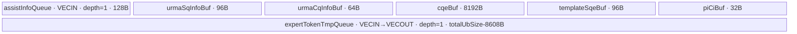

# MoeDistributeCombineSetup 950 ACLNN 算子知识

## 算子速览

| 项目 | 内容 |
|---|---|
| 实际入口 | `aclnnMoeDistributeCombineSetupGetWorkspaceSize` → `aclnnMoeDistributeCombineSetup`；公开、无版本后缀的 ACLNN 两段式接口 |
| 计算语义 | 根据 `assistInfoForCombine` 的专家累计 token 数，把 `expandX` 分段写入各 EP rank 的 HCCL window，并写通知状态；Setup 提交 URMA 后立即返回，完成确认与后处理交给 CombineTeardown |
| 输入输出 | `expandX(A,H)` BF16/FP16、`expertIds(BS,K)` INT32、`assistInfoForCombine(A*128)` INT32；声明输出 `quantExpandX(A,tokenMsgSize)` INT8、`commCmdInfo((A+epWorldSize)*16)` INT32，均为 ND |
| 执行类型 | 多任务图：HCOM wait（非 Cube 通信同步）+ 950 `Mc2ServerKernel`（非 Cube 通信/Hybrid runtime 节点）+ HCOM record + `KERNEL_TYPE_AIV_ONLY`（`AIV_VECTOR` + Scalar/MTE + 非 Cube URMA） |
| Kernel 路线 | R-001：`HasTp=false`、BF16/FP16 共用的 950 URMA 路线 |
| 核心资源 | HCCL `windowsIn/windowsOut`、SQ/CQ/PICI、GM、每 AIV 全量 UB；不使用 workspace、L1、L0A/L0B/L0C |
| 来源闭包 | `source_closed`：公开 wrapper、OpDef、950 Tiling、任务生成、AIV entry、URMA body/helper 和构建配置均闭合；生成的 `aclnnInner*` bridge、`libmc2_server.so` 实现与 HCCL runtime 是明确的框架边界 |
| 验证状态 | 已完成源码闭包检查；本次知识提取未执行编译、真机、数值或性能测试。 |

## 接口与语义

### 计算语义

令 `E_local = moeExpertNum / epWorldSize`（950 不支持共享专家），`C[j]` 为 `assistInfoForCombine[j]` 的累计 token 数。对 `expertIdx = 0..epWorldSize*E_local-1`：

```text
dstRank   = expertIdx % epWorldSize
dstExpert = expertIdx / epWorldSize
preCount  = expertIdx == 0 ? 0 : C[expertIdx - 1]
tokenNum  = C[expertIdx] - preCount
src       = expandX + preCount * H * sizeof(expandX.dtype)
dst       = windowsIn[dstRank] + pingPongOffset
            + dstExpert * maxBs * H * sizeof(expandX.dtype)
            + epRankId * E_local * maxBs * H * sizeof(expandX.dtype)
```

远端 rank 由 AIV 写入 96 B Write-with-Notify SQE；每个目的 rank 的最后一个专家附带 `notifyData=0x3f800000` 和 CQE 请求。当前 rank 不走 URMA，而是 `GM→UB→windowsIn[self]`，随后把本卡状态写成相同的 `0x3f800000`。`SyncAll<true>()` 仅保证所有 AIV 已完成 SQE 组装，再由少量 AIV 敲 JFS doorbell；接口语义明确不等待通信完成。

`commQuantMode` 在 950 仅允许 0。Kernel 按 `H*sizeof(BF16/FP16)` 原样传输，不做 INT8 量化、cast 或 round。虽然输出名为 `quant_expand_x`，固定 Commit 的 AIV body 不读取 `expertIds`，也不写 `quantExpandX`、`commCmdInfoOut` 或 `workspaceGM`；这些输出在生成 inner bridge/HCCL runtime 中是否存在别名或框架侧填充，固定仓不可见，不能从 Kernel 推测。

### 输入、输出与属性

| 参数 | shape/layout | dtype | 约束、默认值与语义 |
|---|---|---|---|
| `expandX` | `(A,H)` / ND，自动连续化 | BF16、FP16 | 非空；950 `H∈{4096,7168}`；通信源数据 |
| `expertIds` | `(BS,K)` / ND，自动连续化 | INT32 | 非空；950 `BS∈{8,16,256}`、`K∈{6,8}`；只参与 Host/Tiling shape 校验，AIV entry 参数未消费其数据 |
| `assistInfoForCombine` | `(A*128,)` / ND，自动连续化 | INT32 | 非空；AIV 只把开头 `epWorldSize*E_local=32` 个累计计数搬到 UB |
| `groupEp` | 长度 1..127 的字符串 | string | HCCL EP 通信域；四个配套算子的通信域和属性必须一致 |
| `epWorldSize` | 标量 | int64 | 公开 950 文档仅开放 `{2,8}`；950 Tiling 源码还接受 4，此更宽实现不扩张公开契约 |
| `epRankId` | 标量 | int64 | `0 <= epRankId < epWorldSize` |
| `moeExpertNum` | 标量 | int64 | 950 固定为 32，且可被 `epWorldSize` 整除 |
| `expertShardType` | 标量 | int64 | 950 仅 0 |
| `sharedExpertNum` | 标量 | int64 | 950 仅 0；OpDef 默认值 1 不满足 950 Tiling，调用者必须显式传 0 |
| `sharedExpertRankNum` | 标量 | int64 | 950 仅 0 |
| `globalBs` | 标量 | int64 | 0，或 `[BS*epWorldSize, 512*epWorldSize]`；Device 直接使用 `globalBs/epWorldSize` 作为 `maxBs`，见失败边界 |
| `commQuantMode` | 标量 | int64 | 仅 0，不量化 |
| `commType` | 标量 | int64 | 仅 2，表示 URMA |
| `commAlg` | 字符串 | string | 仅空指针或空字符串；Tiling 配置固定为 `AlltoAll=level0:fullmesh;level1:pairwise` |
| `quantExpandXOut` | `(A, tokenMsgSize)` / ND | INT8 | `tokenMsgSize=Align512(Align32(H)+Align8(H)/8*4)`；固定 AIV body 不写此地址 |
| `commCmdInfoOut` | `((A+epWorldSize)*16,)` / ND | INT32 | 固定 AIV body 不写此地址 |

无共享专家时，`E_local=32/epWorldSize`，Tiling 对 `A` 的约束为：`globalBs==0` 时 `A >= BS*epWorldSize*min(E_local,K)`；否则 `A >= globalBs*min(E_local,K)`。`assistInfoForCombine` 必须精确为 `A*128` 个 INT32，`quantExpandXOut.dim0=A`。

### 入口与版本

固定 Commit 仅公开无版本后缀的 `aclnnMoeDistributeCombineSetupGetWorkspaceSize` 与 `aclnnMoeDistributeCombineSetup`；`aclnnMoeDistributeCombineSetupTeardownCalcOutputSize` 是输出 shape 辅助接口，不是新的数值版本。公开产品表仅支持 Ascend 950DT，wrapper 在第一段入口显式要求 `GetCurNpuArch()==DAV_3510`，OpDef 也只添加 `ascend950` 配置，950 Tiling template 的 `IsCapable` 再次检查 `DAV_3510`。因此它是 950 当前实际支持的最新公开版本；目录中的 arch22 文件不能证明 A2/A3 公开支持。

## Host/Launcher 执行流程

### 参数校验与前处理

第一段 wrapper 顺序如下：

1. 检查当前 NPU 架构为 `DAV_3510`；否则返回 `ACLNN_ERR_PARAM_INVALID`。
2. `CheckNotNull` 检查 3 个输入、2 个输出和非空 `groupEp`；任一必选指针为空返回 `ACLNN_ERR_PARAM_NULLPTR`。
3. `CheckEmptyTensor` 要求每个 Tensor 至少一维且每一维大于 0，并要求 `groupEp` 长度小于 128。
4. 调用生成边界 `aclnnInnerMoeDistributeCombineSetupGetWorkspaceSize`。OpDef 的 3 个输入带 `.AutoContiguous()`，具体连续化节点由 inner bridge 生成，固定仓没有其实现。
5. Tiling 依次读取属性、检查 dtype/format/rank/shape 关系、HCCL window、平台资源，写 workspace、key、通信 tiling。

wrapper 的 `CheckParams` 对 world size、rank、专家数、通信模式等只做 `(void)`；这些值的真实检查在 `MoeDistributeCombineSetupTilingBase`/`MoeDistributeCombineSetupTilingA5`。第二段入口先通过弱符号 `NnopbaseSetHcclServerType(executor, NNOPBASE_HCCL_SERVER_TYPE_MTE)` 选择 MTE server 类型（若符号存在），再原样返回 `aclnnInnerMoeDistributeCombineSetup` 的状态。

### 参数、Workspace 与生命周期

`SetWorkspace` 只设置一个 slice：

```text
workspace[0] = PlatformAscendC::GetLibApiWorkSpaceSize()
```

该值的具体字节数由平台库返回，固定仓不可见。AIV entry 虽接收 `workspaceGM`，`Init` 将其匿名化且不读取，因此算子 body 没有 user workspace offset、别名或生命周期；workspace 仍必须按第一段返回值交给 executor，因为生成 inner bridge/库 API 可能消费它。

真正跨 rank 数据存放在 HCCL window，其 owner 是 HCCL 通信域。`dataState` 从本 rank `windowsOut + 950 KiB + 512*coreIdx` 读取，选择两个 window 半区之一；Setup 只提交发送，window/SQ/CQ/PICI 与状态必须至少存活到配套 `MoeDistributeCombineTeardown` 完成确认和后处理。四个配套接口的 group/shape 属性必须跨卡、跨层保持一致。

### 启动图与失败传播

`MoeDistributeCombineSetupCalcParamFunc` 申请一个必需附属流，名字 `aicpu kfc server`、复用键 `kfc_stream`。`Mc2MoeGenTaskCallbackV2` 为 Setup 选择 1 个 HCCL group，把隐藏 HCOM 参数插入 AIV task，并生成下列顺序：

```text
主流 HCOM record ───────────────┐
                               v
附属流 HCOM wait -> libmc2_server.so::Mc2ServerKernel
                               || 运行时通信服务
主流                           -> moe_distribute_combine_setup<false>
                                  (AIV-only，隐藏 HCOM context)
```

序列化 task 列表固定为 `[wait(attached), aicpu(attached), record(main), aicore(main)]`；record/wait 建立跨流启动关系，server 与 AIV task 的进一步事件语义由 runtime 实现。950 server task参数格式是 `{64-bit desc, one hidden hcom, tiling}`，其中 `version=1, groupNum=1, hasFfts=0, tilingOff=2, isDyn=0`；Tiling 设置 `AicpuBlockDim=4`。AIV `blockDim=CalcTschBlockDim(aivNum,0,aivNum)`，`scheduleMode=1`，即所有 AIV 批量启动。

| 节点 | Host 生成符号 | entry/执行族 | stream/blockDim | POD、输入输出与 workspace |
|---|---|---|---|---|
| N-001 HCOM wait | `Mc2MoeInsertTask` → `CreateHcomWaitTask(context,"group_ep")` | runtime HCOM wait；非 Cube 通信同步 | attached `aicpu kfc server` stream；blockDim N/A | group=`group_ep`；无 IR tensor 与算子 workspace slice |
| N-002 MC2 server | `CreateAicpuKfcTask(context,"libmc2_server.so","Mc2ServerKernel")` | `Mc2ServerKernel`；非 Cube 通信/Hybrid runtime 节点 | attached stream；Tiling 写 `AicpuBlockDim=4`，generator 不为 Setup 另行覆盖 | `{desc,hcom,tiling}`；`groupNum=1`；server 内部 buffer 固定仓不可见 |
| N-003 HCOM record | `CreateHcomRecordTask(context,"group_ep")` | runtime HCOM record；非 Cube 通信同步 | main stream；blockDim N/A | group=`group_ep`；无 IR tensor 与算子 workspace slice |
| N-004 AIV Kernel | 原始 AICore task，经 `McMoeInsertHiddenInputForAicore` 插入 1 个 HCOM | `moe_distribute_combine_setup<false>`；`AIV_VECTOR` + Scalar/MTE + 非 Cube URMA | main stream；`CalcTschBlockDim(aivNum,0,aivNum)`，batch schedule | hidden HCOM + 7 个 GM_ADDR + TilingData；body 不读 workspace，也不写两个声明输出 |

| 边 | producer / consumer | 交接介质与范围 | ordering | owner/lifetime | 失败传播 |
|---|---|---|---|---|---|
| E-001 server 启动门闩 | N-003 record → N-001 wait | runtime HCOM event，group=`group_ep`；无 tensor extent | main/attached stream 的 HCOM record-wait | runtime 持有到 wait 消费 | 任一 task 创建失败使整个 `GenerateTask` 返回失败 |
| E-002 wait→server | N-001 → N-002 | attached stream 顺序；`{desc,hcom,tiling}` 由 runtime 绑定 | 同 attached stream | executor/runtime，覆盖 server task | wait 未满足时 server 不开始；runtime 细节为外部边界 |
| E-003 record→AIV | N-003 → N-004 | main stream 顺序；AIV task携带隐藏 HCOM context | 同 main stream | executor 持有 task 参数至 launch | task 图生成失败则 N-004 不形成有效 launch |
| E-004 server↔AIV | N-002 ↔ N-004 | HCCL context、SQ/CQ/PICI、`windowsIn/windowsOut`；具体地址来自 hidden HCOM | record/wait 启动关系后允许通信服务与 AIV 协作；内部事件固定仓不可见 | HCCL 通信域，跨 Setup/Teardown 存活 | server/runtime 失败的 Device 传播实现固定仓不可见；异常 CQE在 AIV assert |
| E-005 Setup→Teardown | N-004 → 配套 CombineTeardown | peer window payload、`state*350KiB+self*512` 通知；BF16/FP16 bytes | doorbell 发布；Setup 不等待传输完成 | HCCL 通信域持有至 Teardown 完成 | 必须由 Teardown 确认；不能把 Setup 返回当作完成 |

任一 Tiling/任务生成失败都会阻止有效任务图形成；AICPU task 的创建、隐藏参数插入或 stream 获取失败返回 `GRAPH_FAILED`。AIV 内异常 CQE 通过 `ascendc_assert` 终止；正常路径敲 doorbell 后不等待远端完成。

## Route 与参数设计

### 分核与资源计算

Host 推导顺序为：

```text
attrs + tensor desc/shape
  -> epWorldSize, epRankId, E_local=32/epWorldSize, globalBs, BS, K, H, A
  -> maxBs = (globalBs == 0 ? BS : globalBs/epWorldSize)          [Host HCCL 检查]
  -> tokenMsgSize = Align512(Align32(H)+Align8(H)/8*4)
  -> hcclBuffSize = GetMaxWindowSize()/2
  -> requiredWindow = 2*E_local*maxBs*epWorldSize*Align512(Align32(2H)+44)
                      +(K+sharedExpertNum)*maxBs*Align512(2H)
  -> aivNum, totalUbSize, blockDim, AicpuBlockDim=4
  -> tiling key HasTp=false + MC2 AllToAll/AIV/URMA tiling
```

Device 使用旋转后的 `coreIdxNew=(coreIdx+epRankId)%aivNum` 两次分核：SQE 组装域为 `epWorldSize*curRankExpertNum=32`，每核按商余分 `[startExpertId,endExpertId)`；doorbell 域为 `epWorldSize`，同样按商余分 `[startRankId,endRankId)`。当 AIV 数多于工作项时，多数核区间为空，但仍参与 `SyncAll<true>()`。

Host 的 HCCL 检查在 `globalBs==0` 时用 `BS` 计算 `maxBs`；Device `Init` 却无条件令 `axisMaxBS=globalBs/epWorldSize`。两者不等价，不能把 Host fallback 外推到 Device。

### Route 选择

| 顺序 | Route | Key/模板 | 精确选择条件与优先级 | 不适用去向 |
|---:|---|---|---|---|
| 1 | R-001 950 AIV-URMA | `GET_TPL_TILING_KEY(false)`；`moe_distribute_combine_setup<false>`；binary 分 BF16/FP16 | `DAV_3510`；公开约束通过；Tiling template priority 0 且 `IsCapable=true`；`ORIG_DTYPE_EXPAND_X` 为 BF16/FP16；唯一合法 `TILINGKEY_TP=0` | API/Tiling/任务生成失败；没有第二 Route 或 Device fallback |

```text
if NPU arch != DAV_3510: ACLNN_ERR_PARAM_INVALID
else if A5 template IsCapable() == false: tiling registry 无可用模板
else if attrs/dtype/format/rank/shape/window 不合法: GRAPH_FAILED
else: key=GET_TPL_TILING_KEY(false)
      -> BF16 或 FP16 binary
      -> R-001 moe_distribute_combine_setup<false>
```

### 模板/实现执行矩阵

| Route | key/selector | dtype/shape/platform 完整命中条件 | 执行拓扑与 Kernel 节点 | 实际模板/body | 内存与同步特征 | tail/fallback |
|---|---|---|---|---|---|---|
| R-001 950 AIV-URMA | `HasTp=false`，单一合法模板参数组合；binary 为 `...BF16_INT8` 或 `...FP16_INT8` | 950；ND；输入 dtype 组合固定；950 attrs、`BS/H/K/A`、输出 shape 与 HCCL window 检查全部成功 | N-001 HCOM wait → N-002 MC2 server；N-003 HCOM record → N-004 AIV-only；无 AIC/Cube/MIX_CV，AIV 内含 Scalar/MTE/Vector 初始化和非 Cube URMA doorbell | `MoeDistributeCombineSetup<DTYPE_EXPAND_X,int32_t>::Init/Process`；`Communication`、`CurRankComm`、`CallJfsDoorbell` | 每核全量 UB；远端写 SQ/CQ/PICI/window，本卡经 UB 回环；`SyncAll` 隔开 SQE 与 doorbell | expert/rank 商余分核；self-copy UB 尾块；SQ ring 96 B 跨尾分拆；不满足直接失败 |

### 隐藏性能 Guard

| Guard | Host/Tiling 条件 | Device/资源原因 | 影响 Route | 不满足时去向 | 源码符号 |
|---|---|---|---|---|---|
| 平台 | wrapper 与 `IsCapable` 均要求 `DAV_3510` | arch35 body 和 950 MC2 server specialization | R-001 | API 或 Tiling 失败 | `aclnnMoeDistributeCombineSetupGetWorkspaceSize`；`MoeDistributeCombineSetupTilingA5::IsCapable` |
| 公开 world size | 文档 `{2,8}`；源码 Tiling `{2,4,8}` | 决定每 rank 专家数、SQE 数和 doorbell 数 | R-001 | 公开调用应限制 `{2,8}`；4 不声明支持 | `CheckEpWorldSize` |
| 专家/共享 | `moeExpertNum=32`，三个共享属性均 0 | 950 Device 路线实际固定 `E_local=32/world`，共享分支 dormant | R-001 | `GRAPH_FAILED` | `CheckMoeExpertNum`；`CheckSharedExpertAttr` |
| shape | `BS∈{8,16,256}`、`H∈{4096,7168}`、`K∈{6,8}`，并检查 A 下界和三个辅助 shape 公式 | 决定 token 字节、window stride 与累计计数消费范围 | R-001 | `GRAPH_FAILED` | `CheckTensorShapeSize`；`CheckCalcTensorShapeSizeAndSetTilingData` |
| HCCL window | `GetMaxWindowSize()/2 >= 2` 且不小于 `requiredWindow` | 两个状态半区、rank/expert 数据区和消息区必须容纳最坏 token 数 | R-001 | `GRAPH_FAILED` | `CheckHcclBuffSize` |
| UB | `totalUbSize` 来自 950 平台；Host 没有显式 `totalUbSize>=fixedUB` 检查 | `remain_ub_space=totalUbSize-fixedUB` 使用无符号减法并成为 self-copy blockLen | R-001 | 固定 950 资源外无安全 fallback | `BuffInit` |
| SQ/CQ | SQ depth/地址、CQ depth/地址来自隐藏 HCOM context；notify SQE 占两个 WQEBB | 环形 SQ、CQ poll 与 doorbell 的硬件协议 | R-001 | 空指针/坏 rank 或异常 CQE 触发 `ascendc_assert` | `PutCommNotifySQE`；`PollCommCQUpdateSQCI` |
| `globalBs` | Host 允许 0；Device 用 `globalBs/world` 直接形成 window expert stride | 0 会使 `expertPerSizeOnWin=0`，多个 expert/rank 目的地址重叠 | R-001 | 固定源码无 Device fallback；见限制 | `CheckTensorShapeSizeAndSetTilingData`；`MoeDistributeCombineSetup::Init` |

### POD/ABI

`MoeDistributeCombineSetupInfo` 是标准布局：14 个连续 `uint32_t` 后跟 2 个 `uint64_t`，`sizeof=72, alignof=8`。外层两个 MC2 类型由 `kernel_tiling/kernel_tiling.h` 提供，固定仓没有定义其 `sizeof/alignof`，所以外层结构总大小及 `moeDistributeCombineSetupInfo` 在外层的绝对 offset 不可见。

| 结构 | 字段 | 类型/位宽 | ABI 布局 | 单位 | Host/launcher producer | Device consumer | 边界 |
|---|---|---|---|---|---|---|---|
| `MoeDistributeCombineSetupTilingData` | `mc2InitTiling` | `Mc2InitTiling` / 外部定义 | 外层 offset 0；大小/对齐固定仓不可见 | 通信初始化 POD | `Mc2CcTilingConfig::GetTiling` | MC2 server/runtime；AIV `Init` 参数未读 | 必须是 TilingData 首字段 |
| `MoeDistributeCombineSetupTilingData` | `mc2CcTiling` | `Mc2CcTiling` / 外部定义 | 紧随前字段；绝对 offset 不可见 | 通信任务 POD | `Mc2CcTilingConfig::GetTiling`，并把局部镜像 offset 12 的 `protocol` 改为 1 | MC2 server/runtime；AIV `Init` 参数未读 | engine=AIV，protocol=URMA |
| `MoeDistributeCombineSetupInfo` | `epWorldSize` | `uint32_t` / 32 | offset 0 | rank 数 | required attr 转窄 | 分核、地址、循环 | 公开 `{2,8}` |
| `MoeDistributeCombineSetupInfo` | `epRankId` | `uint32_t` / 32 | offset 4 | rank id | required attr 转窄 | core 旋转、地址 | `<epWorldSize` |
| `MoeDistributeCombineSetupInfo` | `expertShardType` | `uint32_t` / 32 | offset 8 | 枚举 | optional attr 转窄 | Device 未直接读取 | 950 仅 0 |
| `MoeDistributeCombineSetupInfo` | `sharedExpertNum` | `uint32_t` / 32 | offset 12 | expert 数 | optional attr 转窄 | HCCL size | 950 仅 0 |
| `MoeDistributeCombineSetupInfo` | `sharedExpertRankNum` | `uint32_t` / 32 | offset 16 | rank 数 | optional attr 转窄 | `isShardExpert`、`E_local` | 950 仅 0 |
| `MoeDistributeCombineSetupInfo` | `moeExpertNum` | `uint32_t` / 32 | offset 20 | expert 数 | required attr 转窄 | 间接决定 `E_local` | 950 仅 32 |
| `MoeDistributeCombineSetupInfo` | `moeExpertPerRankNum` | `uint32_t` / 32 | offset 24 | expert/rank | `GetComplexAttrAndSetTilingData` | 分核和 window offset | 950 为 `32/world` |
| `MoeDistributeCombineSetupInfo` | `commQuantMode` | `uint32_t` / 32 | offset 28 | 枚举 | optional attr 转窄 | AIV 未读取 | 950 仅 0 |
| `MoeDistributeCombineSetupInfo` | `globalBs` | `uint32_t` / 32 | offset 32 | token/rank 域 | optional attr 转窄 | `axisMaxBS=globalBs/world` | 0 的 Device 行为有风险 |
| `MoeDistributeCombineSetupInfo` | `bs` | `uint32_t` / 32 | offset 36 | token | `expertIds.dim0` 转窄 | AIV 未读取 | `{8,16,256}` |
| `MoeDistributeCombineSetupInfo` | `k` | `uint32_t` / 32 | offset 40 | expert/token | `expertIds.dim1` 转窄 | AIV 未读取 | `{6,8}` |
| `MoeDistributeCombineSetupInfo` | `h` | `uint32_t` / 32 | offset 44 | element/token | `expandX.dim1` 转窄 | `axisHExpandXTypeSize` | `{4096,7168}` |
| `MoeDistributeCombineSetupInfo` | `a` | `uint32_t` / 32 | offset 48 | token 上界 | `expandX.dim0` 转窄 | AIV 未读取 | 先过 A 下界 |
| `MoeDistributeCombineSetupInfo` | `aivNum` | `uint32_t` / 32 | offset 52 | core 数 | `GetCoreNumAiv` | 两次商余分核 | 必须非 0；平台保证 |
| `MoeDistributeCombineSetupInfo` | `totalUbSize` | `uint64_t` / 64 | offset 56 | bytes/core | `GetCoreMemSize(UB)` | `BuffInit` | 必须覆盖固定 UB 子区 |
| `MoeDistributeCombineSetupInfo` | `totalWinSize` | `uint64_t` / 64 | offset 64 | bytes | `GetMaxWindowSize()/2` | ping-pong offset、OOM check | 通过 HCCL 下界检查 |
| Kernel launch ABI | `expandX/expertIds/assistInfo/quantExpandX/commCmdInfoOut/workspaceGM/tilingGM` | 7 个 `GM_ADDR` / 各 64 | 非聚合参数；按 entry 顺序 | GM byte address | executor + hidden HCOM task patch | entry；body 实际只消费 `expandX`、`assistInfo`、`tilingGM`，HCOM context 由隐藏参数取得 | 参数顺序不可改变；声明输出与 workspace 不代表 body 写入 |

### Route 源码闭包

| Route | Key/selector | Host/Tiling producer | POD/参数 | Kernel entry/router 节点 | Kernel body/直接依赖 | 构建接线 |
|---|---|---|---|---|---|---|
| R-001 950 AIV-URMA | `MoeDistributeCombineSetupTilingA5` priority 0；`GET_TPL_TILING_KEY(false)`；BF16/FP16 binary | `MoeDistributeCombineSetupTilingFunc` → registry → `MoeDistributeCombineSetupTilingFuncImpl`；`Mc2MoeGenTaskCallbackV2` | `MoeDistributeCombineSetupTilingData`、一个隐藏 HCOM、7 个 GM_ADDR | `moe_distribute_combine_setup<false>`；编译期 dtype guard | `MoeDistributeCombineSetup::Init/Process/Communication/CurRankComm/CallJfsDoorbell`；`moe_distribute_base.h` URMA helpers | `op_host/config/ascend950/moe_distribute_combine_setup_binary.json`；顶层及 op_host CMake |

## Kernel 实现

### 公共执行流程

只有 R-001。entry 声明 AIV-only，注册并读取 `MoeDistributeCombineSetupTilingData`，获取 `mc2InitTiling/mc2CcTiling` 的 GM 地址，构造 `TPipe` 与 `MoeDistributeCombineSetup<DTYPE_EXPAND_X,int32_t>`。唯一 selector 是 `HasTp=false`；`HasTp=true` 没有合法 tiling 组合，也没有 body。

`Init` 通过隐藏 HCOM 参数获得 `HcclCombinOpParam`，读每核历史 `dataState`，建立窗口、状态和 PICI 地址，计算专家/rank 分核。`Process` 重置并占满每核 UB，生成一个 96 B SQE 模板；Phase 1 为本核 expert 区间组装远端 SQE或执行本卡回环拷贝；`SyncAll<true>()` 后 Phase 2 为本核 rank 区间轮询 CQ、更新 PICI 并敲 doorbell。

### Route R-001：950 AIV-URMA

#### 适用条件

##### 选择证据

| 层级 | 文件 | 符号 | 源码谓词/参数 | 结果/下一跳 |
|---|---|---|---|---|
| API | `op_api/aclnn_moe_distribute_combine_setup.cpp` | `aclnnMoeDistributeCombineSetupGetWorkspaceSize` | `GetCurNpuArch()==DAV_3510` 后 `CheckParams` | 调 inner bridge；否则 ACLNN 错误 |
| Tiling registry | `op_host/op_tiling/arch35/moe_distribute_combine_setup_tiling_arch35.cpp` | `REGISTER_OPS_TILING_TEMPLATE(...,0)`；`IsCapable` | `GetCurNpuArch()==DAV_3510` | priority 0 950 template |
| Tiling key | `op_host/op_tiling/moe_distribute_combine_setup_tiling_base.cpp` | `SetTilingKey` | `tp=false` | `GET_TPL_TILING_KEY(false)` |
| binary | `op_host/config/ascend950/moe_distribute_combine_setup_binary.json` | 两个 `bin_filename` | BF16/FP16 输入，INT8 声明输出，ND | 选择对应 dtype binary |
| entry | `op_kernel/moe_distribute_combine_setup.cpp` | `moe_distribute_combine_setup<HasTp>` | BF16/FP16 编译 guard 且 `if constexpr(!HasTp)` | `MoeDistributeCombineSetup<DTYPE_EXPAND_X,int32_t>::Process` |

#### Device 数据流

##### 函数级调用链

```text
Mc2MoeGenTaskCallbackV2
  -> [HCOM wait, A5 Mc2ServerKernel, HCOM record, AIV kernel]
  -> moe_distribute_combine_setup<false>(7 GM_ADDR + hidden HCOM)
    -> MoeDistributeCombineSetup<ExpandXType,int32_t>::Init
      -> GetHcclContext<HCCL_GROUP_ID_0>
      -> SplitCoreCalForExpert + SplitCoreCal
    -> Process
      -> BuffInit
      -> GenerateCommWriteWithNotifySQE
      -> Communication
        -> AssistInfoLocalCopy
        -> remote: GetURMASqInfoTensor/GetPICI/SetCommWriteWithNotifySQE/PutCommNotifySQE
        -> self: CurRankComm (GM -> UB -> windowsIn[self])
      -> SyncAll<true>
      -> CallJfsDoorbell
        -> remote: PollCommCQUpdateSQCI/SendJFSDoorBell/UpdatePICI
        -> self: write completion state + DCCI
```

##### 源码等价伪码

```text
# 伪码；省略日志和类型转换
ctx = GetHcclContext(group0)
state = DCCI_load(ctx.windowsOut[self] + 950KiB + 512*core)
maxBs_device = globalBs / world
tokenBytes = H * sizeof(ExpandXType)
expertStride = maxBs_device * tokenBytes
dataHalf = state * (totalWinSize / 2)
sourceRankOffset = self * E_local * expertStride
stateStride = (world*E_local > 512 ? 256 : 512)  # A5 实际 world*E_local=32，故 512

init_UB_buffers()
template = write_with_notify_sqe(opcode=0x5)
copy C[0:world*E_local] GM -> UB

for expertIdx in this_core_expert_range:
    rank = expertIdx % world
    expert = expertIdx / world
    prev = expertIdx == 0 ? 0 : C[expertIdx-1]
    n = C[expertIdx] - prev
    src = expandX + (n > 0 ? prev*tokenBytes : 0)
    dst = windowsIn[rank] + dataHalf + expert*expertStride + sourceRankOffset
    sqe.length = max(n,1) * tokenBytes
    sqe.notify = windowsOut[rank] + state*350KiB + self*512 + 8
    if expert == E_local-1:
        sqe.notify -= 8; sqe.notifyData = 0x3f800000; sqe.cqe = 1
    if rank == self:
        if n > 0: copy src -> UB chunks -> dst
    else:
        load SQ/PICI; specialize template for rank; write 96B SQE into ring

SyncAll(all AIV)
for rank in this_core_rank_range:
    if rank == self:
        windowsOut[self][state*350KiB + self*512] = 0x3f800000; DCCI
    else:
        load SQ/CQ/PICI; optionally initialize CQE status
        sqPiLinear += 2*E_local
        poll completed CQE, update sqCi/cqCi, ring JFC/JFS doorbells
        persist PICI
# 不等待 URMA 数据传输完成；Teardown 接手
```

#### 内存与数据搬运

##### 资源与搬运表

| 层级/缓冲区 | offset/地址公式 | extent/容量公式 | dtype/layout | producer | consumer | owner/lifetime | 对齐/复用 |
|---|---|---|---|---|---|---|---|
| GM `expandX` | `base + preCount*H*sizeof(T)` | 有效发送 `tokenNum*H*sizeof(T)`；远端零 token SQE 仍写 `H*sizeof(T)` | BF16/FP16 ND 行连续 | 上游 Combine 数据 | self MTE 或远端 URMA | ACL tensor；至少到 Setup task 取数完成 | token 行无额外 padding |
| HCCL `windowsIn[rank]` 数据半区 | `base + state*(totalWinSize/2) + expert*maxBs*H*sizeof(T) + self*E_local*maxBs*H*sizeof(T)` | 每 source-rank/expert `maxBs*H*sizeof(T)` | 原始 BF16/FP16 | self MTE / remote URMA | CombineTeardown | HCCL 通信域跨接口持有 | ping-pong 半区；Device `maxBs=globalBs/world` |
| HCCL `windowsOut[rank]` 通知区 | `base + state*350KiB + self*512 + {0,8}` | 每 source rank 状态 stride 512 B；写 8 B notify 或本地首个 INT32 | 状态协议；`0x3f800000` | URMA notify / self scalar store | CombineTeardown/runtime | HCCL 通信域 | 两个 state 平面相隔 350 KiB |
| 每核历史状态 | `windowsOut[self]+950KiB+512*coreIdx` | 读首个 INT32 | INT32 | 配套算子生命周期 | `Init` | HCCL window | DCCI 后标量读 |
| SQ/CQ/PICI GM | SQ/CQ 地址来自 `HcclCombinOpParam`；PICI=`windowsOut[self]+1MiB+512*dstRank` | SQE 96 B；PICI 32 B；CQE 每项访问/失效 32 B of 64 B | URMA 协议布局 | AIV | URMA hardware/runtime | HCCL context | SQE 占两个 64 B WQEBB并处理环回 |
| UB `assistInfoQueue_` | TPipe 分配 | `Align32(world*E_local*4)`；950 为 128 B | INT32 | GM→UB `DataCopyPad` | Scalar | 每核 `Communication` | depth 1 |
| UB `urmaSqInfoBuf_` | TPipe 分配 | `Align32(sizeof(HcclAiRMAWQ))`；源码注释原始 80 B，分配 96 B | bytes | GM→UB | Scalar | 每核 Process | 32 B |
| UB `urmaCqInfoBuf_` | TPipe 分配 | `Align32(sizeof(HcclAiRMACQ))`；源码注释原始 48 B，分配 64 B | bytes | GM→UB | Scalar | 每核 doorbell phase | 32 B |
| UB `cqeBuf_` | TPipe 分配 | `32*256=8192 B` | bytes | CQ GM/`Duplicate(0xff)` | CQ poll/init | 每核 doorbell phase | 32 B；CQ depth>256 分批 |
| UB `templateSqeBuf_` | TPipe 分配 | `Align32(96)=96 B` | URMA SQE bytes | Vector zero + Scalar fields | MTE3→SQ GM | 每核 expert loop 复用 | 每轮同步防覆盖 |
| UB `piCiBuf_` | TPipe 分配 | 32 B | 8×UINT32 | PICI GM | Scalar + PICI GM | 每核 rank/expert loop 复用 | 每轮同步防覆盖 |
| UB `expertTokenTmpQueue_` | 剩余 UB | `totalUbSize - fixedUB` | UINT8 | self GM copy | self window copy | 每次 self `CurRankComm` | depth 1；按该容量分块 |
| workspace | N/A | body 不读取；Host 仅返回 lib API workspace | N/A | runtime | runtime | executor | 无算子自有切片 |
| L1/L0A/L0B/L0C/寄存器计算缓存 | N/A | 0 | N/A | N/A | N/A | N/A | 实际替代路径是 GM↔UB MTE、Scalar 和 URMA |

##### 分层内存布局



UB 之外的实际通信层级是：`expandX/assistInfo GM → 每核 UB 元数据或 self-copy 队列 → HCCL SQ/PICI/windowsIn/windowsOut GM → URMA hardware → peer window`。N-002 server 与 N-004 AIV 共享的 window/SQ/CQ/PICI owner、跨节点 ordering 和生命周期见启动图 E-004/E-005；没有 L1/L0、SIMT dynamic UB 或 NDDMA buffer。

##### 字节账与复用顺序

```text
moeSendNum = epWorldSize * E_local = 32                    # A5 无共享专家
assistUB = Align32(32*4) = 128
sqInfoUB = Align32(80) = 96                                # 80 来自源码注释
cqInfoUB = Align32(48) = 64                                # 48 来自源码注释
cqeUB = 32*256 = 8192
templateSqeUB = Align32(96) = 96
piCiUB = 32
fixedUB = 128+96+64+8192+96+32 = 8608
selfCopyUB = totalUbSize - 8608
UB_total = fixedUB + selfCopyUB = totalUbSize
workspace_total = GetLibApiWorkSpaceSize()                 # body slice = 0
L1_total = L0A_total = L0B_total = L0C_total = 0
```

| 复用子区 | 写入者 | 读取者/消费点 | 下一次覆盖 | 同步或释放依据 | 安全条件 |
|---|---|---|---|---|---|
| `assistInfoQueue_` 128 B | `AssistInfoLocalCopy` 以 `DataCopyPad` 写入 | `Communication` 标量读取累计计数 | 本次 Process 不再覆盖；循环后 `FreeTensor` | `EnQue/DeQue` + `MTE2_S` + `FreeTensor` | 累计计数必须单调，否则 UINT32 差值下溢 |
| `urmaSqInfoBuf_` 96 B | 每个远端 expert/rank 的 `GetURMASqInfoTensor` | SQE模板更新或 doorbell 读取 | 下一远端项的 MTE2 load | 使用后 `S_MTE2` 防下一轮覆盖；doorbell phase 另有 PICI event | HCOM context 中 SQ metadata 有效 |
| `urmaCqInfoBuf_` 64 B | `GetURMACqInfoTensor` | CQ init/poll/JFC doorbell | 下一远端 rank | CQ writeback 后 `MTE3_MTE2`，rank 末 events 完成 | CQ depth/address 合法 |
| `cqeBuf_` 8192 B | `InvalidateCqeStatus` 的 `Duplicate(0xff)` 或 CQ GM load | CQ status 检查与失效写回 | 下一 CQE/下一 rank | `V_MTE3`、`MTE2_S`、`S_MTE3`、`MTE3_MTE2` | 一次容纳最多 256 个 32 B 状态片，超出分批 |
| `templateSqeBuf_` 96 B | 首次 Vector zero；每 expert 由 Scalar 改地址/长度/notify | `PutCommNotifySQE` 写入 SQ GM | 下一 expert Scalar 更新 | `S_MTE3` 后写 GM，`MTE3_S` 防止下一轮提前覆盖 | SQE 固定 96 B；ring 尾正确拆分 |
| `piCiBuf_` 32 B | `GetPICI` | expert SQ PI读取；doorbell phase PI/CI更新 | 下一 expert/rank load | `MTE2_S` 后标量读，`S_MTE3` 后写回，`MTE3_MTE2` 防覆盖 | 每目的 rank 的 PICI 槽独立 |
| `expertTokenTmpQueue_` 剩余 UB | `CurRankComm` 从 `expandX` 分块 CopyIn | CopyOut 到 `windowsIn[self]` | 下一 self-copy chunk | 单 buffer `EnQue/DeQue`，每块后 `MTE3_MTE2`，末尾 `FreeTensor` | `totalUbSize>8608`；尾块把 `blockLen` 改为剩余字节 |

#### 同步、精度与尾块

##### 同步与数值边界表

| 阶段 | primitive/机制 | producer | consumer/等待点 | 保护对象 | 精度/尾块 |
|---|---|---|---|---|---|
| task 图 | main-stream record / attached-stream wait | executor 主流 | MC2 server 附属流 | server 启动关系 | runtime 具体事件实现固定仓不可见 |
| 状态读取/本地完成 | `DataCacheCleanAndInvalid` | HCCL window 状态 | Scalar load / Teardown | cache 与 GM 可见性 | `0x3f800000` 按位写入，不是 FP 计算 |
| assist/PICI/SQ/CQ GM→UB | `MTE2_S` | MTE2 | Scalar | UB 元数据 | 无 cast；按字节或 UINT32 解释 |
| SQE 标量→GM | `S_MTE3`、`MTE3_S`、`S_MTE2` | Scalar/MTE | SQ ring / 下一轮 | SQE template 和 SQ info 复用 | 96 B；ring 尾拆分 |
| 两阶段门闩 | `SyncAll<true>()` | 所有核 `Communication` | 所有核 `CallJfsDoorbell` | SQE 完整性 | 空 expert 区间核仍参与全核同步 |
| self copy | TQue + `MTE3_MTE2` | source GM | destination window / 下一块 | 单 buffer UB | 完整块 `selfCopyUB`，尾块改 `blockLen=sendBytes` |
| CQ | CQ poll、JFC doorbell、异常 assert | URMA hardware | JFS doorbell 前 PICI 更新 | SQ/CQ 可用项 | 最多 poll `cqDepth-1`；CQE status 非 0/0xff 失败 |
| 传输精度 | byte-preserving | BF16/FP16 `expandX` | peer window | token payload | 不量化、不累加、不 round；远端零 token 用一行 dummy 长度，本卡零 token不拷贝 |

#### 关键实现

##### 符号证据表

| 阶段 | 文件 | 符号/模板实例 | 实现事实 |
|---|---|---|---|
| Host/Tiling producer | `op_host/op_tiling/moe_distribute_combine_setup_tiling_base.cpp` | `MoeDistributeCombineSetupTilingFuncImpl`、`SetPlatformInfo`、`CheckHcclBuffSize` | 校验顺序、blockDim/UB/window/workspace/key |
| 950 selector/comm tiling | `op_host/op_tiling/arch35/moe_distribute_combine_setup_tiling_arch35.cpp` | `MoeDistributeCombineSetupTilingA5`、`SetHcommCfg` | DAV_3510、950 attrs/shape、AIV engine、URMA protocol |
| 任务图 | `mc2/common/op_graph/mc2_moe_gen_task_ops_utils.cpp` | `Mc2MoeGenTaskCallbackV2`、`Mc2MoeInsertTask` | 1 group 隐藏输入；wait/server/record/AIV task 顺序 |
| Kernel entry/router | `op_kernel/moe_distribute_combine_setup.cpp` | `moe_distribute_combine_setup<false>` | AIV-only、BF16/FP16 guard、唯一 HasTp=false body |
| Device body/helper | `op_kernel/arch35/moe_distribute_combine_setup_arch35.h` | `MoeDistributeCombineSetup::Init/Process/Communication/CurRankComm/CallJfsDoorbell` | 分核、window 地址、SQE、self copy、全核同步、doorbell |
| URMA helper | `op_kernel/moe_distribute_base.h` | `SetCommWriteWithNotifySQE`、`PutCommNotifySQE`、`PollCommCQUpdateSQCI` | 96 B WQE 布局、ring wrap、CQ/PICI 协议 |

## 算子特定优化

### Trick T-001：先全核组装 SQE，再统一敲 doorbell

#### 触发与源码依据

- 适用 Route：R-001。
- 触发条件：950 AIV-only URMA 路线，所有合法 shape/dtype。
- Golden 来源：[`op_kernel/arch35/moe_distribute_combine_setup_arch35.h:440-458`](../../../../../../../cann-ops-raw/ascendc/ops-transformer/be33d95bb755cedec3108f70805c1874d1792540/mc2/moe_distribute_combine_setup/op_kernel/arch35/moe_distribute_combine_setup_arch35.h#L440-L458)

**官方源码（固定 Commit 连续逐字摘录）**：

```cpp
__aicore__ inline void MoeDistributeCombineSetup<TemplateMC2TypeFunc>::Process()
{
    if ASCEND_IS_AIV { // 全aiv处理
        // URMA 通信相关Buffer初始化
        BuffInit();

        // URMA 生成WQE模板
        LocalTensor<uint8_t> templateSqeU8 = templateSqeBuf_.Get<uint8_t>();
        GenerateCommWriteWithNotifySQE(templateSqeU8);

        // Phase1: 组装SQE（按卡数*本卡专家数分核）
        Communication();

        // 全核同步，确保所有SQE组装完成
        SyncAll<true>();

        // Phase2: 按卡分核，敲doorbell
        CallJfsDoorbell();
    }
}
```

#### 机制与设计原因

Phase 1 按 32 个 `(dstRank,dstExpert)` 工作项均摊到 AIV，Phase 2 按 rank 均摊。两种分核映射不同，若某核提前敲 doorbell，URMA 可能看到同一目的 rank 尚未物化完整的专家 SQE。全核 barrier 把“写 SQ ring”与“发布新 SQ PI”分成生产/提交两阶段；`sqPiLinear += 2*E_local` 与每个 notify SQE 占两个 WQEBB严格对应。

#### 迁移边界

- 适用：多核并行生成同一通信队列、随后由另一种分核发布队列的 AIV 通信 Kernel。
- 前提：所有参与核都执行同一个 `SyncAll`，空工作核也不能提前退出；SQ/PICI 属于同一 HCCL context。
- 失效：改成每核独立 SQ、单核组装，或用 runtime 原子发布协议时必须重建同步关系。
- 未验证：本次知识提取未执行编译、真机、数值或性能测试。

#### 错误做法

固定源码的明确反例边界是把 `CallJfsDoorbell` 移到单核 `Communication` 完成之后：这破坏全核 SQE 完整性门闩，可能发布未完成的 WQE 集合。

### Trick T-002：远端零 token 保留协议 SQE，最后专家合并完成通知

#### 触发与源码依据

- 适用 Route：R-001。
- 触发条件：每个远端 `(rank,expert)` 都组装 SQE；`curTokenNum==0` 走 dummy 长度，`sendExpertId==E_local-1` 写完成状态并请求 CQE。
- Golden 来源：[`op_kernel/arch35/moe_distribute_combine_setup_arch35.h:358-371`](../../../../../../../cann-ops-raw/ascendc/ops-transformer/be33d95bb755cedec3108f70805c1874d1792540/mc2/moe_distribute_combine_setup/op_kernel/arch35/moe_distribute_combine_setup_arch35.h#L358-L371)

**官方源码（固定 Commit 连续逐字摘录）**：

```cpp
WriteWithNotifySQEInfoParams notifySqeInfo = {
    (uint64_t)expandXGM_ +
        (likely(curTokenNum > 0U) ? static_cast<uint64_t>(preCount) * axisHExpandXTypeSize_ : 0U),
    (uint64_t)(GetWinAddrByRankId(sendRankId, sendExpertId) + epDataOffsetOnWin_),
    static_cast<uint32_t>(axisHExpandXTypeSize_) * max(curTokenNum, 1U),
    (uint64_t)(GetWinStateAddrByRankId(sendRankId) + epStateOffsetOnWin_ + sizeof(uint64_t)),
    0U,
    0U};

if (unlikely(sendExpertId == curRankExpertNum_ - 1U)) {
    notifySqeInfo.notifyAddr -= sizeof(uint64_t);
    notifySqeInfo.notifyData = 0x3f800000;
    notifySqeInfo.cqe = 1U;
}
```

#### 机制与设计原因

远端每个专家始终占一个 96 B notify SQE；零 token 不删除队列项，而是从 `expandX` 起点发送一行 dummy 长度，使每 rank 的 WQE 数固定为 `E_local`，doorbell 可直接推进 `2*E_local`。前 `E_local-1` 项只更新 `state+8` 的辅助通知，最后一项才写 `0x3f800000` 到完成状态并申请 CQE，从而把“该来源 rank 的专家序列已提交”压到最后一个 WQE。当前 rank 零 token 则跳过 self copy，但仍在 doorbell phase写本卡完成状态。

#### 迁移边界

- 适用：接收端协议依赖固定 WQE 数、最后一项作为批次完成标志的 URMA 批发送。
- 前提：dummy 目的区允许被一行数据覆盖且接收端依据累计计数忽略它；`expandX` 非空；专家遍历顺序保持 rank-fast/expert-slow。
- 失效：接收端把所有写入长度都当有效 token，或 SQ 深度/doorbell 增量按非空专家数计算时不能复用。
- 未验证：本次知识提取未执行编译、真机、数值或性能测试。

#### 错误做法

不能简单跳过远端 `curTokenNum==0` 的 SQE，否则实际 WQEBB 数与 `sqPiLinear += 2*E_local` 不一致；固定源码已经展示了保留 dummy SQE 的真实 fallback。

### Trick T-003：状态驱动的 window 双半区与每核历史状态

#### 触发与源码依据

- 适用 Route：R-001。
- 触发条件：每次 Setup 都从 HCCL window 的每核状态槽读取 `dataState`。
- Golden 来源：[`op_kernel/arch35/moe_distribute_combine_setup_arch35.h:159-169`](../../../../../../../cann-ops-raw/ascendc/ops-transformer/be33d95bb755cedec3108f70805c1874d1792540/mc2/moe_distribute_combine_setup/op_kernel/arch35/moe_distribute_combine_setup_arch35.h#L159-L169)

**官方源码（固定 Commit 连续逐字摘录）**：

```cpp
axisHExpandXTypeSize_ = static_cast<uint64_t>(moeDistributeCombineSetupInfo_->h) *
                        static_cast<uint64_t>(sizeof(ExpandXType));              // 一个token占用内存
expertPerSizeOnWin_ = static_cast<uint64_t>(axisMaxBS_) * axisHExpandXTypeSize_; // 单个专家可能占用的最大空间

winDataSizeOffset_ =
    static_cast<uint64_t>(dataState_) * (static_cast<uint64_t>(moeDistributeCombineSetupInfo_->totalWinSize) >> 1);
stateOffset_ = (moeSendNum_ > STATE_COUNT_THRESHOLD) ? (STATE_OFFSET >> 1) : STATE_OFFSET;
epStateOffsetOnWin_ = static_cast<uint64_t>(moeDistributeCombineSetupInfo_->epRankId) * stateOffset_;
epDataOffsetOnWin_ = static_cast<uint64_t>(moeDistributeCombineSetupInfo_->epRankId) *
                     static_cast<uint64_t>(moeDistributeCombineSetupInfo_->moeExpertPerRankNum) *
                     expertPerSizeOnWin_; // 前面rank数据区占用内存地址偏移
```

#### 机制与设计原因

历史 `dataState` 选择 `totalWinSize` 内的两个等大数据半区；状态本身也在 `windowsOut + dataState*350 KiB` 的两个平面间切换。这样相邻 Setup/Teardown 生命周期可以在不同半区交接，避免新一轮覆盖仍由 Teardown 消费的数据。source-rank 与 destination-expert 的 stride 均显式进入地址，不依赖 SQE 顺序推断布局。

#### 迁移边界

- 适用：Setup/Teardown 拆分且窗口由跨调用状态位选择的双缓冲通信协议。
- 前提：配套算子统一维护每核 `dataState`；`totalWinSize` 是已通过 Host 检查的偶数可用区；所有 rank 的 `globalBs/H/E_local` 相同。
- 失效：单独调用 Setup、状态槽未初始化/未翻转，或改变 window 布局而未同步修改 Teardown。
- 未验证：本次知识提取未执行编译、真机、数值或性能测试。

#### 错误做法

不能把 `totalWinSize` 全部当成本轮容量，也不能省略 `dataState*(totalWinSize/2)`；那会让相邻轮次写入同一半区。固定仓未提供绕开状态协议的可验证 fallback。

## 模板与实现对比

| 对比维度 | R-001 950 AIV-URMA | 无第二 Route | 设计选择依据 |
|---|---|---|---|
| 命中条件/优先级 | DAV_3510，priority 0，`HasTp=false`，BF16/FP16 | N/A | 950 wrapper、OpDef、Tiling 与 binary 四层一致 |
| 模板与 dtype | `moe_distribute_combine_setup<false>`；`MoeDistributeCombineSetup<BF16/FP16,int32_t>` | N/A | 两个 binary 只改变 `ExpandXType`，节点图、POD、内存与同步相同，故合并为一条 Route |
| 循环与分核 | 32 个 expert 工作项和 `epWorldSize` 个 rank 分别商余分核并按 rank 旋转 core id | N/A | `scheduleMode=1` 全 AIV 启动；空工作核仍参与 barrier |
| Queue/TBuf/寄存器/dynamic UB/通信 window | 2 个 depth-1 Queue + 5 个 TBuf；无可证明寄存器容量、SIMT dynamic UB；HCCL 双半区 window/SQ/CQ/PICI | N/A | AIV 同时承担元数据、self-copy 和 URMA发布；无 Cube/MIX_CV |
| 内存总占用与复用 | 每核 UB=8608 B 元数据+全部剩余 self-copy区；body workspace=0；window跨 Setup/Teardown | N/A | TPipe `Reset` 后一次性占满平台 UB；单 buffer依事件复用 |
| 搬运/Vector/SIMT/NDDMA/通信 API | `DataCopyPad`、`Duplicate`、Scalar SQE fields、URMA Write-with-Notify、JFS/JFC doorbell；无 SIMT/NDDMA | N/A | 远端数据不经本地 UB，当前 rank 使用 GM→UB→window 回环 |
| 同步、精度与 tail | SQE→`SyncAll`→doorbell；BF16/FP16按字节发送；商余分核、UB/CQ/SQ ring tail | N/A | 保证发布前 WQE 完整，Setup 不等待通信完成 |
| fallback/失败边界 | 参数/资源失败即终止；异常 CQE assert；没有备用 key | N/A | 单一 950 specialization |

## 平台差异

| 项目 | A2 | A3 | 950 |
|---|---|---|---|
| 支持状态 | 公开文档不支持；wrapper 运行时拒绝 | 公开文档不支持；wrapper 运行时拒绝 | Ascend 950DT 支持；公开 world size `{2,8}` |
| Host/Launcher | 不进入公开入口 | 不进入公开入口；文档残留一段 A3 参数说明不改变产品表结论 | `DAV_3510` Tiling priority 0；950 MC2 server；MTE server type；AicpuBlockDim=4 |
| Kernel/资源 | 不提取 arch22 为公开路线 | 不提取 arch22 为公开路线 | arch35 AIV-only；AIV URMA；`windowsIn/windowsOut` 双半区；全量 UB |

## 限制与失败边界

- 公开 API 要求与 DispatchSetup、DispatchTeardown、CombineTeardown 配套；Setup 自身不等待 URMA 完成，不能把返回成功解释为远端数据已可消费。
- 公开文档仅支持 `epWorldSize∈{2,8}`，而 950 Tiling 实现还接受 4；知识卡遵守公开范围，不把 4 宣布为可用配置。
- `globalBs=0` 被文档和 Host Tiling 接受，Host HCCL 容量检查也以 `BS` 代替；但 AIV `Init` 直接计算 `axisMaxBS=globalBs/epWorldSize`，使 expert/rank window stride 为 0。固定源码没有修正或 fallback，无法证明该配置 Device 安全。
- `sharedExpertNum` 的 OpDef 默认值为 1，而 950 Tiling只接受 0；公开调用必须传 0，不能依赖默认值。
- Tiling 只校验 `assistInfoForCombine.shape=A*128`，不校验其累计值单调、有界；Device 用 UINT32 相减形成 `curTokenNum`。错误内容可能下溢并生成超长 WQE。
- 远端零 token 仍发送 `H*sizeof(T)` 字节的 dummy 行；接收端必须用配套累计计数过滤，不能按物理写入长度推导有效 token 数。
- 固定 AIV body 不读取 `expertIds`、`quantExpandX`、`commCmdInfoOut`、`workspaceGM`，也不使用传入的 `mc2InitTiling/mc2CcTiling` 指针；生成 inner bridge、`libmc2_server.so` 和 HCCL runtime 是否对声明输出或通信 POD 做额外处理，在固定仓不可见。
- `BuffInit` 用无符号减法得到 self-copy 剩余 UB，Host 没有显式容量 guard；只可在 950 平台报告的 UB 配置上复用。
- SQ/CQ 深度、地址、状态初始化和异常恢复依赖 HCCL context；错误 CQE status 会 `ascendc_assert`，没有 Kernel 内降级路线。
- 本次知识提取未执行编译、真机、数值或性能测试。

## 源码索引

### 链路索引

| 链路阶段 | 文件 | 关键符号 | 支撑内容 |
|---|---|---|---|
| 公开约束 | `mc2/moe_distribute_combine_setup/docs/aclnnMoeDistributeCombineSetup.md` | 产品表、函数原型、约束说明 | 950 支持、公开 attrs/shape、异步 Setup/Teardown 语义 |
| 入口声明 | `mc2/moe_distribute_combine_setup/op_api/aclnn_moe_distribute_combine_setup.h` | `aclnnMoeDistributeCombineSetup*` | 无版本后缀公开 API、参数顺序 |
| 入口实现 | `mc2/moe_distribute_combine_setup/op_api/aclnn_moe_distribute_combine_setup.cpp` | `CheckParams`、两个公开入口 | DAV_3510 gate、浅层校验、MTE server setter、inner bridge |
| OpDef | `mc2/moe_distribute_combine_setup/op_host/moe_distribute_combine_setup_def.cpp` | `ops::MoeDistributeCombineSetup` | dtype/format/AutoContiguous、attrs、ascend950、MC2 group |
| Host/Tiling | `mc2/moe_distribute_combine_setup/op_host/op_tiling/moe_distribute_combine_setup_tiling_base.cpp` | `MoeDistributeCombineSetupTilingFuncImpl` | 公共校验、shape/window/workspace/platform/key |
| 950 Tiling | `mc2/moe_distribute_combine_setup/op_host/op_tiling/arch35/moe_distribute_combine_setup_tiling_arch35.cpp` | `MoeDistributeCombineSetupTilingA5` | 950 selector/约束、AIV URMA MC2 tiling |
| POD | `mc2/moe_distribute_combine_setup/op_kernel/moe_distribute_combine_setup_tiling_data.h` | `MoeDistributeCombineSetupInfo` | 逐字段 ABI |
| 算子任务注册 | `mc2/moe_distribute_combine_setup/op_graph/moe_distribute_combine_setup_gen_task.cpp` | `MoeDistributeCombineSetup*Func` | 附属流和 V2 task callback |
| 公共任务图 | `mc2/common/op_graph/mc2_moe_gen_task_ops_utils.cpp` | `Mc2MoeGenTaskCallbackV2`、`Mc2MoeInsertTask` | hidden HCOM、wait/server/record/AIV 顺序 |
| Kernel entry | `mc2/moe_distribute_combine_setup/op_kernel/moe_distribute_combine_setup.cpp` | `moe_distribute_combine_setup<false>` | AIV-only、dtype guard、entry ABI |
| 950 body | `mc2/moe_distribute_combine_setup/op_kernel/arch35/moe_distribute_combine_setup_arch35.h` | `MoeDistributeCombineSetup` | 地址、分核、UB、SQE、self copy、doorbell |
| URMA helper | `mc2/moe_distribute_combine_setup/op_kernel/moe_distribute_base.h` | `HcclCombinOpParam` 与 URMA helpers | SQ/CQ/PICI ABI、WQE和 ring tail |
| binary 配置 | `mc2/moe_distribute_combine_setup/op_host/config/ascend950/moe_distribute_combine_setup_binary.json` | 两个 `bin_filename` | 950 BF16/FP16 binary 接线 |
| 构建接线 | `mc2/moe_distribute_combine_setup/CMakeLists.txt` | 子目录扫描与 `MC2_COMPILE` | op_api/op_host/op_graph/kernel 模块入口 |

每行只写一个文件，并确保该文件存在于 Frontmatter `sources`。

### 实现复用检查

| 检查项 | 可复用事实 | 不得改变的约束 | 源码符号 |
|---|---|---|---|
| ABI/POD | own info 为 72 B/8 对齐；hidden HCOM group 数为 1；entry 7 个 GM_ADDR | own info 字段顺序/位宽；MC2 POD 必须在前；entry 参数顺序；`protocol=1` | `MoeDistributeCombineSetupInfo`；`CreateAicpuTaskMc2Moe`；entry |
| 调用顺序 | wait/server/record/AIV；AIV 内 Init→SQE→barrier→doorbell | 不能在全部 SQE 完成前发布 doorbell；Setup 不承担 Teardown | `Mc2MoeInsertTask`；`Process` |
| workspace/内存 | body 不用 workspace；window 按 state/source-rank/expert 三层 offset；每核 UB 全量切片 | `globalBs` stride、window 半区、状态平面、8608 B fixed UB 与 self-copy tail | `SetWorkspace`；`Init`；`BuffInit` |
| 同步 | record/wait、MTE/Scalar events、`SyncAll`、CQ/PICI doorbells、DCCI | event 方向、全核参与、PICI 写回与 CQE失效顺序 | `Communication`；`CallJfsDoorbell`；URMA helpers |
| 精度与尾块 | BF16/FP16按字节发送；self-copy 和 SQ/CQ ring 均有 tail | 不添加量化/cast；远端零 token dummy SQE和最后专家 notify 协议 | `Communication`；`CurRankComm`；`PutCommNotifySQE` |
| 失败边界 | Host 参数/资源失败、任务生成失败、异常 CQE assert | 不把 world=4、globalBs=0 或声明输出未写解释为已验证行为 | 950 checks；`CheckCqeStatus` |