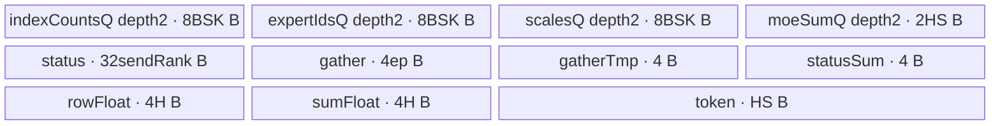

# MoeDistributeCombineTeardown 950 ACLNN 算子知识

## 算子速览

| 项目 | 内容 |
|---|---|
| 实际入口 | `aclnnMoeDistributeCombineTeardownGetWorkspaceSize` + `aclnnMoeDistributeCombineTeardown`；固定提交中唯一、无版本后缀的公开 ACLNN |
| 计算语义 | 等待配套 `MoeDistributeCombineSetup` 写完当前 ping-pong 窗口，对每个本地 token 的 K 路专家结果执行 FP32 权重乘加并写 `xOut` |
| 输入输出 | 六个必选输入、两个 optional 输入；输出 `[BS,H]` FP16/BF16 ND |
| 执行类型 | 非 Cube 通信/Hybrid（`AIV_VECTOR` body）：单 Kernel 从 HCCL window 轮询状态并执行 Vector 加权求和；entry 显式 `KERNEL_TYPE_AIV_ONLY`，body 仅在 `ASCEND_IS_AIV` 内执行 |
| Kernel 路线 | R-001 `HasTp=false` 的 950 本地窗口归并；FP16/BF16 两个 binary 复用同一模板 body |
| 核心资源 | HCCL `windowsIn/windowsOut` GM、4 个 depth=2 VECIN Queue、7 个实际分配 TBuf、FP32 累加；Device body 不读 ACLNN workspace |
| 来源闭包 | `source_closed`：公开 ACLNN→生成式 inner bridge 边界→950 Host/Tiling/POD→单个非 Cube Hybrid/AIV entry+body→HCCL window ABI、直接 helper 与构建接线闭合 |
| 验证状态 | 已完成源码闭包检查；本次知识提取未执行编译、真机、数值或性能测试。 |

## 接口与语义

### 计算语义

公开文档给出 `ataOut=AllToAllV(expandX)`、`xOut=Sum(expertScales*ataOut+expertScales*sharedExpertX)`。950 公开约束不支持共享专家，实际 body 也不读取 `expandX/quantExpandX/commCmdInfo/xActiveMask/sharedExpertX`；它对 token `b`、top-K 槽 `j` 执行：

```text
idx    = expandIdx[b*K+j]
expert = expertIds[b*K+j]
row    = windowsIn[self][state][expert][idx, 0:H]
xOut[b,:] = Cast_RINT(Σ(j=0..K-1) float32(row) * expertScales[b*K+j])
```

`state` 从 `windowsOut[self]+STATE_WIN_OFFSET+512*coreId` 读取并立即翻转；数据窗口用 `state*totalWinSize/2`。计算前，每个有 rank 任务的 core 轮询 `windowsOut[self]+WIN_STATE_OFFSET*state` 的状态，全部为 1 后清零，随后 `SyncAll<true>()` 使所有 AIV 再开始读窗口。

### 输入、输出与属性

| 参数 | shape/layout | dtype | 约束、默认值与语义 |
|---|---|---|---|
| `expandX` | `[A,H]` ND | FP16/BF16 | 必选；body 不直接读，H/dtype 决定窗口行和输出 |
| `quantExpandX` | `[A,tokenMsgSize]` ND | INT8 | `tokenMsgSize=Align512(Align32(H)+Align8(H)/8*4)`；非量化 Route 不直接读 |
| `expertIds` | `[BS,K]` ND | INT32 | 全量 `BS*K` 搬入每核 UB，值参与 expert 窗口地址 |
| `expandIdx` | `[BS*K]` ND | INT32 | 参与专家窗口行地址；头文件注释写 2D，但 docs、Host、body 均为 1D |
| `expertScales` | `[BS,K]` ND | FP32 | 每路窗口行标量权重 |
| `commCmdInfo` | `[(A+epWorldSize)*16]` ND | INT32 | 来自 CombineSetup；body 不直接读 |
| `xActiveMaskOptional` | `[BS]` ND | BOOL | 可空；非空只做 Host 校验，body 不读 |
| `sharedExpertXOptional` | `[BS,H]` 或 `[a,b,H]`,`a*b=BS` ND | 同 `expandX` | 可空；950 不支持共享专家且 body 不读 |
| `groupEp` | string | - | 长度 `[1,128)`；四个配套算子与网络各层必须一致 |
| `epWorldSize` | scalar | INT64→UINT32 | 公开 950 仅 2、8；Tiling 额外接受 4，不扩大公开域 |
| `epRankId` | scalar | INT64→UINT32 | `[0,epWorldSize)` |
| `moeExpertNum` | scalar | INT64→UINT32 | 950 固定 32 |
| `expertShardType` | scalar | INT64→UINT32 | 仅 0 |
| `sharedExpertNum/sharedExpertRankNum` | scalar | INT64→UINT32 | 950 均仅 0；OpDef 的 sharedExpertNum 默认 1，须显式传 0 |
| `globalBs` | scalar | INT64→UINT32 | 0，或 `[BS*epWorldSize,512*epWorldSize]`；body 原样用 `globalBs/epWorldSize`，源码未归一化 0 |
| `commQuantMode` | scalar | INT64 | 仅 0 |
| `commType` | scalar | INT64 | 公开 950 仅 2/URMA；头文件/OpDef 默认 0 会被 Tiling 拒绝 |
| `commAlg` | string | - | 仅空指针或空串 |
| `xOut` | `[BS,H]` ND | 同 `expandX` | K 路 FP32 加权和经 `CAST_RINT` 降精度 |

公开 950 离散 shape 为 `BS∈{8,16,256}`、`H∈{4096,7168}`、`K∈{6,8}`。全部输入在 OpDef 启用 `AutoContiguous()`；连续化对象由 executor 持有。

### 入口与版本

README 明确目录只包含该算子的 ACLNN；docs、头文件和实现只声明无版本后缀的两段式入口，没有 V2/V3，因此它是 950 最新公开版本。第一段显式拒绝非 `DAV_3510`，检查必选 tensor、输出与 `groupEp`；其余 shape/dtype/layout/attrs 交给 inner 后的 Tiling。第二段若弱符号存在则设置 HCCL server type `MTE`，再在调用者 stream 上执行 inner bridge。自动生成的 inner bridge 在固定仓不可见，属于框架边界；算子自有 selector、POD、entry/body 均已闭合。

## Host/Launcher 执行流程

### 参数校验与前处理

1. ACLNN 第一段要求架构 `DAV_3510`，拒绝六个必选输入、`xOut`、空/超长 `groupEp`。
2. OpDef 声明 ND dtype、optional 性及 `AutoContiguous()`；infer shape 令输出为 `[expertIds.dim0,expandX.dim1]`，dtype 跟随 `expandX`。
3. `TilingRegistry::DoTilingImpl` 按 `std::map<int32_t,...>` 的 priority 升序迭代（注册宏注释也明确数值越小优先级越高）；priority 0 950 类仅在 `DAV_3510` capable，950 入口不把 arch22 实现当作 fallback。
4. 950 Tiling 顺序执行 attrs→dims/shape→离散 BS/H/K→dtype→format→HCCL window 检查；失败立即 `GRAPH_FAILED`。
5. 第二段设置 MTE server type 后调用 inner；inner 状态原样返回。

### 参数、Workspace 与生命周期

Tiling 报告 `workspace[0]=16 MiB SYSTEM+16 MiB SDMA=32 MiB`。调用者分配并保持到第二段 stream 完成；entry 接收 `workspaceGM`，但 `Init` 的该形参被注释且 body 不读，故固定源码没有算子自有 workspace 数据边。

HCCL window 独立于该 workspace。记 `W=GetMaxWindowSize()`：它把 `HCCL_BUFFSIZE`（默认 200 MiB）从 MiB 转为 bytes；Tiling 写 `totalWinSize=W/2`，body 再以 `dataState*(totalWinSize/2)` 选择每个 `W/4` 的 ping-pong 半区。`windowsIn/out` 的创建释放在 runtime/配套算子边界；Teardown 消费数据区、清除 ready flag 并翻转下次 state。

### 启动图与失败传播

```text
GetWorkspaceSize -> generated inner -> MoeDistributeCombineTeardownTilingFunc
  -> priority-0 A5 Tiling -> POD/blockDim/32MiB/AIV+URMA config
Execute -> set MTE server type -> generated inner, same stream
  -> moe_distribute_combine_teardown<false>  # 唯一 AIV_ONLY Device 节点
     -> Init -> AlltoAllBuffInit -> WaitDispatch -> SyncAll -> CopyIn -> LocalWindowCopy
```

| 节点/边 | entry/POD/blockDim | 输入→输出 | ordering/owner/lifetime | 失败传播 |
|---|---|---|---|---|
| 前置协议边 | 配套 CombineSetup，不属于本算子 Device 节点 | Setup 写 window/status，Teardown 读 | docs 要求 Setup 先调用；HCCL runtime 持有 | flag 不到达时无超时轮询 |
| K-001 | `<false>`；完整 POD；`CalcTschBlockDim(aivNum,0,aivNum)` | metadata+windows→xOut，并清状态 | 单 kernel `SyncFunc/PipeBarrier/SyncAll` | Host/Tiling/launch 错误由 executor 返回 |

OpDef 的 `multiKernelSupportDynamicGraph` 是能力元数据；固定闭包只发现一个 Teardown Device kernel。AIV engine+URMA 只是上下文配置，body 无 AICPU/CCU/NDDMA/SIMT entry，也不发 URMA SQE。

## Route 与参数设计

### 分核与资源计算

Host 取 `aivNum=GetCoreNumAiv()`，设置 `blockDim=CalcTschBlockDim(aivNum,0,aivNum)`、`AicpuBlockDim=4` launcher/runtime 元数据与 batch schedule mode；固定闭包中唯一可达 Device body 仍为 `AIV_ONLY`，未发现第二个 AICPU kernel body。`totalUbSize` 写入 POD 但不参与 selector。

```text
sendRankNum = epWorldSize/aivNum + (core < epWorldSize%aivNum)
startRank   = (epWorldSize/aivNum)*core + min(core, epWorldSize%aivNum)
tokenCount  = BS/aivNum + (core < BS%aivNum)
beginToken  = (BS/aivNum)*core + min(core, BS%aivNum)
```

每核都分配相同 UB、复制全量 `BS*K` metadata；无 rank 的 core 跳过轮询，无 token 的 core 不进入 token loop，但都参与全核 barrier。

### Route 选择

| 顺序 | Route | Key/模板 | 精确选择条件与优先级 | 不适用去向 |
|---:|---|---|---|---|
| 1 | R-001 950 本地窗口归并 | `GET_TPL_TILING_KEY(false)`；`moe_distribute_combine_teardown<false>` | priority 0；DAV_3510；公开 attrs/shape/dtype/ND/HCCL checks 全通过；BF16/FP16 | API/Host 失败；无 Device fallback |

```text
arch != DAV_3510 -> ACLNN error
arch == DAV_3510 -> A5 checks -> GET_TPL_TILING_KEY(false)
  -> BF16: MoeDistributeCombineTeardown<bfloat16,int32_t>
  -> FP16: MoeDistributeCombineTeardown<half,int32_t>
other dtype/key -> no body/output
```

### 模板/实现执行矩阵

| Route | key/selector | dtype/shape/platform 完整命中条件 | 执行拓扑与 Kernel 节点 | 实际模板/body | 内存与同步特征 | tail/fallback |
|---|---|---|---|---|---|---|
| R-001 | tp=false | 950；FP16/BF16；BS 8/16/256,H 4096/7168,K 6/8；公开 ep 2/8；expert 32；无共享/量化；URMA | 单 K-001 AIV | `MoeDistributeCombineTeardown<T,int32_t>` | ping-pong GM；4 depth-2 queues；status poll+SyncAll；FP32 sum | quotient/remainder 分核，无 H tile tail；Host 失败终止 |

### 隐藏性能 Guard

| Guard | Host/Tiling 条件 | Device/资源原因 | 影响 Route | 不满足时去向 | 源码符号 |
|---|---|---|---|---|---|
| 950 | arch==DAV_3510 | 仅 arch35 body 被 include | R-001 | error | API gate/`IsCapable`/entry guard |
| 固定 shape | BS/H/K 离散集合 | body 整行 H 与全量 BSK 常驻 UB | R-001 | GRAPH_FAILED | `CheckBsHKSize` |
| no-quant/no-shared | quant=0,shared=0 | body 只读普通窗口行 | R-001 | GRAPH_FAILED | 950 attrs checks |
| URMA | commType=2；engine=AIV；protocol=1 | 复用 Setup 已填窗口；本 kernel 仅轮询/读 | R-001 | GRAPH_FAILED | `CheckAttrsNullptr`,`SetHcommCfg` |
| HCCL window | 记 `W=GetMaxWindowSize()`、`B=localExpert*BS*ep*Align512(Align32(2H)+44)+(K+shared)*BS*Align512(2H)`；Host 检查 `W/2>=2B`，等价于每个 `W/4` 数据半区至少为 `B` | 0/1 两个数据半区的容量 | R-001 | GRAPH_FAILED | `CheckHcclBuffsize` |
| UB necessary | `24BSK+14H+32sendRank+4ep+8 <= UB` | 所有 InitBuffer 请求 | R-001 | 无 UB fallback | `AlltoAllBuffInit` |
| status stride | 当前 950 `moeSendNum=32<=512` | 512 B/rank，1 block+15 blocks stride | R-001 | >512 分支公开不可达 | `WaitDispatch` |
| compile guard | expand dtype BF16/FP16 且 !HasTp | 其他实例不执行 body | R-001 | no output | entry |

### POD/ABI

`MoeDistributeCombineTeardownInfo` 在未见 packing pragma 的固定源码中按自然布局推导为：12 个 UINT32 offset 0..47，bool 在 48/49，padding 50..55，UINT64 在 56/64，`sizeof=72,alignof=8`；Host 与 Device 共用同一结构头。本次未通过编译验证 ABI 推导。外层 `Mc2InitTiling/Mc2CcTiling` 定义来自外部 `kernel_tiling`，字段级布局在固定仓不可见。

| 结构 | 字段 | 类型/位宽 | ABI 布局 | 单位 | Host/launcher producer | Device consumer | 边界 |
|---|---|---|---|---|---|---|---|
| outer | `mc2InitTiling` | external POD | offset 0,size 不可见 | comm cfg | `Mc2CcTilingConfig::GetTiling` | runtime | failure→Host error |
| outer | `mc2CcTiling` | external POD | offset/size 不可见 | comm cfg | GetTiling + protocol=1 | runtime | AIV/URMA |
| Info | `epWorldSize` | u32 | 0 | rank | attr cast | split/axisMaxBS | public 2/8 |
| Info | `epRankId` | u32 | 4 | rank | attr cast | self windows | `<epWorldSize` |
| Info | `expertShardType` | u32 | 8 | enum | attr cast | unused | 0 |
| Info | `sharedExpertNum` | u32 | 12 | count | attr cast | Host capacity only | 0 |
| Info | `sharedExpertRankNum` | u32 | 16 | rank | attr cast | shared offset | 0 |
| Info | `moeExpertNum` | u32 | 20 | expert | attr cast | unused directly | 32 |
| Info | `moeExpertPerRankNum` | u32 | 24 | expert/rank | `moe/(ep-sharedRank)` | moeSend/window offset | exact division |
| Info | `globalBs` | u32 | 28 | token/domain | raw attr cast | `axisMaxBS=globalBs/ep` | 0 not normalized |
| Info | `bs` | u32 | 32 | token | expertIds dim0 | BSK/token split | 8/16/256 |
| Info | `k` | u32 | 36 | lane/token | expertIds dim1 | BSK/K loop | 6/8 |
| Info | `h` | u32 | 40 | element/row | expandX dim1 | bytes/Vector/output | 4096/7168 |
| Info | `aivNum` | u32 | 44 | core | platform | split | must nonzero |
| Info | `isActiveMask` | bool | 48 | presence | optional shape | unused body | Host only |
| Info | `hasSharedExpertX` | bool | 49 | presence | optional shape | unused body | Host only |
| Info | padding | 6B | 50..55 | ABI | compiler | N/A | immutable |
| Info | `totalUbSize` | u64 | 56 | bytes | platform UB | unused body | no compare |
| Info | `totalWinSize` | u64 | 64 | bytes | maxWindow/2 | ping-pong/OOM | capacity checked |

### Route 源码闭包

| Route | Key/selector | Host/Tiling producer | POD/参数 | Kernel entry/router 节点 | Kernel body/直接依赖 | 构建接线 |
|---|---|---|---|---|---|---|
| R-001 | priority0 950; tp=false | launcher→registry→950/base Tiling | complete POD+HCCL context | single `<false>` BF16/FP16 entry | arch35 class; SyncFunc; Setup window ABI | op_host CMake depends common/setup; ascend950 binary JSON |

## Kernel 实现

### 公共执行流程

唯一 entry 注册 POD、建 `TPipe`，对 BF16/FP16 且 `HasTp=false` 实例化 body。`Init` 取得 core 和 `GetHcclContext<HCCL_GROUP_ID_0>()` 返回的 HCCL context，读翻 per-core state，绑定 metadata/output，算窗口和分核 offset。`Process` 在 AIV 侧轮询 `windowsOut[self]` 状态、全核 barrier，从 `windowsIn[self]` 读行并做 K 路 FP32 加权和。这是非 Cube 通信窗口协议与 `AIV_VECTOR` 计算的单节点 Hybrid；无 router switch、跨 kernel workspace、Cube/L1/L0、SIMT、NDDMA 或 Atomic。

K-001 不做计算/通信交叠：只有当本核所负责 rank 的 flag 全部到达、清零已发出，且所有 AIV 通过 `SyncAll<true>()` 后，才进入 window 读取和 Vector 计算。状态不到达时持续轮询，固定 body 没有超时或错误传播分支。

### Route R-001：950 本地窗口归并

#### 适用条件

##### 选择证据

| 层级 | 文件 | 符号 | 源码谓词/参数 | 结果/下一跳 |
|---|---|---|---|---|
| API | `mc2/moe_distribute_combine_teardown/op_api/aclnn_moe_distribute_combine_teardown.cpp` | `aclnnMoeDistributeCombineTeardownGetWorkspaceSize` | `GetCurNpuArch()==DAV_3510`，必选指针非空，`1<=strlen(groupEp)<128` | inner 或 ACLNN error |
| Tiling | `mc2/moe_distribute_combine_teardown/op_host/op_tiling/arch35/moe_distribute_combine_teardown_tiling_arch35.cpp` | `REGISTER_OPS_TILING_TEMPLATE`/`MoeDistributeCombineTeardownTilingA5::IsCapable` | priority 0，`GetCurNpuArch()==DAV_3510` | 950 template |
| Tiling | `mc2/moe_distribute_combine_teardown/op_host/op_tiling/moe_distribute_combine_teardown_tiling_base.cpp` | `MoeDistributeCombineTeardownTilingFuncImpl` | attrs/shape/dtype/format/window 检查全成功 | POD/workspace/key/config |
| Router | `mc2/moe_distribute_combine_teardown/op_kernel/moe_distribute_combine_teardown.cpp` | `moe_distribute_combine_teardown<HasTp>` | `ORIG_DTYPE_EXPAND_X` 为 BF16/FP16 且 `!HasTp` | `MoeDistributeCombineTeardown<DTYPE_EXPAND_X,int32_t>` |

#### Device 数据流

##### 函数级调用链

```text
entry<false> -> GET_TILING_DATA -> Init
  -> GetHcclContext -> read/toggle state -> split ranks/tokens
-> Process[AIV]
  -> AlltoAllBuffInit
  -> WaitDispatch: strided DataCopy -> GatherMask -> Sum -> poll -> clear
  -> SyncAll<true>
  -> CopyIn: three DataCopyPad/EnQue
  -> LocalWindowCopy: DeQue -> per token/K window copy
     -> Cast(CAST_NONE) -> Muls -> Add -> Cast(CAST_RINT) -> xOut copy
```

##### 源码等价伪码

```text
# pseudocode
stateSlot=windowsOut[self]+950KiB+512*core
state=load_dcci(stateSlot); store_dcci(stateSlot,1-state)
rowStride=(globalBs/ep)*H*sizeof(T)
window=windowsIn[self]+state*(totalWinSize/2)
status=windowsOut[self]+350KiB*state
split ranks/tokens by quotient+remainder
allocate UB
if rank task:
  while Sum(GatherMask(DataCopy_stride(status), value=1)) != sendRankNum:
    poll
  clear same sparse status blocks
SyncAll
copy full expandIdx/expertIds/scales[BS*K]
for token in local range:
  sumF[H]=0
  for j in K:
    src=window + sharedOffset + expertIds[q]*rowStride + expandIdx[q]*H*sizeof(T)
    rowT=DataCopyPad(src,H); rowF=Cast_NONE(rowT); rowF*=scale[q]; sumF+=rowF
  xOut[token]=DataCopyPad(Cast_RINT<T>(sumF))
```

#### 内存与数据搬运

##### 资源与搬运表

| 层级/缓冲区 | offset/地址公式 | extent/容量公式 | dtype/layout | producer | consumer | owner/lifetime | 对齐/复用 |
|---|---|---|---|---|---|---|---|
| state GM | `windowsOut[self]+950KiB+512*core` | 1 i32 in 512B slot | i32 | prior/current calls | Init | HCCL persistent | DCCI |
| data window | `windowsIn[self]+state*win/2+shared+expert*rowStride+idx*H*S` | H*S/read | T ND row | Setup | compute | HCCL | half-window ping-pong |
| status GM | `windowsOut[self]+350KiB*state+rank*512B` | 1×32B/rank | fp32 flag | Setup | WaitDispatch/clear | current state | strided copy |
| 3 metadata queues | TPipe | each depth2×BSK×4 | i32/i32/fp32 | CopyIn | scalar reads | Process | full per-core copy |
| moeSumQueue | TPipe | depth2×H*S | T | window copy | Cast | K iteration | FreeTensor |
| status/gather/tmp/sum buffers | TPipe | `32sendRank`, `4ep`,4,4 | fp32/u32 | poll stages | poll stages | WaitDispatch | event-protected reuse |
| rowTmpFloat/sumFloat/token | TPipe | 4H,4H,H*S | fp32/fp32/T | Cast/Add/final Cast | next stage | token/K loop | in-place reuse |
| mulBuf/workspaceGM | N/A | 0 allocated/consumed | N/A | N/A | N/A | none | excluded from account |
| xOut GM | token*H | H*S/token | T ND | CopyOut | caller | stream | disjoint tokens |

##### 分层内存布局



##### 字节账与复用顺序

```text
UB_requested = 24*BS*K + 3*H*S + 8*H + 32*sendRankNum + 4*epWorldSize + 8
S=2 => 24*BS*K + 14*H + 32*sendRankNum + 4*epWorldSize + 8
public max BS=256,K=8,H=7168,ep=8；固定仓未给出 A5 `aivNum` 数值，保守取 sendRank<=ep=8 => 149,800 B
UB_requested <= platform UB is necessary; TPipe hidden alignment is fixed-repo-invisible.
```

| 复用子区 | 写入者 | 读取者/消费点 | 下一次覆盖 | 同步或释放依据 | 安全条件 |
|---|---|---|---|---|---|
| status buffers | DMA/Gather/Sum | next stage/scalar | next poll | MTE2_V,PIPE_V,V_S,V_MTE3 | poll completes |
| moeSumQueue | window copy | Cast | next K | EnQue/DeQue,MTE2_V,FreeTensor | Add consumed row |
| rowFloat | Cast/Muls | Add | next K | PIPE_V | current Add complete |
| sumFloat | Duplicate/Add | final Cast | next token | vector barriers | all K complete |
| token | final Cast | GM copy | next token | V_MTE3 | copy issued |
| half-window | Setup | Teardown | next state | DCCI+status+SyncAll | paired protocol agrees |

#### 同步、精度与尾块

##### 同步与数值边界表

| 阶段 | primitive/机制 | producer | consumer/等待点 | 保护对象 | 精度/尾块 |
|---|---|---|---|---|---|
| state | DCCI | prior/store | Init/next call | state i32 | 0/1 |
| scalar→V | S_V | mask value=1 | GatherMask | gatherTmp | exact u32 |
| GM→V | MTE2_V | status DMA | GatherMask | flags | rank-valid count |
| V chain | PIPE_V,V_S | Gather/Sum | scalar while | sum flag | target±0.5 |
| clear | V_MTE3 | Duplicate 0 | GM DMA | status blocks | 32B/rank |
| cross-core | SyncAll | every WaitDispatch | window reads | current state | no timeout |
| metadata | queue+MTE2_S | 3 DMA | GetValue | BSK arrays | no tile tail |
| row | queue+MTE2_V | window DMA | Cast | H row | H aligned |
| compute | CAST_NONE→Muls→Add | row/scale | fp32 sum | token | all K in FP32 |
| output | CAST_RINT→V_MTE3 | fp32 sum | GM | H row | one final cast,no tail |

#### 关键实现

##### 符号证据表

| 阶段 | 文件 | 符号/模板实例 | 实现事实 |
|---|---|---|---|
| Host/Tiling producer | `mc2/moe_distribute_combine_teardown/op_host/op_tiling/moe_distribute_combine_teardown_tiling_base.cpp` | `MoeDistributeCombineTeardownTilingFuncImpl`/`SetPlatformInfo`/`SetWorkspace` | checks、POD、block/workspace/key |
| 950 Host specialization | `mc2/moe_distribute_combine_teardown/op_host/op_tiling/arch35/moe_distribute_combine_teardown_tiling_arch35.cpp` | `MoeDistributeCombineTeardownTilingA5::{IsCapable,CheckBsHKSize,CheckAttrsWithoutRelation,CheckAttrsComplex,SetHcommCfg}` | 950 离散域、AIV engine、URMA protocol |
| Kernel entry/router | `mc2/moe_distribute_combine_teardown/op_kernel/moe_distribute_combine_teardown.cpp` | `moe_distribute_combine_teardown<false>` | `AIV_ONLY`、dtype 编译 guard、body 实例 |
| Device body/helper | `mc2/moe_distribute_combine_teardown/op_kernel/arch35/moe_distribute_combine_teardown_arch35.h` | `MoeDistributeCombineTeardown::{Init,WaitDispatch,CopyIn,LocalWindowCopy,Process}` | 窗口地址、UB、状态轮询、FP32 加权和 |
| Device sync helper | `mc2/common/op_kernel/mc2_kernel_utils.h` | `AscendC::SyncFunc` | `FetchEventID`→`SetFlag`→`WaitFlag` |
| 窗口 ABI | `mc2/moe_distribute_combine_setup/op_kernel/moe_distribute_base.h` | `HcclCombinOpParam`/`WIN_STATE_OFFSET`/`STATE_WIN_OFFSET` | `windowsIn/windowsOut` owner 边界和固定偏移 |

## 算子特定优化

### Trick T-001：稀疏 rank 状态一次 DMA 后向量归约轮询

#### 触发与源码依据

- 适用 Route：R-001；有 rank task，公开 950 `moeSendNum=32<=512`。
- Golden 来源：[`op_kernel/arch35/moe_distribute_combine_teardown_arch35.h:275-283`](../../../../../../../cann-ops-raw/ascendc/ops-transformer/be33d95bb755cedec3108f70805c1874d1792540/mc2/moe_distribute_combine_teardown/op_kernel/arch35/moe_distribute_combine_teardown_arch35.h#L275-L283)

**官方源码（固定 Commit 连续逐字摘录）**：

```cpp
DataCopy(statusTensor, epStatusSpaceGlobal[static_cast<uint64_t>(startRankId_) *
                                         (stateOffset_ / static_cast<uint64_t>(sizeof(float)))], intriParams);
AscendC::SyncFunc<AscendC::HardEvent::MTE2_V>();
GatherMask(gatherMaskOutTensor, statusTensor, gatherTmpTensor, true, 1,
           {1, static_cast<uint16_t>(sendRankNum_), 1, 0}, rsvdCnt);
PipeBarrier<PIPE_V>();
Sum(statusSumOutTensor, gatherMaskOutTensor, sumParams);
```

#### 机制与设计原因

每 rank 状态隔 512 B；`DataCopy(blockCount=sendRankNum,blockLen=1,srcStride=15)` 把每槽首 32 B 聚到 UB，再用 `GatherMask(value=1,repeat=1,{1,sendRankNum,1,0})` 和 `Sum` 一次判断本核全部 rank，减少逐 rank scalar GM load。源码只证明机制，不证明收益幅度。

#### 迁移边界

- 适用：固定大 stride 的少量 all-ready flags。
- 前提：stride/blockCount 可表示，uint16 窄化和 UB/Sum count 安全。
- 失效：超 API 上限时需分批；非 AIV 通信不适用。
- 未验证：本次知识提取未执行编译、真机、数值或性能测试。

#### 错误做法

不能省略 MTE2_V/V_S/V_MTE3；固定仓未提供性能反例。

### Trick T-002：K 路 FP32 原地累加、末尾一次降精度

#### 触发与源码依据

- 适用 Route：R-001 FP16/BF16，K=6/8。
- Golden 来源：[`op_kernel/arch35/moe_distribute_combine_teardown_arch35.h:352-368`](../../../../../../../cann-ops-raw/ascendc/ops-transformer/be33d95bb755cedec3108f70805c1874d1792540/mc2/moe_distribute_combine_teardown/op_kernel/arch35/moe_distribute_combine_teardown_arch35.h#L352-L368)

**官方源码（固定 Commit 连续逐字摘录）**：

```cpp
Cast(rowTmpFloatTensor, tmpUb, AscendC::RoundMode::CAST_NONE, moeDistributeCombineTeardownInfo_->h);
PipeBarrier<PIPE_V>();
Muls(rowTmpFloatTensor, rowTmpFloatTensor, scaleVal, moeDistributeCombineTeardownInfo_->h);
PipeBarrier<PIPE_V>();
Add(sumFloatBufTensor, sumFloatBufTensor, rowTmpFloatTensor, moeDistributeCombineTeardownInfo_->h);

moeSumQueue_.FreeTensor<ExpandXType>(tmpUb);
}

// 结果搬出
PipeBarrier<PIPE_V>(); // 等sumFloatBufTensor的vector操作
LocalTensor<ExpandXType> sumBufLocal = tokenBuf_.Get<ExpandXType>();
Cast(sumBufLocal, sumFloatBufTensor, AscendC::RoundMode::CAST_RINT,
     moeDistributeCombineTeardownInfo_->h); // 转成对应数据类型
```

#### 机制与设计原因

一行升 FP32 后在 `rowTmpFloat` 原地乘权重，`sumFloat` 原地累加 K 次，最后才 RINT。它避免物化 K 个 FP32 行，也避免每次 Add 后降精度；Vector count 来自 POD H，scale 来自 UB scalar。

#### 迁移边界

- 适用：FP16/BF16 行的少量加权合并。
- 前提：UB 可容一输入行、两 FP32 行和输出行。
- 失效：H 超整行 UB 时需 H tiling，精度顺序不变。
- 未验证：本次知识提取未执行编译、真机、数值或性能测试。

#### 错误做法

把 sum 改低精度或把 cast 放入 K loop 会改变舍入；固定仓未给误差对比。

### Trick T-003：数据/状态共用 0/1 ping-pong 生命周期

#### 触发与源码依据

- 适用 Route：R-001，每次配套调用。
- Golden 来源：[`op_kernel/arch35/moe_distribute_combine_teardown_arch35.h:169-174`](../../../../../../../cann-ops-raw/ascendc/ops-transformer/be33d95bb755cedec3108f70805c1874d1792540/mc2/moe_distribute_combine_teardown/op_kernel/arch35/moe_distribute_combine_teardown_arch35.h#L169-L174)

**官方源码（固定 Commit 连续逐字摘录）**：

```cpp
winDataSizeOffset_ = static_cast<uint64_t>(dataState_) *
                     (static_cast<uint64_t>(moeDistributeCombineTeardownInfo_->totalWinSize) / 2ULL);
stateOffset_ = (moeSendNum_ > STATE_COUNT_THRESHOLD) ? (STATE_OFFSET / 2ULL) : STATE_OFFSET;

epWindowGM_ = GetWinAddrByRankId(moeDistributeCombineTeardownInfo_->epRankId);
epStatusSpaceGM_ = GetWinStateAddrByRankId(moeDistributeCombineTeardownInfo_->epRankId);
```

#### 机制与设计原因

当前调用消费旧 state 半窗口并把 per-core state 翻到下一半；data/status offsets 都由同一 state 派生。DCCI、status wait、SyncAll 共同保护生命周期，使相邻轮次交替复用两半大窗口。

#### 迁移边界

- 适用：配对 producer/consumer、深度 2 足够的窗口协议。
- 前提：配套算子共享 group/attrs/state，半窗口各自满足容量。
- 失效：并发深度>2 时需 epoch/更多槽。
- 未验证：本次知识提取未执行编译、真机、数值或性能测试。

#### 错误做法

数据与状态不能分别翻转，DCCI 不能删除；固定仓未给失败 case。

## 模板与实现对比

| 对比维度 | R-001 950 本地窗口归并 | 设计选择依据 |
|---|---|---|
| 命中条件/优先级 | priority0,DAV_3510,tp=false | API+selector 双 gate |
| 模板与 dtype | 同一 template，T=FP16/BF16 | 两 binary，S 都为2 |
| 循环与分核 | rank/token quotient-remainder；token内K；H不切 | 固定 H 整行 UB |
| Queue/TBuf/寄存器 | 4 depth2 queues，7 allocated TBuf；mulBuf未分配 | metadata一次搬入、行复用 |
| UB 总占用与复用 | `24BSK+14H+32sendRank+4ep+8`；保守 max 149800B | 无 UB fallback |
| 搬运/Vector API | strided DataCopy/GatherMask/Sum；Cast/Muls/Add | 稀疏 flag 与 FP32 sum |
| 同步、精度与 tail | DCCI/events/PIPE_V/SyncAll；final RINT；无 H tail | protocol+determinism |
| fallback/失败边界 | Host fail；unmatched key no body；poll no timeout | 单一 950 family |

## 平台差异

| 项目 | A2 | A3 | 950 |
|---|---|---|---|
| 支持状态 | 公开不支持 | 公开不支持；docs 残留 A3 参数段不构成公开支持 | Ascend 950DT 支持 |
| Host/Launcher | 不发布 | arch22 源在，但 API gate 与 IsCapable 使其不可达 | priority0 arch35，AIV/URMA，32MiB runtime workspace |
| Kernel/资源 | 不发布 | 不进入当前公开闭包 | 单 AIV_ONLY，ping-pong GM，FP32 Vector sum |

## 限制与失败边界

- 公开 epWorldSize 只含 2/8；Tiling 接受 4 只是实现开放面。950 平台证据无发布冲突。
- OpDef/头文件默认或注释与 950 有效值不一致：须显式 `sharedExpertNum=0,commType=2`。
- `globalBs=0` 被 Host 接受，但 body 直接得 `axisMaxBS=0`；固定源码无归一化，不能推测补齐。
- `WaitDispatch` 无超时；Host 不校验 expertIds/expandIdx 元素范围，它们直接进入地址公式。
- Host 不比较 `totalUbSize`；149800B 是不假设 950 core 数时的保守最大逻辑请求，不含不可见内部开销。
- workspace、expandX、quantExpandX、commCmdInfo、optional 输入在 950 body 不读；通信 window/runtime 消费是框架边界。
- 本次知识提取未执行编译、单元测试、validator、真机、数值或性能测试。

## 源码索引

### 链路索引

| 链路阶段 | 文件 | 关键符号 | 支撑内容 |
|---|---|---|---|
| 公开约束 | `mc2/moe_distribute_combine_teardown/docs/aclnnMoeDistributeCombineTeardown.md` | support/API/constraints | 950,formula,domain,URMA |
| 版本入口 | `mc2/moe_distribute_combine_teardown/README.md` | 目录公开入口说明 | 目录仅包含该算子 ACLNN；固定提交仅声明无版本后缀入口，未存在 V2/V3 声明或实现 |
| 入口声明 | `mc2/moe_distribute_combine_teardown/op_api/aclnn_moe_distribute_combine_teardown.h` | two ACLNN | ABI/lifecycle |
| 入口实现 | `mc2/moe_distribute_combine_teardown/op_api/aclnn_moe_distribute_combine_teardown.cpp` | checks/entries | arch,pointer,MTE,inner |
| OpDef | `mc2/moe_distribute_combine_teardown/op_host/moe_distribute_combine_teardown_def.cpp` | ctor | IO,AutoContiguous,ascend950 |
| 推导 | `mc2/moe_distribute_combine_teardown/op_host/moe_distribute_combine_teardown_infershape.cpp` | `InferShapeMoeDistributeCombineTeardown`/`InferDataTypeMoeDistributeCombineTeardown` | `xOut=[BS,H]`，dtype 跟随 `expandX` |
| Launcher | `mc2/moe_distribute_combine_teardown/op_host/op_tiling/moe_distribute_combine_teardown_tiling.cpp` | TilingFunc | registry |
| Tiling | `mc2/moe_distribute_combine_teardown/op_host/op_tiling/moe_distribute_combine_teardown_tiling_base.cpp` | Check/Set methods | full producer formulas |
| 950 selector | `mc2/moe_distribute_combine_teardown/op_host/op_tiling/arch35/moe_distribute_combine_teardown_tiling_arch35.cpp` | IsCapable/check/config | 950/AIV/URMA |
| binary | `mc2/moe_distribute_combine_teardown/op_host/config/ascend950/moe_distribute_combine_teardown_binary.json` | two op_list entries | FP16/BF16 schemas |
| key | `mc2/moe_distribute_combine_teardown/op_kernel/moe_distribute_combine_teardown_tiling_key.h` | TPL args/sel | tp=0 only |
| POD | `mc2/moe_distribute_combine_teardown/op_kernel/moe_distribute_combine_teardown_tiling_data.h` | structs | ABI |
| entry | `mc2/moe_distribute_combine_teardown/op_kernel/moe_distribute_combine_teardown.cpp` | entry<false> | AIV_ONLY/router |
| body | `mc2/moe_distribute_combine_teardown/op_kernel/arch35/moe_distribute_combine_teardown_arch35.h` | class methods | full Device flow |
| sync | `mc2/common/op_kernel/mc2_kernel_utils.h` | SyncFunc | event implementation |
| window 参数 | `mc2/common/op_host/op_tiling/mc2_tiling_utils.cpp` | `Mc2TilingUtils::GetMaxWindowSize` | `HCCL_BUFFSIZE` MB→bytes，未设置时 200 MiB |
| window | `mc2/moe_distribute_combine_setup/op_kernel/moe_distribute_base.h` | context/constants | window ABI |
| build | `mc2/moe_distribute_combine_teardown/op_host/CMakeLists.txt` | source/dependency macros | ACLNN+MC2+setup wiring |
| selector 框架 | `common/include/op_host/tiling_templates_registry.h` | `TilingRegistry::DoTilingImpl`/`REGISTER_OPS_TILING_TEMPLATE` | priority 升序选择与失败终点 |
| Tiling 基类 | `common/include/op_host/tiling_base.h` | `TilingBaseClass::DoTiling` | `IsCapable=false`才 fallthrough，`DoOpTiling` 失败立即终止 |

### 实现复用检查

| 检查项 | 可复用事实 | 不得改变的约束 | 源码符号 |
|---|---|---|---|
| ABI/POD | Info 72B internal layout | order,bool/padding,u64 align,outer MC2 prefix | tiling structs |
| 调用顺序 | two-phase; Init→wait→barrier→copy→compute | Setup first; window read after barrier | ACLNN/Process |
| workspace/内存 | 32MiB runtime; double window; UB formula | workspace≠window; offsets/depth fixed | SetWorkspace/InitBuffer |
| 同步 | DCCI,status events,PIPE_V,SyncAll | no producer-consumer edge removed | Init/Wait/LocalCopy |
| 精度与尾块 | input→FP32,K sums,final RINT | no low-precision intermediate sum | LocalWindowCopy |
| 失败边界 | immediate Host errors,no fallback | no silent success; polling has no timeout | API/checks/entry/Wait |