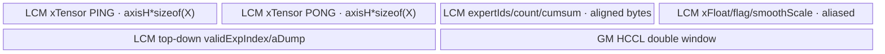
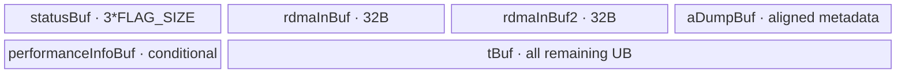
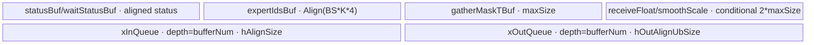
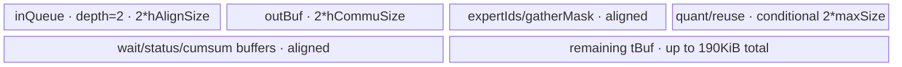

# MoeDistributeDispatch A2/A3 ACLNN 算子知识

## 算子速览

| 项目 | 内容 |
|---|---|
| 实际入口 | A2：`aclnnMoeDistributeDispatchV4GetWorkspaceSize/V4`；A3：`aclnnMoeDistributeDispatchV5GetWorkspaceSize/V5`；公开 ACLNN 两段式入口 |
| 计算语义 | 按 `expertIds[BS,K]` 扩展、可选动态量化 token，经 EP AllToAllV 分发；A3 可追加 TP AllGatherV |
| 输入输出 | ND `x[BS,H]`、`expertIds[BS,K]`；输出 `expandX`、动态尺度、combine 辅助信息和专家/EP/TP 计数 |
| 执行类型 | 每条 Route 均为单 Kernel `HYBRID(AIV_VECTOR + 非 Cube 通信)`；通信介质为 HCCL BatchWrite/RDMA、AIV/AICPU 分层数据面或 HCCL window/MTE；无 Cube/AIC/MIX_CV |
| Kernel 路线 | R-001 A2 fullmesh；R-002 A2 hierarchy/AIV；R-003 A2 hierarchy/AICPU；R-004 A3 fullmesh_v1；R-005 A3 fullmesh_v2 |
| 核心资源 | GM 通信 window、GM workspace、UB/TQue/TBuf；无 L1/L0/Cube |
| 来源闭包 | source_closed：两代最新公开入口均闭合到 inner op、Tiling/POD、Kernel entry/body 和 CMake |
| 验证状态 | 已完成源码闭包检查；本次知识提取未执行编译、真机、数值或性能测试。 |

## 接口与语义

### 计算语义

每个有效 `(token,k)` 按 `expertIds` 映射到目标专家及 EP rank；发送端重排 token 和三元组 `[源EP rank, 源token索引, k]`，目标端压紧为 `expandX` 和 `assistInfoForCombine`。`quantMode=0` 搬运 FP16/BF16；`quantMode=2` 将 token 转 FP32、可选乘 smooth scale，按 token 最大绝对值生成动态尺度后转 INT8，数据与逆尺度一同通信。A3 `tpWorldSize=2` 可在 EP 后继续 TP AllGatherV。

### 输入、输出与属性

| 参数 | shape/layout | dtype | 约束、默认值与语义 |
|---|---|---|---|
| `context`（V5） | 1D/ND | INT64 | A3 必选 Mc2 通信上下文；替代 V4 group 名 |
| `x` | `[BS,H]`/ND | FP16/BF16 | A2：`H%32=0,0<H≤10240`；A3：`1024≤H≤8192` |
| `expertIds` | `[BS,K]`/ND | INT32 | 必选，`1≤K≤16` |
| `scales/xActiveMask/expertScales` | ND | FP32/BOOL/FP32 | 可选；dynamic quant、mask、A2 hierarchy 分别消费；hierarchy 要求 expertScales |
| `elasticInfo/performanceInfo` | 1D/ND | INT32/INT64 | V5 README 明确不支持 |
| `groupEp/groupTp`（V4） | string | char | A2 通信域；名称 `<128`，A2 强制 TP group 为空 |
| EP/TP/专家属性 | scalar | INT64 | rank/world、专家分片/共享/zero/copy/const；V5 可 TP=2，fullmesh_v2 禁 TP |
| `quantMode/globalBs/expertTokenNumsType` | scalar | INT64 | 本卡 A2/A3 最新入口量化 0/2；计数类型 0=cumsum、1=count |
| `commAlg` | string | char | A2：空/`0` 自动、`fullmesh`、`hierarchy`；A3：空/`fullmesh_v1`/`fullmesh_v2` |
| `cclBufferSize`（V5） | scalar | INT64 | A3 context window 字节数，Tiling 检查容量 |
| 七个输出 | ND | FP16/BF16/INT8、FP32、INT32、INT64 | expandX、dynamicScales、assistInfo、expertTokenNums、EP/TP recv counts、expandScales |

### 入口与版本

A2 最新公开支持 V4，声明和实现均在 v2 `op_api`；实现转发至 `aclnnMoeDistributeDispatchGetWorkspaceSizeBase/Base`。A3 的 v3 README 产品表仅勾选 A3，`op_api/aclnn_moe_distribute_dispatch_v5.cpp` 导出 V5 并以 `context+cclBufferSize` 调 inner V3，因此 A3 选 V5。固定 Commit 未收录 V5 独立公开头文件；本卡据导出实现与 README 固定签名/约束，不补造缺失声明。

## Host/Launcher 执行流程

### 参数校验与前处理

V4 的 `DispatchCheckNotNull/DispatchCheckParams` 检查必选 tensor/输出、非空 `groupEp`、group 长度；`quantMode==2` 要求动态尺度输出。base 在 A2 清空 TP group，设置 HCCL server/opType 后创建 inner V2。V5 直接将 context、`cclBufferSize` 和属性传给 `aclnnInnerMoeDistributeDispatchV3GetWorkspaceSize`。OpDef 对 tensor 输入执行 `AutoContiguous`；Tiling 再检查 shape、rank、量化输入、window 和 commAlg。

### 参数、Workspace 与生命周期

A2 写 `MoeDistributeDispatchA2TilingData`，workspace=`16 MiB system + 1 MiB user`，user 区保存 BatchWrite 描述符/分层状态。A3 写 `MoeDistributeDispatchV2TilingData`，workspace=`16 MiB + 512*aivNum*aivNum`，后项供每核接收计数归约。V5 context、workspace 和 tiling 在 executor/stream 上存活到 Kernel 完成。

### 启动图与失败传播

V4 → base/inner V2 → `MoeDistributeDispatchV2TilingFunc` → 单节点 `moe_distribute_dispatch_v2`；V5 → inner V3 → `MoeDistributeDispatchV3TilingFunc` → 单节点 `moe_distribute_dispatch_v3`。A2 节点 `blockDim=CalcTschBlockDim(aivNum,0,aivNum)`，POD 为 `MoeDistributeDispatchA2TilingData`，输入/输出直接绑定公开 tensor，使用 1 MiB user workspace；A3 节点使用全部 AIV，POD 为 `MoeDistributeDispatchV2TilingData`，使用 `512*aivNum²` 计数切片。两者都在 executor stream 上单次 launch，没有跨 Kernel 边；context/window 与 workspace 由 executor 持有至节点完成。Tiling 或 launch 失败阻断唯一节点，Device key/dataplane 未命中无 fallback。

## Route 与参数设计

### 分核与资源计算

A2 `blockDim=CalcTschBlockDim(aivNum,0,aivNum)`。A3 使用全部 AIV，计算 `axisMaxBS=globalBs/epWorldSize`、`hAlignWinSize=Align512(hScaleIdxSize)` 和双半窗偏移。fullmesh_v2 用 `ceil(hOutSizeAlign/SPLIT_BLOCK_DATA_SIZE)*SPLIT_BLOCK_SIZE`（常量分别为 480/512 字节）计算通信 stride；UB 上界含状态、H 双缓冲、通信双缓冲、对齐 expertIds 和可选的 `2*maxSizeForUbBuffer`。

### Route 选择

| 顺序 | Route | Key/模板 | 精确选择条件与优先级 | 不适用去向 |
|---:|---|---|---|---|
| 1 | R-001 A2 fullmesh | `A2,MTE,NO_FULLMESH` | `fullmesh`，或自动模式非 layered | layered → R-002/003 |
| 2 | R-002 A2 hierarchy/AIV | `A2,AICPU` + runtime AIV | hierarchy；`GetDataplaneMode==AIV` | AICPU → R-003 |
| 3 | R-003 A2 hierarchy/AICPU | 同 key + runtime AICPU | hierarchy；`GetDataplaneMode==AICPU` | 其他值无 body |
| 4 | R-004 A3 fullmesh_v1 | `A3,MTE,NO_FULLMESH` | V5，commAlg 为空或 fullmesh_v1 | v2 → R-005；hierarchy 失败 |
| 5 | R-005 A3 fullmesh_v2 | `A3,MTE,ENABLE_FULLMESH` | V5，fullmesh_v2，TP≠2、BS≤256、K≤12、UB/window 通过 | Tiling 失败 |

```text
A2: layered = hierarchy || (auto && EP>8 && INTRA_PCIE=1 && INTRA_ROCE=0)
    !layered -> R-001; layered+AIV -> R-002; layered+AICPU -> R-003
A3 V5: fullmesh_v2 -> R-005; {empty,fullmesh_v1} -> R-004; otherwise fail
```

### 模板/实现执行矩阵

| Route | key/selector | dtype/shape/platform 完整命中条件 | 执行族与 kernel 节点 | 实际模板/body | 内存与同步特征 | tail/fallback |
|---|---|---|---|---|---|---|
| R-001 | A2/MTE | FP16/BF16 或动态 INT8，A2 fullmesh | AIV+BatchWrite/RDMA | `MoeDistributeDispatchA2<X,Y,false,isQuant,S>` | UB 重排、双半窗、status | 有效 count；超限失败 |
| R-002 | A2/AICPU+AIV | hierarchy+expertScales | AIV+RDMA/IPC | `MoeDistributeDispatchA2Layered` | flag-first record、IPC flags | 有效 count |
| R-003 | A2/AICPU+AICPU | hierarchy+expertScales | AIV+AICPU/IPC | `MoeDistributeDispatchA2LayeredAicpu` | 100 MiB RDMA 区、描述符 | 有效 count |
| R-004 | A3/MTE/no-fullmesh | BS≤512,K≤16，可 TP | AIV+window/MTE | `MoeDistributeDispatchV2<X,Y,Q,S,HasTp>` | 32B status、SyncAll | 压紧有效 token |
| R-005 | A3/MTE/fullmesh | BS≤256,K≤12，无 TP | AIV+window/MTE | `MoeDistributeDispatchV2FullMesh<X,Y,Q,S,false>` | 512B DataAsFlag、barrier | 480B payload tail |

### 隐藏性能 Guard

| Guard | Host/Tiling 条件 | Device/资源原因 | 影响 Route | 不满足时去向 | 源码符号 |
|---|---|---|---|---|---|
| 自动分层 | EP>8 且 PCIe=1、RoCE=0 | 跨 server 拓扑 | R-002/003 | R-001 | `IsLayered` |
| v2 K/BS | `K≤12,BS≤256` | DataAsFlag/UB 上界 | R-005 | 失败 | `CheckOtherAttrParams` |
| v2 禁 TP | `tpWorldSize!=2` | 模板固定 HasTp=false | R-005 | 失败 | `isSetFullMeshV2` |
| V5 禁 hierarchy | `isMc2Context` 时 layered=false | context 路线仅闭合 window fullmesh | R-004/005 | 失败 | `CheckOtherAttrParams` |
| UB/window | 计算字节数≤平台容量 | 队列/状态/量化同时驻留 | R-004/005 | 失败 | UB/WinSize checks |

### POD/ABI

| 结构 | 字段 | 类型/位宽 | ABI 布局 | 单位 | Host/launcher producer | Device consumer | 边界 |
|---|---|---|---|---|---|---|---|
| V4/V5 launch | `mc2Context` | GM_ADDR/64 | V5 第 1 项；V4 无 | byte address | inner V3 | V2 body Init | V5 必选 |
| 同上 | `x` | GM_ADDR/64 | V4 第1/V5第2 | byte address | inner op | route body | 必选 |
| 同上 | `expertIds` | GM_ADDR/64 | 下一参数 | byte address | inner op | sort/router | 必选 |
| 同上 | `scales` | GM_ADDR/64 | 下一参数 | byte address | optional binding | quant | 可空 |
| 同上 | `xActiveMask` | GM_ADDR/64 | 下一参数 | byte address | optional binding | mask | 可空 |
| 同上 | `expertScales` | GM_ADDR/64 | 下一参数 | byte address | optional binding | hierarchy | hierarchy 必选 |
| 同上 | `elasticInfo` | GM_ADDR/64 | 下一参数 | byte address | optional binding | V2 body | V5 不支持 |
| 同上 | `performanceInfo` | GM_ADDR/64 | 下一参数 | byte address | optional binding | atomic max | V5 不支持 |
| 同上 | `expandXOut` | GM_ADDR/64 | output 1 | byte address | executor | local copy | 必选 |
| 同上 | `dynamicScalesOut` | GM_ADDR/64 | output 2 | byte address | executor | quant writer | mode2 有效 |
| 同上 | `assistInfoOut` | GM_ADDR/64 | output 3 | byte address | executor | metadata writer | 必选 |
| 同上 | `expertTokenNumsOut` | GM_ADDR/64 | output 4 | byte address | executor | count writer | 必选 |
| 同上 | `epSendCountsOut` | GM_ADDR/64 | output 5 | byte address | executor | count writer | 公开语义为 recv |
| 同上 | `tpSendCountsOut` | GM_ADDR/64 | output 6 | byte address | executor | TP writer | 无 TP 为空 |
| 同上 | `expandScalesOut` | GM_ADDR/64 | output 7 | byte address | executor | scale writer | 条件有效 |
| 同上 | `workspaceGM` | GM_ADDR/64 | 倒数第2 | byte address | executor | route scratch | 按 Tiling 容量 |
| 同上 | `tilingGM` | GM_ADDR/64 | 最后 | byte address | Host Tiling | GET_TILING_DATA | key/结构同版本 |
| `MoeDistributeDispatchA2TilingData` | `mc2InitTiling` | opaque | 第1子结构；内部定义固定仓不可见 | block | HCCL Tiling | HCCL Init | 不得推测字段 |
| 同上 | `mc2CcTiling` | opaque | 第2子结构 | block | HCCL Tiling | SetCcTilingV2 | 不得重排 |
| 同上 | `moeDistributeDispatchInfo` | A2Info | 第3子结构 | aggregate | A2 Tiling | A2 body | 见头文件 |
| `MoeDistributeDispatchA2Info` | `epWorldSize` | uint32/32 | 首字段；offsetof 未静态断言 | rank | A2 Tiling `epWorldSize` | 通信循环 | >0 |
| 同上 | `tpWorldSize` | uint32/32 | 顺序字段 | rank | A2 Tiling `tpWorldSize` | body guard | A2 inactive |
| 同上 | `epRankId` | uint32/32 | 顺序字段 | rank id | A2 Tiling `epRankId` | route metadata | `<epWorldSize` |
| 同上 | `tpRankId` | uint32/32 | 顺序字段 | rank id | A2 Tiling `tpRankId` | body guard | A2 inactive |
| 同上 | `expertSharedType` | uint32/32 | 顺序字段 | enum | attrs | route packing | 公开约束 |
| 同上 | `sharedExpertRankNum` | uint32/32 | 顺序字段 | rank | attrs | window sizing | 公开约束 |
| 同上 | `moeExpertNum` | uint32/32 | 顺序字段 | expert | attrs | sort/count | route上界 |
| 同上 | `quantMode` | uint32/32 | 顺序字段 | enum | attrs | router/body | 0/2 |
| 同上 | `globalBs` | uint32/32 | 顺序字段 | token | shape/attr | window sizing | 防溢出 |
| 同上 | `bs` | uint32/32 | 顺序字段 | token | input shape | per-core loops | route上界 |
| 同上 | `k` | uint32/32 | 顺序字段 | expert/token | expertIds shape | sort/reorder | 1..16 |
| 同上 | `h` | uint32/32 | 顺序字段 | element/token | x shape | byte stride | 32对齐 |
| 同上 | `aivNum` | uint32/32 | 顺序字段 | core | platform info | core split | >0 |
| 同上 | `isTokenMask` | bool/8 | 顺序字段 | flag | mask rank check | token mask path | conditional |
| 同上 | `isExpertMask` | bool/8 | 顺序字段 | flag | mask rank check | expert mask path | conditional |
| 同上 | `isMc2Context` | bool/8 | 顺序字段 | flag | A2 Tiling | body | false |
| 同上 | `reserved2` | bool/8 | 顺序字段 | flag | zero/default | 未消费 | 保持0 |
| 同上 | `reserved3` | bool/8 | 顺序字段 | flag | zero/default | 未消费 | 保持0 |
| 同上 | `totalUbSize` | uint64/64 | C++ 对齐后 | byte | platform | UB allocator | 上界 |
| 同上 | `expertTokenNumsType` | uint32/32 | 顺序字段 | enum | attr | count output | 0/1 |
| 同上 | `zeroComputeExpertNum` | int32/32 | 顺序字段 | expert | zero/copy/const attrs sum | output layout | ≥0 |
| 同上 | `maxMoeExpertNum` | uint32/32 | 末字段 | expert | A2 Tiling | UB/layout | route上界 |
| `MoeDistributeDispatchV2TilingData` | `mc2InitTiling` | opaque | 第1子结构 | block | common Tiling | context init | 内部定义不可见 |
| 同上 | `mc2CcTiling1` | opaque | 第2子结构 | block | common Tiling | EP channel | 不得重排 |
| 同上 | `mc2CcTiling2` | opaque | 第3子结构 | block | common Tiling | TP channel | TP inactive仍保留 |
| 同上 | `moeDistributeDispatchV2Info` | V2Info | 第4子结构 | aggregate | common/V3 Tiling | V2/fullmesh body | 字段顺序见头文件 |
| `MoeDistributeDispatchV2Info` | `epWorldSize` | uint32/32 | 首字段 | rank | common Tiling | EP loops | >0 |
| 同上 | `tpWorldSize` | uint32/32 | 顺序字段 | rank | common Tiling | TP guard | 1/2 |
| 同上 | `epRankId` | uint32/32 | 顺序字段 | rank id | common Tiling | metadata | 合法rank |
| 同上 | `tpRankId` | uint32/32 | 顺序字段 | rank id | common Tiling | TP metadata | inactive为0 |
| 同上 | `expertShardType` | uint32/32 | 顺序字段 | enum | attr | layout | 公开约束 |
| 同上 | `sharedExpertNum` | uint32/32 | 顺序字段 | expert | attr | A/window sizing | 0..4 |
| 同上 | `sharedExpertRankNum` | uint32/32 | 顺序字段 | rank | attr | layout | 公开约束 |
| 同上 | `moeExpertNum` | uint32/32 | 顺序字段 | expert | attr | sort/count | ≤1024 |
| 同上 | `quantMode` | uint32/32 | 顺序字段 | enum | attr | quant template | 0/2 |
| 同上 | `globalBs` | uint32/32 | 顺序字段 | token | attr | axisMaxBS | 防溢出 |
| 同上 | `bs` | uint32/32 | 顺序字段 | token | input shape | loops | route上界 |
| 同上 | `k` | uint32/32 | 顺序字段 | expert/token | shape | gather/sort | ≤16/12 |
| 同上 | `h` | uint32/32 | 顺序字段 | element/token | shape | stride | 1024..8192 |
| 同上 | `a` | uint32/32 | 顺序字段 | output token | Tiling derivation | output range | 防溢出 |
| 同上 | `aivNum` | uint32/32 | 顺序字段 | core | platform info | core roles | >0 |
| 同上 | `isTokenMask` | bool/8 | 顺序字段 | flag | mask rank | mask body | conditional |
| 同上 | `isExpertMask` | bool/8 | 顺序字段 | flag | mask rank | mask body | conditional |
| 同上 | `hasElasticInfo` | bool/8 | 顺序字段 | flag | input optional | elastic path | V5 false |
| 同上 | `isPerformance` | bool/8 | 顺序字段 | flag | input optional | atomic max | V5 false |
| 同上 | `isQuant` | bool/8 | 顺序字段 | flag | quantMode | queue allocation | mode!=0 |
| 同上 | `isMc2Context` | bool/8 | 顺序字段 | flag | V3 wrapper=true | context window path | V5 true |
| 同上 | `reserved1` | bool/8 | 顺序字段 | flag | zero/default | 未消费 | 保持0 |
| 同上 | `reserved2` | bool/8 | 顺序字段 | flag | zero/default | 未消费 | 保持0 |
| 同上 | `totalUbSize` | uint64/64 | C++对齐后 | byte | platform info | allocation guard | 上界 |
| 同上 | `totalWinSizeEp` | uint64/64 | 顺序字段 | byte | context/Tiling | EP half-window | cclBufferSize内 |
| 同上 | `totalWinSizeTp` | uint64/64 | 顺序字段 | byte | context/Tiling | TP window | TP inactive可0 |
| 同上 | `expertTokenNumsType` | uint32/32 | 顺序字段 | enum | attr | count writer | 0/1 |
| 同上 | `zeroComputeExpertNum` | int32/32 | 顺序字段 | expert | attrs sum | layout | ≥0 |
| 同上 | `maxSizeForUbBuffer` | uint32/32 | 顺序字段 | byte | UB formula | InitBuffer | ≤totalUbSize |
| 同上 | `scalesRow` | uint64/64 | 顺序字段 | row | scales shape | quant indexing | conditional |
| 同上 | `scalesCol` | uint64/64 | 顺序字段 | column | scales shape | quant indexing | conditional |
| 同上 | `scalesTypeSize` | uint32/32 | 顺序字段 | byte | dtype | scale stride | conditional |
| 同上 | `scalesCount` | uint64/64 | 末字段 | element | shape product | bounds | 防溢出 |

### Route 源码闭包

| Route | Key/selector | Host/Tiling producer | POD/参数 | Kernel entry/router 节点 | Kernel body/直接依赖 | 构建接线 |
|---|---|---|---|---|---|---|
| R-001 | A2/MTE | `...tiling_arch22.cpp` | `moe_distribute_dispatch_tiling.h` | `moe_distribute_dispatch_v2.cpp` | `moe_distribute_dispatch_a2.h` | v2 `CMakeLists.txt` |
| R-002 | A2/AICPU+AIV | 同上 | 同上+context | 同上/runtime guard | `...a2_layered.h` | 同上 |
| R-003 | A2/AICPU+AICPU | 同上 | 同上+context | 同上/runtime guard | `...a2_layered_aicpu.h` | 同上 |
| R-004 | A3/MTE/no-fullmesh | v3 Tiling→common v2 | V2 tiling+V5 ABI | `moe_distribute_dispatch_v3.cpp` | `moe_distribute_dispatch_v2.h` | v3 `CMakeLists.txt` |
| R-005 | A3/MTE/fullmesh | 同上 | 同上 | 同上 | `...v2_full_mesh.h` | 同上 |

## Kernel 实现

### 公共执行流程

entry 以 `<HasTp,QuantMode,ScaleMode,FullMesh,CommMode,ArchTag>` 实例化 body。所有路线均先在 UB 统计/重排路由，再写通信 window，等待远端就绪后按接收 count 压紧输出；无 Cube、L1、L0。

### Route R-001：A2 fullmesh BatchWrite

#### 适用条件

##### 选择证据

| 层级 | 文件 | 符号 | 源码谓词/参数 | 结果/下一跳 |
|---|---|---|---|---|
| Tiling | `...tiling_arch22.cpp` | A2 func | `isLayered==false` | A2/MTE |
| Router | `...v2.cpp` | entry | A2&&MTE | `MoeDistributeDispatchA2` |

#### Device 数据流

##### 函数级调用链

```text
entry -> Init -> Process -> mask count -> IndexSort -> ReorderTokens
      -> ConstructBatchWriteInfo/BatchWrite -> WaitDispatch -> LocalWindowCopy -> Finalize
```

##### 源码等价伪码

```text
count and sort valid routes; reorder token+metadata to current half-window
build descriptors and BatchWrite remote slices; poll status
prefix-sum counts and compact valid records to outputs
```

#### 内存与数据搬运

##### 资源与搬运表

| 层级/缓冲区 | offset/地址公式 | extent/容量公式 | dtype/layout | producer | consumer | owner/lifetime | 对齐/复用 |
|---|---|---|---|---|---|---|---|
| GM window | dataState half | HCCL Tiling | token+metadata | reorder/RDMA | local copy | context/kernel | aligned stride |
| workspace | system+16MiB | 1MiB | BatchWrite descriptors | AIV | HCCL | executor | ABI records |
| UB | allocator offsets | ≤totalUbSize | sort/token queues | DMA/vector | DMA/vector | kernel | events |
| L1/L0 | N/A | 0 | N/A | N/A | N/A | N/A | 未使用 |

##### 分层内存布局



##### 字节账与复用顺序

```text
UB_total = TOTAL_UB_SIZE LCM arena; bottom-up token/meta slices must not cross top-down validExpIndex+aDump
dynamic_ub = N/A
workspace_total = 16 MiB system + 1 MiB BatchWrite user slice
```

| 复用子区 | 写入者 | 读取者/消费点 | 下一次覆盖 | 同步或释放依据 | 安全条件 |
|---|---|---|---|---|---|
| LCM offset 0 | `CopyIn/ReorderTokens` 的 PING token，或 status/BatchWrite 临时量 | 相应 vector/通信阶段 | 下一阶段重绑 | `PipeBarrier<PIPE_ALL>` 与阶段完成 | 同时只激活当前用途 |
| `xfloatOrFlagAddr` | quant 的 `xFloatTensor_` 或 flag | quant/状态阶段 | 下一种模板阶段 | 编译期量化分支互斥 | 不跨分支并存 |
| HCCL half-window | BatchWrite | `LocalWindowCopy` | 下一次 dataState 轮转 | `WaitDispatch` status | 仅覆盖非活动半窗 |

#### 同步、精度与尾块

##### 同步与数值边界表

| 阶段 | primitive/机制 | producer | consumer/等待点 | 保护对象 | 精度/尾块 |
|---|---|---|---|---|---|
| DMA/vector | hard event | queue stage | reuse | UB | valid routes |
| remote | status polling | RDMA | WaitDispatch | window | 不读未到达记录 |
| quant | FP32 scale→INT8 | quant helper | transport | token/scale | mode2 |

#### 关键实现

##### 符号证据表

| 阶段 | 文件 | 符号/模板实例 | 实现事实 |
|---|---|---|---|
| Host/Tiling producer | `...tiling_arch22.cpp` | A2 func | key/workspace |
| Kernel entry/router | `...v2.cpp` | `MoeDistributeDispatchA2` | dtype/scale 实例 |
| Device body/helper | `...a2.h` | `Process` | sort/BatchWrite/copy |

### Route R-002：A2 hierarchy AIV dataplane

#### 适用条件

##### 选择证据

| 层级 | 文件 | 符号 | 源码谓词/参数 | 结果/下一跳 |
|---|---|---|---|---|
| Tiling | `...tiling_arch22.cpp` | `isLayered` | true | A2/AICPU key |
| Router | `...v2.cpp` | `GetDataplaneMode` | AIV | layered AIV body |

#### Device 数据流

##### 函数级调用链

```text
entry -> Layered::Process -> Reorder -> SendDataToServer/InnerReduce -> OuterReduce
      -> Win2Ipc -> Set/WaitIpcFlag -> Ipc2Out -> Finalize
```

##### 源码等价伪码

```text
pack [32B flag|token|Align8(K) ids|Align8(K) weights|32B scale]
server AIVs post RDMA WQE and reduce counts; transfer arrived records through IPC
```

#### 内存与数据搬运

##### 资源与搬运表

| 层级/缓冲区 | offset/地址公式 | extent/容量公式 | dtype/layout | producer | consumer | owner/lifetime | 对齐/复用 |
|---|---|---|---|---|---|---|---|
| RDMA window | server/rank slice | Host window | flag-first record | AIV RDMA | Win2Ipc | context | 32B flag |
| IPC/workspace | context/user slice | 1MiB user | records/status | Win2Ipc | Ipc2Out | kernel | step flag |
| UB | allocator | ≤totalUbSize | reorder | AIV | RDMA | kernel | events |

##### 分层内存布局



##### 字节账与复用顺序

```text
record = 32B flag + H*dtype + Align8(K)*u32*2 + 32B scale
UB_total = 3*FLAG_SIZE + 2*32B + aDumpSize + conditional performanceInfoSize + leftBufSize = TOTAL_UB_SIZE
dynamic_ub = N/A
workspace_total = 16 MiB + 1 MiB
```

| 复用子区 | 写入者 | 读取者/消费点 | 下一次覆盖 | 同步或释放依据 | 安全条件 |
|---|---|---|---|---|---|
| `tBuf` token/index slices | Reorder/inner reduce | RDMA/IPC stage | 下一阶段划片 | `SyncAll`/`PipeBarrier` | offset公式不交叠 |
| RDMA window record | server AIV | `Win2Ipc` | 下次 magic/dataState | remote flag+IPC flag | payload写完才置flag |
| IPC slice | `Win2Ipc` | `Ipc2Out` | 下一轮 | step-numbered IPC flag | 有效count范围 |

#### 同步、精度与尾块

##### 同步与数值边界表

| 阶段 | primitive/机制 | producer | consumer/等待点 | 保护对象 | 精度/尾块 |
|---|---|---|---|---|---|
| reduce | SyncAll/core role | server AIVs | IPC stage | counts | exact int |
| arrival | flag polling | remote AIV | Win2Ipc | record | valid count |

#### 关键实现

##### 符号证据表

| 阶段 | 文件 | 符号/模板实例 | 实现事实 |
|---|---|---|---|
| Host/Tiling producer | `...tiling_arch22.cpp` | layered key | hierarchy |
| Kernel entry/router | `...v2.cpp` | runtime AIV | dataplane guard |
| Device body/helper | `...a2_layered.h` | `Process` | RDMA+IPC |

### Route R-003：A2 hierarchy AICPU dataplane

#### 适用条件

##### 选择证据

| 层级 | 文件 | 符号 | 源码谓词/参数 | 结果/下一跳 |
|---|---|---|---|---|
| Tiling | `...tiling_arch22.cpp` | `isLayered` | true | A2/AICPU key |
| Router | `...v2.cpp` | `GetDataplaneMode` | AICPU | layered AICPU body |

#### Device 数据流

##### 函数级调用链

```text
entry -> LayeredAicpu::Process -> Reorder/Count -> DispatchBetweenServer
      -> WaitWindow -> Win2Ipc/Reduce -> IPC flags -> output -> Finalize
```

##### 源码等价伪码

```text
write BatchWrite descriptors; AICPU transports inter-server records
wait fixed RDMA region, reduce counts, transfer valid records to IPC/output
```

#### 内存与数据搬运

##### 资源与搬运表

| 层级/缓冲区 | offset/地址公式 | extent/容量公式 | dtype/layout | producer | consumer | owner/lifetime | 对齐/复用 |
|---|---|---|---|---|---|---|---|
| RDMA region | window base | 100MiB | token records | AICPU | WaitWindow | context | fixed extent |
| IPC region | base+100MiB | context | compact records | Win2Ipc | output | context | flags |
| workspace | user slice | 1MiB | descriptors/counts | AIV | AICPU | executor | bounded count |

##### 分层内存布局


##### 字节账与复用顺序

```text
UB_total = PER_MSG_RDMA_SEND_TIME*BW_ITEM_SIZE + 32B + serverNum*4B + TBUF_SIZE
dynamic_ub = N/A
IPC_base = RDMA_base + 100 MiB; workspace_total = 16 MiB + 1 MiB
```

| 复用子区 | 写入者 | 读取者/消费点 | 下一次覆盖 | 同步或释放依据 | 安全条件 |
|---|---|---|---|---|---|
| `tBuf` top-down indices/counts | reorder/count stage | descriptor builder | 下一轮 | stage completion | `expertIdsOffset>expertCountOffset>expertToServerCntOffset` |
| user workspace descriptors | AIV builder | AICPU BatchWrite | Kernel结束/下轮 | BatchWrite completion | 条目数受1MiB限制 |
| RDMA→IPC | AICPU/window | `Win2Ipc/Ipc2Out` | 下一轮 | WaitWindow+IPC flags | 有效count范围 |

#### 同步、精度与尾块

##### 同步与数值边界表

| 阶段 | primitive/机制 | producer | consumer/等待点 | 保护对象 | 精度/尾块 |
|---|---|---|---|---|---|
| inter-server | BatchWrite/window flag | AICPU | WaitWindow | RDMA | valid count |
| IPC | numbered flags | Win2Ipc | output | IPC | valid range |

#### 关键实现

##### 符号证据表

| 阶段 | 文件 | 符号/模板实例 | 实现事实 |
|---|---|---|---|
| Host/Tiling producer | `...tiling_arch22.cpp` | layered key | hierarchy |
| Kernel entry/router | `...v2.cpp` | runtime AICPU | dataplane guard |
| Device body/helper | `...a2_layered_aicpu.h` | `Process` | BatchWrite+IPC |

### Route R-004：A3 fullmesh_v1 状态窗

#### 适用条件

##### 选择证据

| 层级 | 文件 | 符号 | 源码谓词/参数 | 结果/下一跳 |
|---|---|---|---|---|
| API | `...v5.cpp` | V5 GetWorkspaceSize | context+cclBuffer | inner V3 |
| Tiling | `...v3_tiling_a2a3.cpp` | V3 func | empty/fullmesh_v1 | no-fullmesh key |
| Router | `...v3.cpp` | entry | A3+NO_FULLMESH | V2 body |

#### Device 数据流

##### 函数级调用链

```text
entry -> V2::Process -> AlltoAllDispatch -> SetStatus -> WaitDispatch
      -> LocalWindowCopy -> [TP AllGather] -> SetExpertTokenNums
```

##### 源码等价伪码

```text
scatter route records to context half-window; write 32B status
SyncAll and poll/reduce counts through per-core workspace slots
compact received records; optionally execute TP allgather
```

#### 内存与数据搬运

##### 资源与搬运表

| 层级/缓冲区 | offset/地址公式 | extent/容量公式 | dtype/layout | producer | consumer | owner/lifetime | 对齐/复用 |
|---|---|---|---|---|---|---|---|
| EP window | `dataState*totalWinSizeEp/2+...` | half-window | token+triple | dispatch | local copy | context | 512 align |
| status | status area | 32B record | flag/count | SetStatus | WaitDispatch | context | SyncAll |
| workspace | writer `(512*aivNum)*aivId`; reader `512*aivId` | 512*AIV² | counters | cores | reducer | executor | separated |
| UB | status/index/gather/quant | Tiling formula | mixed | DMA/vector | DMA/vector | kernel | reused |

##### 分层内存布局



##### 字节账与复用顺序

```text
workspace_total = 16 MiB + 512*aivNum*aivNum
expertPerSizeOnWin = (globalBs/epWorldSize) * Align512(hScaleIdxSize)
UB_total = status + expertIds + gatherMask + valid-index(condition) + quant(condition)*2*maxSize + bufferNum*(hAlignSize+hOutAlignUbSize)
bufferNum = (double-buffer total > 190KiB) ? 1 : 2; dynamic_ub = N/A
```

| 复用子区 | 写入者 | 读取者/消费点 | 下一次覆盖 | 同步或释放依据 | 安全条件 |
|---|---|---|---|---|---|
| `gatherMaskTBuf_` | mask/gather计算 | route筛选 | 后续临时计算 | 同一阶段顺序+PipeBarrier | 不与未消费mask重叠 |
| `receiveDataCastFloatBuf_`→`dstExpBuf_` | quant float temp | quant | expert-index阶段 | 编译期分支和阶段结束 | quant临时已消费 |
| `smoothScalesBuf_`→`subExpBuf_` | scale temp | quant | expert-index阶段 | 同上 | scale已输出/消费 |
| EP half-window | dispatch | LocalWindowCopy | 下一轮dataState | status+SyncAll | 当前半窗完成 |

#### 同步、精度与尾块

##### 同步与数值边界表

| 阶段 | primitive/机制 | producer | consumer/等待点 | 保护对象 | 精度/尾块 |
|---|---|---|---|---|---|
| status | `SyncAll<true>`+poll | scatter | WaitDispatch | window/count | 32B record |
| quant | FP32 max/scale→INT8 | vector | communication | payload/scale | valid mask |
| TP | status/allgather wait | EP stage | TP output | TP window | HasTp only |

#### 关键实现

##### 符号证据表

| 阶段 | 文件 | 符号/模板实例 | 实现事实 |
|---|---|---|---|
| Host/Tiling producer | `...v3_tiling_a2a3.cpp` | V3 func | context indexes/common Tiling |
| Kernel entry/router | `...v3.cpp` | `MoeDistributeDispatchV2` | no-fullmesh/HasTp |
| Device body/helper | `...v2.h` | `Process/WaitDispatch` | status/window/TP |

### Route R-005：A3 fullmesh_v2 DataAsFlag

#### 适用条件

##### 选择证据

| 层级 | 文件 | 符号 | 源码谓词/参数 | 结果/下一跳 |
|---|---|---|---|---|
| Tiling | `...v2_tiling.cpp` | `isSetFullMeshV2` | v2+TP禁用+BS/K guard | ENABLE_FULLMESH |
| Router | `...v3.cpp` | entry | FullMesh enabled | FullMesh body |

#### Device 数据流

##### 函数级调用链

```text
entry -> FullMesh::Process -> AllToAllDispatch || CalCumSum
      -> PipeBarrier -> LocalWindowCopy
```

##### 源码等价伪码

```text
blockCnt=ceil(hOutSizeAlign/SPLIT_BLOCK_DATA_SIZE); stride=blockCnt*SPLIT_BLOCK_SIZE
encode 32B flag + 480B payload per block; scatter/count on disjoint cores
barrier; poll flags and copy payload while skipping each 32B gap
```

#### 内存与数据搬运

##### 资源与搬运表

| 层级/缓冲区 | offset/地址公式 | extent/容量公式 | dtype/layout | producer | consumer | owner/lifetime | 对齐/复用 |
|---|---|---|---|---|---|---|---|
| DataAsFlag window | token*stride | ceil(size/480)*512 | 32B+480B | scatter | copy | context | 512B |
| workspace | per-AIV | common 512*AIV² | counters | cumsum | copy | executor | disjoint |
| UB | H/comm/index/quant buffers | computed upper bound | mixed | AIV | AIV | kernel | conditional double buffer |

##### 分层内存布局



##### 字节账与复用顺序

```text
hCommuSize = Ceil(hOutSizeAlign,SPLIT_BLOCK_DATA_SIZE)*SPLIT_BLOCK_SIZE
workspace_total = 16 MiB + 512*aivNum*aivNum
UB_total = 32B state + 2*hAlignSize + 2*hCommuSize + expertIds/gatherMask + conditional quant/reuse + wait/cumsum buffers <= 190KiB
dynamic_ub = N/A
```

| 复用子区 | 写入者 | 读取者/消费点 | 下一次覆盖 | 同步或释放依据 | 安全条件 |
|---|---|---|---|---|---|
| `receiveDataCastFloatBuf`→`dstExpBuf_` | quant | quant consumer | index阶段 | 阶段结束 | quant结果已发出 |
| `smoothScalesBuf`→`subExpBuf_` | scale计算 | scale consumer | index阶段 | 阶段结束 | scale已消费 |
| DataAsFlag record | remote scatter | LocalWindowCopy | 下一轮dataState | embedded flag+PipeBarrier | 末块只取有效480B以内 |

#### 同步、精度与尾块

##### 同步与数值边界表

| 阶段 | primitive/机制 | producer | consumer/等待点 | 保护对象 | 精度/尾块 |
|---|---|---|---|---|---|
| core join | PipeBarrier | scatter/cumsum | copy | counts/window | roles complete |
| arrival/tail | embedded flag + 480B copy stride | remote | local copy | each block | last block masked |

#### 关键实现

##### 符号证据表

| 阶段 | 文件 | 符号/模板实例 | 实现事实 |
|---|---|---|---|
| Host/Tiling producer | `...v2_tiling.cpp` | fullmesh_v2 checks | guard/key/UB |
| Kernel entry/router | `...v3.cpp` | `MoeDistributeDispatchV2FullMesh` | specialization |
| Device body/helper | `...v2_full_mesh.h` | `Process/LocalWindowCopy` | DataAsFlag |

## 算子特定优化

### Trick T-001：DataAsFlag 把到达标志嵌入 512-byte 通信记录

#### 触发与源码依据

- 适用 Route：R-005
- 触发条件：A3 V5、fullmesh_v2、无 TP、BS≤256、K≤12
- Golden 来源：[`moe_distribute_dispatch_v2_full_mesh.h:431-432`](../../../../../../../cann-ops-raw/ascendc/ops-transformer/be33d95bb755cedec3108f70805c1874d1792540/mc2/moe_distribute_dispatch_v2/op_kernel/moe_distribute_dispatch_v2_full_mesh.h)

**官方源码（固定 Commit 连续逐字摘录）**：

```cpp
blockCntPerToken_ = Ceil(hOutSizeAlign_, SPLIT_BLOCK_DATA_SIZE);
hCommuSize_ = blockCntPerToken_ * SPLIT_BLOCK_SIZE;
```

#### 机制与设计原因

每个 512-byte 物理块承载 480-byte payload 和 32-byte flag，使消费者逐块判断到达而不依赖独立状态表；输出必须跳过 flag gap。

#### 迁移边界

- 适用：双方共享 512/480/32 字节 ABI 的无 TP window AllToAll。
- 前提：Host 用同一公式检查 UB/window。
- 失效：TP 或 BS/K 超限使用 R-004。
- 未验证：本次知识提取未执行编译、真机、数值或性能测试。

#### 错误做法

按逻辑 H 字节直接递增 window 会把 32-byte flag 当成 payload。

### Trick T-002：同一 hierarchy key 按运行时 dataplane 分体

#### 触发与源码依据

- 适用 Route：R-002、R-003
- 触发条件：A2 hierarchy key，HCCL context 返回 AIV/AICPU
- Golden 来源：[`moe_distribute_dispatch_v2.cpp:165-168`](../../../../../../../cann-ops-raw/ascendc/ops-transformer/be33d95bb755cedec3108f70805c1874d1792540/mc2/moe_distribute_dispatch_v2/op_kernel/moe_distribute_dispatch_v2.cpp)

**官方源码（固定 Commit 连续逐字摘录）**：

```cpp
DataplaneMode dataplaneMode = GetDataplaneMode(contextGM0);
if (dataplaneMode == DataplaneMode::AICPU) {
```

#### 机制与设计原因

Host key 只表达 hierarchy；Device 再据实际数据面选择 AIV WQE/RDMA 或 AICPU BatchWrite，两者 window、workspace 和完成协议不同。

#### 迁移边界

- 适用：context 返回已实现枚举。
- 前提：保留 runtime guard 与 expertScales。
- 失效：非 layered 用 R-001；未知 dataplane 无 fallback。
- 未验证：本次知识提取未执行编译、真机、数值或性能测试。

#### 错误做法

仅看 key 固定 AIV body 会在 AICPU 数据面误用内存和同步 ABI。

## 模板与实现对比

| 对比维度 | R-001 | R-002/003 | R-004 | R-005 | 设计选择依据 |
|---|---|---|---|---|---|
| 命中条件/优先级 | A2非分层 | A2分层+runtime | A3 v1 | A3 v2 | platform/commAlg/context |
| 模板与 dtype | A2动态量化bool模板 | A2同模板、两dataplane body | V2 Q/S/HasTp | FullMesh Q/S/无TP | dtype/量化key |
| 循环与分核 | 全AIV，按route排序 | server core角色分工 | 全AIV，按rank/expert | scatter/cumsum两组core | 通信拓扑/状态协议 |
| Queue/TBuf/寄存器/dynamic UB/通信 window | LCM arena+HCCL双半窗 | TBuf+RDMA/IPC | TQue/TBuf+状态窗 | TQue/TBuf+DataAsFlag | body Init/allocator |
| 内存总占用与复用 | 17MiB WS，LCM阶段别名 | 17MiB WS，tBuf划片 | 16MiB+512*AIV²，quant buffer别名 | 同WS，190KiB guard | Host UB/WS上界 |
| 搬运/Vector/SIMT/NDDMA/通信 API | DataCopy/Vector+BatchWrite | Vector+RDMA/IPC或AICPU | Vector+window MTE | Vector+512B flag records | 无SIMT/NDDMA/Cube |
| 同步、精度与 tail | status | RDMA+IPC flags | 32B status | embedded flag | 就绪粒度 |
| fallback/失败边界 | 转hierarchy | 未知mode无body | v2转R-005 | guard失败 | 无猜测fallback |

## 平台差异

| 项目 | A2 | A3 | 950 |
|---|---|---|---|
| 支持状态 | V4 最新 | V5 最新 | 本卡不覆盖；V5 README 明确不支持 |
| Host/Launcher | group 字符串、A2 Tiling | context+cclBufferSize、V3 wrapper | 见 `_950` 卡 V4 |
| Kernel/资源 | A2 fullmesh/hierarchy，17MiB | V2/fullmesh body，16MiB+512*AIV² | 见 `_950` 卡 |

## 限制与失败边界

- A2 量化只记录 0/2；H 需 32 对齐且≤10240，fullmesh/hierarchy 的 BS、EP、专家数超界均失败。
- A3 V5 不支持 elastic/performance/hierarchy；fullmesh_v2 禁 TP，`BS≤256,K≤12`。
- 固定 Commit 无 V5 独立头文件；不得推测缺失声明、未公开 ABI 或性能值。

## 源码索引

### 链路索引

| 链路阶段 | 文件 | 关键符号 | 支撑内容 |
|---|---|---|---|
| 入口声明/约束 | `mc2/moe_distribute_dispatch_v2/op_api/aclnn_moe_distribute_dispatch_v4.h` | V4 API | A2 签名 |
| 入口实现 | `mc2/moe_distribute_dispatch_v2/op_api/aclnn_moe_distribute_dispatch_v4.cpp` | V4 funcs | base 转发 |
| 入口实现 | `mc2/moe_distribute_dispatch_v2/op_api/moe_distribute_dispatch_v2_base.cpp` | base/checks | 平台/通信分流 |
| 入口声明/约束 | `mc2/moe_distribute_dispatch_v3/README.md` | 产品表 | V5 A3约束 |
| 入口实现 | `mc2/moe_distribute_dispatch_v3/op_api/aclnn_moe_distribute_dispatch_v5.cpp` | V5 funcs | context inner V3 |
| Host/Tiling/Launcher | `mc2/moe_distribute_dispatch_v2/op_host/op_tiling/arch22/moe_distribute_dispatch_v2_tiling_arch22.cpp` | A2 func | layered/key/workspace |
| Host/Tiling/Launcher | `mc2/moe_distribute_dispatch_v2/op_host/op_tiling/moe_distribute_dispatch_v2_tiling.cpp` | common func | A3 guards/UB/key |
| Host/Tiling/Launcher | `mc2/moe_distribute_dispatch_v3/op_host/op_tiling/arch22/moe_distribute_dispatch_v3_tiling_a2a3.cpp` | V3 func | context映射 |
| POD | `mc2/moe_distribute_dispatch_v2/op_kernel/moe_distribute_dispatch_tiling.h` | A2 structs | A2 ABI |
| POD | `mc2/moe_distribute_dispatch_v2/op_kernel/moe_distribute_dispatch_v2_tiling.h` | V2 structs | A3 ABI |
| Kernel entry/body | `mc2/moe_distribute_dispatch_v2/op_kernel/moe_distribute_dispatch_v2.cpp` | v2 entry | A2 router |
| Kernel entry/body | `mc2/moe_distribute_dispatch_v3/op_kernel/moe_distribute_dispatch_v3.cpp` | v3 entry | A3 router |
| Kernel entry/body | `mc2/moe_distribute_dispatch_v2/op_kernel/moe_distribute_dispatch_a2.h` | Process | A2 fullmesh |
| Kernel entry/body | `mc2/moe_distribute_dispatch_v2/op_kernel/moe_distribute_dispatch_a2_layered.h` | Process | AIV hierarchy |
| Kernel entry/body | `mc2/moe_distribute_dispatch_v2/op_kernel/moe_distribute_dispatch_a2_layered_aicpu.h` | Process | AICPU hierarchy |
| Kernel entry/body | `mc2/moe_distribute_dispatch_v2/op_kernel/moe_distribute_dispatch_v2.h` | Process | A3 v1 |
| Kernel entry/body | `mc2/moe_distribute_dispatch_v2/op_kernel/moe_distribute_dispatch_v2_full_mesh.h` | Process | A3 v2 |
| 构建接线 | `mc2/moe_distribute_dispatch_v2/CMakeLists.txt` | subdirs | V2 build |
| 构建接线 | `mc2/moe_distribute_dispatch_v3/CMakeLists.txt` | dependencies | V3 build |

### 实现复用检查

| 检查项 | 可复用事实 | 不得改变的约束 | 源码符号 |
|---|---|---|---|
| ABI/POD | V3 复用 V2 tiling/body | V5 首参数 context；结构顺序 | v3 entry |
| 调用顺序 | 重排→通信→等待→压紧 | hierarchy/v2 阶段不可互换 | route `Process` |
| workspace/内存 | A3 body 共用预算 | DataAsFlag 512/480/32 | fullmesh `Init` |
| 同步 | 均基于通信 window | status、embedded、IPC flag 不可混用 | wait helpers |
| 精度与尾块 | dynamic quant 模板复用 | FP32 scale→INT8次序和有效count | quant helpers |
| 失败边界 | Host guard 早退 | 未知dataplane、V5 hierarchy、v2 TP无fallback | guards |