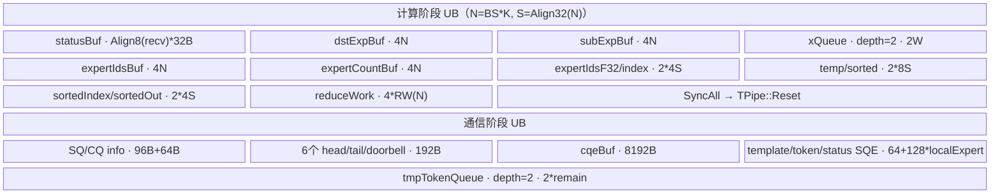
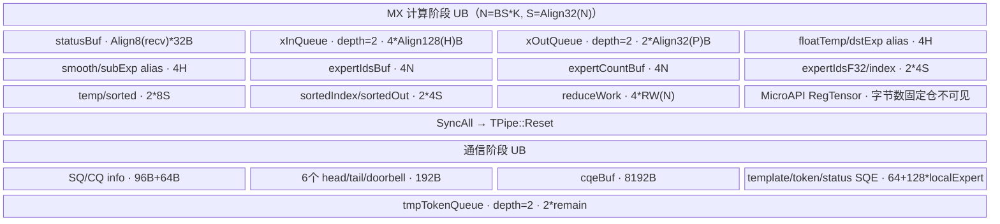
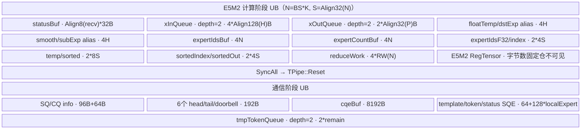

# MoeDistributeDispatchSetup 950 ACLNN 算子知识

## 算子速览

| 项目 | 内容 |
|---|---|
| 实际入口 | `aclnnMoeDistributeDispatchSetupGetWorkspaceSize` / `aclnnMoeDistributeDispatchSetup`，公开、无版本后缀的两段式 ACLNN；固定仓没有 V2/V3 同名入口 |
| 计算语义 | 可选 MX FP8 量化；按 `expertIds` 对 `(BS,H)` token 排序并写入 `yOut`，生成 `expandIdxOut`；把 token 数据与 32 B/专家状态写入 EP 域对端 URMA window，提交 SQE 后立即退出，不等待本轮通信完成 |
| 输入输出 | `x`: FP16/BF16 `(BS,H)`；`expertIds`: INT32 `(BS,K)`；`scales`/`xActiveMask`: 可选；`yOut`: `(BS*(K+sharedExpertNum), tokenMsgSize)`；`expandIdxOut`: INT32 `(BS*K)`；`commCmdInfoOut`: INT32 1D |
| 执行类型 | 单 AscendC Kernel；全部计算在 AIV 上，节点内含 Vector/MicroAPI、MTE 与非 Vector URMA SQ/CQ/doorbell 通信执行，属于 Hybrid；无 AIC/Cube、SIMT 或 NDDMA 节点 |
| Kernel 路线 | R-001 `key=1000` 非量化；R-002 `key=1004` MX→FP8E4M3；R-003 `key=1004` MX→FP8E5M2 |
| 核心资源 | HCCL `windowsIn/windowsOut`、输出 GM、固定 32 MiB executor workspace、两阶段整块 UB 复用；L1/L0A/L0B/L0C 均不使用 |
| 来源闭包 | `source_closed`：公开入口→generated inner 边界→Host Tiling/POD→单 AIV/URMA Kernel→量化与 SQ/CQ helper 已闭合；固定源码同时证明 `key=1014` 无 Device 分支、950 body 不写 `commCmdInfoOut`，作为实现缺口而非推测补齐 |
| 验证状态 | 已完成源码闭包检查；本次知识提取未执行编译、真机、数值或性能测试。 |

## 接口与语义

### 计算语义

对每个参与通信的 token `t` 和其 Top-K 专家 `e=expertIds[t,j]`，Device 先把全部 `expertIds` 取负后做稳定排序，得到按专家聚集的原索引 `sortedIndex1`。非量化路线把 `x[t,:]` 原 dtype 搬到 `yOut`；MX 路线按每 32 个 hidden 元素求共享指数，将 `x[t,:]` 量化为 FP8，并把 `Align2(Ceil32(H))` 个 MX scale byte 接在 `Align256(H)` 个 FP8 数据之后。每个排序后位置的 `expandIdxOut` 是该 token 之前已经出现的相同专家个数。

`SetStatus` 为每个专家生成 8 个 INT32（32 B）状态记录，其中偏移 1 是发送 token 数。`Communication` 把本 rank 数据写到本地 window，或为远端 rank 组装数据 SQE 和状态 SQE，写入 HBM SQ 后敲 JFS doorbell。公开文档明确 Setup 只发数据和状态，指令发出后立即退出；接收与后处理属于配套的 Teardown 算子。

`xActiveMask` 的实际 950 body 只用来求 `true` 的总数 `activeMaskBsCnt`，随后仍以排序数组前 `activeMaskBsCnt*K` 项作为有效 token 域；固定源码没有按 mask 逐项压缩/重排 `expertIds` 的步骤。该事实是实现复用边界，不能外推成任意稀疏 mask 的稳定过滤语义。

### 输入、输出与属性

| 参数 | shape/layout | dtype | 约束、默认值与语义 |
|---|---|---|---|
| `x` | `(BS,H)` / ND，2D | FP16、BF16 | public 当前 `BS∈{8,16,256}`、`H∈{4096,7168}`；OpDef `AutoContiguous` |
| `expertIds` | `(BS,K)` / ND，2D | INT32 | public 当前 `K∈{6,8}`、`0<K≤moeExpertNum`；dim0 必须等于 `x.dim0` |
| `scalesOptional` | public 文档写 `(sharedExpertNum+moeExpertNum,H)` / ND，2D | FP32 | 非量化必须空；文档泛称动态量化可传有效值，但 public 当前只支持 `quantMode=0/4`，950 MX 成功分支只有 `key=1004`（无 scales）；有 scales 会生成未处理的 `1014` |
| `xActiveMaskOptional` | `(BS,)` / ND，1D | BOOL | 空表示全部 token；有效时 950 body 只 reduce-sum 得到参与数 |
| `groupEp` | 字符串 | STRING | 长度 `[1,128)`；四个配套 Setup/Teardown 接口及各卡/各层必须一致 |
| `epWorldSize`,`epRankId` | 标量属性 | INT64→POD UINT32 | Tiling 范围 `[2,384]` 与 `[0,epWorldSize)`；public 当前只支持 world size 2、8 |
| `moeExpertNum` | 标量属性 | INT64→POD UINT32 | `(0,512]` 且整除 `epWorldSize-sharedExpertRankNum`；public 当前只支持 32 |
| `expertShardType` | 标量属性 | INT64→POD UINT32 | 当前只支持 0 |
| `sharedExpertNum`,`sharedExpertRankNum` | 标量属性 | INT64→POD UINT32 | Tiling 有共享专家代码；公开 950 当前明确两者只支持 0 |
| `quantMode` | 标量属性 | INT64→POD UINT32 | 定义 0..4；公开 950 当前只支持 0 和 4 |
| `globalBs` | 标量属性 | INT64→POD UINT32 | 0 或 `[BS*epWorldSize,512*epWorldSize]`；各 rank 不等长时为 `maxBs*epWorldSize` |
| `commType`,`commAlg` | 标量属性 | INT64、STRING | 950 Tiling 只接受 `commType=2`（URMA）与空 `commAlg` |
| `yOut` | `(BS*(K+sharedExpertNum),tokenMsgSize)` / ND | 非量化同 `x`；MX 为 FP8E4M3FN/FP8E5M2 | 非量化 `tokenMsgSize=Align256(H)`；MX Tiling 为 `Align512(Align256(H)+Align2(Ceil32(H)))` |
| `expandIdxOut` | `(BS*K,)` / ND | INT32 | 排序域内相同专家的先前出现次数 |
| `commCmdInfoOut` | `((BS*(K+sharedExpertNum)+epWorldSize*localExpertNum)*16,)` / ND | INT32 | API/Host 要求必选且校验 shape；950 Kernel 仅接收入参，`Init` 与 body 均未保存或写入，producer 在固定仓缺失 |

### 入口与版本

固定仓目录、公开 API 清单、头文件与文档只存在无版本后缀的 `aclnnMoeDistributeDispatchSetup`，因此它是 950 的最新公开版本。产品表只给 Ascend 950DT 打勾，A2/A3 均为不支持；`MoeDistributeDispatchSetup` OpDef 也只 `AddConfig("ascend950", ...)`，950 Tiling `IsCapable` 只接受 `NpuArch::DAV_3510`。

第一段接口只显式检查必选 tensor、非空 `groupEp` 及组名长度，然后把所有参数传给 generated `aclnnInnerMoeDistributeDispatchSetupGetWorkspaceSize`；dtype、shape、属性组合由 Host Tiling 完成。第二段接口若弱符号存在，先设置 `NnopbaseSetHcclServerType(executor, NNOPBASE_HCCL_SERVER_TYPE_MTE)`，再调用 generated inner 执行器。generated inner 的生成源码不在本仓，视为框架边界。

## Host/Launcher 执行流程

### 参数校验与前处理

1. `CheckNotNull` 校验 `x/expertIds/yOut/expandIdxOut/commCmdInfoOut` 和非空 `groupEp`；`scalesOptional/xActiveMaskOptional/commAlg` 可以为空。
2. `CheckParams` 只再检查 `groupEp` 长度小于 `HCCL_GROUP_NAME_MAX`；其形参中的其他属性没有在该函数内使用。
3. generated inner 创建 executor；OpDef 对四个输入声明 `AutoContiguous`，因此非连续输入的普通连续化属于框架边界。
4. `TilingRegistry` 按 priority 0 构造 `MoeDistributeDispatchSetupTilingA5`；基类取得 `npuArch_`，`IsCapable` 要求 `DAV_3510`。
5. `MoeDistributeDispatchSetupTilingFuncImpl` 依次读取/校验属性、dtype/dim/shape、HCCL window，设置平台、workspace、key 与 HCCL 配置；任一步失败返回 `GRAPH_FAILED`。

### 参数、Workspace 与生命周期

Host 固定 `workspace[0]=16 MiB SYSTEM_NEED_WORKSPACE + 16 MiB SDMA_NEED_WORKSPACE`。950 Kernel 只把 `workspaceGM` 保存到成员 `workspaceGM_`，其余 body 不读写该地址；两个 16 MiB 区域的精确 runtime owner、offset 与释放协议不在固定仓。不能把这 32 MiB 误写成 Kernel 自行切分的 token 临时区。

通信数据不经该 workspace：`GetHcclContext<HCCL_GROUP_ID_0>()` 提供 `HcclCombinOpParam`，其中 `windowsIn/windowsOut`、SQ/CQ 与 doorbell 地址由 HCCL runtime 持有。输出 `yOut` 同时是远端发送 SQE 的源，至少必须活到本轮 URMA DMA 真正完成；公开 Setup 会在提交后立即返回，因此生命周期由配套 executor/stream/HCCL 协议约束，固定仓没有“返回即释放”的保证。

### 启动图与失败传播

```text
aclnnMoeDistributeDispatchSetupGetWorkspaceSize
  -> generated aclnnInner...GetWorkspaceSize
    -> TilingRegistry priority 0 / A5 IsCapable(DAV_3510)
      -> MoeDistributeDispatchSetupTilingFuncImpl
        -> key=1000 or 1004 + blockDim=CalcTschBlockDim(aivNum,0,aivNum)

aclnnMoeDistributeDispatchSetup
  -> NnopbaseSetHcclServerType(...MTE) [weak symbol exists]
  -> generated aclnnInner...(workspace, executor, stream)
    -> one moe_distribute_dispatch_setup<<<blockDim>>>
       [AIV] TokenScatter -> AlltoAllDispatch -> SetStatus
       -> SyncAll<true>
       -> [AIV + URMA] Communication -> SQE enqueue -> JFS doorbell -> return
```

`SetPlatformInfo` 令 `blockDim=CalcTschBlockDim(aivNum,0,aivNum)`、AICPU blockDim=4、schedule mode=1，并写 `aivNum`、UB bytes、`sdmaUsedStreamPerCore=40/aivNum`。Kernel 没有默认 `else`：不匹配编译 dtype 或 key 会直接走到 entry 末尾且没有显式错误码；launch 本身成功不代表输出已生成。远端 SQ 空间不足时 `PutCommSQE` 轮询 CQ；CQE 非零异常状态触发 `ascendc_assert`。本轮 doorbell 后没有完成轮询，符合公开异步 Setup 语义。

## Route 与参数设计

### 分核与资源计算

公开当前 `sharedExpertNum=sharedExpertRankNum=0` 时：

```text
localExpertNum = moeExpertNum / epWorldSize
activeMaskBsCnt = xActiveMask ? sum(bool mask) : BS
expertIdsCnt = BS*K
moeUsedAivNum = aivNum
每核 token 区间 = SplitToCore(activeMaskBsCnt*K, aivNum)
recvWinBlockNum = epWorldSize*localExpertNum = moeExpertNum
每核状态区间 = SplitToCore(moeExpertNum, aivNum)
hOutSizeAlign:
  key1000 = Align32(H*sizeof(XType))
  key1004 = Align256(H)*sizeof(YOutType) + Align2(Ceil32(H))
hAlignWinSize = Align512(hOutSizeAlign)
expertPerSizeOnWin = (globalBs/epWorldSize)*hAlignWinSize
stateOffset = recvWinBlockNum>512 ? 256 : 512  bytes
```

计算阶段把 token 与状态按 AIV 均分；通信阶段重新按 `epWorldSize` 均分 rank。`SyncAll<true>` 是两阶段间的全核屏障。没有 M/N/K、Cube tile、L1/L0 或 SIMT thread/grid。

### Route 选择

| 顺序 | Route | Key/模板 | 精确选择条件与优先级 | 不适用去向 |
|---:|---|---|---|---|
| 1 | R-001 UNQUANT | `1000`; `MoeDistributeDispatchSetup<DTYPE_X,DTYPE_Y,UNQUANT,false>` | 950 priority 0；public `quantMode=0`；`scales` 不存在；`Y` 与 `X` 同为 BF16 或同为 FP16；其余 public/tiling guard 全满足 | scales 存在会成 `1010`，entry 无分支；dtype/shape/attr 不符则 Tiling 失败 |
| 2 | R-002 MX FP8E4M3 | `1004`; `<DTYPE_X,fp8_e4m3fn_t,MX_QUANT,false>` | 950 priority 0；public `quantMode=4`；`scales` 不存在；`Y=FP8E4M3FN`；其余 guard 全满足 | scales 存在成 `1014`，entry 无分支；其他失败同上 |
| 3 | R-003 MX FP8E5M2 | `1004`; `<DTYPE_X,fp8_e5m2_t,MX_QUANT,false>` | 与 R-002 相同，但 `Y=FP8E5M2` | 同 R-002 |

```text
if npuArch != DAV_3510: no capable A5 template
else validate attrs/tensors/window
key = 1000 + quantMode + (scalesPresent ? 10 : 0)
if key==1000 and Y is BF16/FP16: R-001
else if key==1004 and Y is FP8E4M3FN: R-002
else if key==1004 and Y is FP8E5M2: R-003
else: Kernel entry has no matching body and no explicit fallback/error
```

### 模板/实现执行矩阵

| Route | key/selector | dtype/shape/platform 完整命中条件 | 执行族与 kernel 节点 | 实际模板/body | 内存与同步特征 | tail/fallback |
|---|---|---|---|---|---|---|
| R-001 UNQUANT | 1000 | DAV_3510；X/Y 同 FP16 或 BF16；quant=0；无 scales；public shape/attr guard | 单 Kernel：AIV Vector sort/copy + AIV 驱动 URMA SQ/CQ | `<X,Y,UNQUANT,false>`；`TokenScatter/SendToMoeExpert/Communication` | 计算 UB 使用双缓冲 `xQueue_`；`SyncAll` 后 `TPipe::Reset`，通信 UB 重新分配并用双缓冲 local-rank copy | token/rank/expert 用 `SplitToCore` 处理余数；unknown key 无 fallback |
| R-002 MX FP8E4M3 | 1004 | DAV_3510；X FP16/BF16；Y FP8E4M3FN；quant=4；无 scales；public guard | 单 Kernel：AIV MicroAPI MX 量化 + 同一 URMA 阶段 | `<X,fp8_e4m3fn_t,MX_QUANT,false>` + `ComputeMaxExp/ComputeScale/ComputeFp8Data` | 输入先把 `Align128(H)` 元素填 0；UB 输出为 `Align256(H)` data + scale bytes；随后同 R-001 通信复用 | MicroAPI `UpdateMask` 保护 H tail；unknown key 无 fallback |
| R-003 MX FP8E5M2 | 1004 | 同 R-002，仅 Y=FP8E5M2 | 同 R-002 | `<X,fp8_e5m2_t,MX_QUANT,false>` | 同 R-002；`ComputeScale` 使用 E5M2 最大指数常量 | 同 R-002 |

### 隐藏性能 Guard

| Guard | Host/Tiling 条件 | Device/资源原因 | 影响 Route | 不满足时去向 | 源码符号 |
|---|---|---|---|---|---|
| 950 平台 | `npuArch_==DAV_3510` | 950 URMA 协议和 arch35 body | 全部 | 无 capable template | `MoeDistributeDispatchSetupTilingA5::IsCapable` |
| public 当前形状 | BS 8/16/256，H 4096/7168，K 6/8，moe=32，world=2/8，shared=0 | 文档公开覆盖边界比通用 Tiling 范围窄 | 全部 | 超出 public 当前值不可当正式 Route | API 文档“约束说明” |
| HCCL window | `maxWindow/2 >= 2` 且 `>=2*localExpertNum*maxBs*world*Align512(Align32(2H)+44)+(K+shared)*maxBs*Align512(2H)` | token window 与状态/双区容量 | 全部 | `GRAPH_FAILED` | `CheckHcclBuffSize` |
| SQ 深度 | `sqeCount < sqDepth`；可用 WQEBB ≥ sqeCount | SQ 环形队列保留一个 entry | 全部远端通信 | 轮询 CQ；计数仍过大触发 assert | `PutCommSQE/GetAvailableSpace` |
| UB 重分配 | `remaining=(totalUb-fixedComm)/2` | `tmpTokenQueue_` 双缓冲占尽剩余 UB | 全部 local-rank copy | 固定仓没有显式负值/容量 fallback | `InitCommBuffer` |
| globalBs | Tiling 允许 0；Device 直接 `axisMaxBS=globalBs/epWorldSize` | 决定每专家远端 window stride | 全部 | `globalBs=0` 会令 `expertPerSizeOnWin=0`；固定仓没有替换为 `BS` 的分支 | `Init` |
| scales/key | `key += 10` iff scales shape 存在 | 编译期 `IsSmoothScaleExist` specialization | 全部 | public MX+scales 得 1014，但 entry 无 1014；非量化+scales 得 1010，也无分支 | `SetTilingKey` / entry |
| mask | optional desc 存在即 `isActiveMask=true` | 决定是否执行 mask reduce | 全部 | 空指针走 `activeMaskBsCnt=BS`；非空只按总数缩短域 | `ActiveMaskCalCnt` |

### POD/ABI

`Mc2InitTiling` 与 `Mc2CcTiling` 定义来自外部 CANN 头，固定仓只见字段实例和一个 reinterpret 的内部镜像，故两者 `sizeof/alignof/offsetof` 以及外层 `moeDistributeDispatchSetupInfo` 的绝对 offset 不可见。下表给出固定仓可闭合的 `MoeDistributeDispatchSetupInfo` 自身自然布局；仓内没有 packing pragma/static_assert，跨编译器复用必须重新静态校验。

| 结构 | 字段 | 类型/位宽 | ABI 布局 | 单位 | Host/launcher producer | Device consumer | 边界 |
|---|---|---|---|---|---|---|---|
| `MoeDistributeDispatchSetupTilingData` | `mc2InitTiling` | 外部 POD | offset 0；size/align 固定仓不可见 | byte blob | 950 `SetHcommCfg/GetTiling` | HCCL/runtime；arch35 body 不直接读 | 外部 ABI |
| 同上 | `mc2CcTiling` | 外部 POD | 前一成员之后；绝对 offset/size 固定仓不可见 | byte blob | `SetHcommCfg`，并把内部 `protocal=1` | HCCL/runtime | `Mc2CcTilingInner` 镜像依赖外部布局 |
| `MoeDistributeDispatchSetupInfo` | `epWorldSize` | UINT32 | 相对子结构 offset 0 | rank 数 | required attr cast | Init/Communication | public 2 或 8 |
| 同上 | `epRankId` | UINT32 | offset 4 | rank id | required attr cast | Init/window offset | `<epWorldSize` |
| 同上 | `expertShardType` | UINT32 | offset 8 | enum | optional attr cast | POD 中保留，950 body 不读 | 当前 0 |
| 同上 | `sharedExpertNum` | UINT32 | offset 12 | 专家数 | optional attr cast | Init/shape/send | public 0 |
| 同上 | `sharedExpertRankNum` | UINT32 | offset 16 | rank 数 | optional attr cast | Init/分核 | public 0 |
| 同上 | `moeExpertNum` | UINT32 | offset 20 | 专家数 | required attr cast | Init | public 32 |
| 同上 | `moeExpertPerRankNum` | UINT32 | offset 24 | 专家/rank | `GetComplexAttrAndSetTilingData` | 固定 arch35 body 自行重算，未读该字段 | Host 公式源码写 `moe/(world-sharedExpertNum)` |
| 同上 | `quantMode` | UINT32 | offset 28 | enum | optional attr cast | Host key；Device由模板常量替代 | public 0/4 |
| 同上 | `globalBs` | UINT32 | offset 32 | token 数 | optional attr cast | `axisMaxBS=globalBs/world` | 可为 0 |
| 同上 | `bs` | UINT32 | offset 36 | token 数 | `x.shape[0]` | Init/sort/send | public 8/16/256 |
| 同上 | `k` | UINT32 | offset 40 | expert/token | `expertIds.shape[1]` | Init/sort/send | public 6/8 |
| 同上 | `h` | UINT32 | offset 44 | 元素/token | `x.shape[1]` | QuantInit/copy | public 4096/7168 |
| 同上 | `aivNum` | UINT32 | offset 48 | AIV 核数 | `GetCoreNumAiv` | Init/分核 | 大于 0 是 Device 隐含前提 |
| 同上 | `sdmaUsedStreamPerCore` | UINT32 | offset 52 | stream/core | `40/aivNum` | 950 body 未读 | `aivNum!=0` |
| 同上 | `isQuant` | BOOL/8 | offset 56 | boolean | `quantMode!=0` | 950 body未读，模板常量决定 | inactive field |
| 同上 | `isActiveMask` | BOOL/8 | offset 57 | boolean | optional desc 是否存在 | Init | 控制 reduce |
| 同上 | `reserved2` | BOOL/8 | offset 58 | reserved | 未显式初始化 | 950 body不读 | 值不可依赖 |
| 同上 | `reserved3` | BOOL/8 | offset 59 | reserved | 未显式初始化 | 950 body不读 | 值不可依赖 |
| 同上 | padding | 4 B | offset 60..63 | padding | 编译器自然对齐 | 无 | 固定仓无 static_assert |
| 同上 | `totalUbSize` | UINT64 | offset 64 | byte | platform `GetCoreMemSize(UB)` | Init/Comm UB | 必须覆盖全部 TPipe allocation |
| 同上 | `totalWinSize` | UINT64 | offset 72 | byte | `GetMaxWindowSize()/2` | `winDataSizeOffset` | HCCL guard 后有效 |
| 同上 | `scalesCount` | UINT64 | offset 80 | FP32 元素数 | optional scales shape product | static quant body；public routes inactive | 无 scales 为 0 |

`MoeDistributeDispatchSetupInfo` 的自然 `sizeof=88`、`alignof=8`；这是由上述声明顺序推导的 ABI，固定仓未提供 `static_assert`。launch 参数依次为九个 64-bit GM 地址：`x,expertIds,scales,xActiveMask,YOut,expandIdxOut,commCmdInfoOut,workspaceGM,tilingGM`，它们不是聚合 POD，无 `offsetof`。

### Route 源码闭包

| Route | Key/selector | Host/Tiling producer | POD/参数 | Kernel entry/router | Kernel body/直接依赖 | 构建接线 |
|---|---|---|---|---|---|---|
| R-001 UNQUANT | 1000 | `MoeDistributeDispatchSetupTilingFuncImpl/SetTilingKey/SetPlatformInfo` | `MoeDistributeDispatchSetupTilingData` + 9 GM_ADDR | `moe_distribute_dispatch_setup` → `<X,Y,UNQUANT,false>` | arch35 `Init/TokenScatter/SendToMoeExpert/SetStatus/Communication`; `moe_distribute_base.h` SQ/CQ | `op_host/CMakeLists.txt`: op_api/host/kernel 模块，ascend950 `--cce-auto-sync=off` |
| R-002 MX E4M3 | 1004 + compiled Y dtype | 同上 | 同上 | entry → `<X,fp8_e4m3fn_t,MX_QUANT,false>` | arch35 body + `quantize_functions.h::Compute*` + URMA helper | 同上 |
| R-003 MX E5M2 | 1004 + compiled Y dtype | 同上 | 同上 | entry → `<X,fp8_e5m2_t,MX_QUANT,false>` | 同 R-002 | 同上 |

## Kernel 实现

### 公共执行流程

entry 注册 POD，按编译期 `ORIG_DTYPE_Y` 与 runtime tiling key 构造模板对象。每个对象先读取 AIV/rank/shape/HCCL context，建立 GM tensor 与计算阶段 UB；`Process` 只在 `ASCEND_IS_AIV` 分支执行：

```text
TokenScatter
  -> expertIds GM→UB；INT32→FP32；取负；Concat+Sort+Extract 得 expert-sorted index
AlltoAllDispatch
  -> 可选 mask reduce
  -> 按 sortedIndex 从 x 搬 token；可选 MX；写 yOut
  -> 写 expandIdxOut
SetStatus
  -> 统计每专家 token 数；32 B/专家状态写本 rank windowsOut 状态暂存区
SyncAll<true>
Communication
  -> TPipe::Reset；整块 UB 改建为 SQ/CQ/doorbell/tmpToken buffers
  -> 本 rank: yOut→UB→本地 window，再写状态
  -> 远端: 组 token/status SQE，PutCommSQE，SendJFSDoorBell
  -> 返回，不等待本轮完成
```

`commCmdInfoOut` 不在这条调用链中被保存或写入。`workspaceGM_` 只在 Init 赋值，后续无 consumer。

### Route R-001：UNQUANT AIV→URMA

#### 适用条件

##### 选择证据

| 层级 | 文件 | 符号 | 源码谓词/参数 | 结果/下一跳 |
|---|---|---|---|---|
| API | `docs/aclnnMoeDistributeDispatchSetup.md` | 产品/约束表 | 950DT；quant=0；public shape/attr | 进入无后缀 ACLNN |
| Host | `...tiling_base.cpp` | `Check*` / `SetTilingKey` | quant=0、无 scales，Y dtype==X dtype | key 1000 |
| Tiling | `...arch35.cpp` | `IsCapable` | `npuArch_==DAV_3510` | priority 0 950 template |
| Router | `op_kernel/moe_distribute_dispatch_setup.cpp` | entry | Y 为 BF16/FP16 且 `TILING_KEY_IS(1000)` | `<DTYPE_X,DTYPE_Y,UNQUANT,false>` |

#### Device 数据流

##### 函数级调用链

```text
moe_distribute_dispatch_setup
  -> MoeDistributeDispatchSetup<X,Y,UNQUANT,false>::Init
  -> Process
    -> TokenScatter
    -> AlltoAllDispatch -> SendToMoeExpert -> CalTokenSendExpertCnt
    -> SetStatus -> SyncAll<true>
    -> Communication -> CurRankComm / PutCommSQE -> SendJFSDoorBell
```

##### 源码等价伪码

```text
expert = load expertIds[0:BS*K]
sortedIndex = stable_sort_index(-float(expert), padded_to_32)
for sortedPos in thisAivRange(activeCount*K):
    dstExpert = expert[sortedPos]
    expandIdx[sortedPos] = count(expert[0:sortedPos] == dstExpert)
    yOut[sortedPos,0:H] = x[sortedIndex[sortedPos]/K,0:H]
for expert in thisAivExpertRange:
    status[expert].count = count(expert[0:activeCount*K] == expert)
write 32 B status/expert to local status staging
all_aiv_barrier
reset_ub_for_comm()
for dstRank in thisAivRankRange:
    if dstRank == epRank: local_copy(yOut -> own window); copy status
    else:
        reclaim completed CQEs as needed
        enqueue one token SQE per nonempty dst expert
        enqueue one 32 B status SQE per dst expert, last one requests CQE
        ring JFS doorbell
```

#### 内存与数据搬运

##### 资源与搬运表

| 层级/缓冲区 | offset/地址公式 | extent/容量公式 | dtype/layout | producer | consumer | owner/lifetime | 对齐/复用 |
|---|---|---|---|---|---|---|---|
| GM `x` | `(sortedIndex/K)*H` | `BS*H*2` B | FP16/BF16 ND | caller | SendToMoeExpert | caller；计算阶段 | blockLen=`2H` |
| GM `yOut` | `sortedPos*hAlignWinSize` byte | `BS*K*hAlignWinSize` B | 同 X；每 token 512 B 对齐 | SendToMoeExpert | URMA SQE / Teardown | caller；通信完成前 | `hAlignWinSize=Align512(2H)` |
| GM `expandIdxOut` | `startTokenId*4` | `BS*K*4` B | INT32 | SendToMoeExpert | downstream | caller | 每核连续片；DataCopyPad tail |
| GM `commCmdInfoOut` | N/A | Host 校验的 shape | INT32 | 固定 950 body无 producer | Teardown API 声称消费 | caller | 实现缺口 |
| HCCL window data | `winDataSizeOffset + expertPerSizeOnWin*(srcRank*localExpertNum+expertIdx)` | 每 expert `axisMaxBS*hAlignWinSize` B | token packed | local copy/URMA | remote Teardown | HCCL runtime | 512 B token stride |
| HCCL window status | `dataState*WIN_STATE_OFFSET + (srcRank+expertIdx*world)*stateOffset` | 32 B/专家 | 8×INT32 | SetStatus/SQE | remote Teardown | HCCL runtime | stateOffset 512 B（public moe=32） |
| 计算 UB | 多个 TBuf/TQue | 见字节账 | INT32/FP32/token | MTE2/Vector | sort/copy/MTE3 | 当前 kernel、SyncAll 前 | `xQueue_` depth 2 |
| 通信 UB | `TPipe::Reset` 后重新分配 | 近似填满 `totalUbSize` | SQ/CQ bytes + token bytes | GM/CQ | SQ/GM/doorbell | Communication 阶段 | `tmpTokenQueue_` depth 2 |
| Vector 寄存器 | 固定仓未暴露物理 offset | `Sort/ReduceSum` primitive 内部占用不可见 | FP32/INT32/UINT32 | Vector API | 同一 API/紧邻 consumer | 单条 Vector 调用或 `PipeBarrier` 前后 | 不计入可见 UB 字节账 |
| L1/L0A/L0B/L0C | N/A | 0 | N/A | N/A | 由 GM↔UB↔GM/URMA 替代 | N/A | 无 Cube |

##### 分层内存布局



##### 字节账与复用顺序

```text
N = BS*K; S = Align32(N); RW = ReduceSumWorkNeedSize(N); W = Align512(2H); recv = moeExpertNum
statusUB = Align8(recv)*32
computeUB = statusUB + 16N + 2W + 32S + 4RW
commFixed = statusUB + Align32(sizeof(HcclAiRMAWQ=80)) + Align32(sizeof(HcclAiRMACQ=48))
          + 6*32 + 256*32 + 64 + 2*64*localExpertNum
remain = floor((totalUbSize-commFixed)/2)
commUB = commFixed + 2*remain <= totalUbSize
UB_total_peak = max(computeUB, commUB) <= totalUbSize
dynamic_ub = N/A（不是 SIMT launch）
workspace_total = 16 MiB + 16 MiB；Kernel body消费字节数=0
```

| 复用子区 | 写入者 | 读取者/消费点 | 下一次覆盖 | 同步或释放依据 | 安全条件 |
|---|---|---|---|---|---|
| `xQueue_` depth-2 slots | `DataCopyPad(x→UB)` | `DataCopyPad(UB→yOut)` | `FreeTensor` 后的下一 token | EnQue/DeQue/FreeTensor | 当前 slot 已完成 MTE3 |
| `dstExpBuf_/subExpBuf_` | `Duplicate/Sub/Abs/Mins` | `ReduceSum`、mask reduce | 下一专家计数或 ActiveMask 阶段 | `PIPE_V`、`V_S`/`MTE2_V` | consumer 完成后方可覆盖 |
| 整块计算 UB | Init 阶段所有 TBuf/TQue | sort/copy/status | `InitCommBuffer` 全部重建 | `SetStatus` 后 `SyncAll<true>`，随后 `TPipe::Reset` | 所有 AIV 已完成 GM producer，旧 LocalTensor 不再使用 |
| `tmpTokenQueue_` depth-2 slots | local `yOut→UB` | `UB→own window` | `FreeTensor` 后下一 chunk | EnQue/DeQue/FreeTensor + `MTE3_MTE2` | chunk `blockLen<=remain` |
| `cqeBuf_` | CQ load/invalid initialization | CQ poll/回写 | 下一 CQE 或下一 rank | `MTE2_S`、`MTE3_MTE2` | CQE回写 invalid 后才能复用 |
| GM `yOut`（跨阶段介质） | `SendToMoeExpert` | `CurRankComm`/远端 URMA SQE | HCCL 完成本轮发送后 | `SyncAll<true>` 保证 producer 完成；doorbell 后异步 | caller 不得在通信完成前释放或覆盖 |

#### 同步、精度与尾块

##### 同步与数值边界表

| 阶段 | primitive/机制 | producer | consumer/等待点 | 保护对象 | 精度/尾块 |
|---|---|---|---|---|---|
| sort | `MTE2_V`, `PIPE_V`, `V_MTE2` | expertIds load/Vector ops | next sort/copy stage | UB aliases | N pad 到 32，填 `MAX_FP32` 后取负排序 |
| token queue | TQue EnQue/DeQue | x GM→UB | UB→yOut | depth-2 xQueue | 精确 bit-copy，无 cast |
| stage barrier | `SyncAll<true>` | all AIV yOut/status | all AIV Communication | GM/status staging | 每核余数由 SplitToCore |
| local copy | `MTE3_MTE2`, `MTE3_S` | previous chunk/status | next chunk/status | `tmpTokenQueue_` | 最后一块 `blockLen=sendBytes` |
| remote queue | CQ polling + SQ ring + JFS doorbell | previous/new SQE | URMA engine | SQ/CQ ring | 无数值变化；最后状态 SQE请求 CQE |

#### 关键实现

##### 符号证据表

| 阶段 | 文件 | 符号/模板实例 | 实现事实 |
|---|---|---|---|
| Host/Tiling producer | `op_host/op_tiling/moe_distribute_dispatch_setup_tiling_base.cpp` | `SetTilingKey/SetPlatformInfo/SetWorkspace` | key1000、AIV blockDim、32 MiB workspace |
| Kernel entry/router | `op_kernel/moe_distribute_dispatch_setup.cpp` | `<DTYPE_X,DTYPE_Y,UNQUANT,false>` | 仅 Y BF16/FP16 + key1000 命中 |
| Device body/helper | `op_kernel/arch35/moe_distribute_dispatch_setup_arch35.h` | `TokenScatter/SendToMoeExpert/Communication` | 排序、bit-copy、status、URMA SQE |

### Route R-002：MX FP8E4M3 AIV→URMA

#### 适用条件

##### 选择证据

| 层级 | 文件 | 符号 | 源码谓词/参数 | 结果/下一跳 |
|---|---|---|---|---|
| API | public 文档 | quantMode 约束 | 当前支持 4；Y dtype 表含 FP8E4M3 | 进入 MX 候选 |
| Host | tiling base | dtype/shape/key checks | quant=4、Y=E4M3、无 scales | key1004 |
| Tiling | arch35 tiling | `IsCapable/SetHcommCfg` | DAV_3510、URMA | 950 route |
| Router | kernel entry | `TILING_KEY_IS(1004)` | compiled Y=E4M3FN | `<X,Y,MX_QUANT,false>` |

#### Device 数据流

##### 函数级调用链

```text
entry -> Init -> QuantInit
  -> Process -> TokenScatter
  -> SendToMoeExpert -> QuantProcess -> QuantDynamicMxFp8
     -> ComputeMaxExp<X> -> ComputeScale<fp8_e4m3fn_t>
     -> ComputeFp8Data<X,fp8_e4m3fn_t,CAST_TRUNC,CAST_RINT>
  -> SetStatus -> SyncAll -> Communication
```

##### 源码等价伪码

```text
for token in sorted range:
    zero pad input UB to Align128(H)
    load H FP16/BF16 values
    per 32-value group: extract/reduce maximum exponent
    derive E4M3 shared exponent byte and reciprocal BF16 scale
    multiply input by scale; saturating CAST_RINT to FP8E4M3
    store FP8 data at [0,Align256(H)) and MX scale bytes after it
    copy Align512(data+scales) bytes to yOut
then status/barrier/URMA flow equals R-001
```

#### 内存与数据搬运

##### 资源与搬运表

| 层级/缓冲区 | offset/地址公式 | extent/容量公式 | dtype/layout | producer | consumer | owner/lifetime | 对齐/复用 |
|---|---|---|---|---|---|---|---|
| input UB queue | 0 | depth 2 × `Align128(H)*2` B | XType | GM/MTE2 | MX MicroAPI | compute phase | padding zero before load |
| output UB queue | data 0；scale `Align256(H)` | depth 2 × `Align32(Align256(H)+Align2(Ceil32(H)))` B | E4M3 bytes + scale bytes | MX helper | MTE3 yOut | compute phase | scale count even |
| float temp | maxExp 0；halfScale `Align32(mxScaleNum)` uint16 offset | `H*4` B allocation | UINT16 views | ComputeMaxExp/Scale | ComputeFp8Data | compute phase | aliases receiveDataCastFloatBuf |
| smooth/temp alias | base 0 | `H*4` B | FP32/INT32/bool views | MX temp / optional mask path | MX helper / ActiveMaskCalCnt | compute phase | `subExpBuf_` alias `smoothScalesBuf_`，`dstExpBuf_` alias float temp |
| Vector registers | MicroAPI 内部，物理 offset 不可见 | VL=`GetVRegSizeDispatch()/sizeof(T)`；实际寄存器字节数固定仓不可见 | X/BF16/FP32/UINT16/E4M3 | `ComputeMaxExp/Scale/Fp8Data` | 同一 `__VEC_SCOPE__` | 单个 helper 调用 | `UpdateMask` 保护 H tail |
| GM/window/comm UB | 同 R-001，W=`Align512(Align256(H)+Align2(Ceil32(H)))` | 同 Route 公式 | packed E4M3+MX scale | QuantDynamicMxFp8 | URMA/Teardown | HCCL lifecycle | 512 B token stride |
| L1/L0 | N/A | 0 | N/A | N/A | GM↔UB route | N/A | 无 Cube |

##### 分层内存布局



##### 字节账与复用顺序

```text
N=BS*K; S=Align32(N); RW=ReduceSumWorkNeedSize(N); P=Align256(H)+Align2(Ceil32(H))
qin=2*Align128(H)*sizeof(XType)=4*Align128(H)
qout=2*Align32(P)*sizeof(YOutType)=2*Align32(P)
quantTemps=H*4 + H*4；dstExp/subExp 与这两块分别 alias，不重复计
computeUB=statusUB + qin + qout + 8H + 8N + 32S + 4RW
commUB=R-001 的 commFixed+2*remain
UB_total_peak=max(computeUB,commUB)<=totalUbSize
dynamic_ub=N/A；workspace_total=32 MiB，Kernel body消费0 B
```

| 复用子区 | 写入者 | 读取者/消费点 | 下一次覆盖 | 同步或释放依据 | 安全条件 |
|---|---|---|---|---|---|
| `xInQueue_` slot | `Duplicate(0)` 后 `DataCopyPad(x)` | `QuantDynamicMxFp8` | `FreeTensor` 后下一 token | `V_MTE2` + EnQue/DeQue/FreeTensor | padding 完成后才启动 MTE2，量化完成后才复用 |
| `xOutQueue_` data/scale 子区 | `ComputeFp8Data` / `ComputeScale` | `DataCopyPad(yOut)` | `FreeTensor` 后下一 token | EnQue/DeQue/FreeTensor | P 个有效 byte 保持 data→scale 布局 |
| `receiveDataCastFloatBuf_` | `ComputeMaxExp/Scale` 临时值 | `ComputeFp8Data` | 下一 token；ActiveMask 之前作为 `dstExpBuf_` alias | helper program order / `PIPE_V` | alias 的两个用途不并发 |
| `smoothScalesBuf_` | MX scale/临时值 | MX helper | 下一 token；ActiveMask 之前作为 `subExpBuf_` alias | helper program order | 无 scales 的 key1004仍把它作为 temp，而非读取 GM scales |
| whole compute UB | 计算阶段所有 buffer | yOut/status producer | `InitCommBuffer` | `SyncAll<true>` 后 `TPipe::Reset` | 同 R-001 |
| GM packed `yOut` | MX MTE3 | local/remote URMA | HCCL完成后 | stage barrier + SQ/doorbell | FP8 data 与 scale stride不得改变 |

#### 同步、精度与尾块

##### 同步与数值边界表

| 阶段 | primitive/机制 | producer | consumer/等待点 | 保护对象 | 精度/尾块 |
|---|---|---|---|---|---|
| max exponent | MicroAPI `UpdateMask/ReduceMaxWithDataBlock` | input regs | ComputeScale | maxExp UB | FP16 异常指数先屏蔽；BF16直接取指数 |
| scale | exponent clamp/select | maxExp | data quant | packed scale + reciprocal BF16 | E4M3 max exponent `0x0400`；零/异常特殊值处理 |
| FP8 cast | FP16 path先转 FP32；BF16 path原类型乘 scale；saturating cast | input+scale | packed output | output regs/UB | `CAST_RINT` to E4M3；H tail用 masks |
| communication | 同 R-001 | packed yOut | URMA | GM/window | 不改写 FP8/scale bytes |

#### 关键实现

##### 符号证据表

| 阶段 | 文件 | 符号/模板实例 | 实现事实 |
|---|---|---|---|
| Host/Tiling producer | tiling base | `CheckOutputTensorDataType/SetTilingKey` | quant4只许 E4M3/E5M2，生成1004/1014 |
| Kernel entry/router | kernel entry | `<X,fp8_e4m3fn_t,MX_QUANT,false>` | 1004实例 |
| Device body/helper | arch35 + `quantize_functions.h` | `QuantDynamicMxFp8/Compute*` | E4M3 exponent、scale与cast顺序 |

### Route R-003：MX FP8E5M2 AIV→URMA

#### 适用条件

##### 选择证据

| 层级 | 文件 | 符号 | 源码谓词/参数 | 结果/下一跳 |
|---|---|---|---|---|
| API | public 文档 | quantMode/Y dtype | quant4 + FP8E5M2 | MX candidate |
| Host | tiling base | output dtype/key | 无 scales | key1004 |
| Tiling | arch35 tiling | `IsCapable` | DAV_3510 | 950 route |
| Router | kernel entry | `TILING_KEY_IS(1004)` | compiled Y=E5M2 | `<X,Y,MX_QUANT,false>` |

#### Device 数据流

##### 函数级调用链

```text
entry -> MoeDistributeDispatchSetup<X,fp8_e5m2_t,MX_QUANT,false>
  -> QuantDynamicMxFp8
    -> ComputeMaxExp<X>
    -> ComputeScale<fp8_e5m2_t>
    -> ComputeFp8Data<X,fp8_e5m2_t,...>
  -> common status + URMA flow
```

##### 源码等价伪码

```text
与 R-002 完全同序；唯一数值 specialization 是 ComputeScale 选择
FP8_E5M2_MAX_EXP=0x0780，最终饱和 CAST_RINT 的目标类型为 fp8_e5m2_t。
```

#### 内存与数据搬运

##### 资源与搬运表

| 层级/缓冲区 | offset/地址公式 | extent/容量公式 | dtype/layout | producer | consumer | owner/lifetime | 对齐/复用 |
|---|---|---|---|---|---|---|---|
| GM→UB→reg | 同 R-002 | 同 R-002 | XType | MTE2 | MX helper | compute phase | Align128 input |
| UB/GM packed output | data 0；scale `Align256(H)` | 同 R-002 | E5M2 + MX scale | MX helper | URMA | compute→communication | Align512 token stride |
| Vector registers | MicroAPI 内部，物理 offset 不可见 | VL 与 R-002 相同；寄存器字节数固定仓不可见 | X/BF16/FP32/UINT16/E5M2 | MX helper | 同一 `__VEC_SCOPE__` | helper 调用 | `UpdateMask` tail |
| communication UB/window | 同 R-001/R-002 | 同公式 | bytes | GM | URMA | HCCL runtime | Reset 后分时复用 |
| L1/L0 | N/A | 0 | N/A | N/A | GM↔UB route | N/A | 无 Cube |

##### 分层内存布局



##### 字节账与复用顺序

```text
所有容量与 R-002 相同；E4M3/E5M2 都是 1 B/元素。
UB_total_peak=max(MX computeUB, communicationUB)<=totalUbSize，不是两阶段之和。
dynamic_ub=N/A；workspace_total=32 MiB，Kernel body消费0 B。
```

| 复用子区 | 写入者 | 读取者/消费点 | 下一次覆盖 | 同步或释放依据 | 安全条件 |
|---|---|---|---|---|---|
| maxExp/halfScale temp | `ComputeMaxExp/ComputeScale<E5M2>` | `ComputeFp8Data` | 下一 token | 同一 helper program order，MicroAPI masks | H tail lane不进入有效 reduce/store |
| `xInQueue_/xOutQueue_` slots | MTE2 / MX helper | MX helper / MTE3 | `FreeTensor` 后下一 token | Queue EnQue/DeQue/FreeTensor | 同 R-002 |
| whole compute UB | 计算阶段 | yOut/status | `InitCommBuffer` | `SyncAll<true>` 后 Reset | 所有旧 LocalTensor失活 |
| packed yOut | `ComputeFp8Data`+MTE3 | local/remote URMA | HCCL完成后 | SyncAll/SQ doorbell | completion前存活 |

#### 同步、精度与尾块

##### 同步与数值边界表

| 阶段 | primitive/机制 | producer | consumer/等待点 | 保护对象 | 精度/尾块 |
|---|---|---|---|---|---|
| MX scale | E5M2 template branch | maxExp | reciprocal scale/data quant | scale bytes | 最大指数 `0x0780`；其余特殊值规则同 R-002 |
| cast | saturating `CAST_RINT` | scaled values | packed output | FP8 bytes | target E5M2；mask tail |
| communication | common URMA protocol | yOut | remote window | packed bytes | 无额外 cast |

#### 关键实现

##### 符号证据表

| 阶段 | 文件 | 符号/模板实例 | 实现事实 |
|---|---|---|---|
| Host/Tiling producer | tiling base | `CheckOutputTensorDataType/SetTilingKey` | key1004 |
| Kernel entry/router | kernel entry | `<X,fp8_e5m2_t,MX_QUANT,false>` | E5M2 specialization |
| Device body/helper | quant helper | `ComputeScale<fp8_e5m2_t>/ComputeFp8Data` | E5M2 exponent与cast |

## 算子特定优化

### Trick T-001：计算/通信两阶段整块 UB 重置复用

#### 触发与源码依据

- 适用 Route：R-001、R-002、R-003
- 触发条件：进入 `Communication`；所有 AIV 已在 `SyncAll<true>` 处完成 yOut/status producer
- Golden 来源：[`moe_distribute_dispatch_setup_arch35.h:811`](../../../../../../../cann-ops-raw/ascendc/ops-transformer/be33d95bb755cedec3108f70805c1874d1792540/mc2/moe_distribute_dispatch_setup/op_kernel/arch35/moe_distribute_dispatch_setup_arch35.h#L811)

**官方源码（固定 Commit 连续逐字摘录）**：

```cpp
template <TemplateMC2TypeClass>
__aicore__ inline void MoeDistributeDispatchSetup<TemplateMC2TypeFunc>::InitCommBuffer()
{
    tpipe_->Reset();
    uint32_t statusBufCntAlign = Ceil(recvWinBlockNum_, 8) * 8;
    tpipe_->InitBuffer(statusBuf_, statusBufCntAlign * UB_ALIGN);
    uint32_t sqInfoSize = Ceil(sizeof(HcclAiRMAWQ), UB_ALIGN) * UB_ALIGN;
    tpipe_->InitBuffer(urmaSqInfoBuf_, sqInfoSize);
```

#### 机制与设计原因

排序/量化需要大块 token、sort 与临时 buffer，URMA 阶段需要 SQ/CQ、doorbell 和大块 local-copy 双缓冲；二者由 `SyncAll` 分隔，不并发。`TPipe::Reset()` 令通信阶段重新占用同一 UB，峰值按 `max(compute,communication)` 计算。

#### 迁移边界

- 适用：严格阶段化、计算输出已落 GM/window staging 的单 Kernel AIV+通信图
- 前提：Reset 前所有 AIV producer 完成，且旧 LocalTensor 不再访问
- 失效：计算通信重叠、跨 Reset 保存 UB 指针、移除 `SyncAll`
- 未验证：本次知识提取未执行编译、真机、数值或性能测试。

#### 错误做法

在 `SyncAll` 前 Reset 或在 Communication 中继续使用计算阶段 LocalTensor，会破坏 owner/lifetime；固定源码用明确的阶段顺序规避。

### Trick T-002：MX FP8 数据与共享指数同 token 打包

#### 触发与源码依据

- 适用 Route：R-002、R-003
- 触发条件：key1004、QuantMode=MX_QUANT、Y 为 E4M3/E5M2、无 scales
- Golden 来源：[`moe_distribute_dispatch_setup_arch35.h:792`](../../../../../../../cann-ops-raw/ascendc/ops-transformer/be33d95bb755cedec3108f70805c1874d1792540/mc2/moe_distribute_dispatch_setup/op_kernel/arch35/moe_distribute_dispatch_setup_arch35.h#L792)

**官方源码（固定 Commit 连续逐字摘录）**：

```cpp
uint32_t mxScaleNum = Align2(Ceil32(axisH_));
__ubuf__ XType* srcAddr = (__ubuf__ XType*)inLocal.GetPhyAddr();
__ubuf__ uint16_t* maxExpAddr = (__ubuf__ uint16_t*)floatLocalTemp_.GetPhyAddr();
__ubuf__ uint16_t* halfScaleLocalAddr = (__ubuf__ uint16_t*)floatLocalTemp_[Align32(mxScaleNum)].GetPhyAddr();
__ubuf__ int8_t* outLocalAddr = (__ubuf__ int8_t*)outLocal.GetPhyAddr();
__ubuf__ uint16_t* mxScaleLocalAddr = (__ubuf__ uint16_t*)outLocal[Align256<uint32_t>(axisH_)].GetPhyAddr();

quant::ComputeMaxExp(srcAddr, maxExpAddr, axisH_);
quant::ComputeScale<YOutType>(maxExpAddr, mxScaleLocalAddr, halfScaleLocalAddr, mxScaleNum);
```

#### 机制与设计原因

数据区先 pad 到 `Align256(H)`，每 32 元素的共享指数 byte 数再 pad 为偶数并紧随其后，整个 token 最终对齐 512 B。这样 URMA 只需把一个连续 token message 写到对端，无独立 scale SQE。

#### 迁移边界

- 适用：对端按相同 `Align256/Align2(Ceil32)/Align512` ABI 解包的 MX FP8 通信
- 前提：输入 FP16/BF16、输出 E4M3/E5M2、相同 MicroAPI 特殊值/round 规则
- 失效：不同 group size、scale dtype/位置或 token stride
- 未验证：本次知识提取未执行编译、真机、数值或性能测试。

#### 错误做法

只发送 `H` 个 FP8 byte、忽略尾随 scale，或用 `H+Ceil32(H)` 代替对齐布局，会令 Teardown 以错误 stride/scale 解包。

### Trick T-003：先回收旧 CQ，再异步提交本轮 token/status SQE

#### 触发与源码依据

- 适用 Route：R-001、R-002、R-003 的远端 rank
- 触发条件：`rankId!=epRankId` 且至少一个远端 MoE 专家；SQ/CQ 信息来自 HCCL context
- Golden 来源：[`moe_distribute_dispatch_setup_arch35.h:1047`](../../../../../../../cann-ops-raw/ascendc/ops-transformer/be33d95bb755cedec3108f70805c1874d1792540/mc2/moe_distribute_dispatch_setup/op_kernel/arch35/moe_distribute_dispatch_setup_arch35.h#L1047)

**官方源码（固定 Commit 连续逐字摘录）**：

```cpp
SyncFunc<AscendC::HardEvent::S_MTE3>();
PutCommSQE(sqInfoU8, cqInfoU8, tokenSqeU8, cqeTensorU8, jfcDoorBellU8, tokenSqeNum, sqPi, sqPiLinear, sqCi, cqCi, cqCiLinear);
SyncFunc<AscendC::HardEvent::MTE3_S>();
LocalTensor<uint8_t> jfsDoorBellU8 = jfsDoorBellBuf_.Get<uint8_t>(4);
SyncFunc<AscendC::HardEvent::S_MTE3>();
PutCommSQE(sqInfoU8, cqInfoU8, statusSqeU8, cqeTensorU8, jfsDoorBellU8, moeExpertNumPerRank_, sqPi, sqPiLinear, sqCi, cqCi, cqCiLinear);
SyncFunc<AscendC::HardEvent::MTE3_S>();
SendJFSDoorBell(jfsDoorBellU8, sqInfoU8, sqPiLinear);
```

#### 机制与设计原因

`PutCommSQE` 在空间不足时轮询 CQ，保证环形 SQ 不覆盖尚未完成的 WQE；token SQE 后跟每专家状态 SQE，最后一个状态 SQE设置 CQE 请求，随后一次 doorbell 发布新 producer index。代码在 doorbell 后不轮询本轮 CQ，保留 Setup 的异步提交语义。

#### 迁移边界

- 适用：HCCL 提供相同 WQ/CQ/doorbell ABI 的 URMA producer
- 前提：SQ depth 大于单批 SQE 数，yOut/status 源地址保持有效，Teardown 按状态协议等待
- 失效：同步 collective、返回后立即复用 yOut、不同 CQ ownership
- 未验证：本次知识提取未执行编译、真机、数值或性能测试。

#### 错误做法

省略 CQ 回收会耗尽 SQ；在 MTE3 写 SQ 之前敲 doorbell 会向硬件发布未完整 WQE；doorbell 后立即释放源 GM 也不满足异步 lifetime。

## 模板与实现对比

| 对比维度 | R-001 UNQUANT | R-002 MX E4M3 | R-003 MX E5M2 | 设计选择依据 |
|---|---|---|---|---|
| 命中条件/优先级 | key1000，Y=X | key1004，Y=E4M3 | key1004，Y=E5M2 | 单 950 template priority 0；编译 dtype再分支 |
| 执行族/节点图 | AIV sort/copy→URMA | AIV sort/MicroAPI MX→URMA | 同左 | 单 Kernel Hybrid |
| M/N/K、tile 与 scheduler | N/A；AIV均分 token/rank/expert | 同左 | 同左 | 无 Cube；`SplitToCore` |
| workspace/L1/L0/UB | 32 MiB runtime WS，Kernel不消费；双缓冲原 dtype token | 增加 MX input/output/temp UB | 同 R-002 | SyncAll+Reset阶段复用 |
| AIC/AIV 或 kernel 交接 | 无 AIC；GM yOut/status 是 AIV→URMA边 | 同左 | 同左 | 全 AIV |
| 同步、精度与 tail | bit-copy；TQue/SyncAll/CQ | E4M3 maxExp、SAT+RINT、mask | E5M2 maxExp、SAT+RINT、mask | 模板 Y dtype决定指数常量 |
| fallback/失败边界 | 1010无分支 | 1014无分支 | 1014无分支 | entry无 default error |

## 平台差异

| 项目 | A2 | A3 | 950 |
|---|---|---|---|
| 支持状态 | 公开文档明确不支持 | 公开文档明确不支持 | Ascend 950DT 支持 |
| Host/Launcher | 不发布；目录中的 arch22 不能推翻公开产品表 | 不发布；目录中的 arch22 不能推翻公开产品表 | `DAV_3510` priority-0 950 Tiling；`commType=2`、protocol=URMA |
| Kernel/资源 | 不在本卡抽取 | 不在本卡抽取 | arch35 全 AIV + URMA SQ/CQ；ascend950 构建关闭 CCE auto-sync，源码显式同步 |

## 限制与失败边界

- public 当前只覆盖 world size 2/8、moeExpertNum 32、BS 8/16/256、H 4096/7168、K 6/8、sharedExpertNum/sharedExpertRankNum 0、quantMode 0/4、commType 2；Tiling 中更宽的静态/pertoken/pergroup route 不能自动视作最新公开范围。
- 文档称动态量化 `scalesOptional` 可有效，但 `quantMode=4 + scales` 生成 key1014，950 entry 没有 1014 分支；固定仓没有安全 fallback 或显式错误。
- 950 `Init` 接收 `commCmdInfoOut` 后不保存，整个 arch35 body 无写入；公开输出的 Device producer缺失。复用实现时不得臆造其内容。
- 文档与 Tiling 允许 `globalBs=0`，但 950 body 直接计算 `axisMaxBS=globalBs/epWorldSize`，使 window expert stride 为 0；固定仓没有以 `BS` 回填的分支，不能推断 0 在 Device 被归一化。
- `xActiveMask` body 只统计 true 数量，不按 mask 位置压缩 token；任意非前缀 mask 的实际映射语义缺少闭合实现证据。
- `MoeDistributeDispatchSetupInfo::moeExpertPerRankNum` 的 Host 赋值分母源码为 `epWorldSize-sharedExpertNum`，而整除检查和 950 Device 重算使用 `epWorldSize-sharedExpertRankNum`；公开 shared=0 时二者相同，扩展共享专家时不得复用该字段。
- API `CheckParams` 没有校验除组名/必选指针外的 dtype/shape/属性；错误最终由 generated inner/Tiling 返回。entry 的未知 key 是静默无 body，而非可证明的 ACLNN 错误。
- Setup 异步退出；doorbell 后 yOut/status/SQ 源数据的运行时完成与释放时点不在固定仓。固定仓只提供静态源码证据，本次知识提取未执行编译、真机、数值或性能测试。

## 源码索引

### 链路索引

| 链路阶段 | 文件 | 关键符号 | 支撑内容 |
|---|---|---|---|
| 公开约束 | `mc2/moe_distribute_dispatch_setup/docs/aclnnMoeDistributeDispatchSetup.md` | 产品表、函数原型、参数/约束 | 950支持、当前公开值、异步 Setup 语义 |
| 入口声明 | `mc2/moe_distribute_dispatch_setup/op_api/aclnn_moe_distribute_dispatch_setup.h` | 两段式 ACLNN | ABI 与参数顺序 |
| 入口实现 | `mc2/moe_distribute_dispatch_setup/op_api/aclnn_moe_distribute_dispatch_setup.cpp` | `CheckParams`、两段入口 | 校验、inner bridge、MTE server选择 |
| OpDef | `mc2/moe_distribute_dispatch_setup/op_host/moe_distribute_dispatch_setup_def.cpp` | `MoeDistributeDispatchSetup` | dtype组合、AutoContiguous、ascend950配置 |
| Host/Tiling | `mc2/moe_distribute_dispatch_setup/op_host/op_tiling/moe_distribute_dispatch_setup_tiling_base.cpp` | `MoeDistributeDispatchSetupTilingFuncImpl` | guard、key、workspace、blockDim、window公式 |
| 950通信Tiling | `mc2/moe_distribute_dispatch_setup/op_host/op_tiling/arch35/moe_distribute_dispatch_setup_tiling_arch35.cpp` | `IsCapable/SetHcommCfg` | DAV_3510、AllToAll、AIV engine、URMA protocol |
| POD/ABI | `mc2/moe_distribute_dispatch_setup/op_kernel/moe_distribute_dispatch_setup_tiling.h` | 两个 POD struct | Host→Device字段 |
| Kernel entry | `mc2/moe_distribute_dispatch_setup/op_kernel/moe_distribute_dispatch_setup.cpp` | `moe_distribute_dispatch_setup` | key→模板 router、9 GM_ADDR launch ABI |
| Device body | `mc2/moe_distribute_dispatch_setup/op_kernel/arch35/moe_distribute_dispatch_setup_arch35.h` | `MoeDistributeDispatchSetup` | AIV排序/量化/status/URMA任务图 |
| URMA helper | `mc2/moe_distribute_dispatch_setup/op_kernel/moe_distribute_base.h` | SQ/CQ/doorbell helpers | WQE/CQE布局、poll、ring、PICI lifecycle |
| MX helper | `mc2/moe_distribute_dispatch_v2/op_kernel/quantize_functions.h` | `ComputeMaxExp/Scale/Fp8Data` | MicroAPI精度、mask与layout |
| 构建接线 | `mc2/moe_distribute_dispatch_setup/op_host/CMakeLists.txt` | `add_modules_sources_with_soc` | API/Host/Kernel模块、依赖、950 compile option |

### 实现复用检查

| 检查项 | 可复用事实 | 不得改变的约束 | 源码符号 |
|---|---|---|---|
| ABI/POD | 9 GM_ADDR 顺序与 Info 字段顺序 | external Mc2 POD size未知；reserved未初始化；key与compiled dtype必须一致 | entry / tiling header |
| 调用顺序 | sort→dispatch→status→all-AIV barrier→URMA | Reset/Communication 不得前移；Setup不等本轮完成 | `Process/InitCommBuffer` |
| workspace/内存 | 固定32 MiB executor WS；计算/通信UB分时复用 | 不得把 WS 当 body token slice；MX data/scale与window stride必须一致 | `SetWorkspace/QuantInit` |
| 同步 | TQue、HardEvent、SyncAll、CQ reclaim、doorbell | `--cce-auto-sync=off` 下不能删源码显式同步 | `SyncFunc/PutCommSQE/Process` |
| 精度与尾块 | UNQUANT bit-copy；MX shared exponent+SAT/RINT | E4M3/E5M2 maxExp不同；H tail mask与zero pad不可省 | `QuantDynamicMxFp8/Compute*` |
| 失败边界 | Tiling GRAPH_FAILED；unknown key无 body；CQ异常assert | 不得把1014、commCmdInfo producer或globalBs=0回填行为补造出来 | `SetTilingKey` / entry / `CheckCqeStatus` |