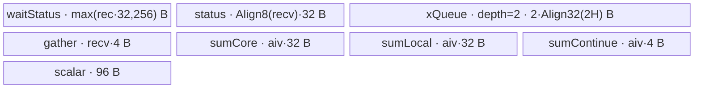
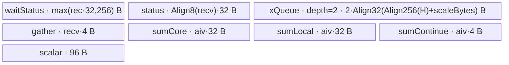

# MoeDistributeDispatchTeardown 950 ACLNN 算子知识

## 算子速览

| 项目 | 内容 |
|---|---|
| 实际入口 | `aclnnMoeDistributeDispatchTeardownGetWorkspaceSize` + `aclnnMoeDistributeDispatchTeardown`，固定提交中无版本后缀，公开 ACLNN 当前版 |
| 计算语义 | 等待 `MoeDistributeDispatchSetup` 发起的 EP AllToAllV 数据到达；按本 rank 的专家窗口重排收到的 token，拆出 MX scale，生成 combine 辅助前缀计数和本地专家 token 数 |
| 输入输出 | `x[BS,H]`、`y[BS*K,tokenMsgSize]`、`expertIds[BS,K]`、`commCmdInfo[(BS*K+32)*16]`；输出 `expandX[A,H]`、可选有效的 `dynamicScales`、`assistInfoForCombine[A*128]`、`expertTokenNums[localExpertNum]`，均为 ND |
| 执行类型 | `AIV_VECTOR + 非 Cube 通信 Hybrid`；单 Kernel 节点。Host 用 `CalcTschBlockDim(aivNum, 0, aivNum)`，Device 只有 `ASCEND_IS_AIV` 路径；同一 AIV kernel 轮询并消费 URMA window，再以 Vector/MTE 完成计数、前缀和与重排。未发现 AIC/Cube、MIX_CV、SIMT、NDDMA 或第二个 Device 节点 |
| Kernel 路线 | R-001 非量化 `key=10000`；R-002 MX 量化 `key=10004` |
| 核心资源 | HCCL/URMA GM window、配套 Setup 的 URMA SQ/CQ 与 token→status 提交协议、GM 输出、`workspace` 跨核计数矩阵、`TQueBind<VECIN,VECOUT,1>` depth=2、7 个 `TBuf`、Vector `GatherMask/Sum/ReduceSum/Duplicate` 与 MTE `DataCopy/DataCopyPad` |
| 来源闭包 | `source_closed`：公开 ACLNN 文档/声明、API wrapper、平台注册、950 selector、POD、单 entry/router、950 Hybrid body、配套 Setup 的 window producer 协议、直接 helper 与构建接线已闭合；自动生成 `aclnnInner*` 和运行时 HCCL context 为明确框架边界 |
| 验证状态 | 已完成源码闭包检查；本次知识提取未执行编译、真机、数值或性能测试。 |

## 接口与语义

### 计算语义

公开语义不是重新发起 AllToAllV，而是消费配套 `aclnnMoeDistributeDispatchSetup` 已写入的通信窗口。Setup 先通过本地 MTE 或远端 URMA 写 token 数据，再写同一目的 rank 的 32 B 状态记录；记录第 0 个 `int32` 的位模式为 `0x40000000`（按 `float` 解释为 2.0），第 1 个 `int32` 是 token count。Teardown 只有观察到本 core 所有记录的 flag 之和等于 `2*recordCount` 才清 flag 并消费数据。令 `localExpertNum=moeExpertNum/epWorldSize`（当前公开 950 不支持共享专家），`globalBsReal=(globalBs==0 ? BS*epWorldSize : globalBs)`，则输出容量第一维为：

```text
A = globalBsReal * min(localExpertNum, K)
```

每个状态记录的第二个 `int32` 是该来源 rank/本地专家块收到的 token 数。Kernel 对这些计数做前缀和；窗口中的 token 按 `winOffset = index % epWorldSize * localExpertNum + index / epWorldSize` 转为“本地专家优先、rank 次之”的读地址，再连续写入 `expandXOut`。R-002 的每个窗口 token 尾部还携带 `Align2(CeilDiv(H,32))` 个 `fp8_e8m0_t` scale，写入 `dynamicScalesOut`；`expandXOut` 只写前 `H` 个元素。

`assistInfoForCombineOut` 的 Device 可见写入是每个状态块结束位置的累积 token 数，起始索引为该 core 的 `startExpertId_`。多本地专家时，最后一个活动 AIV 从每个专家对应的最后 rank 前缀差分得到 `expertTokenNumsOut`；当前公开 `expertTokenNumsType=1`，因此输出逐专家数量而非专家间累计前缀。这里的 Setup 是配套逻辑算子和先决条件，不是本 ACLNN executor 内新增的 Device 节点。

### 输入、输出与属性

| 参数 | shape/layout | dtype | 约束、默认值与语义 |
|---|---|---|---|
| `x` | `[BS,H]` / ND | FP16、BF16 | 必选；`BS∈(0,512]`、`H∈[1024,8192]`，公开当前仅列 `BS∈{8,16,256}`、`H∈{4096,7168}`；OpDef `AutoContiguous`。Kernel 仅用其 shape/dtype specialization，绑定的 `xGMTensor_` 在当前 body 中未读取。 |
| `y` | `[BS*(K+sharedExpertNum), tokenMsgSize]` / ND | 与 Route 对应 | setup 输出；R-001 为 FP16/BF16 且 `tokenMsgSize=Align256(H)`；R-002 当前公开闭合到 FP8E5M2/FP8E4M3 且 `tokenMsgSize=Align512(Align256(H)+Align2(CeilDiv(H,32)))`。Device 通过 HCCL window 读到它，不直接使用 entry 的 `y` 指针。 |
| `expertIds` | `[BS,K]` / ND | INT32 | `K∈(0,min(16,moeExpertNum)]`，公开当前仅 `K∈{6,8}`；与 `x` 的 dim0 相同。当前 body 不直接读该 GM 指针。 |
| `commCmdInfo` | `[(BS*K+epWorldSize*localExpertNum)*16]` / ND | INT32 | 当前公开无共享专家且 `epWorldSize*localExpertNum=moeExpertNum=32`。当前 body 不直接读该 GM 指针。 |
| `groupEp` | 标量字符串 | STRING | 长度 `[1,128)`；同时注册为 MC2 HCCL group。 |
| `epWorldSize` / `epRankId` | 标量 | INT64 | Host 范围分别为 `[2,384]` 与 `[0,epWorldSize)`；公开 950 当前仅 `epWorldSize∈{2,8}`。 |
| `moeExpertNum` | 标量 | INT64 | Host `(0,512]` 且须能按非共享专家 rank 划分；公开当前仅 32。 |
| `expertShardType` | 标量 | INT64 | 仅 0。 |
| `sharedExpertNum` / `sharedExpertRankNum` | 标量 | INT64 | Host 通用检查允许前者 `[0,4]`、后者 `[0,epWorldSize/2]`；公开 950 当前两者仅 0，所以共享专家 key `11xxx` 不属于本卡。 |
| `quantMode` | 标量 | INT64 | Host 通用实现接受 0..4，但公开 950 当前仅 0 和 4；本卡只发布对应 `10000`、`10004`。 |
| `globalBs` | 标量 | INT64 | 0 或 `[BS*epWorldSize,512*epWorldSize]`；Device 直接计算 `axisMaxBS_=globalBs/epWorldSize`，见失败边界。 |
| `expertTokenNumsType` | 标量 | INT64 | 当前仅 1，表示逐专家 token 数。 |
| `commType` / `commAlg` | 标量 | INT64 / STRING | 950 当前只允许 `commType=2`（URMA），`commAlg` 必须为空。 |
| `expandXOut` | `[A,H]` / ND | R-001：同 `x` 的 FP16/BF16；R-002：FP8E5M2/FP8E4M3 | 与 `y` dtype 相同；每个 token 只提交真实 `H` 个元素。 |
| `dynamicScalesOut` | R-001 文档为 `[A]` 但值无效；R-002 `[A,Align2(CeilDiv(H,32))]` / ND | R-001：FP32；R-002：FP8E8M0 | 参数指针在 wrapper 中始终必选；只有量化 Route 写有效 scale。 |
| `assistInfoForCombineOut` | `[A*128]` / ND | INT32 | Device 写入状态块粒度的累积 token 计数；其余空间语义固定仓未展示直接 consumer。 |
| `expertTokenNumsOut` | `[localExpertNum]` / ND | INT64 | 当前 `localExpertNum=32/epWorldSize`，由最后活动 core 写入。 |

### 入口与版本

固定提交只有无版本后缀的公开两段式入口，未发现 `V2/V3` 同语义公开函数，因此它就是 950 实际支持的最新公开版本。文档产品表明确仅 `Ascend 950DT` 支持，A2/A3 均为“×”；尽管文档后段残留 A3 参数段、仓内也有 arch22 源码，本卡按产品表、`DAV_3510` wrapper gate、950 `IsCapable`、`AddConfig("ascend950")` 和 ascend950 binary config 的一致证据只发布 950。

第一段 wrapper 先拒绝非 `DAV_3510`，检查必选 tensor/group，随后调用自动生成的 `aclnnInnerMoeDistributeDispatchTeardownGetWorkspaceSize`。第二段在 weak symbol 可用时先设置 executor HCCL server type 为 `MTE`，再把 workspace/executor/stream 交给 `aclnnInnerMoeDistributeDispatchTeardown`。生成 bridge 源码不在固定仓；其参数透传和执行器内部细节是框架边界，未补造额外 Device 节点。

## Host/Launcher 执行流程

### 参数校验与前处理

1. `GetWorkspaceSize` 用 `GetCurrentPlatformInfo().GetCurNpuArch()==DAV_3510` 冻结 950。
2. `CheckNotNull` 要求四个输入、四个输出和非空 `groupEp`；`groupEp` 长度达到 128 时返回参数错误。
3. OpDef 给四个输入加 `AutoContiguous`，并用 14 组 dtype tuple 约束 `x/y/expandX/dynamicScales` 组合；自动生成的 contiguous bridge 属框架边界。
4. `MoeTilingBase::GetPlatformInfo` 从 `PlatformAscendC` 生产 `npuArch_`；950 tiling template priority 0 的 `IsCapable` 只接受 `DAV_3510`，没有下一候选模板。
5. Tiling 按 required attrs → optional attrs → shape → dtype → HCCL window 容量顺序校验；任一步失败返回 `GRAPH_FAILED`，不会设置可执行 key。
6. `SetHcommCfg` 选择 AllToAll、`SetCommEngine(3)`（AIV URMA）并把 protocol 改为 1；然后设置 key、AIV blockDim、batch schedule、workspace。

公开支持面比通用 Host 代码更窄：Host 仍有 quant 1/2/3 和共享专家判断，router 也保留相应实例，但这些不属于文档声明的 950 当前版，故只作为 dormant 实现边界记录，不发布为 Route。

### 参数、Workspace 与生命周期

`SetPlatformInfo` 读取 `aivNum=GetCoreNumAiv()` 与 `totalUbSize=GetCoreMemSize(UB)`，设置：

```text
blockDim = CalcTschBlockDim(aivNum, 0, aivNum)
scheduleMode = 1
workspaceSize[0] = 16 MiB + aivNum * 512 B
```

Device 把 `workspaceGM` 起点解释为跨核 recv-count 交换矩阵。core `i` 在 `workspace + i*(512*aivNum)` 起写，`DataCopy` 以 512 B 的目标间隔复制同一个 core sum；core `j` 再从 `workspace+512*j` 起，以 `512*aivNum` 的源间隔读取此前 core 的 sum。16 MiB 固定区与尾部 `aivNum*512` 的框架/算子边界在固定仓没有更细 owner 切分；调用者必须保留第一段返回的完整 workspace 至 stream 上 kernel 完成。

HCCL window 由运行时 context 拥有。`Mc2TilingUtils::GetMaxWindowSize` 把 `HCCL_BUFFSIZE` 的 MB 值换成字节，未配置时使用 200 MiB；Tiling 再取 `totalWinSize=GetMaxWindowSize()/2`，并要求它不小于：

```text
2 * (localExpertNum*maxBs*epWorldSize*Align512(Align32(2*H)+44)
     + K*maxBs*Align512(2*H))
maxBs = (globalBs == 0 ? BS : globalBs/epWorldSize)
```

Device 用 `dataState` 在两半 window 间翻转：`winDataSizeOffset=dataState*(totalWinSize/2)`。状态区在 `windowsOut[self]+dataState*WIN_STATE_OFFSET`，数据区在 `windowsIn[self]+winDataSizeOffset`。配套 Setup 的远端路径先组装/提交所有非空 token WQE，再提交每个本地专家的 32 B status WQE，最后一次敲 `SendJFSDoorBell`；本地 rank 路径也在 token MTE3 完成后才复制 status。Teardown 以 status flag 轮询作为 token 可消费条件；这两个 window 在配套 Setup/Teardown 完成前不得覆盖。

### 启动图与失败传播

```text
external precondition: paired DispatchSetup A5
  -> local MTE / remote URMA token writes
  -> 32 B status writes (flag=2.0, count=int32)
  -> HCCL windowsIn/windowsOut

GetWorkspaceSize -> generated ACLNN inner bridge -> A5 TilingRegistry/tiling template
Execute -> NnopbaseSetHcclServerType(MTE) -> generated ACLNN inner bridge
  -> K0 moe_distribute_dispatch_teardown<<<blockDim>>>
       POD=MoeDistributeDispatchTeardownTilingData
       execution=AIV_VECTOR + non-Cube communication Hybrid
       paired DispatchSetup/HCCL window -> K0 -> four outputs
       K0 cores -> workspace -> K0 cores, ordered by SyncAll<true>
```

固定仓可见的本逻辑算子拓扑只有 K0 一个 Device 节点；上图的 Setup 是跨 ACLNN 调用的前置 producer，不计入本 executor 的 launch graph。OpDef 的 `multiKernelSupportDynamicGraph.value=multi_kernel` 是能力标志，不足以证明本入口实际启动多个 kernel。Tiling、generated inner 或 launch 失败由两段式 ACLNN 返回；K0 内 `WaitDispatch` 是无超时轮询，固定源码没有 Device 错误码或 cleanup 分支。

## Route 与参数设计

### 分核与资源计算

公开无共享专家时：

```text
localExpertNum = moeExpertNum / epWorldSize
recvWinBlockNum = rscvStatusNum = moeExpertNum
base = rscvStatusNum / aivNum; remainder = rscvStatusNum % aivNum
recStatusNumPerCore = base + (aivId < remainder ? 1 : 0)
startStatusIndex = base*aivId + min(aivId, remainder)

R-001: hOutSizeAlign = Align32(2H)
R-002: scaleBytes=Align2(CeilDiv(H,32)); hOutSizeAlign=Align256(H)+scaleBytes
common: hOutAlignUbSize=Align32(hOutSizeAlign)
        hAlignWinSize=Align512(hOutSizeAlign)
        expertPerSizeOnWin=(globalBs/epWorldSize)*hAlignWinSize
```

`aivId>=rscvStatusNum` 的 core 在两个工作函数中 no-op，但仍参加全核 barrier。Host 不按 UB 反推 tile；每次只搬一个 token，必要条件是后文 `UB_total<=totalUbSize`。

### Route 选择

| 顺序 | Route | Key/模板 | 精确选择条件与优先级 | 不适用去向 |
|---:|---|---|---|---|
| 1 | R-001 非量化 window copy | 10000；`<X,Out,UNQUANT,false,false>` | 950；公开 q0、shared rank 0；`x/y/expandX` 为同一 FP16 或 BF16；其余 guard 全通过 | q4 转 R-002；其它失败，无 fallback |
| 2 | R-002 MX scale 拆分 | 10004；`<X,Out,MX_QUANT,false,false>` | 950；公开 q4、shared rank 0；闭合 tuple 为 `x` FP16/BF16、`y/expandX` FP8E5M2/E4M3、scale FP8E8M0；其余 guard 全通过 | 失败，无 fallback |

```text
A5 template priority=0, IsCapable iff DAV_3510
validate attrs/shapes/dtypes/window
key = 10000 + quantMode + (epRankId < sharedExpertRankNum ? 1000 : 0)
  public q0/nonshared -> 10000 -> R-001
  public q4/nonshared -> 10004 -> R-002
```

### 模板/实现执行矩阵

| Route | key/selector | dtype/shape/platform 完整命中条件 | 执行拓扑与 Kernel 节点 | 实际模板/body | 内存与同步特征 | tail/fallback |
|---|---|---|---|---|---|---|
| R-001 | 10000 | 950、q0、非共享、FP16/BF16，公开 shape/attr/window guard | 单 Hybrid K0：URMA window consumer + AIV Vector/MTE | `<DTYPE_X,DTYPE_EXPAND_X,0,false,false>`；`WaitDispatch→SyncAll→LocalWindowCopy→UpdateTokenNumsOut` | 2B payload；depth-2 queue；workspace prefix | 输出只写 H；状态余数分核；无 fallback |
| R-002 | 10004 | 950、q4、非共享、FP8 output/E8M0 scale，同公共 guard | 同一 Hybrid K0 | `<DTYPE_X,DTYPE_EXPAND_X,4,false,false>`；编译期启用 scale split | 1B payload+scale tail；同同步图 | payload H、scale aligned count；无 fallback |

### 隐藏性能 Guard

| Guard | Host/Tiling 条件 | Device/资源原因 | 影响 Route | 不满足时去向 | 源码符号 |
|---|---|---|---|---|---|
| AIV-only | `CalcTschBlockDim(aivNum,0,aivNum)` | body 只在 `ASCEND_IS_AIV`，且所有 core 参加 barrier | 两条 | tiling失败 | `SetPlatformInfo/Process` |
| window 容量 | `GetMaxWindowSize()/2>=golden` | 双状态 window 与专家/rank token 段 | 两条 | `GRAPH_FAILED` | `CheckHcclBuffSize` |
| token→status 提交 | Setup 先提交 token WQE、后提交 32 B status WQE；本地亦先数据后状态 | Teardown 只看 status，不另查 URMA CQ；status 必须成为数据可见性的提交标志 | 两条 | flag 未到 2.0 时持续轮询 | Setup `CurRankComm/Communication`；Teardown `WaitDispatch` |
| 状态分核 | `startStatusIndex<rscvStatusNum` | 防越界；闲 core仍须同步 | 两条 | per-core no-op | `WaitDispatch/LocalWindowCopy` |
| 状态 stride | `recvBlocks>512 ? 256 : 512` B | 每记录只搬首 32 B | 两条 | 无替代 | `Init/WaitDispatch` |
| UB 上限 | `UB_total<=totalUbSize`，Host 未显式检查 | 所有 InitBuffer 同时分配，queue depth=2 | 两条 | 无 runtime fallback | `Init` |
| MTE 16-bit count | record/core counts 转 uint16 | `DataCopyParams.blockCount` 位宽 | 两条 | 无专门 Host guard | `WaitDispatch/SyncCntOnCore/GetCumSum` |
| MX 对齐 | `scaleBytes=Align2(CeilDiv(H,32))` | 每32值一scale且偶数；token 512B stride | R-002 | shape失败 | `CheckTensorShapeSize/QuantInit` |
| dtype compile guard | q0在2B输出分支；q4在1B输出分支 | router按 `ORIG_DTYPE_EXPAND_X` 编译 | 两条 | unknown key无输出 | kernel entry |

### POD/ABI

`MoeDistributeDispatchTeardownInfo` 为 standard-layout；相对内层结构可推导 `alignof=8`、`sizeof=80`。外层前置两个运行时定义类型，固定仓未给出其定义，因此内层在完整 POD 中的绝对 offset 与完整 sizeof 不可见。

| 结构 | 字段 | 类型/位宽 | ABI 布局 | 单位 | Host/launcher producer | Device consumer | 边界 |
|---|---|---|---|---|---|---|---|
| outer | `mc2InitTiling` | `Mc2InitTiling` / 不可见 | outer offset 0；内部不可见 | runtime config | `Mc2CcTilingConfig::GetTiling` | HCCL runtime；body不直接读 | SDK ABI |
| outer | `mc2CcTiling` | `Mc2CcTiling` / 不可见 | 绝对 offset不可见 | runtime config | `GetTiling`，随后 `protocal=1` | HCCL runtime | engine3/URMA |
| Info | `epWorldSize` | uint32/32 | offset 0 | rank | required attr cast | `Init` | Host 2..384；公开2/8 |
| Info | `epRankId` | uint32/32 | offset 4 | rank id | required attr cast | `Init` | `<epWorldSize` |
| Info | `expertShardType` | uint32/32 | offset 8 | enum | optional attr cast | 未读取 | 当前0 |
| Info | `sharedExpertNum` | uint32/32 | offset 12 | expert | optional attr cast | `Init` | 公开0 |
| Info | `sharedExpertRankNum` | uint32/32 | offset 16 | rank | optional attr cast | `Init` | 公开0 |
| Info | `moeExpertNum` | uint32/32 | offset 20 | expert | required attr cast | `Init` | 公开32 |
| Info | `quantMode` | uint32/32 | offset 24 | enum | optional attr cast | body不读取；key冻结 | 0/4 |
| Info | `globalBs` | uint32/32 | offset 28 | token | optional attr cast | `axisMaxBS` | 0边界见限制 |
| Info | `bs` | uint32/32 | offset 32 | token | `x.shape[0]` | `Init` | 公开8/16/256 |
| Info | `k` | uint32/32 | offset 36 | expert/token | `expertIds.shape[1]` | `Init` | 公开6/8 |
| Info | `h` | uint32/32 | offset 40 | element | `x.shape[1]` | layout/copy methods | 公开4096/7168 |
| Info | `aivNum` | uint32/32 | offset 44 | core | `GetCoreNumAiv` | 全部分核/workspace | 与blockDim一致 |
| Info | `isQuant` | bool/8 | offset 48 | boolean | `quantMode!=0` | 未读取 | key已有信息 |
| Info | `isActiveMask` | bool/8 | offset 49 | boolean | 未赋值 | 未读取 | inactive |
| Info | `reserved2` | bool/8 | offset 50 | reserved | 未赋值 | 未读取 | reserved |
| Info | `reserved3` | bool/8 | offset 51 | reserved | 未赋值 | 未读取 | offset52..55 padding |
| Info | `totalUbSize` | uint64/64 | offset 56 | byte | `GetCoreMemSize(UB)` | 未读取 | Host无UB selector |
| Info | `totalWinSize` | uint64/64 | offset 64 | byte | `GetMaxWindowSize()/2` | `Init` | 容量检查后 |
| Info | `expertTokenNumsType` | uint32/32 | offset 72 | enum | optional attr cast | `UpdateMultiMoeTokenNumsOut` | 公开1 |
| Info | `sdmaUsedStreamPerCore` | uint32/32 | offset 76 | stream/core | 未赋值 | 未读取 | inactive |

### Route 源码闭包

| Route | Key/selector | Host/Tiling producer | POD/参数 | Kernel entry/router 节点 | Kernel body/直接依赖 | 构建接线 |
|---|---|---|---|---|---|---|
| R-001 | 950 priority0；10000 | 950 template + base Impl/SetKey | POD q0/nonshared/AIV/window/workspace | K0 q0 branch | 950全部公共方法；Setup `CurRankComm/Communication` producer 协议；setup base/common；SyncFunc | modules-with-soc、simplified key0、950 auto-sync off |
| R-002 | 同；10004 | 同，q4 | 同 POD | K0 q4 branch | 公共方法 + `QuantInit/CopyScalesToOut`；同一 Setup producer 协议 | 同 |

## Kernel 实现

### 公共执行流程

K0 是单节点 Hybrid：解包 POD 并按 key 构造唯一模板实例；`Init` 读取 AIV id、HCCL context、自 rank 双状态位，绑定输出与 workspace，按状态数分核并一次性分配所有 UB。`Process` 完整顺序为 `WaitDispatch()` → `SyncAll<true>()` → `LocalWindowCopy()` → `UpdateTokenNumsOut()`，且整体位于 `ASCEND_IS_AIV`。通信侧不新增 kernel：同一节点以 status poll 消费 Setup 已经通过本地 MTE/远端 URMA 提交的 window，再进入 Vector/MTE 重排。

`WaitDispatch` 轮询状态首 32 B，直到 flag 和为 `2*recStatusNumPerCore`；随后清 flag、提取每记录第二个 int32 count 并求和，把 core sum 写入 workspace 的转置布局。全核 barrier 后 `LocalWindowCopy` 求此前 core sum，获得无重叠输出起点，再逐 token 从 window 搬到 depth-2 queue、拆 scale、写输出。最后活动 core 生成专家 token 数。

### Route R-001：非量化 window copy

#### 适用条件

##### 选择证据

| 层级 | 文件 | 符号 | 源码谓词/参数 | 结果/下一跳 |
|---|---|---|---|---|
| API | `op_api/aclnn_moe_distribute_dispatch_teardown.cpp` | `aclnnMoeDistributeDispatchTeardownGetWorkspaceSize` | `npuArch==DAV_3510` 且 wrapper检查通过 | generated inner |
| Host | `op_tiling/arch35/moe_distribute_dispatch_teardown_tiling_arch35.cpp` | `IsCapable` | `DAV_3510`，priority0 | base tiling；false失败 |
| Tiling | `moe_distribute_dispatch_teardown_tiling_base.cpp` | `SetTilingKey` | `10000+q+(shared?1000:0)`；公开q0/nonshared | 10000 |
| Router | `op_kernel/moe_distribute_dispatch_teardown.cpp` | `TILING_KEY_IS(10000)` | output compile dtype BF16/FP16 | q0模板；unknown无输出 |

#### Device 数据流

##### 函数级调用链

```text
external Setup::Communication -> token WQE/MTE -> status WQE/MTE -> HCCL window
K0 entry -> q0 Init -> GetHcclContext + InitBuffer
  -> Process[AIV]
     -> WaitDispatch: status DataCopy -> ReduceSum -> clear -> GatherMask/Sum -> workspace
     -> SyncAll<true>
     -> LocalWindowCopy: GetCumSum -> window->xQueue->expand -> assist prefix
     -> UpdateTokenNumsOut -> UpdateMultiMoeTokenNumsOut
```

##### 源码等价伪码

```text
records = partition([0,moeExpertNum), aivNum, aivId)
if active:
  loop: DataCopy status records; flagSum=ReduceSum(status flags)
        until flagSum==2*records.count
  clear flags; localRecv=Sum(GatherMask(second int32 per 32B block))
  workspace[aivId,0:workCoreNum]=broadcast(localRecv)
SyncAll(all AIV)
if active:
  begin=Sum(workspace[0:aivId,aivId])
  for status index: count=statusUB[i*8+1]; assist[index]=begin+count
    winOffset=index%epWorldSize*localExpertNum+index/epWorldSize
    for token: window[winOffset][token] -> queue -> expand[begin+token,0:H]
    begin+=count
last active core writes expert counts from assist prefix differences
```

#### 内存与数据搬运

##### 资源与搬运表

| 层级/缓冲区 | offset/地址公式 | extent/容量公式 | dtype/layout | producer | consumer | owner/lifetime | 对齐/复用 |
|---|---|---|---|---|---|---|---|
| window state GM | `windowsOut[self]+state*WIN_STATE_OFFSET+start*stateOffset` | per record 32B，stride256/512B | 记录前两项为 `[float flag=2.0,int32 count]` | Setup 本地 MTE / 远端 status WQE | `WaitDispatch` | HCCL generation；Teardown清 flag后可供下一 generation | DCache；MTE stride7/15；token 后提交 |
| window data GM | `windowsIn[self]+state*totalWinSize/2+winOffset*expertPerSize+j*hAlignWinSize` | token `Align32(2H)` B | FP16/BF16 | Setup 本地 MTE / 远端 token WQE | `LocalWindowCopy` | HCCL generation | L2 disabled；512B stride；status到达前不可读 |
| workspace | producer `i*512*aivNum+j*512`；consumer transpose | 1×32B blocks | int32 sparse | SyncCnt | GetCumSum | K0 | 512B对齐；无atomic |
| waitStatusBuf | UB | `max(recPerCore*32,256)` B | float/int32 alias | status copy | flag/count/copy | Process | flag后复用count |
| statusBuf | UB | `Align8(recvBlocks)*32` B | int32 | InitBuffer | 当前路径随后改绑 | Process | 实际分配不可扣除 |
| xQueue | UB | depth2 × `Align32(2H)` B | output dtype | window copy | output copy | per token | alloc/enque/deque/free |
| gatherMaskOut | UB | `recvBlocks*4` B | float/int32 | Gather/Reduce | Sum/outCount | Process | 后作prefix output |
| sumCore/sumLocal/sumContinue | UB | `aivNum*32 + aivNum*32 + aivNum*4` B | sparse/continuous int32 | Vector/MTE | workspace/Sum | phase-local | block-first-element layout |
| scalarBuf | UB | 96 B | pattern/scalars | scalar/Vector | Gather/Sum | Process | 32B子区 |
| outputs GM | expand `(begin+j)*H`；assist `startExpertId` | H / assigned statuses / local experts | API dtype | K0 | caller | stream | 不写expand padding |

##### 分层内存布局



##### 字节账与复用顺序

```text
UB_R001=max(rec*32,256)+Align8(recv)*32+2*Align32(2H)
        +recv*4+68*aivNum+96 <= totalUbSize
公开 recv=32 且 aivNum>=32：UB_R001=1504+68*aivNum+2*Align32(2H) B
```

| 复用子区 | 写入者 | 读取者/消费点 | 下一次覆盖 | 同步或释放依据 | 安全条件 |
|---|---|---|---|---|---|
| waitStatus | status MTE2 | Reduce/Gather/Local count | 下一代算子 | MTE2_V/V_S/V_MTE3/MTE3_S | clear/count顺序不换 |
| gather | status gather | Sum | GetCumSum作outLocal | Wait后SyncAll | SyncCnt完成前不覆盖 |
| queue slot | window MTE2 | output MTE3 | Free后下个token | queue生命周期+MTE2_S | 两路消费完再free |
| workspace | all cores | all core prefix | kernel后 | SyncAll | producer均到barrier |

#### 同步、精度与尾块

##### 同步与数值边界表

| 阶段 | primitive/机制 | producer | consumer/等待点 | 保护对象 | 精度/尾块 |
|---|---|---|---|---|---|
| remote/local commit | URMA SQ/CQ + `SendJFSDoorBell` / local MTE3 | paired Setup token writes | paired Setup status writes；Teardown poll | window token→status ordering | status flag 位模式是 float 2.0，count 是下一 int32 |
| poll | DCache + MTE2_V | Setup status | ReduceSum | flags | float sum目标精确整数2n；无超时 |
| clear | S_V/V_MTE3/MTE3_S | Duplicate0 | state GM | generation | 每8 int32清首个 |
| count | GatherMask+Sum+V_S | status second int32 | scalar | local counts | 按源码reinterpret顺序 |
| prefix | workspace+SyncAll+MTE2 | cores | GetCumSum | output ownership | inactive core也同步 |
| token | MTE2_S/queue/PIPE_MTE3 | window | output | token slot | 输入Align32(2H)，输出2H，无cast |
| expert count | SyncAll+DCache | assist prefix | last core | tokenNums | int32差分写int64 |

#### 关键实现

##### 符号证据表

| 阶段 | 文件 | 符号/模板实例 | 实现事实 |
|---|---|---|---|
| Host/Tiling | `moe_distribute_dispatch_teardown_tiling_base.cpp` | SetHcommCfg/Platform/Workspace/Key | AIV URMA、资源、10000 |
| Router | `op_kernel/moe_distribute_dispatch_teardown.cpp` | key10000 branch | q0模板/参数 |
| Body | `op_kernel/arch35/moe_distribute_dispatch_teardown_arch35.h` | Init/Wait/Sync/GetCumSum/Copy/Update | 真实循环、地址、搬运、同步 |
| Producer/helper | setup 950 body；`moe_distribute_base.h`；`mc2_kernel_utils.h` | `CurRankComm/Communication`；HcclCombinOpParam/offsets；SyncFunc | token→status提交、context ABI与硬事件 |

### Route R-002：MX scale 拆分

#### 适用条件

##### 选择证据

| 层级 | 文件 | 符号 | 源码谓词/参数 | 结果/下一跳 |
|---|---|---|---|---|
| Doc | `docs/aclnnMoeDistributeDispatchTeardown.md` | 950 constraints | q4当前公开，scale有效 | inner |
| Host | arch35 tiling | IsCapable | DAV_3510 | base tiling |
| Tiling | base tiling | shape/dtype/key | MX tokenMsg、scale dim、E8M0、10004 | R-002 |
| Router | kernel entry | key10004 | 1-byte output compile group | MX模板 |

#### Device 数据流

##### 函数级调用链

```text
external Setup::Communication -> MX token WQE/MTE -> status WQE/MTE -> HCCL window
K0 key10004 -> MX Init -> QuantInit(payloadOffset=Align256(H), scaleBytes=Align2(Ceil32(H)))
  -> common Wait/Sync/GetCumSum
  -> per token window->queue -> CopyScalesToOut -> expandXOut -> common counts
```

##### 源码等价伪码

```text
payloadAligned=Align256(H); scaleBytes=Align2(CeilDiv(H,32))
tokenBytes=payloadAligned+scaleBytes; tokenStride=Align512(tokenBytes)
tokenUB=DataCopyPad(windowToken,tokenBytes)
DataCopyPad(scaleOut[tokenIndex*scaleBytes],tokenUB.byte[payloadAligned],scaleBytes)
DataCopyPad(expandOut[tokenIndex*H],tokenUB,H)
```

#### 内存与数据搬运

##### 资源与搬运表

| 层级/缓冲区 | offset/地址公式 | extent/容量公式 | dtype/layout | producer | consumer | owner/lifetime | 对齐/复用 |
|---|---|---|---|---|---|---|---|
| state/workspace/count | 同R-001 | 同R-001 | packed/int32 | setup/K0 | K0 | K0 | 同步图不变 |
| window token | `wAddr+j*Align512(tokenBytes)` | `Align256(H)+scaleBytes` | FP8 payload+E8M0 tail | setup | queue | HCCL | 512B stride |
| xQueue | UB | depth2×`Align32(tokenBytes)` | raw bytes | window | two outputs | token | 一次搬入两路只读 |
| scale output | `tokenIndex*scaleBytes` | scaleBytes | E8M0 | CopyScales | caller | stream | offset Align256(H) |
| expand output | `tokenIndex*H` | H bytes | E5M2/E4M3 | LocalCopy | caller | stream | 丢弃padding/tail |

##### 分层内存布局



##### 字节账与复用顺序

```text
scaleBytes=Align2(CeilDiv(H,32))
UB_R002=max(rec*32,256)+Align8(recv)*32
        +2*Align32(Align256(H)+scaleBytes)+recv*4+68*aivNum+96 <= totalUbSize
公开 recv=32且aivNum>=32：UB_R002=1504+68*aivNum+2*Align32(Align256(H)+scaleBytes) B
```

| 复用子区 | 写入者 | 读取者/消费点 | 下一次覆盖 | 同步或释放依据 | 安全条件 |
|---|---|---|---|---|---|
| queue token | window MTE2 | scale MTE3 + payload MTE3 | Free后 | MTE2_S+queue生命周期 | 两次读取后才free |
| status/gather/workspace | 同R-001 | 同R-001 | 同R-001 | 同事件/barrier | 同R-001 |

#### 同步、精度与尾块

##### 同步与数值边界表

| 阶段 | primitive/机制 | producer | consumer/等待点 | 保护对象 | 精度/尾块 |
|---|---|---|---|---|---|
| status/prefix | 同R-001（Setup token→status提交 + K0 poll/barrier） | Setup/cores | K0 | status/workspace | 无变化 |
| MX split | compile-time q4 | token layout | CopyScales | boundary | 无cast/round，逐字节保持 |
| payload | DataCopyPad | queue base | expand | H elements | 忽略Align256 padding |
| scale | DataCopyPad | queue+Align256(H) | scaleOut | scaleBytes | 偶数scale shape |

#### 关键实现

##### 符号证据表

| 阶段 | 文件 | 符号/模板实例 | 实现事实 |
|---|---|---|---|
| Host/Tiling | base tiling | shape/dtype/SetKey | MX约束与10004 |
| Router | kernel entry | key10004 | MX nonshared模板 |
| Body | 950 body | QuantInit/CopyScales/LocalCopy | scale offset/bytes/双输出 |
| Producer/helper | setup 950 body；setup common.h | `Communication`；Ceil32/Align2/Align256 | MX token先于status提交；Device对齐 |

## 算子特定优化

### Trick T-001：转置 workspace 实现无 Atomic 跨核前缀

#### 触发与源码依据

- 适用 Route：R-001、R-002。
- 触发条件：活动 core 已得到 `sumOfRecvCnt`，随后所有 AIV 执行 `SyncAll<true>`。
- Golden 来源：[`arch35/moe_distribute_dispatch_teardown_arch35.h:368-386`](../../../../../../../cann-ops-raw/ascendc/ops-transformer/be33d95bb755cedec3108f70805c1874d1792540/mc2/moe_distribute_dispatch_teardown/op_kernel/arch35/moe_distribute_dispatch_teardown_arch35.h#L368-L386)

**官方源码（固定 Commit 连续逐字摘录）**：

```cpp
// 把当前核的所有专家的recv cnt之和写到workspace
uint32_t coreOffset = WORKSPACE_ELEMENT_OFFSET * aivNum_;
GM_ADDR wAddr = (__gm__ uint8_t*)(recvCntWorkspaceGM_) + coreOffset * aivId_;
GlobalTensor<int32_t> sumTensor;
sumTensor.SetGlobalBuffer((__gm__ int32_t*)wAddr);
uint16_t workCoreNum = MIN(recvWinBlockNum_, aivNum_);
// 每个核把sumOfRecvCnt重复写workCoreNum份
LocalTensor<int32_t> sumCoreTensor = sumCoreBuf_.Get<int32_t>();
// 仅处理每个datablock的首元素（对应maskArray[0]的bit0）。操作数为32bit情况下，maskArray只有第0个元素有效
// 每个元素占4字节，每个32字节处理8份，mask中每8个bit的填充第1位
uint64_t maskArray[2] = {0x0101010101010101, 0};
// 每个核一个datablock，总共需要处理workCoreNum个核。每个repeat总共256字节，可以处理8个datablock
uint8_t repeatTimes = (workCoreNum + 7) / 8;
// 1代表单个repeat内不同的datablock连续，没有跳过
// 8代表不同repeat的首元素间隔8个datablock
Duplicate<int32_t>(sumCoreTensor, sumOfRecvCnt, maskArray, repeatTimes, 1, 8);
DataCopyParams sumIntriParams{static_cast<uint16_t>(workCoreNum), 1, 0, 15};
SyncFunc<AscendC::HardEvent::V_MTE3>();
DataCopy(sumTensor, sumCoreTensor, sumIntriParams);
```

#### 机制与设计原因

每个 core 把自己的总 count 沿 512 B 间隔广播成一行；consumer 以 `512*aivNum` 间隔读取同一列的此前行并 `GatherMask+Sum`。这把可变输出段起点转换成稀疏 GM 交换加全核 barrier，无需全局 Atomic 或单 core 串行扫描。`Duplicate` 只写每32B block首个int32，`dstStride=15` 与 consumer `srcStride=16*aivNum-1` 互逆。

#### 迁移边界

- 适用：各 core 独立得计数、之后需要稳定非重叠输出区间的 AIV compact/reorder。
- 前提：workspace覆盖稀疏地址；相同aivNum；读前全核可见性同步。
- 失效：不能全核 barrier、core提前退出或 stride/owner 不匹配时，改用有明确可见性的 scan/atomic/多kernel。
- 未验证：本次知识提取未执行编译、真机、数值或性能测试。

#### 错误做法

把 producer 地址改为 `workspace+512*aivId` 会让行重叠；删除 `SyncAll<true>` 会读到未提交 sum，均与源码协议冲突。

### Trick T-002：同一 token queue 直接拆出 MX scale 与 payload

#### 触发与源码依据

- 适用 Route：R-002。
- 触发条件：q4编译期分支，window布局为 `Align256(H)` payload 后接偶数个E8M0 scale。
- Golden 来源：[`arch35/moe_distribute_dispatch_teardown_arch35.h:511-520`](../../../../../../../cann-ops-raw/ascendc/ops-transformer/be33d95bb755cedec3108f70805c1874d1792540/mc2/moe_distribute_dispatch_teardown/op_kernel/arch35/moe_distribute_dispatch_teardown_arch35.h#L511-L520)

**官方源码（固定 Commit 连续逐字摘录）**：

```cpp
xTmpTensor_ = xQueue_.AllocTensor<ExpandXOutType>();
DataCopyPad(xTmpTensor_, tokGlobal, hCommuCopyOutParams_, copyPadExtParams);
SyncFunc<AscendC::HardEvent::MTE2_S>();
xQueue_.EnQue(xTmpTensor_);
xTmpTensor_ = xQueue_.DeQue<ExpandXOutType>();
xTmpTensorInt = xTmpTensor_.template ReinterpretCast<int32_t>();
CopyScalesToOut(beginIdx + j, xTmpTensor_);
expandXOutGlobal.SetGlobalBuffer((__gm__ ExpandXOutType*)(expandXOutGM_) + (beginIdx + j) * axisH_, axisH_);
DataCopyPad(expandXOutGlobal, xTmpTensor_, expandXCopyParams_);
xQueue_.FreeTensor(xTmpTensor_);
```

#### 机制与设计原因

window token只搬入UB一次。scale helper直接对 queue tensor 在 `Align256(H)` 处作 uint8 view，payload从同一tensor起点只写H个元素，避免单独scale CopyIn或去padding中间buffer。depth=2是真实分配；每slot在两路消费后才free。

#### 迁移边界

- 适用：payload与定长metadata尾部同块、需要分流输出。
- 前提：offset、dtype、长度、window stride和shape一致；MX scale数为 `Align2(CeilDiv(H,32))`。
- 失效：metadata变长、需cast/round或consumer异步生命周期不同，应增加buffer/同步。
- 未验证：本次知识提取未执行编译、真机、数值或性能测试。

#### 错误做法

用H作scale offset会把Align256 padding当scale；把tokenBytes全写expand会混入padding/scale。固定源码分别使用Align256(H)与H。

## 模板与实现对比

| 对比维度 | R-001 非量化 | R-002 MX | 设计选择依据 |
|---|---|---|---|
| 命中条件/优先级 | q0/key10000 | q4/key10004 | 同950 selector；key编码q |
| 模板与 dtype | `<X,Out,0,false,false>` FP16/BF16 | `<X,Out,4,false,false>` FP8+E8M0 | compile dtype + key |
| 循环与分核 | 状态分核/逐token | 相同 | q不改状态拓扑 |
| Queue/TBuf/寄存器/dynamic UB/通信 window | queue token 2H B；双状态window | queue token Align256(H)+scale B；同一window | 其余7 TBuf相同；无显式RegTensor成员或dynamic UB |
| 内存总占用与复用 | common+2Align32(2H) | common+2Align32(tokenBytes) | 真实depth2 |
| 搬运/Vector/SIMT/NDDMA/通信 API | Setup URMA/MTE token→status；window→queue→expand | Setup URMA/MTE token→status；window→queue→scale+expand | 无SIMT/NDDMA；通信提交与状态Vector相同，q4仅多一路scale CopyOut |
| 同步、精度与 tail | 无cast，写H×2B | 无cast，写H×1B+aligned scales | template layout |
| fallback/失败边界 | unknown无写 | 同 | 无Host fallback |

## 平台差异

| 项目 | A2 | A3 | 950 |
|---|---|---|---|
| 支持状态 | 公开产品表不支持 | 公开产品表不支持；后段A3说明冲突，不能发布 | Ascend 950DT支持 |
| Host/Launcher | 不发布 | arch22存在不推翻公开× | DAV_3510 gate；950 priority0；AIV URMA |
| Kernel/资源 | 不发布 | 不发布 | arch35；单 `AIV_VECTOR + 非 Cube 通信 Hybrid` K0；双window |

## 限制与失败边界

- 公开当前仅 q0/q4、EP 2/8、moeExpertNum32、无共享、URMA、BS 8/16/256、H 4096/7168、K 6/8；其它Host/router key不得扩展公开承诺。
- 公开文档参数表把 `dynamicScalesOut` 统一写成 1D `[A]`，但 950 q4 Host 明确要求 2D `[A,Align2(CeilDiv(H,32))]`；本卡按可执行 950 Host/Kernel 闭包记录 q4 形状，并保留该文档冲突。文档的通用量化 `tokenMsgSize=Align512(Align32(H)+4)` 与 q4 Host 公式不同，但在当前公开 `H=4096/7168` 上结果相同；扩展 H 时必须重新按 Host 公式校验。
- 文档与Host允许 `globalBs=0`，但Device直接令 `axisMaxBS=globalBs/epWorldSize`，使 `expertPerSizeOnWin=0`；固定提交未见归一化，这是源码不一致，不能推测bridge补值。
- `CheckRelationTensorDataType` 含 `(quantMode==PERTOKEN_DYNAMIC_QUANT)&&(quantMode=PERGROUP_DYNAMIC_QUANT)` 赋值表达式；本卡不发布q2/q3，迁移时不得照抄为正确谓词。
- key11004分支末尾重复 `op.Process()`；共享专家公开不可达，不纳入Route。
- `statusBuf_` 实际分配但当前路径随后改绑waitStatus；UB账不可扣除。
- assist输出shape为A*128，body只可证明写 assigned status prefix；其余区域consumer语义不可见。
- status轮询无超时；远端未写2会持续等待。
- Setup 源码注释把 `0x40000000` 误写成 float 1，实际位模式是 float 2.0；Teardown 的 `compareTarget*2` 与实际常量一致，迁移时不能按注释改成1。
- Teardown 不轮询 URMA CQ，而以 Setup 后提交的 status 为数据完成标志；移植时必须保留“远端 token WQE→status WQE→doorbell”或“本地 token MTE3→status MTE3”的顺序，不能把 status 提前。
- 16MiB固定workspace区的精确owner分区未展开，不能自行缩减返回workspace。
- Host未用totalUbSize拒绝实际分配；改H/dtype/状态规模须重算。
- 本次知识提取未执行编译、真机、数值或性能测试。

## 源码索引

### 链路索引

| 链路阶段 | 文件 | 关键符号 | 支撑内容 |
|---|---|---|---|
| 公开约束 | `docs/aclnnMoeDistributeDispatchTeardown.md` | 产品表/原型/约束 | 950-only与公开范围 |
| 入口声明 | `op_api/aclnn_moe_distribute_dispatch_teardown.h` | 两段接口 | 签名/参数 |
| 入口实现 | `op_api/aclnn_moe_distribute_dispatch_teardown.cpp` | checks/APIs | 950 gate/inner/MTE hook |
| 平台注册 | `op_host/moe_distribute_dispatch_teardown_def.cpp` | OpDef/AddConfig/MC2 | tuple/contiguous/950/HCCL |
| Tiling registry | `op_host/op_tiling/moe_distribute_dispatch_teardown_tiling.cpp` | TilingFunc | registry入口 |
| Host/Tiling | `op_host/op_tiling/moe_distribute_dispatch_teardown_tiling_base.cpp` | Check/Set/Impl | guard/window/key/resources/POD |
| 950 selector | `op_host/op_tiling/arch35/moe_distribute_dispatch_teardown_tiling_arch35.cpp` | IsCapable/Do | priority0/DAV3510 |
| Tiling基类 | `mc2/common/op_host/op_tiling/moe_tiling_base.cpp` | `GetPlatformInfo` | `npuArch_` producer |
| Window配置 | `mc2/common/op_host/op_tiling/mc2_tiling_utils.cpp` | `GetMaxWindowSize` | HCCL_BUFFSIZE默认值、MB到字节转换 |
| POD | `op_kernel/moe_distribute_dispatch_teardown_tiling.h` | tiling structs | ABI |
| Router | `op_kernel/moe_distribute_dispatch_teardown.cpp` | entry/key branches | 参数/模板 |
| Body | `op_kernel/arch35/moe_distribute_dispatch_teardown_arch35.h` | class methods | AIV/UB/address/sync/output |
| HCCL ABI | `moe_distribute_dispatch_setup/op_kernel/moe_distribute_base.h` | context/offsets | window结构 |
| Window producer | `moe_distribute_dispatch_setup/op_kernel/arch35/moe_distribute_dispatch_setup_arch35.h` | `SetStatus/CurRankComm/Communication` | flag/count布局、本地与远端token→status提交顺序 |
| Align | `moe_distribute_dispatch_setup/op_kernel/common.h` | Ceil/Align | Device layout |
| Event | `mc2/common/op_kernel/mc2_kernel_utils.h` | SyncFunc | SetFlag/WaitFlag |
| Build | `op_host/CMakeLists.txt` | modules/options/deps | SoC接线/auto-sync off |
| Binary | `op_host/config/ascend950/moe_distribute_dispatch_teardown_simplified_key.ini` | default=0 | simplified key mode |

### 实现复用检查

| 检查项 | 可复用事实 | 不得改变的约束 | 源码符号 |
|---|---|---|---|
| ABI/POD | Info 80B/relative offsets；outer由SDK生成 | nested布局、bool/padding、inactive字段 | tiling header/SetHcommCfg |
| 调用顺序 | wait→barrier→copy→tokenNums | 闲core也到barrier；lastCore语义 | Process/Wait/Copy |
| workspace/内存 | 转置矩阵前缀；depth2一入两出 | 512/512*aiv stride、workspace owner、free时点 | SyncCnt/GetCumSum/Init |
| 同步 | Setup token→status提交、HardEvent、SyncAll、DCache维护 | 不提前status；不用局部PipeBarrier替代跨核/缓存可见性 | Setup Communication；SyncFunc/Wait/Update |
| 精度与尾块 | 无cast；count按Gather/Sum/Reinterpret | q0写H×2B；q4写H×1B和偶数scale | QuantInit/CopyScales/LocalCopy |
| 失败边界 | Host gate失败；unknown无写；poll无超时 | dormant key/arch22/文档冲突不算公开支持 | selector/base/router/docs |