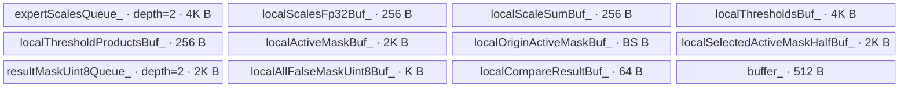

# MoeUpdateExpert A3 ACLNN 算子知识

## 算子速览

| 项目 | 内容 |
|---|---|
| 实际入口 | 公开两段式 `aclnnMoeUpdateExpertGetWorkspaceSize` / `aclnnMoeUpdateExpert`；固定提交不存在 V2/V3 入口 |
| 计算语义 | 把 `(BS,K)` 逻辑专家号映射为物理专家实例号；可按相对阈值和 token active 状态生成 `(BS,K)` 剪枝 mask |
| 输入输出 | `expertIds:int32/int64[BS,K]`、`eplbTable:int32[E,F]`、三项可选剪枝输入；输出同 dtype ids 与 bool mask |
| 执行类型 | `AIV_VECTOR`：单个 `moe_update_expert` 节点；`CalcTschBlockDim(aivNum,0,aivNum)` 未请求 AIC |
| Kernel 路线 | R-001 无剪枝；R-002 FP32 剪枝；R-003 FP16 剪枝；R-004 BF16 剪枝 |
| 核心资源 | GM、512 B 映射 TBuf；剪枝 Route 另有双缓冲 Queue、多 TBuf、Vector `Sum/Muls/Compare/Select/Cast`；无算子自有 workspace 切片 |
| 来源闭包 | `source_closed`：ACLNN、OpDef/推形、Tiling/POD/key、单 Kernel entry/body、同步 helper、A3 binary/CI 接线闭合；生成的 `aclnnInner` bridge 为框架边界 |
| 验证状态 | 已完成源码闭包检查；本次知识提取未执行编译、真机、数值或性能测试。 |

## 接口与语义

### 计算语义

令扁平位置 `p=t*K+j`，逻辑专家 `e=expertIds[p]`，部署数 `c=eplbTable[e*F]`。若 `c==1`，选择列 1；否则 rank 模式选择 `q=floor(localRankId/ceil(worldSize/c))+1`，token 模式选择 `q=(t mod c)+1`，输出 `eplbTable[e*F+q]`。

剪枝 Route 对 token `t` 以 FP32 求 `S=sum_j scales[t,j]`，输出 `scales[t,j] >= threshold[j]*S`；若传入的 `activeMask[t]` 为 false，则整行 false。该式来自 Kernel 的 `Sum→Muls→Compare(GE)`。公开文档第 45–50 行伪码的乘法/比较表述与固定实现不完全一致，本卡不将文档伪码补成 Device 行为。

### 输入、输出与属性

| 参数 | shape/layout | dtype | 约束、默认值与语义 |
|---|---|---|---|
| `expertIds` | `[BS,K]`, ND | int32/int64 | `1<=BS<=512`，`1<=K<=16`；元素值域由调用者保证 |
| `eplbTable` | `[E,F]`, ND | int32 | `K<=E<=1024`；rank 模式 `2<=F<=worldSize+1`，token 模式 `F<=769`；表内 count/实例号由调用者保证 |
| `expertScalesOptional` | `[BS,K]`, ND | fp16/bf16/fp32 | 与 threshold 成对存在；文档要求 token 内降序，Host 不扫描值 |
| `pruningThresholdOptional` | `[K]` 或 `[1,K]`, ND | fp32 | 与 scales 成对存在 |
| `activeMaskOptional` | `[BS]`, ND | bool | 存在时 scales/threshold 也必须存在；文档要求 true 前缀，Host 不扫描顺序 |
| `localRankId` | 标量 | int64 | `balanceMode=0` 时 `0<=id<worldSize`；mode1 写 -1 哨兵 |
| `worldSize` | 标量 | int64 | `balanceMode=0` 时 `[2,768]`；mode1 写 -1 |
| `balanceMode` | 标量 | int64 | 默认0，仅0/1；实际映射分支读取此字段 |
| `balancedExpertIds` | `[BS,K]`, ND | 同 `expertIds` | 映射后的物理实例号 |
| `balancedActiveMask` | `[BS,K]`, ND | bool | 无剪枝 Route 不写，但公开 API 仍要求非空 |

### 入口与版本

固定提交全仓只发布未带版本后缀的 `aclnnMoeUpdateExpert`，它是 A3 唯一且最新公开版本。第一段手写层仅检查四个必选 tensor 非空，再转入生成的 `aclnnInnerMoeUpdateExpertGetWorkspaceSize`；第二段透传 workspace、executor、stream。OpDef 对输入声明 `AutoContiguous`，而 README 称支持非连续 tensor、详细 ACLNN 参数表标“×”；生成 bridge 缺失，因此不推断冲突的运行时结果。

## Host/Launcher 执行流程

### 参数校验与前处理

手写 API 依次检查 `expertIds/eplbTable/balancedExpertIds/balancedActiveMask`。`MoeUpdateExpertTiling::Init` 固定执行 `CheckAttrs→CheckDataType→CheckShape`：属性写 `balanceMode/localRankId/worldSize`，dtype 检查生成 scale key，shape 检查写 `bs/k/moeExpertNum/f/isActiveMask` 并拒绝非法 optional 组合。推形把两项输出设为 `[BS,K]`，ids dtype 继承输入，mask 为 bool。

### 参数、Workspace 与生命周期

`RunFusionKernelTiling` 取得 `aivNum` 和 UB size；UB size 只读取、不参与 Route。它设置 `blockDim=CalcTschBlockDim(aivNum,0,aivNum)`，POD 写 `aivCoreNum=aivNum`。唯一 workspace size 是 `GetLibApiWorkSpaceSize()`；ACLNN 调用者拥有该内存并保持到 stream 工作完成。Kernel 收到 `workspaceGM` 但 body 未解引用；lib-api workspace 的框架消费点固定仓不可见。

### 启动图与失败传播

```text
GetWorkspaceSize -> aclnnInner...（生成边界）
  -> MoeUpdateExpertTilingFunc -> Init -> RunFusionKernelTiling
Execute(workspace,executor,stream) -> aclnnInner...（生成边界）
  -> [同一 stream] moe_update_expert<BalanceKey,ScaleKey>
     -> MoeUpdateExpert<DTYPE_EXPERT_IDS,ScaleType,EnablePruning>::Init -> Process
```

只有一个算子自有 Device 节点，GM 直接连接公开 tensor，无跨 Kernel edge。Tiling 任一检查失败即 `GRAPH_FAILED`；手写 ACLNN 原样返回 inner 状态。生成 bridge 内的 executor/Contiguous/launch 返回细节不可见。

## Route 与参数设计

### 分核与资源计算

所有 AIV core 启动。剪枝用 `GetCoreRange(blockIdx,aivCoreNum,BS)` 按 token 均分；映射再独立按 `BS*K` 均分。公式为 `perCore=N/C,remainder=N%C`，前 remainder 个 core 多一项。空核没有 early return，映射最终会调用 blockLen=0 的 `DataCopyPad`。

映射每四元素展开，尾部 1–3 项走 rest；固定 `BUFFER_SIZE=512` B。剪枝 `newKCount=align_up(K*4,256)/4=64`（`K<=16`），用于三个 256 B FP32 TBuf 和 64 B compare 区。

### Route 选择

| 顺序 | Route | Key/模板 | 精确选择条件与优先级 | 不适用去向 |
|---:|---|---|---|---|
| 1 | R-001 无剪枝 | `GET_TPL_TILING_KEY(RANK_ID_BALANCING_MODE,TILINGKEY_FLOAT)`；`<Ids,float,false>` | `tailorCfg_==0`，三项 optional 全空；与属性 `balanceMode` 无关 | 有 optional 则校验组合 |
| 2 | R-002 FP32剪枝 | `GET_TPL_TILING_KEY(TOKEN_ID_BALANCING_MODE,TILINGKEY_FLOAT)`；`<Ids,float,true>` | `tailorCfg_` 为 `0x0C` 或 `0x1C`，scale fp32 | dtype不符到后续；组合非法失败 |
| 3 | R-003 FP16剪枝 | `GET_TPL_TILING_KEY(TOKEN_ID_BALANCING_MODE,TILINGKEY_HALF)`；`<Ids,half,true>` | 同组合，scale fp16 | bf16到下一 Route |
| 4 | R-004 BF16剪枝 | `GET_TPL_TILING_KEY(TOKEN_ID_BALANCING_MODE,TILINGKEY_BFLOAT16)`；`<Ids,bfloat16_t,true>` | 同组合，scale bf16 | 其它 dtype 失败 |

```text
tailorCfg 0x00 -> R-001
tailorCfg 0x0C(scales+threshold) / 0x1C(+active)
  -> fp32 R-002 / fp16 R-003 / bf16 R-004
tailorCfg 0x04/0x08/0x10/0x14/0x18 -> GRAPH_FAILED
```

key 第一轴实际表示是否剪枝，不替代 POD 的运行时 `balanceMode`。

### 模板/实现执行矩阵

| Route | key/selector | dtype/shape/platform 完整命中条件 | 执行拓扑与 Kernel 节点 | 实际模板/body | 内存与同步特征 | tail/fallback |
|---|---|---|---|---|---|---|
| R-001 | `(0,float)` | A3；optional全空；Ids int32/int64 | 单 AIV Kernel | `<Ids,float,false>::Process/Calculate*` | 512 B TBuf；S↔MTE3 | 4元素+1–3 rest；空核0B copy |
| R-002 | `(1,float)` | A3；`tailorCfg_ in {0x0C,0x1C}`；scale fp32；Ids int32/int64 | 单 AIV Kernel，BS域剪枝后BS*K域映射 | `<Ids,float,true>::ProcessPruning/ProcessEachTokenPruning/Calculate*` | fp32 depth2 Queue直接别名计算；Vector/Queue/event | token区间tail；Compare 64 lane只提交K；映射4+1..3 tail |
| R-003 | `(1,half)` | A3；`tailorCfg_ in {0x0C,0x1C}`；scale fp16；Ids int32/int64 | 单 AIV Kernel，BS域剪枝后BS*K域映射 | `<Ids,half,true>::ProcessPruning/ProcessEachTokenPruning/Calculate*` | half depth2 Queue后Cast FP32；Vector/Queue/event | token区间tail；Compare 64 lane只提交K；映射4+1..3 tail |
| R-004 | `(1,bfloat16)` | A3；`tailorCfg_ in {0x0C,0x1C}`；scale bf16；Ids int32/int64 | 单 AIV Kernel，BS域剪枝后BS*K域映射 | `<Ids,bfloat16_t,true>::ProcessPruning/ProcessEachTokenPruning/Calculate*` | BF16 depth2 Queue后Cast FP32；Vector/Queue/event | token区间tail；Compare 64 lane只提交K；映射4+1..3 tail |

### 隐藏性能 Guard

| Guard | Host/Tiling 条件 | Device/资源原因 | 影响 Route | 不满足时去向 | 源码符号 |
|---|---|---|---|---|---|
| K上界 | `0<K<=16` | 64-lane FP32比较区和固定小输出批次 | 全部 | Tiling失败 | `CheckInputShape` |
| shape窄化 | `GetDim()` 结果先赋给POD的`int32_t bs/k/moeExpertNum/f`，再检查范围 | 后续分核、地址和UB公式均使用32位字段 | 全部 | 正常公开shape范围内安全；对超出`int32_t`的恶意shape，窄化后检查结果不闭合 | `CheckInputShape` |
| optional闭包 | `tailorCfg in {0,0x0C,0x1C}` | pruning模板同时解引用scales/threshold | 全部 | Tiling失败 | `CheckOptionalInputShape` |
| AIV除数 | `aivNum>0`（平台前提，未显式检查） | `GetCoreRange` 用coreNum作除数 | 全部 | 无fallback | `RunFusionKernelTiling/GetCoreRange` |
| UB固定分配 | Host无ubSize谓词 | R-002请求 `1344+BS+19K` B；R-003/4请求 `1344+BS+15K` B，未含TPipe内部对齐 | 剪枝 | 无fallback | `Init` |
| 比较对齐 | `newCalCount=64` | Compare处理64个FP32 lane，但Cast/Muls只生产前K项，Select/CopyOut也只消费前K个比较结果；FP32 Route 别名Queue slot的物理对齐extent属TPipe内部不可见 | 剪枝 | K越界Host拒绝；无其它fallback | `ProcessEachTokenPruning` |
| 表值域 | Host不扫描 ids/count/entry | `GetValue(e*F+q)` 无Device边检 | 全部 | 非法值行为不闭合 | `Calculate*` |

### POD/ABI

Host/Device 共用同一结构。固定仓没有 `static_assert(sizeof/offsetof)` 或生成序列化布局，下表只承诺声明顺序和类型。

| 结构 | 字段 | 类型/位宽 | ABI 布局 | 单位 | Host/launcher producer | Device consumer | 边界 |
|---|---|---|---|---|---|---|---|
| `MoeUpdateExpertTilingData` | `bs` | int32/32 | 第1字段；offset/sizeof未固化 | token | `CheckInputShape` dim0 | `Init→bs_`、分核 | `[1,512]` |
| 同上 | `k` | int32/32 | 第2字段 | expert/token | dim1 | 地址、Vector count | `[1,16]` |
| 同上 | `moeExpertNum` | int32/32 | 第3字段 | logical expert | table dim0 | 仅存入成员，之后未读 | `[K,1024]` |
| 同上 | `f` | int32/32 | 第4字段 | int32/表行 | table dim1 | `e*f_` | `[2,769]`内 |
| 同上 | `aivCoreNum` | uint32/32 | 第5字段 | core | `GetCoreNumAiv` | `GetCoreRange` | 未检查0 |
| 同上 | `localRankId` | int64/64 | 第6字段 | rank | `CheckAttrs` | rank映射 | mode1 inactive=-1 |
| 同上 | `worldSize` | int64/64 | 第7字段 | rank count | `CheckAttrs` | `Ceil` | mode1 inactive=-1 |
| 同上 | `balanceMode` | int64/64 | 第8字段 | enum | 默认0或显式0/1 | 映射分支 | 仅0/1 |
| 同上 | `isActiveMask` | int32/32 | 第9字段 | 0/1 | `CheckActiveMaskShape` | pruning active分支 | R-001不读 |

### Route 源码闭包

| Route | Key/selector | Host/Tiling producer | POD/参数 | Kernel entry/router 节点 | Kernel body/直接依赖 | 构建接线 |
|---|---|---|---|---|---|---|
| R-001 | `(0,float)` | `MoeUpdateExpertTiling::GetTilingKey` | 九字段POD | `moe_update_expert` false分支 | `Process/Calculate*`、`SyncFunc` | A3 binary int32/int64 + CI |
| R-002 | `(1,float)` | `CheckOptionalInput* / GetTilingKey` | 同上 | float true分支 | `ProcessPruning/ProcessEachTokenPruning` | 同上 |
| R-003 | `(1,half)` | `CheckOptionalInputDataType/Shape` + `GetTilingKey` | 九字段POD，`isActiveMask`控制可选active读 | `moe_update_expert` half分支 | `<Ids,half,true>` 的 pruning + mapping 全body | A3 Host target + int32/int64 binary + CI |
| R-004 | `(1,bfloat16)` | `CheckOptionalInputDataType/Shape` + `GetTilingKey` | 九字段POD，`isActiveMask`控制可选active读 | `moe_update_expert` bfloat16分支 | `<Ids,bfloat16_t,true>` 的 pruning + mapping 全body | A3 Host target + int32/int64 binary + CI |

## Kernel 实现

### 公共执行流程

entry 解析 POD、创建 `TPipe`，按 key 实例化类并执行 `Init→Process`。剪枝 Route 先写 mask，再写 ids；输出地址不重叠，无跨核 barrier。映射以 `GlobalTensor::GetValue` 做依赖索引的标量 gather，四个结果暂存在 `buffer_`，S/MTE3 event 保护 DMA 与复用。剪枝用 Queue 表达 MTE2→Vector 和 Vector→MTE3 生命周期，并在 Sum 标量化和阈值/active 预载后显式同步。

### Route R-001：无剪枝映射

#### 适用条件

##### 选择证据

| 层级 | 文件 | 符号 | 源码谓词/参数 | 结果/下一跳 |
|---|---|---|---|---|
| API | `op_api/aclnn_moe_update_expert.cpp` | GetWorkspaceSize | 四必选tensor非空 | inner bridge |
| Tiling | `op_host/op_tiling/moe_update_expert_tiling.cpp` | `GetTilingKey` | `tailorCfg_==0` | `(0,float)` |
| Router | `op_kernel/moe_update_expert.cpp` | `moe_update_expert<0,0>` | compile key | `<Ids,float,false>` |

#### Device 数据流

##### 函数级调用链

```text
moe_update_expert<0,0> -> Init -> Process
  -> GetCoreRange(BS*K) -> InitBuffer(buffer_,512)
  -> CalculateUnroll -> [4元素] GetValue/SetValue -> S_MTE3 -> DataCopyPad
     -> CalculateUnrollRest(1..3)
  -> 或 Calculate(0..3)
```

##### 源码等价伪码

```text
[start,end)=balanced_partition(BS*K,C,blockIdx)
for group in chunks_of_4_with_tail:
  for p in group: e=ids[p]; c=table[e*F]; q=1 or rank/token公式; outUB[p-groupStart]=table[e*F+q]
  wait prior MTE3 before reuse; signal S_MTE3; copy groupLen*sizeof(Ids) to output[groupStart]
```

#### 内存与数据搬运

##### 资源与搬运表

| 层级/缓冲区 | offset/地址公式 | extent/容量公式 | dtype/layout | producer | consumer | owner/lifetime | 对齐/复用 |
|---|---|---|---|---|---|---|---|
| ids GM | `p` | `BS*K` | Ids/ND | caller | scalar | launch | DCCI后读 |
| table GM | `e*F+q` | `E*F` | int32 | caller | scalar | launch | 值域由caller保证 |
| `buffer_/outTensor_` | 0 | 512 B | Ids | scalar | MTE3 | Process | 每组复用前缀 |
| ids output GM | `groupStart` | `BS*K` | Ids | DataCopyPad | caller | launch | blockLen=`groupLen*sizeof(Ids)` |

##### 分层内存布局


##### 字节账与复用顺序

```text
UB_requested=512 B；Host UB guard=N/A（ubSize读取后未使用）；TPipe内部对齐不可见。
```

| 复用子区 | 写入者 | 读取者/消费点 | 下一次覆盖 | 同步或释放依据 | 安全条件 |
|---|---|---|---|---|---|
| outTensor前4项 | SetValue | DataCopyPad | 下一组 | `S_MTE3` + 下一组前 `MTE3_S` | blockLen仅有效1–4项 |

#### 同步、精度与尾块

##### 同步与数值边界表

| 阶段 | primitive/机制 | producer | consumer/等待点 | 保护对象 | 精度/尾块 |
|---|---|---|---|---|---|
| GM读 | DCCI+GetValue | GM | scalar | cacheline | 整数原类型 |
| CopyOut | S_MTE3/MTE3_S | scalar/MTE3 | MTE3/下一组 | TBuf前缀 | 4项或rest项 |
| 空核 | 0 B DataCopyPad | N/A | N/A | 空域 | 无early return |

#### 关键实现

##### 符号证据表

| 阶段 | 文件 | 符号/模板实例 | 实现事实 |
|---|---|---|---|
| Host/Tiling producer | `op_host/op_tiling/moe_update_expert_tiling.cpp` | `RunFusionKernelTiling/GetTilingKey` | AIV blockDim与key |
| Kernel entry/router | `op_kernel/moe_update_expert.cpp` | false实例 | Route映射 |
| Device body/helper | `op_kernel/moe_update_expert.h` | `Process/GetCoreRange/Calculate*` | 分核、地址、DMA、tail |

### Route R-002：FP32 剪枝与映射

#### 适用条件

##### 选择证据

| 层级 | 文件 | 符号 | 源码谓词/参数 | 结果/下一跳 |
|---|---|---|---|---|
| Tiling | `moe_update_expert_tiling.cpp` | optional checks/key | `0x0C/0x1C` + DT_FLOAT | `(1,float)` |
| Router | `moe_update_expert.cpp` | float pruning分支 | key匹配 | `<Ids,float,true>` |

#### Device 数据流

##### 函数级调用链

```text
Init(pruning buffers) -> Process -> GetCoreRange(BS) -> ProcessPruning
  -> InitPruning -> Copy threshold[0:K] -> optional Copy active[tokenStart:tokenEnd]
  -> Duplicate(half 0,K) -> Cast(uint8 false,K) -> MTE2_V/MTE2_S
  -> for token: inactive -> V_MTE3 -> CopyOut false[K]
                active -> Alloc fp32 scalesQ -> DataCopyPad(K*4 B) -> EnQue/DeQue
                       -> localScalesFp32_=localScales Queue 别名
                       -> Sum -> V_S -> scalar scaleSum -> Muls -> CompareGE(64) -> Free scalesQ
                       -> Duplicate(half 1,K) -> Select(K) -> Cast(uint8,K)
                       -> result Queue -> ReinterpretCast<bool> -> DataCopyPad(K B) -> Free result Queue
-> GetCoreRange(BS*K) -> InitBuffer(buffer_,512)
-> CalculateUnroll(4项一组+1..3 tail) 或 Calculate(0..3) -> balancedExpertIds
```

##### 源码等价伪码

```text
[tokenStart,tokenEnd)=balanced_partition(BS,C,blockIdx)
thresholdUB[0:K]=thresholdGM[0:K]
if hasActive: activeUB[0:tokenEnd-tokenStart]=activeGM[tokenStart:tokenEnd]
falseUB[0:K]=bool(Cast(half(0)))
for t in [tokenStart,tokenEnd):
  if hasActive && !activeUB[t-tokenStart]: maskGM[t*K:t*K+K]=falseUB[0:K]
  else:
    fp32 scalesQ[0:K]=scalesGM[t*K:t*K+K]; scalesFp 别名到 scalesQ
    S=Sum(scalesFp[0:K], SumParams{1,align_up(K*4,32)/4,K})
    products[0:K]=thresholdUB[0:K]*S
    cmp[0:64]=CompareGE(scalesFp,products,64)
    selectedHalf[0:K]=Select(cmp,half(1),half(0),K)
    maskGM[t*K:t*K+K]=bool(Cast<uint8>(selectedHalf[0:K]))
[start,end)=balanced_partition(BS*K,C,blockIdx)
for each 4-element group and 1..3 tail:
  p -> e=ids[p], c=table[e*F], q=1 or (balanceMode==0 ? localRank/ceil(worldSize/c)+1 : (p/K)%c+1)
  outUB[p-groupStart]=table[e*F+q]; S_MTE3; DataCopyPad(groupLen*sizeof(Ids))
```

#### 内存与数据搬运

##### 资源与搬运表

| 层级/缓冲区 | offset/地址公式 | extent/容量公式 | dtype/layout | producer | consumer | owner/lifetime | 对齐/复用 |
|---|---|---|---|---|---|---|---|
| scales GM / `expertScalesQueue_` | `t*K` / 0 | `BS*K` / depth2×`4K` B | fp32/ND | caller/MTE2 | Sum/Compare | launch/token | DeQue后 `localScalesFp32_`直接别名，Compare后Free |
| `localScalesFp32Buf_` | 0 | 256 B | fp32 | 未写（句柄被Queue tensor替换） | 无 | Process | 物理分配仍存在 |
| `localScaleSumBuf_` | 0 | 256 B | fp32 | Sum | scalar `GetValue(0)` | Process | `V_S`后读 |
| threshold GM / `localThresholdsBuf_` | 0 | `K*4` B / `4K` B | fp32 | caller/MTE2 preload | Muls | ProcessPruning | 跨token只读 |
| `localThresholdProductsBuf_` | 0 | 256 B | fp32 | Muls | Compare | Process | 每token覆盖 |
| active GM / `localOriginActiveMaskBuf_` | `tokenStart` / 0 | `BS` / `tokenEnd-tokenStart<=BS` B；分配BS B | uint8 | caller/MTE2 preload | scalar | ProcessPruning | 可选；`MTE2_S`后读 |
| `localActiveMaskBuf_` / `localSelectedActiveMaskHalfBuf_` | 0 | 各`2K` B | half | Duplicate/Select | Select/Cast | Process | Vector barrier保护 |
| `resultMaskUint8Queue_` | 0 | depth2×`K` B | uint8/bool reinterpret | Cast | MTE3 | token | CopyOut后Free |
| `localAllFalseMaskUint8Buf_` / `localCompareResultBuf_` | 0 | `K` B / 64 B | uint8 | Cast/Compare | inactive CopyOut/Select | ProcessPruning/token | Compare只消费前K个结果；前K之外源lane未由Kernel初始化 |
| ids/table/output GM | `p` / `e*F+q` / `groupStart` | `BS*K` / `E*F` / `BS*K` | Ids/int32/Ids | caller/scalar/MTE3 | scalar/scalar/caller | launch | table值域由caller保证 |
| `buffer_/outTensor_` | 0 | 512 B | Ids | scalar | MTE3 | mapping阶段 | 仅复用前4项；S↔MTE3 event |

##### 分层内存布局


##### 字节账与复用顺序

```text
UB_requested = 2*(4K) + 256 + 256 + 4K + 256 + 2K + BS + 2K + 2K + K + 64 + 512
             = 1344 + BS + 19K B <= 2160 B；不含TPipe内部对齐。
Host UB guard = N/A；`ubSize` 被读取但没有进入选路或上界校验。
```

| 复用子区 | 写入者 | 读取者/消费点 | 下一次覆盖 | 同步或释放依据 | 安全条件 |
|---|---|---|---|---|---|
| scalesQ slot | MTE2 | Sum/Compare | 下一token | EnQue/DeQue/FreeTensor | Compare后Free |
| resultQ slot | Cast | MTE3 | 下一token | EnQue/DeQue/FreeTensor | CopyOut后Free |
| threshold | 首次MTE2 | 每token Muls | ProcessPruning结束 | MTE2_V/MTE2_S | 期间只读 |

#### 同步、精度与尾块

##### 同步与数值边界表

| 阶段 | primitive/机制 | producer | consumer/等待点 | 保护对象 | 精度/尾块 |
|---|---|---|---|---|---|
| scales | Queue | MTE2 | Vector | slot | fp32无Cast |
| Sum | barrier+V_S | Sum | scalar GetValue | sum | `SumParams{1,align32(K*4)/4,K}` |
| compare | Muls/barrier/CompareGE | fp32 | Select | compare mask | Compare64 lane，输出K |
| inactive | V_MTE3 | false Vector | MTE3 | false mask | K个false |
| mapping | `S_MTE3/MTE3_S` | scalar | MTE3/下一组 | 512 B mapping TBuf | Ids整数精度，4项+1..3 tail |

#### 关键实现

##### 符号证据表

| 阶段 | 文件 | 符号/模板实例 | 实现事实 |
|---|---|---|---|
| Host/Tiling producer | `op_host/op_tiling/moe_update_expert_tiling.cpp` | optional checks/key | FP32 pruning可达性 |
| Kernel entry/router | `op_kernel/moe_update_expert.cpp` | `<Ids,float,true>` | 实例 |
| Device body/helper | `op_kernel/moe_update_expert.h` | `InitPruning/ProcessPruning/ProcessEachTokenPruning` | 全部Vector与内存事实 |

### Route R-003：FP16 剪枝与映射

#### 适用条件

##### 选择证据

| 层级 | 文件 | 符号 | 源码谓词/参数 | 结果/下一跳 |
|---|---|---|---|---|
| Tiling | `moe_update_expert_tiling.cpp` | dtype/key | 合法剪枝+DT_FLOAT16 | `(1,half)` |
| Router | `moe_update_expert.cpp` | half分支 | key匹配 | `<Ids,half,true>` |

#### Device 数据流

##### 函数级调用链

```text
moe_update_expert<1,1> -> MoeUpdateExpert<Ids,half,true>::Init
  -> InitBuffer(全部 pruning Queue/TBuf，包括 depth=2 的 half scales Queue 和 uint8 result Queue)
  -> Process -> GetCoreRange(blockIdx,C,BS) -> ProcessPruning
     -> InitPruning -> Copy threshold[0:K] -> optional Copy active[tokenStart:tokenEnd]
     -> Duplicate(half 0,K) -> Cast(uint8 false,K) -> MTE2_V/MTE2_S
     -> for token: inactive -> V_MTE3 -> CopyOut false[K]
                   active -> ProcessEachTokenPruning
                     -> Alloc half scalesQ -> DataCopyPad(K*2 B) -> EnQue/DeQue
                     -> Cast(FP32,CAST_NONE,K) -> Sum -> V_S -> scalar scaleSum
                     -> Muls(threshold,scaleSum,K) -> CompareGE(64) -> Free scalesQ
                     -> Duplicate(half 1,K) -> Select(K) -> Cast(uint8,K)
                     -> result Queue -> ReinterpretCast<bool> -> DataCopyPad(K B) -> Free result Queue
  -> GetCoreRange(blockIdx,C,BS*K) -> InitBuffer(buffer_,512)
  -> CalculateUnroll(4项一组+1..3 tail) 或 Calculate(0..3) -> balancedExpertIds
```

##### 源码等价伪码

```text
[tokenStart,tokenEnd)=balanced_partition(BS,C,blockIdx)
thresholdUB[0:K]=thresholdGM[0:K]
if hasActive: activeUB[0:tokenEnd-tokenStart]=activeGM[tokenStart:tokenEnd]
falseUB[0:K]=bool(Cast(half(0)))
for t in [tokenStart,tokenEnd):
  if hasActive && !activeUB[t-tokenStart]: maskGM[t*K:t*K+K]=falseUB[0:K]
  else:
    half scalesQ[0:K]=scalesGM[t*K:t*K+K]
    fp32 scalesFp[0:K]=Cast(scalesQ,CAST_NONE)
    S=Sum(scalesFp[0:K], SumParams{1,align_up(K*4,32)/4,K})
    products[0:K]=thresholdUB[0:K]*S
    cmp[0:64]=CompareGE(scalesFp,products,64)
    selectedHalf[0:K]=Select(cmp,half(1),half(0),K)
    maskGM[t*K:t*K+K]=bool(Cast<uint8>(selectedHalf[0:K]))
[start,end)=balanced_partition(BS*K,C,blockIdx)
for each 4-element group and 1..3 tail:
  p -> e=ids[p], c=table[e*F], q=1 or (balanceMode==0 ? localRank/ceil(worldSize/c)+1 : (p/K)%c+1)
  outUB[p-groupStart]=table[e*F+q]; S_MTE3; DataCopyPad(groupLen*sizeof(Ids))
```

#### 内存与数据搬运

##### 资源与搬运表

| 层级/缓冲区 | offset/地址公式 | extent/容量公式 | dtype/layout | producer | consumer | owner/lifetime | 对齐/复用 |
|---|---|---|---|---|---|---|---|
| scales GM / `expertScalesQueue_` | `t*K` / 0 | `BS*K` / depth2×`2K` B | fp16/ND | caller/MTE2 | Cast | launch/token | Queue Free后 slot复用 |
| `localScalesFp32Buf_` | 0 | 256 B | fp32 | `Cast(...,K)` | Sum/Compare | Process | 每token覆盖前须完成Compare |
| `localScaleSumBuf_` | 0 | 256 B | fp32 | Sum | scalar `GetValue(0)` | Process | `V_S`后读 |
| threshold GM / `localThresholdsBuf_` | 0 | `K*4` B / `4K` B | fp32 | caller/MTE2 preload | Muls | ProcessPruning | 跨token只读 |
| `localThresholdProductsBuf_` | 0 | 256 B | fp32 | Muls | Compare | Process | 每token覆盖 |
| active GM / `localOriginActiveMaskBuf_` | `tokenStart` / 0 | `BS` / `tokenEnd-tokenStart<=BS` B；分配BS B | uint8 | caller/MTE2 preload | scalar | ProcessPruning | 可选；`MTE2_S`后读 |
| `localActiveMaskBuf_` / `localSelectedActiveMaskHalfBuf_` | 0 | 各`2K` B | half | Duplicate/Select | Select/Cast | Process | Vector barrier保护 |
| `resultMaskUint8Queue_` | 0 | depth2×`K` B | uint8/bool reinterpret | Cast | MTE3 | token | CopyOut后Free |
| `localAllFalseMaskUint8Buf_` / `localCompareResultBuf_` | 0 | `K` B / 64 B | uint8 | Cast/Compare | inactive CopyOut/Select | ProcessPruning/token | Compare只消费前K个结果；前K之外源lane未由Kernel初始化 |
| ids/table/output GM | `p` / `e*F+q` / `groupStart` | `BS*K` / `E*F` / `BS*K` | Ids/int32/Ids | caller/scalar/MTE3 | scalar/scalar/caller | launch | table值域由caller保证 |
| `buffer_/outTensor_` | 0 | 512 B | Ids | scalar | MTE3 | mapping阶段 | 仅复用前4项；S↔MTE3 event |

##### 分层内存布局



##### 字节账与复用顺序

```text
UB_requested = 2*(2K) + 256 + 256 + 4K + 256 + 2K + BS + 2K + 2K + K + 64 + 512
             = 1344 + BS + 15K B <= 2096 B；不含TPipe内部对齐。
Host UB guard = N/A；`ubSize` 被读取但没有进入选路或上界校验。
```

| 复用子区 | 写入者 | 读取者/消费点 | 下一次覆盖 | 同步或释放依据 | 安全条件 |
|---|---|---|---|---|---|
| half Queue | MTE2 | Cast | 下一token | Queue Free | Cast已消费 |
| fp32 TBuf | Cast | Sum/Compare | 下一token Cast | Vector顺序/barrier | Compare已发出 |

#### 同步、精度与尾块

##### 同步与数值边界表

| 阶段 | primitive/机制 | producer | consumer/等待点 | 保护对象 | 精度/尾块 |
|---|---|---|---|---|---|
| 升精度 | `Cast(CAST_NONE,K)` | fp16 Queue | FP32 Sum | scalesTBuf | 仅K项 |
| 规约标量化 | `PipeBarrier<PIPE_V>` + `V_S` | Sum | `GetValue(0)` | `localScaleSum_` | FP32累加，`innerSumParams=align_up(K*4,32)/4` |
| 阈值/比较 | Muls + barrier + CompareGE | FP32 scales/threshold | Select | products/compare mask | Compare 64 lane，仅Select/Copy前K |
| mask提交 | Queue + `V_MTE3` | Vector | MTE3 | result/false mask | half→uint8/bool，恰写K B |
| 映射 | `S_MTE3/MTE3_S` | scalar | MTE3/下一组 | 512 B mapping TBuf | Ids整数精度，4项+1..3 tail |

#### 关键实现

##### 符号证据表

| 阶段 | 文件 | 符号/模板实例 | 实现事实 |
|---|---|---|---|
| Host/Tiling producer | `moe_update_expert_tiling.cpp` | `KEY_SCALES_FP16` | half key |
| Kernel entry/router | `moe_update_expert.cpp` | `<Ids,half,true>` | Route |
| Device body/helper | `moe_update_expert.h` | `ProcessEachTokenPruning` | half→FP32 |

### Route R-004：BF16 剪枝与映射

#### 适用条件

##### 选择证据

| 层级 | 文件 | 符号 | 源码谓词/参数 | 结果/下一跳 |
|---|---|---|---|---|
| Tiling | `moe_update_expert_tiling.cpp` | dtype/key | 合法剪枝+DT_BF16 | `(1,bfloat16)` |
| Router | `moe_update_expert.cpp` | bfloat16分支 | key匹配 | `<Ids,bfloat16_t,true>` |

#### Device 数据流

##### 函数级调用链

```text
moe_update_expert<1,2> -> MoeUpdateExpert<Ids,bfloat16_t,true>::Init
  -> InitBuffer(全部 pruning Queue/TBuf，包括 depth=2 的 BF16 scales Queue 和 uint8 result Queue)
  -> Process -> GetCoreRange(blockIdx,C,BS) -> ProcessPruning
     -> InitPruning -> Copy threshold[0:K] -> optional Copy active[tokenStart:tokenEnd]
     -> Duplicate(half 0,K) -> Cast(uint8 false,K) -> MTE2_V/MTE2_S
     -> for token: inactive -> V_MTE3 -> CopyOut false[K]
                   active -> ProcessEachTokenPruning
                     -> Alloc BF16 scalesQ -> DataCopyPad(K*2 B) -> EnQue/DeQue
                     -> Cast(FP32,CAST_NONE,K) -> Sum -> V_S -> scalar scaleSum
                     -> Muls(threshold,scaleSum,K) -> CompareGE(64) -> Free scalesQ
                     -> Duplicate(half 1,K) -> Select(K) -> Cast(uint8,K)
                     -> result Queue -> ReinterpretCast<bool> -> DataCopyPad(K B) -> Free result Queue
  -> GetCoreRange(blockIdx,C,BS*K) -> InitBuffer(buffer_,512)
  -> CalculateUnroll(4项一组+1..3 tail) 或 Calculate(0..3) -> balancedExpertIds
```

##### 源码等价伪码

```text
[tokenStart,tokenEnd)=balanced_partition(BS,C,blockIdx)
thresholdUB[0:K]=thresholdGM[0:K]
if hasActive: activeUB[0:tokenEnd-tokenStart]=activeGM[tokenStart:tokenEnd]
falseUB[0:K]=bool(Cast(half(0)))
for t in [tokenStart,tokenEnd):
  if hasActive && !activeUB[t-tokenStart]: maskGM[t*K:t*K+K]=falseUB[0:K]
  else:
    bf16 scalesQ[0:K]=scalesGM[t*K:t*K+K]
    fp32 scalesFp[0:K]=Cast(scalesQ,CAST_NONE)
    S=Sum(scalesFp[0:K], SumParams{1,align_up(K*4,32)/4,K})
    products[0:K]=thresholdUB[0:K]*S
    cmp[0:64]=CompareGE(scalesFp,products,64)
    selectedHalf[0:K]=Select(cmp,half(1),half(0),K)
    maskGM[t*K:t*K+K]=bool(Cast<uint8>(selectedHalf[0:K]))
[start,end)=balanced_partition(BS*K,C,blockIdx)
for each 4-element group and 1..3 tail:
  p -> e=ids[p], c=table[e*F], q=1 or (balanceMode==0 ? localRank/ceil(worldSize/c)+1 : (p/K)%c+1)
  outUB[p-groupStart]=table[e*F+q]; S_MTE3; DataCopyPad(groupLen*sizeof(Ids))
```

#### 内存与数据搬运

##### 资源与搬运表

| 层级/缓冲区 | offset/地址公式 | extent/容量公式 | dtype/layout | producer | consumer | owner/lifetime | 对齐/复用 |
|---|---|---|---|---|---|---|---|
| scales GM / `expertScalesQueue_` | `t*K` / 0 | `BS*K` / depth2×`2K` B | bf16/ND | caller/MTE2 | Cast | launch/token | Queue Free后 slot复用 |
| `localScalesFp32Buf_` | 0 | 256 B | fp32 | `Cast(...,K)` | Sum/Compare | Process | 每token覆盖前须完成Compare |
| `localScaleSumBuf_` | 0 | 256 B | fp32 | Sum | scalar `GetValue(0)` | Process | `V_S`后读 |
| threshold GM / `localThresholdsBuf_` | 0 | `K*4` B / `4K` B | fp32 | caller/MTE2 preload | Muls | ProcessPruning | 跨token只读 |
| `localThresholdProductsBuf_` | 0 | 256 B | fp32 | Muls | Compare | Process | 每token覆盖 |
| active GM / `localOriginActiveMaskBuf_` | `tokenStart` / 0 | `BS` / `tokenEnd-tokenStart<=BS` B；分配BS B | uint8 | caller/MTE2 preload | scalar | ProcessPruning | 可选；`MTE2_S`后读 |
| `localActiveMaskBuf_` / `localSelectedActiveMaskHalfBuf_` | 0 | 各`2K` B | half | Duplicate/Select | Select/Cast | Process | Vector barrier保护 |
| `resultMaskUint8Queue_` | 0 | depth2×`K` B | uint8/bool reinterpret | Cast | MTE3 | token | CopyOut后Free |
| `localAllFalseMaskUint8Buf_` / `localCompareResultBuf_` | 0 | `K` B / 64 B | uint8 | Cast/Compare | inactive CopyOut/Select | ProcessPruning/token | Compare只消费前K个结果；前K之外源lane未由Kernel初始化 |
| ids/table/output GM | `p` / `e*F+q` / `groupStart` | `BS*K` / `E*F` / `BS*K` | Ids/int32/Ids | caller/scalar/MTE3 | scalar/scalar/caller | launch | table值域由caller保证 |
| `buffer_/outTensor_` | 0 | 512 B | Ids | scalar | MTE3 | mapping阶段 | 仅复用前4项；S↔MTE3 event |

##### 分层内存布局


##### 字节账与复用顺序

```text
UB_requested = 2*(2K) + 256 + 256 + 4K + 256 + 2K + BS + 2K + 2K + K + 64 + 512
             = 1344 + BS + 15K B <= 2096 B；不含TPipe内部对齐。
Host UB guard = N/A；`ubSize` 被读取但没有进入选路或上界校验。
```

| 复用子区 | 写入者 | 读取者/消费点 | 下一次覆盖 | 同步或释放依据 | 安全条件 |
|---|---|---|---|---|---|
| bf16 Queue | MTE2 | Cast | 下一token | Queue Free | Cast已消费 |
| fp32 TBuf | Cast | Sum/Compare | 下一token Cast | Vector顺序/barrier | Compare已发出 |

#### 同步、精度与尾块

##### 同步与数值边界表

| 阶段 | primitive/机制 | producer | consumer/等待点 | 保护对象 | 精度/尾块 |
|---|---|---|---|---|---|
| 升精度 | `Cast(CAST_NONE,K)` | bf16 Queue | FP32 Sum | scalesTBuf | K项 |
| 规约标量化 | `PipeBarrier<PIPE_V>` + `V_S` | Sum | `GetValue(0)` | `localScaleSum_` | FP32累加，`innerSumParams=align_up(K*4,32)/4` |
| 阈值/比较 | Muls + barrier + CompareGE | FP32 scales/threshold | Select | products/compare mask | Compare 64 lane，仅Select/Copy前K |
| mask提交 | Queue + `V_MTE3` | Vector | MTE3 | result/false mask | half→uint8/bool，恰写K B |
| 映射 | `S_MTE3/MTE3_S` | scalar | MTE3/下一组 | 512 B mapping TBuf | Ids整数精度，4项+1..3 tail |

#### 关键实现

##### 符号证据表

| 阶段 | 文件 | 符号/模板实例 | 实现事实 |
|---|---|---|---|
| Host/Tiling producer | `moe_update_expert_tiling.cpp` | `KEY_SCALES_BF16` | BF16 key |
| Kernel entry/router | `moe_update_expert.cpp` | `<Ids,bfloat16_t,true>` | Route |
| Device body/helper | `moe_update_expert.h` | `ProcessEachTokenPruning` | BF16→FP32 |

## 算子特定优化

### Trick T-001：四元素展开后合并一次 UB→GM 提交

#### 触发与源码依据

- 适用 Route：R-001～R-004 的映射阶段。
- 触发条件：本核 `computeLen>=4`；尾部由 rest 处理。
- Golden 来源：[`mc2/moe_update_expert/op_kernel/moe_update_expert.h:270-291`](../../../../../../../cann-ops-raw/ascendc/ops-transformer/be33d95bb755cedec3108f70805c1874d1792540/mc2/moe_update_expert/op_kernel/moe_update_expert.h#L270-L291)

**官方源码（固定 Commit 连续逐字摘录）**：

```cpp
DataType tableOffsetList[UNROLL_NUM] = {expertId0 * f_, expertId1 * f_, expertId2 * f_, expertId3 * f_};
DataType newExpertIdList[UNROLL_NUM] = {0};
for (int32_t j = 0; j < UNROLL_NUM; j++) {
    if (eplbTableTensor_.GetValue(tableOffsetList[j]) == 1) {
        newExpertIdList[j] = static_cast<DataType>(eplbTableTensor_.GetValue(tableOffsetList[j] + 1));
    } else {
        if (balanceMode_ == 0) { // rank_id 模式
            int64_t modeValue = Ceil(worldSize_, eplbTableTensor_.GetValue(tableOffsetList[j]));
            int64_t rankId = localRankId_ / modeValue + 1;
            newExpertIdList[j] = static_cast<DataType>(eplbTableTensor_.GetValue(tableOffsetList[j] + rankId));
        } else {                                                                       // token_id 模式
            int32_t tokenId = (start + i * static_cast<int32_t>(UNROLL_NUM) + j) / k_; // 计算tokenId
            int64_t expertCount = eplbTableTensor_.GetValue(tableOffsetList[j]);
            int64_t selectedId = tokenId % expertCount + 1;
            newExpertIdList[j] =
                static_cast<DataType>(eplbTableTensor_.GetValue(tableOffsetList[j] + selectedId));
        }
    }
    outTensor_.SetValue(j, newExpertIdList[j]);
}
SyncFunc<AscendC::HardEvent::S_MTE3>();
DataCopyPad(balancedExpertIdsTensor_[start + i * UNROLL_NUM], outTensor_, unrollDataCopyParams);
```

#### 机制与设计原因

依赖 expert id 的表访问是标量 gather；实现固定展开四项，先写同一 TBuf 前缀，再以 `blockCount=1,blockLen=4*sizeof(Ids)` 一次提交连续输出。`S_MTE3` 使 DMA 看见标量结果，下一组 `MTE3_S` 保护 TBuf 复用。

#### 迁移边界

- 适用：不连续标量 gather 决定连续小批输出。
- 前提：UB 容纳四项，输出连续，event 方向匹配。
- 失效：`computeLen<4` 走 `Calculate`，末尾1–3项走 `CalculateUnrollRest`。
- 未验证：本次知识提取未执行编译、真机、数值或性能测试。

#### 错误做法

不得把 rest 按四项搬出；官方代码以 `restNum*sizeof(DataType)` 单独构造 tail copy。

### Trick T-002：FP32 Queue tensor 原位作为统一计算输入

#### 触发与源码依据

- 适用 Route：R-002 直接别名；R-003/4 使用必要 Cast。
- 触发条件：`ScalesDataType` 编译期为 float。
- Golden 来源：[`mc2/moe_update_expert/op_kernel/moe_update_expert.h:316-327`](../../../../../../../cann-ops-raw/ascendc/ops-transformer/be33d95bb755cedec3108f70805c1874d1792540/mc2/moe_update_expert/op_kernel/moe_update_expert.h#L316-L327)

**官方源码（固定 Commit 连续逐字摘录）**：

```cpp
LocalTensor<ScalesDataType> localScales = expertScalesQueue_.AllocTensor<ScalesDataType>();
DataCopyPadExtParams<ScalesDataType> padParamsScalesDataType{false, 0, 0, 0};
DataCopyPad(
    localScales, expertScalesTensor_[tokenIdx * k_],
    {1, static_cast<uint32_t>(k_ * sizeof(ScalesDataType)), 0, 0, 0}, padParamsScalesDataType);
expertScalesQueue_.EnQue(localScales);
localScales = expertScalesQueue_.DeQue<ScalesDataType>();
if constexpr (!std::is_same_v<ScalesDataType, float>) {
    Cast(localScalesFp32_, localScales, RoundMode::CAST_NONE, k_);
} else {
    localScalesFp32_ = localScales;
}
```

#### 机制与设计原因

后续统一 FP32。输入已是 FP32 时让 `localScalesFp32_` 指向 DeQue tensor，消除一次 Cast/FP32中间写；半精度才物化 256 B FP32副本。注意专用 TBuf 仍被申请，因此源码请求 UB 不减少。

#### 迁移边界

- 适用：输入 dtype 等于计算 dtype，Queue 生命周期覆盖最后消费者。
- 前提：必须在 Compare 使用结束后才 `FreeTensor(localScales)`。
- 失效：FP16/BF16 必须 `Cast(...CAST_NONE,K)`。
- 未验证：本次知识提取未执行编译、真机、数值或性能测试。

#### 错误做法

不能把半精度 Queue tensor 重解释为 FP32；固定源码仅在 `is_same_v<...,float>` 时别名。

## 模板与实现对比

| 对比维度 | R-001 无剪枝 | R-002 FP32 | R-003 FP16 | R-004 BF16 | 设计选择依据 |
|---|---|---|---|---|---|
| 命中条件/优先级 | optional全空 | 合法组合+fp32 | 合法组合+fp16 | 合法组合+bf16 | optional先决定pruning，dtype再实例化 |
| 模板与 dtype | `<Ids,float,false>` | `<Ids,float,true>` | `<Ids,half,true>` | `<Ids,bfloat16_t,true>` | entry if constexpr |
| 循环与分核 | BS*K域 | BS域后BS*K域 | BS域后BS*K域 | BS域后BS*K域 | mask按token，映射按元素 |
| Queue/TBuf/寄存器 | 512 B TBuf | 双Queue+多TBuf，fp32 alias | 同+Cast | 同+BF16 Cast | pruning条件分配 |
| UB 总占用与复用 | 512 B | `1344+BS+19K` | `1344+BS+15K` | `1344+BS+15K` | 请求量，未含内部对齐 |
| 搬运/Vector API | gather+DMA | FP32 Queue别名后Sum/Muls/Compare/Select/Cast | half→FP32 Cast后Sum/Muls/Compare/Select/Cast | BF16→FP32 Cast后Sum/Muls/Compare/Select/Cast | 统一FP32计算 |
| 同步、精度与 tail | S↔MTE3；4+rest | Queue、V/S、MTE2/V/S；K输出 | 同 | 同 | Compare64、Copy K |
| fallback/失败边界 | 有optional转组合检查 | 非法组合/dtype失败 | 同 | 同 | 无Device fallback |

## 平台差异

| 项目 | A2 | A3 | 950 |
|---|---|---|---|
| 支持状态 | README/API明确不支持 | 公开支持；`ascend910_93` OpDef/binary/CI | 公开支持；`ascend950` OpDef/binary/CI |
| Host/Launcher | N/A | 共用Tiling；CMake额外 `--cce-auto-sync=off` | 共用Tiling；无该平台选项 |
| Kernel/资源 | N/A | 共用单AIV source；资源值由A3 platform给出 | 共用单AIV source；资源值由950 platform给出 |

## 限制与失败边界

- Host 不校验 `expertIds`、表内 count/实例号，非法值可能形成越界 GM 读。
- `bs/k/moeExpertNum/f` 都是把`GetDim()`先窄化为`int32_t`再校验；公开合法范围远小于32位上限，但固定源码对超大恶意shape没有窄化前防护。
- 无剪枝时 `balancedActiveMask` 不写但仍必选；不可读取为有效结果。
- 公开剪枝伪码与 Kernel 的 `Sum→threshold*sum→GE` 存在表述差异。
- README、ACLNN 参数表和 `AutoContiguous` 对非连续 tensor 表述不一致；生成 bridge 不可见。
- API 头注释列 A3 worldSize 离散值，而当前 README/ACLNN/Tiling 使用 `[2,768]`；固定实现仅检查连续区间。
- `Compare(..., newCalCount=64)` 的前K个结果才进入Select/CopyOut，Kernel没有初始化K之外的源lane；FP16/BF16的256 B TBuf覆盖该指令extent，FP32 Route则别名到每slot仅请求`4K` B的Queue，TPipe实际物理对齐和64-lane读取footprint在固定仓不可见。
- `ubSize` 未参与选择，TPipe内部对齐和 lib-api workspace 消费不可见。
- 本次知识提取未执行编译、真机、数值或性能测试。

## 源码索引

### 链路索引

| 链路阶段 | 文件 | 关键符号 | 支撑内容 |
|---|---|---|---|
| 入口声明/约束 | `mc2/moe_update_expert/README.md` | 产品支持表/参数表 | A3/950支持、A2不支持、接口约束 |
| 入口声明/约束 | `mc2/moe_update_expert/docs/aclnnMoeUpdateExpert.md` | 产品表/原型/约束 | A3公开支持、API语义 |
| 入口声明/约束 | `mc2/moe_update_expert/op_api/aclnn_moe_update_expert.h` | 两段式声明 | 参数 ABI |
| 入口实现 | `mc2/moe_update_expert/op_api/aclnn_moe_update_expert.cpp` | 两个ACLNN函数 | null检查/inner边界 |
| Host定义 | `mc2/moe_update_expert/op_host/moe_update_expert_def.cpp` | `ops::MoeUpdateExpert` | dtype/平台/AutoContiguous |
| 推形 | `mc2/moe_update_expert/op_host/moe_update_expert_infershape.cpp` | InferShape/InferDataType | 输出shape/dtype |
| Host/Tiling | `mc2/moe_update_expert/op_host/op_tiling/moe_update_expert_tiling.cpp` | `MoeUpdateExpertTiling` | 校验、POD、key、block/workspace |
| POD | `mc2/moe_update_expert/op_kernel/moe_update_expert_tiling.h` | POD struct | 九字段 |
| key | `mc2/moe_update_expert/op_kernel/moe_update_expert_tiling_key.h` | TPL DECL/SEL | 可达tuple |
| Kernel entry | `mc2/moe_update_expert/op_kernel/moe_update_expert.cpp` | `moe_update_expert` | router |
| Kernel body | `mc2/moe_update_expert/op_kernel/moe_update_expert.h` | `MoeUpdateExpert` | 全Route实现 |
| 同步 helper | `mc2/common/op_kernel/mc2_kernel_utils.h` | `SyncFunc` | event set/wait |
| 构建接线 | `mc2/moe_update_expert/op_host/CMakeLists.txt` | source/compile options | Host/API与A3选项 |
| 构建接线 | `mc2/moe_update_expert/op_host/config/ascend910_93/moe_update_expert_binary.json` | int32/int64 binary | A3 binary选择 |
| 构建接线 | `scripts/ci/ascend910_93/ops_transformer_operator_list.yaml` | `moe_update_expert` | A3活动CI |

### 实现复用检查

| 检查项 | 可复用事实 | 不得改变的约束 | 源码符号 |
|---|---|---|---|
| ABI/POD | 九字段共头文件 | 顺序/位宽/inactive哨兵 | POD/`Init` |
| 调用顺序 | pruning先于映射，单Kernel | 两输出生命周期 | `Process` |
| workspace/内存 | platform lib workspace；body不显式用 | caller生命周期、Queue depth2、请求量 | `RunFusionKernelTiling/Init` |
| 同步 | Queue与S/MTE3、V/S、MTE2事件 | consumer完成前不得覆盖/Free | `SyncFunc/ProcessEachTokenPruning/CalculateUnroll` |
| 精度与尾块 | scale统一FP32；Compare64输出K；映射4+rest | Cast/GE/K字节数 | pruning/CalculateRest |
| 失败边界 | Host拒绝shape/dtype/optional非法 | 不补造Device fallback/逐值校验 | `CheckAttrs/DataType/Shape` |