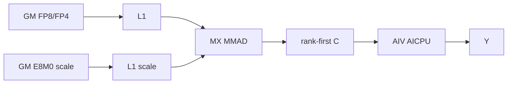

# QuantGroupedMatMulAlltoAllv 950 ACLNN 算子知识

## 算子速览

| 项目 | 内容 |
|---|---|
| 实际入口 | `aclnnQuantGroupedMatMulAlltoAllvV2GetWorkspaceSize` / `aclnnQuantGroupedMatMulAlltoAllvV2`，公开 ACLNN V2 |
| 计算语义 | 量化路由专家 `GroupedMatMul→rank-first布局→AlltoAllV`；可选共享专家量化 MatMul 与主通信重叠 |
| 输入输出 | TT：HIFLOAT8、FLOAT scale；MX：FP8/FP4、E8M0 scale；输出 FP16/BF16，全部 ND |
| 执行类型 | 单 Kernel `MIX_CV` + HCCL Hybrid，`KERNEL_TYPE_MIX_AIC_1_2`；AIC Cube，AIV 等待交接，其中 AIV `blockIdx==0` 发起/等待 HCCL collective |
| Kernel 路线 | R-001 TT+AI_CPU；R-002 TT+CCU；R-003 MX+AI_CPU；R-004 MX+CCU；Route 内按 shared/两组转置 tuple 特化 |
| 核心资源 | user workspace、L1/L0A/L0B/L0C、HCCL handle；本路线不调用 UB permute |
| 来源闭包 | `source_closed`：V2 API、generated inner 边界、950 Tiling/POD、Cube/MIX/HCCL 和构建接线闭合 |
| 验证状态 | 已完成源码闭包检查；本次知识提取未执行编译、真机、数值或性能测试。 |

## 接口与语义

### 计算语义

路由专家计算 `gmm=(gmmX@gmmWeight)*gmmXScale*gmmWeightScale`。AIC 按 `sendCounts[rank,e]` 切分 token，并通过 `cGroupOffsetTable` 直接把 C 写为 batch 内 rank-first 布局；AIV 等待 flag 9，`A2AV_AIV_ONLY` 再限定只有 AIV `blockIdx==0` 以 N1 为轴发起 AlltoAllV，recv 直接写 `yGM`，不再启动 Unpermute kernel。可选共享专家计算 `mmY=(mmX@mmWeight)*mmXScale*mmWeightScale`。TT 以 FP32 乘两个 FLOAT scale，再用 `0xFFFFE000` 保留 Fixpipe 可消费的高 19 位；MX 把 E8M0 scale A/B 交给 `MatmulWithScalePolicy`。通信 dtype 是计算后的 FP16/BF16，通信量化未启用；Matmul 库内部 MMAD 累加与最终 round 的更细规则不在固定仓可见边界内。

### 输入、输出与属性

| 参数 | shape/layout | dtype | 约束、默认值与语义 |
|---|---|---|---|
| `gmmX` | `[A,H1]`, ND | TT HIFLOAT8；MX E4M3FN/E5M2/FP4_E2M1 | `A=sum(sendCounts)`；OpDef `AutoContiguous` |
| `gmmWeight` | `[e,H1,N1]` 或 `[e,N1,H1]`, ND | 相应 TT/MX dtype | `0<e<=32`；`transGmmWeight` 控制 B 转置 |
| GMM scale | TT X/W=`[1]`；MX X=`[A,ceil(H1/64),2]`；非转置 W=`[e,ceil(H1/64),N1,2]`，转置 W=`[e,N1,ceil(H1/64),2]` | TT FLOAT；MX E8M0 | 必选；API 检出 stride-transpose 时同步交换 weight/scale 的相应 view 维 |
| counts tensor pair | 1D ND | INT32/INT64 | 当前两个都必须 nullptr；实际 counts 来自 list |
| shared tuple | X=`[BS,H2]`、Y=`[BS,N2]`；W 非转置=`[H2,N2]`、转置=`[N2,H2]`；MX X scale=`[BS,ceil(H2/64),2]`，W scale 非转置=`[ceil(H2/64),N2,2]`、转置=`[N2,ceil(H2/64),2]` | 与主量化族/输出一致 | X/W/Y 同时存在或缺省；存在时两 scale 必选，`BSK % BS==0` 且 `BSK/BS∈[2,8]` |
| `commQuantScaleOptional/commQuantMode/commQuantDtypeOptional` | optional/scalar | FLOAT/INT64 | 公开契约要求 scale 空、mode=0、dtype=-1；Host/Tiling 不消费 dtype 的数值 |
| `groupSize` | packed M/N/K | INT64 | 公开 V2 文档只支持0；TT Host也严格要求0。MX Host 实现额外接受 M=0/1、N=0/1、K=0/32，但这不是公开 ACLNN 支持域 |
| `group/commMode` | string | char | group非空且≤127；950 engine只接受`ai_cpu`或`ccu` |
| `epWorldSize` | scalar | INT64 | Host实际集合 `{2,4,8,16,32,64,128}`；`e*world<=256` |
| counts lists | 长度`e*world` | INT64 | 非负；和分别为A/BSK；写POD时cast i32 |
| `y/mmY` | `[BSK,N1]` / `[BS,N2]`, ND | FP16/BF16 | y由HCCL直接写；mmY由AIC写 |

### 入口与版本

V2 是 950 最新公开版本，相对 V1 新增 `commMode`。第一段完成基础校验、counts检查、量化 mode 和 engine 解析，再调用 generated `aclnnInner...GetWorkspaceSize`。DAV_3510 遇到最后两维 stride-transpose view 时用 `SwapTensorDims` 重建 view 并翻转 `trans*Weight`，MX 同时交换 scale 对应维，不物化 TransData。engine enum 保存到 executor user handle；第二段取出它、设置 AICPU/CCU server type，再在调用者 stream 执行 inner。generated inner 是框架边界；算子自身 selector、POD、workspace 和 Device body 均在固定仓闭合。

## Host/Launcher 执行流程

### 参数校验与前处理

API 要求 `gmmX/gmmWeight/y` 非空、counts tensor pair 为空、shared X/W/Y 存在性一致、group非空；GMM X/W mode相等且仅1或6，shared存在时其mode与GMM完全一致，通信量化mode为0。MX scale至少3D且末维2。Tiling再检查ND、精确维数、dtype/scale组合、转置shape、counts和、rank/expert上界、MX scale shape和FP4偶数约束。任一失败即返回；没有Device fallback。

### 参数、Workspace 与生命周期

设 `dY=sizeof(y)`、`W=epWorldSize`：

```text
wsGmmOutput = align512(A*N1*dY)
wsMainMeta  = align512(2*e*W*8 + 512 + 2*e*4)
wsSharedMeta= align512(e*8 + 512 + 2*e*4)
workspace_total = libApiWorkSpaceSize + wsGmmOutput + wsMainMeta + wsSharedMeta
```

`GetUserWorkspace` 跳过 system workspace 后切出以上三段。main meta 为 `groupList[eW]`、`cGroupOffsetTable[eW]`、512B 指针表、两组 TT scale repeat；MX不读repeat但仍按最大模式分配。shared meta为`groupList[e]`、512B指针表和两组FLOAT repeat。无shared也保留第三段并构造shared op，但 `IsNeedMM=false` 时不执行。workspace、tensor、executor、tiling与HCCL context均须活到当前stream全部Wait/Finalize结束。

### 启动图与失败传播

```text
V2 GetWorkspaceSize -> checks/view/engine -> generated inner
 -> TilingRegistry: TT priority0 或 MX priority1
 -> common checks -> GMM adapter -> HCCL tiling -> POD/workspace/blockDim
V2 execute -> set server type -> one MIX kernel(blockDim=AIC数, AIC:AIV=1:2)
 -> each expert batch: AIC quant GMM -> barrier flag8 -> signal flag9
                       all AIV wait9 -> AIV block0 async AlltoAllV handle
 -> optional AIC shared quant MM -> AIV block0 waits handles -> SyncAll -> AIV Finalize
```

API/Tiling/HCCL tiling失败阻止launch；null `workspaceGM`或null user workspace令entry直接返回且不写输出。TilingKey是编译期tuple，无运行期unknown-key fallback。

## Route 与参数设计

### 分核与资源计算

`expertNum=ceil(e/4)`，故轮数≤4。主GMM以 `mMax=max_e(sum_rank sendCnt[rank*e+e])` 做保守tiling：`M=mMax,K=H1,N=N1,groupNum=expertNum,SPLIT_M`；shared为`M=BS,K=H2,N=N2,groupNum=1`。`baseM/baseN<=256`，`baseK`取不超过128元素并按dtype/Cube粒度对齐；MX再要求baseK 64对齐，FP4非转置B令baseN 64对齐。若`baseM*baseN*4>L0C`则缩N。L0A/B双缓冲固定2，L0C按容量取1/2；L1容量决定depth/stepK。最后group最后一轮占核≤一半时，Device把M/N tail再拆分利用空闲核。

### Route 选择

| 顺序 | Route | Key/模板 | 精确选择条件与优先级 | 不适用去向 |
|---:|---|---|---|---|
| 1 | R-001 TT+AI_CPU | TT priority0；`<shared,gTrans,mmTrans,AICPU>` | mode `(1,1)`、TT dtype/shape、`ai_cpu` | 失败或MX检查 |
| 2 | R-002 TT+CCU | 同上，CCU | TT条件、`ccu` | 失败，无fallback |
| 3 | R-003 MX+AI_CPU | MX priority1；`<shared,gTrans,mmTrans,AICPU>` | mode `(6,6)`、MX/FP4 guard、`ai_cpu` | 失败，无fallback |
| 4 | R-004 MX+CCU | 同上，CCU | MX条件、`ccu` | 失败，无fallback |

```text
mode(1,1)->TT; mode(6,6)->MX; else fail
engine ai_cpu->AICPU, ccu->CCU, else fail
then exact tuple(hasShared,gmmWeightTrans,mmWeightTrans,engine)
```

`GET_TPL_TILING_KEY` 的四元组按 `{hasShared,gTrans,mmTrans,comm}` 展开如下；`comm=1` 对应 R-001/R-003 的 AICPU，`comm=0` 对应 R-002/R-004 的 CCU。TT/MX 不进入该四元组，而由编译期 `ORIG_DTYPE_GMM_X_SCALE` 选择不同 binary specialization。

| active 节点图 | 四元组（每个 comm 分别取0/1） | active 转置语义 |
|---|---|---|
| 仅主 GMM | `{0,0,0,comm}`、`{0,0,1,comm}` | 主 B 不转置；`mmTrans` inactive |
| 仅主 GMM | `{0,1,0,comm}`、`{0,1,1,comm}` | 主 B 转置；`mmTrans` inactive |
| 主 GMM + shared MM | `{1,0,0,comm}` | 两个 B 均不转置 |
| 主 GMM + shared MM | `{1,0,1,comm}` | 主 B 不转置、shared B 转置 |
| 主 GMM + shared MM | `{1,1,0,comm}` | 主 B 转置、shared B 不转置 |
| 主 GMM + shared MM | `{1,1,1,comm}` | 两个 B 均转置 |

无 shared 时 main NN/NT 是 active body，mmTrans 仅改变不会执行的 shared 实例；有 shared 时两组转置产生 NN/NN、NN/NT、NT/NN、NT/NT 四个 active specialization。表中 R-001～R-004 是按“量化族×通信引擎”组织的 Route 家族；每个家族仍逐 key 保留八个 selector，不能把 active 转置实例互换。无 shared 的两个 mmTrans key 仅因 inactive 模板参数不同而共享实际节点图。

### 模板/实现执行矩阵

| Route | key/selector | dtype/shape/platform 完整命中条件 | 执行族与 kernel 节点 | 实际模板/body | 内存与同步特征 | tail/fallback |
|---|---|---|---|---|---|---|
| R-001 | TT+AICPU全部tuple | 950 HIF8/FLOAT/FP16或BF16 | AIC GMM→AIV HCCL；optional shared | `MatmulImpl<aType,bType,cType,float,GetMDLConfig(false,false,0,false,false,false,true)>` + `Hccl<AICPU>` | rank-first WS、flags8/9、TT repeat | MNK tail，无fallback |
| R-002 | TT+CCU全部tuple | R-001但CCU | 同一MIX图 | TT Cube + `Hccl<CCU>` | WS/flags相同 | 同上 |
| R-003 | MX+AICPU全部tuple | 950 FP8/FP4、E8M0 scale | AIC MX GMM→AIV HCCL；optional shared | 上述 MDL config + `MatmulCallBackFunc<nullptr,...>` + `MatmulWithScalePolicy` + `Hccl<AICPU>` | MX scale占L1；TT repeat inactive | MX/FP4 guard |
| R-004 | MX+CCU全部tuple | R-003但CCU | 同一MIX图 | MX Cube + `Hccl<CCU>` | WS/flags相同 | 同上 |

### 隐藏性能 Guard

| Guard | Host/Tiling 条件 | Device/资源原因 | 影响 Route | 不满足时去向 | 源码符号 |
|---|---|---|---|---|---|
| 批数 | `expertNum=ceil(e/4)` | collective handle轮数≤4 | 全部 | Host失败 | `SetTilingCommonInfo` |
| L0C/L1 | C tile≤L0C；depth×A/B/scale tile≤L1 | Cube层级容量 | 全部 | 缩tile/depth或失败 | `CalBasicBlock/CalL1Depth` |
| MX对齐 | baseK 64；scale K组64、末维2 | MX MMAD/scale packing | R-003/004 | Host失败 | `CheckMx* / CalBasicBlock` |
| 公开 groupSize | ACLNN V2 公开契约 `groupSize==0`；MX Host 代码另接受 packed M/N/K=`0/1,0/1,0/32` | 后者只是固定实现可达域，不能提升为公开支持承诺 | R-003/004 | 正式复用按0；非0仅作实现审计 | V2 docs / `CheckParamsAttrEpAndSetLocalParams` |
| FP4 | H偶且≠2；非转置N偶；X/W同dtype | 2元素/字节 | R-003/004 | Host失败 | `CheckMxfp4SpecificConstraints` |
| rank/expert | world支持集合、e≤32、eW≤256 | counts POD固定256 | 全部 | Host失败 | `CheckParamsAttrEpAndSetLocalParams` |
| counts窄化 | 非负且≤A/BSK后cast i32 | Device字段i32 | 全部 | Host失败；无独立INT32_MAX guard | `CheckAndSetSendRecvCountsAttr` |
| 可见性 | AIC `SetFlag<0,PIPE_FIX>(8)` 后 `WaitFlag(8)`，再 `SetFlag<2,PIPE_FIX>(9)`；全部 AIV `WaitFlag(9)` | HCCL不得读半成品C；flag 8/9 每批复用 | 全部 | 无fallback | scheduler `Process` |
| HCCL 单发起核 | `A2AV_AIV_ONLY`: AIC 返回，AIV `GetBlockIdx()!=0` 返回 | collective launch/Wait 只由 AIV block0 执行，避免重复提交 | 全部 | 无fallback | `a2av_comm_guard.h` |
| workspace | 两层workspace指针非空 | 三段直接寻址 | 全部 | entry返回 | kernel entry |

### POD/ABI

`GmmA2avWorkspaceInfo` 为24B。`TaskTilingInfo` 由固定宽度成员按自然8B对齐可推导为2160B：12个u64、4个u32、两组256×i32；固定仓没有对应 `static_assert(sizeof/offsetof)`，复用时仍须由目标编译器 ABI 确认。外层还含 SDK `Mc2InitTiling/Mc2CcTiling/TCubeTiling`；其完整 sizeof/offsetof 不在固定仓，不得补造。

| 结构 | 字段 | 类型/位宽 | ABI 布局 | 单位 | Host/launcher producer | Device consumer | 边界 |
|---|---|---|---|---|---|---|---|
| outer | `hcclA2avTiling` | SDK POD | offset0；内部用offsetof | POD | `SetHcclTiling` | HCCL Init/SetCc | SDK布局不可见 |
| outer | `workspaceInfo/taskTilingInfo/sharedGmmTiling/gmmBaseTiling/isPermuteOut` | ordered members | 各自顺序；bool尾成员 | mixed | common/adapter | entry/bodies | permute flag默认false且本entry不读 |
| workspace | 三个size字段 | 3×u64 | +0/+8/+16，size24 align8 | bytes | workspace公式 | entry slicer | 512B对齐 |
| Task | `BSK,BS,H1,H2,A,N1,N2` | 7×u64 | +0..48 | elements | common tiling | GMM/HCCL | inactive dims为0 |
| Task | `epWorldSize,e` | 2×u64 | +56/+64 | count | attrs/shape | scheduler/HCCL | eW≤256 |
| Task | `ubSize` | u64 | +72 | bytes | 固定 Host 未赋值 | 当前 kernel 不读 | 未初始化 storage，不得复用或声称为0 |
| Task | `aivCoreNum` | u64 | +80 | core count | `GetCoreNumAiv()` | HCCL Init / Permute helper 参数；当前路线仅传给 Init | 有明确 producer |
| Task | `aicCoreNum` | u64 | +88 | core count | 固定 Host 未赋值 | 当前 kernel 不读；blockDim 直接来自 `localParams_.aicCoreNum` | 未初始化 storage，不得复用或声称为0 |
| Task | `expertNum,mainLoopExpertNum,tailLoopExpertNum,totalLoopCount` | 4×u32 | +96..108 | count | common tiling | scheduler/兼容字段 | expertNum≥1 |
| Task | `sendCnt[256]` | i32×256 | +112 | tokens | attr cast | GMM/HCCL | 前eW有效 |
| Task | `recvCnt[256]` | i32×256 | +1136 | tokens | attr cast | HCCL | 前eW有效 |
| GMM POD | `gmmQuantParams` | 24B align8 | +0 | flags | adapter | Cube | SPLIT_M/no bias |
| GMM POD | `gmmArray` | 1536B align8 | +24 | elements | adapter | `SetMNK` | m/k/n各128 i32 |
| GMM POD | `mmTilingData` | SDK TCube | +1560 | mixed | lib tiling | Matmul | SDK size不可见 |

### Route 源码闭包

| Route | Key/selector | Host/Tiling producer | POD/参数 | Kernel entry/router | Kernel body/直接依赖 | 构建接线 |
|---|---|---|---|---|---|---|
| R-001 | TT priority0+AICPU tuple | TT/common/adapter | QuantGmmA2avTilingData | templated MIX entry | scheduler→TT Cube→HcclAICPU | 950 OpDef+CMake |
| R-002 | TT priority0+CCU tuple | 同上+CCU tiling | 同上 | 同上 | scheduler→TT Cube→HcclCCU | 同上 |
| R-003 | MX priority1+AICPU tuple | MX/common/adapter | 同上+MX TCube | 同上 | scheduler→MX Cube→HcclAICPU | 同上 |
| R-004 | MX priority1+CCU tuple | 同上+CCU tiling | 同上 | 同上 | scheduler→MX Cube→HcclCCU | 同上 |

## Kernel 实现

### 公共执行流程

entry 声明 MIX 1:2，Host `SetBlockDim(localParams_.aicCoreNum)`。HCCL send=`gmmOutputGM`、recv=`yGM`；main/shared `QuantGroupedMatmul::Init/Process` 在 AIV 立即返回。每批 AIC 完成 GMM 后用 flag 8 做 AIC barrier，再以 mode 2 的 flag 9 交给全部 AIV；随后 `A2AV_AIV_ONLY` 令只有 AIV `blockIdx==0` 生成 counts/offset 并异步 launch。主批全部提交后 AIC 可计算 shared MM；最终也只有 AIV block0 逐 handle `Wait`。`End` 先让全部 MIX 任务执行 `SyncAll<false>`，AIC 返回，AIV 执行 `Finalize`。

### Route R-001：TT + AI_CPU

#### 适用条件

##### 选择证据

| 层级 | 文件 | 符号 | 源码谓词/参数 | 结果/下一跳 |
|---|---|---|---|---|
| API/Tiling/Router | V2 API、TT tiling、key | `CheckQuantMode/IsCapable/GET_TPL_TILING_KEY` | mode1、TT dtype、ai_cpu、exact tuple | TT+AICPU实例 |

#### Device 数据流

##### 函数级调用链

```text
entry<tuple,AICPU> -> Scheduler -> QuantGroupedMatmul<TT>
 -> Mc2GmmASWKernel<MatmulImpl>::Process -> flags8/9
 -> HcclA2avOp<Y,false,AICPU>::AlltoAllV -> optional shared TT -> Wait/Finalize
```

##### 源码等价伪码

```text
for batch: AIC builds group/cOffset, repeats FLOAT scales, scaleScalar=bits(x*w)&0xFFFFE000,
           tiles Matmul to rank-first WS, barrier8/set9;
           all AIV wait9; only AIV block0 builds per-rank cnt/offset*N1 and async A2AV(WS->y).
optional shared TT Matmul; wait all handles; finalize.
```

#### 内存与数据搬运

##### 资源与搬运表

| 层级/缓冲区 | offset/地址公式 | extent/容量公式 | dtype/layout | producer | consumer | owner/lifetime | 对齐/复用 |
|---|---|---|---|---|---|---|---|
| GM X/W/scale | expert prefixes；W=`start*H1*N1` | A*H1/e*H1*N1 bytes；FLOAT scales | HIF8 ND | caller | AIC | stream | bTrans解释B |
| WS C | cOffset+tileC | align512(A*N1*dY) | FP16/BF16 rank-first | Cube | HCCL | 至Wait | batch区间不重叠 |
| WS meta | group/cOffset/ptr/repeat | 两个meta公式 | mixed | wrapper | Cube | kernel | 每批重建 |
| L1 | A/B tiles | `depthA*baseM*baseK+depthB*baseN*baseK` bytes | HIF8 | MTE2 | L0 | K tile | depth/step |
| L0A/B/C | current tiles | `2*baseM*baseK + 2*baseN*baseK + dbC*baseM*baseN*4` | Cube | load/MMAD | MMAD/Fixpipe | tile | dbA/B=2 |
| UB | N/A | N/A | N/A | N/A | N/A | no PermuteData | HCCL私有资源为SDK边界 |

##### 分层内存布局


##### 字节账、交接边与复用顺序

```text
userWS=align512(A*N1*dY)+align512(16eW+512+8e)+align512(16e+512)
L1=depthA*baseM*baseK+depthB*baseN*baseK
L0=2*baseM*baseK+2*baseN*baseK+dbC*baseM*baseN*4; UB=0
```

| 边/复用子区 | producer | offset/extent | dtype/layout | consumer | ordering/sync | owner/lifetime | 安全条件 |
|---|---|---|---|---|---|---|---|
| Cube→HCCL | `GetTensorC` | `batchStartOffset + rankRunningOffset`；extent=`Σbatch sendCnt[rank,e]*N1` 元素 | FP16/BF16，batch 内 rank-first ND | AIV block0 `AlltoAllV<true>` | barrier8→set9/wait9 | user WS，直至对应 handle Wait | `cGroupOffsetTable` 与 `CalcA2avCommAfterParams.sendOffset` 同一 rank 顺序 |
| HCCL→y | collective | recvOffset/counts*N1 | FP16/BF16 ND | output | handle Wait | caller | Wait前不释放 |

#### 同步、精度与尾块

##### 同步与数值边界表

| 阶段 | primitive/机制 | producer | consumer/等待点 | 保护对象 | 精度/尾块 |
|---|---|---|---|---|---|
| AIC/AIV | flag8 barrier、flag9交接 | 全部 AIC | 全部 AIV wait；AIV block0 launch | batch C | 同一 ID 按 expert batch 轮次复用 |
| TT scale | FLOAT乘法、mask `0xFFFFE000`、`SetQuantScalar` | wrapper | Fixpipe | C | 输出FP16/BF16 |
| tail | singleCore M/N、末group二次拆分 | block scheduler | Matmul | valid tile | K由TCube处理 |

#### 关键实现

##### 符号证据表

| 阶段 | 文件 | 符号/模板实例 | 实现事实 |
|---|---|---|---|
| Host/Tiling producer | TT/common/adapter cpp | `IsCapable/DoQuantGMMTiling/SetWorkspace` | TT route、tile、workspace |
| Kernel entry/router | quant kernel cpp | templated entry | MIX/slices/TT types |
| Device body/helper | scheduler/quant wrapper/gqmm/HCCL | `Process/SetMMParaAndCompute/LaunchCommData` | flags、scalar、Cube、AICPU |

### Route R-002：TT + CCU

#### 适用条件

##### 选择证据

| 层级 | 文件 | 符号 | 源码谓词/参数 | 结果/下一跳 |
|---|---|---|---|---|
| Host/Router | common tiling/key | engine selector | R-001 TT条件且`commMode=ccu` | `ENGINE_CCU_SCHED`/HcclCCU |

#### Device 数据流

##### 函数级调用链

```text
entry<tuple,CCU> -> R-001 TT Cube/flags -> Hccl<CCU>::AlltoAllV -> Wait/Finalize
```

##### 源码等价伪码

```text
与R-001相同；仅Host engine和Device HcclTypeSelector改为CCU。
```

#### 内存与数据搬运

##### 资源与搬运表

| 层级/缓冲区 | offset/地址公式 | extent/容量公式 | dtype/layout | producer | consumer | owner/lifetime | 对齐/复用 |
|---|---|---|---|---|---|---|---|
| GM/WS/L1/L0 | 同R-001 | 同R-001 | TT | AIC | CCU HCCL/y | stream | 相同 |
| UB | N/A；CCU内部不可见 | N/A | SDK边界 | CCU | fabric | context | 仅单机UB域 |

##### 分层内存布局


##### 字节账、交接边与复用顺序

```text
与R-001相同；engine不改变user workspace。
```

| 边/复用子区 | producer | offset/extent | dtype/layout | consumer | ordering/sync | owner/lifetime | 安全条件 |
|---|---|---|---|---|---|---|---|
| Cube→CCU | TT Cube | counts*N1 | FP16/BF16 | CCU HCCL | flags8/9 | WS至Wait | 950+ccu |

#### 同步、精度与尾块

##### 同步与数值边界表

| 阶段 | primitive/机制 | producer | consumer/等待点 | 保护对象 | 精度/尾块 |
|---|---|---|---|---|---|
| 全链 | 同R-001，CCU Wait | AIC/AIV | output | C/y | TT/tail相同 |

#### 关键实现

##### 符号证据表

| 阶段 | 文件 | 符号/模板实例 | 实现事实 |
|---|---|---|---|
| Host/Tiling producer | common tiling cpp | `SetHcclTiling` | CCU engine |
| Kernel entry/router | key/kernel | CCU tuple | CCU实例 |
| Device body/helper | HCCL header | `HcclTypeSelector<CCU>` | CCU server，其余复用R-001 |

### Route R-003：MX + AI_CPU

#### 适用条件

##### 选择证据

| 层级 | 文件 | 符号 | 源码谓词/参数 | 结果/下一跳 |
|---|---|---|---|---|
| API/Tiling/Router | V2 API、MX tiling、key | MX checks/tuple | mode6、MX shape/dtype/FP4 guard、ai_cpu | MX+AICPU |

#### Device 数据流

##### 函数级调用链

```text
entry<tuple,AICPU> -> Scheduler -> QuantGroupedMatmul<E8M0>
 -> Mc2GmmASWKernel<MatmulWithScalePolicy>::SetTensorScaleA/B/Iterate
 -> flags8/9 -> Hccl<AICPU>::AlltoAllV -> Wait/Finalize
```

##### 源码等价伪码

```text
for batch: AIC addresses E8M0 scale by token/expert/K64 group, SetTensorScaleA/B,
           MX Matmul writes FP16/BF16 rank-first C, barrier8/set9;
           all AIV wait9; AIV block0 launches output-dtype A2AV.
optional shared MX Matmul; wait/finalize.
```

#### 内存与数据搬运

##### 资源与搬运表

| 层级/缓冲区 | offset/地址公式 | extent/容量公式 | dtype/layout | producer | consumer | owner/lifetime | 对齐/复用 |
|---|---|---|---|---|---|---|---|
| GM X/W | group offsets；FP4 offset按2打包 | FP8正常字节；FP4一半 | FP8/FP4 ND | caller | AIC | stream | FP4偶数guard |
| GM/L1 scale | token/expert + K/64组 | `depthA*baseM*align2(ceil(baseK/64))+depthB*baseN*align2(ceil(baseK/64))` | E8M0 | caller/MTE2 | MX MMAD | K tile | scaleFactor受L1限制 |
| WS C/meta | 同R-001公式 | 同R-001 | FP16/BF16/mixed | AIC | HCCL | 至Wait | TT repeat inactive |
| L1 A/B | tile | depth×packed tile bytes | FP8/FP4 | MTE2 | L0 | K tile | baseK64 |
| L0A/B/C | current tiles | 2×packed operands；`dbC*baseM*baseN*4` | MX Cube | load/MMAD | output | tile | dbA/B2 |
| UB | N/A | N/A | N/A | N/A | N/A | no PermuteData | SDK边界 |

##### 分层内存布局



##### 字节账、交接边与复用顺序

```text
userWS同R-001；L1=depthA*(A_tile+scaleA_tile)+depthB*(B_tile+scaleB_tile)
L0C=dbC*baseM*baseN*4；UB=0
```

| 边/复用子区 | producer | offset/extent | dtype/layout | consumer | ordering/sync | owner/lifetime | 安全条件 |
|---|---|---|---|---|---|---|---|
| MX Cube→HCCL | GetTensorC | counts*N1 | FP16/BF16 rank-first | AICPU HCCL | flags8/9 | WS至Wait | scale已在Matmul消费 |

#### 同步、精度与尾块

##### 同步与数值边界表

| 阶段 | primitive/机制 | producer | consumer/等待点 | 保护对象 | 精度/尾块 |
|---|---|---|---|---|---|
| MX scale | `SetTensorScaleA/B` + policy | L1 scale | MX MMAD | A/B tile | E8M0→FP16/BF16 |
| MIX/tail | flags8/9；baseK64；MN tail | AIC | 全部 AIV wait，block0 launch | C | FP4 packed guard |

#### 关键实现

##### 符号证据表

| 阶段 | 文件 | 符号/模板实例 | 实现事实 |
|---|---|---|---|
| Host/Tiling producer | MX/common/gmm tiling cpp | `CheckMx*/CalBasicBlock/CalL1Depth` | MX guard/tile/scaleFactor |
| Kernel entry/router | quant kernel cpp | `ComputeOpType` | E8M0选择MX模板 |
| Device body/helper | gqmm/HCCL | `MatmulWithScalePolicy/HcclAICPU` | scale tensor、MX Cube、AICPU |

### Route R-004：MX + CCU

#### 适用条件

##### 选择证据

| 层级 | 文件 | 符号 | 源码谓词/参数 | 结果/下一跳 |
|---|---|---|---|---|
| Host/Router | MX/common tiling+key | engine selector | R-003条件且ccu | MX+CCU |

#### Device 数据流

##### 函数级调用链

```text
entry<tuple,CCU> -> R-003 MX Cube/flags -> Hccl<CCU>::AlltoAllV -> Wait/Finalize
```

##### 源码等价伪码

```text
与R-003相同；engine specialization改为CCU。
```

#### 内存与数据搬运

##### 资源与搬运表

| 层级/缓冲区 | offset/地址公式 | extent/容量公式 | dtype/layout | producer | consumer | owner/lifetime | 对齐/复用 |
|---|---|---|---|---|---|---|---|
| GM/WS/L1/L0 | 同R-003 | 同R-003 | MX | AIC | CCU/y | stream | 相同 |
| UB | N/A；CCU内部不可见 | N/A | SDK边界 | CCU | fabric | context | 单机UB域 |

##### 分层内存布局


##### 字节账、交接边与复用顺序

```text
与R-003相同；engine不改变user workspace。
```

| 边/复用子区 | producer | offset/extent | dtype/layout | consumer | ordering/sync | owner/lifetime | 安全条件 |
|---|---|---|---|---|---|---|---|
| MX Cube→CCU | MX Cube | counts*N1 | FP16/BF16 | CCU | flags8/9 | WS至Wait | 950+ccu |

#### 同步、精度与尾块

##### 同步与数值边界表

| 阶段 | primitive/机制 | producer | consumer/等待点 | 保护对象 | 精度/尾块 |
|---|---|---|---|---|---|
| 全链 | MX policy+flags+CCU Wait | AIC/AIV | output | C/y | 同R-003 |

#### 关键实现

##### 符号证据表

| 阶段 | 文件 | 符号/模板实例 | 实现事实 |
|---|---|---|---|
| Host/Tiling producer | common tiling | `SetHcclTiling` | CCU engine |
| Kernel entry/router | key/kernel | MX+CCU tuple | exact实例 |
| Device body/helper | gqmm/HCCL | MX policy/`HcclTypeSelector<CCU>` | MX Cube+CCU |

## 算子特定优化

### Trick T-001：最多四轮专家批处理并直接生成 rank-first C

#### 触发与源码依据

- 适用 Route：R-001～R-004
- 触发条件：合法e/world/counts；`expertNum=ceil(e/4)`
- Golden 来源：[`quant_grouped_mat_mul_allto_allv_tiling_common.cpp:843-858`](../../../../../../../cann-ops-raw/ascendc/ops-transformer/be33d95bb755cedec3108f70805c1874d1792540/mc2/quant_grouped_mat_mul_allto_allv/op_host/op_tiling/arch35/quant_grouped_mat_mul_allto_allv_tiling_common.cpp#L843-L858)

**官方源码（固定 Commit 连续逐字摘录）**：

```cpp
// 动态计算 expertNum_，保证不同专家数量下通信和计算次数不超过4次
// expertNum_ = CeilDiv(ep, 4)，使得 totalLoopCount = CeilDiv(ep, expertNum_) <= 4
constexpr uint32_t TARGET_COMM_ROUNDS = 4U;
expertNum_ = static_cast<uint32_t>(
    Ops::Base::CeilDiv(localParams_.ep, static_cast<uint64_t>(TARGET_COMM_ROUNDS)));
```

#### 机制与设计原因

每轮合并专家，减少collective handle轮数；Device按counts生成rank-first C offset，使Cube输出直接成为HCCL send布局，省去额外Unpermute kernel。`mMax`保证一份TCube tiling覆盖动态专家M。

#### 迁移边界

- 适用：GMM后通信且能按counts直接排C。
- 前提：e≤32、eW≤256、通信轴N1、C offset与sendOffset同序。
- 失效：必须保留expert-first输出或通信前计算时需重做布局。
- 未验证：本次知识提取未执行编译、真机、数值或性能测试。

#### 错误做法

按expert-first写C却复用当前rank-first sendOffset会发送错误片段；`cGroupOffsetTable`是固定源码反例。

### Trick T-002：flag 8/9交接并用shared MM覆盖通信等待

#### 触发与源码依据

- 适用 Route：全部；shared重叠仅`IsNeedMM=true`
- 触发条件：单MIX kernel、1:2核比、异步HCCL
- Golden 来源：[`gmm_a2av_scheduler.h:39-59`](../../../../../../../cann-ops-raw/ascendc/ops-transformer/be33d95bb755cedec3108f70805c1874d1792540/mc2/allto_allv_quant_grouped_mat_mul/op_kernel/mc2_templates/scheduler/gmm_a2av_scheduler.h#L39-L59)

**官方源码（固定 Commit 连续逐字摘录）**：

```cpp
if ASCEND_IS_AIC {
    computeOp_.Process(start, actualExpertNum);
    AscendC::CrossCoreSetFlag<0, PIPE_FIX>(8);
    AscendC::CrossCoreWaitFlag(8);
    AscendC::CrossCoreSetFlag<2, PIPE_FIX>(9);
}
if ASCEND_IS_AIV {
    AscendC::CrossCoreWaitFlag(9);
    hcclOp_.LaunchCommData(start, actualExpertNum);
}
```

#### 机制与设计原因

flag8 保证全部 AIC 完成 batch C，flag9 才把读权限交给全部 AIV；`A2AV_AIV_ONLY` 把真正的 HCCL launch/Wait 收敛到 AIV block0。HCCL 返回 handle 后不立刻 Wait，AIC 继续下一批/共享 MM，末尾统一 Wait。

#### 迁移边界

- 适用：AIC producer、AIV block0 异步通信 consumer。
- 前提：保持 1:2 核比、AIV block0 单发起 guard、flag mode/PIPE/ID/轮次和 C 到 Wait 的 lifetime。
- 失效：核映射或buffer ownership变化时必须重做同步。
- 未验证：本次知识提取未执行编译、真机、数值或性能测试。

#### 错误做法

删除barrier8或在wait9前launch会读半成品；每次launch后立刻Wait则消除源码中的重叠。

### Trick T-003：TT/MX共图而在Matmul policy内分离scale

#### 触发与源码依据

- 适用 Route：TT R-001/002；MX R-003/004
- 触发条件：scaleType FLOAT或E8M0
- Golden 来源：[`gqmm_cube_on_the_fly.h:359-380`](../../../../../../../cann-ops-raw/ascendc/ops-transformer/be33d95bb755cedec3108f70805c1874d1792540/mc2/3rd/grouped_matmul/op_kernel/gqmm_cube_on_the_fly.h#L359-L380)

**官方源码（固定 Commit 连续逐字摘录）**：

```cpp
if constexpr (Mc2QuantUtils::IsMxType<scaleType>()) {
    mm_.SetTensorScaleA(scaleAGlobal_[block_.offset_.offsetPerTokenScale], aTrans);
    mm_.SetTensorScaleB(mxScaleBGlobal_[block_.offset_.offsetScale], bTrans);
} else {
    if (gmmQuantParams_->bQuantMode ==
        static_cast<uint32_t>(Mc2QuantUtils::QuantMode::PERTENSOR_MODE)) {
        mm_.SetQuantScalar(scaleScalar_);
    }
}
```

#### 机制与设计原因

TT仅复制scalar并生成Fixpipe scalar；MX scale随token/N/K-group变化，作为A/B scale tensor进入L1/Matmul。两者复用block scheduler、rank-first C、flags和HCCL。

#### 迁移边界

- 适用：输出dtype和通信布局相同、只改变scale粒度的Cube路线。
- 前提：TT保持高19位规则；MX保持K64组、E8M0布局和baseK对齐。
- 失效：新增per-token/per-channel或通信量化时需新selector/POD。
- 未验证：本次知识提取未执行编译、真机、数值或性能测试。

#### 错误做法

把MX scale当TT scalar会丢失token/K-group维；固定仓的compile-time分支明确否定该做法。

### Trick T-004：MIX 1:2 中把 collective 收敛到 AIV block0

#### 触发与源码依据

- 适用 Route：R-001～R-004
- 触发条件：`HcclA2avOp::LaunchCommData/Wait` 进入 `A2AV_AIV_ONLY`
- Golden 来源：[`a2av_comm_guard.h:14-18`](../../../../../../../cann-ops-raw/ascendc/ops-transformer/be33d95bb755cedec3108f70805c1874d1792540/mc2/allto_allv_quant_grouped_mat_mul/op_kernel/mc2_templates/communication/a2av_comm_guard.h#L14-L18)

**官方源码（固定 Commit 连续逐字摘录）**：

```cpp
#define A2AV_AIV_ONLY()                     \
    if ASCEND_IS_AIC { return; }            \
    if ASCEND_IS_AIV {                      \
        if (GetBlockIdx() != 0) { return; } \
    }
```

#### 机制与设计原因

所有 AIV 都参与 flag 9 等待和最终 MIX 同步，但只有 AIV block0 生成本轮 `sendCnt/sendOffset/recvCnt/recvOffset`、提交 `AlltoAllV<true>` 并保存/等待 handle，从而避免 1:2 配比下多个 AIV 重复提交同一 collective。

#### 迁移边界

- 适用：一个 MIX kernel 内由单 AIV 控制面发起 collective。
- 前提：保留 `GetBlockIdx()==0` 的唯一发起者、handle 数组 owner 和末尾 `SyncAll<false>`。
- 失效：通信库显式要求多 AIV 分片提交时必须重做 handle、offset 和同步协议。
- 未验证：本次知识提取未执行编译、真机、数值或性能测试。

#### 错误做法

在所有 AIV 上直接移除 guard 会重复提交同一 counts/offset 的 collective；固定仓用该宏明确阻止这种路径。

## 模板与实现对比

| 对比维度 | R-001 TT+AICPU | R-002 TT+CCU | R-003 MX+AICPU | R-004 MX+CCU | 设计选择依据 |
|---|---|---|---|---|---|
| 命中条件/优先级 | mode1/p0 | mode1/p0 | mode6/p1 | mode6/p1 | IsCapable+engine |
| 执行族/节点图 | MIX Cube→AICPU | MIX Cube→CCU | MIX MX→AICPU | MIX MX→CCU | key engine |
| M/N/K、tile | common TT | common TT | baseK64+scaleFactor | 同左 | Matmul policy |
| workspace/L1/L0/UB | 最大meta；HIF8 | 同左 | 同WS；MX scale占L1 | 同左 | 按最大TT meta分配 |
| AIC/AIV交接 | flags8/9 | 同 | 同 | 同 | scheduler共用 |
| 精度与tail | 高19位scalar | 同 | E8M0 tensor scale | 同 | scaleType分支 |
| fallback | 无 | 无 | 无 | 无 | Host失败终点 |

## 平台差异

| 项目 | A2 | A3 | 950 |
|---|---|---|---|
| 支持状态 | 公开文档不支持 | 公开文档不支持 | Ascend 950DT支持 |
| Host/Launcher | 无公开route | 无公开route | DAV_3510 TT/MX、AI_CPU/CCU |
| Kernel/资源 | N/A | N/A | arch35 POD、MIX1:2、MX Matmul/HCCL |

## 限制与失败边界

- 文档写world可到256，固定Host实际只接受到128；正式可达集合按Host selector记录。
- V2头注释有旧mode/rank说明；事实以API body→Host selector→Kernel可达链为准。
- INT64 counts写入i32 POD前没有独立`INT32_MAX` guard，不得把超i32值视为闭合支持。
- 通信量化不支持；公开 ACLNN 要求 `commQuantScaleOptional=nullptr`、`commQuantMode=0`、`commQuantDtypeOptional=-1`。`groupSize` 的公开支持值也是0；虽然 MX Host 代码额外接受 packed M/N/K=`0/1,0/1,0/32`，正式实现复用不得据此声明非0公开支持。
- `workSpaceSize_` 是 `uint32_t`，而 `A*N1*sizeof(y)` 和各 meta 先以 `uint64_t` 计算后再汇总；固定 Host 未提供总 workspace 超过 `UINT32_MAX` 的显式溢出 guard，超大 shape 不得据此卡推断安全。
- SDK嵌套POD、Matmul物理fractal和HCCL私有buffer定义在固定仓外；仅当前实例可见字段/容量闭合。
- Device 以 `hccl_.GetRankDim()` 遍历 counts，Host 则按 `epWorldSize` 填前 `e*epWorldSize` 项；固定算子源码没有二者相等的显式 Device guard，依赖 HCCL group/tiling 保持一致。
- `ascend950/quant_grouped_mat_mul_allto_allv_binary.json` 只列 FP16/BF16 的旧式 binary 描述，未列 HIF8/MX scale 输入，不能作为当前量化 specialization 的证明；当前公开 Route 以 OpDef dtype 表、Tiling `IsCapable`、TPL selector 与 kernel body 的闭合链为准。固定仓未给出最终生成的量化 binary 清单。
- null workspace静默返回；非法key、HCCL tiling失败和资源失败无Device fallback。
- 本次知识提取未执行编译、真机、数值或性能测试。

## 源码索引

### 链路索引

| 链路阶段 | 文件 | 关键符号 | 支撑内容 |
|---|---|---|---|
| 入口声明/约束 | `mc2/quant_grouped_mat_mul_allto_allv/docs/aclnnQuantGroupedMatMulAlltoAllvV2.md` | V2文档 | 950/公式/约束 |
| 入口声明/约束 | `mc2/quant_grouped_mat_mul_allto_allv/op_api/aclnn_quant_grouped_mat_mul_allto_allv_v2.h` | 两段式符号 | 签名 |
| 入口实现 | `mc2/quant_grouped_mat_mul_allto_allv/op_api/aclnn_quant_grouped_mat_mul_allto_allv_v2.cpp` | checks/V2 | 校验、view、engine、inner |
| 平台注册 | `mc2/quant_grouped_mat_mul_allto_allv/op_host/quant_grouped_mat_mul_allto_allv_def.cpp` | OpDef | dtype/950/ACLNN |
| Host/Tiling | `mc2/quant_grouped_mat_mul_allto_allv/op_host/op_tiling/quant_grouped_mat_mul_allto_allv_tiling_base.cpp` | `GetQuantMode` | TT/MX pair |
| Host/Tiling | `mc2/quant_grouped_mat_mul_allto_allv/op_host/op_tiling/arch35/tt_quant_grouped_mat_mul_allto_allv_tiling.cpp` | `IsCapable` | TT priority0 |
| Host/Tiling | `mc2/quant_grouped_mat_mul_allto_allv/op_host/op_tiling/arch35/mx_quant_grouped_mat_mul_allto_allv_tiling.cpp` | MX checks | MX priority1/guard |
| Host/Tiling | `mc2/quant_grouped_mat_mul_allto_allv/op_host/op_tiling/arch35/quant_grouped_mat_mul_allto_allv_tiling_common.cpp` | `DoOpTiling/SetWorkspace/SetHcclTiling` | batch/WS/HCCL/key |
| Host/Tiling | `mc2/quant_grouped_mat_mul_allto_allv/op_host/op_tiling/arch35/quant_grouped_mat_mul_allto_allv_tiling_adapter.cpp` | adapter | main/shared GMM参数 |
| POD/ABI | `mc2/quant_grouped_mat_mul_allto_allv/op_kernel/arch35/quant_grouped_mat_mul_allto_allv_tiling.h` | outer POD | workspace/POD |
| Router | `mc2/quant_grouped_mat_mul_allto_allv/op_kernel/quant_grouped_mat_mul_allto_allv_tiling_key.h` | TPL args/sel | tuple |
| Kernel entry | `mc2/quant_grouped_mat_mul_allto_allv/op_kernel/quant_grouped_mat_mul_allto_allv.cpp` | entry | MIX/slices/templates |
| POD/ABI | `mc2/allto_allv_quant_grouped_mat_mul/op_kernel/mc2_templates/common/a2av_common_tiling.h` | TaskTilingInfo | dims/counts |
| 编译期类型 | `mc2/allto_allv_quant_grouped_mat_mul/op_kernel/mc2_templates/a2av_gmm_utils.h` | `MX_QUANT_MODE/PERTENSOR_QUANT_MODE/PACK_FACTOR` | scale族与FP4打包选择 |
| Scheduler | `mc2/allto_allv_quant_grouped_mat_mul/op_kernel/mc2_templates/scheduler/gmm_a2av_scheduler.h` | `Process` | flags/overlap/Wait |
| 通信 | `mc2/allto_allv_quant_grouped_mat_mul/op_kernel/mc2_templates/communication/hccl_a2av_op.h` | Hccl selector/body | engines/handles |
| 通信 | `mc2/allto_allv_quant_grouped_mat_mul/op_kernel/mc2_templates/communication/a2av_comm_params.h` | CommAfter params | rank offset |
| 通信 Guard | `mc2/allto_allv_quant_grouped_mat_mul/op_kernel/mc2_templates/communication/a2av_comm_guard.h` | `A2AV_AIV_ONLY` | AIV block0 单发起/等待 |
| Cube wrapper | `mc2/allto_allv_quant_grouped_mat_mul/op_kernel/mc2_templates/compute/quant_grouped_matmul.h` | QuantGroupedMatmul | meta/offset/scale |
| GMM POD | `mc2/3rd/grouped_matmul/op_kernel/grouped_matmul_tiling_data_apt.h` | `GMMQuantParams/GMMArray/GMMQuantTilingData` | ABI顺序与数组长度 |
| Cube body | `mc2/3rd/grouped_matmul/op_kernel/gqmm_cube_on_the_fly.h` | Mc2GmmASWKernel | TT/MX Matmul |
| Cube traits | `mc2/3rd/grouped_matmul/op_kernel/quant_utils.h` | `MM_CFG_NO_PRELOAD_OPEN_UNIT_FLAG/QuantMode` | Matmul配置与量化枚举 |
| Cube scheduler | `mc2/3rd/grouped_matmul/op_kernel/quant_block_sch.h` | QuantASWBlockSch | tile/core/tail |
| Cube tiling | `mc2/3rd/grouped_matmul/op_tiling/gmm_qbmm_tiling.cpp` | basic/L1 tiling | base/depth/db |
| 构建接线 | `mc2/quant_grouped_mat_mul_allto_allv/op_host/CMakeLists.txt` | modules/options | API/MC2/950接线 |
| 构建配置 | `mc2/quant_grouped_mat_mul_allto_allv/op_host/config/ascend950/quant_grouped_mat_mul_allto_allv_binary.json` | `op_list` | 固定静态描述的覆盖缺口 |
| 简化 key | `mc2/quant_grouped_mat_mul_allto_allv/op_host/config/ascend950/quantgrouped_mat_mul_allto_allv_simplified_key.ini` | `default=0` | 950 simplified-key 模式 |

每行文件均已列入 Frontmatter `sources`。

### 实现复用检查

| 检查项 | 可复用事实 | 不得改变的约束 | 源码符号 |
|---|---|---|---|
| ABI/POD | WS三u64、Task可见2160B、GMM POD顺序 | SDK嵌套、数组长度、位宽/offset不得猜改 | outer/Task POD |
| 调用顺序 | 两段式；batch GMM→flags→A2AV→shared→Wait | engine handle、stream与Wait顺序 | API/scheduler |
| workspace/内存 | 三段align512和rank-first C | system/user边界、offset、C lifetime | workspace producer/entry |
| 同步 | flag8 barrier、flag9交接、SyncAll | mode/PIPE/ID/轮次与1:2核比 | scheduler |
| 精度与尾块 | TT高19位；MX tensor scale；MN tail | scale shape/baseK64/FP4 packing | gqmm/block scheduler |
| 失败边界 | Host拒绝非法参数；null WS返回 | 不得把无输出/unsupported改成成功 | API/Tiling/entry |
