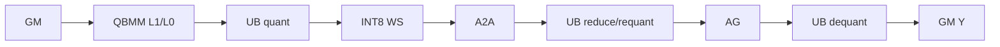

# QuantMatmulAllReduce A2 ACLNN 算子知识

## 算子速览

| 项目 | 内容 |
|---|---|
| 实际入口 | 公开 `aclnnQuantMatmulAllReduceV5GetWorkspaceSize`/`aclnnQuantMatmulAllReduceV5` |
| 计算语义 | A8W8 QuantMatmul（可带 bias、per-token scale、x3）后 SUM；可压成 INT8 通信 |
| 输入输出 | `x1:[...,M,K]`,`x2:[K,N]`，输出 `[...,M,N]` FP16/BF16 |
| 执行类型 | MIX_CV：Cube QBMM、AIV 后处理、AICPU HCCL 融合 |
| Kernel 路线 | R-001 普通 AllReduce；R-002 INT8 AllToAll/AllGather |
| 核心资源 | GM、workspace、L1/L0、UB、HCCL window/notify |
| 来源闭包 | source_closed：V5 API→Inner Op→A2 Tiling→key→entry/body→CMake |
| 验证状态 | 已完成源码闭包检查；本次知识提取未执行编译、真机、数值或性能测试。 |

## 接口与语义

### 计算语义

普通路径为 `Y=AllReduce(x2Scale*x1ScaleOptional*(x1@x2+bias)+x3)`。低比特路径先用 `commQuantScale1` 将本地结果压成 INT8，AllToAll 后按 rank 求和/重定标，再 AllGather，最后用 `commQuantScale2` 反量化。V5 延续 V4 语义，仅新增 `commMode`。

### 输入、输出与属性

| 参数 | shape/layout | dtype | 约束、默认值与语义 |
|---|---|---|---|
| x1/x2 | x1 2D/3D ND；x2 2D ND/NZ | INT8/INT8 | 非空；逻辑 K 相等；M≤INT32_MAX，K及受限轴≤65535 |
| bias/x3 | `[N]`/output shape | INT32/输出 dtype | 可空；x3 与 output 同 dtype |
| x1Scale/x2Scale | per-token/pertensor；per-channel | FP32；UINT64/INT64、FP32或BF16 | x2Scale 必选；组合依输出 dtype |
| commQuantScale1/2 | 广播兼容 | 输出 dtype | 同为空或同为非空；后者启用 INT8 通信 |
| group/reduceOp | string | - | group 必选；reduceOp 仅接受 `sum` 前缀 |
| commMode/commTurn/streamMode | scalar | - | A2 仅 `ai_cpu`；0；1 |
| output | `[...,M,N]` ND | FP16/BF16 | 非空；rank 仅 1/2/4/8 |

### 入口与版本

固定仓公开 V1—V5；V5 文档声明兼容旧版本并新增通信模式，故采用 A2 最新公开版本 V5。产品表明确 A2 支持、A3 不支持。

## Host/Launcher 执行流程

### 参数校验与前处理

`CheckParams` 依次做必选指针、dtype、属性和 shape 校验。Workspace 查询把 INT64 x2Scale 转为 UINT64 视图；识别 x2 转置/NZ，必要时复制 storage metadata 并用 `QuantMatmulAllReduceTransTensor` 转置 x2，按 `IsNeedScaleTrans` 转 scale，之后调用生成的 Inner workspace API。

### 参数、Workspace 与生命周期

executor 持有 Inner 图与 `commMode` user handle，调用者为同 stream 的 execute 提供 workspace。A2 总空间以共享 QBMM workspace 为基数；R-002 追加 `Σ AlignUp(turnM,rank)*N*sizeof(int8)`，`commWorkSpaceSize=qbmmWorkspace-libApiWorkspace` 写入 POD。

### 启动图与失败传播

A2 execute 强制 `HCCL_SERVER_TYPE_AICPU` 后调用 Inner executor。OpDef 注册 `MatmulAllReduce` 的 ascend910b 配置；Tiling `PostTiling` 设置 `blockDim=aicCoreNum`、schedule mode 1，kernel entry 是 `matmul_all_reduce`。API 或 Inner 非成功映射到 ACLNN 错误，Tiling 错误终止图构造。

## Route 与参数设计

### 分核与资源计算

3D x1 将 batch×M 展平；`DoSplitMTiling` 生成 `tileCnt/tailM/tailCnt`。`DoQuantTiling` 分别调用共享 `Mc2QuantBatchMatmulV3Tiling` 生成 tile/tail 的 L1/L0/UB/Matmul 参数；MC2 再填 rank、notify、通信 offset 和 workspace，POD 按 8 字节打包对齐。

### Route 选择

| 顺序 | Route | Key/模板 | 精确选择条件与优先级 | 不适用去向 |
|---:|---|---|---|---|
| 1 | R-001 普通 AllReduce | A2 quant，commInt8=0，transB/pertoken各0或1 | `isA8W8_` 且 comm scale 均空 | R-002或失败 |
| 2 | R-002 INT8 通信 | 同 key 但 commInt8=1 | A8W8 且 comm scale 成对存在、同输出 dtype | 失败 |

```text
IsCapable(isA8W8) -> CheckA8W8 -> CheckInput -> CheckCommModeA2
  -> comm scales absent: R-001
  -> comm scales paired: R-002
  -> otherwise: failure
```

### 模板/实现执行矩阵

| Route | key/selector | dtype/shape/platform 完整命中条件 | 执行族与 kernel 节点 | 实际模板/body | 内存与同步特征 | tail/fallback |
|---|---|---|---|---|---|---|
| R-001 | transB×pertoken×FP16/BF16；对应 key 4104/20488/8/16392/4136/20520/40/16424 中 commInt8=0 子集 | INT8×INT8、合法 scale、A2、comm scale空 | 单 MIX_CV kernel+AICPU AllReduce | `BmmDequant`,`BmmDequantBf16`,`BmmDequantPertoken`+base | QBMM WS；SyncAll、Commit/Wait | tail tiling；无 fallback |
| R-002 | 同维度的 commInt8=1 子集 | 上述条件且 comm scale pair存在 | 单 MIX_CV kernel；A2A→AIV reduce/requant→AG | `MatmulAllReduceQuant*CommInt8` | 追加 padded INT8 WS | tail pad/crop；非法失败 |

### 隐藏性能 Guard

| Guard | Host/Tiling 条件 | Device/资源原因 | 影响 Route | 不满足时去向 | 源码符号 |
|---|---|---|---|---|---|
| rank | 1/2/4/8 | rank 分片与通信拓扑 | 全部 | 失败 | `CheckRankSize` |
| axis | M≤INT32_MAX，K/权重受限轴≤UINT16_MAX | Matmul/POD 位宽 | 全部 | 失败 | `CheckAxis` |
| low-bit pad | `AlignUp(turnM,rank)` | A2A 均分 | R-002 | 增大 WS | `GetWorkspaceSize` |
| UB | `CalcUbSize` 与 QBMM tiler预算 | x3和量化后处理 | 全部 | 调整 tile/失败 | `DoRCSTiling` |

### POD/ABI

| 结构 | 字段 | 类型/位宽 | ABI 布局 | 单位 | Host/launcher producer | Device consumer | 边界 |
|---|---|---|---|---|---|---|---|
| `QuantMatmulAllReduceTilingData` | `msg` | `Mc2Msg` | 外层 `#pragma pack(8), alignas(8)`；`sizeof(Mc2Msg)`/外层 offset 受外部 HCCL 定义影响，固定仓未给编译值 | mixed | `DoAllReduceTiling` | `MatmulAllReduceBase::Init`/HCCL | tile/tail消息与 window/notify |
| `RCSTiling` | `rankDim` | uint32/32 | `sizeof(RCSTiling)=128, alignof=8, offsetof=0`（按固定声明） | rank count | `CheckInput/DoRCSTiling` | padding、send count | 仅 1/2/4/8 |
| 同上 | `rankID` | uint32/32 | `offsetof=4` | rank id | 结构零初始化；当前量化 tiling 未显式赋值 | 仅 `PrintTilingData` 的非零跳过条件 | 当前正式 route 保持 0，不用作 Device rank；Device 从 HCCL context 取 rank |
| 同上 | `commtype` | uint32/32 | `offsetof=8` | HCCL command enum | `DoRCSTiling=args_.cmdType` | `DoAllReduceTiling` 生成消息 | 当前接口为 SUM AllReduce 语义 |
| 同上 | `subtype` | uint32/32 | `offsetof=12` | reduce enum | `DoRCSTiling`：`sum` 前缀映射 SUM，否则 RESERVED | 通信 tiling | API 已先拒绝非 SUM |
| 同上 | `tileCnt` | uint32/32 | `offsetof=16` | turn count | `DoSplitMTiling` | tile loop/HCCL handle count | 可为 0；与 tailCnt 合计受 handle 数约束 |
| 同上 | `tailM` | uint32/32 | `offsetof=20` | element | `DoSplitMTiling` | tail route | 0 表示无尾块 |
| 同上 | `tailCnt` | uint32/32 | `offsetof=24` | turn count | `DoSplitMTiling` | tail loop/HCCL | `tailM=0` 时为 0 |
| 同上 | `biasLen` | uint32/32 | `offsetof=28` | byte | `DoRCSTiling` | BF16 bias 预处理/workspace 推进 | bias 空时 0 |
| 同上 | `isAdd` | uint32/32 | `offsetof=32` | bool flag | `DoRCSTiling` | `PostProcEachTurn`/CommInt8 body | x3 空时 0 |
| 同上 | `rankM` | uint32/32 | `offsetof=36` | element | shape 归一化 | 地址/通信总长 | 原 M 已校验不超过 INT32_MAX |
| 同上 | `rankN` | uint32/32 | `offsetof=40` | element | shape 归一化 | scale/bias/通信 | 由 x2/output 推导 |
| 同上 | `rankK` | uint32/32 | `offsetof=44` | element | shape 归一化 | QBMM/地址 | 不超过 UINT16_MAX |
| 同上 | `gatherIndex` | uint32/32 | `offsetof=48` | index | 结构零初始化；当前 route 未显式赋值 | 当前 A2 quant body 不读取 | inactive=0 |
| 同上 | `isTransposeA` | uint32/32 | `offsetof=52` | bool flag | `DoRCSTiling=args_.isATrans` | 共享诊断/参数；实际模板由 key 固化 | V5 当前 x1 不转置 |
| 同上 | `isTransposeB` | uint32/32 | `offsetof=56` | bool flag | `DoRCSTiling=args_.isBTrans` | QBMM tiling/key | 0/1，与 `TRANS` 模板一致 |
| 同上 | `storageGather` | uint32/32 | `offsetof=60` | flag | 结构零初始化；当前 route 未显式赋值 | 当前 A2 quant body 不读取 | inactive=0 |
| 同上 | `nd2NzWorkLen` | uint64/64 | `offsetof=64` | byte | 结构零初始化；A2 quant route 未写 | 当前 A2 body 不读取 | inactive=0 |
| 同上 | `cToFloatLen` | uint64/64 | `offsetof=72` | byte | 结构零初始化；当前 route 未写 | 当前 A2 quant body 不读取 | inactive=0 |
| 同上 | `gatherLen` | uint64/64 | `offsetof=80` | element/byte（旧字段注释不完整） | 结构零初始化；当前 route 未写 | 当前 A2 quant body 不读取 | inactive=0，单位不可从本 route补造 |
| 同上 | `workspaceAddr4` | uint32/32 | `offsetof=88` | byte offset（旧字段） | 结构零初始化；当前 route 未写 | 当前 A2 quant body 不读取 | inactive=0 |
| 同上 | `aicCoreNum` | uint32/32 | `offsetof=92` | core count | `DoRCSTiling=args_.aicCoreNum` | 公共调度/诊断；Host 同值设置 `blockDim` | 独占全 AIC 核并设置 schedule mode 1 |
| 同上 | `needUbBuffer` | uint32/32 | `offsetof=96` | flag | 结构零初始化；当前 quant tiling 未显式写 | 被传入部分 CommInt8 `InnerProcess`，固定 body 内未读取 | inactive=0，不能据参数名推导 UB 分配 |
| 同上 | `addX3UbCnt` | uint32/32 | `offsetof=100` | element/core chunk | `DoRCSTiling` | `Matmul_All_Reduce_Add_X3` | x3 空时不消费 |
| 同上 | `commWorkSpaceSize` | uint32/32 | `offsetof=104` | byte | `GetWorkspaceSize: myWorkSpaceSize_-libApiWorkSpaceSize_` | CommInt8 以 `userWS+该值` 起片 | 写入前存在 uint64→uint32 窄化边界 |
| 同上 | `isInputCommQuantScale` | uint32/32 | `offsetof=108` | enum/flag | 公共输入检查 | key 与 CommInt8 body | A2 为 0/1 |
| 同上 | `dataType` | uint32/32 | `offsetof=112` | enum | `DoRCSTiling` | 通信/后处理 | 当前 route 为输出 dtype 编码 |
| 同上 | `commInt8WorkSpace` | uint32/32 | `offsetof=116` | byte | A2 不写活动值 | A2 CommInt8 不读取此字段 | inactive，实际追加区由 `commWorkSpaceSize` 后地址及 tile 公式得到 |
| 同上 | `dynamicQuantTempBuffSize` | uint32/32 | `offsetof=120` | byte | A2 不写活动值 | A2 不读取 | inactive |
| `QuantMatmulAllReduceTilingData` | `tilematmulTiling` | `Mc2QuantBatchMatmulV3TilingData` | 位于 `msg+RCSTiling` 后；具体 offset/sizeof 依共享 QBMM ABI，固定仓未输出编译值 | mixed | `DoQuantTiling(mmTile)` | QBMM `opTile` | 主 tile |
| 同上 | `tailmatmulTiling` | 同上 | 紧随主 tiling；外层总大小强制 8 字节整除 | mixed | `DoQuantTiling(mmTail)` | QBMM `opTail` | `tailCnt>0` 时有效 |

### Route 源码闭包

| Route | Key/selector | Host/Tiling producer | POD/参数 | Kernel entry/router | Kernel body/直接依赖 | 构建接线 |
|---|---|---|---|---|---|---|
| R-001 | A2 quant commInt8=0 | `DoOpTiling/SetTilingKey` | A2 tiling data | `matmul_all_reduce` quant router | base、quant bodies、共享 QBMM | `op_host/CMakeLists.txt` |
| R-002 | commInt8=1 | 同上+`GetWorkspaceSize` | 同上 | entry低比特分支 | CommInt8 bodies、共享 QBMM/HCCL | 同上 |

## Kernel 实现

### 公共执行流程

entry 检查 workspace/user workspace，创建 `TPipe`，按输出 dtype、transB、pertoken、commInt8 实例化 body。每 turn 使用 tile/tail QBMM 产生 C，可选加 x3，再提交通信；A offset 按 `M*K`、C offset 按 `M*N` 前进，最终等待 handle 并 finalize。

### Route R-001：普通 AllReduce

#### 适用条件

##### 选择证据

| 层级 | 文件 | 符号 | 源码谓词/参数 | 结果/下一跳 |
|---|---|---|---|---|
| Tiling | `arch22/quant_matmul_all_reduce_tiling.cpp` | `DoOpTiling` | A8W8、comm scale空 | commInt8=0 |
| Router | `arch22/matmul_all_reduce.cpp` | `quant_matmul_allreduce` | dtype/trans/pertoken | 对应 BmmDequant body |

#### Device 数据流

##### 函数级调用链

```text
matmul_all_reduce -> MatmulAllReduceQuant*::Process
  -> QBMM.Init/Process -> PostProcEachTurn -> AllReduce Commit -> Wait/Finalize
```

##### 源码等价伪码

```text
for tile then tail: QBMM; if x3 {SyncAll; Add}; SyncAll; Commit(AllReduce C->Y); advance offsets
wait all handles; finalize
```

#### 内存与数据搬运

##### 资源与搬运表

| 层级/缓冲区 | offset/地址公式 | extent/容量公式 | dtype/layout | producer | consumer | owner/lifetime | 对齐/复用 |
|---|---|---|---|---|---|---|---|
| GM A/C | turn×M×K / turn×M×N | current tile | INT8/Y ND | caller/QBMM | Cube/HCCL | call | contiguous |
| L1/L0 | QBMM TCubeTiling | shared tiler values | cube layout | loaders/Mmad | epilogue | turn | hardware alignment |
| UB | QBMM/x3 temp | tiler UB budget | FP32/Y | AIV | GM C | turn | TQue/TBuf |
| HCCL window | `Mc2Msg` offsets | M×N×sizeof(Y) | Y | C | AllReduce | handle | notify |

##### 分层内存布局


##### 字节账、交接边与复用顺序

```text
workspace_total = max(tile_QBMM_workspace, tail_QBMM_workspace, libApiWorkSpaceSize)
commWorkSpaceSize = workspace_total - libApiWorkSpaceSize
L1/L0/UB = tilematmulTiling.matmulTiling + QBMM auxiliary tiling
```

| 边/复用子区 | producer | offset/extent | dtype/layout | consumer | ordering/sync | owner/lifetime | 安全条件 |
|---|---|---|---|---|---|---|---|
| C tile | QBMM/Add | M×N×sizeof(Y) | Y ND | HCCL | SyncAll→Commit→Wait | handle | wait before finalize |

#### 同步、精度与尾块

##### 同步与数值边界表

| 阶段 | primitive/机制 | producer | consumer/等待点 | 保护对象 | 精度/尾块 |
|---|---|---|---|---|---|
| QBMM→comm | SyncAll | Cube/AIV | HCCL | C | INT32累加后scale到Y；tail专用tiling |
| comm | notify/Commit/Wait | local tile | output | window | SUM in Y dtype path |

#### 关键实现

##### 符号证据表

| 阶段 | 文件 | 符号/模板实例 | 实现事实 |
|---|---|---|---|
| Host/Tiling producer | `arch22/quant_matmul_all_reduce_tiling.cpp` | `DoQuantTiling` | 主/tail QBMM tiling |
| Kernel entry/router | `arch22/matmul_all_reduce.cpp` | quant router | dtype/trans/pertoken映射 |
| Device body/helper | `arch22/matmul_all_reduce_base.h` | `PostProcEachTurn` | x3、AllReduce和handle生命周期 |

### Route R-002：INT8 低比特通信

#### 适用条件

##### 选择证据

| 层级 | 文件 | 符号 | 源码谓词/参数 | 结果/下一跳 |
|---|---|---|---|---|
| Tiling | `arch22/quant_matmul_all_reduce_tiling.cpp` | `DoOpTiling/GetWorkspaceSize` | `isInputCommQuantScale==1` | commInt8=1、追加WS |
| Router | `arch22/matmul_all_reduce.cpp` | low-bit branches | dtype×pertoken | CommInt8 body |

#### Device 数据流

##### 函数级调用链

```text
entry -> MatmulAllReduceQuant*CommInt8::Process
  -> QBMM -> PerChannelQuant -> AllToAll -> ReduceSum/Requant -> AllGather -> PerChannelDequant
```

##### 源码等价伪码

```text
for turn: QBMM; optional x3; scale1-quantize padded C; commit A2A
wait shard; reduce ranks and requantize; commit AG; wait AG; scale2-dequantize to Y
finalize
```

#### 内存与数据搬运

##### 资源与搬运表

| 层级/缓冲区 | offset/地址公式 | extent/容量公式 | dtype/layout | producer | consumer | owner/lifetime | 对齐/复用 |
|---|---|---|---|---|---|---|---|
| comm WS | after `commWorkSpaceSize` | ΣAlignUp(M,rank)×N | INT8 | quant | A2A/reduce/AG | call | M rank-aligned |
| UB | vector quant/reduce/dequant tile | tiler UB | FP32/INT8/Y | AIV | HCCL/GM | stage | SyncAll |
| L1/L0 | QBMM tiling | shared | INT8→INT32 | Cube | vector | turn | QBMM contract |

##### 分层内存布局



##### 字节账、交接边与复用顺序

```text
int8_ws = tileCnt*AlignUp(tileM,rankDim)*N + tailCnt*AlignUp(tailM,rankDim)*N
workspace_total = max(tile_QBMM_workspace,tail_QBMM_workspace,libApiWorkSpaceSize) + int8_ws
CommInt8 base = userWS + commWorkSpaceSize
```

| 边/复用子区 | producer | offset/extent | dtype/layout | consumer | ordering/sync | owner/lifetime | 安全条件 |
|---|---|---|---|---|---|---|---|
| padded INT8 tile | quant | prefix/paddedM×N | INT8 | A2A | Sync+notify | handle | paddedM%rank=0 |

#### 同步、精度与尾块

##### 同步与数值边界表

| 阶段 | primitive/机制 | producer | consumer/等待点 | 保护对象 | 精度/尾块 |
|---|---|---|---|---|---|
| compute→A2A | SyncAll/Commit | QBMM+AIV | HCCL | INT8 WS | scale1量化 |
| A2A→AG→Y | Wait/Commit/Wait | comm/AIV | next stage | shards | scale2反量化；tail pad/crop |

#### 关键实现

##### 符号证据表

| 阶段 | 文件 | 符号/模板实例 | 实现事实 |
|---|---|---|---|
| Host/Tiling producer | `arch22/quant_matmul_all_reduce_tiling.cpp` | `GetWorkspaceSize` | rank padding/INT8 bytes |
| Kernel entry/router | `arch22/matmul_all_reduce.cpp` | low-bit branches | 四种dtype/scale组合 |
| Device body/helper | `arch22/matmul_all_reduce_quant_fp16_comm_int8.h` | CommInt8 body | A2A→reduce/requant→AG→dequant |

## 算子特定优化

### Trick T-001：通信前 INT8 压缩

#### 触发与源码依据

- 适用 Route：R-002
- 触发条件：两个 comm scale 同时存在。
- Golden 来源：[`quant_matmul_all_reduce_tiling.cpp:43-45`](../../../../../../../cann-ops-raw/ascendc/ops-transformer/be33d95bb755cedec3108f70805c1874d1792540/mc2/matmul_all_reduce/op_host/op_tiling/arch22/quant_matmul_all_reduce_tiling.cpp)

**官方源码（固定 Commit 连续逐字摘录）**：

```cpp
if (tilingData_.param.isInputCommQuantScale == 1U) {
    isCommInt8Enable_ = true;
}
```

#### 机制与设计原因

该位同时进入 key 与 workspace 公式，把通信载荷从输出 dtype 压为 INT8；代价是量化、分片归约重定标、反量化和 rank padding。

#### 迁移边界

- 适用：A2 A8W8、成对通信 scale。
- 前提：rank 1/2/4/8、scale dtype正确、workspace足够。
- 失效：scale均空走R-001；单边scale失败。
- 未验证：本次知识提取未执行编译、真机、数值或性能测试。

#### 错误做法

只传一个通信 scale；成对约束拒绝该组合。

## 模板与实现对比

| 对比维度 | R-001 普通 AllReduce | R-002 INT8 通信 | 设计选择依据 |
|---|---|---|---|
| 命中条件/优先级 | comm scale空 | comm scale成对 | `isInputCommQuantScale` |
| 执行族/节点图 | QBMM→AR | QBMM→quant→A2A→reduce→AG→dequant | 通信 dtype |
| M/N/K、tile 与 scheduler | split M/tail | 同tile，M pad rank | rank分片 |
| workspace/L1/L0/UB | QBMM WS | +padded INT8 WS | 通信暂存 |
| AIC/AIV 或 kernel 交接 | C→HCCL | C→AIV→HCCL交错 | notify/SyncAll |
| 同步、精度与 tail | Y dtype SUM | 额外INT8 round；tail pad/crop | 带宽换精度 |
| fallback/失败边界 | 无其他quant route | 非法scale失败 | A2仅A8W8 |

## 平台差异

| 项目 | A2 | A3 | 950 |
|---|---|---|---|
| 支持状态 | 支持 | 公开支持表不支持 | 支持，见 `_950` 卡 |
| Host/Launcher | ai_cpu；rank≤8 | N/A | ai_cpu/ccu；rank≤64 |
| Kernel/资源 | A2 QBMM+AICPU | N/A | FP8/HIF8/MX、CCU、两段通信 |

## 限制与失败边界

- A2 只支持公开 A8W8 组合；`streamMode=1`、`commTurn=0`、SUM、非空 tensor、rank 1/2/4/8。
- API 对 NZ shape 有提前返回分支，最终合法性仍由 Inner/Tiling；生成 executor 与 HCCL 库内部实现不在固定仓。
- POD 只声明 pack/align 8，编译后 sizeof/offsetof 不可见，不作推测。

## 源码索引

### 链路索引

| 链路阶段 | 文件 | 关键符号 | 支撑内容 |
|---|---|---|---|
| 入口声明/约束 | `mc2/matmul_all_reduce/docs/aclnnQuantMatmulAllReduceV5.md` | V5 prototypes/table | API/A2约束 |
| 入口实现 | `mc2/matmul_all_reduce/op_api/aclnn_quant_matmul_all_reduce_v5.cpp` | workspace/execute | 校验、转置、executor |
| Host Op | `mc2/matmul_all_reduce/op_host/matmul_all_reduce_def.cpp` | `MatmulAllReduce` | schema/config |
| Host/Tiling | `mc2/matmul_all_reduce/op_host/op_tiling/arch22/quant_matmul_all_reduce_tiling.cpp` | A2 quant tiling | route/key/workspace |
| Host/Tiling | `mc2/matmul_all_reduce/op_host/op_tiling/matmul_all_reduce_tiling_base.cpp` | `DoRCSTiling/DoAllReduceTiling` | 公共维度、通信消息与 RCS producer |
| POD | `mc2/matmul_all_reduce/op_kernel/arch22/quant_matmul_all_reduce_tiling_data.h` | tiling data | ABI aggregate |
| POD | `mc2/common/op_kernel/mc2_tiling_struct.h` | `RCSTiling` | 字段顺序、位宽与 offset |
| Kernel entry/body | `mc2/matmul_all_reduce/op_kernel/arch22/matmul_all_reduce.cpp` | entry/router | key→body |
| Kernel router | `mc2/matmul_all_reduce/op_kernel/matmul_all_reduce_tiling_key.h` | quant key selection | 8 个 A2 quant key |
| Kernel body | `mc2/matmul_all_reduce/op_kernel/arch22/matmul_all_reduce_base.h` | base | AR lifecycle |
| Kernel body | `mc2/matmul_all_reduce/op_kernel/arch22/matmul_all_reduce_quant_fp16_comm_int8.h` | FP16 CommInt8 body | INT8 pipeline |
| Kernel body | `mc2/matmul_all_reduce/op_kernel/arch22/matmul_all_reduce_quant_bf16_comm_int8.h` | BF16 CommInt8 body | BF16 量化通信与反量化 |
| Kernel body | `mc2/matmul_all_reduce/op_kernel/arch22/matmul_all_reduce_quant_pertoken_comm_int8.h` | per-token CommInt8 body | per-token scale 地址推进与低比特流水 |
| Kernel helper | `mc2/matmul_all_reduce/op_kernel/arch22/matmul_all_reduce_quant_perchannel.h` | `MatmulAllReduceQuantPerchannelCommInt8` | scale1→INT8 |
| Kernel helper | `mc2/matmul_all_reduce/op_kernel/arch22/matmul_all_reduce_quant_reduce_sum.h` | INT8 reduce/requant | rank 分片归约 |
| Kernel helper | `mc2/matmul_all_reduce/op_kernel/arch22/matmul_all_reduce_dequant_perchannel.h` | CommInt8 dequant | scale2→输出 dtype |
| QBMM dependency | `mc2/3rd/quant_batch_matmul_v3/op_kernel/quant_batch_matmul_v3.h` | `BmmDequant*` | Cube→Vector QBMM 当前实例入口 |
| 构建接线 | `mc2/matmul_all_reduce/op_host/CMakeLists.txt` | module/options | build wiring |

### 实现复用检查

| 检查项 | 可复用事实 | 不得改变的约束 | 源码符号 |
|---|---|---|---|
| ABI/POD | tile/tail双QBMM数据 | pack/align8、字段顺序 | tiling struct |
| 调用顺序 | WS查询→execute→Inner | executor/stream生命周期 | V5 API |
| workspace/内存 | QBMM基址+低比特追加区 | byte offset、rank pad | `GetWorkspaceSize` |
| 同步 | SyncAll+notify/handle | Commit/Wait/Finalize顺序 | base/body |
| 精度与尾块 | INT32累加后scale；tail独立tiling | INT8额外round/pad/crop | quant bodies |
| 失败边界 | selector拒绝返回错误 | 不补造fallback | `IsCapable`,`CheckA8W8` |