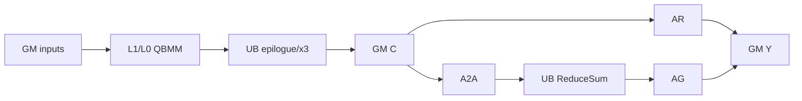
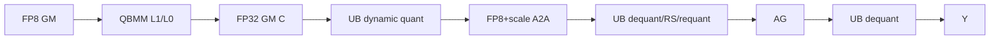

# QuantMatmulAllReduce 950 ACLNN 算子知识

## 算子速览

| 项目 | 内容 |
|---|---|
| 实际入口 | 公开 `aclnnQuantMatmulAllReduceV5GetWorkspaceSize`/`aclnnQuantMatmulAllReduceV5` |
| 计算语义 | A8W8、FP8/HIF8、MXFP4/MXFP8 QuantMatmul+x3+SUM；通信可为原 dtype、INT8或FP8 per-tile |
| 输入输出 | `x1:[...,M,K]`,`x2:[K,N]`；输出 FP16/BF16/部分低浮点组合的 FP32 |
| 执行类型 | MIX_CV：AIC QBMM、AIV epilogue、AICPU或CCU HCCL |
| Kernel 路线 | R-001 原 dtype AR/A2A-RS-AG；R-002 INT8通信；R-003 FP8 per-tile通信 |
| 核心资源 | GM/workspace、L1/L0、UB、Mc2Init/Cc通信tiling、notify |
| 来源闭包 | source_closed：V5 API→950 Tiling→template key→APT router/body→CMake |
| 验证状态 | 已完成源码闭包检查；本次知识提取未执行编译、真机、数值或性能测试。 |

## 接口与语义

### 计算语义

普通路径执行 `Y=AllReduce(scale(x1@x2+bias)+x3)`；A2A 路径与其数学等价，把 C 分片 AllToAll、AIV ReduceSum 后 AllGather。`commQuantMode=0` 且通信 scale 成对存在时使用 INT8；`commQuantMode=1` 仅 FP8输入，按每行 N 方向 128 元素动态 scale 量化 FP8 payload，分片反量化归约再量化，聚合后反量化输出。

### 输入、输出与属性

| 参数 | shape/layout | dtype | 约束、默认值与语义 |
|---|---|---|---|
| x1/x2 | x1 2D/3D ND；x2 2D ND/NZ | INT8、FP8 E4M3/E5M2、HIF8、FLOAT4_E2M1等同族组合 | 非空；K匹配；M≤INT32_MAX，K/受限轴≤65535 |
| bias/x3 | `[N]`/output shape | A8 bias INT32；低浮点 bias FP32；x3=output dtype | 可空 |
| x1Scale/x2Scale | mode决定shape | FP32/UINT64/BF16/E8M0 | per-block要求128×128；MX为1×1×32编码 |
| comm scales | 广播兼容 | output dtype | mode0下成对存在启用INT8；mode1由动态FP8流程使用 |
| groupSize | bits[15:0]/[31:16]/[47:32] | uint64 | 编码K/N/M group；0推导；per-block=128/128/128，MX=1/1/32 |
| commMode | string | - | `ai_cpu`或`ccu`；CCU仅单机UB互联 |
| rank/reduce/stream | scalar | - | rank 1/2/4/8/16/32/64；SUM；streamMode=1 |
| output | `[...,M,N]` | FP16/BF16/受支持组合FP32 | 非空；950默认确定性 |

### 入口与版本

V5 是固定仓 950 最新公开版本，新增 `commMode` 并兼容 V1—V4。README/V5产品表明确 Ascend 950PR/DT 支持，A3不支持。

## Host/Launcher 执行流程

### 参数校验与前处理

API 先校验指针、dtype、reduce/stream、shape；INT64 x2Scale 转 UINT64 视图。根据 strides/NZ metadata 得到 transB，必要时转置 x2及x2Scale，再调用生成的 Inner workspace API。950 execute 从 executor user handle 读取 `ai_cpu`/`ccu` 并调用 `SetHcclServerType`。

### 参数、Workspace 与生命周期

executor 保留 Inner 图和通信模式，调用者管理同 stream workspace。Tiling 先取 QBMM/lib-api 空间，R-001 A2A额外分配本地C和三段通信区；R-002追加 padded INT8区及本地浮点C；R-003为动态FP8 payload、rank shard、两个FP32中间区和动态量化临时UB预算。各切片只在 execute 生命周期有效。

### 启动图与失败传播

OpDef 注册 ascend950，dispatcher 在 DAV_3510 进入 950 registry。`PostTiling` 写8字节对齐POD、`blockDim=aicCoreNum`、schedule mode 1；entry `matmul_all_reduce_apt` 按 key 路由。API/Inner失败返回 ACLNN error；registry中非 `GRAPH_PARAM_INVALID` 的错误为终点。

## Route 与参数设计

### 分核与资源计算

batch×M展平后 split M/tail；batched per-block/MX强制单个M tile。共享950 QBMM tiler返回 kernelType（0无Vector epilogue、2 Vector epilogue、4 per-block custom）及L1/L0/UB参数。`SetMc2Hcomm` 决定AllReduce或A2A+AG并生成 `Mc2InitTiling/Mc2CcTiling`；低比特M向上对齐rank。所有workspace公式最后8字节对齐。

### Route 选择

| 顺序 | Route | Key/模板 | 精确选择条件与优先级 | 不适用去向 |
|---:|---|---|---|---|
| 1 | R-001 原dtype通信 | quant key，commDtype=DEFAULT，kernelType=0/2/4，A2ARSAG 0/1，commMode AICPU/CCU | A8W8/FP8/HIF8/MX且非低比特通信 | R-002/R-003/失败 |
| 2 | R-002 INT8通信 | commDtype=INT8，kernelType=0/2 | `isInputCommQuantScale==1` | 失败 |
| 3 | R-003 FP8 per-tile通信 | commDtype=FP8，kernelType=2 | `isInputCommQuantScale==2`，x1/x2为FP8 E4M3/E5M2 | 失败 |

```text
scenario in {A8W8,FP8/HIF8,MXFP4/MXFP8} -> validate/split/QBMM tiling
  -> comm status 0: choose AllReduce or A2A-RS-AG => R-001
  -> comm status 1: INT8 A2A-RS-AG => R-002
  -> comm status 2: FP8 per-tile A2A-RS-AG => R-003
```

### 模板/实现执行矩阵

| Route | key/selector | dtype/shape/platform 完整命中条件 | 执行族与 kernel 节点 | 实际模板/body | 内存与同步特征 | tail/fallback |
|---|---|---|---|---|---|---|
| R-001 | transB0/1，kernelType0/2/4，A2ARSAG0/1，commMode两值；MX仅transB1/kernel0 | 950合法A8/FP8/HIF8/MX，comm status0 | MIX_CV；AR或A2A→AIV RS→AG | `MatmulAllReduceQuant/PerToken/PerBlock` + 两种base | 原dtype通信区；QBMM不同epilogue | tile/tail；selector不命中失败 |
| R-002 | commDtype INT8，kernelType0或2 | 通信scale pair；A8/FP8适用组合 | MIX_CV；quant→A2A→RS/requant→AG→dequant | `MatmulAllReduceQuantCommInt8`/Pertoken版 | padded INT8三段区 | tail pad/crop |
| R-003 | commDtype FP8，kernelType2 | FP8 E4M3/E5M2且commQuantMode1 | MIX_CV；dynamic quant→A2A→mixed RS/requant→AG→dequant | `MatmulAllReduceCommFp8MixedCalc` | payload含FP8值+每128列FP32 scale | 256MiB guard调整tile/失败 |

### 隐藏性能 Guard

| Guard | Host/Tiling 条件 | Device/资源原因 | 影响 Route | 不满足时去向 | 源码符号 |
|---|---|---|---|---|---|
| topology | `IsUseA2APath(rank,arch)`；rank8+CCU+K≥4608且非低比特强制AR | 大K CCU AR更合适 | R-001 | 另一通信base | `SetMc2Hcomm` |
| FP8 payload | 每次通信≤256MiB并可拆分 | HCCL计数上界 | R-003 | 调小tile或失败 | `CheckHCCLSize/AdjustHCCLLimit` |
| kernelType | QBMM tiler仅返回0/2/4可用组合 | epilogue位置不同 | R-001/2/3 | key不存在/失败 | `SetTilingKey` |
| MX shape | transB且K group=32、ceil(K/32)满足偶数约束 | FP4打包和E8M0 scale | R-001 | 失败 | `CheckMXFP4Input` |
| low-bit pad | AlignUp(M,rank) | rank均分 | R-002/3 | 增workspace | `GetWorkspaceSize` |

### POD/ABI

| 结构 | 字段 | 类型/位宽 | ABI 布局 | 单位 | Host/launcher producer | Device consumer | 边界 |
|---|---|---|---|---|---|---|---|
| `QuantMatmulAllReduceTilingDataA5` | `mc2InitTiling` | `Mc2InitTiling` | 外层 `#pragma pack(8),alignas(8)`；该外部类型的 sizeof 固定仓未输出 | mixed | `SetMc2Hcomm*` | `Hccl::InitV2` | 所有 route 活动 |
| 同上 | `mc2CcTiling` | `Mc2CcTiling` | 紧随 `mc2InitTiling`，具体 offset 依外部类型 | mixed | `SetMc2Hcomm*` | 第一次 `SetCcTilingV2(offsetof(...))` | AR 或 A2A 主通信 |
| 同上 | `mc2CcTilingComm` | `Mc2CcTiling` | 紧随 `mc2CcTiling`，具体 offset 依外部类型 | mixed | `SetMc2HcommTwoShot` | 第二次 `SetCcTilingV2` | 两段 route 的 AllGather；AR route 不消费第二段 |
| `RCSTiling` | `rankDim` | uint32/32 | `sizeof(RCSTiling)=128, alignof=8, offsetof=0`（按固定声明） | rank count | `DoRCSTiling` | padding/send count | 1/2/4/8/16/32/64 |
| 同上 | `rankID` | uint32/32 | `offsetof=4` | rank id | 结构零初始化；当前量化 tiling 未显式赋值 | 仅 `PrintTilingData` 的非零跳过条件 | 当前 route 保持 0；Device rank 来自 HCCL context |
| 同上 | `commtype` | uint32/32 | `offsetof=8` | HCCL command enum | `DoRCSTiling=args_.cmdType` | 通信 tiling | 由公开 SUM 语义派生 |
| 同上 | `subtype` | uint32/32 | `offsetof=12` | reduce enum | `DoRCSTiling`：`sum` 前缀映射 SUM | HCCL config | API/Tiling 双层拒绝非 SUM |
| 同上 | `tileCnt` | uint32/32 | `offsetof=16` | turn count | `DoSplitMTiling/AdjustHCCLLimit` | QBMM/handle loops | 与 tailCnt 合计受 handle/HCCL 次数上界约束 |
| 同上 | `tailM` | uint32/32 | `offsetof=20` | element | 同上 | tail body | 0 表示无尾块 |
| 同上 | `tailCnt` | uint32/32 | `offsetof=24` | turn count | 同上 | tail body | 0/1 为当前 split 结果 |
| 同上 | `biasLen` | uint32/32 | `offsetof=28` | byte | `DoRCSTiling` | bias 预处理/workspace | 无 bias 时 0 |
| 同上 | `isAdd` | uint32/32 | `offsetof=32` | bool flag | `DoRCSTiling` | x3 AIV epilogue | x3 空时 0 |
| 同上 | `rankM` | uint32/32 | `offsetof=36` | element | shape 归一化 | 地址/通信总长 | M 已校验不超过 INT32_MAX |
| 同上 | `rankN` | uint32/32 | `offsetof=40` | element | shape 归一化 | payload/scale/通信 | N 来自 output/x2 |
| 同上 | `rankK` | uint32/32 | `offsetof=44` | element | shape 归一化 | QBMM/地址 | K 不超过 UINT16_MAX |
| 同上 | `gatherIndex` | uint32/32 | `offsetof=48` | index | 结构零初始化；当前 route 未显式赋值 | 950 quant body 不读取 | inactive=0 |
| 同上 | `isTransposeA` | uint32/32 | `offsetof=52` | bool flag | `DoRCSTiling=args_.isATrans` | 共享参数；实际模板由 key 固化 | V5 当前 x1 不转置 |
| 同上 | `isTransposeB` | uint32/32 | `offsetof=56` | bool flag | `DoRCSTiling=args_.isBTrans` | QBMM tiling/key | 0/1；MX route 必须 1 |
| 同上 | `storageGather` | uint32/32 | `offsetof=60` | flag | 结构零初始化；当前 route 未显式赋值 | 950 quant body 不读取 | inactive=0 |
| 同上 | `nd2NzWorkLen` | uint64/64 | `offsetof=64` | byte | 结构零初始化；当前 950 quant tiling 未显式写 | AR/A2A base 用作 `cGM=userWS+nd2NzWorkLen+biasLen` 的前缀 | 当前 route 为 0；仍不可改变与 bias/commWorkspace 的地址契约 |
| 同上 | `cToFloatLen` | uint64/64 | `offsetof=72` | byte | 结构零初始化；当前 quant route 未写 | 950 quant body 不读取 | inactive=0 |
| 同上 | `gatherLen` | uint64/64 | `offsetof=80` | element/byte（旧字段注释不完整） | 结构零初始化；当前 route 未写 | 950 quant body 不读取 | inactive=0，单位不可补造 |
| 同上 | `workspaceAddr4` | uint32/32 | `offsetof=88` | byte offset（旧字段） | 结构零初始化；当前 route 未写 | 950 quant body 不读取 | inactive=0 |
| 同上 | `aicCoreNum` | uint32/32 | `offsetof=92` | core count | `DoRCSTiling=args_.aicCoreNum` | 公共调度/诊断；Host 同值设置 `blockDim` | schedule mode 1 等待全核空闲 |
| 同上 | `needUbBuffer` | uint32/32 | `offsetof=96` | flag | 结构零初始化；当前 950 quant tiling 未显式写 | 部分低比特 body 形参透传但固定实现未据其分配 | inactive=0 |
| 同上 | `addX3UbCnt` | uint32/32 | `offsetof=100` | element/core chunk | `DoRCSTiling` | x3 helper | x3 空时不消费 |
| 同上 | `commWorkSpaceSize` | uint32/32 | `offsetof=104` | byte | `GetWorkspaceSize: myWorkSpaceSize_-libApiWorkSpaceSize_`（追加 route slice 前） | 所有 body 的 `userWS+该值` | uint64→uint32 窄化边界需保持 |
| 同上 | `isInputCommQuantScale` | uint32/32 | `offsetof=108` | enum | 公共输入分析 | key/通信 body | 0=原 dtype，1=INT8，2=FP8 per-tile |
| 同上 | `dataType` | uint32/32 | `offsetof=112` | enum | `DoRCSTiling` | 通信/后处理 | 当前 route dtype 编码 |
| 同上 | `commInt8WorkSpace` | uint32/32 | `offsetof=116` | byte | `GetWorkspaceSizeOfCommQuantScaleOrFP8` | INT8/FP8 buffer slicing | route 0 inactive；名字虽含 Int8，FP8 route 也使用 |
| 同上 | `dynamicQuantTempBuffSize` | uint32/32 | `offsetof=120` | byte | `GetDynamicQuantTempBuffSize` | FP8 dynamic quant/mixed/dequant helpers | 仅 mode=2 活动，32B 对齐 |
| `QuantMatmulAllReduceTilingDataA5` | `tilematmulTiling` | `Mc2QuantBatchMatmulV3TilingDataParams` | 位于 `param` 后，具体 offset/sizeof 依共享 QBMM ABI | mixed | `DoQuantTiling(mmTile)` | 950 QBMM `opTile` | 主 tile |
| 同上 | `tailmatmulTiling` | 同上 | 紧随主 tiling；外层总大小强制 8 字节整除 | mixed | `DoQuantTiling(mmTail)` | 950 QBMM `opTail` | `tailCnt>0` 时有效 |

### Route 源码闭包

| Route | Key/selector | Host/Tiling producer | POD/参数 | Kernel entry/router | Kernel body/直接依赖 | 构建接线 |
|---|---|---|---|---|---|---|
| R-001 | DEFAULT×kernel0/2/4×A2ARSAG×mode | 950 `DoOpTiling/SetMc2Hcomm/SetTilingKey` | 950 tiling data | `matmul_all_reduce_apt` | quant/pertoken/perblock + AR/A2A bases + shared QBMM | `op_host/CMakeLists.txt` |
| R-002 | INT8×kernel0/2 | 同上+workspace | 同上 | APT int8分支 | `matmul_all_reduce_quant_comm_int8.h`及pertoken版 | 同上 |
| R-003 | FP8×kernel2 | 同上+dynamic temp | 同上 | APT FP8 mixed分支 | `matmul_all_reduce_quant_commfp8_mixed_calc.h`及dynamic helpers | 同上 |

## Kernel 实现

### 公共执行流程

APT entry检查workspace/user workspace，注册950 tiling并创建TPipe；编译dtype宏与key选择QBMM/body/通信base。各turn执行QBMM及可选x3，利用SyncAll和HCCL notify在AIC/AIV/通信引擎间交接，处理tail后等待全部handle并Finalize。

### Route R-001：原 dtype AllReduce 或 A2A-RS-AG

#### 适用条件

##### 选择证据

| 层级 | 文件 | 符号 | 源码谓词/参数 | 结果/下一跳 |
|---|---|---|---|---|
| Tiling | `arch35/quant_matmul_all_reduce_tiling_950.cpp` | `SetMc2Hcomm` | comm status0及topology/K谓词 | AR或A2ARSAG |
| Router | `arch35/matmul_all_reduce_apt.cpp` | quant dispatch | kernelType0/2/4、dtype、MX | Quant/Pertoken/PerBlock body |

#### Device 数据流

##### 函数级调用链

```text
matmul_all_reduce_apt -> Quant/PerToken/PerBlock::Process -> QBMM.Process
  -> PostProcEachTurn -> {AllReduce | AllToAll -> ReduceSumForAlltoAll -> AllGather} -> Wait/Finalize
```

##### 源码等价伪码

```text
for tile/tail: QBMM(current addresses); optional x3; SyncAll
if AR: Commit AllReduce(C,Y)
else: Commit A2A(C,padded shard); wait; AIV reduce; Commit AG; strip padding if needed
advance x1/per-token-or-MX-scale/C; drain handles; finalize
```

#### 内存与数据搬运

##### 资源与搬运表

| 层级/缓冲区 | offset/地址公式 | extent/容量公式 | dtype/layout | producer | consumer | owner/lifetime | 对齐/复用 |
|---|---|---|---|---|---|---|---|
| L1/L0 | 950 QBMM tiling | shared tiler | cube layout | QBMM loaders/Mmad | epilogue | turn | kernelType contract |
| UB | epilogue/x3/reduce | tiler budget | FP32/Y | AIV | C/HCCL | stage | SyncAll |
| local C / AR input | `userWS+commWorkSpaceSize` | `M*N*sizeof(Y)` | Y ND | QBMM/x3 | AllReduce 或 A2A | executor workspace | AR 也物化该区 |
| A2A regions | C 后连续切片 | `commWS=(M*N+(tileCnt+tailCnt)*512)*sizeof(Y)`；实际每 turn 用 `CeilAlign(turnElements,512)` | Y | QBMM/A2A | RS/AG | handles | Host 每 turn 保守加 512 元素，Device 按实际 ceil padding |
| output | direct AR or AG/copy result | M*N*sizeof(Y) | Y ND | comm/AIV | caller | call | logical M only |

##### 分层内存布局



##### 字节账、交接边与复用顺序

```text
AR: workspace_total = qbmm_workspace_base + local_C(M*N*sizeofY)
A2A: workspace_total = qbmm_workspace_base + local_C(M*N*sizeofY) + 3*commWS + commWS/rank
commWS = (M*N + (tileCnt+tailCnt)*512)*sizeofY
```

| 边/复用子区 | producer | offset/extent | dtype/layout | consumer | ordering/sync | owner/lifetime | 安全条件 |
|---|---|---|---|---|---|---|---|
| A2A recv shard | HCCL | 512-aligned tile extent | Y | AIV RS | Wait | turn | count ceil(C/rank) |
| RS→AG | AIV | rank shard | Y | HCCL AG | Commit | handle | padding最终剥离 |

#### 同步、精度与尾块

##### 同步与数值边界表

| 阶段 | primitive/机制 | producer | consumer/等待点 | 保护对象 | 精度/尾块 |
|---|---|---|---|---|---|
| QBMM→comm | SyncAll/notify | AIC/AIV | HCCL | C | QBMM按模式scale；tail独立tiling |
| A2A→RS→AG | Wait/Commit/Wait | HCCL/AIV | next stage | padded shard | 原dtypeSUM；crop padding |

#### 关键实现

##### 符号证据表

| 阶段 | 文件 | 符号/模板实例 | 实现事实 |
|---|---|---|---|
| Host/Tiling producer | `arch35/quant_matmul_all_reduce_tiling_950.cpp` | `SetMc2Hcomm` | topology和CCU大K选择 |
| Kernel entry/router | `arch35/matmul_all_reduce_apt.cpp` | quant dispatch | kernelType/dtype/body映射 |
| Device body/helper | `arch35/matmul_all_reduce_based_a2a_rs_ag.h` | A2A base | 512 pad、RS、AG、crop |

### Route R-002：INT8 低比特通信

#### 适用条件

##### 选择证据

| 层级 | 文件 | 符号 | 源码谓词/参数 | 结果/下一跳 |
|---|---|---|---|---|
| Tiling | 950 tiling | `DoOpTiling/GetWorkspaceSize` | comm status1 | INT8 key/WS |
| Router | APT entry | int8 quant branches | kernelType0/2 | normal/pertoken CommInt8 |

#### Device 数据流

##### 函数级调用链

```text
APT -> MatmulAllReduceQuant[PerToken]CommInt8::Process
 -> QBMM -> PerChannelQuant -> A2A -> ReduceSum/Requant -> AG -> PerChannelDequant
```

##### 源码等价伪码

```text
QBMM to local C; add x3; scale1 quantize into padded INT8 A2A input; Commit A2A
wait prior shard; reduce and requantize INT8; Commit AG; wait AG; scale2 dequantize to Y
```

#### 内存与数据搬运

##### 资源与搬运表

| 层级/缓冲区 | offset/地址公式 | extent/容量公式 | dtype/layout | producer | consumer | owner/lifetime | 对齐/复用 |
|---|---|---|---|---|---|---|---|
| local C | WS+commWorkSpaceSize | M*N*sizeofY | Y | QBMM | AIV quant | call | tile prefix |
| A2A/AG WS | consecutive `commInt8WorkSpace` regions | paddedM*N each | INT8 | AIV/HCCL | HCCL/AIV | handles | M rank pad |
| UB | quant/reduce/dequant | tiler UB | FP32/INT8/Y | AIV | WS/Y | stage | SyncAll |

##### 分层内存布局


##### 字节账、交接边与复用顺序

```text
int8WS = Σ AlignUp(turnM,rank)*N
workspace_total = qbmmWS + M*N*sizeofY + 3*int8WS
```

| 边/复用子区 | producer | offset/extent | dtype/layout | consumer | ordering/sync | owner/lifetime | 安全条件 |
|---|---|---|---|---|---|---|---|
| INT8 shard | scale1 quant/A2A | paddedM*N/rank | INT8 | reduce/requant | Commit/Wait | handle | scale pair、rank divide |

#### 同步、精度与尾块

##### 同步与数值边界表

| 阶段 | primitive/机制 | producer | consumer/等待点 | 保护对象 | 精度/尾块 |
|---|---|---|---|---|---|
| QBMM→quant→A2A | SyncAll/notify | AIC/AIV | HCCL | C/INT8 WS | scale1 round；tail pad |
| RS→AG→Y | Wait/Commit/Wait | HCCL/AIV | dequant | shard | scale2恢复、crop |

#### 关键实现

##### 符号证据表

| 阶段 | 文件 | 符号/模板实例 | 实现事实 |
|---|---|---|---|
| Host/Tiling producer | 950 tiling | `GetWorkspaceSize` | padded INT8三段区 |
| Kernel entry/router | APT entry | int8 branches | kernelType0/2 |
| Device body/helper | `arch35/matmul_all_reduce_quant_comm_int8.h` | CommInt8 body | 流水重叠A2A/RS/AG |

### Route R-003：FP8 per-tile 通信

#### 适用条件

##### 选择证据

| 层级 | 文件 | 符号 | 源码谓词/参数 | 结果/下一跳 |
|---|---|---|---|---|
| API/Tiling | V5 API/950 tiling | commQuantMode/`GetDynamicQuantTempBuffSize` | mode1且FP8输入 | FP8 key/temp |
| Router | APT entry | FP8 comm branch | commDtype FP8,kernelType2 | mixed-calc body |

#### Device 数据流

##### 函数级调用链

```text
APT -> MatmulAllReduceCommFp8MixedCalc::Process
 -> QBMM(float C) -> DynamicQuantPertile -> A2A
 -> MixedDequantReduceQuant -> AG -> DynamicDequant -> Y
```

##### 源码等价伪码

```text
QBMM to FP32 C; add x3; for every row encode N FP8 values + ceil(N/128) FP32 scales; A2A
wait shard; dequantize rank payloads, sum, requantize with new scales; AG
wait AG; dynamically dequantize logical rows to Y; crop padded M
```

#### 内存与数据搬运

##### 资源与搬运表

| 层级/缓冲区 | offset/地址公式 | extent/容量公式 | dtype/layout | producer | consumer | owner/lifetime | 对齐/复用 |
|---|---|---|---|---|---|---|---|
| FP32 C | WS+commWorkSpaceSize | paddedM*N*4 | FP32 | QBMM | dynamic quant | call | M rank pad |
| FP8 紧凑 payload | `all2allInGM` 起，每 turn 前缀和 | `padM*(N*sizeof(XType)+ceil(N/128)*sizeof(float))` | FP8 values + FP32 scales | dynamic quant/HCCL | mixed RS | handles | 每行先 N 个 FP8 值并携带 scale 区；N 方向 128 元素一 scale |
| FP8 payload 物理 slice | `commWorkSpaceSize+commFp32WS` 后 | `commInt8WorkSpace=4*Σ padM*(N+ceil(N/128))` | raw bytes（保守容量） | Host allocator | 三段通信区 | executor workspace | 大于等于 Device 紧凑 payload；不得按逻辑 payload 反推 slice offset |
| dynamic UB | POD size | `dynamicQuantTempBuffSize` | mixed | AIV | helpers | stage | double-buffer/min broadcast |

##### 分层内存布局



##### 字节账、交接边与复用顺序

```text
commFp32WS = 4*Σ AlignUp(turnM,rank)*N
compactPayload = Σ AlignUp(turnM,rank)*(N*1 + ceil(N/128)*4)
commInt8WorkSpace = 4*Σ AlignUp(turnM,rank)*(N + ceil(N/128))  // Host 物理 slice，名称沿用源码
workspace_total = qbmmWS_base + 2*commFp32WS + 3*commInt8WorkSpace + commInt8WorkSpace/rank
```

| 边/复用子区 | producer | offset/extent | dtype/layout | consumer | ordering/sync | owner/lifetime | 安全条件 |
|---|---|---|---|---|---|---|---|
| values+scales | dynamic quant | row payload | FP8+FP32 | A2A/mixed RS | Sync/Commit/Wait | handle | payload≤256MiB |

#### 同步、精度与尾块

##### 同步与数值边界表

| 阶段 | primitive/机制 | producer | consumer/等待点 | 保护对象 | 精度/尾块 |
|---|---|---|---|---|---|
| C→A2A | SyncAll/notify | QBMM/AIV | HCCL | payload | 每128列动态FP8 round |
| A2A→RS→AG→Y | Wait/Commit/Wait | comm/AIV | output | payload/shard | FP32归约中间；tail pad/crop |

#### 关键实现

##### 符号证据表

| 阶段 | 文件 | 符号/模板实例 | 实现事实 |
|---|---|---|---|
| Host/Tiling producer | 950 tiling | `CheckHCCLSize`,`GetDynamicQuantTempBuffSize` | 256MiB与UB预算 |
| Kernel entry/router | APT entry | FP8 mixed branch | FP8 key→body |
| Device body/helper | `arch35/matmul_all_reduce_quant_commfp8_mixed_calc.h` | mixed body | payload布局和三段流水 |

## 算子特定优化

### Trick T-001：按拓扑和 K 切换通信算法

#### 触发与源码依据

- 适用 Route：R-001。
- 触发条件：A2A拓扑候选；但 rank=8、CCU、K≥4608、非低比特时强制AllReduce。
- Golden 来源：[`quant_matmul_all_reduce_tiling_950.cpp:155-163`](../../../../../../../cann-ops-raw/ascendc/ops-transformer/be33d95bb755cedec3108f70805c1874d1792540/mc2/matmul_all_reduce/op_host/op_tiling/arch35/quant_matmul_all_reduce_tiling_950.cpp)

**官方源码（固定 Commit 连续逐字摘录）**：

```cpp
bool isUseA2APath = mc2tiling::IsUseA2APath(args_.rankDim, npuArch_);
const uint64_t k = MatmulAllReduceTilingBase::GetKValue();
uint8_t commMode = GetCommMode();
if (commMode == Mc2Comm::COMM_MODE_CCU && k >= QUANT_A2APATH_CRITICAL_K &&
    mc2tiling::Is8P(args_.rankDim, npuArch_)) {
    isUseA2APath = false;
}
```

#### 机制与设计原因

选择发生在key和通信tiling生成之前，使大K rank8 CCU避免A2A中间区与AIV归约，直接采用CCU AllReduce；其余合适拓扑仍可用A2A-RS-AG流水。

#### 迁移边界

- 适用：950 R-001。
- 前提：CCU、rank8、K阈值和非低比特条件同时满足。
- 失效：低比特仍走两段通信；其他拓扑服从 `IsUseA2APath`。
- 未验证：本次知识提取未执行编译、真机、数值或性能测试。

#### 错误做法

忽略该覆写而只依据拓扑选择A2A，会改变固定源码的大K CCU route。

## 模板与实现对比

| 对比维度 | R-001 原dtype | R-002 INT8 | R-003 FP8 per-tile | 设计选择依据 |
|---|---|---|---|---|
| 命中条件/优先级 | status0 | status1 | status2+FP8 | comm scale状态/mode |
| 执行族/节点图 | AR或A2A-RS-AG | quant-A2A-RS/req-AG-dequant | dynQ-A2A-mixedRSQ-AG-dynDQ | 通信格式 |
| M/N/K、tile | splitM；MX/perblock特例 | M pad rank | M pad、N/128 scale | shard/layout |
| workspace/L1/L0/UB | QBMM+原dtype区 | +INT8三段 | +FP8三段+2×FP32+dynamicUB | payload |
| AIC/AIV交接 | QBMM→comm/RS | AIV量化/归约 | AIV动态量化/混合归约 | SyncAll/notify |
| 同步、精度与tail | 原dtypeSUM | INT8额外round | FP8 per-tile round，FP32中间 | 带宽/精度 |
| fallback/失败 | topology切AR/A2A | 非法scale失败 | 256MiB调整后仍超限失败 | guards |

## 平台差异

| 项目 | A2 | A3 | 950 |
|---|---|---|---|
| 支持状态 | 支持，见无后缀卡 | 公开表不支持 | 支持 |
| Host/Launcher | ai_cpu、rank≤8 | N/A | ai_cpu/ccu、rank≤64、默认确定性 |
| Kernel/资源 | A8W8；A2 kernel | N/A | A8/FP8/HIF8/MX；950 QBMM、CCU、dynamic FP8 |

## 限制与失败边界

- reduce仅SUM、streamMode=1、commTurn=0、非空；rank只允许1/2/4/8/16/32/64且需HCCS全互联。
- CCU只支持单机UB互联；跨机使用AICPU。FP8通信单次payload受256MiB限制。
- MX/per-block的groupSize、scale shape和transB约束由950 Tiling严格检查；API层较宽松不代表kernel支持。
- 生成Inner executor、HCCL库内部与编译后POD sizeof/offsetof在固定仓不可见，不作推测。

## 源码索引

### 链路索引

| 链路阶段 | 文件 | 关键符号 | 支撑内容 |
|---|---|---|---|
| 入口声明/约束 | `mc2/matmul_all_reduce/docs/aclnnQuantMatmulAllReduceV5.md` | V5 prototypes/table | API/950约束 |
| 入口实现 | `mc2/matmul_all_reduce/op_api/aclnn_quant_matmul_all_reduce_v5.cpp` | workspace/execute | 校验、转置、commMode |
| Host Op | `mc2/matmul_all_reduce/op_host/matmul_all_reduce_def.cpp` | OpDef | schema/ascend950 |
| Host/Tiling | `mc2/matmul_all_reduce/op_host/op_tiling/arch35/quant_matmul_all_reduce_tiling_950.cpp` | 950 tiling | route/key/workspace |
| Host/Tiling | `mc2/matmul_all_reduce/op_host/op_tiling/matmul_all_reduce_tiling_base.cpp` | `DoRCSTiling/DoAllReduceTiling` | 公共维度、通信与 RCS producer |
| POD | `mc2/matmul_all_reduce/op_kernel/arch35/matmul_all_reduce_tiling_struct_ar35.h` | 950 tiling data | ABI aggregate |
| POD | `mc2/common/op_kernel/mc2_tiling_struct.h` | `RCSTiling` | 字段顺序、位宽与 offset |
| Kernel entry/body | `mc2/matmul_all_reduce/op_kernel/arch35/matmul_all_reduce_apt.cpp` | APT entry | key router |
| Kernel router | `mc2/matmul_all_reduce/op_kernel/matmul_all_reduce_apt_tiling_key.h` | APT key definition | quant key字段与合法值 |
| Kernel body | `mc2/matmul_all_reduce/op_kernel/arch35/matmul_all_reduce_based_all_reduce.h` | AR base | AllReduce |
| Kernel body | `mc2/matmul_all_reduce/op_kernel/arch35/matmul_all_reduce_based_a2a_rs_ag.h` | A2A base | A2A-RS-AG |
| Kernel body | `mc2/matmul_all_reduce/op_kernel/arch35/matmul_all_reduce_quant_comm_int8.h` | CommInt8 | INT8 pipeline |
| Kernel body | `mc2/matmul_all_reduce/op_kernel/arch35/matmul_all_reduce_quant_pertoken_comm_int8.h` | per-token CommInt8 | per-token 地址推进和低比特流水 |
| Kernel body | `mc2/matmul_all_reduce/op_kernel/arch35/matmul_all_reduce_quant.h` | Quant body | kernelType 0 QBMM/通信 base 接合 |
| Kernel body | `mc2/matmul_all_reduce/op_kernel/arch35/matmul_all_reduce_quant_pertoken.h` | per-token body | kernelType 2 RegBase epilogue |
| Kernel body | `mc2/matmul_all_reduce/op_kernel/arch35/matmul_all_reduce_quant_perblock.h` | per-block body | kernelType 4 custom QBMM |
| Kernel body | `mc2/matmul_all_reduce/op_kernel/arch35/matmul_all_reduce_quant_commfp8_mixed_calc.h` | mixed body | FP8 pipeline |
| Kernel helper | `mc2/matmul_all_reduce/op_kernel/arch35/matmul_all_reduce_dynamic_quant_pertile.h` | dynamic quant/dequant | 128 列 scale 与 UB 分块 |
| Kernel helper | `mc2/matmul_all_reduce/op_kernel/arch35/matmul_all_reduce_mixed_dequant_reduce_quant.h` | mixed reduce/requant | rank payload 反量化、FP32 SUM、再量化 |
| QBMM dependency | `mc2/3rd/quant_batch_matmul_v3/op_kernel/arch35/qbmm_cube_on_the_fly.h` | `MatMulASWKernel` 当前实例 | kernelType 0 Cube mainloop/epilogue |
| QBMM dependency | `mc2/3rd/quant_batch_matmul_v3/op_kernel/arch35/qbmm_mix_online_dynamic.h` | `Mc2QuantBmmPertokenRegbaseKernel` | kernelType 2 AIC/AIV 在线 epilogue |
| QBMM dependency | `mc2/3rd/quant_batch_matmul_v3/op_kernel/arch35/qbmm_mix_perblock.h` | `MatMulPerBlockASW` | kernelType 4 per-block custom MIX |
| 构建接线 | `mc2/matmul_all_reduce/op_host/CMakeLists.txt` | module/options | build wiring |

### 实现复用检查

| 检查项 | 可复用事实 | 不得改变的约束 | 源码符号 |
|---|---|---|---|
| ABI/POD | Init/Cc/RC/QBMM聚合 | pack/align8、字段顺序 | 950 tiling struct |
| 调用顺序 | WS查询→execute→Inner | user-handle commMode与stream生命周期 | V5 API |
| workspace/内存 | route分段公式 | byte offset、rank/512 padding | 950 `GetWorkspaceSize` |
| 同步 | SyncAll+notify+handle | Commit/Wait/Finalize顺序 | route bases/bodies |
| 精度与尾块 | QBMM模式和低比特路径 | INT8/FP8 round、scale payload、pad/crop | quant bodies |
| 失败边界 | guard失败为终点或调tile | 不补造fallback | `CheckHCCLSize`,`IsCapable` |