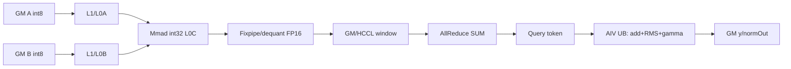

# QuantMatmulAllReduceAddRmsNorm A2 ACLNN 算子知识

## 算子速览

| 项目 | 内容 |
|---|---|
| 实际入口 | `aclnnQuantMatmulAllReduceAddRmsNormGetWorkspaceSize` / `aclnnQuantMatmulAllReduceAddRmsNorm`；公开无版本后缀 ACLNN，已标记未来废弃 |
| 计算语义 | `qmm=dequantScale*(x1_int8@x2_int8+bias_int32)`；`mmOut=AllReduceSum(qmm)`；`y=mmOut+residual`；`normOut=y/sqrt(mean(y²)+epsilon)*gamma` |
| 输入输出 | `x1/x2:int8`；`bias:int32` 可空；`dequantScale:uint64/int64` 或 BF16；`residual/gamma/y/normOut:fp16\|bf16`；均为 ND |
| 执行类型 | 单 Kernel MIX_CV + 非 Vector HCCL 通信；FP16 为 MIX_AIC_1_2，BF16 为 MIX_AIC_1_1 |
| Kernel 路线 | R-001 FP16/B不转置；R-002 FP16/B转置；R-003 BF16/B不转置；R-004 BF16/B转置；每条再按 ARN key 选择 Normal/SplitD/MergeN/SingleN/MultiN |
| 核心资源 | GM/HCCL window、workspace、Matmul L1/L0A/L0B/L0C、ARN UB/TQue/TBuf、标量寄存器 |
| 来源闭包 | `source_closed`：公开 ACLNN、generated inner 边界后的 OpDef/Context、Host Tiling、共享 POD、单 Kernel entry、量化 Matmul、HCCL 提交/查询和全部 ARN body 均在固定提交闭合 |
| 验证状态 | 已完成源码闭包检查；本次知识提取未执行编译、真机、数值或性能测试。 |

## 接口与语义

### 计算语义

令 `M=prod(x1[:-1])`、`K=x1[-1]`、`N=residual[-1]`。每卡先执行 INT8×INT8、INT32 累加与可选 INT32 bias，再按 per-tensor/per-channel scale 反量化成 FP16/BF16；HCCL 对每个 M 片做 SUM AllReduce。AIV 只消费 `Hccl::Query` 已完成的片：

```text
y = allreduce_qmm + residual
rstd = 1 / sqrt(sum(float(y)^2) / N + epsilon)
normOut = y * rstd * gamma
```

FP16 ARN 先以 FP16 相加，再转 FP32 求平方和。BF16 ARN 先将两输入转 FP32 相加、`CAST_RINT` 到 BF16 写 `y`，再转 FP32 求 RMS；归一化结果阶段性 RINT 到 BF16，gamma 转 FP32 相乘，最终再次 RINT 到 BF16。接口不输出 rstd。

### 输入、输出与属性

| 参数 | shape/layout | dtype | 约束、默认值与语义 |
|---|---|---|---|
| `x1` | `[M,K]` 或 `[B,S,K]`，ND | INT8 | 必选；不转置；`M<=INT32_MAX`、`K<=UINT16_MAX`；K=0 报错 |
| `x2` | 2D ND，可为最后两轴转置 view | INT8 | 必选；逻辑 K 与 x1 匹配；物理末轴不超过 UINT16_MAX |
| `bias` | `[N]`，ND | INT32 | 可空；存在时长度 N；仅 K 首分片设置 bias |
| `dequantScale` | `[1]`、`[N]` 或 `[1,N]` | UINT64/INT64/BF16 | 必选；FP16 输出要求 UINT64/INT64，BF16 输出要求 BF16；API 将 INT64 descriptor 改为 UINT64 |
| `residual` | `[B,S,N]` | FP16/BF16 | 必选；`B*S=M`，dtype 同 gamma/y/normOut |
| `gamma` | `[N]` | FP16/BF16 | 必选，dtype 同 residual |
| `epsilon` | Host scalar | double→float POD | `(0,1)` |
| `group` | Host string | char* | 必选通信域；同一模型中此类 MC2 算子只支持同一通信域 |
| `reduceOp` | Host string | char* | 仅 `sum` |
| `commTurn` | Host scalar | int64 | 仅 0 |
| `streamMode` | Host scalar | int64 | 必须为 `NUM_ACL_STOP_ON_FAILURE`，公开值 1 |
| `y` | `[B,S,N]` | FP16/BF16 | AllReduce(qmm)+residual |
| `normOut` | `[B,S,N]` | FP16/BF16 | RMSNorm×gamma；文档参数表一处写 2D，但约束及 Host 实现均要求与 residual 相同的 3D shape |

### 入口与版本

固定提交只有无后缀公开入口，没有同语义 V2/V3。头文件标记其将在 2026 年 12 月之后的版本更新中废弃，并建议拆用 `aclnnQuantMatmulAllReduceV2` 与 `aclnnAddRmsNorm`；本卡仍固定到该提交的最新公开入口。API 产品表明确只支持 Atlas A2 训练/推理系列，A3 与 950PR/950DT 均不支持。

## Host/Launcher 执行流程

### 参数校验与前处理

第一段依次检查 x1/x2/residual/gamma/dequantScale 非空，检查输入至少 1D、`x1[-1]==x2[0]`、`residual[-1]==x2[-1]`。INT64 dequantScale descriptor 被改为 UINT64。任一必选 tensor 为空时，K=0 返回参数错误；否则创建空 executor、workspaceSize=0 并成功返回。非空路径要求 streamMode=1，固定 `transposeX1=false`，以 `IsTransposeLastTwoDims(x2)` 产生 transposeX2；antiquantScale/Offset 置空，antiquantGroupSize=0。源码没有对 x1/residual/gamma/dequantScale 调用 `Contiguous`；x2 转置依赖 view 元数据。

generated `aclnnInner...GetWorkspaceSize` 是框架边界；其后由已注册 OpDef、ContextTransfer 与本卡 Tiling 闭合。第二段 workspace 空或 size=0 直接成功，否则调用 inner launch；非零返回统一转为 `ACLNN_ERR_INNER`。

### 参数、Workspace 与生命周期

`QuantMMNTilingTransferHelper` 复用 `QuantMatmulAllReduceTiling` 生成 MC2/QBMM POD，再对整 tile 与 tail 分别生成 ARN POD：

```text
arn_reported = SYS_WORKSPACE_SIZE(16 MiB) + 256 B
workspace_total = mc2_workspace + (arn_reported - SYS_WORKSPACE_SIZE)
                = mc2_workspace + 256 B
```

`mc2_workspace` 是 tile/tail QBMM workspace 最大值。BF16 `BmmDequantBf16::SetWorkspace` 每个逻辑 block 使用 `max(singleTimeM,baseM)*max(singleTimeN,baseN)*4` 字节 INT32 临时区。MC2 另写 `commWorkSpaceSize=myWorkSpaceSize-libApiWorkSpaceSize`。新增 256 B 是 ARN 完成计数/保留预算；Device 直接把传入 `workspaceGM` 作为 `rcvCntGM`，固定仓没有展开框架的 system/user workspace 地址重定位，因此不得手工改 offset。

调用者拥有 workspace 与张量，executor 持有 tiling 和执行节点；它们及 HCCL context 均须存活至同一 stream 完成。

### 启动图与失败传播

```text
ACLNN GetWorkspaceSize
  -> generated inner bridge
    -> QuantMatmulAllReduceAddRmsNormTiling(priority 0)
      -> QuantMatmulAllReduceTiling + CommonAddResNormTiling
      -> blockDim=AIC core count; scheduleMode=1

ACLNN execute(stream)
  -> matmul_all_reduce_add_rms_norm (单 MIX_CV Kernel)
    -> Hccl::Init + AllReduce handle registration
    -> QBMM tile/tail -> Mc2SyncAll -> block0 Commit
    -> Mc2SyncAll
    -> AIV Query(handle) -> ARN 逐片消费
    -> Mc2SyncAll -> block0 Finalize
```

Tiling、workspace、schedule mode 或 launch 失败均向上返回；entry 的 workspace/user workspace 为空直接返回。未知 outer key 或 ARN key 没有 Device fallback。

## Route 与参数设计

### 分核与资源计算

MC2 公式化切 M，得到 `tileMValue/tileCnt` 与可选 `tailMValue/tailCnt`；每种 M 独立运行 QBMM Tiling。`tileCnt+tailCnt` 同时成为 HCCL turnNum/reuseMode 和 ARN 完成计数终点。

ARN 对 tile/tail 独立计算：`numCore=GetCoreNumAiv()`，`blockFactor=ceil(numRow,numCore)`，`numBlocks=ceil(numRow,blockFactor)`；初始 `ubFactor=12288`，`numColAlign=ceil(N/16)*16`。选择顺序为：

```text
N > 12288 -> SplitD:
  colTileNum=ceil(N/12096)
  ubFactor=ceil(N/(colTileNum*16))*16
else blockFactor == 1 -> SingleN
else align16(N) <= 2000 -> MergeN:
  rowFactor=UB/(18*align16(N)+260); ubFactor=rowFactor*align16(N)
else dtype==FP16 && N==align16(N) -> MultiN:
  rowFactor=(UB-1024-256-2*N)/(16*N+64); ubFactor=rowFactor*N
  rowFactor==0 时回退 Normal
else -> Normal
```

### Route 选择

| 顺序 | Route | Key/模板 | 精确选择条件与优先级 | 不适用去向 |
|---:|---|---|---|---|
| 1 | R-001 FP16/B-ND | 8；`BmmDequant<...,int32_t,uint64_t,half,false,false>` | INT8 x1/x2、FP16 residual/output、UINT64/INT64 scale、B不转置、A2非空 | R-002或失败 |
| 2 | R-002 FP16/B-T | 4104；同上但 bTrans=true | 同 R-001 且 x2 view 转置 | 失败 |
| 3 | R-003 BF16/B-ND | 8；`BmmDequantBf16<...,bf16,bf16,false,false,true>` | INT8 x1/x2、BF16 residual/output/scale、B不转置、A2非空 | R-004或失败 |
| 4 | R-004 BF16/B-T | 4104；同上但 bTrans=true | 同 R-003 且 x2 view 转置 | 失败 |

```text
空 M/N 且 K!=0 -> workspace 0 -> 不 launch
非空 -> isA8W8 IsCapable
  -> FP16: R-001/R-002；BF16: R-003/R-004
  -> tile/tail 各自按 SplitD > SingleN > MergeN > MultiN > Normal 选 ARN key
```

### 模板/实现执行矩阵

| Route | key/selector | dtype/shape/platform 完整命中条件 | 执行族与 kernel 节点 | 实际模板/body | 内存与同步特征 | tail/fallback |
|---|---|---|---|---|---|---|
| R-001 | outer 8；ARN 10/11/12/13/14 | FP16、B-ND、A2 | MIX_AIC_1_2+HCCL | BmmDequant bTrans=false；FP16 ARN五body | AIC QBMM→GM/window；sync；AIV Query→ARN | tile/tail独立POD；unknown无输出 |
| R-002 | outer 4104；ARN 10/11/12/13/14 | FP16、B-T、A2 | 同 R-001 | BmmDequant bTrans=true | B offset用转置公式 | 同 R-001 |
| R-003 | outer 8；ARN 30/31/32/33 | BF16、B-ND、A2 | MIX_AIC_1_1+HCCL | BmmDequantBf16 isAllAiv=true；BF16 ARN四body | INT32 workspace→AIV dequant→GM；Query→ARN | BF16无MultiN |
| R-004 | outer 4104；ARN 30/31/32/33 | BF16、B-T、A2 | 同 R-003 | BmmDequantBf16 bTrans=true | 转置B offset | 同 R-003 |
| ARN-Normal | 10/30 | 未命中专门模式 | AIV_VECTOR子任务 | `KernelAddRmsNorm<half\|bf16>` | 每次一行、全N入UB | rowWork tail |
| ARN-SplitD | 11/31 | N>12288 | AIV_VECTOR子任务 | `KernelAddRmsNormSplitD` | N切片；先全列累计rstd，再全列归一化 | col_tail |
| ARN-MergeN | 12/32 | blockFactor!=1且align16(N)<=2000 | AIV_VECTOR子任务 | `KernelAddRmsNormMergeN` | 多行合并、x/y双缓冲 | row_tail |
| ARN-SingleN | 13/33 | blockFactor==1 | AIV_VECTOR子任务 | `KernelAddRmsNormSingleN` | 每核一行、固定195584B TBuf | blockIdx行 |
| ARN-MultiN | 14 | FP16、N 16对齐、rowFactor>0 | AIV_VECTOR子任务 | `KernelAddRmsNormMultiN<half>` | 多行双缓冲、Gather广播rstd | rowFactor=0退key10 |

### 隐藏性能 Guard

| Guard | Host/Tiling 条件 | Device/资源原因 | 影响 Route | 不满足时去向 | 源码符号 |
|---|---|---|---|---|---|
| A8W8 | `isA8W8_` | 只闭合INT8×INT8 | 全部 | IsCapable false | `QuantMatmulAllReduceTiling::IsCapable` |
| dtype配对 | BF16→BF16 scale；FP16→UINT64/INT64 scale | 反量化body不同 | R-001..004 | Tiling失败 | `CheckDequantScaleType/CheckMRNInput` |
| 轴宽 | M<=INT32_MAX，K及x2末轴<=UINT16_MAX | POD/Matmul index位宽 | 全部 | Tiling失败 | `CheckAxisSize` |
| 通信模式 | A2 attr为空或ai_cpu；API streamMode=1 | 使用AICPU HCCL server | 全部 | Host/API失败 | `CheckCommModeA2` |
| rank/topology | 1/2/4/8卡，HCCS all-mesh | HCCL切片与窗口 | 全部 | Host/HCCL失败 | API文档/`DoAllReduceTiling` |
| window容量 | tile+tail send bytes小于HCCL_BUFFSIZE且无溢出 | 决定window-in或output buffer | 全部 | 切output buffer | `CalcBufferTypeByWindowSize` |
| 全核驻留 | `aicCoreNum*2>=max(ARN blocks)`；scheduleMode=1 | SyncAll需要全核进入 | 全部 | PostTiling失败 | fused `PostTiling` |
| N阈值 | N>12288 | 单片UB不足 | SplitD | 后续mode | `SetAddRmsNormTilingData` |
| 小N阈值 | align16(N)<=2000且多行/核 | MergeN reduce与UB模型 | MergeN | MultiN/Normal | 同上 |
| MultiN | FP16、N对齐、UB容量且rowFactor>0 | 固定reserve/双缓冲 | MultiN | Normal或失败 | 同上 |
| unknown key | outer非8/4104或ARN列表外 | router无实例 | 全部 | 无输出 | kernel entry/ARN router |

### POD/ABI

共享头使用 `#pragma pack(push,8)`；Host `PostTiling` 要求顶层 `sizeof%8==0` 并整块 `memcpy_s`。固定仓未提供嵌套 `TCubeTiling` 的数值 `sizeof/offsetof` 静态断言，故只记录源码可见 offset；不可跨工具链手工序列化。

| 结构 | 字段 | 类型/位宽 | ABI 布局 | 单位 | Host/launcher producer | Device consumer | 边界 |
|---|---|---|---|---|---|---|---|
| `QuantMatmulAllReduceAddRmsNormTilingData` | `quantMatmulAllReduceTilingData` | nested | offset 0 | POD | QuantMM helper | MC2/QBMM | 必须首字段以兼容MC2TilingHeader |
| 同上 | `addRMSNormTileTilingData` | nested | 前字段后，8-byte pack | POD | tile ARN Tiling | ARN | 始终有效 |
| 同上 | `addRMSNormTailTilingData` | nested | 前字段后 | POD | tail ARN Tiling | ARN | tailCnt=0不读 |
| 同上 | `addRmsNormTilingeKeyData` | nested | 末字段 | POD | fused DoOpTiling | ARN router | tail字段条件有效 |
| `AddRMSNormTilingData` tile | `num_row` | uint32 | offset 0 | 行 | tileM | 所有ARN | QBMM片M |
| 同上 | `num_col` | uint32 | offset 4 | 元素/行 | N | 所有ARN | N=0不launch |
| 同上 | `block_factor` | uint32 | offset 8 | 行/核 | ceil(numRow,numCore) | 分核 | >=1 |
| 同上 | `row_factor` | uint32 | offset 12 | 行/UB批 | mode公式 | 行循环 | MultiN 0回退 |
| 同上 | `ub_factor` | uint32 | offset 16 | 元素 | mode公式 | InitBuffer/列切片 | 含对齐容量 |
| 同上 | `epsilon` | float32 | offset 20 | 标量 | API attr | Adds | (0,1) |
| 同上 | `avg_factor` | float32 | offset 24；结构自然28B | 标量 | N?1/N:0 | RMS | 部分body重算1/N |
| `AddRMSNormTilingData` tail | `num_row` | uint32 | 同tile offset0 | 行 | tailM | tail ARN | tailCnt有效 |
| 同上 | `num_col` | uint32 | offset4 | 元素 | N | tail ARN | 同tile |
| 同上 | `block_factor` | uint32 | offset8 | 行/核 | tail独立推导 | tail ARN | 同tile |
| 同上 | `row_factor` | uint32 | offset12 | 行 | tail独立推导 | tail ARN | 同tile |
| 同上 | `ub_factor` | uint32 | offset16 | 元素 | tail独立推导 | tail ARN | 同tile |
| 同上 | `epsilon` | float32 | offset20 | 标量 | 同API | tail ARN | 同tile |
| 同上 | `avg_factor` | float32 | offset24 | 标量 | 1/N | tail ARN | 同tile |
| `AddRMSNormTilingeKeyData` | `ARNKeyTile` | uint32 | offset0 | enum | dtype*10+mode | router | FP16 10..14；BF16 30..33 |
| 同上 | `ARNKeyTail` | uint32 | offset4 | enum | tail Tiling | router | 无tail不读 |
| 同上 | `ARNNumBlocksTile` | uint32 | offset8 | AIV blocks | ceil(row/blockFactor) | block guard | <=2*AIC核 |
| 同上 | `ARNNumBlocksTail` | uint32 | offset12；sizeof16 | AIV blocks | tail Tiling | tail guard | 无tail不读 |
| `QuantMatmulAllReduceTilingData` | `msg` | `Mc2Msg` | nested首字段 | HCCL消息 | `DoAllReduceTiling` | HCCL | send/recv/turn/policy |
| 同上 | `param` | `RCSTiling` | msg后 | mixed | RCS/M切分 | MC2 body | rank/tile/tail/trans/workspace |
| 同上 | `tilematmulTiling` | QBMM POD | param后 | mixed | QBMM tile Tiling | BmmDequant* | 有效 |
| 同上 | `tailmatmulTiling` | QBMM POD | 末字段 | mixed | QBMM tail Tiling | BmmDequant* | tailCnt有效 |
| `Mc2Msg` | `sendOff/recvOff/sendCnt/recvCnt` | uint64各 | nested数值offset固定仓不可见 | 字节/元素 | send/recv公式 | HCCL | tile M*N |
| 同上 | `tailSendOff/tailRecvOff/tailSendCnt/tailRecvCnt` | uint64各 | 同上 | 字节/元素 | tail公式 | HCCL | tail有效 |
| 同上 | `totalCnt/turnNum/tailNum/reuseMode` | 64/32/32/8 | 同上 | 元素/轮 | Host | HCCL/ARN | turn=tile+tail |
| 同上 | `workspaceOff/notifyOff/notifyBeginCnt/notifyEndCnt` | 32/32/16/16 | 同上 | 字节/计数 | Host | AICPU HCCL | workspaceOff=libApiWS |
| 同上 | `waitPolicy/rspPolicy/exitPolicy/commOrder` | uint8各 | 同上 | enum | 1/1/0/1 | HCCL | MM先于AICPU，逐轮响应 |
| 同上 | `useBufferType/funID/dataType/groupNum/commType/reduceOp` | uint8各 | 同上 | enum | Host | HCCL | SUM、单group |
| `RCSTiling` | `rankDim/rankM/rankN/rankK` | uint32各 | nested数值offset固定仓不可见 | 卡/元素 | attrs/shape | MC2 | rank 1/2/4/8 |
| 同上 | `tileCnt/tailM/tailCnt` | uint32各 | 同上 | 轮/行 | DoSplitMTiling | QBMM/HCCL/ARN | 覆盖M |
| 同上 | `isTransposeA/isTransposeB` | uint32各 | 同上 | bool | API/helper | address/template | A固定0 |
| 同上 | `aicCoreNum/addX3UbCnt/commWorkSpaceSize` | uint32各 | 同上 | 核/元素/字节 | Platform/Host | sync/HCCL | 本卡ARN不用addX3 |
| QBMM POD | `params` | nested uint32 | 首字段，alignas8 | mixed | QBMM Tiling | Bmm body | batch/perTensor/UB/realSingleCore |
| 同上 | `matmulTiling` | `TCubeTiling` | params后 | mixed | Matmul tiling API | Matmul library | M/N/K/base/step/depth/core |
| 同上 | `tileL2cacheTiling` | 6×uint32 | 后续 | tile | QBMM Tiling | scheduler | outer key禁用L2 flag |
| 同上 | `adaptiveSlidingWin` | 6×uint32 | 末字段 | tile | QBMM Tiling | scheduler | 按当前POD消费 |

### Route 源码闭包

| Route | Key/selector | Host/Tiling producer | POD/参数 | Kernel entry/router | Kernel body/直接依赖 | 构建接线 |
|---|---|---|---|---|---|---|
| R-001/R-002 | 8/4104+ARN10..14 | fused quant Tiling+common ARN Tiling | QuantMC2+tile/tail ARN | arch22 entry/FP16 branch | `matmul_all_reduce_quant.h`→`quant_batch_matmul_v3.h::BmmDequant`、MC2 base、ARN router与五body | ascend910b A8W8 FP16 binary+CMake |
| R-003/R-004 | 8/4104+ARN30..33 | 同上 | 同上 | arch22 entry/BF16 branch | `matmul_all_reduce_quant.h`→`quant_batch_matmul_v3_bf16.h::BmmDequantBf16`、MC2 base、ARN router与四body | ascend910b A8W8 BF16 binary+CMake |

## Kernel 实现

### 公共执行流程

entry 拒绝空 workspace/user workspace，建立 TPipe，并按 binary dtype 与 outer key 实例化。`MatmulAllReduceBase::Init` 初始化 HCCL；block0 注册 tile/tail AllReduce handle。每个 Matmul turn 后全核同步，block0 Commit；全部 turn 提交后再次同步，AIV 进入 ARN。AIV block0 轮询 Query，将完成计数写 workspace 并 DCCI clean/invalidate；所有 AIV SyncAll 后仅处理新增片。`normOutGM` 在每个 slice 上先拥有 HCCL 输出暂存生命周期，ARN 将该 slice 搬入 UB 后再原址覆盖为最终 `normOut`；`yGM` 单独保存 add 结果。ARN结束后全核同步，block0 Finalize。

### Route R-001：FP16/B 不转置

#### 适用条件

##### 选择证据

| 层级 | 文件 | 符号 | 源码谓词/参数 | 结果/下一跳 |
|---|---|---|---|---|
| API | ACLNN cpp | first API | 非空、streamMode=1、transposeX2=false | inner |
| Tiling | quant MC2 Tiling | GetTilingKey | A8W8、TRANS=0、PERTOKEN=0、INT8_COMM=0 | key8 |
| Router | arch22 entry | FP16 key8 | BmmDequant false,false | R-001 |
| ARN | common Tiling | mode selector | N/blockFactor/UB | key10..14 |

#### Device 数据流

##### 函数级调用链

```text
entry -> fused Init
  -> InnerProcess(BmmDequant,tile/tail)
    -> BmmDequant::Process/IterateAll -> GM/window FP16
    -> Mc2SyncAll<ON_CUBE_AND_VECTOR> -> Commit
  -> Mc2SyncAll -> AIV Query -> ARN key10..14 body
  -> Mc2SyncAll -> Finalize
```

##### 源码等价伪码

```text
for each tile/tail turn:
  AIC: qmm_fp16=dequant(int8 A@int8 B+int32 bias)
  all cores sync; block0 Commit(handle)
all cores sync
AIV while finished<tileCnt+tailCnt:
  block0 publishes Query(tile)+Query(tail)
  AIV SyncAll
  process every newly finished slice: add residual -> RMSNorm -> gamma
all cores sync; block0 Finalize
```

#### 内存与数据搬运

##### 资源与搬运表

| 层级/缓冲区 | offset/地址公式 | extent/容量公式 | dtype/layout | producer | consumer | owner/lifetime | 对齐/复用 |
|---|---|---|---|---|---|---|---|
| GM x1 | turn*tileM*K | M*K | int8/ND | caller | Matmul | stream | K tail由TCube |
| GM x2 | kOffset*N+nOffset | K*N | int8/ND | caller | Matmul | stream | B不转置 |
| GM/window qmm | turn*tileM*N*2 | tileM*N*2 | fp16/ND | Cube/Fixpipe | HCCL/ARN | stream | window不足转output |
| L1/L0A/L0B/L0C | TCube base/step/depth | 逻辑tile下界A=`baseM*baseK`、B=`baseN*baseK`、C=`baseM*baseN*4`B；物理db由库管理 | int8/int32 fractal | Matmul库 | Mmad/Fixpipe | K-loop/tile | 固定仓未展开库内部buffer对象 |
| workspace | framework传入 | mc2_workspace+256 | byte | caller | Matmul/HCCL/ARN counter | stream | 不改框架重定位 |
| ARN GM | slice*numRow*N*2+block*blockFactor*N*2 | 有效slice | fp16/ND | HCCL/caller | ARN | stream | DataCopyPad处理32B尾 |
| ARN UB | mode公式 | 下方字节账 | fp16/fp32 | MTE2 | Vector/MTE3 | 当前片 | body前TPipe Reset |

##### 分层内存布局



##### 字节账、交接边与复用顺序

```text
workspace_total = mc2_workspace + 256
Normal UB = 14*ubFactor + 256
SplitD UB = 16*ubFactor + 36*rowFactor + 256
MergeN UB = 18*ubFactor + 260*rowFactor
SingleN UB = 195584
MultiN UB = 16*ubFactor + 2*align16(N) + 64*rowFactor + 256，另保留1024
```

| 边/复用子区 | producer | offset/extent | dtype/layout | consumer | ordering/sync | owner/lifetime | 安全条件 |
|---|---|---|---|---|---|---|---|
| QBMM→HCCL | BmmDequant | turn*tileM*N*2 / tileM*N*2 | fp16/ND | AllReduce | Mc2SyncAll后Commit | window/output | turn计算完成 |
| HCCL→ARN | HCCL | 同slice | fp16/ND | ARN x1=normOutGM，随后原址写最终normOut | Query增长+DCCI+AIV SyncAll | HCCL staging→正式输出，stream完成后归调用者 | 只消费<=lastCnt，当前段先搬入UB再覆盖 |
| ARN UB复用 | body | mode-specific | fp16/fp32 | 下一片 | queue free/PipeBarrier | TPipe周期 | body完成后推进GM |

#### 同步、精度与尾块

##### 同步与数值边界表

| 阶段 | primitive/机制 | producer | consumer/等待点 | 保护对象 | 精度/尾块 |
|---|---|---|---|---|---|
| QBMM→Commit | SyncAll<false> | AIC | block0 Commit | qmm片 | INT32→FP16；TCube tail |
| HCCL→ARN | Query+DCCI+SyncAll | HCCL | AIV ARN | 完成计数/GM片 | 逐完成片 |
| ARN | queue events/PipeBarrier/V_S/S_V | MTE/Vector | 后继阶段 | UB/rstd | FP16 add，FP32 reduce |
| tail | tile/tail独立POD、row/col tail、DataCopyPad | Host/body | GM | 有效域 | 不写无效尾部 |

#### 关键实现

##### 符号证据表

| 阶段 | 文件 | 符号/模板实例 | 实现事实 |
|---|---|---|---|
| Host/Tiling producer | fused quant Tiling cpp | DoOpTiling/GetWorkspaceSize/PostTiling | MC2 key、两套ARN、workspace、batch mode |
| Kernel entry/router | arch22 entry | FP16 key8 | 不转置BmmDequant |
| Device body/helper | fused quant header | Process | Matmul/HCCL后Query-driven ARN |
| Device body/helper | `mc2/3rd/quant_batch_matmul_v3/op_kernel/quant_batch_matmul_v3.h` | `BmmDequant::Process/IterateAll` | INT8 Cube、INT32累加、UINT64 scale反量化与FP16输出 |

### Route R-002：FP16/B 转置

#### 适用条件

##### 选择证据

| 层级 | 文件 | 符号 | 源码谓词/参数 | 结果/下一跳 |
|---|---|---|---|---|
| API | util cpp | IsTransposeLastTwoDims | true | transposeX2=true |
| Tiling | quant MC2 | GetTilingKey | TRANS=1 | key4104 |
| Router | arch22 entry | FP16 key4104 | bTrans=true | R-002 |

#### Device 数据流

##### 函数级调用链

```text
同R-001，但BmmDequant模板bTrans=true，B地址按nOffset*K+kOffset
```

##### 源码等价伪码

```text
read B transposed view -> same qmm -> Commit -> Query -> ARN pipeline
```

#### 内存与数据搬运

##### 资源与搬运表

| 层级/缓冲区 | offset/地址公式 | extent/容量公式 | dtype/layout | producer | consumer | owner/lifetime | 对齐/复用 |
|---|---|---|---|---|---|---|---|
| GM x2 | nOffset*K+kOffset | N*K | int8/ND-T | caller | BmmDequant | stream | 其余同R-001 |

##### 分层内存布局


##### 字节账、交接边与复用顺序

字节账与交接协议同 R-001；B 的转置 offset 不得改回 K×N 公式。

| 边/复用子区 | producer | offset/extent | dtype/layout | consumer | ordering/sync | owner/lifetime | 安全条件 |
|---|---|---|---|---|---|---|---|
| B view→Matmul | caller | nOffset*K+kOffset | int8/ND-T | BmmDequant | Matmul pipeline | stream | 合法最后两轴转置view |

#### 同步、精度与尾块

##### 同步与数值边界表

| 阶段 | primitive/机制 | producer | consumer/等待点 | 保护对象 | 精度/尾块 |
|---|---|---|---|---|---|
| 全流程 | 同R-001 | 同R-001 | 同R-001 | 同R-001 | B的K/N tail按转置TCube |

#### 关键实现

##### 符号证据表

| 阶段 | 文件 | 符号/模板实例 | 实现事实 |
|---|---|---|---|
| Host/Tiling producer | quant MC2 Tiling | QuantMatmulTPLParam.trans | trans=1 |
| Kernel entry/router | arch22 entry | key4104 FP16 | BmmDequant bTrans=true |
| Device body/helper | `mc2/3rd/quant_batch_matmul_v3/op_kernel/quant_batch_matmul_v3.h` | `BmmDequant::CalcOffset` | 转置B公式 |

### Route R-003：BF16/B 不转置

#### 适用条件

##### 选择证据

| 层级 | 文件 | 符号 | 源码谓词/参数 | 结果/下一跳 |
|---|---|---|---|---|
| Tiling | fused quant Tiling | CheckMRNInput | scale/residual均BF16 | BF16 binary |
| Tiling key | quant MC2 | TRANS=0、PERTOKEN=0 | key8 | R-003 |
| Router | arch22 entry | BF16 key8 | BmmDequantBf16 false,false,true；ON_VECTOR | MIX_AIC_1_1 |
| ARN | common ARN | dtypeKey=3 | key30/31/32/33 | BF16 body |

#### Device 数据流

##### 函数级调用链

```text
entry -> REGIST_MATMUL_OBJ
  -> BmmDequantBf16::Process
    -> mm.Iterate<false> -> INT32 per-core workspace
    -> AIV AscendDequant(BF16 scale) -> CAST_RINT -> GM/window
  -> Commit/Query -> ARN<bfloat16_t>
```

##### 源码等价伪码

```text
int32Tmp=Matmul<int8,int8,int32>(A,B,bias)
bf16Qmm=RINT(AscendDequant(int32Tmp,bf16Scale))
Commit AllReduce; Query completed slices
fp32Y=fp32(allreduceQmm)+fp32(residual); y=RINT(fp32Y)
normOut=RINT(fp32(RINT(fp32Y*rstd))*fp32(gamma))
```

#### 内存与数据搬运

##### 资源与搬运表

| 层级/缓冲区 | offset/地址公式 | extent/容量公式 | dtype/layout | producer | consumer | owner/lifetime | 对齐/复用 |
|---|---|---|---|---|---|---|---|
| per-core QBMM WS | blockIdx*singleOffset | `max(singleTimeM,baseM)*max(singleTimeN,baseN)*4` | int32/ND tile | Matmul | AIV DequantCompute | turn | block独占 |
| QBMM UB | M-UB loop | src双队列int32、out双队列BF16、tmp/scale | mixed | workspace/GM | AscendDequant/MTE3 | turn | depth2 |
| ARN UB | key30/31/32/33 | Normal/Split/Merge/Single公式 | bf16/fp32 | GM | Vector | 完成片 | 无MultiN |
| GM/HCCL | slice offset | M*N*2 | bf16/ND | QBMM/HCCL | ARN读后原址写最终normOut | HCCL staging→正式输出，stream完成后归调用者 | 同R-001 |

##### 分层内存布局


##### 字节账、交接边与复用顺序

```text
workspace_total=max(QBMM tile/tail workspace including per-core int32Tmp and HCCL system space)+256
key30 UB=14*ubFactor+256
key31 UB=16*ubFactor+36*rowFactor+256
key32 UB=18*ubFactor+260*rowFactor
key33 UB=195584
```

| 边/复用子区 | producer | offset/extent | dtype/layout | consumer | ordering/sync | owner/lifetime | 安全条件 |
|---|---|---|---|---|---|---|---|
| Cube→AIV dequant | Matmul | blockIdx*singleOffset/singleOffset | int32 tile | DequantCompute | Iterate完成后读 | QBMM WS | blockIdx<usedCoreNum |
| dequant→HCCL | AIV MTE3 | output offset/M*N*2 | bf16/ND | HCCL | sync→Commit | window/output | RINT完成 |

#### 同步、精度与尾块

##### 同步与数值边界表

| 阶段 | primitive/机制 | producer | consumer/等待点 | 保护对象 | 精度/尾块 |
|---|---|---|---|---|---|
| Matmul→dequant | Matmul object lifecycle | Cube | AIV workspace读 | int32 tile | SetTail(M,N,K) |
| dequant | MTE2_V/V_MTE3 | GM/Vector | MTE3 | UB队列 | scalar/vector BF16 scale，RINT |
| ARN | Query公共协议 | HCCL | BF16 body | GM slice | FP32 add/reduce/mul与阶段RINT |

#### 关键实现

##### 符号证据表

| 阶段 | 文件 | 符号/模板实例 | 实现事实 |
|---|---|---|---|
| Host/Tiling producer | fused quant Tiling | CheckMRNInput | BF16配对 |
| Kernel entry/router | arch22 entry | BF16 key8 | ON_VECTOR+registered Matmul |
| Device body/helper | `mc2/3rd/quant_batch_matmul_v3/op_kernel/quant_batch_matmul_v3_bf16.h` | `BmmDequantBf16::MMDequantCompute` | INT32 WS、AscendDequant、RINT |

### Route R-004：BF16/B 转置

#### 适用条件

##### 选择证据

| 层级 | 文件 | 符号 | 源码谓词/参数 | 结果/下一跳 |
|---|---|---|---|---|
| API/Tiling | util+quant Tiling | BF16且transposeX2=true | key4104 | R-004 |
| Router | arch22 entry | BF16 key4104 | BmmDequantBf16 false,true,true | MIX_AIC_1_1 |

#### Device 数据流

##### 函数级调用链

```text
同R-003，但BmmDequantBf16的bTrans=true
```

##### 源码等价伪码

```text
read B transposed view -> INT32 Matmul WS -> BF16 dequant -> HCCL -> BF16 ARN
```

#### 内存与数据搬运

##### 资源与搬运表

| 层级/缓冲区 | offset/地址公式 | extent/容量公式 | dtype/layout | producer | consumer | owner/lifetime | 对齐/复用 |
|---|---|---|---|---|---|---|---|
| GM x2 | 转置N×K offset | N*K | int8/ND-T | caller | BmmDequantBf16 | stream | 其余同R-003 |

##### 分层内存布局


##### 字节账、交接边与复用顺序

R-004 字节账同 R-003；唯一额外约束是 B 的 offset/layout。

| 边/复用子区 | producer | offset/extent | dtype/layout | consumer | ordering/sync | owner/lifetime | 安全条件 |
|---|---|---|---|---|---|---|---|
| B-T→Matmul | caller | 转置view offset | int8/ND-T | BmmDequantBf16 | Matmul pipeline | stream | K/N按transB解释 |

#### 同步、精度与尾块

##### 同步与数值边界表

| 阶段 | primitive/机制 | producer | consumer/等待点 | 保护对象 | 精度/尾块 |
|---|---|---|---|---|---|
| 全流程 | 同R-003 | 同R-003 | 同R-003 | 同R-003 | 转置B tail由TCube |

#### 关键实现

##### 符号证据表

| 阶段 | 文件 | 符号/模板实例 | 实现事实 |
|---|---|---|---|
| Host/Tiling producer | quant MC2 Tiling | trans=1 | key4104 |
| Kernel entry/router | arch22 entry | BF16 key4104 | bTrans=true |
| Device body/helper | `mc2/3rd/quant_batch_matmul_v3/op_kernel/quant_batch_matmul_v3_bf16.h` | `BmmDequantBf16::CalcOffset` | 转置B地址 |

## 算子特定优化

### Trick T-001：以 HCCL 完成计数逐片触发 AddRmsNorm

#### 触发与源码依据

- 适用 Route：R-001～R-004。
- 触发条件：非空，tile/tail HCCL handle 已注册并逐轮 Commit。
- Golden 来源：[`add_rms_norm_kernel.h:61-96`](../../../../../../../cann-ops-raw/ascendc/ops-transformer/be33d95bb755cedec3108f70805c1874d1792540/mc2/matmul_all_reduce_add_rms_norm/op_kernel/add_rms_norm_kernel.h#L61-L96)

**官方源码（固定 Commit 连续逐字摘录）**：

```cpp
while (true) {
    if (GetBlockIdx() == 0) {
        const uint32_t curCnt = GetCurFinishedCnt();
        if (curCnt <= lastCnt) {
            continue;
        }
        *rcvCntGM = curCnt;
        rcvCntGMTensor.SetGlobalBuffer(reinterpret_cast<__gm__ int64_t*>(rcvCntGM));
        DataCacheCleanAndInvalid<
            int64_t, AscendC::CacheLine::SINGLE_CACHE_LINE, AscendC::DcciDst::CACHELINE_OUT>(rcvCntGMTensor);
    }
    SyncAll();
    DataCacheCleanAndInvalid<int64_t, AscendC::CacheLine::SINGLE_CACHE_LINE, AscendC::DcciDst::CACHELINE_OUT>(
        rcvCntGMTensor);
    lastCnt = *rcvCntGM;
    if (lastCnt >= addRmsNormCount) {
        uint32_t rcvCntTile = lastCnt;
        if (tailCnt_ != 0U && lastCnt > tileCnt_) {
            rcvCntTile = tileCnt_;
        }
        if (tailCnt_ == 0U || (tailCnt_ != 0U && addRmsNormCount <= tileCnt_)) {
            ComputeAddRmsNormInner(
                addRMSNormTileTilingData, addRmsNormTilingeKeyData.ARNKeyTile,
                addRmsNormTilingeKeyData.ARNNumBlocksTile, rcvCntTile, addRmsNormCount);
        }

        if (tailCnt_ != 0U && addRmsNormCount > tileCnt_ && addRmsNormCount <= lastCnt) {
            ComputeAddRmsNormInner(
                addRMSNormTailTilingData, addRmsNormTilingeKeyData.ARNKeyTail,
                addRmsNormTilingeKeyData.ARNNumBlocksTail, lastCnt, addRmsNormCount);
        }
    }
    if (lastCnt >= (tileCnt_ + tailCnt_)) {
        break;
    }
}
```

#### 机制与设计原因

Commit 只提交通信；ARN 用 `Query(tileHandle)+Query(tailHandle)` 的单调完成计数作令牌。block0 发布计数，AIV SyncAll 后共同处理新增片，GM 指针一次推进 `cnt=lastCnt-addRmsNormCount+1` 个 slice，从而允许通信与后处理流水并保证不读未完成片。

#### 迁移边界

- 适用：通信API能返回按提交轮次单调完成计数、输出slice连续的融合后处理。
- 前提：handle Query语义、DCCI可见性、全AIV驻留、slice offset与HCCL轮次一致。
- 失效：Query仅最终完成、输出乱序或不能全核驻留时，需改成event/final wait或重建token映射。
- 未验证：本次知识提取未执行编译、真机、数值或性能测试。

#### 错误做法

把 Commit 当通信完成并立即读取会越过 Query 保护。

### Trick T-002：按 N 与行并行度切换五种 ARN UB 组织

#### 触发与源码依据

- 适用 Route：FP16 key10～14；BF16 key30～33。
- 触发条件：依次检查 N>12288、blockFactor==1、align16(N)<=2000、FP16且N对齐，最后 Normal。
- Golden 来源：[`common_add_rms_norm_tiling.cpp:222-252`](../../../../../../../cann-ops-raw/ascendc/ops-transformer/be33d95bb755cedec3108f70805c1874d1792540/mc2/matmul_all_reduce_add_rms_norm/op_host/op_tiling/arch22/common_add_rms_norm_tiling.cpp#L222-L252)

**官方源码（固定 Commit 连续逐字摘录）**：

```cpp
uint32_t modeKey = ModeKey::K_NORMAL; // 0: Normal, 1: SplitD, 2: MergeN, 3: SingleN 4: MultiN
uint32_t numColAlign = Ops::Base::CeilDiv(numCol, static_cast<int64_t>(BLOCK_ALIGN_NUM)) * BLOCK_ALIGN_NUM;
uint32_t rowFactor = VALUE_64;
uint64_t ubSize;
const auto& ascendcPlatform = platform_ascendc::PlatformAscendC(&addRmsNormTilingDepend.platFormInfos);
ascendcPlatform.GetCoreMemSize(platform_ascendc::CoreMemType::UB, ubSize);
if (numCol > ubFactor) {
    modeKey = ModeKey::K_SPLIT_D;
    ubFactor = (dataType == ge::DT_FLOAT) ? UB_FACTOR_B32_CUTD : UB_FACTOR_B16_CUTD;
    uint32_t colTileNum = Ops::Base::CeilDiv(numCol, static_cast<int64_t>(ubFactor));
    ubFactor = Ops::Base::CeilDiv(numCol, static_cast<int64_t>(colTileNum * BLOCK_ALIGN_NUM)) * BLOCK_ALIGN_NUM;
} else if (blockFactor == 1) {
    modeKey = ModeKey::K_SINGLE_N;
} else if (numColAlign <= SMALL_REDUCE_NUM) {
    modeKey = ModeKey::K_MERGE_N;
    uint64_t numColAlignWeight = (dtypeKey == DTYPE_KEY_FP32) ? 24 : 18;
    rowFactor = ubSize / (numColAlign * numColAlignWeight + COL_ALIGN_SIZE);
    ubFactor = rowFactor * numColAlign;
} else if (dataType == ge::DT_FLOAT16 && numCol == numColAlign) {
    modeKey = ModeKey::K_MULTI_N;
    MC2_CHECK_TRUE_RET(addRmsNormTilingDepend.nodeName, ubSize >= VALUE_1024 + VALUE_256 + numColAlign * VALUE_2);
    MC2_CHECK_TRUE_RET(addRmsNormTilingDepend.nodeName, numColAlign * VALUE_16 + VALUE_64 != 0);
    // reserve 1024byte
    rowFactor = (ubSize - VALUE_1024 - VALUE_256 - numColAlign * VALUE_2) / (numColAlign * VALUE_16 + VALUE_64);
    ubFactor = rowFactor * numColAlign;
    if (rowFactor == 0) {
        modeKey = ModeKey::K_NORMAL;
        rowFactor = VALUE_64;
        ubFactor = UB_FACTOR_B16;
    }
}
```

#### 机制与设计原因

SplitD 用两遍列切片承载大 N；SingleN 固定大 TBuf、每核一行；MergeN 广播 gamma/rstd 并双缓冲多行；MultiN 对 FP16 对齐 N 使用连续多行与 Gather；Normal 逐行。tile 与 tail 独立选 key，所以尾片可切换 body。

#### 迁移边界

- 适用：末轴 RMSNorm 且通信 slice 独立。
- 前提：UB容量、32B/16元素对齐、dtype精度路径和numBlocks上限保持。
- 失效：N/dtype/UB规格变化时重算常量；BF16不得进入key14。
- 未验证：本次知识提取未执行编译、真机、数值或性能测试。

#### 错误做法

把五个 mode 合并成一个 body 会遗漏 SplitD 两遍读取、Merge/Multi 双缓冲与 SingleN 固定 TBuf。

### Trick T-003：FP16 与 BF16 分离反量化位置

#### 触发与源码依据

- 适用 Route：R-001/R-002 与 R-003/R-004。
- 触发条件：binary output dtype 与 dequantScale dtype 配对。
- Golden 来源：[`matmul_all_reduce_add_rms_norm.cpp:74-89`](../../../../../../../cann-ops-raw/ascendc/ops-transformer/be33d95bb755cedec3108f70805c1874d1792540/mc2/matmul_all_reduce_add_rms_norm/op_kernel/arch22/matmul_all_reduce_add_rms_norm.cpp#L74-L89)

**官方源码（固定 Commit 连续逐字摘录）**：

```cpp
#if defined(MC2_QUANT_FP16)
    if (TILING_KEY_IS(8UL)) {
        INVOKE_MC2_ARN_QUANT_910_OP_IMPL(
            BmmDequant, Mc2CoreType::ON_CUBE_AND_VECTOR, REG_NO_MM_OBJ, int32_t, uint64_t, DTYPE_Y, false, false);
    } else if (TILING_KEY_IS(4104UL)) {
        INVOKE_MC2_ARN_QUANT_910_OP_IMPL(
            BmmDequant, Mc2CoreType::ON_CUBE_AND_VECTOR, REG_NO_MM_OBJ, int32_t, uint64_t, DTYPE_Y, false, true);
    }
#elif defined(MC2_QUANT_BF16)
    if (TILING_KEY_IS(8UL)) {
        INVOKE_MC2_ARN_QUANT_910_OP_IMPL(
            BmmDequantBf16, Mc2CoreType::ON_VECTOR, REG_MM_OBJ_FOR_ARN, DTYPE_Y, DTYPE_Y, false, false, true);
    } else if (TILING_KEY_IS(4104UL)) {
        INVOKE_MC2_ARN_QUANT_910_OP_IMPL(
            BmmDequantBf16, Mc2CoreType::ON_VECTOR, REG_MM_OBJ_FOR_ARN, DTYPE_Y, DTYPE_Y, false, true, true);
    }
```

#### 机制与设计原因

FP16 route 由 BmmDequant 直接形成 FP16 GM 输出；BF16 route 注册 Matmul 对象，将 INT32 tile 暂存 per-core workspace，再由 AIV AscendDequant 与 RINT 输出 BF16。两条路线的 workspace、core ratio、同步模板和舍入均不同。

#### 迁移边界

- 适用：A2 INT8×INT8、FP16 UINT64 scale或BF16 scale。
- 前提：outer key、binary dtype、编译宏与HCCL dtype一致。
- 失效：per-token、INT8通信、950或其它dtype产生其它key/body，本卡不覆盖。
- 未验证：本次知识提取未执行编译、真机、数值或性能测试。

#### 错误做法

把 BF16 route 套用 FP16 的 `REG_NO_MM_OBJ` 会丢失 INT32 workspace 与 AIV dequant。

## 模板与实现对比

| 对比维度 | R-001 FP16/B-ND | R-002 FP16/B-T | R-003 BF16/B-ND | R-004 BF16/B-T | 设计选择依据 |
|---|---|---|---|---|---|
| 命中条件/优先级 | FP16 key8 | FP16 key4104 | BF16 key8 | BF16 key4104 | dtype配对+x2 view |
| 执行族/节点图 | MIX_AIC_1_2+HCCL | 同左 | MIX_AIC_1_1+HCCL | 同左 | tpl key与实例宏 |
| M/N/K、tile 与 scheduler | QBMM tile/tail，B-ND | B-T offset | QBMM tile/tail，B-ND | B-T offset | 公式化M切分+QBMM |
| workspace/L1/L0/UB | Matmul WS+256；五ARN mode | 同左 | 另含INT32 per-core；四ARN mode | 同左 | BF16在AIV反量化 |
| AIC/AIV 或 kernel 交接 | GM/window+全核sync | 同左 | INT32 WS→AIV→GM/window | 同左 | dtype body不同 |
| 同步、精度与 tail | INT32→FP16；Query | 同左 | INT32→BF16 RINT；Query | 同左 | 精度路径不同 |
| fallback/失败边界 | unknown无输出 | 同左 | BF16无key14 | 同左 | router显式分支 |

## 平台差异

| 项目 | A2 | A3 | 950 |
|---|---|---|---|
| 支持状态 | 支持，公开文档√ | 明确× | 950PR/950DT明确× |
| Host/Launcher | ascend910b OpDef、arch22 Tiling、AICPU HCCL | 无公开路线 | 无公开路线 |
| Kernel/资源 | key8/4104，MIX_AIC_1_2或1_1 | N/A | N/A；其它MC2 arch35实现不能证明本接口支持 |

## 限制与失败边界

- 接口已标记未来废弃；新实现可评估拆用 QuantMatmulAllReduceV2 与 AddRmsNorm，但不能据此改写本卡固定语义。
- 只支持 A2、1/2/4/8 卡与 HCCS all-mesh；reduceOp仅SUM、commTurn仅0、streamMode仅1、x1不转置。
- 空 M/N 由 ACLNN 返回 workspace 0 并跳过；K=0 返回参数错误。Host/Tiling/HCCL失败没有静默 fallback。
- outer router只有8/4104；ARN只有FP16 10..14与BF16 30..33；调用方不得自行构造key/POD。
- `KernelAddRmsNormMergeN` 的 `isNumColAlign_` 成员在固定文件中声明但未看到赋值；固定仓不能证明其运行时取值，复用时不得推测。
- POD共享声明可闭合 producer/consumer，但固定仓未给嵌套 TCubeTiling 数值 sizeof/offsetof 断言，不得跨工具链手工序列化。
- HCCL与AscendC Matmul库内部不在本仓；本卡闭合当前实参、调用顺序、buffer、同步和tail，不外推库内部算法。
- 本次知识提取未执行编译、真机、数值或性能测试。

## 源码索引

### 链路索引

| 链路阶段 | 文件 | 关键符号 | 支撑内容 |
|---|---|---|---|
| 公开文档 | `mc2/matmul_all_reduce_add_rms_norm/docs/aclnnQuantMatmulAllReduceAddRmsNorm.md` | 产品表/公式/约束 | A2-only、API语义、dtype/shape/rank |
| 入口声明 | `mc2/matmul_all_reduce_add_rms_norm/op_api/aclnn_quant_matmul_all_reduce_add_rms_norm.h` | 两段ACLNN | 签名/废弃计划 |
| 入口实现 | `mc2/matmul_all_reduce_add_rms_norm/op_api/aclnn_quant_matmul_all_reduce_add_rms_norm.cpp` | 两段body | 空域、streamMode、错误传播 |
| API helper | `mc2/matmul_all_reduce_add_rms_norm/op_api/matmul_all_reduce_arn_util.cpp` | ArnCheck/Inner helper | shape/transpose/optional |
| OpDef | `mc2/matmul_all_reduce_add_rms_norm/op_host/matmul_all_reduce_add_rms_norm_def.cpp` | OpDef | ascend910b/ACLNN/MC2 group |
| Context | `mc2/common/utils/context_transfer.cpp` | AssembleMRNCtxInfo | IR映射 |
| Fused Tiling | `mc2/matmul_all_reduce_add_rms_norm/op_host/op_tiling/arch22/quant_matmul_all_reduce_add_rms_norm_tiling.cpp` | DoOpTiling/GetWorkspaceSize/PostTiling | tile/tail ARN、workspace、blockDim |
| ARN Tiling | `mc2/matmul_all_reduce_add_rms_norm/op_host/op_tiling/arch22/common_add_rms_norm_tiling.cpp` | Tiling4AddRmsNorm | key/UB/分核 |
| ARN Tiling声明 | `mc2/matmul_all_reduce_add_rms_norm/op_host/op_tiling/arch22/common_add_rms_norm_tiling.h` | `SYS_WORKSPACE_SIZE`/`ModeKey` | 16 MiB系统workspace、模式枚举与Tiling输入输出 |
| MC2 Tiling | `mc2/matmul_all_reduce/op_host/op_tiling/arch22/quant_matmul_all_reduce_tiling.cpp` | GetTilingKey | key8/4104/QBMM |
| MC2公共Tiling | `mc2/matmul_all_reduce/op_host/op_tiling/matmul_all_reduce_tiling_base.cpp` | DoSplitMTiling/DoAllReduceTiling | HCCL轮次/窗口/M切分 |
| POD | `mc2/matmul_all_reduce_add_rms_norm/op_kernel/matmul_all_reduce_add_rms_norm_tiling_data.h` | fused POD | 顶层ABI/ARN字段 |
| MC2 POD | `mc2/common/op_kernel/mc2_tiling_struct.h` | `Mc2Msg`/`RCSTiling` | 通信消息、tile/tail与workspace字段 |
| Quant POD | `mc2/matmul_all_reduce/op_kernel/arch22/quant_matmul_all_reduce_tiling_data.h` | `QuantMatmulAllReduceTilingData` | MC2消息、RCSTiling与tile/tail QBMM嵌套 |
| key定义 | `mc2/matmul_all_reduce/op_kernel/matmul_all_reduce_tiling_key.h` | tpl args | core ratio/key维度 |
| Kernel entry | `mc2/matmul_all_reduce_add_rms_norm/op_kernel/arch22/matmul_all_reduce_add_rms_norm.cpp` | entry | outer router/实例 |
| Fused body | `mc2/matmul_all_reduce_add_rms_norm/op_kernel/mm_allreduce_add_rms_norm_quant.h` | fused class | Matmul→ARN顺序 |
| Quant MC2 body | `mc2/matmul_all_reduce/op_kernel/arch22/matmul_all_reduce_quant.h` | `MatmulAllReduceQuantBF16::InnerProcess` | QBMM初始化、逐turn地址推进与HCCL提交 |
| HCCL body | `mc2/matmul_all_reduce/op_kernel/arch22/matmul_all_reduce_base.h` | Init/PostProcEachTurn | handle/Commit/Finalize |
| FP16 QBMM body | `mc2/3rd/quant_batch_matmul_v3/op_kernel/quant_batch_matmul_v3.h` | `BmmDequant` | INT8 Cube、offset、INT32累加与FP16反量化输出 |
| BF16 QBMM body | `mc2/3rd/quant_batch_matmul_v3/op_kernel/quant_batch_matmul_v3_bf16.h` | `BmmDequantBf16` | INT32 workspace、AIV AscendDequant、RINT与tail |
| ARN router | `mc2/matmul_all_reduce_add_rms_norm/op_kernel/add_rms_norm_kernel.h` | ComputeAddRmsNorm | Query/key分派 |
| ARN Normal | `mc2/matmul_all_reduce_add_rms_norm/op_kernel/add_rms_norm.h` | KernelAddRmsNorm | 逐行body |
| ARN SplitD | `mc2/matmul_all_reduce_add_rms_norm/op_kernel/add_rms_norm_split_d.h` | KernelAddRmsNormSplitD | 两遍列切片 |
| ARN MergeN | `mc2/matmul_all_reduce_add_rms_norm/op_kernel/add_rms_norm_merge_n.h` | KernelAddRmsNormMergeN | 广播/双缓冲 |
| ARN SingleN | `mc2/matmul_all_reduce_add_rms_norm/op_kernel/add_rms_norm_single_n.h` | KernelAddRmsNormSingleN | 固定TBuf/events |
| ARN MultiN | `mc2/matmul_all_reduce_add_rms_norm/op_kernel/add_rms_norm_multi_n.h` | KernelAddRmsNormMultiN | FP16多行/Gather |
| ARN primitive | `mc2/matmul_all_reduce_add_rms_norm/op_kernel/rms_norm_base.h` | DataCopyCustom/ReduceSum | 32B tail/reduce |
| binary配置 | `mc2/matmul_all_reduce_add_rms_norm/op_host/config/ascend910b/matmul_all_reduce_add_rms_norm_binary.json` | A8W8 entries | FP16/BF16接线 |
| 构建接线 | `mc2/matmul_all_reduce_add_rms_norm/op_host/CMakeLists.txt` | module/options | API/Host/Kernel依赖、auto-sync off |

每行只写一个文件，并确保该文件存在于 Frontmatter `sources`。

### 实现复用检查

| 检查项 | 可复用事实 | 不得改变的约束 | 源码符号 |
|---|---|---|---|
| ABI/POD | QuantMC2+tile/tail ARN nesting | 首字段兼容、8-byte pack、tile/tail独立、整体memcpy | fused POD |
| 调用顺序 | QBMM→sync→Commit→Query→ARN→Finalize | Commit不等完成；Query token不可删 | PostProcEachTurn/ComputeAddRmsNorm |
| workspace/内存 | mc2_workspace+256；BF16 per-core INT32；ARN UB公式 | framework指针语义、offset、block独占/lifetime | GetWorkspaceSize/SetWorkspace |
| 同步 | batch schedule、Mc2SyncAll、DCCI、AIV SyncAll、events | 全核驻留；计数发布后才读 | PostTiling/Mc2SyncAll |
| 精度与尾块 | FP16/BF16分离；FP32 RMS；BF16 RINT；tile/tail独立 | scale dtype、cast/round、row/col tail | BmmDequant*/ARN bodies |
| 失败边界 | 空域短路、Host错误、unknown无body | 不得把非法key/平台改为成功输出 | ACLNN body/routers |