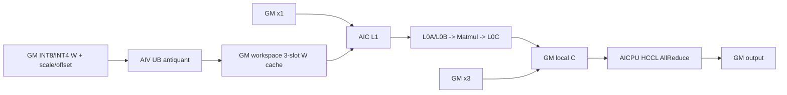
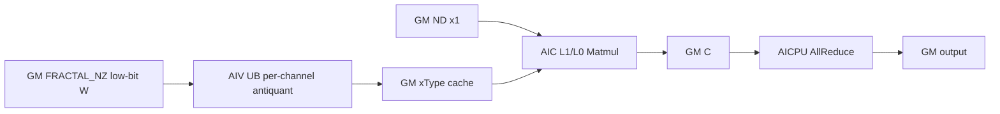
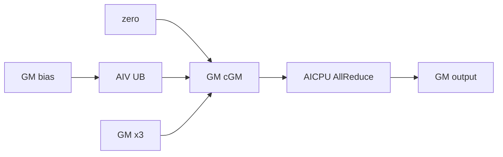

# WeightQuantMatmulAllReduce A2 ACLNN 算子知识

## 算子速览

| 项目 | 内容 |
|---|---|
| 实际入口 | `aclnnWeightQuantMatmulAllReduceV2GetWorkspaceSize` + `aclnnWeightQuantMatmulAllReduceV2`，公开 ACLNN 两段式 V2 接口 |
| 计算语义 | `output = AllReduce(x1 @ ((x2 + antiquantOffset) * antiquantScale) + bias + x3)`；空 K 时退化为 `AllReduce(bias + x3)` |
| 输入输出 | `x1` 为 `(m,k)`/`(b,s,k)` ND FP16/BF16；`x2` 为 `(k,n)` ND 或四维存储 FRACTAL_NZ 的 INT8/INT4；`output` 为 `(m,n)`/`(b,s,n)` 同 `x1` dtype |
| 执行类型 | 非空路线为 `MIX_CV`（AIC:AIV=1:2）并在同一 Kernel 内提交 AICPU HCCL；空 K 路线为 AIV 初始化/加法 + AICPU AllReduce |
| Kernel 路线 | R-001 ND CustomAntiquant；R-002 FRACTAL_NZ WeightNZ；R-003 K=0 空域 |
| 核心资源 | GM 输入/输出、user workspace 三槽反量化权重缓存、AIC L1/L0A/L0B/L0C、AIV UB、HCCL window/handle |
| 来源闭包 | `source_closed`：公开 V2 声明/文档 → API 实现 → inner `MatmulAllReduce` → A2 tiling/key/POD → entry/router → WQBMM body/空域 body → CMake 接线闭合 |
| 验证状态 | 已完成源码闭包检查；本次知识提取未执行编译、真机、数值或性能测试。 |

## 接口与语义

### 计算语义

令 `M=m`（三维输入时 `M=b*s`）、`K=x1[-1]`、`N=output[-1]`。非空 K 路线先在 AIV 对权重做 `w'=(x2+offset)*scale`，AIC 计算 `x1 @ w' + bias`，可选 `x3` 在通信提交前加到本 rank 的结果，最后对各 rank 结果求和。`offset==nullptr` 时省略加法；scale 形状决定 per-tensor、per-channel 或 per-group。BF16 权重反量化使用 FP32 中间值并以 `CAST_RINT` 回写 BF16 权重缓存；FP16 路线直接以 half 缓存交给 Cube。

### 输入、输出与属性

| 参数 | shape/layout | dtype | 约束、默认值与语义 |
|---|---|---|---|
| `x1` | ND `(m,k)` 或 `(b,s,k)` | FP16/BF16 | 必需；不转置；`m∈[1,INT32_MAX]`，非空时 `k∈[1,65535]` |
| `x2` | ND 2D `(k,n)`，或 FRACTAL_NZ 四维存储；允许最后两轴转置 view | INT8/INT4 | 必需；逻辑 K 与 `x1` 相等，`n∈[1,65535]`；NZ 仅 per-channel |
| `bias` | ND `[n]` | 与 `x1` 相同 | 可空；在 MatMul 结果上加偏置；BF16 Device 路线先转 FP32 workspace bias |
| `antiquantScale` | `[1]`、`[n]`/`[1,n]`、或 `[ceil(k/groupSize),n]` | 与 `x1` 相同 | 必需；分别选 per-tensor/channel/group |
| `antiquantOffset` | 与 scale 相同 | 与 scale 相同 | 可空；非空时反量化先加 offset |
| `x3` | 与 output 相同 | 与 `x1` 相同 | 可空；每个 M tile 的本地 MatMul/bias 结果上加后再通信 |
| `group` | HCCL 通信域名 | string | 必需的 inner op 属性；A2 同一模型的 MC2 仅支持相同通信域 |
| `reduceOp` | 标量属性 | string | 仅 `"sum"` |
| `commMode` | 标量属性 | string | A2 仅 `"ai_cpu"` |
| `commTurn` | 标量属性 | int64 | 公开文档仅支持 `0` |
| `streamMode` | 标量属性 | int64 | 仅 `1`（stop-on-failure） |
| `antiquantGroupSize` | 标量属性 | int64 | 非 per-group 为 `0`；per-group 为 32 的倍数且在 `[32,min(k-1,INT_MAX)]`；K=0 跳过该检查 |
| `output` | ND `(m,n)` 或 `(b,s,n)` | 与 `x1` 相同 | 必需且非空；仅 K 可为 0，M/N 不可为 0 |

### 入口与版本

固定仓同时保留旧版 `aclnnWeightQuantMatmulAllReduce`，但公开文档说明 V2 兼容旧版并新增 `commMode`，故本卡选择同平台最新公开入口 `aclnnWeightQuantMatmulAllReduceV2`。产品表明确 A2 支持、A3 不支持；本卡不外推 A3。第一段返回 workspace 与 executor，第二段在调用者 stream 上执行。接口语义不同的原地、Grad、量化通信变体不并入本卡。

## Host/Launcher 执行流程

### 参数校验与前处理

`CheckParams` 依次执行必需指针、dtype、属性、shape、A2 连续性、affine 转置一致性和 `commMode` 校验。A2 要求 `x2/scale/offset` 除合法空 K 外为连续或支持的最后两轴转置；二维多行 scale/offset 的连续性方向必须与 `x2` 一致。`CopyTensor` 按 `x2` storage shape 构造连续 storage stride，保留 view offset、底层地址和 ND/NZ storage format；仅 NZ 时把该 storage-view tensor 传给 inner op。

### 参数、Workspace 与生命周期

第一段固定 `transposeX1=false`，由 view 判断 `transposeX2`，把 dequant/per-token/通信量化输入设空，并调用 `aclnnInnerMatmulAllReduceGetWorkspaceSize`。成功后 executor user handle 保存 `ai_cpu` 枚举，并禁用 inner IR 6–9。A2 workspace 由 base 的 libApi/同步/计算临时区，加 `biasLen`（BF16 bias 转 FP32）和 WQBMM 所需 workspace 取大；空 K 再加 libApi workspace。Device 通过 `GetUserWorkspace` 获得 user slice，生命周期覆盖 MatMul、可选 x3、HCCL wait/finalize。

### 启动图与失败传播

`MatmulAllReduceTiling` dispatcher 在非 DAV_3510 平台走 `TilingRegistryNew`，A2 的 `WeightQuantMatmulAllReduceTiling` 以 ASCEND910B、优先级 1 注册。`PostTiling` 序列化 8-byte aligned POD，`blockDim=aicCoreNum`，并因 `SyncAll` 设置 schedule mode 1。entry 对 `workspaceGM` 或 user workspace 为空直接返回；Host tiling 失败不 launch；API 第二段把 inner 非成功统一映射为 `ACLNN_ERR_INNER`。

## Route 与参数设计

### 分核与资源计算

Host 将三维 `b*s` 展平为 M，先以 MC2 切分公式得到 `tileM/tailM` 与 `tileCnt/tailCnt`，再分别调用 `Mc2WeightQuantBatchMatmulV2TilingCustom`。WQBMM 产生 `cubeBlockDimM/N/K`、`vecBlockDimN/K`、K/N 对齐、A/B L1 ping-pong、AIV queue/temporary sizes 与 `TCubeTiling`。Device AIV core 按 `vecNDimIdx/vecKDimIdx` 分片，AIC core 按 `cubeMDimIdx/cubeNDimIdx` 分片。反量化权重 GM cache 单槽元素数为 `singleCoreN*cubeBlockDimN*kAlign`（转置时用 `Kb`），向 256 个 `xType` 元素取整，实际轮转三槽。

### Route 选择

| 顺序 | Route | Key/模板 | 精确选择条件与优先级 | 不适用去向 |
|---:|---|---|---|---|
| 1 | R-003 K=0 空域 | `EMPTY_INPUT=true` 的 weight-quant key | `isKZero_`；在非空 route 前判断 | K!=0 → R-001/R-002 |
| 2 | R-002 FRACTAL_NZ WeightNZ | `SUB_ALGORITHM_CUSTOM=WEIGHT_NZ`，per-channel，offset 0/1，transB 0/1 | K!=0 且 `GetPrimaryFormat(x2.storage)==FRACTAL_NZ`；Host 先拒绝非 per-channel | ND → R-001；其他格式失败 |
| 3 | R-001 ND CustomAntiquant | `CUSTOM_ANTIQUANT × offset{0,1} × antiquant{tensor,channel,group} × transB{0,1}` 共 12 个 key | K!=0 且 x2 storage 为 ND、dtype/shape/group/comm 校验通过 | 无可用 specialization → tiling 失败 |

```text
if K == 0: R-003
else if x2.storage_format == FRACTAL_NZ:
    require antiquant_type == PER_CHANNEL
    R-002
else if x2.storage_format == ND: R-001
else: GRAPH_FAILED
```

### 模板/实现执行矩阵

| Route | key/selector | dtype/shape/platform 完整命中条件 | 执行族与 kernel 节点 | 实际模板/body | 内存与同步特征 | tail/fallback |
|---|---|---|---|---|---|---|
| R-001 ND CustomAntiquant | 12 个 `MIX_AIC_1_2` selector | ASCEND910B；FP16/BF16 × INT8/INT4；ND；三种 scale；offset/transB 两布尔 | 单个 MIX_CV entry：AIV 反量化 → GM cache → AIC MatMul → 可选 AIV x3 → AICPU AllReduce | `Mc2WeightQuantBatchMatmulV2CustomKernel<...,false,bTrans,quantType,offset,NONE>` | 三槽 cache；AIV/AIC cross-core flags；每 M turn `SyncAll` 后 commit | 主 tile + 可选 tail tile；不匹配则 Host 失败 |
| R-002 FRACTAL_NZ WeightNZ | 4 个 `WEIGHT_NZ` selector | ASCEND910B；FP16/BF16 × INT8/INT4；NZ；仅 per-channel；offset/transB 两布尔 | 单个 MIX_CV entry：AIV 按 NZ block/stride 反量化 → GM cache → AIC 以 `CubeFormat::NZ` MatMul → 可选 x3 → AICPU AllReduce | `Mc2WeightQuantBatchMatmulV2CustomWeightNzKernel<...,false,bTrans,PER_CHANNEL,offset,NONE>` | Host key 的 `FORMAT_B` 槽固定 ND，实际 NZ class 由构建期 `FORMAT_X2==FORMAT_FRACTAL_NZ` 和 sub-algorithm 共同闭合；POD仍为普通 WQBMM tiling | 主/tail；非 per-channel 在 Host 失败 |
| R-003 K=0 空域 | `MATMUL_ALLREDUCE_EMPTY_INPUT_T` | 仅 K=0，M/N 非零，FP16/BF16 output | AIV 初始化/bias/x3 + AICPU AllReduce | `MatmulAllReduceEmptyTensorKGeneral<DTYPE_Y>` | `InitOutput` 清零；全核同步；block0 commit/wait | bias/x3 均可空；M/N=0 API 失败 |

### 隐藏性能 Guard

| Guard | Host/Tiling 条件 | Device/资源原因 | 影响 Route | 不满足时去向 | 源码符号 |
|---|---|---|---|---|---|
| 全核同启 | `SetScheduleMode(1)` | Device 使用 `SyncAll` 和 AIC/AIV flag，缺核会死锁 | 全部 | PostTiling 失败 | `WeightQuantMatmulAllReduceTiling::PostTiling` |
| 轴上界 | `M<=INT32_MAX && K,N<=UINT16_MAX` | RCSTiling/模板轴字段与 tile 计算上界 | R-001/R-002 | `GRAPH_FAILED` | `CheckAxisSize` |
| NZ antiquant | `bFormat==FRACTAL_NZ => PER_CHANNEL` | WeightNZ selector 仅实例化 per-channel | R-002 | `GRAPH_FAILED` | `WeightQuantTilingTransferHelper::GetShapeAttrsInfo` |
| cache 对齐 | `ceil(weightCacheSize/256)*256` elements | 保证下一 workspace 起始满足源码注释的 512B MTE3 对齐 | R-001/R-002 | 由 tiling 扩大 workspace | `ComputeConstexpr` |
| 三槽复用 | `slot=cubeNLoopIdx%3` | Vector 领先 Cube，并避免覆盖仍在消费的反量化权重 | R-001/R-002 | 无动态 fallback；依赖 flag 协议 | `WEIGHT_CACHE_COUNT`、`ComputeWeight` |
| 通信模式 | `commMode=="ai_cpu"` | A2 body 固定 `Hccl<HCCL_SERVER_TYPE_AICPU>` | 全部 | API/tiling 失败 | `CheckCommModeA2`、`MatmulAllReduceBase` |

### POD/ABI

| 结构 | 字段 | 类型/位宽 | ABI 布局 | 单位 | Host/launcher producer | Device consumer | 边界 |
|---|---|---|---|---|---|---|---|
| launch ABI | `aGM`…`cGM` | `GM_ADDR`/64-bit 地址 | 独立 kernel 参数，固定仓未显式给 offsetof | byte address | inner executor 绑定 11 个 tensor slot | `matmul_all_reduce`/router | 可选输入可空；必需输入由 API 拒空 |
| launch ABI | `workspaceGM` | `GM_ADDR`/64-bit 地址 | 独立参数 | byte address | executor 按 workspaceSize 绑定 | `GetUserWorkspace`、各 route | null 直接 return |
| launch ABI | `tilingGM` | `GM_ADDR`/64-bit 地址 | 独立参数 | byte address | `PostTiling` memcpy | `GET_TILING_DATA_WITH_STRUCT` | key/POD 必须同构建产物 |
| `WeightQuantMatmulAllReduceTilingData` | `msg` | `Mc2Msg` | `#pragma pack(8), alignas(8)`；具体 offsetof 固定仓未常量化 | mixed | `DoAllReduceTiling(true)` | HCCL/KFC | A2 only |
| `WeightQuantMatmulAllReduceTilingData` | `param` | `RCSTiling` | 紧随 `msg`，8-byte pack | mixed | `DoRCSTiling/DoSplitMTiling` | base、empty、x3 | M/K/N 与 tile counts 有上界 |
| `WeightQuantMatmulAllReduceTilingData` | `tilematmulTiling` | `Mc2WeightQuantBatchMatmulV2TilingData` | 8-byte aligned nested struct | elements | `mmTile.DoTiling` | main-turn WQBMM | K=0 只读取内嵌 `matmulTiling.isBias/M` |
| `WeightQuantMatmulAllReduceTilingData` | `tailmatmulTiling` | 同上 | 8-byte aligned nested struct | elements | `mmTail.DoTiling` | tail WQBMM | `tailCnt==0` 时 inactive |
| `Mc2Msg` | `preparePosition` | uint32 | struct natural layout；sizeof/offsetof 未常量化 | enum | `DoAllReduceTiling` 写 1 | HCCL task prepare | kernel-side prepare |
| `Mc2Msg` | `sendOff` | uint64 | 同上 | bytes | `CalcAllReduceSendRecvParams` | HCCL | main tile |
| `Mc2Msg` | `recvOff` | uint64 | 同上 | bytes | 同上 | HCCL | main tile |
| `Mc2Msg` | `tailSendOff` | uint64 | 同上 | bytes | 同上 | HCCL | tail only |
| `Mc2Msg` | `tailRecvOff` | uint64 | 同上 | bytes | 同上 | HCCL | tail only |
| `Mc2Msg` | `sendCnt` | uint64 | 同上 | elements | `DoAllReduceTiling` | HCCL | main tile |
| `Mc2Msg` | `recvCnt` | uint64 | 同上 | elements | 同上 | HCCL | main tile |
| `Mc2Msg` | `tailSendCnt` | uint64 | 同上 | elements | 同上 | HCCL | tail only |
| `Mc2Msg` | `tailRecvCnt` | uint64 | 同上 | elements | 同上 | HCCL | tail only |
| `Mc2Msg` | `totalCnt` | uint64 | 同上 | elements | 同上 | HCCL | total output |
| `Mc2Msg` | `turnNum` | uint32 | 同上 | turns | 同上 | KFC/HCCL | tile turns |
| `Mc2Msg` | `tailNum` | uint32 | 同上 | turns | 同上 | KFC/HCCL | tail turns |
| `Mc2Msg` | `stride` | uint32 | 同上 | elements | 同上 | HCCL | strided write |
| `Mc2Msg` | `workspaceOff` | uint32 | 同上 | bytes | base tiling 写 libApi WS offset | HCCL | uint32 上界 |
| `Mc2Msg` | `notifyOff` | uint32 | 同上 | bytes | base tiling 写 KFC body size | HCCL notify | uint32 上界 |
| `Mc2Msg` | `notifyBeginCnt`…`reserve2` | uint16/uint8/uint32 | 各字段依声明顺序；固定仓未常量化逐字段 offsetof | count/enum | `DoAllReduceTiling`/默认初始化 | KFC/HCCL | inactive 保留位不得复用 |
| `RCSTiling` | `rankDim` | uint32 | natural layout | ranks | `DoRCSTiling` | HCCL/base | A2 文档 1/2/4/8 |
| `RCSTiling` | `rankID` | uint32 | natural layout | rank | base tiling | HCCL | 通信域内 |
| `RCSTiling` | `commtype` | uint32 | natural layout | enum | `DoRCSTiling` | base | AllReduce |
| `RCSTiling` | `subtype` | uint32 | natural layout | enum | `DoRCSTiling` | HCCL | sum |
| `RCSTiling` | `tileCnt` | uint32 | natural layout | turns | `DoSplitMTiling` | loops/HCCL | main turns |
| `RCSTiling` | `tailM` | uint32 | natural layout | rows | `DoSplitMTiling` | tail route | 0 if absent |
| `RCSTiling` | `tailCnt` | uint32 | natural layout | turns | `DoSplitMTiling` | loops/HCCL | 0 if absent |
| `RCSTiling` | `biasLen` | uint32 | natural layout | bytes | base workspace tiling | BF16 bias preproc | 0 if no conversion |
| `RCSTiling` | `isAdd` | uint32 | natural layout | bool | context x3 presence | postprocess/empty | 0/1 |
| `RCSTiling` | `rankM` | uint32 | natural layout | elements | `DoRCSTiling` | empty/base | flattened M |
| `RCSTiling` | `rankN` | uint32 | natural layout | elements | `DoRCSTiling` | all routes | <=65535 |
| `RCSTiling` | `rankK` | uint32 | natural layout | elements | `DoRCSTiling` | all routes | 0 or <=65535 |
| `RCSTiling` | `gatherIndex`…`dynamicQuantTempBuffSize` | uint32/uint64 | 各字段依声明顺序；固定仓未常量化逐字段 offsetof | mixed | base tiling | shared MC2 base | 本算子未使用字段保持 producer 值 |
| WQBMM POD | `vecBlockDimN`…`matmulTiling` | uint8/uint16/uint32/uint64/`TCubeTiling` | nested struct `#pragma pack(8), alignas(8)`；每一声明字段 ABI 固定，sizeof/offsetof 未常量化 | elements/counts | `Mc2WeightQuantBatchMatmulV2TilingCustom::DoTiling` | CustomKernel common/Cube/Vector | main/tail 各一份；不得跨版本重排 |

### Route 源码闭包

| Route | Key/selector | Host/Tiling producer | POD/参数 | Kernel entry/router | Kernel body/直接依赖 | 构建接线 |
|---|---|---|---|---|---|---|
| R-001 ND CustomAntiquant | 12 selectors | `op_host/.../arch22/weight_quant_matmul_all_reduce_tiling.cpp::DoWeightQuantTiling/GetTilingKey` | `arch22/weight_quant_matmul_all_reduce_tiling_data.h` | `arch22/matmul_all_reduce.cpp::weight_quant_matmul_allreduce` | `arch22/matmul_all_reduce_weight_quant.h`; `weight_quant_batch_matmul_v2_custom.h/common.h` | `op_host/CMakeLists.txt::add_modules_sources_with_soc` |
| R-002 FRACTAL_NZ WeightNZ | 4 selectors | 同上，`GetWeightQuantMatmulTPLParam` 产生 WEIGHT_NZ | 同一普通 POD（key selector 也声明该 POD） | 同上，WEIGHT_NZ 分支 | `matmul_all_reduce_weight_quant.h` 按 `FORMAT_X2` 选择 `weight_quant_batch_matmul_v2_custom_weight_nz.h::Mc2WeightQuantBatchMatmulV2CustomWeightNzKernel` | 同上 |
| R-003 K=0 空域 | empty weight-quant key | `DoEmptyTensorTiling` + `DoAllReduceTiling(true)` | 普通 POD 的 `param` 与 `tilematmulTiling.matmulTiling` | `matmul_all_reduce.cpp` empty branch | `arch22/matmul_all_reduce_empty_tensor_k_general.h` | 同上 |

## Kernel 实现

### 公共执行流程

entry 注册 key 对应 POD，拒绝空 workspace，建立 `TPipe` 后按 `MM_TYPE=WEIGHT_QUANT_MATMUL` 进入 router。非空 route 的 wrapper 对每个 main/tail M turn 重置 pipe、运行 WQBMM、可选加 x3、推进 A/C 地址，并由 AIV block0 在全核同步后 commit 预先创建的 AllReduce handle；最后 wait、全核同步、Finalize。A2 固定 AICPU server。空 K route不构造 WQBMM。

### Route R-001：ND CustomAntiquant

#### 适用条件

##### 选择证据

| 层级 | 文件 | 符号 | 源码谓词/参数 | 结果/下一跳 |
|---|---|---|---|---|
| API | `op_api/...v2.cpp` | `CheckParams` | A2 dtype/shape/contiguous/`ai_cpu` 全通过 | inner op |
| Host | `op_host/.../arch22/...tiling.cpp` | `GetWeightQuantMatmulTPLParam` | `bFormat!=FRACTAL_NZ` | `CUSTOM_ANTIQUANT` |
| Tiling | `op_kernel/matmul_all_reduce_tiling_key.h` | 12-key selector | offset×type×transB，MIX_AIC_1_2 | R-001 binary |
| Router | `arch22/matmul_all_reduce.cpp` | `weight_quant_matmul_allreduce` | `SUB_ALGORITHM_CUSTOM==CUSTOM_ANTIQUANT` | matching template macro |

#### Device 数据流

##### 函数级调用链

```text
matmul_all_reduce -> weight_quant_matmul_allreduce
  -> MatmulAllReduceWeightQuant::Init/Process
    -> Mc2WeightQuantBatchMatmulV2CustomKernel::ProcessVector (GM W/scale/offset -> UB -> GM cache)
    -> Mc2WeightQuantBatchMatmulV2CustomKernel::ProcessCube (GM A + cached W -> Matmul -> GM C)
    -> PostProcEachTurn (optional x3, SyncAll, HCCL Commit)
    -> HcclFinalize
```

##### 源码等价伪码

```text
for main tile, then optional tail tile:
  AIV: split N/K; load scale/optional offset and low-bit W to UB
       W16/W32 = (W + offset) * scale; BF16 cast RINT
       copy to workspace_cache[cubeNLoop % 3]; set AIV->AIC flag
  AIC: wait flag; Matmul.Init(A, cached_W, bias); IterateAll(C); release cache slot
  if x3: all-core sync; C += x3
  advance A/C; all-core sync; AIV block0 commits AllReduce
wait main/tail handles; all-core sync; finalize
```

#### 内存与数据搬运

##### 资源与搬运表

| 层级/缓冲区 | offset/地址公式 | extent/容量公式 | dtype/layout | producer | consumer | owner/lifetime | 对齐/复用 |
|---|---|---|---|---|---|---|---|
| GM x1/x2/scale/offset | tile/vec K,N offsets | logical tensor extents | ND | caller | AIC/AIV | caller/executor | transpose changes stride |
| GM cache | `slot*weightCacheSizeAlign + bOffset` | `3*ceil(weightCacheSize/256)*256*sizeof(xType)` | dequant FP16/BF16 | AIV | AIC | user workspace/current op | 3-slot rotation, 512B-start intent |
| AIV UB | queues sized by `wInQueueSize/scaleInQueueSize/...` | Host POD sizes | low-bit + xType/FP32 temps | MTE2/vector | MTE3 | per pipe reset | double output queue; tails by DataCopyPad |
| L1/L0A/B/C | `TCubeTiling`/Matmul API managed | `mAL1*kAL1`, `nBL1*kBL1`, `mCub*nCub` concepts; exact byte allocation hidden in library | A/xType, W/xType, accumulate | Matmul API | Matmul API/fixpipe | AIC turn | ping-pong from POD |
| GM C/output | per turn `M*N*sizeof(yType)` | full output | ND FP16/BF16 | AIC/x3 | HCCL/output | until HCCL wait | turn contiguous |

##### 分层内存布局



##### 字节账、交接边与复用顺序

```text
weight_slot_elems = ceil((singleCoreN*cubeBlockDimN*(bTrans?Kb:kAlign))/256)*256
weight_cache_bytes = 3*weight_slot_elems*sizeof(xType)
workspace_total = max(base_workspace + biasLen, WQBMM_workspace); exact base constants由Host producer给出
UB_total = queue/tbuf sizes in WQBMM POD <= platform UB used by tiler
```

| 边/复用子区 | producer | offset/extent | dtype/layout | consumer | ordering/sync | owner/lifetime | 安全条件 |
|---|---|---|---|---|---|---|---|
| W cache slot | AIV antiquant | `cubeNLoop%3` slot | xType ND tile | AIC Matmul | cross-core flags; AIV leads Cube | workspace/op | slot reused only after AIC release |
| local C | AIC Matmul | current M tile | yType ND | x3/HCCL | `Mc2SyncAll` before add/commit | workspace/window | all writers complete |

#### 同步、精度与尾块

##### 同步与数值边界表

| 阶段 | primitive/机制 | producer | consumer/等待点 | 保护对象 | 精度/尾块 |
|---|---|---|---|---|---|
| weight ready/reuse | AIV↔AIC cross-core flags | AIV/AIC | opposite core | 3-slot cache | N/K tail uses actual vec size and DataCopyPad |
| BF16 antiquant | FP32 vector + `Cast(...CAST_RINT)` | AIV | AIC | dequant W | RINT to BF16 before MatMul |
| x3/comm | `Mc2SyncAll` | AIC/AIV | AIV block0 commit | C tile | x3 in output dtype |
| completion | HCCL wait + all-core sync | AICPU HCCL | all cores | output/lifetime | main and optional tail handles |

#### 关键实现

##### 符号证据表

| 阶段 | 文件 | 符号/模板实例 | 实现事实 |
|---|---|---|---|
| Host/Tiling producer | `op_host/.../arch22/weight_quant_matmul_all_reduce_tiling.cpp` | `DoWeightQuantTiling` | main/tail WQBMM tiling和 Custom selector |
| Kernel entry/router | `op_kernel/arch22/matmul_all_reduce.cpp` | `weight_quant_matmul_allreduce` | 12 个 ND 分支映射模板实参 |
| Device body/helper | `3rd/.../weight_quant_batch_matmul_v2_custom.h` | `ProcessVector/ProcessCube` | AIV antiquant与 AIC Matmul流水 |

### Route R-002：FRACTAL_NZ WeightNZ

#### 适用条件

##### 选择证据

| 层级 | 文件 | 符号 | 源码谓词/参数 | 结果/下一跳 |
|---|---|---|---|---|
| API | `op_api/...v2.cpp` | `CopyTensor` | storage primary format NZ | 以四维 storage view 传 inner |
| Host | `...arch22/...tiling.cpp` | `GetShapeAttrsInfo` | NZ 且 antiquant!=per-channel → fail | per-channel 才继续 |
| Tiling | 同上 | `GetWeightQuantMatmulTPLParam` | NZ | `WEIGHT_NZ` |
| Router | `arch22/matmul_all_reduce.cpp` | WEIGHT_NZ branches | offset/transB 组合 | CustomKernel specialization |

#### Device 数据流

##### 函数级调用链

```text
V2::CopyTensor(NZ storage) -> A2 tiling WEIGHT_NZ key
  -> matmul_all_reduce -> weight_quant_matmul_allreduce
    -> CustomWeightNzKernel<PER_CHANNEL,...> -> PostProcEachTurn -> HCCL
```

##### 源码等价伪码

```text
require scale mode == per-channel
for each AIV N/K shard:
  if transB:
    src = kOffset*nAlign + originNOffset*lowbitBlock
    copy(blockCount=vecNzSingleK/lowbitBlock, blockLen=vecNzSingleN,
         srcStride=nAlign-vecNzSingleN)
  else:
    src = originNOffset*kAlign + kOffset*lowbitBlock
    copy(blockCount=vecNzSingleN/lowbitBlock, blockLen=vecNzSingleK,
         srcStride=kAlign-vecNzSingleK)
  cast low-bit block to FP16 (BF16 route再转FP32), add optional offset, multiply per-channel scale
  copy NZ xType tile to workspace slot[cubeNLoop%3]; notify AIC
AIC waits ready, binds inputW as CubeFormat::NZ, Matmul -> GM C
optional x3 -> AllReduce; main/tail M turns use separate tiling
```

#### 内存与数据搬运

##### 资源与搬运表

| 层级/缓冲区 | offset/地址公式 | extent/容量公式 | dtype/layout | producer | consumer | owner/lifetime | 对齐/复用 |
|---|---|---|---|---|---|---|---|
| GM x2 | transB：`kOffset*nAlign + originNOffset*lowbitBlock`；非 transB：`originNOffset*kAlign + kOffset*lowbitBlock` | 四维 FRACTAL_NZ storage；每次 `blockCount×blockLen` | FRACTAL_NZ INT8/INT4 | caller | AIV `WeightCopyIn` | caller | `srcStride` 分别为 `nAlign-vecNzSingleN` 或 `kAlign-vecNzSingleK` |
| AIV UB | `originWeightQueue`→`weight16Tbuf`，BF16时再到`weight32Tbuf` | POD queue/TBuf 容量 | low-bit→FP16/FP32 | MTE2/Vector | Vector/MTE3 | 当前 pipe | 按 `INT4_OR_INT8_BLOCK_SIZE` 解包；尾块由实际 `vecNzSingleK/N` 控制 |
| GM cache | `slot*weightCacheSizeAlign+bOffset` | `3*ceil(singleCoreN*cubeBlockDimN*kAlign/256)*256*sizeof(xType)` | NZ xType tile | AIV `WeightCopyOut` | AIC `MatmulImpl` | user workspace/当前 op | 三槽轮转；AIV/AIC flag 防覆盖 |
| L1/L0A/L0B/L0C | `MatmulImpl<GM ND,GM NZ,GM ND,...>` 管理 | `TCubeTiling`；精确字节由外部 Matmul 库管理 | A ND、B NZ、累加类型由实例决定 | AIC Matmul | Fixpipe/GM C | 当前 turn | 输入 W type 显式为 `CubeFormat::NZ` |
| GM C/output | 当前 M turn | `Mturn*N*sizeof(yType)` | ND FP16/BF16 | AIC/x3 | HCCL | 至 wait/finalize | main/tail 独立 tiling |

##### 分层内存布局



##### 字节账、交接边与复用顺序

```text
workspace_total/cache formula = R-001
POD = WeightQuantMatmulAllReduceTilingData（不是 NzTilingData）
```

| 边/复用子区 | producer | offset/extent | dtype/layout | consumer | ordering/sync | owner/lifetime | 安全条件 |
|---|---|---|---|---|---|---|---|
| NZ→cache | AIV `WeightCopyIn/AntiQuantCompute/WeightCopyOut` | `slot*weightCacheSizeAlign+bOffset`，extent 为实际 NZ K/N shard | xType/NZ | AIC `SetMatmulParams` | `CrossCoreSetFlag<SYNC_MODE2,PIPE_MTE3>(SYNC_AIV_AIC_FLAG)`；AIC 完成后 `NotifyVector` | workspace/current turn | per-channel；slot 仅在 AIC 释放后复用 |

#### 同步、精度与尾块

##### 同步与数值边界表

| 阶段 | primitive/机制 | producer | consumer/等待点 | 保护对象 | 精度/尾块 |
|---|---|---|---|---|---|
| layout specialization | `FORMAT_X2==FORMAT_FRACTAL_NZ` + WEIGHT_NZ key | build/router | `CustomWeightNzKernel` | x2 地址、DMA stride 与 `CubeFormat::NZ` | 无运行时 fallback |
| weight ready/reuse | `SYNC_MODE2/PIPE_MTE3` + reciprocal notify | AIV/AIC | AIC/AIV | 三槽 NZ cache | K/N tail 使用实际 shard |
| compute/comm | `SyncAll` + HCCL Commit/Wait/Finalize | AIC/AIV/HCCL | block0/all cores | C/output | BF16 反量化经 FP32 后 RINT 回 BF16；M tail 独立 tiling |

#### 关键实现

##### 符号证据表

| 阶段 | 文件 | 符号/模板实例 | 实现事实 |
|---|---|---|---|
| Host/Tiling producer | `op_host/.../arch22/weight_quant_matmul_all_reduce_tiling.cpp` | `GetShapeAttrsInfo/GetWeightQuantMatmulTPLParam` | NZ→WEIGHT_NZ，限制 per-channel |
| Kernel entry/router | `op_kernel/arch22/matmul_all_reduce.cpp` | four WEIGHT_NZ branches | offset/transB selector |
| Device body/helper | `3rd/.../weight_quant_batch_matmul_v2_custom_weight_nz.h` | `Mc2WeightQuantBatchMatmulV2CustomWeightNzKernel::WeightCopyIn/ProcessVector/ProcessCube/SetMatmulParams` | NZ block/stride 搬运、三槽反量化 cache、`CubeFormat::NZ` MatMul 与 AIC/AIV 同步 |

### Route R-003：K=0 空域

#### 适用条件

##### 选择证据

| 层级 | 文件 | 符号 | 源码谓词/参数 | 结果/下一跳 |
|---|---|---|---|---|
| API | docs/API | `CheckAttr/CheckShape` | K=0 时跳过 group/scale shape核心检查，M/N仍非空 | inner op |
| Host | A2 tiling | `DoOpTiling` | `isKZero_` | `DoEmptyTensorTiling` + AllReduce |
| Router | A2 entry | `EMPTY_INPUT==true` | weight-quant empty key | empty body |

#### Device 数据流

##### 函数级调用链

```text
matmul_all_reduce -> INVOKE_MC2_EMPTY_TENSOR_OP_IMPL
  -> MatmulAllReduceEmptyTensorKGeneral::Init
  -> Process: InitOutput -> optional ProcessBias -> optional ProcessAdd
  -> HCCL Commit/Wait/Finalize
```

##### 源码等价伪码

```text
block0 prepares AllReduce(cGM, output, M*N)
all cores InitOutput(cGM, 0)
if bias: SyncAll; broadcast bias[n] to each M row via UB, padded tail
if x3: add row by row
SyncAll; block0 Commit; Wait; Finalize
```

#### 内存与数据搬运

##### 资源与搬运表

| 层级/缓冲区 | offset/地址公式 | extent/容量公式 | dtype/layout | producer | consumer | owner/lifetime | 对齐/复用 |
|---|---|---|---|---|---|---|---|
| GM cGM | base | `M*N*sizeof(yType)` | ND | InitOutput/bias/x3 | HCCL | workspace | half-wise zero init |
| UB bias temp | 0 | `TOTAL_UB_SIZE` | yType | MTE2 | broadcast MTE3 | TPipe | 32B aligned chunks + padded tail |
| L1/L0 | N/A | N/A | N/A | N/A | N/A | N/A | no MatMul |

##### 分层内存布局



##### 字节账、交接边与复用顺序

```text
c_bytes = M*N*sizeof(yType)
ub_bias_chunk <= TOTAL_UB_SIZE
workspace_total = base + biasLen + libApiWorkSpaceSize
```

| 边/复用子区 | producer | offset/extent | dtype/layout | consumer | ordering/sync | owner/lifetime | 安全条件 |
|---|---|---|---|---|---|---|---|
| cGM | init/bias/x3 | full output | yType ND | HCCL | SyncAll before commit | workspace | M/N nonzero |

#### 同步、精度与尾块

##### 同步与数值边界表

| 阶段 | primitive/机制 | producer | consumer/等待点 | 保护对象 | 精度/尾块 |
|---|---|---|---|---|---|
| init→bias/add | `SyncAll` | zero init | bias/x3 | cGM | bias N tail uses `DataCopyPad` |
| local→comm | `SyncAll` | all AIV cores | block0 HCCL | cGM | yType addition |
| comm | Commit/Wait/Finalize | block0 | API stream | output | sum across ranks |

#### 关键实现

##### 符号证据表

| 阶段 | 文件 | 符号/模板实例 | 实现事实 |
|---|---|---|---|
| Host/Tiling producer | `op_host/.../arch22/...tiling.cpp` | `DoEmptyTensorTiling` | M/isBias/usedCoreNum与 empty key |
| Kernel entry/router | `op_kernel/arch22/matmul_all_reduce.cpp` | empty branch | 先于非空 selector |
| Device body/helper | `op_kernel/arch22/matmul_all_reduce_empty_tensor_k_general.h` | `ProcessBias/ProcessAdd` | 零初始化、bias广播、x3、AllReduce |

## 算子特定优化

### Trick T-001：三槽反量化权重缓存轮转

#### 触发与源码依据

- 适用 Route：R-001、R-002
- 触发条件：A2 非空 K Custom/WeightNZ CV specialization
- Golden 来源：[`weight_quant_batch_matmul_v2_common.h:297-303`](../../../../../../../cann-ops-raw/ascendc/ops-transformer/be33d95bb755cedec3108f70805c1874d1792540/mc2/3rd/weight_quant_batch_matmul_v2/op_kernel/weight_quant_batch_matmul_v2_common.h#L297-L303)

**官方源码（固定 Commit 连续逐字摘录）**：

```cpp
uint64_t weightCacheSize =
    static_cast<uint64_t>(tiling_->matmulTiling.singleCoreN) * tiling_->cubeBlockDimN * tiling_->kAlign;
if constexpr (bTrans) {
    weightCacheSize = tiling_->matmulTiling.singleCoreN * tiling_->cubeBlockDimN * kCacheAlignSize_;
}
weightCacheSizeAlign_ = CeilDiv(weightCacheSize, 256) * 256;
```

#### 机制与设计原因

每个 N loop 选择 `cubeNLoopIdx % 3`，AIV 把低比特权重反量化到对应 GM slot，AIC 读取前序 slot。256 个 xType 元素对齐使相邻 workspace 区域满足源码所述 512B 起始对齐目标，三槽允许 producer/consumer 流水且限制 workspace 增长。

#### 迁移边界

- 适用：相同 A2 CV、相同 cross-core flag 协议的权重预处理→Cube 消费。
- 前提：Host 按同一 tile 公式分配三槽，且 AIC 释放后才复用。
- 失效：改变 slot 数、dtype 或 K/N layout 时必须同时改地址和同步。
- 未验证：本次知识提取未执行编译、真机、数值或性能测试。

#### 错误做法

只复制 `slot%3` 地址公式而不复制 AIV→AIC ready 与 AIC→AIV reuse flag，会产生未完成读取或覆盖。

### Trick T-002：BF16 反量化与 bias 的 FP32 中间精度

#### 触发与源码依据

- 适用 Route：R-001、R-002
- 触发条件：`x1/scale/output` 为 BF16
- Golden 来源：[`weight_quant_batch_matmul_v2_common.h:910-917`](../../../../../../../cann-ops-raw/ascendc/ops-transformer/be33d95bb755cedec3108f70805c1874d1792540/mc2/3rd/weight_quant_batch_matmul_v2/op_kernel/weight_quant_batch_matmul_v2_common.h#L910-L917)

**官方源码（固定 Commit 连续逐字摘录）**：

```cpp
PipeBarrier<PIPE_V>();
if constexpr (IsSameType<xType, bfloat16_t>::value) {
    LocalTensor<float> weight32 = weight32Tbuf_.Get<float>();
    Cast(weightOutput, weight32, RoundMode::CAST_RINT, weight32.GetSize());
} else {
    LocalTensor<half> weight16 = weight16Tbuf_.Get<half>();
    DataCopy(weightOutput, weight16, weight16.GetSize());
}
```

#### 机制与设计原因

BF16 权重的 offset/scale 运算保留 FP32 临时结果，进入共享权重 cache 前用 RINT 降回 BF16；bias 则由 AIV0 预转 FP32 workspace，供 Matmul bias 接口消费。这两个精度边界是不同 buffer/lifetime，不能混为一次 cast。

#### 迁移边界

- 适用：同模板 BF16 WQBMM。
- 前提：保留 `biasLen` workspace 与全核 bias 转换同步。
- 失效：FP16 route 不使用该 FP32 bias/weight cast路径。
- 未验证：本次知识提取未执行编译、真机、数值或性能测试。

#### 错误做法

在反量化乘法前把 scale/offset 先降精度，或省略 BF16 bias workspace 的同步，会改变数值或产生读写竞争。

## 模板与实现对比

| 对比维度 | R-001 ND Custom | R-002 NZ WeightNZ | R-003 K=0 | 设计选择依据 |
|---|---|---|---|---|
| 命中条件/优先级 | 非空、ND、三 scale mode | 非空、NZ、per-channel | K=0 最高优先 | Host format/K 判断 |
| 执行族/节点图 | MIX_CV + AICPU AR | MIX_CV + AICPU AR | AIV + AICPU AR | 是否需要 MatMul/反量化 |
| M/N/K、tile 与 scheduler | WQBMM custom main/tail | WeightNZ main/tail | M*N 初始化 | `DoSplitMTiling`/empty tiling |
| workspace/L1/L0/UB | 三槽 cache + Matmul层级 | 同，layout不同 | UB bias，无 L1/L0 | body specialization |
| AIC/AIV 或 kernel 交接 | cross-core flags | cross-core flags | SyncAll | producer/consumer不同 |
| 同步、精度与 tail | BF16 FP32/RINT，M/K/N tails | 同，scale per-channel | bias N padded tail | route body |
| fallback/失败边界 | selector缺失失败 | 非 channel失败 | M/N=0失败 | 无推测 fallback |

## 平台差异

| 项目 | A2 | A3 | 950 |
|---|---|---|---|
| 支持状态 | 官方支持 | 官方产品表明确不支持 | 官方支持，见 `_950` 卡 |
| Host/Launcher | ASCEND910B tiling；仅 `ai_cpu` | 无公开支持 route | DAV_3510 tiling；`ai_cpu/ccu` |
| Kernel/资源 | 三槽 GM 反量化 cache；Custom/WeightNZ；AICPU AR | N/A | RegBase/AdaptiveSplit；direct AR 或 A2A+RS+AG |

## 限制与失败边界

- 仅 HCCS all-mesh；A2 支持 1/2/4/8 卡；默认非确定性，可通过 `HCCL_DETERMINISTIC=true` 开启确定性。
- M/N 不可为 0；仅 K=0 空域受支持。长序列可能 OOM 或超时，固定仓未给出更窄阈值。
- A2 NZ 公开输入是四维 storage，必须 per-channel；Host 的 tiling key `FORMAT_B` 槽仍固定 `FORMAT_B_ND`，真正区分由 `SUB_ALGORITHM_CUSTOM=WEIGHT_NZ` 完成，不得据 key 槽误判为 ND body。
- entry 对 workspace null 静默 return，而公开 API 负责 workspace/executor 合法性；不能把该 return 当成功语义。
- `TCubeTiling` 内部 L0 精确字节分配与 HCCL 库内部算法在固定仓不可见；本卡不推测。

## 源码索引

### 链路索引

| 链路阶段 | 文件 | 关键符号 | 支撑内容 |
|---|---|---|---|
| 入口声明/约束 | `mc2/matmul_all_reduce/docs/aclnnWeightQuantMatmulAllReduceV2.md` | 产品表/公式/约束 | A2/A3/950支持、公开语义与限制 |
| 入口声明/约束 | `mc2/matmul_all_reduce/op_api/aclnn_weight_quant_matmul_all_reduce_v2.h` | 两段式原型 | ABI 参数顺序 |
| 入口实现 | `mc2/matmul_all_reduce/op_api/aclnn_weight_quant_matmul_all_reduce_v2.cpp` | `CheckParams`、两段 API | 校验、CopyTensor、inner 调用、server type |
| Host/Tiling | `mc2/matmul_all_reduce/op_host/op_tiling/arch22/weight_quant_matmul_all_reduce_tiling.cpp` | `WeightQuantMatmulAllReduceTiling` | route/key/workspace/POD/blockDim |
| Host/Tiling | `mc2/matmul_all_reduce/op_kernel/matmul_all_reduce_tiling_key.h` | weight-quant selectors | 12 Custom + 4 WeightNZ key |
| POD | `mc2/matmul_all_reduce/op_kernel/arch22/weight_quant_matmul_all_reduce_tiling_data.h` | `WeightQuantMatmulAllReduceTilingData` | launch POD |
| Kernel entry | `mc2/matmul_all_reduce/op_kernel/arch22/matmul_all_reduce.cpp` | `matmul_all_reduce`/router | key→body |
| Kernel body | `mc2/matmul_all_reduce/op_kernel/arch22/matmul_all_reduce_weight_quant.h` | wrapper/macro | turn loop、x3、HCCL |
| Kernel body | `mc2/3rd/weight_quant_batch_matmul_v2/op_kernel/weight_quant_batch_matmul_v2_custom.h` | CustomKernel | AIC/AIV 主循环 |
| Kernel body | `mc2/3rd/weight_quant_batch_matmul_v2/op_kernel/weight_quant_batch_matmul_v2_custom_weight_nz.h` | `CustomWeightNzKernel` | NZ block/stride、反量化、三槽 cache、NZ MatMul |
| Kernel helper | `mc2/3rd/weight_quant_batch_matmul_v2/op_kernel/weight_quant_batch_matmul_v2_common.h` | cache/antiquant/copy | UB、cache、BF16、tail |
| Kernel body | `mc2/matmul_all_reduce/op_kernel/arch22/matmul_all_reduce_empty_tensor_k_general.h` | empty body | K=0 |
| 构建接线 | `mc2/matmul_all_reduce/op_host/CMakeLists.txt` | `add_modules_sources_with_soc` | Host/API/Kernel模块与平台编译选项 |

### 实现复用检查

| 检查项 | 可复用事实 | 不得改变的约束 | 源码符号 |
|---|---|---|---|
| ABI/POD | main/tail 两份 WQBMM POD | pack/alignment、字段顺序、key选择必须一致 | `WeightQuantMatmulAllReduceTilingData` |
| 调用顺序 | 反量化→MatMul→x3→commit→wait | x3 必须在通信提交前 | `Process`/`PostProcEachTurn` |
| workspace/内存 | 三槽权重 cache、BF16 bias slice | 256-element align、slot数与offset同改 | `ComputeConstexpr` |
| 同步 | AIV/AIC flags + all-core barrier + HCCL handle | schedule mode 1；不得跳过 reuse barrier | CustomKernel/base |
| 精度与尾块 | BF16 FP32 intermediate + RINT；padded copies | 不得提前降精度；tail count来自 POD | `WeightCopyOut`/empty `ProcessBias` |
| 失败边界 | Host拒绝非法 dtype/shape/layout/mode | 不得自行 fallback到未注册 key | `CheckParams/CheckInput/GetTilingKey` |