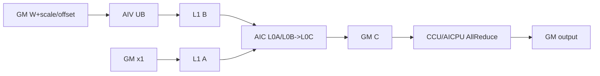
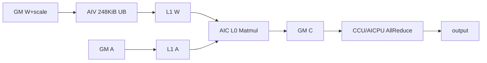
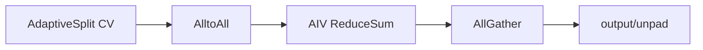
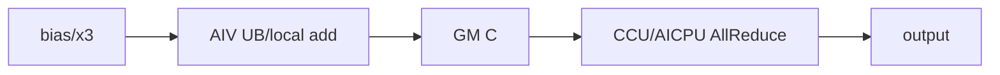

# WeightQuantMatmulAllReduce 950 ACLNN 算子知识

## 算子速览

| 项目 | 内容 |
|---|---|
| 实际入口 | `aclnnWeightQuantMatmulAllReduceV2GetWorkspaceSize` + `aclnnWeightQuantMatmulAllReduceV2`，公开 ACLNN 两段式 V2 接口 |
| 计算语义 | `output = AllReduce(x1 @ ((x2 + antiquantOffset) * antiquantScale) + bias + x3)`；实现可把 AllReduce 等价拆为 AlltoAll→AIV ReduceSum→AllGather |
| 输入输出 | `x1/output/scale/可选 bias,offset,x3` 为 FP16 或 BF16；`x2` 为 ND INT8/INT4/FP8_E4M3FN/HIFLOAT8；output 为 ND |
| 执行类型 | 非空为单个 `MIX_CV` Kernel（AIC:AIV=1:2）+ CCU/AICPU 通信；空 K 为 AIV 初始化/加法 + 通信 |
| Kernel 路线 | R-001 RegBase+AllReduce；R-002 RegBase+TwoShot；R-003 AdaptiveSplit+AllReduce；R-004 AdaptiveSplit+TwoShot；R-005 K=0 |
| 核心资源 | GM/user workspace、AIC L1/L0、AIV 248 KiB UB（Adaptive vector body）、RegBase UB/L1 ping-pong、HCCL CcTiling 与 handle arrays |
| 来源闭包 | `source_closed`：公开 V2 → API/inner op → DAV_3510 tiling/key/POD → APT entry → RegBase/AdaptiveSplit → direct/TwoShot communication → build 接线闭合；K=0 的固定源码缺陷另列失败边界 |
| 验证状态 | 已完成源码闭包检查；本次知识提取未执行编译、真机、数值或性能测试。 |

## 接口与语义

### 计算语义

三维 `x1(b,s,k)` 在 tiling 中展平为 `M=b*s`。权重反量化顺序是先加 optional offset、再乘 scale，随后 MatMul 和 optional bias；每个本 rank M tile 可再加 `x3`。通信 key 决定直接 `AllReduce(sum)`，或等价的 `AlltoAll`、AIV 对 rank 分片求和、`AllGather`。K=0 不读取权重，先构造 `bias+x3` 再做 sum。

### 输入、输出与属性

| 参数 | shape/layout | dtype | 约束、默认值与语义 |
|---|---|---|---|
| `x1` | ND `(m,k)`/`(b,s,k)` | FP16/BF16 | 必需，不转置；M `[1,INT32_MAX]`，K 非空时 `[1,65535]` |
| `x2` | ND 2D `(k,n)`，可最后两轴转置 view | INT8/INT4/FP8_E4M3FN/HIFLOAT8 | 必需；文档要求 INT8 的 K/N 32 对齐、INT4 的 K/N 64 对齐；FP8/HIF8 仅 per-channel |
| `bias` | `[n]` ND | 与 `x1` 相同 | 可空；公开 API 不允许 FP32 bias |
| `antiquantScale` | `[1]`、`[n]`/`[1,n]`、`[ceil(k/group),n]` | 与 `x1` 相同 | 必需；分别 per-tensor/channel/group |
| `antiquantOffset` | 与 scale 相同 | 与 scale 相同 | 可空；FP8/HIF8 必须为空 |
| `x3` | output shape ND | 与 `x1` 相同 | 可空；通信前加到 local result |
| `group` | HCCL domain | string | 必需的 inner 属性；仅 HCCS all-mesh |
| `reduceOp` | scalar | string | 仅 `"sum"` |
| `commMode` | scalar | string | `"ai_cpu"` 或 `"ccu"`；同链路只能一种引擎；CCU 仅单机 UB 域，AICPU 可跨机 UB 域 |
| `commTurn` | scalar | int64 | 仅 `0` |
| `streamMode` | scalar | int64 | 仅 `1` |
| `antiquantGroupSize` | scalar | int64 | per-group 为 `[32,min(k-1,INT_MAX)]` 的 32 倍数，否则 0；K=0 跳过 |
| `output` | `(m,n)`/`(b,s,n)` ND | 与 `x1` 相同 | 必需且非空；M/N 不能为 0 |

### 入口与版本

V2 是固定仓同平台最新公开版本：文档明确其兼容旧版并新增 `commMode`。产品表支持 Ascend 950PR/950DT，明确不支持 A3。第一段构造 inner `MatmulAllReduce` executor，第二段依据第一段保存的 user handle 把 HCCL server 设为 CCU 或 AICPU，再在调用者 stream 执行。本卡不合并原地、Grad 或通信量化语义。

## Host/Launcher 执行流程

### 参数校验与前处理

API `CheckParams` 顺序为必需指针→平台 dtype→属性→shape→affine transpose consistency→`commMode`。950 允许 x2 的 INT8/INT4/FP8/HIF8；Host tiling再次拒绝 FP8/HIF8 的 offset、per-tensor/per-group。x2 为 FP8/HIF8 只能走 per-channel AdaptiveSplit。`transposeX1=false`，`transposeX2` 由最后两轴 view/pre-transposed状态推导。

### 参数、Workspace 与生命周期

第一段把 inner 的 dequant/per-token/communication-scale inputs 置空，成功后在 executor user handle 保存 `commMode` enum，并禁用 IR 6–9。950 base workspace含 libApi、soft-sync、MatMul local result 等切片；direct route再加 WQBMM `workspaceSize_`。TwoShot额外定义：

```text
commWorkSpace = (tileM*N*tileCnt + tailM*N*tailCnt + (tileCnt+tailCnt)*512) * sizeof(output)
workspace += 3*commWorkSpace + commWorkSpace/rankDim
```

三倍分别容纳 MatMul/AlltoAll、AlltoAll output、ReduceSum output，最后 `/rankDim` 为 gather input/output分片。所有权归 caller workspace，直到 HCCL finalize。

### 启动图与失败传播

公共 dispatcher 对 `DAV_3510` 走 `TilingRegistryArch`；`WeightQuantMatmulAllReduceTilingA5` 以 DAV_3510、优先级 1 注册。`PostTiling` 按 antiquant type 选 RegBase POD 或 AS POD，8-byte aligned memcpy，`blockDim=aicCoreNum`，schedule mode 1。APT entry 对空 workspace/userWS直接 return；未命中 selector不产生替代实现。API 第二段将 inner launch失败映射为 `ACLNN_ERR_INNER`。

## Route 与参数设计

### 分核与资源计算

Host先切 M 为 main/tail turns。per-group 调 `WeightQuantTilingTransferHelperA5` 生成 RegBase `cubeBlockDimM/N`、`vecCoreParallel`、A/B L1 ping-pong、`nBubSize/kBubSize` 和 `TCubeTiling`；非 group 调 `WeightQuantAsTilingTransferHelper` 生成 basic-block counts、三类 L1 size、A preload和 `TCubeTiling`。RegBase AIV直接把分组权重反量化到 L1，AIC从L1完成 MatMul；AdaptiveSplit以 M/N basic block controller动态映射 core，vector模板 `{bufferNum,innerK}` 由 transB和 Host templateCustom选取。

### Route 选择

| 顺序 | Route | Key/模板 | 精确选择条件与优先级 | 不适用去向 |
|---:|---|---|---|---|
| 1 | R-005 K=0 | `MMTYPE_WEIQUANT_NULL_TENSOR` | `isKZero_`，先于 quant type | K!=0继续 |
| 2 | R-001/R-002 RegBase | per-group selector，`TPL_A2A_RS_AG` 0/1，comm CCU/AICPU | K!=0 且 `antiQuantType==PER_GROUP`；INT8 K/N 32 align、INT4 64 align | 非 group→Adaptive；非法 align/type失败 |
| 3 | R-003/R-004 AdaptiveSplit | per-tensor/channel selectors，MTE2 config 0/2/3/4 | K!=0 且 antiquant不是 group；FP8/HIF8仅 channel且offset null | 无 selector→失败 |
| 4 | R-002/R-004 TwoShot | `isUseA2APath=IsUseA2APath(rank,npuArch)` | helper 返回 true，除 `commMode==CCU && K>=2048 && Is8P` 强制 false | false→direct |
| 5 | R-001/R-003 direct | `TPL_A2A_RS_AG=0` | helper false或上述 CCU 8P large-K guard | 无通信 fallback |

```text
if K == 0: R-005
compute = (antiquant_type == PER_GROUP ? RegBase : AdaptiveSplit)
two_shot = IsUseA2APath(rankDim, DAV_3510)
if commMode == CCU && K >= 2048 && Is8P(rankDim): two_shot = false
if compute==RegBase: two_shot ? R-002 : R-001
else:                two_shot ? R-004 : R-003
```

### 模板/实现执行矩阵

| Route | key/selector | dtype/shape/platform 完整命中条件 | 执行族与 kernel 节点 | 实际模板/body | 内存与同步特征 | tail/fallback |
|---|---|---|---|---|---|---|
| R-001 RegBase direct | per-group × transB × offset × comm，A2A=0 | DAV_3510；FP16/BF16 × INT8/INT4；ND；aligned K/N | MIX_CV RegBase + CCU/AICPU AllReduce | `Mc2WeightQuantBatchMatmulV2RegBaseKernel` + direct base | AIV GM→UB→L1；AIC L1/L0；GM C→AR | main/tail；invalid fail |
| R-002 RegBase TwoShot | 同上，A2A=1 | R-001计算条件 + TwoShot predicate | MIX_CV RegBase + AlltoAll + AIV ReduceSum + AllGather | same compute + A2A base | 3+1/rank comm workspace；512-element tile alignment | pad copy if M/rank misaligned |
| R-003 Adaptive direct | non-group configs × comm，A2A=0 | INT8/INT4 tensor/channel；FP8/HIF8 channel/no offset | MIX_CV basic-block + direct AR | `WeightQuantBatchMatmulV2BasicBlockController<WqmmConfig,VecConfig>` | AIV 248KiB UB antiquant→L1；AIC Matmul | AS main/first/second tails |
| R-004 Adaptive TwoShot | 同上，A2A=1 | R-003 + TwoShot predicate | MIX_CV basic-block + A2A/AIV RS/AG | same compute + A2A base | same AS resources + comm workspace/handle arrays | pad removal copy |
| R-005 K=0 | null-tensor key + commMode | K=0，M/N非空 | 设计图为 AIV init/bias/x3 + direct AllReduce | `MatmulAllReduceEmptyTensorKGeneral<YType,commMode>` | UB bias chunk；CcTiling；但固定 Commit 存在未初始化 `tilingData_` 与 per-group POD 解析不一致 | bias/x3 optional；不能据源码断言该路线可正确运行 |

### 隐藏性能 Guard

| Guard | Host/Tiling 条件 | Device/资源原因 | 影响 Route | 不满足时去向 | 源码符号 |
|---|---|---|---|---|---|
| exclusive launch | `SetScheduleMode(1)` | multi-core/cross-AIC-AIV `SyncAll`，否则可能挂死 | 全部 | PostTiling failure | `PostTiling` |
| large-K 8P CCU | `CCU && K>=2048 && Is8P` | Host显式关闭 TwoShot | R-001/R-003 | direct route | `GetTilingKey/SetMc2Hcomm/GetWorkspaceSize` |
| TwoShot handles | arrays size 16 | 每个 main/tail turn各需 A2A/AG handle/address | R-002/R-004 | producer必须保证 turns不越界；无Device检查 | `A2A_VSUM_AG_MAX_HANDLE_ID_NUM` |
| TwoShot alignment | `CeilAlign(M*N,512)` elements | rank分片和非连续 comm buffers | R-002/R-004 | pad后最终 GM copy | `CalcCeilAlignGMSize/CalcNeededPad` |
| Adaptive UB | `UB_AVAILABLE_SIZE=248 KiB` | vector antiquant queue/TBuf共享固定 UB | R-003/R-004 | Host选择不同 VecConfig或失败 | `WeightQuantBatchMatmulV2VecCompute` |
| FP8/HIF8 | channel且offset null | APT只闭合该精度与参数组合 | R-003/R-004 | `GRAPH_FAILED` | `CheckInput` |
| public alignment | INT8 K/N 32；INT4 K/N 64 | 文档公开约束；RegBase Host显式检查 per-group | 非空 | API/tiling失败；不得依赖未检查组合 | docs/`CheckAxisSize` |

### POD/ABI

| 结构 | 字段 | 类型/位宽 | ABI 布局 | 单位 | Host/launcher producer | Device consumer | 边界 |
|---|---|---|---|---|---|---|---|
| launch ABI | `aGM`…`cGM` | `GM_ADDR`/64-bit address | independent parameters；offsetof N/A | bytes | inner executor | APT entry/routes | optional inputs may null |
| launch ABI | `workspaceGM` | GM_ADDR | independent | bytes | executor | `GetUserWorkspace`/bases | null returns |
| launch ABI | `tilingGM` | GM_ADDR | independent | bytes | `PostTiling` | `GET_TILING_DATA_WITH_STRUCT` | key/POD exact match |
| RegBase POD | `mc2InitTiling` | `Mc2InitTiling` | top struct pack(8), alignas(8)；external framework type layout not visible | opaque | `Mc2CcTilingConfig::GetTiling` | `Hccl::InitV2` | no inferred fields |
| RegBase POD | `mc2CcTiling` | `Mc2CcTiling` | same | opaque | direct/first comm config | `SetCcTilingV2` | engine-dependent |
| RegBase POD | `mc2CcTilingComm` | `Mc2CcTiling` | same | opaque | TwoShot AllGather config | second `SetCcTilingV2` | inactive on direct |
| RegBase POD | `param` | `RCSTiling` | same | mixed | `DoRCSTiling/SplitM` | compute/comm base | see A2 card field semantics |
| RegBase POD | `tileRegBaseMmTiling` | RegBase tiling struct | nested pack(8) | elements/count | per-group main tiler | RegBase kernel | main |
| RegBase POD | `tailRegBaseMmTiling` | RegBase tiling struct | nested pack(8) | elements/count | per-group tail tiler | RegBase kernel | inactive if tailCnt=0 |
| AS POD | `mc2InitTiling` | `Mc2InitTiling` | pack(8), alignas(8) | opaque | comm tiler | HCCL | exact framework ABI |
| AS POD | `mc2CcTiling` | `Mc2CcTiling` | same | opaque | first/direct comm | HCCL | exact framework ABI |
| AS POD | `mc2CcTilingComm` | `Mc2CcTiling` | same | opaque | second comm | HCCL | inactive direct |
| AS POD | `param` | `RCSTiling` | same | mixed | base tiler | wrapper/base/empty | `tileCnt/tailCnt/rankM/N/K` |
| AS POD | `tileMmASTiling` | AS tiling struct | nested pack(8) | elements/count/bytes | adaptive main tiler | basic-block controller | K=0 empty body reads `isBias` |
| AS POD | `tailMmASTiling` | AS tiling struct | nested pack(8) | elements/count/bytes | adaptive tail tiler | basic-block controller | inactive if no tail |
| RegBase tiling | `cubeBlockDimN` | uint8 | declaration order | cores | helper | core map | nonzero valid route |
| RegBase tiling | `cubeBlockDimM` | uint8 | declaration order | cores | helper | core map | nonzero valid route |
| RegBase tiling | `vecCoreParallel` | uint8 | declaration order | ratio | helper | AIV map | compile AIC:AIV 1:2 |
| RegBase tiling | `reserve1` | uint8 | declaration order | N/A | zero/default | none | do not repurpose |
| RegBase tiling | `AL1Pingpong` | uint16 | declaration order | count | helper | AIC | 1/2 producer value |
| RegBase tiling | `BL1Pingpong` | uint16 | declaration order | count | helper | AIC/AIV | 1/2 producer value |
| RegBase tiling | `kSize` | uint64 | declaration order | elements | helper | address loops | <=65535 |
| RegBase tiling | `nSize` | uint64 | declaration order | elements | helper | address loops | <=65535 |
| RegBase tiling | `groupSize` | uint64 | declaration order | elements | helper | per-group scale offset | valid group |
| RegBase tiling | `mSize` | uint64 | declaration order | elements | helper | core loops | tile M |
| RegBase tiling | `nBubSize` | uint64 | declaration order | elements | helper | vector UB | within UB |
| RegBase tiling | `kBubSize` | uint64 | declaration order | elements | helper | vector UB | within UB |
| RegBase tiling | `matmulTiling` | `TCubeTiling` | nested external struct | mixed | helper | Matmul API | exact library ABI |
| AS tiling | `cubeBlockDimM` | uint32 | declaration order | blocks | helper | controller | core map |
| AS tiling | `cubeBlockDimN` | uint32 | declaration order | blocks | helper | controller | core map |
| AS tiling | `hasBias` | uint32 | declaration order | bool | helper | body | public bias same x1 |
| AS tiling | `firstTailBlockCount` | uint32 | declaration order | blocks | helper | controller | first tail |
| AS tiling | `secondTailBlockCount` | uint32 | declaration order | blocks | helper | controller | second tail |
| AS tiling | `weightL2Cacheable` | uint32 | declaration order | bool | helper | controller | cache policy |
| AS tiling | `mainBlockL1Size` | uint32 | declaration order | bytes | helper | L1 allocator | main block |
| AS tiling | `firstTailBlockL1Size` | uint32 | declaration order | bytes | helper | L1 allocator | first tail |
| AS tiling | `secondTailBlockL1Size` | uint32 | declaration order | bytes | helper | L1 allocator | second tail |
| AS tiling | `aPreloadSize` | uint32 | declaration order | bytes | helper | controller | preload |
| AS tiling | `groupSize` | uint64 | declaration order | elements | helper | antiquant | 0/non-group |
| AS tiling | `mainBlockCount` | uint64 | declaration order | blocks | helper | loop | main |
| AS tiling | `mSize` | uint64 | declaration order | elements | helper | address | tile M |
| AS tiling | `kSize` | uint64 | declaration order | elements | helper | address | <=65535 |
| AS tiling | `nSize` | uint64 | declaration order | elements | helper | address | <=65535 |
| AS tiling | `matmulTiling` | `TCubeTiling` | nested external struct | mixed | helper | Matmul API | exact library ABI |

### Route 源码闭包

| Route | Key/selector | Host/Tiling producer | POD/参数 | Kernel entry/router | Kernel body/直接依赖 | 构建接线 |
|---|---|---|---|---|---|---|
| R-001 | per-group,A2A=0 | 950 tiling `DoWeightQuantTiling/SetMc2HcommAllReduce` | 950 RegBase POD | `matmul_all_reduce_apt.cpp` | RegBase wrapper/kernel + direct base | `op_host/CMakeLists.txt` |
| R-002 | per-group,A2A=1 | same + `SetMc2HcommTwoShot` | RegBase POD two CcTiling | APT entry | RegBase + A2A base | same |
| R-003 | non-group,A2A=0 | `DoWeightQuantAsTiling` + direct | AS POD | APT entry adaptive branches | AS wrapper/basic controller + direct | same |
| R-004 | non-group,A2A=1 | adaptive + TwoShot | AS POD two CcTiling | APT entry | AS + A2A base | same |
| R-005 | null key | `DoEmptyTensorTiling` + `SetMc2Hcomm` | Host按 antiquant type 选 RegBase/AS POD；Device宏固定读 AS POD | APT null branch | 950 empty body；构造函数未保存 `tilingData_` | same |

## Kernel 实现

### 公共执行流程

APT entry注册平台最大 tiling storage，拒绝空 workspace，建立 `TPipe`；null key进入 empty body，其他 weight-quant key进入 router。RegBase和Adaptive wrapper均对main turns再对tail turns循环：reset pipe→compute `Init/Process`→可选x3→推进 A/C→commit当前通信。TwoShot wrapper在每段后等待 AlltoAll，所有 compute turns后做 ReduceSum+AllGather，再 finalize；direct wrapper直接 wait AllReduce handles并 finalize。empty body 的意图是直连 AllReduce，但固定 Commit 的 `tilingData_` 生命周期和 POD 选择缺陷意味着该意图不能等同于已验证可运行实现。

### Route R-001：Per-group RegBase + direct AllReduce

#### 适用条件

##### 选择证据

| 层级 | 文件 | 符号 | 源码谓词/参数 | 结果/下一跳 |
|---|---|---|---|---|
| API | V2 cpp | `CheckParams` | 950 supported dtypes/mode | inner |
| Host | 950 tiling | `DoOpTiling` | `antiQuantType_==PER_GROUP` | `DoWeightQuantTiling` |
| Tiling | APT key | per-group selector | `isA2ARSAG=false` | R-001 |
| Router | APT cpp | group branch | `ANTIQUANT_TYPE==TPL_PER_GROUP` | RegBase macro |

#### Device 数据流

##### 函数级调用链

```text
APT entry -> weight_quant_matmul_allreduce
 -> MatmulAllReduceWeightQuantRegBase::Process/InnerProcess
  -> Mc2WeightQuantBatchMatmulV2RegBaseKernel::Init/Process
  -> PostProcEachTurn -> Hccl::AllReduce Commit
 -> HcclFinalize
```

##### 源码等价伪码

```text
prepare main/tail AllReduce handles
for each M turn:
  AIV load low-bit W + per-group scale/offset to UB; antiquant to L1
  AIC load A/bias to L1; wait vector; Matmul through L0; write GM C
  optional C += x3; SyncAll; block0 Commit(AllReduce)
wait all handles; SyncAll; Finalize
```

#### 内存与数据搬运

##### 资源与搬运表

| 层级/缓冲区 | offset/地址公式 | extent/容量公式 | dtype/layout | producer | consumer | owner/lifetime | 对齐/复用 |
|---|---|---|---|---|---|---|---|
| GM W/scale | group/K/N tile offsets | source tensor | low-bit/FP16/BF16 ND | caller | AIV | caller | K/N public alignment |
| AIV UB | nBub/kBub-derived queues | tiler-bounded | low-bit+xType/FP32 temp | MTE2/vector | MTE3 | turn | queues/pingpong |
| L1 B | RegBase block/pingpong offsets | `BL1Pingpong` × tile | xType | AIV | AIC | block | cross-core flag |
| L1 A/L0A/B/C | TCubeTiling | exact library allocation opaque | xType/accumulate | AIC | Matmul/fixpipe | block | AL1/BL1 pingpong |
| GM C/output | workspace+base offsets | Mturn*N*ybytes | ND | AIC/x3 | HCCL | until wait | contiguous turn |

##### 分层内存布局



##### 字节账、交接边与复用顺序

```text
workspace_total = base_workspace + regbase workspaceSize_
L1/UB sizes = Host RegBase tiling fields + TCubeTiling; exact L0 bytes not constantized
```

| 边/复用子区 | producer | offset/extent | dtype/layout | consumer | ordering/sync | owner/lifetime | 安全条件 |
|---|---|---|---|---|---|---|---|
| L1 B ping/pong | AIV | tiling block | xType | AIC | cross-core mode4 flags | turn | producer/consumer alternate |
| C→AR | AIC/x3 | turn M*N | yType ND | HCCL | all-core sync then commit | workspace | complete local tile |

#### 同步、精度与尾块

##### 同步与数值边界表

| 阶段 | primitive/机制 | producer | consumer/等待点 | 保护对象 | 精度/尾块 |
|---|---|---|---|---|---|
| W ready | AIV→AIC cross-core flags | vector | cube wait | L1 B | group tail derives scale row |
| L1 reuse | AIC→AIV flag | cube | vector wait | ping/pong slot | main/tail tilings separate |
| comm | SyncAll+Commit/Wait | compute | HCCL | C/output | sum in output dtype |

#### 关键实现

##### 符号证据表

| 阶段 | 文件 | 符号/模板实例 | 实现事实 |
|---|---|---|---|
| Host/Tiling producer | `...tiling_950.cpp` | `DoWeightQuantTiling/GetTilingKey` | per-group RegBase/direct |
| Kernel entry/router | `arch35/matmul_all_reduce_apt.cpp` | group branch | RegBase实例 |
| Device body/helper | `3rd/.../weight_quant_batch_matmul_v2_reg_base.h` | `RegBaseKernel::Process` | UB→L1反量化与AIC MatMul |

### Route R-002：Per-group RegBase + TwoShot

#### 适用条件

##### 选择证据

| 层级 | 文件 | 符号 | 源码谓词/参数 | 结果/下一跳 |
|---|---|---|---|---|
| Host | 950 tiling | `SetMc2Hcomm` | `IsUseA2APath==true` | AlltoAll+AllGather CcTiling |
| Workspace | same | `GetWorkspaceSizeForA2ARSAG` | TwoShot | 3+1/rank slices |
| Tiling/Router | APT key/entry | `TPL_A2A_RS_AG=1` | per-group | R-002 |

#### Device 数据流

##### 函数级调用链

```text
RegBase compute -> PostProcEachTurn Commit(AlltoAll)
 -> WaitAlltoAllEachTurn -> ReduceSumForAlltoAll
 -> ReduceSumAndAllGather -> Commit/Wait(AllGather)
 -> optional GmUbGmCopy(unpad) -> Finalize
```

##### 源码等价伪码

```text
compute each C tile; commit A2A
wait A2A in AIV; reduce rank slices into 1/rank result
pipeline first ReduceSum with A2A and later ReduceSum with prior AllGather
commit final AllGather; wait all; if padded copy compact output
```

#### 内存与数据搬运

##### 资源与搬运表

| 层级/缓冲区 | offset/地址公式 | extent/容量公式 | dtype/layout | producer | consumer | owner/lifetime | 对齐/复用 |
|---|---|---|---|---|---|---|---|
| `all2allIn` | cGM | cgmAddr | yType ND | RegBase | A2A | workspace | turns contiguous |
| `all2allOut/reduceSumIn` | `in+cgmAddr+pad` | aligned cgm | rank-major | A2A | AIV RS | workspace | each turn 512 elements align |
| `reduceSumOut/allgatherIn` | next aligned slice | `(cgmAddr+pad)/rank` | local shard | AIV | AllGather | workspace | rank split |
| `allgatherOut` | output or final workspace slice | cgmAddr | padded/ND | HCCL | optional copy | workspace/output | copy only needPad |

##### 分层内存布局


##### 字节账、交接边与复用顺序

```text
aligned_turn_elems = ceil(Mturn*N/512)*512
comm_extra = 3*commWorkSpace + commWorkSpace/rankDim
handle_slots = 16
```

| 边/复用子区 | producer | offset/extent | dtype/layout | consumer | ordering/sync | owner/lifetime | 安全条件 |
|---|---|---|---|---|---|---|---|
| A2A→RS | HCCL | aligned turn | rank-major | AIV | Wait + SyncAll | comm WS | turn index<16 |
| RS→AG | AIV | 1/rank shard | yType | HCCL | SyncAll before commit | comm WS | RS complete |

#### 同步、精度与尾块

##### 同步与数值边界表

| 阶段 | primitive/机制 | producer | consumer/等待点 | 保护对象 | 精度/尾块 |
|---|---|---|---|---|---|
| A2A completion | HCCL Wait + SyncAll | HCCL | AIV RS | all2allOut | ceil-div rank count |
| RS→AG | SyncAll | AIV | block0 commit | shard | sum semantics |
| padding | GmUbGmCopy | AG | output | padded tiles | removes only when needed |

#### 关键实现

##### 符号证据表

| 阶段 | 文件 | 符号/模板实例 | 实现事实 |
|---|---|---|---|
| Host/Tiling producer | `...tiling_950.cpp` | `SetMc2HcommTwoShot/GetWorkspaceSizeForA2ARSAG` | comm graph/bytes |
| Kernel entry/router | `matmul_all_reduce_apt.cpp` | A2A template bool | selects specialized base |
| Device body/helper | `arch35/matmul_all_reduce_based_a2a_rs_ag.h` | `ReduceSumAndAllGather` | handles、pad、pipeline |

### Route R-003：Per-tensor/channel AdaptiveSplit + direct AllReduce

#### 适用条件

##### 选择证据

| 层级 | 文件 | 符号 | 源码谓词/参数 | 结果/下一跳 |
|---|---|---|---|---|
| Host | 950 tiling | `DoOpTiling` | antiquant != per-group | AS tiling |
| Tiling | APT key | MTE2 configs | tensor/channel, A2A=0 | R-003 |
| Router | APT cpp | adaptive branches | transB/type/offset/config | basic controller |

#### Device 数据流

##### 函数级调用链

```text
APT router -> MatmulAllReduceWeightQuantAdaptiveSplit::Process
 -> WeightQuantBatchMatmulV2BasicBlockController::Init/Process
  -> AIV VecCompute antiquant GM->UB->L1
  -> AIC basic block Matmul L1/L0->GM
 -> PostProcEachTurn -> direct AllReduce -> Finalize
```

##### 源码等价伪码

```text
map blockIdx to M/N basic block and main/first/second tail
for K blocks: AIV antiquant W with selected {bufferNum,innerK}; signal L1 ready
              AIC preload A/bias; wait; Matmul; signal L1 reusable
write GM C; optional x3; commit direct AllReduce
```

#### 内存与数据搬运

##### 资源与搬运表

| 层级/缓冲区 | offset/地址公式 | extent/容量公式 | dtype/layout | producer | consumer | owner/lifetime | 对齐/复用 |
|---|---|---|---|---|---|---|---|
| AIV UB | controller tile offsets | fixed available 248 KiB | low-bit/scale/xType temp | MTE2/vector | MTE3 | basic block | VecConfig 2/4 buffers, innerK 256/512/1024 |
| L1 W/A | POD main/tail L1 sizes | `mainBlockL1Size` etc | xType | AIV/AIC | AIC Matmul | block | cross-core pingpong |
| L0/GM C | TCubeTiling | opaque library bytes/M*N ybytes | accumulate/yType | AIC | HCCL | turn | basic tails |

##### 分层内存布局



##### 字节账、交接边与复用顺序

```text
UB_available = 248*1024 bytes
L1_size = selected main/firstTail/secondTail POD bytes
workspace_total = base + AS workspaceSize_
```

| 边/复用子区 | producer | offset/extent | dtype/layout | consumer | ordering/sync | owner/lifetime | 安全条件 |
|---|---|---|---|---|---|---|---|
| UB→L1 W | AIV | basic K/N block | xType | AIC | cross-core flags | block | selected config fits UB |
| C→AR | AIC/x3 | Mturn*N | yType ND | HCCL | SyncAll/Commit | workspace | all blocks done |

#### 同步、精度与尾块

##### 同步与数值边界表

| 阶段 | primitive/机制 | producer | consumer/等待点 | 保护对象 | 精度/尾块 |
|---|---|---|---|---|---|
| W L1 handoff | mode4 cross-core flags | AIV | AIC | L1 W | transB changes innerK/config |
| reuse | reciprocal flag | AIC | AIV | L1 slot | three AS block classes |
| comm | all-core sync/HCCL | compute | output | C | deterministic 950 documented |

#### 关键实现

##### 符号证据表

| 阶段 | 文件 | 符号/模板实例 | 实现事实 |
|---|---|---|---|
| Host/Tiling producer | `...tiling_950.cpp` | `DoWeightQuantAsTiling` | AS POD/config |
| Kernel entry/router | `matmul_all_reduce_apt.cpp` | adaptive branches | VecConfig mapping |
| Device body/helper | `...basic_block_controller.h`→`...basic_block.h`→`...vec_compute.h` | `WeightQuantBatchMatmulV2BasicBlockController`/`WeightQuantBatchMatmulV2BasicBlock`/`WeightQuantBatchMatmulV2VecCompute` | basic-block scheduling、CV handoff、248 KiB UB 反量化 body |

### Route R-004：Per-tensor/channel AdaptiveSplit + TwoShot

#### 适用条件

##### 选择证据

| 层级 | 文件 | 符号 | 源码谓词/参数 | 结果/下一跳 |
|---|---|---|---|---|
| Host | 950 tiling | non-group + `IsUseA2APath` | true | AS+TwoShot |
| Tiling | APT selector | `TPL_A2A_RS_AG=1` | tensor/channel configs | R-004 |
| Router | APT cpp | adaptive macro bool=true | controller + A2A base | route |

#### Device 数据流

##### 函数级调用链

```text
AdaptiveSplit compute -> AlltoAll -> AIV ReduceSum -> AllGather -> optional unpad copy
```

##### 源码等价伪码

```text
run R-003 basic-block compute per turn
replace direct AllReduce with R-002 TwoShot communication pipeline
wait all AllGather handles; compact padding when M tile not divisible by rank
```

#### 内存与数据搬运

##### 资源与搬运表

| 层级/缓冲区 | offset/地址公式 | extent/容量公式 | dtype/layout | producer | consumer | owner/lifetime | 对齐/复用 |
|---|---|---|---|---|---|---|---|
| compute UB/L1/L0 | R-003 | R-003 | mixed | AIV/AIC | AIC | turn | AS tails |
| comm workspace | R-002 formulas | `3*commWS+commWS/rank` | yType | compute/HCCL/AIV | AG/copy | op | 512-element alignment |

##### 分层内存布局



##### 字节账、交接边与复用顺序

```text
workspace_total = base + AS workspace + 3*commWorkSpace + commWorkSpace/rank
```

| 边/复用子区 | producer | offset/extent | dtype/layout | consumer | ordering/sync | owner/lifetime | 安全条件 |
|---|---|---|---|---|---|---|---|
| AS C→A2A | AIC/x3 | per turn | yType ND | HCCL | SyncAll/Commit | comm WS | handle index<16 |
| A2A→RS→AG | HCCL/AIV | aligned shard | rank-major→local | AIV/HCCL | waits/barriers | comm WS | rankDim valid |

#### 同步、精度与尾块

##### 同步与数值边界表

| 阶段 | primitive/机制 | producer | consumer/等待点 | 保护对象 | 精度/尾块 |
|---|---|---|---|---|---|
| compute | R-003 flags | AIV/AIC | opposite | L1 | AS tails |
| communication | R-002 waits/SyncAll | HCCL/AIV | next stage | comm slices | pad/unpad |

#### 关键实现

##### 符号证据表

| 阶段 | 文件 | 符号/模板实例 | 实现事实 |
|---|---|---|---|
| Host/Tiling producer | `...tiling_950.cpp` | AS tiling + TwoShot config | combined key/workspace |
| Kernel entry/router | `matmul_all_reduce_apt.cpp` | adaptive macro | `basedA2aRsAg=true` |
| Device body/helper | AS controller + `matmul_all_reduce_based_a2a_rs_ag.h` | Process/ReduceSumAndAllGather | compute/comm closure |

### Route R-005：K=0 空域

#### 适用条件

##### 选择证据

| 层级 | 文件 | 符号 | 源码谓词/参数 | 结果/下一跳 |
|---|---|---|---|---|
| API | docs/API | K=0 special case | M/N nonzero | bias+x3 semantic |
| Host | 950 tiling | `isKZero_` | empty tiling + AllReduce | null key |
| Router | APT entry | `MMTYPE_WEIQUANT_NULL_TENSOR` | commMode template | empty body；随后受固定 Commit 缺陷影响 |

#### Device 数据流

##### 函数级调用链

```text
APT entry -> MatmulAllReduceEmptyTensorKGeneral::Init
 -> InitOutput -> ProcessBias -> ProcessAdd
 -> Hccl<commMode>::AllReduce Commit/Wait/Finalize

固定 Commit 实际风险：构造函数只保存 `param_`，未执行 `tilingData_=tilingData`；`Init()` 却把未初始化成员传给 `Hccl::InitV2`。此外 `GET_TILING_DATA_FOR_EMPTY_TENSOR` 在 weight-quant build 中固定解析 `WeightQuantMatmulAllReduceA5Fp8TilingData`，而 Host `PostTiling` 在 per-group 时序列化 `WeightQuantMatmulAllReduceA5TilingData`。
```

##### 源码等价伪码

```text
zero cGM[M*N]; optional broadcast bias[n] to M rows; optional add x3
SyncAll; AIV block0 direct-AllReduce cGM to output; wait/finalize
```

#### 内存与数据搬运

##### 资源与搬运表

| 层级/缓冲区 | offset/地址公式 | extent/容量公式 | dtype/layout | producer | consumer | owner/lifetime | 对齐/复用 |
|---|---|---|---|---|---|---|---|
| cGM | workspace compute slice | M*N*ybytes | ND | AIV | HCCL | op | zero first |
| UB | 0 | TOTAL_UB_SIZE | yType bias | MTE2 | MTE3 | TPipe | 32B chunks/tail pad |
| L1/L0 | N/A | N/A | N/A | N/A | N/A | N/A | no MatMul |

##### 分层内存布局



##### 字节账、交接边与复用顺序

```text
c_bytes=M*N*sizeof(YType); UB<=TOTAL_UB_SIZE; no WQBMM L1/L0 allocation
```

| 边/复用子区 | producer | offset/extent | dtype/layout | consumer | ordering/sync | owner/lifetime | 安全条件 |
|---|---|---|---|---|---|---|---|
| cGM | AIV | full output | yType ND | HCCL | SyncAll | workspace | M/N nonzero |

#### 同步、精度与尾块

##### 同步与数值边界表

| 阶段 | primitive/机制 | producer | consumer/等待点 | 保护对象 | 精度/尾块 |
|---|---|---|---|---|---|
| bias tail | DataCopyPad | UB | GM | last N | byte length mask |
| local→comm | SyncAll | all cores | block0 HCCL | cGM | 这是源码设计顺序；未初始化 `tilingData_` 可能在准备 handle 前即破坏该路线 |

#### 关键实现

##### 符号证据表

| 阶段 | 文件 | 符号/模板实例 | 实现事实 |
|---|---|---|---|
| Host/Tiling producer | `...tiling_950.cpp` | empty branch | null key/POD |
| Kernel entry/router | `matmul_all_reduce_apt.cpp` | null-tensor branch | commMode instance |
| Device body/helper | `arch35/matmul_all_reduce_empty_tensor_k_general.h` | constructor/`Init`/empty macro/`Process` | zero/bias/x3/direct AR 的设计图，以及未保存 `tilingData_`、固定 AS POD 解析风险 |

## 算子特定优化

### Trick T-001：通信图按拓扑选择并为 CCU 8P 大 K 改走直连 AllReduce

#### 触发与源码依据

- 适用 Route：R-001～R-004
- 触发条件：950 非空；TwoShot 初值来自 `IsUseA2APath`，CCU + 8P + K≥2048 强制 direct
- Golden 来源：[`weight_quant_matmul_all_reduce_tiling_950.cpp:467-483`](../../../../../../../cann-ops-raw/ascendc/ops-transformer/be33d95bb755cedec3108f70805c1874d1792540/mc2/matmul_all_reduce/op_host/op_tiling/arch35/weight_quant_matmul_all_reduce_tiling_950.cpp#L467-L483)

**官方源码（固定 Commit 连续逐字摘录）**：

```cpp
bool isUseA2APath = mc2tiling::IsUseA2APath(args_.rankDim, npuArch_);
const uint64_t k = MatmulAllReduceTilingBase::GetKValue();
uint8_t commMode = GetCommMode();
if (commMode == Mc2Comm::COMM_MODE_CCU && k >= WEIGHT_QUANT_A2APATH_CRITICAL_K &&
    mc2tiling::Is8P(args_.rankDim, npuArch_)) {
    isUseA2APath = false;
}
```

#### 机制与设计原因

相同数学 AllReduce有两张执行图。Host把选择同时写入 key、HCCL CcTiling和workspace公式，保证Device通信body与内存切片一致。大 K 的8P CCU显式避开TwoShot，这是源码中的性能guard，不是功能fallback。

#### 迁移边界

- 适用：相同 DAV_3510 topology helper、CCU/AICPU模式。
- 前提：key、CcTiling、workspace三处保持同一 bool。
- 失效：rank/topology helper或临界K改变。
- 未验证：本次知识提取未执行编译、真机、数值或性能测试。

#### 错误做法

只改 key 而不改 `SetMc2Hcomm` 或 workspace会让Device按另一张通信图解释POD/地址。

### Trick T-002：TwoShot 的流水 ReduceSum 与延迟 AllGather

#### 触发与源码依据

- 适用 Route：R-002、R-004
- 触发条件：`TPL_A2A_RS_AG=1`
- Golden 来源：[`matmul_all_reduce_based_a2a_rs_ag.h:204-224`](../../../../../../../cann-ops-raw/ascendc/ops-transformer/be33d95bb755cedec3108f70805c1874d1792540/mc2/matmul_all_reduce/op_kernel/arch35/matmul_all_reduce_based_a2a_rs_ag.h#L204-L224)

**官方源码（固定 Commit 连续逐字摘录）**：

```cpp
for (int i = 0; i < paramInTiling_->tileCnt; i++) {
    SyncAll();
    if (notifyFlag_) {
        if (i >= 1) {
            hccl_.Commit(allgatherHandleId_[i - 1]);
        }
    }
```

#### 机制与设计原因

第一块 ReduceSum 与 AlltoAll 重叠，后续 ReduceSum 与前一块 AllGather 重叠。显式 `SyncAll` 防止0卡过快导致未完成 ReduceSum 就开始 AllGather；padding使每块rank分片地址规则，最后仅在需要时压紧。

#### 迁移边界

- 适用：turn数不超过16、按512元素对齐的TwoShot。
- 前提：handle index、workspace slices和barrier顺序保持一致。
- 失效：direct route或rank-shard layout变化。
- 未验证：本次知识提取未执行编译、真机、数值或性能测试。

#### 错误做法

删除AllGather前的 `SyncAll` 会触发源码注释所述精度风险；把512误作字节而非Device对元素数的 `CeilAlign` 也会错算地址。

### Trick T-003：AdaptiveSplit 的编译期 Vector 反量化配置

#### 触发与源码依据

- 适用 Route：R-003、R-004
- 触发条件：non-group，Host `templateCustom` 与 transB命中
- Golden 来源：[`matmul_all_reduce_apt.cpp:39-45`](../../../../../../../cann-ops-raw/ascendc/ops-transformer/be33d95bb755cedec3108f70805c1874d1792540/mc2/matmul_all_reduce/op_kernel/arch35/matmul_all_reduce_apt.cpp#L39-L45)

**官方源码（固定 Commit 连续逐字摘录）**：

```cpp
static constexpr Mc2WeightQuantBatchMatmulV2::Arch35::VecAntiQuantConfig VEC_ANTIQUANT_CONFIG_0 = {2, 512};
static constexpr Mc2WeightQuantBatchMatmulV2::Arch35::VecAntiQuantConfig VEC_ANTIQUANT_CONFIG_1 = {4, 512};
static constexpr Mc2WeightQuantBatchMatmulV2::Arch35::VecAntiQuantConfig VEC_ANTIQUANT_CONFIG_2 = {2, 1024};
static constexpr Mc2WeightQuantBatchMatmulV2::Arch35::VecAntiQuantConfig VEC_ANTIQUANT_CONFIG_3 = {4, 256};
static constexpr Mc2WeightQuantBatchMatmulV2::Arch35::VecAntiQuantConfig VEC_ANTIQUANT_CONFIG_4 = {2, 256};
```

#### 机制与设计原因

buffer数与 inner-K 在编译期决定 UB 队列深度和一次反量化粒度；Host tiling key把MTE2 config映射到相同实例。常用转置路径用 `{2,512}` 或 `{2,1024}`，非转置用 `{4,256}`，另有default `{2,256}` selector。

#### 迁移边界

- 适用：950 AS basic-block body。
- 前提：248KiB UB、模板 key和controller地址公式一致。
- 失效：per-group使用RegBase，不走这些配置。
- 未验证：本次知识提取未执行编译、真机、数值或性能测试。

#### 错误做法

运行时只改 inner-K 而不重新实例化 buffer布局，会让UB extent、搬运步长和tail逻辑不一致。

## 模板与实现对比

| 对比维度 | R-001 RegBase AR | R-002 RegBase TS | R-003 AS AR | R-004 AS TS | R-005 K0 | 设计选择依据 |
|---|---|---|---|---|---|---|
| 命中条件/优先级 | group/direct | group/A2A | non-group/direct | non-group/A2A | K=0 | quant mode+topology |
| 执行族/节点图 | CV+AR | CV+A2A+V+AG | CV+AR | CV+A2A+V+AG | AIV+AR | body needs |
| M/N/K、tile | RegBase | RegBase+align | AS blocks/tails | AS+align | M*N | Host helper |
| workspace/L1/L0/UB | Reg L1/UB | +comm slices | 248KiB UB/AS L1 | +comm slices | bias UB | route resources |
| AIC/AIV交接 | L1 flags | flags+RS | controller flags | flags+RS | barrier | producer/consumer |
| 同步、精度与 tail | main/tail handles | pad pipeline | 3 AS tail types | both tails | N pad | source body |
| fallback/失败边界 | invalid fail | handle/rank guard | no selector fail | same | M/N0 fail | no guessed fallback |

## 平台差异

| 项目 | A2 | A3 | 950 |
|---|---|---|---|
| 支持状态 | 官方支持，见无后缀卡 | 官方明确不支持 | 官方支持 |
| Host/Launcher | ASCEND910B；仅 ai_cpu | 无公开 route | DAV_3510；ai_cpu/ccu；拓扑通信图 |
| Kernel/资源 | Custom/WeightNZ，GM三槽cache | N/A | RegBase/AdaptiveSplit，L1交接，direct/TwoShot |

## 限制与失败边界

- 仅 HCCS all-mesh；950支持1/2/4/8/16/32/64卡；官方说明默认确定性。
- 950仅ND x2。文档对INT8要求K/N 32对齐、INT4要求64对齐；固定Host显式对齐检查位于per-group分支，其他公开组合仍应遵守文档约束。
- FP8_E4M3FN/HIFLOAT8仅per-channel且offset必须null；per-tensor/per-group在Host失败。
- TwoShot固定数组最多16个 main+tail handle；Device无运行时越界检查，必须由Host切分保持上界。固定仓未在该类旁显式给出证明。
- K=0 的 950 empty body 构造函数未把参数 `tilingData` 写入成员 `tilingData_`，但 `Init()` 立即调用 `Hccl::InitV2(GetHcclContext<0>(), tilingData_)`；本次未执行运行测试，不能推测该未初始化成员的实际后果。
- K=0 的 weight-quant empty 宏固定以 `WeightQuantMatmulAllReduceA5Fp8TilingData` 解析 POD，而 Host `PostTiling` 仍按 `antiQuantType_` 在 AS/RegBase 顶层 POD 间选择；K=0 且 per-group 的 ABI 因而不闭合，不能声明该组合可安全复用。
- `Mc2InitTiling/Mc2CcTiling`和`TCubeTiling`的完整字段/offsetof属于依赖库，在固定仓不可见；不推测ABI或L0精确字节。
- 长序列可能OOM/超时，固定仓无稳定阈值。entry空workspace静默return不代表公开API成功。

## 源码索引

### 链路索引

| 链路阶段 | 文件 | 关键符号 | 支撑内容 |
|---|---|---|---|
| 入口声明/约束 | `mc2/matmul_all_reduce/docs/aclnnWeightQuantMatmulAllReduceV2.md` | 产品/公式/约束 | 950公开支持与边界 |
| 入口声明 | `mc2/matmul_all_reduce/op_api/aclnn_weight_quant_matmul_all_reduce_v2.h` | V2 prototypes | 参数ABI |
| 入口实现 | `mc2/matmul_all_reduce/op_api/aclnn_weight_quant_matmul_all_reduce_v2.cpp` | `CheckParams`/两段API | validation/inner/server |
| Host/Tiling | `mc2/matmul_all_reduce/op_host/op_tiling/arch35/weight_quant_matmul_all_reduce_tiling_950.cpp` | 950 tiling | compute/comm route/workspace |
| Host/Tiling | `mc2/matmul_all_reduce/op_kernel/matmul_all_reduce_apt_tiling_key.h` | weight selectors | compiled key matrix |
| POD | `mc2/matmul_all_reduce/op_kernel/arch35/matmul_all_reduce_tiling_struct_ar35.h` | two 950 PODs | ABI |
| Kernel entry | `mc2/matmul_all_reduce/op_kernel/arch35/matmul_all_reduce_apt.cpp` | APT entry/router | key→body/config |
| Kernel body | `mc2/matmul_all_reduce/op_kernel/arch35/matmul_all_reduce_weight_quant.h` | RegBase wrapper | per-group turns |
| Kernel body | `mc2/matmul_all_reduce/op_kernel/arch35/matmul_all_reduce_weight_quant_adaptive_split.h` | AS wrapper | non-group turns |
| Kernel body | `mc2/matmul_all_reduce/op_kernel/arch35/matmul_all_reduce_based_all_reduce.h` | direct base | AR handles/x3 |
| Kernel body | `mc2/matmul_all_reduce/op_kernel/arch35/matmul_all_reduce_based_a2a_rs_ag.h` | TwoShot base | workspace/RS/AG/pad |
| Kernel body | `mc2/3rd/weight_quant_batch_matmul_v2/op_kernel/arch35/weight_quant_batch_matmul_v2_reg_base.h` | RegBase kernel | per-group CV |
| Kernel body | `mc2/3rd/weight_quant_batch_matmul_v2/op_kernel/arch35/weight_quant_batch_matmul_v2_reg_base_common.h` | RegBase common | per-group反量化、CV同步与MatMul body |
| Kernel body | `mc2/3rd/weight_quant_batch_matmul_v2/op_kernel/arch35/n_first/weight_quant_batch_matmul_v2_basic_block_controller.h` | AS controller | basic blocks |
| Kernel body | `mc2/3rd/weight_quant_batch_matmul_v2/op_kernel/arch35/n_first/weight_quant_batch_matmul_v2_basic_block.h` | AS basic block | block内AIV/AIC调度 |
| Kernel body | `mc2/3rd/weight_quant_batch_matmul_v2/op_kernel/arch35/n_first/weight_quant_batch_matmul_v2_vec_compute.h` | AS vector body | 248 KiB UB、反量化与L1搬运 |
| Kernel body | `mc2/matmul_all_reduce/op_kernel/arch35/matmul_all_reduce_empty_tensor_k_general.h` | empty kernel | K=0 |
| 构建接线 | `mc2/matmul_all_reduce/op_host/CMakeLists.txt` | `add_modules_sources_with_soc`/950 options | module/platform compile |

### 实现复用检查

| 检查项 | 可复用事实 | 不得改变的约束 | 源码符号 |
|---|---|---|---|
| ABI/POD | group和non-group使用不同top POD | pack(8)、CcTiling顺序、key struct必须匹配 | two 950 tiling structs |
| 调用顺序 | compute→x3→comm | local add必须在commit前 | wrappers/bases |
| workspace/内存 | TwoShot 3+1/rank切片 | 512元素alignment、rank divisor、owner lifetime | `CalcGMAddr/GetWorkspaceSizeForA2ARSAG` |
| 同步 | CV cross-core + HCCL wait + all-core barriers | schedule mode1、AG前barrier、handle<16 | RegBase/AS/A2A base |
| 精度与尾块 | Host产生main/tail或三类AS block | FP8/HIF8 mode、pad copy、TCubeTiling不变 | `DoWeightQuantAsTiling`/controller |
| 失败边界 | unsupported type/layout/mode fails Host；K=0 存在固定源码 ABI/成员初始化缺陷 | 不得fallback到A2 body或另一comm graph；不得把 empty 设计图写成已验证可运行 | `CheckInput/GetTilingKey`、950 empty constructor/宏 |