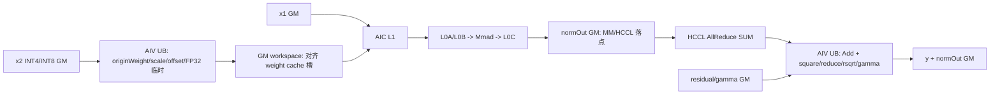

# WeightQuantMatmulAllReduceAddRmsNorm A2 ACLNN 算子知识

## 算子速览

| 项目 | 内容 |
|---|---|
| 实际入口 | 公开 ACLNN：`aclnnWeightQuantMatmulAllReduceAddRmsNormGetWorkspaceSize` + `aclnnWeightQuantMatmulAllReduceAddRmsNorm`；固定 Commit 无 V2。 |
| 计算语义 | `W=(cast(x2)+offset)*scale`；`z=AllReduce_sum(x1*W+bias)`；`y=z+residual`；`normOut=y*rsqrt(mean(y^2)+epsilon)*gamma`。 |
| 输入输出 | x1/residual/gamma/y/normOut 为同一 FP16 或 BF16；x2 为 INT8/INT4 ND；bias/offset 可选。 |
| 执行类型 | 单次 `MIX_AIC_1_2` launch：AIV_VECTOR 反量化和 ARN，AIC_CUBE Matmul，同一 Device 生命周期内提交 HCCL AllReduce。 |
| Kernel 路线 | R-001～R-012：`transB × {tensor,channel,group} × hasOffset`；每条再由 ARN key 选择 Normal/SplitD/MergeN/SingleN/MultiN。 |
| 核心资源 | GM 输入输出与 workspace 三槽反量化 cache；AIC Matmul 使用 L1/L0A/L0B/L0C；AIV 使用 UB/TQue/TBuf；另有 256 B 完成计数区。 |
| 来源闭包 | `source_closed`：公开 ACLNN → OpDef/融合 Tiling → 12 key router → CUSTOM 反量化 body/AIC Matmul/HCCL/五种 ARN body → ascend910b 构建与 binary 配置。 |
| 验证状态 | 已完成源码闭包检查；本次知识提取未执行编译、真机、数值或性能测试。 |

## 接口与语义

### 计算语义

令 x1 展平后的二维形状为 [M,K]，x2 逻辑矩阵为 [K,N]，则公开语义为：

1. W = (cast(x2) + antiquantOffset) × antiquantScale；offset 缺省时省略加法。
2. mm = AllReduce_sum(x1 × W + bias)。
3. y = mm + residual。
4. normOut = y / sqrt(mean(y², axis=-1) + epsilon) × gamma。

per-group 时 scale/offset 的形状为 [ceil(K,G),N]，G=antiquantGroupSize；per-channel 为 [N] 或 [1,N]；per-tensor 为 [1]。上述次序来自 Device body：先将 INT8/INT4 权重 cast，再按模板分支加 offset，最后乘 scale；不能把 offset 当成需再次取负的零点。FP16 路径在 half 中反量化；BF16 路径以 FP32 处理中间量，再以 RINT 舍入回 BF16 cache。

公开文档的展示公式写成 `x2*antiquantScale+antiquantOffset`，与固定 Commit 的 Device 执行次序不一致；本卡把文档表达保留为接口材料，但 Kernel Route 事实以 `Mc2AntiQuant` 及其 Add→Mul helper 为准，不把两者强行解释为代数等价。

### 输入、输出与属性

| 参数 | shape/layout | dtype | 约束、默认值与语义 |
|---|---|---|---|
| x1 | ND；[M,K] 或 [B,S,K]，M=B×S | FP16/BF16 | 必选；不转置；M∈[1,INT32_MAX]，K∈[1,65535] |
| x2 | ND；逻辑 view shape 固定 [K,N]；连续 stride 为非转置，`stride[-2]==1 && stride[-1]==K` 表示底层转置存储 | INT8/INT4 | 必选、二维；N∈[1,65535] |
| bias | [N] | 同 x1 | 可选；BF16 Device 路径转 FP32 |
| antiquantScale | [1]、[N]/[1,N] 或 [ceil(K,G),N] | 同 x1 | 必选；分别表示 tensor/channel/group |
| antiquantOffset | 与 scale 相同 | 同 x1 | 可选；Device 顺序为先加后乘 |
| residual | ND；[B,S,N]，B×S=M | 同 x1 | 必选、三维 |
| gamma | ND；[N] | 同 x1 | 必选、一维 |
| epsilon | 标量 | Host double→POD float | 必选；`0<epsilon<1` |
| group | C 字符串 | `const char*` | 必选 HCCL 通信域名 |
| reduceOp | C 字符串 | `const char*` | 必选且仅 `sum` |
| commTurn | 标量 | int64 | 必选且固定 0 |
| streamMode | 标量 | int64 | 必选且仅 1（stop-on-failure） |
| antiquantGroupSize | 标量 | int64 | group 时 G 为 32 倍数且 `32<=G<=K-1`；其他粒度为 0 |
| y | 同 residual | 同 residual | Add 输出 |
| normOut | 同 residual | 同 residual | RMSNorm 输出；先承接 MM/AR 中间结果再原位覆盖 |

公开文档给出 M∈[1,INT32_MAX]、K/N∈[1,65535]。API 对空输入有专门分支：x1、x2、scale、residual 或 gamma 任一为空时，K=0 报错；其余空 M/N 返回 workspace=0，执行入口直接成功。

### 入口与版本

- 版本链：固定 Commit 仅公开无后缀 GetWorkspaceSize/Execute 二段式接口，不存在本算子的 V2 文件或符号。
- GetWorkspaceSize 先做非空、shape 与 streamMode 检查，再通过 InnerMatmulAllReduceAddRmsNormGetWorkspaceSize 进入生成式算子执行器；transposeX1 固定 false，transposeX2 由 x2 末两维判断。
- Execute 在 workspace 为空或 workspaceSize=0 时直接返回成功；否则调用 InnerMatmulAllReduceAddRmsNorm。
- 头文件将两入口标记为 deprecated，并写明计划在 2026 年 12 月之后的版本更新中弃用；替代组合是 aclnnWeightQuantMatmulAllReduce + aclnnAddRmsNorm。这是迁移提示，不代表固定 Commit 已删除当前入口，也不应扩写为已确定的下线日期。

## Host/Launcher 执行流程

### 参数校验与前处理

1. ArnCheckNotNull 强制 x1、x2、antiquantScale、residual、gamma 非空；bias 与 antiquantOffset 可空。
2. ArnCheckShape 先按逻辑 view shape 检查 `x1[-1]==x2[0]`、`residual[-1]==x2[-1]`；随后 `IsTransposeLastTwoDims` 读取 view stride 判定底层是否为末两维转置。因此两种布局的逻辑 x2 形状都仍是 [K,N]，不是把转置 Route 的 view shape 改成 [N,K]。
3. streamMode 必须为 NUM_ACL_STOP_ON_FAILURE；reduceOp、commTurn、dtype、shape、group/rank 等剩余约束由 OpDef 与复用的 WeightQuantMatmulAllReduceTiling 闭合。
4. Host tiler WeightQuantMatmulAllReduceAddRmsNormTiling 复用 WeightQuantMatmulAllReduceTiling，另构造 ARN context；要求 x1 dtype 与 residual dtype 相同。
5. BF16 且 bias 非空时，`PreProcForBiasOnVector` 令 AIV0 调用 `CastBFtoFloatOnAiv0`，先把 bias 转到 Workspace 首段 FP32 区；随后 `SyncAll`，Matmul bias 指针切换到该区，工作区基址越过该切片。

### 参数、Workspace 与生命周期

| 阶段 | 主要对象 | 生命周期/字节 |
|---|---|---|
| ACLNN Host | aclOpExecutor | GetWorkspaceSize 创建，Execute 消费 |
| MC2 tiling | WeightQuantMatmulAllReduceTilingData | 包含 matmul、通信、tile/tail 与反量化参数 |
| Fusion tiling | Mc2WeightQuantMatmulAllReduceAddRmsNormTilingData | 外层 POD：MC2 数据 + ARN key/data |
| 系统 Workspace | SYS_WORKSPACE_SIZE | ARN 通用 tiler声明 16 MiB，融合 tiler扣除重复系统区 |
| ARN 计数区 | rcvCntGM | 在 MC2 workspace 尾部追加 256 B；第一个 int64 保存已完成分片计数 |
| Device 通信 | tile/tail HCCL handle | Init 创建，Process 轮询，Finalize 释放 |
| BF16 bias 切片 | workspace 起始 `AlignUp(N, SHAPE_ALIGN_SIZE)*4` B | AIV0 产生、全部核同步后供 AIC bias 使用；随后工作区基址前移 |
| 反量化缓存 | `min(3,cubeSingleNLoop)` 个 Host 规划槽；Device 模 3 轮转 | 位于 bias 切片之后；Matmul 各 turn 均提交后，该 cache 首部转为 ARN 的 `rcvCnt` 所在区 |

融合 GetWorkspaceSize 的结果为 `Wmc2 + (Warn - 16 MiB)`，而 ARN 报告 `Warn=16 MiB+256 B`，故 `Wfusion=Wmc2+256 B`。非转置单槽元素数为 `kAlign*singleCoreN*cubeBlockDimN`，转置单槽为 `AlignUp(K,256)*singleCoreN*cubeBlockDimN`，每槽再按 256 个 xType 元素对齐。固定源码没有给出所有嵌套外部 POD 的编译后 sizeof/offsetof 常数；只能确认 ARN 数据字段顺序及外层以 8 字节复制，本任务禁止编译，故不臆造其 ABI 数值。

### 启动图与失败传播

Host GetWorkspaceSize → 生成 executor → WeightQuantMatmulAllReduceAddRmsNormTiling → 单 Kernel matmul_all_reduce_add_rms_norm → AIV/AIC/HCCL 协作 → y/normOut。

Kernel entry 检查 user workspace，设置 KERNEL_TASK_TYPE_DEFAULT(KERNEL_TYPE_MIX_AIC_1_2)，按 MC2 TilingKey 实例化 12 个模板之一。Host 错误以 ACLNN 参数/内部错误返回；Execute 的内部非零结果统一转换为 ACLNN_ERR_INNER。Device 同步或通信错误没有 Host 侧恢复分支，streamMode=1 的语义是失败即停。

## Route 与参数设计

### 分核与资源计算

- MC2 的 M 轴由 MMPlusAllReduce 产生 tileCnt、tileM，并可能产生 tailCnt、tailM；tile 与 tail 分别建 HCCL handle。
- ARN 对 tileM 与 tailM 分别调用 DoOpTiling；blockFactor=ceil(numRow/AIVCoreNum)，numBlocks=ceil(numRow/blockFactor)。
- 外层 blockDim 固定为 aicCoreNum；ARN 的 tile/tail block 数必须均不超过 aicCoreNum×2，契合 MIX_AIC_1_2 的 AIV:AIC=2:1。
- ARN 初始 UB 因子：B16 为 12288 元素；SplitD 为 12096；对齐粒度 16；small-reduce 阈值 2000。
- Matmul 的 TCubeTiling 由运行时 M/K/N、核数和 SoC 资源计算，固定源码不存在一组通用常数；Kernel 按 POD 实值消费。

### Route 选择

| 顺序 | Route | Key/模板 | 精确选择条件与优先级 | 不适用去向 |
|---:|---|---|---|---|
| 1 | R-001 ND tensor 无 offset | 2293772 | `!transB && scaleNum==1 && offset==nullptr` | 按 transB/粒度/offset 继续 |
| 2 | R-002 ND tensor 有 offset | 3342348 | `!transB && scaleNum==1 && offset!=nullptr` | 同上 |
| 3 | R-003 trans tensor 无 offset | 69402636 | `transB && scaleNum==1 && offset==nullptr` | 同上 |
| 4 | R-004 trans tensor 有 offset | 70451212 | `transB && scaleNum==1 && offset!=nullptr` | 同上 |
| 5 | R-005 ND channel 无 offset | 4390924 | `!transB && scaleNum!=1 && G==0 && offset==nullptr` | 同上 |
| 6 | R-006 ND channel 有 offset | 5439500 | `!transB && scaleNum!=1 && G==0 && offset!=nullptr` | 同上 |
| 7 | R-007 trans channel 无 offset | 71499788 | `transB && scaleNum!=1 && G==0 && offset==nullptr` | 同上 |
| 8 | R-008 trans channel 有 offset | 72548364 | `transB && scaleNum!=1 && G==0 && offset!=nullptr` | 同上 |
| 9 | R-009 ND group 无 offset | 6488076 | `!transB && scaleNum!=1 && G>0 && offset==nullptr` | 同上 |
| 10 | R-010 ND group 有 offset | 7536652 | `!transB && scaleNum!=1 && G>0 && offset!=nullptr` | 同上 |
| 11 | R-011 trans group 无 offset | 73596940 | `transB && scaleNum!=1 && G>0 && offset==nullptr` | 同上 |
| 12 | R-012 trans group 有 offset | 74645516 | `transB && scaleNum!=1 && G>0 && offset!=nullptr` | Host 校验失败 |

```text
scaleNum == 1 ? tensor : (G > 0 ? group : channel)
  -> transB = IsTransposeLastTwoDims(x2)
  -> hasOffset = (antiquantOffset != nullptr)
  -> R-001 ... R-012 / Mc2WeightQuantBatchMatmulV2CustomKernel<DTYPE_X1,DTYPE_X2,DTYPE_BIAS_FOR_MC2,DTYPE_Y,false,transB,antiQuantType,hasOffset,NONE>
  -> 每个 tile/tail 的 ARN：
       N > 12288                         -> SplitD
       else blockFactor == 1             -> SingleN
       else AlignUp(N,16) <= 2000         -> MergeN
       else dtype==FP16 && N%16==0        -> MultiN（rowFactor==0 回退 Normal）
       else                               -> Normal
```

### 模板/实现执行矩阵

| Route | key/selector | dtype/shape/platform 完整命中条件 | 执行族与 kernel 节点 | 实际模板/body | 内存与同步特征 | tail/fallback |
|---|---:|---|---|---|---|---|
| R-001 ND tensor 无 offset | 2293772 | A2；B16×INT4/8；非转置；tensor；无 offset | 单 MIX_CV：AIV→AIC→HCCL→AIV | `CustomKernel<B16,W,FP32/B16,B16,false,false,PER_TENSOR,false,NONE>` | 标量 scale；三槽；flag 8/9 | tile/tail 各选 ARN |
| R-002 ND tensor 有 offset | 3342348 | 同 R-001，offset 有 | 同上 | `CustomKernel<B16,W,FP32/B16,B16,false,false,PER_TENSOR,true,NONE>` | 标量 scale/offset | 同上 |
| R-003 trans tensor 无 offset | 69402636 | A2；B16×INT4/8；转置；tensor；无 | 同上 | `CustomKernel<B16,W,FP32/B16,B16,false,true,PER_TENSOR,false,NONE>` | 转置搬运；三槽 | 同上 |
| R-004 trans tensor 有 offset | 70451212 | 同 R-003，offset 有 | 同上 | `CustomKernel<B16,W,FP32/B16,B16,false,true,PER_TENSOR,true,NONE>` | 转置+双标量 | 同上 |
| R-005 ND channel 无 offset | 4390924 | A2；B16×INT4/8；非转置；channel；无 | 同上 | `CustomKernel<B16,W,FP32/B16,B16,false,false,PER_CHANNEL,false,NONE>` | 逐 N scale | 同上 |
| R-006 ND channel 有 offset | 5439500 | 同 R-005，offset 有 | 同上 | `CustomKernel<B16,W,FP32/B16,B16,false,false,PER_CHANNEL,true,NONE>` | 逐 N scale/offset | 同上 |
| R-007 trans channel 无 offset | 71499788 | A2；B16×INT4/8；转置；channel；无 | 同上 | `CustomKernel<B16,W,FP32/B16,B16,false,true,PER_CHANNEL,false,NONE>` | 转置+逐 N scale | 同上 |
| R-008 trans channel 有 offset | 72548364 | 同 R-007，offset 有 | 同上 | `CustomKernel<B16,W,FP32/B16,B16,false,true,PER_CHANNEL,true,NONE>` | 转置+逐 N 双参数 | 同上 |
| R-009 ND group 无 offset | 6488076 | A2；B16×INT4/8；非转置；group；无 | 同上 | `CustomKernel<B16,W,FP32/B16,B16,false,false,PER_GROUP,false,NONE>` | 逐 K-group×N scale | 同上 |
| R-010 ND group 有 offset | 7536652 | 同 R-009，offset 有 | 同上 | `CustomKernel<B16,W,FP32/B16,B16,false,false,PER_GROUP,true,NONE>` | 逐 group 双参数 | 同上 |
| R-011 trans group 无 offset | 73596940 | A2；B16×INT4/8；转置；group；无 | 同上 | `CustomKernel<B16,W,FP32/B16,B16,false,true,PER_GROUP,false,NONE>` | 转置 group 切 K | 同上 |
| R-012 trans group 有 offset | 74645516 | 同 R-011，offset 有 | 同上 | `CustomKernel<B16,W,FP32/B16,B16,false,true,PER_GROUP,true,NONE>` | 最完整搬运；显式同步 | 同上 |

ARN key：FP16 Normal/SplitD/MergeN/SingleN/MultiN = 10/11/12/13/14；BF16 = 30/31/32/33，BF16 MultiN key 34 虽在枚举体系中有位置，但选择逻辑不产生它。MC2 通用空张量 key 28 被公开 API 的空分支截获，不是本公开入口可达 Route。

### 隐藏性能 Guard

| Guard | Host/Tiling 条件 | Device/资源原因 | 影响 Route | 不满足时去向 | 源码符号 |
|---|---|---|---|---|---|
| 超长 N | `N>12288` | 一行不能由常规 UB 方案容纳 | 所有主 Route 的 SplitD | 继续 ARN 优先级 | `CommonAddRmsNormTiling::DoOpTiling` |
| 单行块 | `blockFactor==1` | 固定 195584 B 单行缓冲 | SingleN | MergeN/MultiN/Normal | 同上 |
| 短行 | `AlignUp(N,16)<=2000` | 合并多行提高 AIV 利用率 | MergeN | MultiN/Normal | 同上 |
| FP16 对齐多行 | `dtype==FP16 && N%16==0` | MultiN 双缓冲避免掩码尾 | MultiN | BF16/不对齐走 Normal | 同上 |
| MultiN 可切行 | `rowFactor>0` | UB 需容纳双缓冲 | MultiN | `rowFactor==0` 回退 Normal | 同上 |
| Weight UB | `antiquantBuffer+weightBuffer<=UB` | 反量化参数与权重必须共驻 UB | R-001～R-012 | Host 二分缩小 base 块或失败 | `WeightQuantMatmulAllReduceTiling` custom tiler |
| cache 槽数 | `cacheCnt=min(3,cubeSingleNLoop)` | 不为不存在的 loop 分配槽 | R-001～R-012 | 最少按实际 loop 数 | `WEIGHT_CACHE_COUNT` |
| 输出复用 | `useMmOutputAsX1Input=true` | normOut 兼作通信落点与 ARN x1 | R-001～R-012 | false 会另计输入 workspace | `AddRmsNormTilingDepend` |
| 调度模式 | `scheduleMode=1` | entry/body 使用全核 `SyncAll` | 单 MIX_CV launch | Host tiling 失败 | `SetScheduleMode(1)` |
| A2 通信模式 | `commMode` 为空或 `ai_cpu` | arch22 HCCL 实现边界 | R-001～R-012 | 参数失败 | `CheckCommMode` |

### POD/ABI

| 结构 | 字段 | 类型/位宽 | ABI 布局 | 单位 | Host/launcher producer | Device consumer | 边界 |
|---|---|---|---|---|---|---|---|
| `AddRMSNormTilingData` | `num_row` | uint32/32 | offsetof 0；pack(8)；本地结构字段长 28 B | 行 | `DoOpTiling` | ARN `Init`/`Process` | tileM 或 tailM |
| 同上 | `num_col` | uint32/32 | offsetof 4 | 元素 | `DoOpTiling=N` | 五个 ARN body | N≤65535 |
| 同上 | `block_factor` | uint32/32 | offsetof 8 | 行/块 | `CeilDiv(numRow,numBlocks)` | 行起点/尾行 | 至少 1 |
| 同上 | `row_factor` | uint32/32 | offsetof 12 | 行 | ARN selector | SplitD/MergeN/MultiN | Route 相关；inactive 仍保留字段 |
| 同上 | `ub_factor` | uint32/32 | offsetof 16 | 元素 | ARN selector | UB tile 长度 | B16 初始 12288；SplitD 12096 |
| 同上 | `epsilon` | float/32 | offsetof 20 | 标量 | double 转 float | `Adds` 后 `Sqrt/Reciprocal` | 精度收窄为 FP32 |
| 同上 | `avg_factor` | float/32 | offsetof 24 | `1/N` | `1.0f/N` | square mean | N 非零 |
| `AddRMSNormTilingeKeyData` | `ARNKeyTile` | uint32/32 | offsetof 0；结构长 16 B | key | tile `DoOpTiling` | `AddRmsNormKernel` router | FP16 10～14；BF16 30～33 |
| 同上 | `ARNKeyTail` | uint32/32 | offsetof 4 | key | tail `DoOpTiling` | 同上 | 无 tail 时 inactive |
| 同上 | `ARNNumBlocksTile` | uint32/32 | offsetof 8 | AIV blocks | tile `DoOpTiling` | tile dispatch | ≤2×AIC core |
| 同上 | `ARNNumBlocksTail` | uint32/32 | offsetof 12 | AIV blocks | tail `DoOpTiling` | tail dispatch | ≤2×AIC core |
| `WeightQuantMatmulAllReduceTilingData` | `msg` | `Mc2Msg`/固定仓嵌套定义 | pack(8)，编译后 offsetof/sizeof 未在本 op 固化 | 通信消息 | WQ tiler | `MatmulAllReduceBase` | 不手构 ABI |
| 同上 | `param` | `RCSTiling`/固定仓嵌套定义 | 位于 `msg` 后，精确编译 ABI 未固化 | 参数 | WQ tiler | MC2 base/custom body | 同上 |
| 同上 | `tilematmulTiling` | `Mc2WeightQuantBatchMatmulV2TilingData` | 位于 `param` 后；含 TCube/custom POD | tile | WQ tiler | tile body | 精确嵌套 ABI 缺失 |
| 同上 | `tailmatmulTiling` | 同上 | 位于 tile POD 后 | tail | WQ tiler | tail body | 无 tail 时 inactive |
| `WeightQuantMatmulAllReduceAddRmsNormTilingData` | `weightQuantMatmulAllReduceTilingData` | 上述结构 | 外层首字段、pack(8) | POD | fusion tiler | fusion entry/body | 以 uint64 粒度复制 |
| 同上 | `addRMSNormTileTilingData` | ARN data | 紧随 MC2 POD；精确 offsetof 依赖前段 sizeof | POD | fusion tiler | ARN tile | 不臆造偏移 |
| 同上 | `addRMSNormTailTilingData` | ARN data | 紧随 tile ARN | POD | fusion tiler | ARN tail | 同上 |
| 同上 | `addRmsNormTilingeKeyData` | ARN key data | 外层末字段 | POD | fusion tiler | ARN router | 同上 |

### Route 源码闭包

| Route | Key/selector | Host/Tiling producer | POD/参数 | Kernel entry/router | Kernel body/直接依赖 | 构建接线 |
|---|---:|---|---|---|---|---|
| R-001 | 2293772 | WQ tiler + fusion tiler | WQ POD + tile/tail ARN | `matmul_all_reduce_add_rms_norm` | CUSTOM body + base + ARN 五 body | OpDef/binary/CMake |
| R-002 | 3342348 | 同上 | 同上 | 同上 key case | 同上，offset=true | 同上 |
| R-003 | 69402636 | 同上 | 同上 | 同上 key case | 同上，transB=true | 同上 |
| R-004 | 70451212 | 同上 | 同上 | 同上 key case | transB=true/offset=true | 同上 |
| R-005 | 4390924 | 同上 | 同上 | 同上 key case | antiquant channel | 同上 |
| R-006 | 5439500 | 同上 | 同上 | 同上 key case | channel/offset | 同上 |
| R-007 | 71499788 | 同上 | 同上 | 同上 key case | trans channel | 同上 |
| R-008 | 72548364 | 同上 | 同上 | 同上 key case | trans channel/offset | 同上 |
| R-009 | 6488076 | 同上 | 同上 | 同上 key case | antiquant group | 同上 |
| R-010 | 7536652 | 同上 | 同上 | 同上 key case | group/offset | 同上 |
| R-011 | 73596940 | 同上 | 同上 | 同上 key case | trans group | 同上 |
| R-012 | 74645516 | 同上 | 同上 | 同上 key case | trans group/offset | 同上 |

闭包为公开 API → inner op → fusion tiler → WQ tiler/ARN tiler → 外层 POD → 单 `MIX_AIC_1_2` entry → `MatmulAllReduceAddRmsNormWeightQuant` → `MatmulAllReduceBase`/仓内 `weight_quant_batch_matmul_v2_custom.h`/五种 ARN body。TCube 通用库的内部物理 L0 offset 与完整编译 ABI 在固定仓中不可见，已明确标缺失；CUSTOM 反量化 body 本身不存在私有实现缺口。

## Kernel 实现

### 公共执行流程

1. entry 将 a/b/bias/normOut/workspace/normOut 组为 MC2 地址，residual/gamma/y/normOut 组为 ARN 地址。
2. MatmulAllReduceAddRmsNormWeightQuant::Init 初始化 WeightQuant Matmul、HCCL tile/tail handle 与 ARN 参数；BF16 bias 先转 FP32。
3. 每个 tile/tail turn：AIV 将 INT8/INT4 权重搬入 UB、反量化到 FP16/BF16 三槽缓存；AIC 等待对应槽并执行 Matmul；PostProcEachTurn 推进 A/C 偏移并提交 HCCL。
4. Matmul/AllReduce 提交完成后 SyncAll；AIV 进入 AddRmsNormKernel。block 0 轮询两个 handle 的已完成计数，将计数写入 rcvCntGM，DCCI clean/invalidate 后 SyncAll 广播。
5. 各 AIV 只处理新完成的连续前缀，写 y，并把 normOut 中的 AllReduce 结果原位改成归一化结果；完成全部 tileCnt+tailCnt 后再次 SyncAll，notify core 执行 HCCL Finalize。

### Route R-001：非转置 × per-tensor × 无 offset

#### 适用条件

x2 按 [K,N] 存储，scale 仅 1 个元素，offset 为空。

##### 选择证据

Host key=2293772；entry 实例化 TRANS_B=false、ANTIQUANT_TENSOR、HAS_OFFSET=false。

#### Device 数据流

GM x2 → AIV UB cast/scale → 三槽 GM cache → AIC L1/L0 Matmul → GM normOut → HCCL sum → AIV ARN → GM y/normOut。

##### 函数级调用链

matmul_all_reduce_add_rms_norm → MatmulAllReduceAddRmsNormWeightQuant::Process/InnerProcess → `mmOp_.Process` → Mc2WeightQuantBatchMatmulV2CustomKernel::ProcessVector/ProcessCube → AddRmsNormKernel::ComputeAddRmsNorm。

##### 源码等价伪码

每个权重块执行 deq=cast(w)×scale；AIC 计算 x1×deq+bias；提交 AllReduce；按完成计数执行 Add 和 RmsNorm。

#### 内存与数据搬运

##### 资源与搬运表

| 对象 | 路径 | 复用 |
|---|---|---|
| x2 block | GM→UB→GM cache | cache slot=cubeNLoop mod 3 |
| Matmul | GM→L1/L0→GM | TCubeTiling 运行时确定 |
| ARN | normOut/residual/gamma GM↔UB | normOut 原位覆盖 |

##### 分层内存布局

scale 在 Vector 侧广播；非转置权重按连续 N 方向搬运。AIC 使用通用 Matmul 的 L1/L0A/L0B/L0C 层次，固定源码只暴露 TCubeTiling 消费点。



##### 字节账、交接边与复用顺序

```text
bias_bytes = (dtype==BF16 && bias!=null) ? AlignUp(N,SHAPE_ALIGN_SIZE)*4 : 0
cache_slot_elems = transB ? AlignUp(K,256)*singleCoreN*cubeBlockDimN
                          : kAlign*singleCoreN*cubeBlockDimN
cache_bytes = AlignUp(cache_slot_elems,256)*sizeof(xType)*min(3,cubeSingleNLoop)
workspace_fusion = workspace_mc2 + 256 B
ARN Normal(B16) = 14*ubFactor + 256 B
ARN SplitD(B16) = 16*ubFactor + 36*rowFactor + 256 B
ARN MergeN(B16) = 18*ubFactor + 260*rowFactor B
ARN SingleN = 195584 B
ARN MultiN(FP16) = 16*ubFactor + 2*AlignUp(N,16) + 64*rowFactor + 256 B
```

WQ custom tiler保证 `antiquantBuffer+weightBuffer<=UB`；originWeight/scale/offset 队列单缓冲，输出 weight 队列双缓冲，BF16 另用 FP32 中间 TBuf。AIC 的 L1/L0A/L0B/L0C 容量来自 runtime `TCubeTiling`；固定仓缺少通用 Matmul 库内部定义，因此精确物理 offset 标为不可见。Vector 以 flag 8 交给 Cube，以 flag 9 回收。ARN 仅在全部 Matmul turn 提交后启动，故已死亡 cache 首部可安全转作 `rcvCnt`。

#### 同步、精度与尾块

##### 同步与数值边界表

| 项 | 语义 |
|---|---|
| V→C/C→V | flag8/flag9；局部完成 flag6/flag7 |
| 通信→ARN | Query 完成计数 + rcvCntGM + DCCI + SyncAll |
| FP16 | Add 以 half 路径落 y，归一化累加 FP32 |
| BF16 | Add FP32 后 RINT 到 y；归一化中间按实现舍入 |
| 尾块 | tailM 独立 HCCL handle 与 ARN tiling |

#### 关键实现

##### 符号证据表

| 符号 | 作用 |
|---|---|
| ProcessVector | 反量化并维护三槽流水 |
| ProcessCube | WaitForVector 后 IterateAll |
| GetCurFinishedCnt | 汇总 tile/tail HCCL 完成数 |
| AddRmsNorm | Normal ARN 实现 |

### Route R-002：非转置 × per-tensor × 有 offset

#### 适用条件

与 R-001 相同，但 antiquantOffset 非空。

##### 选择证据

Host key=3342348；HAS_OFFSET=true。

#### Device 数据流

同 R-001，Vector 多读取一个标量 offset，计算 (cast(w)+offset)×scale。

##### 函数级调用链

同 R-001，差异封装在 WeightQuantMatmul 模板 offset 分支。

##### 源码等价伪码

deq=(cast(w)+offsetScalar)×scaleScalar；其余流程同 R-001。

#### 内存与数据搬运

##### 资源与搬运表

| 新增对象 | 路径 | 代价 |
|---|---|---|
| offsetScalar | GM→UB 广播 | 每个权重 tile 参与 Vector 运算 |

##### 分层内存布局

沿用 R-001 三槽布局，offset 与 scale 分属参数队列/缓冲。

##### 字节账、交接边与复用顺序

cache、TCube 与 ARN 字节账同 R-001；offset 不新增 Host workspace 公式项。

#### 同步、精度与尾块

##### 同步与数值边界表

| 项 | 结论 |
|---|---|
| 同步/尾块 | 同 R-001 |
| 精度 | offset 加法和 scale 乘法在反量化 Vector 路径完成 |

#### 关键实现

##### 符号证据表

| 符号 | 作用 |
|---|---|
| ANTIQUANT_TENSOR + true | 编译期选择标量 offset 路径 |
| `CopyInAntiquantParams` | per-channel/group 搬入并广播 offset/scale；tensor 参数在 `InitInput` 取标量 |

### Route R-003：转置 × per-tensor × 无 offset

#### 适用条件

x2 以转置逻辑布局存储，scale 为标量，offset 为空。

##### 选择证据

Host key=69402636；TRANS_B=true。

#### Device 数据流

转置权重通过 `WeightCopyInAndCast` 配置 `DataCopyPad` 的 `blockCount=Ntile`、行长 Ktile 和 GM K-stride 搬入；`Brcb` 用于 scale/offset 参数广播，不负责权重转置。之后进入同一三槽/AIC/通信/ARN 流程。

##### 函数级调用链

同 R-001，Vector CopyIn 分支选择 transB 路径。

##### 源码等价伪码

按转置 stride 取权重块 → UB 重排 → cast×scale → cache → Matmul/AllReduce/ARN。

#### 内存与数据搬运

##### 资源与搬运表

| 对象 | 路径 | 特点 |
|---|---|---|
| transposed x2 | GM→UB | `DataCopyPad` 跨行 K-stride；cache 仍以 transB 模板供 AIC 读取 |
| cache | UB→GM | 仍按 AIC 消费布局写三槽 |

##### 分层内存布局

GM stride 与非转置不同；cache 之后的 AIC L1/L0 层次不变。

##### 字节账、交接边与复用顺序

缓存对齐、flag 交接、阶段复用同 R-001；转置影响搬运次数而非融合 workspace 公式。

#### 同步、精度与尾块

##### 同步与数值边界表

| 项 | 结论 |
|---|---|
| 同步/精度 | 同 R-001 |
| 尾 N/K | `DataCopyPad` 的真实 blockLen/stride 与 pad 处理；参数广播使用 `Brcb` |

#### 关键实现

##### 符号证据表

| 符号 | 作用 |
|---|---|
| TRANS_B=true | 选择转置 B 模板 |
| `WeightCopyInAndCast` | 计算转置权重的 K-stride `DataCopyPad` 参数 |

### Route R-004：转置 × per-tensor × 有 offset

#### 适用条件

R-003 的转置布局，且标量 offset 非空。

##### 选择证据

Host key=70451212；TRANS_B=true、HAS_OFFSET=true。

#### Device 数据流

转置搬运后计算 (w+offsetScalar)×scaleScalar，再走公共流程。

##### 函数级调用链

同 R-003，并启用 offset 参数分支。

##### 源码等价伪码

stridedCopy(w) → (cast(w)+offset)×scale → cache → MM → AR → ARN。

#### 内存与数据搬运

##### 资源与搬运表

| 差异 | 资源 |
|---|---|
| 转置 + offset | strided `DataCopyPad` 与 offset 参数 UB 广播同时启用 |

##### 分层内存布局

沿用 R-003；标量参数广播不改变 cache 形状。

##### 字节账、交接边与复用顺序

同 R-003，Host workspace 不因 offset 单独增加。

#### 同步、精度与尾块

##### 同步与数值边界表

| 项 | 结论 |
|---|---|
| 同步/尾块 | 同 R-003 |
| 数值 | 加 offset 后乘 scale |

#### 关键实现

##### 符号证据表

| 符号 | 作用 |
|---|---|
| key 70451212 | 唯一绑定转置 tensor+offset |
| `InitInput` | per-tensor offset 直接读取标量；无需参数向量 copy-in |

### Route R-005：非转置 × per-channel × 无 offset

#### 适用条件

x2 非转置；scale 为 [N] 或 [1,N]；G=0；offset 为空。

##### 选择证据

Host key=4390924；ANTIQUANT_CHANNEL。

#### Device 数据流

每个 N tile 搬入对应 scale 向量，与权重逐通道相乘，再走公共流程。

##### 函数级调用链

ProcessVector → per-channel CopyInScale → AntiQuantCompute → ProcessCube → ARN。

##### 源码等价伪码

deq[k,n]=cast(w[k,n])×scale[n]。

#### 内存与数据搬运

##### 资源与搬运表

| 对象 | 路径 | 粒度 |
|---|---|---|
| scale | GM→UB | 当前 N tile |
| x2 | GM→UB→3-slot cache | K×N tile |

##### 分层内存布局

scale 向量在 UB 展开到权重计算所需形状；AIC 与 ARN 布局同公共流程。

##### 字节账、交接边与复用顺序

比 tensor Route 增加 scale 向量搬运，三槽和 256 元素对齐不变。

#### 同步、精度与尾块

##### 同步与数值边界表

| 项 | 结论 |
|---|---|
| N 尾块 | scale 与权重采用相同有效 N |
| 其他 | 同 R-001 |

#### 关键实现

##### 符号证据表

| 符号 | 作用 |
|---|---|
| ANTIQUANT_CHANNEL | 编译期逐 N 通道缩放 |
| antiquantType | Host 将非标量且 G=0 编为 channel |

### Route R-006：非转置 × per-channel × 有 offset

#### 适用条件

R-005 且 offset 具有逐通道形状。

##### 选择证据

Host key=5439500；ANTIQUANT_CHANNEL、HAS_OFFSET=true。

#### Device 数据流

scale[n] 与 offset[n] 同 tile 搬入，计算 (w+offset[n])×scale[n]。

##### 函数级调用链

同 R-005，额外启用 channel offset CopyIn。

##### 源码等价伪码

deq[k,n]=(cast(w[k,n])+offset[n])×scale[n]。

#### 内存与数据搬运

##### 资源与搬运表

| 对象 | 路径 |
|---|---|
| scale/offset channel tile | GM→UB 参数队列 |
| dequant weight | UB→三槽 GM cache |

##### 分层内存布局

两个 N 向量在 UB 按相同通道索引广播。

##### 字节账、交接边与复用顺序

参数搬运约为 R-005 的两条向量；workspace 公式与交接协议不变。

#### 同步、精度与尾块

##### 同步与数值边界表

| 项 | 结论 |
|---|---|
| 参数边界 | scale/offset 有效 N 必须与权重 N tile 一致 |
| 其他 | 同 R-005 |

#### 关键实现

##### 符号证据表

| 符号 | 作用 |
|---|---|
| key 5439500 | 非转置 channel+offset |
| HAS_OFFSET | 消除运行时空指针分支 |

### Route R-007：转置 × per-channel × 无 offset

#### 适用条件

x2 转置逻辑布局；逐通道 scale；offset 为空。

##### 选择证据

Host key=71499788；TRANS_B=true、ANTIQUANT_CHANNEL。

#### Device 数据流

跨 stride 搬权重并按输出通道匹配 scale，随后进入三槽与公共流程。

##### 函数级调用链

transB CopyIn → channel AntiQuantCompute → ProcessCube → HCCL → ARN。

##### 源码等价伪码

for n-tile: gather transposed w; deq=w×scale[n]; MM/AR/ARN。

#### 内存与数据搬运

##### 资源与搬运表

| 对象 | 特点 |
|---|---|
| x2 | `DataCopyPad` 按 K-stride 处理转置；`Brcb` 仅广播参数 |
| scale | 连续 N 向量搬入 |

##### 分层内存布局

GM 权重与 scale 的地址步进不同，在 UB 反量化后统一成 AIC cache 布局。

##### 字节账、交接边与复用顺序

三槽对齐与同步协议同 R-003；每 N tile 增加 scale 向量。

#### 同步、精度与尾块

##### 同步与数值边界表

| 项 | 结论 |
|---|---|
| 转置尾块 | padded copy 后只计算有效 N/K |
| 其他 | 同 R-005 |

#### 关键实现

##### 符号证据表

| 符号 | 作用 |
|---|---|
| key 71499788 | 转置 channel 无 offset |
| `WeightCopyInAndCast` | 转置权重 strided copy 与 cast |

### Route R-008：转置 × per-channel × 有 offset

#### 适用条件

R-007 且 offset 为逐通道向量。

##### 选择证据

Host key=72548364。

#### Device 数据流

转置权重、scale[n]、offset[n] 在 Vector 合流，随后公共流程。

##### 函数级调用链

同 R-007，加 HAS_OFFSET channel 路径。

##### 源码等价伪码

deq=(gather(w)+offset[n])×scale[n]；MM/AR/ARN。

#### 内存与数据搬运

##### 资源与搬运表

| 对象 | 路径 |
|---|---|
| transposed x2 | GM→UB 重排 |
| scale/offset | GM→UB 向量 |

##### 分层内存布局

Vector 侧统一后写三槽，Cube 不感知原 GM 布局与 offset 有无。

##### 字节账、交接边与复用顺序

同 R-007，额外一条 offset 向量搬运。

#### 同步、精度与尾块

##### 同步与数值边界表

| 项 | 结论 |
|---|---|
| 精度/同步 | 同 R-006 与 R-007 的组合 |
| 尾块 | 参数向量与转置权重有效区同步裁剪 |

#### 关键实现

##### 符号证据表

| 符号 | 作用 |
|---|---|
| key 72548364 | 唯一绑定该组合 |
| TRANS_B/HAS_OFFSET | 两个编译期分支 |

### Route R-009：非转置 × per-group × 无 offset

#### 适用条件

x2 非转置，G>0，scale=[ceil(K,G),N]，offset 为空。

##### 选择证据

Host key=6488076；ANTIQUANT_GROUP。

#### Device 数据流

按 K 所属 group 选择一行 scale，N tile 内逐元素广播；权重反量化后走公共流程。

##### 函数级调用链

ProcessVector → group index/address 计算 → CopyInScale → AntiQuantCompute → ProcessCube → ARN。

##### 源码等价伪码

g=floor(k/G)；deq[k,n]=cast(w[k,n])×scale[g,n]。

#### 内存与数据搬运

##### 资源与搬运表

| 对象 | 布局 |
|---|---|
| group scale | [ceil(K,G),N]，按当前 K group/N tile 搬入 |
| x2/cache | 非转置连续 N，三槽流水 |

##### 分层内存布局

K tile 跨 group 边界时 Vector 按 group 段更新参数；输出 cache 仍是 xType。

##### 字节账、交接边与复用顺序

参数流量取决于 K tile 覆盖的 group 数；缓存/ARN workspace 与其他 Route 相同。

#### 同步、精度与尾块

##### 同步与数值边界表

| 项 | 结论 |
|---|---|
| G | 32 的倍数，32≤G≤K-1 |
| K 尾 group | ceil(K/G) 最后一组允许不足 G |
| 其他 | 同 R-001 |

#### 关键实现

##### 符号证据表

| 符号 | 作用 |
|---|---|
| ANTIQUANT_GROUP | 选择 group 地址公式 |
| antiquantGroupSize | Host/Device 的 K 分组尺度 |

### Route R-010：非转置 × per-group × 有 offset

#### 适用条件

R-009 且 offset=[ceil(K,G),N]。

##### 选择证据

Host key=7536652。

#### Device 数据流

每个 K group 同时搬 scale[g,n] 与 offset[g,n]，计算后进入公共流程。

##### 函数级调用链

同 R-009，启用 group offset 路径。

##### 源码等价伪码

deq[k,n]=(cast(w[k,n])+offset[floor(k/G),n])×scale[floor(k/G),n]。

#### 内存与数据搬运

##### 资源与搬运表

| 参数 | 路径 |
|---|---|
| scale/offset group tile | GM→UB，按相同 group/N 地址 |
| dequant cache | UB→三槽 GM |

##### 分层内存布局

scale 与 offset 形状一致，跨 group 边界同步换行。

##### 字节账、交接边与复用顺序

group 参数流量约为无 offset 的两倍；其余字节账同 R-009。

#### 同步、精度与尾块

##### 同步与数值边界表

| 项 | 结论 |
|---|---|
| group 尾块 | scale/offset 使用同一 ceil(K/G) 行 |
| 其他 | 同 R-009 |

#### 关键实现

##### 符号证据表

| 符号 | 作用 |
|---|---|
| key 7536652 | 非转置 group+offset |
| `CopyInAntiquantParams` | group offset/scale 搬入并广播 |

### Route R-011：转置 × per-group × 无 offset

#### 适用条件

x2 转置逻辑布局，G>0，group scale，offset 为空。

##### 选择证据

Host key=73596940。

#### Device 数据流

转置权重按 stride 搬入；参数仍按逻辑 K group 与 N 通道索引，反量化后写标准 cache。

##### 函数级调用链

transB CopyIn → group address/scale → AntiQuantCompute → Cube → AR → ARN。

##### 源码等价伪码

g=floor(k/G)；deq[gather(w[k,n])]×=scale[g,n]；其余公共流程。

#### 内存与数据搬运

##### 资源与搬运表

| 对象 | 特点 |
|---|---|
| x2 | 转置 GM stride + padded copy |
| scale | 逻辑 [group,N] 连续片段 |
| cache | 统一 AIC 消费布局 |

##### 分层内存布局

Vector 同时解决 GM 转置与 group 参数索引，Cube 层不再分支。

##### 字节账、交接边与复用顺序

结合 R-003 的转置搬运与 R-009 的 group 参数流量；三槽与 256 元素对齐不变。

#### 同步、精度与尾块

##### 同步与数值边界表

| 项 | 结论 |
|---|---|
| K/N 尾块 | 转置 padded copy 与末 group 同时处理 |
| 其他 | 同 R-009 |

#### 关键实现

##### 符号证据表

| 符号 | 作用 |
|---|---|
| key 73596940 | 转置 group 无 offset |
| TRANS_B + ANTIQUANT_GROUP | 组合模板参数 |

### Route R-012：转置 × per-group × 有 offset

#### 适用条件

R-011 且 group offset 非空。

##### 选择证据

Host key=74645516。

#### Device 数据流

转置搬运、group scale/offset 反量化、三槽流水、Matmul/AllReduce/ARN 全部启用。

##### 函数级调用链

同 R-011，加 group offset CopyIn/Compute 分支。

##### 源码等价伪码

g=floor(k/G)；deq=(gather(w)+offset[g,n])×scale[g,n]；MM→AR→Add/RmsNorm。

#### 内存与数据搬运

##### 资源与搬运表

| 对象 | 路径 |
|---|---|
| x2 | GM stride→UB |
| scale/offset | GM group row→UB |
| deq | UB→3-slot GM→AIC L1/L0 |

##### 分层内存布局

这是最完整的 Vector 路径；cache 交付后 Cube/HCCL/ARN 与其余 Route 共用。

##### 字节账、交接边与复用顺序

转置与双 group 参数增加搬运，不改变融合 Host workspace=MC2 workspace+256 B。

#### 同步、精度与尾块

##### 同步与数值边界表

| 项 | 结论 |
|---|---|
| 同步 | flag6/7/8/9、SyncAll、HCCL count 同公共流程 |
| 尾块 | K 末 group、N padded copy、tailM 分别闭合 |
| 精度 | INT4/8→half；BF16 路径经 FP32 再 RINT |

#### 关键实现

##### 符号证据表

| 符号 | 作用 |
|---|---|
| key 74645516 | 最完整组合 Route |
| MatmulAllReduceAddRmsNormWeightQuant | 融合生命周期总控 |

## 算子特定优化

### Trick T-001：三槽反量化 cache 连接 AIV 与 AIC

#### 触发与源码依据

- 适用 Route：R-001～R-012。
- 触发条件：CUSTOM WeightQuant 路径，`cubeSingleNLoop>0`；Host 实际分配 `min(3,cubeSingleNLoop)` 槽。
- Golden 来源：[`mc2/3rd/weight_quant_batch_matmul_v2/op_kernel/weight_quant_batch_matmul_v2_custom.h:143-157`](../../../../../../../cann-ops-raw/ascendc/ops-transformer/be33d95bb755cedec3108f70805c1874d1792540/mc2/3rd/weight_quant_batch_matmul_v2/op_kernel/weight_quant_batch_matmul_v2_custom.h#L143-L157)

**官方源码（固定 Commit 连续逐字摘录）**：

```cpp
for (int32_t cubeNLoopIdx = 0; cubeNLoopIdx < this->tiling_->cubeSingleNLoop; cubeNLoopIdx++) {
    uint64_t nBaseOffset = cubeNLoopIdx * nBaseSize;
    // ... tail size ...
    this->weightCacheIdx_ = cubeNLoopIdx % this->WEIGHT_CACHE_COUNT;
    this->AntiquantWeight(cubeNLoopIdx, nBaseOffset, nRealSize, nLoopLimit, weightSplitInfo);
    CrossCoreSetFlag<SYNC_MODE0, PIPE_MTE3>(this->SYNC_AIV_ONLY_ALL_FLAG);
}
NotifyCube();
```

#### 机制与设计原因

AIV 对当前 N 块做 `(cast(w)+offset)*scale`，写入按 256 个 xType 元素对齐的 GM cache；槽号按 loop 模 3。flag 8 发布给 AIC，AIC 完成后用 flag 9 归还，另以 flag 6/7 表示 AIV/AIC 局部完成。这样反量化与 `MatmulImpl::IterateAll` 可流水重叠；三槽是 Device 上限，Host 在少于三轮时只分配实际需要的槽数。

#### 迁移边界

- 适用：同为 AIV 生产、AIC 消费且可按 N-loop 轮转的 WeightQuant Matmul。
- 前提：cache extent、256 元素对齐、flag 6/7/8/9 协议和 loop 序不变。
- 失效：改变 transB/group 切分后必须重新计算单槽 extent；不能直接复用 NZ/SplitK 路线的槽数。
- 未验证：本次知识提取未执行编译、真机、数值或性能测试。

#### 错误做法

只保留一个槽却沿用 AIV 领先 AIC 的调度会在 AIC 消费前覆盖权重；分配固定三槽却不考虑 `cubeSingleNLoop` 则浪费 workspace。

### Trick T-002：HCCL 完成前缀驱动 Add/RMSNorm

#### 触发与源码依据

- 适用 Route：R-001～R-012 的 tile/tail HCCL 生命周期。
- 触发条件：Matmul turn 已提交，AIV 进入 ARN；handle 的 `Query` 完成数单调增长。
- Golden 来源：[`mc2/matmul_all_reduce_add_rms_norm/op_kernel/add_rms_norm_kernel.h:61-84`](../../../../../../../cann-ops-raw/ascendc/ops-transformer/be33d95bb755cedec3108f70805c1874d1792540/mc2/matmul_all_reduce_add_rms_norm/op_kernel/add_rms_norm_kernel.h#L61-L84)

**官方源码（固定 Commit 连续逐字摘录）**：

```cpp
while (true) {
    if (GetBlockIdx() == 0) {
        const uint32_t curCnt = GetCurFinishedCnt();
        if (curCnt <= lastCnt) { continue; }
        *rcvCntGM = curCnt;
        DataCacheCleanAndInvalid<int64_t, AscendC::CacheLine::SINGLE_CACHE_LINE,
            AscendC::DcciDst::CACHELINE_OUT>(rcvCntGMTensor);
    }
    SyncAll();
    DataCacheCleanAndInvalid<int64_t, AscendC::CacheLine::SINGLE_CACHE_LINE,
        AscendC::DcciDst::CACHELINE_OUT>(rcvCntGMTensor);
    lastCnt = *rcvCntGM;
```

#### 机制与设计原因

AIV0 合并 tile/tail handle 的完成数并写 int64 计数；DCCI 与 `SyncAll` 把计数广播到所有活跃 AIV。每核只处理 `[addRmsNormCount,lastCnt]` 的新增连续前缀，因而已完成通信的 M 片可提前进入 Add/RMSNorm，而后续 AllReduce 继续推进。计数复用 Matmul 已不再需要的 cache 首部，外层 workspace 仅净增 256 B 安全区。

#### 迁移边界

- 适用：通信完成顺序与 M 分片提交顺序一致、Query 返回连续完成前缀的场景。
- 前提：只有 block 0 写计数；写后 DCCI、全核 barrier、读前 invalidate 均保留。
- 失效：乱序完成或非连续分片必须改用位图/独立事件，不能把计数当连续前缀。
- 未验证：本次知识提取未执行编译、真机、数值或性能测试。

#### 错误做法

删除 DCCI 或 `SyncAll` 会让其他 AIV 读取旧计数；在 HCCL 覆盖 normOut 前提前原位写 ARN 会破坏通信输出。

### Trick T-003：BF16 bias 在 Workspace 首段转 FP32

#### 触发与源码依据

- 适用 Route：R-001～R-012 的 BF16 且 bias 非空实例。
- 触发条件：`ORIG_DTYPE_X1==DT_BF16 && paramInTiling_->biasLen!=0`。
- Golden 来源：[`mc2/matmul_all_reduce/op_kernel/arch22/matmul_all_reduce_base.h:87-100`](../../../../../../../cann-ops-raw/ascendc/ops-transformer/be33d95bb755cedec3108f70805c1874d1792540/mc2/matmul_all_reduce/op_kernel/arch22/matmul_all_reduce_base.h#L87-L100)

**官方源码（固定 Commit 连续逐字摘录）**：

```cpp
#if (ORIG_DTYPE_X1 == DT_BF16)
__aicore__ inline void PreProcForBiasOnVector()
{
    if (paramInTiling_->biasLen == 0U) { return; }
    TBuf<TPosition::VECCALC> tmpBuf;
    tPipe_->InitBuffer(tmpBuf, TOTAL_UB_SIZE);
    CastBFtoFloatOnAiv0(addrs_->workspaceGM, addrs_->biasGM, paramInTiling_->rankN, tmpBuf);
    SyncAll<false>();
    addrs_->biasGM = addrs_->workspaceGM;
    addrs_->workspaceGM += paramInTiling_->biasLen;
}
#endif
```

#### 机制与设计原因

公开 bias 仍是 BF16，但 AIV0 用 FP32 中间缓冲转换 `rankN` 个元素；所有核同步后，AIC bias 指针切换到 Workspace 首段，剩余 workspace 基址越过 `AlignUp(N,SHAPE_ALIGN_SIZE)*4` B 后才布置 weight cache。它保持 Matmul bias 的 FP32 消费契约，也明确了 bias/cache/ARN 计数区的先后生命周期。

#### 迁移边界

- 适用：arch22 BF16 输入且 Cube bias 需要 FP32的 MC2 派生实现。
- 前提：Host `biasLen` 与 Device 指针前移使用同一字节单位和对齐式。
- 失效：FP16 或无 bias 时 `biasLen=0`，不得无条件前移 workspace。
- 未验证：本次知识提取未执行编译、真机、数值或性能测试。

#### 错误做法

把该步骤笼统记成未追溯的“bias 初始化”会失去真实 producer/consumer 证据；漏掉 `SyncAll` 则 AIC 可能读到未完成转换的 bias。

## 模板与实现对比

| 对比维度 | R-001/R-002 tensor | R-005/R-006 channel | R-009/R-010 group | transB 对应 R-003/4/7/8/11/12 | 设计选择依据 |
|---|---|---|---|---|---|
| 命中条件/优先级 | `scaleNum==1` | `scaleNum!=1 && G==0` | `scaleNum!=1 && G>0` | 同粒度且 `transB=true` | 先粒度，再布局和 offset |
| 执行族/节点图 | AIV→AIC→HCCL→AIV | 同左 | 同左 | 同左 | 12 路均为单 MIX_CV launch |
| M/N/K、tile 与 scheduler | 标量参数广播 | N 参数向量 | K-group×N 参数 | 转置搬运/重排 | MC2 切 M/N，ARN 再按 N 选五 route |
| workspace/L1/L0/UB | cache + scalar UB | cache + channel UB | cache + group UB | trans cache extent 用 `AlignUp(K,256)` | TCube runtime POD；精确内部 L0 offset不可见 |
| AIC/AIV 或 kernel 交接 | flag 8/9，三槽 | 同左 | 同左 | 同左 | CUSTOM body 的真实同步协议 |
| 同步、精度与 tail | offset 路先加后乘；tile/tail 独立 | 逐 N 参数 | group 尾 K | strided DataCopyPad 尾块；Brcb 广播参数 | BF16 FP32 中间+RINT；FP16 half |
| fallback/失败边界 | shape/dtype 校验失败 | 同左 | G 非法失败 | API 前置 shape 检查存在布局限制 | 无跨平台或私有 fallback |

## 平台差异

| 项目 | A2 | A3 | 950 |
|---|---|---|---|
| 支持状态 | 支持 ascend910b；200I/500 A2 不支持 | 公开文档明确不支持 | 950PR/950DT 明确不支持 |
| Host/Launcher | OpDef 仅 `AddConfig("ascend910b")`，公开无后缀 ACLNN | 无本 op 配置/入口闭包 | 无本 op arch35 配置/入口闭包 |
| Kernel/资源 | arch22 单 `MIX_AIC_1_2`，binary 有 FP16/BF16×INT8/INT4 四组合 | 不得迁入其他 MC2 的 A3 实现 | 不得从其他 WeightQuant arch35 路线反推支持 |

ascend910b binary JSON 为该 op 声明 FP16/INT8、BF16/INT8、FP16/INT4、BF16/INT4 四种 WeightQuant 二进制组合；同文件另含非 WeightQuant 变体，不属于本逻辑算子的 Route。Host CMake 对 ascend910b 启用 MC2 依赖，并设置 --cce-auto-sync=off，因此同步完全依赖源码显式 flag/SyncAll。

## 限制与失败边界

- 只支持 A2、sum、commTurn=0、streamMode=1；同一 MC2 模型中的算子须使用相同通信域，1/2/4/8 卡 HCCS 全互联 mesh。
- x1/residual/gamma dtype 必须一致为 FP16 或 BF16；x2 仅 INT8/INT4。bias、scale、offset 的精确匹配还受生成式 Host 与 tiler 校验。
- per-group 的 G 必须为 32 的倍数，且 32≤G≤K-1；G=0 代表非 group。
- API 的 `ArnCheckShape` 检查 x2 的逻辑 [K,N] view，转置由后续 stride 谓词识别；把转置底层存储误传成逻辑 [N,K] 会在前置 shape 检查处失败。
- 任一 required tensor 为空时走空分支；K=0 明确失败，其他空 M/N 不启动 Kernel。
- workspace 为 null 或 size=0 的 Execute 直接成功，这只适用于 GetWorkspaceSize 已判定的空路径；不能对非空输入手工传 0。
- 外层 PostTiling 要求 POD 总长可按 8 字节复制；固定源码未提供嵌套依赖的编译后 ABI 常数，跨版本手工构造 tiling buffer 不受支持。
- N>12288 触发 SplitD，两遍读取 y；BF16 不走 MultiN。性能边界是 Route 选择结果，不是数值语义变化。
- normOut 在 ARN 前保存通信结果，y 保存 Add 结果；输出别名可能破坏原位生命周期，公开文档未承诺任意 alias。
- 头文件已弃用当前融合接口；新代码应评估拆分接口，但拆分后不再保证此单 Kernel 的内部重叠与中间复用。

## 源码索引

### 链路索引

| 链路阶段 | 文件 | 关键符号 | 支撑内容 |
|---|---|---|---|
| 入口声明/约束 | `mc2/matmul_all_reduce_add_rms_norm/docs/aclnnWeightQuantMatmulAllReduceAddRmsNorm.md` | 平台/约束表 | 语义、shape、A2 only |
| 入口声明/约束 | `mc2/matmul_all_reduce_add_rms_norm/op_api/aclnn_weight_quant_matmul_all_reduce_add_rms_norm.h` | 两个 ACLNN 符号 | 无 V2、deprecated |
| 入口实现 | `mc2/matmul_all_reduce_add_rms_norm/op_api/aclnn_weight_quant_matmul_all_reduce_add_rms_norm.cpp` | GetWorkspaceSize/Execute | 校验、空域、失败传播 |
| 入口实现 | `mc2/matmul_all_reduce_add_rms_norm/op_api/matmul_all_reduce_arn_util.cpp` | inner workspace helper | 生成式 op、transB |
| 入口实现 | `mc2/matmul_all_reduce/op_api/matmul_all_reduce_util.h` | `IsTransposeLastTwoDims` | x2 stride 转置谓词 |
| Host/Tiling | `mc2/matmul_all_reduce_add_rms_norm/op_host/matmul_all_reduce_add_rms_norm_def.cpp` | OpDef/ascend910b | IO/属性/平台配置 |
| Host/Tiling | `mc2/matmul_all_reduce_add_rms_norm/op_host/op_tiling/arch22/weight_quant_matmul_all_reduce_add_rms_norm_tiling.cpp` | fusion tiler | WQ/ARN 复用、workspace、blockDim |
| Host/Tiling | `mc2/matmul_all_reduce_add_rms_norm/op_host/op_tiling/arch22/common_add_rms_norm_tiling.cpp` | `SetAddRmsNormTilingData` | ARN 选择与 UB 公式 |
| Host/Tiling | `mc2/matmul_all_reduce_add_rms_norm/op_host/op_tiling/arch22/common_add_rms_norm_tiling.h` | `AddRmsNormTilingDepend` | 输出复用依赖与 ARN 输入上下文 |
| Host/Tiling | `mc2/matmul_all_reduce/op_host/op_tiling/arch22/weight_quant_matmul_all_reduce_tiling.cpp` | WQ tiler | 12 key、cache/bias workspace |
| Host/Tiling | `mc2/matmul_all_reduce/op_kernel/matmul_all_reduce_tiling_key.h` | WQ key builder | CUSTOM、粒度、offset、transB、ND bit 编码 |
| POD | `mc2/matmul_all_reduce_add_rms_norm/op_kernel/matmul_all_reduce_add_rms_norm_tiling_data.h` | 三个外层结构 | ARN data/key 字段顺序 |
| POD | `mc2/matmul_all_reduce/op_kernel/arch22/weight_quant_matmul_all_reduce_tiling_data.h` | `WeightQuantMatmulAllReduceTilingData` | msg/param/tile/tail 嵌套顺序 |
| Kernel entry/body | `mc2/matmul_all_reduce_add_rms_norm/op_kernel/arch22/matmul_all_reduce_add_rms_norm.cpp` | entry/key router | MIX_AIC_1_2、12 模板实例 |
| Kernel entry/body | `mc2/matmul_all_reduce_add_rms_norm/op_kernel/mm_allreduce_add_rms_norm_weight_quant.h` | fusion `Process` | MM/AR→ARN→Finalize 生命周期 |
| Kernel entry/body | `mc2/matmul_all_reduce/op_kernel/arch22/matmul_all_reduce_base.h` | base/HCCL/`PreProcForBiasOnVector` | 通信、BF16 bias、workspace 前移 |
| Kernel entry/body | `mc2/matmul_all_reduce/op_kernel/arch22/matmul_all_reduce_weight_quant.h` | `InnerProcess`/`mmOp_.Process` | CUSTOM ProcessVector/ProcessCube 调用 |
| Kernel helper | `mc2/matmul_all_reduce/op_kernel/common.h` | `CastBFtoFloatOnAiv0` | BF16 bias 转 FP32 |
| Kernel body | `mc2/3rd/weight_quant_batch_matmul_v2/op_kernel/weight_quant_batch_matmul_v2_custom.h` | CUSTOM body | 反量化循环、AIV/AIC 流水 |
| Kernel body | `mc2/3rd/weight_quant_batch_matmul_v2/op_kernel/weight_quant_batch_matmul_v2_common.h` | common state/flags | 三槽常数、地址与同步字段 |
| Kernel entry/body | `mc2/matmul_all_reduce_add_rms_norm/op_kernel/add_rms_norm_kernel.h` | ARN driver | HCCL Query、DCCI、完成前缀 |
| Kernel entry/body | `mc2/matmul_all_reduce_add_rms_norm/op_kernel/add_rms_norm.h` | Normal | 常规 Add/RMSNorm |
| Kernel entry/body | `mc2/matmul_all_reduce_add_rms_norm/op_kernel/add_rms_norm_split_d.h` | SplitD | 超 UB 两阶段 |
| Kernel entry/body | `mc2/matmul_all_reduce_add_rms_norm/op_kernel/add_rms_norm_merge_n.h` | MergeN | 短行合并 |
| Kernel entry/body | `mc2/matmul_all_reduce_add_rms_norm/op_kernel/add_rms_norm_single_n.h` | SingleN | 单行固定缓冲 |
| Kernel entry/body | `mc2/matmul_all_reduce_add_rms_norm/op_kernel/add_rms_norm_multi_n.h` | MultiN | FP16 多行双缓冲 |
| 构建接线 | `mc2/matmul_all_reduce_add_rms_norm/op_host/config/ascend910b/matmul_all_reduce_add_rms_norm_binary.json` | WeightQuant dtype 配置 | 四种二进制组合 |
| 构建接线 | `mc2/matmul_all_reduce_add_rms_norm/op_host/CMakeLists.txt` | include/dependency/cce option | 依赖接线、auto-sync off |

### 实现复用检查

| 检查项 | 可复用事实 | 不得改变的约束 | 源码符号 |
|---|---|---|---|
| ABI/POD | fusion tiler 可嵌套 WQ POD 与 tile/tail ARN POD | pack(8)、字段顺序和 producer/consumer 必须同步；未知编译 ABI 不手构 | `WeightQuantMatmulAllReduceAddRmsNormTilingData` |
| 调用顺序 | WQ MC2 与五种 ARN body 可复用 | bias 预处理→tile/tail 提交→SyncAll→ARN→SyncAll→Finalize | fusion `Process` |
| workspace/内存 | 三槽 cache、normOut 原位与计数区可迁移 | `Wfusion=Wmc2+256 B`；BF16 bias 在 cache 前；阶段复用不得提前 | fusion tiler/base/custom body |
| 同步 | flag 6/7/8/9 与 HCCL Query 协议可复用 | CMake 关闭 auto-sync；DCCI/SyncAll/Finalize 顺序不能省略 | CUSTOM body/ARN driver |
| 精度与尾块 | FP16/BF16 反量化和五 ARN specialization 可复用 | `(cast(w)+offset)*scale`；BF16 RINT；tile/tail 各自 tiling/handle | antiquant/ARN bodies |
| 失败边界 | API 空域与 Host selector 可复用 | K=0 失败，其他空域零 workspace；A2 only；无 V2/950 fallback | ACLNN cpp/docs/OpDef |