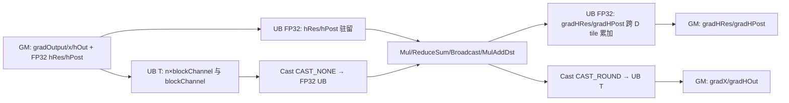

# MhcPostBackward A2/A3 ACLNN 算子知识

## 算子速览

| 项目 | 内容 |
|---|---|
| 实际入口 | `aclnnMhcPostBackwardGetWorkspaceSize` / `aclnnMhcPostBackward`，公开两段式 ACLNN，无版本后缀 |
| 计算语义 | 对每个 T 或 B×S 位置计算 `gradX=hRes·gradOutput`、`gradHRes=x·gradOutput^T`、`gradHOut=hPost^T·gradOutput`、`gradHPost=hOut·gradOutput^T` |
| 输入输出 | TND/BSND 的 ND 连续视图；`gradOutput/x/hOut/gradX/gradHOut` 为同一 FP16 或 BF16，`hRes/hPost/gradHRes/gradHPost` 为 FP32 |
| 执行类型 | `AIV_VECTOR`：AIV-only，FP32 UB 小矩阵乘与归约；本平台的 Host 可达节点不含 Cube/AIC |
| Kernel 路线 | R-001 arch22 AIV Vector Matmul |
| 核心资源 | GM、单缓冲 `TBuf<VECCALC>`、UB FP16/BF16 与 FP32 视图、Vector 临时缓冲；L1/L0A/L0B/L0C 均不使用 |
| 来源闭包 | `source_closed`：公开 ACLNN→L0 launcher→arch22 Tiling/POD/key→AIV entry/body/helper→构建与平台注册闭合 |
| 验证状态 | 已完成源码闭包检查；本次知识提取未执行编译、真机、数值或性能测试。 |

## 接口与语义

### 计算语义

把 TND 的 `T` 或 BSND 的 `B*S` 折叠为位置 `p`，令 `G=gradOutput[p]∈T^{n×D}`、`X=x[p]∈T^{n×D}`、`R=hRes[p]∈FP32^{n×n}`、`O=hOut[p]∈T^D`、`P=hPost[p]∈FP32^n`。源码计算：`gradX[i,d]=Σ_j R[i,j]G[j,d]`，`gradHRes[i,j]=Σ_d X[i,d]G[j,d]`，`gradHOut[d]=Σ_i P[i]G[i,d]`，`gradHPost[i]=Σ_d O[d]G[i,d]`。输入 T 先 `CAST_NONE` 到 FP32，四路乘加均在 FP32 UB 完成；数据输出以 `CAST_ROUND` 回 T，连接权重梯度保持 FP32。

### 输入、输出与属性

| 参数 | shape/layout | dtype | 约束、默认值与语义 |
|---|---|---|---|
| `gradOutput` | `[T,4,D]` 或 `[B,S,4,D]`，ND | FP16/BF16 | 非空；反向输入 G；与 `x`、`hOut` 同 dtype |
| `x` | 同 `gradOutput`，ND | 同 `gradOutput` | `gradHRes` 左矩阵 |
| `hRes` | `[T,4,4]` 或 `[B,S,4,4]`，ND | FP32 | `gradX` 左矩阵 |
| `hOut` | `[T,D]` 或 `[B,S,D]`，ND | 同 `gradOutput` | `gradHPost` 的 D 维乘数 |
| `hPost` | `[T,4]` 或 `[B,S,4]`，ND | FP32 | `gradHOut` 的 n 维乘数 |
| `gradX` | 同 `x`，ND | 同 `x` | 由 `hRes·gradOutput` 写入 |
| `gradHRes` | 同 `hRes`，ND | FP32 | 由 `x·gradOutput^T` 写入 |
| `gradHOut` | 同 `hOut`，ND | 同 `hOut` | 由 `hPost^T·gradOutput` 写入 |
| `gradHPost` | 同 `hPost`，ND | FP32 | 由 `hOut·gradOutput^T` 写入 |
| 隐式约束 | TND 或 BSND | N/A | A2/A3 固定 `n=4`；`0<D≤100000` 且 `D%128=0`；私有 storage format 被拒绝；空 tensor 被拒绝 |

### 入口与版本

固定仓只公开无版本后缀的 `aclnnMhcPostBackwardGetWorkspaceSize` 与 `aclnnMhcPostBackward`，故 CANN 9.1.0 在 A2/A3 的最新公开版本就是该入口。`MhcPostBackward` OpDef 对 `ascend910b` 与 `ascend910_93` 复用同一配置，声明 `support_aclnn`、绑定 `opFile=mhc_post_backward`；arch22 Tiling 也只注册这两个 SoC。950 的 `mhc_post_backward_apt` 是不同架构实现，不并入本卡。

## Host/Launcher 执行流程

### 参数校验与前处理

第一段先对九个 tensor 做非空检查，再拒绝任一空输入；随后按 `CheckFormat→CheckDtype→CheckShape` 顺序拒绝私有格式，检查各参数允许 dtype 与输出-输入对应关系、TND/BSND rank 及所有输入输出逐维一致性，并在非 `DAV_3510` 分支强制 `n=4`、`D%128=0`、`0<D≤100000`。ACLNN 的 `CheckDtype` 本身不比较 `x/hOut` 与 `gradOutput`；arch22 `DoOpTiling` 在 launch 前再强制三者 dtype 相同。成功后创建 executor，依次对五输入调用 `l0op::Contiguous`；L0 按 `x/hRes/hOut/hPost` 的 view shape/dtype/format 分配四个内部输出并用 `ADD_TO_LAUNCHER_LIST_AICORE(MhcPostBackward, ...)` 入队，最后四次 `ViewCopy` 写用户输出。任一步返回空或 launcher 入队失败立即返回错误，不继续后继任务。

### 参数、Workspace 与生命周期

arch22 Tiling 把 workspace slot 0 设为 `PlatformAscendC::GetLibApiWorkSpaceSize()`；Kernel entry 的 `workspace` 形参未读取，算法 body 没有 user workspace 切片。第一段的 `uniqueExecutor` 持有 contiguous 临时 tensor、四个 L0 输出、AICore task 与 ViewCopy task，并在 `ReleaseTo(executor)` 后交给调用者；第二段在调用者指定 stream 上由 `CommonOpExecutorRun` 提交。固定仓没有展开 executor/system-workspace 的内部布局和释放实现。

### 启动图与失败传播

`Tiling4MhcPostBackward` 仅在 `npuArch==DAV_3510` 走 arch35，否则进入 `TilingRegistryNew`，其中 arch22 模板按 `ASCEND910B/ASCEND910_93` 命中。Tiling key 固定 `GET_TPL_TILING_KEY(0)`，模板声明 `AIV_ONLY`；`PostTiling` 写 `blockDim=frontCore+tailCore`。单个 `mhc_post_backward<SCHMODE=0>` entry 解包 POD，构造 `TPipe`，执行 `KernelMhcPostBackward<T>::Init/Process`；第二段任何 executor 运行失败统一转换为 `ACLNN_ERR_INNER`。

## Route 与参数设计

### 分核与资源计算

令位置数 `P=T` 或 `B*S`，AIV 核数 `C=GetCoreNumAiv()`。Host 计算 `frontCore=(P%C!=0?P%C:C)`、`tailCore=(P≤C?0:C-frontCore)`、`blockDim=frontCore+tailCore`、`singleCoreBS=ceil(P/C)`、`tailBS=floor(P/C)`；前 `frontCore` 核各处理 `singleCoreBS` 个位置，其余有效核各处理 `tailBS` 个。D 方向固定 `blockChannel=min(1024,D)`，`loopC=D/blockChannel`，`tailC=D%blockChannel`；`alignN=align_up(n*4,32)/4`，公开入口下 `n=4` 因而 `alignN=8`。workspace 仅取库 API workspace；UB 容量由 `InitBuffer` 的逐缓冲公式确定，不从 Host UB size 派生或回退。

### Route 选择

| 顺序 | Route | Key/模板 | 精确选择条件与优先级 | 不适用去向 |
|---:|---|---|---|---|
| 1 | R-001 arch22 AIV Vector Matmul | key 0 / `SCHMODE=0` / `AIV_ONLY` | `npuArch!=DAV_3510`，SoC 为 `ASCEND910B` 或 `ASCEND910_93`；ACLNN 全部检查通过，`n=4`、D 正数且 128 对齐；arch22 `IsCapable=true` | `DAV_3510` 转 950 arch35；未注册 SoC 或任一检查失败终止，无 Kernel fallback |

```text
aclnnMhcPostBackwardGetWorkspaceSize
  -> CheckParam：TND/BSND，非 DAV_3510 要求 n=4 且 D%128=0
  -> Tiling4MhcPostBackward
      -> DAV_3510：arch35（不属于本卡）
      -> 其他架构：TilingRegistryNew
          -> SoC==ASCEND910B/ASCEND910_93：arch22 key=0, AIV_ONLY
          -> 其他 SoC：固定仓无本 Route 注册，失败
```

### 模板/实现执行矩阵

| Route | key/selector | dtype/shape/platform 完整命中条件 | 执行族与 kernel 节点 | 实际模板/body | 内存与同步特征 | tail/fallback |
|---|---|---|---|---|---|---|
| R-001 arch22 AIV Vector Matmul | `GET_TPL_TILING_KEY(0)` / `SCHMODE=0` | A2 `ASCEND910B` 或 A3 `ASCEND910_93`；T 为 FP16/BF16；TND/BSND；`n=4`；`0<D<=100000` 且 `D%128=0` | 单节点 `mhc_post_backward<0>`，`AIV_ONLY` | `KernelMhcPostBackward<T>::Process`、`VecMatmulMknk`、`VecMatmulMkkn` | 无算法 workspace、L1/L0；单缓冲 UB，以 `V_MTE2/MTE2_V/MTE3_V/V_MTE3` 和 `PIPE_V` 排序 | `tailC=D%blockChannel`；公开约束下 `blockChannel` 与 D 均为 128 倍数，故实际 `tailC=0`；失败无 Device fallback |

### 隐藏性能 Guard

| Guard | Host/Tiling 条件 | Device/资源原因 | 影响 Route | 不满足时去向 | 源码符号 |
|---|---|---|---|---|---|
| 平台 registry | SoC 仅 `ASCEND910B/ASCEND910_93` 且 `npuArch!=DAV_3510` | key 0 binary 是 arch22 AIV-only specialization | R-001 | DAV_3510 转 950；其余平台注册缺失而失败 | `Tiling4MhcPostBackward`、`REGISTER_TILING_TEMPLATE_WITH_SOCVERSION` |
| 固定 n | ACLNN `n==4` | `VecMatmulMknk` 逐字展开 `B[0],B[k],B[2k],B[3k]` 四行 | R-001 | 参数错误，无泛化 route | `CheckShape`、`VecMatmulMknk` |
| D 有效域 | `0<D<=100000 && D%128==0` | 搬运长度、1024-D UB tile 与 classic Vector 调用依赖有效且对齐的 D | R-001 | 参数错误 | `CheckDimD`、`DoOpTiling` |
| 位置分核 | `coreUsed=frontCore+tailCore`，`frontCore=P%C`（整除时 C） | 保证每个有效 AIV 核取得连续 item 区间 | R-001 | `coreId>=coreUsed` 直接 return | `DoOpTiling`、`Process` |
| UB 容量 | `blockChannel=min(1024,D)`；Host 虽读取 UB size，却没有容量谓词 | body 一次分配 `164*blockChannel+448` byte（公开 `n=4,alignN=8`） | R-001 | 固定仓无资源 fallback | `DoOpTiling`、`KernelMhcPostBackward::Init` |
| 32 位 Host 窄化 | `totalTasks`、五个 `GetShapeSize()` 结果和 `GetCeilInt` 中间参数使用 `uint32_t/int32_t` | 超大前导维或 tensor 元素数可在写入 64 位 POD 前已截断 | R-001 | 固定仓无显式溢出 guard 或 fallback | `DoOpTiling`、`GetCeilInt` |

### POD/ABI

`MhcPostBackwardTilingDataArch22` 由 17 个顺序 `uint64_t` 组成，固定源码下 `sizeof=136, alignof=8`；每字段都以 Host 原生对象写入、entry 按值解包并由 Device 同序读取。

| 结构 | 字段 | 类型/位宽 | ABI 布局 | 单位 | Host/launcher producer | Device consumer | 边界 |
|---|---|---|---|---|---|---|---|
| `MhcPostBackwardTilingDataArch22` | `coreUsed` | uint64/64 | `sizeof(field)=8, alignof(field)=8, offsetof=0` | AIV 核 | `blockDim_` | `Init/Process` 空核保护 | 等于 blockDim |
| 同上 | `frontCore` | uint64/64 | `sizeof=8, alignof=8, offsetof=8` | 核 | `P%C` 或 C | `Process` 起止位置 | 1..C（P>0） |
| 同上 | `tailCore` | uint64/64 | `sizeof=8, alignof=8, offsetof=16` | 核 | `P≤C?0:C-frontCore` | `Init` 保存，body 不读取 | inactive consumer |
| 同上 | `singleCoreBS` | uint64/64 | `sizeof=8, alignof=8, offsetof=24` | item/核 | `ceil(P/C)` | 前段核 extent | 至少 1 |
| 同上 | `tailBS` | uint64/64 | `sizeof=8, alignof=8, offsetof=32` | item/核 | `floor(P/C)` | 后段核 extent | P≤C 时 0 |
| 同上 | `dFPostResSize` | uint64/64 | `sizeof=8, alignof=8, offsetof=40` | T 元素 | `gradYTensor->GetShapeSize()` | `gradOutputGm` extent | `P*n*D` |
| 同上 | `xSize` | uint64/64 | `sizeof=8, alignof=8, offsetof=48` | T 元素 | `xTensor->GetShapeSize()` | `xGm/gradXGm` extent | `P*n*D` |
| 同上 | `hResSize` | uint64/64 | `sizeof=8, alignof=8, offsetof=56` | FP32 元素 | `hResTensor->GetShapeSize()` | `hResGm/gradHResGm` extent | `P*n*n` |
| 同上 | `hOutSize` | uint64/64 | `sizeof=8, alignof=8, offsetof=64` | T 元素 | `hOutTensor->GetShapeSize()` | `hOutGm/gradHOutGm` extent | `P*D` |
| 同上 | `hPostSize` | uint64/64 | `sizeof=8, alignof=8, offsetof=72` | FP32 元素 | `hPostTensor->GetShapeSize()` | `hPostGm/gradHPostGm` extent | `P*n` |
| 同上 | `channel` | uint64/64 | `sizeof=8, alignof=8, offsetof=80` | D 元素 | shape 最后一维 | GM stride/loop | 128 对齐，≤100000 |
| 同上 | `blockChannel` | uint64/64 | `sizeof=8, alignof=8, offsetof=88` | D 元素/tile | `min(1024,D)` | UB 容量和整块循环 | 128..1024，128 对齐 |
| 同上 | `n` | uint64/64 | `sizeof=8, alignof=8, offsetof=96` | 元素 | shape n | GM stride、循环、UB 公式 | 固定 4 |
| 同上 | `alignN` | uint64/64 | `sizeof=8, alignof=8, offsetof=104` | FP32 元素 | `ceil(n*4/32)*8` | reduce 输出/梯度 UB | 公开入口为 8 |
| 同上 | `tileC` | uint64/64 | `sizeof=8, alignof=8, offsetof=112` | 元素 | 默认成员初始化为 0；Host 不赋值 | Device 不读取 | inactive 字段，仍保留 ABI |
| 同上 | `tailC` | uint64/64 | `sizeof=8, alignof=8, offsetof=120` | D 元素 | `D%blockChannel` | tail 分支与搬运 | 0 或小于 blockChannel |
| 同上 | `loopC` | uint64/64 | `sizeof=8, alignof=8, offsetof=128` | tile | `D/blockChannel` | 整块循环和 tail offset | 至少 1 |

### Route 源码闭包

| Route | Key/selector | Host/Tiling producer | POD/参数 | Kernel entry/router | Kernel body/直接依赖 | 构建接线 |
|---|---|---|---|---|---|---|
| R-001 arch22 AIV Vector Matmul | `ASCEND910B/ASCEND910_93`，key 0，`SCHMODE=0` | `op_host/op_tiling/arch22/mhc_post_backward_tiling_base_arch22.cpp: DoOpTiling/GetTilingKey/PostTiling` | `MhcPostBackwardTilingDataArch22` 17×uint64 | `op_kernel/mhc_post_backward.cpp: mhc_post_backward<0>` | `op_kernel/arch22/mhc_post_backward.h: Process/VecMatmulMknk/VecMatmulMkkn` | `op_host/mhc_post_backward_def.cpp: opFile=mhc_post_backward`；`op_host/CMakeLists.txt: add_modules_sources` |

## Kernel 实现

### 公共执行流程

本卡仅一条 AIV Route。entry 不读取 `workspace`，也没有多 Kernel 或 AIC/AIV 交接；`TPipe` 管理全部 UB `TBuf`。每个有效 AIV 核按 POD 给定的连续位置区间工作；对一个位置先将 `hPost/hRes` 驻留 UB 并把两项 FP32 梯度清零，再按 D tile 依次读取 `gradOutput/hOut/x`、执行四个 Vector 小矩阵乘、写两项 T 梯度，最后写驻留累加的两项 FP32 梯度。

### Route R-001：arch22 AIV Vector Matmul

#### 适用条件

##### 选择证据

| 层级 | 文件 | 符号 | 源码谓词/参数 | 结果/下一跳 |
|---|---|---|---|---|
| ACLNN | mhc/mhc_post_backward/op_host/op_api/aclnn_mhc_post_backward.cpp | `CheckShape` | 非 `DAV_3510`：TND 的 x dim1 或 BSND 的 x dim2 必须 4；D 需 `0<D≤100000 && D%128==0` | 通过后进入 L0；否则 `ACLNN_ERR_PARAM_INVALID` |
| Host selector | mhc/mhc_post_backward/op_host/op_tiling/mhc_post_backward_tiling.cpp | `Tiling4MhcPostBackward` | `npuArch != DAV_3510` | `TilingRegistryNew::DoTilingImpl` |
| Host/Tiling | mhc/mhc_post_backward/op_host/op_tiling/arch22/mhc_post_backward_tiling_base_arch22.cpp | `REGISTER_TILING_TEMPLATE_WITH_SOCVERSION/DoOpTiling` | SoC 为 `ASCEND910B` 或 `ASCEND910_93`，`IsCapable=true`；dtype/shape 检查成功 | key 0，blockDim 与 POD |
| Router | mhc/mhc_post_backward/op_kernel/arch22/mhc_post_backward_tiling_key_arch22.h | `ASCENDC_TPL_SEL(MhcPostBackward)` | `SCHMODE=0` | `ASCENDC_TPL_AIV_ONLY` 实例 |
| Kernel entry | mhc/mhc_post_backward/op_kernel/mhc_post_backward.cpp | `mhc_post_backward<0>` | 编译期 `DTYPE_GRAD_Y` 为 FP16 或 BF16 | `KernelMhcPostBackward<T>::Init/Process` |

#### Device 数据流

##### 函数级调用链

```text
mhc_post_backward<SCHMODE=0>(grad_y,x,h_res,h_out,h_post,...,workspace,tiling)
  -> GET_TILING_DATA(MhcPostBackwardTilingDataArch22)
  -> KernelMhcPostBackward<T>::Init
      -> GlobalTensor::SetGlobalBuffer
      -> TPipe::InitBuffer（全部单缓冲 TBuf）
  -> KernelMhcPostBackward<T>::Process
      -> DataCopyPad(hPost/hRes GM→UB) -> Duplicate(gradHPost/gradHRes)
      -> [每个 D tile] DataCopyPad(gradOutput/hOut/x GM→UB) -> Cast(CAST_NONE)
          -> VecMatmulMknk（gradHPost、gradHRes）
          -> VecMatmulMkkn（gradHOut、gradX）
          -> Cast(CAST_ROUND) -> DataCopyPad(gradHOut/gradX UB→GM)
      -> DataCopyPad(gradHPost/gradHRes UB→GM)
```

##### 源码等价伪码

```text
伪码：core=GetBlockIdx(); 若 core>=coreUsed 返回
start = core>frontCore ? (core-frontCore)*tailBS + frontCore*singleCoreBS : core*singleCoreBS
end = start + (core<frontCore ? singleCoreBS : tailBS)
for p in [start,end):
  copy hPost[p*n:n]、hRes[p*n*n:n*n] 到 FP32 UB
  gradHPost[0:alignN]=0；gradHRes[0:n*alignN]=0
  for j in [0,loopC):
    c0=j*blockChannel；C=blockChannel；逐 n 行按 GM stride D 搬 gradOutput/x，并搬 hOut；cast FP32
    VecMatmulMknk(hOut,gradOutput,gradHPost,m=1,k=C,n=4,alignN)
    VecMatmulMknk(x,gradOutput,gradHRes,m=4,k=C,n=4,alignN)
    VecMatmulMkkn(hPost,gradOutput,gradHOut,m=1,k=4,n=C)
    VecMatmulMkkn(hRes,gradOutput,gradX,m=4,k=4,n=C)
    CAST_ROUND 到 T；写 gradHOut[p*D+c0:C] 和 gradX[p*4*D+i*D+c0:C]
  if tailC!=0：以 c0=loopC*blockChannel、C=tailC 重复同一计算，只搬/写 tailC
  写 gradHPost 的 n 项；按 n 个 block 写 gradHRes 的 n×n 项

VecMatmulMknk 伪码：对 i<m，显式形成 A[i,:]*B[j,:]（j=0..3），ReduceSum 到 reduceBuffer[i*alignN:]，再累加 C
VecMatmulMkkn 伪码：Broadcast A[m,k] 到 [m,k,n]；对 i<m,j<k 执行 C[i,:] += broadcast(A[i,j])*B[j,:]
```

#### 内存与数据搬运

##### 资源与搬运表

| 层级/缓冲区 | offset/地址公式 | extent/容量公式 | dtype/layout | producer | consumer | owner/lifetime | 对齐/复用 |
|---|---|---|---|---|---|---|---|
| GM `gradOutput/x/gradX` | `p*n*D + i*D + c0` | 每 tile n 个 block，各 `C*sizeof(T)`；GM 行距 D | T，ND `[P,n,D]` | executor / Kernel | Kernel / ViewCopy | executor，stream 完成前 | `DataCopyPad`，D 与 C 均 128 元素对齐；tail 仅有效 C |
| GM `hOut/gradHOut` | `p*D+c0` | `C*sizeof(T)` | T，ND `[P,D]` | executor / Kernel | Kernel / ViewCopy | executor，stream 完成前 | 单 block；无越界 padding 写回 |
| GM `hPost/gradHPost` | `p*n` | `n*sizeof(float)` | FP32，ND `[P,n]` | executor / Kernel | Kernel / ViewCopy | 位置 p | UB 容量 alignN，GM 只传 n |
| GM `hRes/gradHRes` | `p*n*n` | `n` 个 block×`n*sizeof(float)` | FP32，ND `[P,n,n]` | executor / Kernel | Kernel / ViewCopy | 位置 p | UB 累加 stride `alignN`；copy 参数的显式 stride 均 0 |
| UB T 输入/输出 | pipe 内部 | `gradOutput/x/gradX: n*blockChannel*sizeof(T)`；`hOut/gradHOut: blockChannel*sizeof(T)` | T 线性 tile | MTE2 / Cast | Cast / MTE3 | Kernel 对象，跨 tile 复用 | `BUFFER_NUM=1`，没有双缓冲 |
| UB FP32 主缓冲 | pipe 内部 | `gradOutput/x/gradX: n*blockChannel*4`；`hOut/gradHOut:blockChannel*4`；`hPost:n*4`；`hRes:n*n*4`；`gradHPost:alignN*4`；`gradHRes:n*alignN*4` | FP32 | Cast/DataCopy/Duplicate | Vector helper/DataCopy | 位置或 tile | 32-byte 对齐由 alignN 与 D 约束保证 |
| UB 临时缓冲 | pipe 内部 | `tmp1=blockChannel*n*4`，`tmp2=blockChannel*n*n*4`，`tmp3=n*alignN*4`，`tmp4=n*n*1`，`dxTmp2=n*n*4` | FP32/uint8 | Mul/Broadcast/ReduceSum | `VecMatmul*` | helper 调用间复用 | `tmp4` 作为 ReduceSum temp；`dxTmp2` 固定源码分配但不读取 |
| 寄存器 | N/A：该 arch22 body 调用 classic Vector API，不显式声明 `RegTensor` | N/A | N/A | Vector intrinsic | Vector intrinsic | 指令内部 | 实际替代路径为 UB `Mul/ReduceSum/Broadcast/MulAddDst` |
| L1/L0A/L0B/L0C | N/A：无 Cube/Matmul API | N/A | N/A | N/A | N/A | N/A | 小矩阵乘完全在 AIV UB |
| workspace | Kernel entry 的形参未读取 | Host slot=`GetLibApiWorkSpaceSize()` | byte | runtime | 算法 body N/A | executor/system | 无算法 offset 或复用 |

##### 分层内存布局



L1、L0A、L0B、L0C 均为 N/A；实际替代路径是 GM→UB→classic Vector API→UB→GM。

##### 字节账、交接边与复用顺序

```text
workspace_total = GetLibApiWorkSpaceSize()（system/library workspace）；算法 slice = 0
UB_T = (3*n + 2) * blockChannel * sizeof(T)
UB_FP32_main = [(3*n + 2)*blockChannel + n + n*n + alignN + n*alignN] * 4
UB_tmp = [blockChannel*n + blockChannel*n*n + n*alignN + n*n] * 4 + n*n
UB_total(n=4, alignN=8, sizeof(T)=2) = 164*blockChannel + 448 byte
UB_total(blockChannel=1024) = 168384 byte
L1/L0A/L0B/L0C = 0（未使用）
```

| 边/复用子区 | producer | offset/extent | dtype/layout | consumer | ordering/sync | owner/lifetime | 安全条件 |
|---|---|---|---|---|---|---|---|
| D tile 输入槽 | MTE2 `DataCopyPad` | GM `p*n*D+i*D+c0`；UB 连续 `i*C`，共 `n*C*sizeof(T)` | T/ND 行切片 | Cast 与四个 Vector helper | `MTE2_V(0)`；下一轮覆盖前 `V_MTE2(0)` | 当前核、当前 tile | depth=1；C 使用 blockChannel 或 tailC |
| `gradHRes/gradHPost` 累加槽 | `Duplicate` 后每 tile `Add` | `gradHRes: n*alignN*4`；`gradHPost: alignN*4` | FP32/UB padded | 最终 MTE3 | `PIPE_V`，写 GM 前 `V_MTE3(2)` | 当前位置，全部 D tile 完成后释放 | 不得在 tile 间清零 |
| `gradX/gradHOut` 输出槽 | Vector helper + Cast | `n*C*sizeof(T)` 与 `C*sizeof(T)` | T/UB contiguous | MTE3→GM | `V_MTE3(0)`；复用前 `MTE3_V(1)` | 当前 tile | GM 仅提交有效 C；公开 route 实际无 tailC |

#### 同步、精度与尾块

##### 同步与数值边界表

| 阶段 | primitive/机制 | producer | consumer/等待点 | 保护对象 | 精度/尾块 |
|---|---|---|---|---|---|
| 上一轮 Vector/MTE2 | `SetFlag/WaitFlag<HardEvent::V_MTE2>(0)` | Vector 读 UB 完成 | 下一次 GM→UB 前 | 可复用输入 UB | 单缓冲防覆盖；搬运参数按 C/tailC |
| GM→UB 后 | `SetFlag/WaitFlag<HardEvent::MTE2_V>(0)` | MTE2 | Cast/Vector | gradOutput/hOut/x tile | 输入 T 以 `CAST_NONE` 转 FP32 |
| 上一轮 MTE3/Vector | `MTE3_V` event 0/1 | MTE3 | Duplicate/下一轮 Vector | 输出与累加 UB | gradHPost/gradHRes 跨 D tile FP32 累加 |
| Vector helper 内 | `PipeBarrier<PIPE_V>()` | Mul/Broadcast/逐段 Add | ReduceSum/Add/MulAddDst | 临时与输出 UB | `Mknk` 固定展开 j=0..3；`alignN=8` 容纳 reduce tail |
| Vector→GM | `SetFlag/WaitFlag<HardEvent::V_MTE3>(0/2)` | Cast/累加 | MTE3 copy | 两项 T tile 或最终 FP32 梯度 | T 输出 `CAST_ROUND`；FP32 输出不 cast |
| D tail | `tailC!=0` 独立分支 | Host `tailC=D%blockChannel` | 同一四个 helper | 尾 D 范围 | GM blockLen、Cast count、Vector n 参数均改用 tailC；无 mask API |
| 空域/空核 | ACLNN 拒绝空 tensor；`coreId>=coreUsed` return | Host 校验/分核 | Device entry | 无效任务 | 无零元素 Kernel 路径 |

#### 关键实现

##### 符号证据表

| 阶段 | 文件 | 符号/模板实例 | 实现事实 |
|---|---|---|---|
| Host/Tiling producer | mhc/mhc_post_backward/op_host/op_tiling/arch22/mhc_post_backward_tiling_base_arch22.cpp | `MhcPostBackwardTilingBaseArch22::DoOpTiling/PostTiling/GetTilingKey` | dtype/shape复核、位置分核、1024-D tile、17 字段 POD、workspace 与 key 0 |
| Kernel entry/router | mhc/mhc_post_backward/op_kernel/mhc_post_backward.cpp | `mhc_post_backward<SCHMODE=0>` | AIV-only entry、POD 解包、T 类型实例、Init→Process |
| Device body/helper | mhc/mhc_post_backward/op_kernel/arch22/mhc_post_backward.h | `KernelMhcPostBackward<T>::Init/Process` | GM extent、逐缓冲 UB 容量、位置/D 循环、搬运、cast、四输出提交与事件 |
| Device body/helper | mhc/mhc_post_backward/op_kernel/arch22/mhc_post_backward.h | `VecMatmulMknk` | 四个 B 行显式 Mul、`ReduceSum<AR>`、按 alignN 的 FP32 累加 |
| Device body/helper | mhc/mhc_post_backward/op_kernel/arch22/mhc_post_backward.h | `VecMatmulMkkn` | A 广播与 `MulAddDst` 的 m×k 循环，生成 gradHOut/gradX |

## 算子特定优化

### Trick T-001：FP32 权重梯度驻留 UB 跨 D tile 累加

#### 触发与源码依据

- 适用 Route：R-001
- 触发条件：arch22 key 0；`n=4`；D 按 `blockChannel=min(1024,D)` 分块。
- Golden 来源：[`mhc_post_backward.h:191-207`](../../../../../../../cann-ops-raw/ascendc/ops-transformer/be33d95bb755cedec3108f70805c1874d1792540/mhc/mhc_post_backward/op_kernel/arch22/mhc_post_backward.h#L191-L207)

**官方源码（固定 Commit 连续逐字摘录）**：

```cpp
for (uint64_t i = startIdx; i < endIdx; i++) {
    // Hlpost 和Hlres 驻留
    SetFlag<HardEvent::V_MTE2>(0);
    WaitFlag<HardEvent::V_MTE2>(0);

    DataCopyExtParams copyParamsHLPostUb{1, static_cast<uint32_t>(this->n * sizeof(float)), 0, 0, 0};
    DataCopyPad(this->HLPostUb, this->HLPostGm[i * this->n], copyParamsHLPostUb, this->padParamsFloat);
    DataCopyExtParams copyParamsHLResUb{1, static_cast<uint32_t>(this->n * this->n * sizeof(float)), 0, 0, 0};
    DataCopyPad(this->HLResUb, this->HLResGm[i * this->n * this->n], copyParamsHLResUb, this->padParamsFloat);

    // 清0
    SetFlag<HardEvent::MTE3_V>(0);
    WaitFlag<HardEvent::MTE3_V>(0);

    Duplicate(this->dHLPostUb, float(0.0), this->alignN);
    Duplicate(this->dHLResUb, float(0.0), this->n * this->alignN);
```

#### 机制与设计原因

`hPost/hRes` 与两项 FP32 权重梯度的生命周期提升到“一个位置的全部 D tile”；每个 tile 只物化当前 D 段，`gradHPost/gradHRes` 在 UB 继续累加，最后一次性写 GM，避免为每个 D tile 建立中间 GM partial-sum。`alignN` 把每行补到 32 byte，供 Reduce/Add 使用。

#### 迁移边界

- 适用：同一位置内沿长 D 轴分块、最终归约输出很小的 FP32 Vector 路线。
- 前提：A2/A3、key 0、`n=4`、驻留缓冲总量满足 UB、事件顺序不变。
- 失效：950 改由 AIC Matmul 独立生成 `gradHRes`；n 扩展也不能复用固定四行 helper。
- 未验证：本次知识提取未执行编译、真机、数值或性能测试。

#### 错误做法

若在每个 D tile 前重置 `dHLPostUb/dHLResUb`，将只保留最后一个 tile；若删除 MTE3→Vector 复用事件，单缓冲可能在写回完成前被覆盖。

## 模板与实现对比

| 对比维度 | R-001 arch22 AIV Vector Matmul | 设计选择依据 |
|---|---|---|
| 命中条件/优先级 | A2/A3、key 0、`n=4`、D 128 对齐 | ACLNN 检查与 SoC registry 唯一命中 |
| 执行族/节点图 | 单 AIV-only kernel | tiling key 明确 `ASCENDC_TPL_AIV_ONLY` |
| M/N/K、tile 与 scheduler | 四个小矩阵乘；D tile=`min(1024,D)`；位置连续分核 | 固定 n=4 适合 UB Vector helper；无 Cube scheduler |
| workspace/L1/L0/UB | 算法 workspace 0；L1/L0 N/A；UB=`164*blockChannel+448` byte | body 逐项 `InitBuffer` |
| AIC/AIV 或 kernel 交接 | N/A | 仅 AIV 节点 |
| 同步、精度与 tail | 硬事件 + PIPE_V；T→FP32，T 输出 CAST_ROUND；公开 route `tailC=0` | 单缓冲与公开 D 对齐约束 |
| fallback/失败边界 | 无 Device fallback | 参数、平台或资源不满足即失败 |

## 平台差异

| 项目 | A2 | A3 | 950 |
|---|---|---|---|
| 支持状态 | 支持；OpDef `ascend910b` | 支持；OpDef `ascend910_93` | 支持，另卡 |
| Host/Launcher | arch22 SoC registry，key 0；`n=4,D%128=0` | 与 A2 共用同一 arch22 producer/body | `DAV_3510` arch35 registry，key 1 |
| Kernel/资源 | AIV-only，UB Vector Matmul，D tile 1024 | 与 A2 相同 | `MIX_AIC_1_2`：AIV RegBase 三输出 + AIC Matmul `gradHRes`，`n=4/6/8` |

## 限制与失败边界

- 公开入口在 A2/A3 只接受非空 TND/BSND、`n=4`、`D∈[1,100000]` 且 128 对齐；没有 dtype、shape、format 或平台 fallback。第一段未在本实现中显式检查 `workspaceSize` 与 `executor` 输出指针，成功路径会直接解引用，调用者必须按公开签名提供有效地址。
- arch22 UB 所需总量由多个 `InitBuffer` 直接分配，Host 读取 UB size 但未据此做容量检查；固定仓没有显示资源不足时的回退。`VecMatmulMknk` 固定访问 B 的 4 行，因此不得把本 body 泛化到 `n=6/8`。
- arch22 Host 把前导位置数、`B*S`、tensor shape size 和部分除法中间量收窄到 `uint32_t/int32_t`，之后才写入 64 位 POD；固定仓没有证明超大 shape 不会截断，复用时不能把 POD 的 64 位外观当作 Host 推导全程 64 位。
- `gradHRes` 在 UB 中按 `alignN=8` 形成行起点，而最终 `DataCopyPad` 的 n 个 block 使用 `blockLen=n*4` 且显式 source/destination stride 都为 0；固定源码未提供对这一 UB padding/stride 组合的额外解释或真机验证。`dxLTmpBuf2` 已分配但 body 不读取，`tileC` POD 也不消费。
- `kernel_operator.h`、ACLNN executor/Contiguous/ViewCopy、Tiling registry 宏及编译器事件语义来自仓外 CANN 公共库，固定仓不可见；本卡只陈述当前算子对这些接口的可见调用参数。构建未在本任务中执行。

## 源码索引

### 链路索引

| 链路阶段 | 文件 | 关键符号 | 支撑内容 |
|---|---|---|---|
| 公开支持/语义 | mhc/mhc_post_backward/README.md | 产品支持情况/计算公式 | A2、A3、950 公开支持与四项梯度语义 |
| 公开入口约束 | mhc/mhc_post_backward/docs/aclnnMhcPostBackward.md | 产品支持情况/函数原型/约束说明 | 两段式 ACLNN、TND/BSND、A2/A3 的 n/D 约束 |
| 入口声明/约束 | mhc/mhc_post_backward/op_host/op_api/aclnn_mhc_post_backward.h | `aclnnMhcPostBackwardGetWorkspaceSize/aclnnMhcPostBackward` | 公开两段式签名 |
| 入口实现 | mhc/mhc_post_backward/op_host/op_api/aclnn_mhc_post_backward.cpp | `CheckParam/aclnnMhcPostBackwardGetWorkspaceSize/aclnnMhcPostBackward` | 完整接口检查、Contiguous、L0、ViewCopy、executor 运行 |
| L0 Launcher | mhc/mhc_post_backward/op_host/op_api/mhc_post_backward.cpp | `MhcPostBackward/MhcPostBackwardAICore` | 四输出分配与 AICore launcher task |
| 平台注册 | mhc/mhc_post_backward/op_host/mhc_post_backward_def.cpp | `ops::MhcPostBackward` | A2/A3 `support_aclnn` 与 `opFile=mhc_post_backward` |
| Host selector | mhc/mhc_post_backward/op_host/op_tiling/mhc_post_backward_tiling.cpp | `Tiling4MhcPostBackward` | DAV_3510 与其他架构分流 |
| Host/Tiling/Launcher | mhc/mhc_post_backward/op_host/op_tiling/arch22/mhc_post_backward_tiling_base_arch22.cpp | `DoOpTiling/PostTiling/GetTilingKey/REGISTER_TILING_TEMPLATE_WITH_SOCVERSION` | SoC、POD、分核、workspace、key |
| POD | mhc/mhc_post_backward/op_kernel/arch22/mhc_post_backward_tiling_data_arch22.h | `MhcPostBackwardTilingDataArch22` | 17×uint64 ABI |
| Kernel selector | mhc/mhc_post_backward/op_kernel/arch22/mhc_post_backward_tiling_key_arch22.h | `ASCENDC_TPL_SEL` | key 0 的 AIV-only 实例 |
| Kernel entry/body | mhc/mhc_post_backward/op_kernel/mhc_post_backward.cpp | `mhc_post_backward<0>` | entry 与 POD 解包 |
| Kernel entry/body | mhc/mhc_post_backward/op_kernel/arch22/mhc_post_backward.h | `KernelMhcPostBackward/VecMatmulMknk/VecMatmulMkkn` | 完整 Device 数据流、资源、同步、精度和 tail |
| 构建接线 | mhc/mhc_post_backward/op_host/CMakeLists.txt | `add_ops_compile_options/add_op_to_compiled_list/add_modules_sources` | 非 950 自动同步关闭选项与模块接线 |

### 实现复用检查

| 检查项 | 可复用事实 | 不得改变的约束 | 源码符号 |
|---|---|---|---|
| ABI/POD | 17 个连续 uint64、`sizeof=136/alignof=8` 可原样消费 | 字段顺序/offset、`tileC` inactive slot、元素单位和 key 0 不得改变 | `MhcPostBackwardTilingDataArch22/DoOpTiling` |
| 调用顺序 | ACLNN 校验→五次 Contiguous→四输出 L0→四次 ViewCopy→executor run | 四输出对应关系、失败短路、stream 生命周期不得改变 | `aclnnMhcPostBackwardGetWorkspaceSize/MhcPostBackwardAICore` |
| workspace/内存 | GM offset、1024-D tile、逐 TBuf 容量可复用 | 单缓冲、`blockChannel/tailC`、alignN 行布局与 owner 不得擅改 | `DoOpTiling/KernelMhcPostBackward::Init/Process` |
| 同步 | MTE2/V/MTE3 的 event 顺序和 PIPE_V barrier 可复用 | flag ID 0/1/2、单缓冲防覆盖关系不得删除或虚构跨核同步 | `Process/VecMatmulMknk/VecMatmulMkkn` |
| 精度与尾块 | T→FP32→T、FP32 累加、full/tail 共用 helper 可复用 | `CAST_NONE/CAST_ROUND`、显式四行 Mknk、tailC 搬运长度不得改变 | `Process/VecMatmulMknk` |
| 失败边界 | A2/A3 的 n/D/空 tensor/SoC 限制可复用 | 不得扩展到 n=6/8、非 910B/910_93 或声称资源 fallback | `CheckShape/REGISTER_TILING_TEMPLATE_WITH_SOCVERSION` |