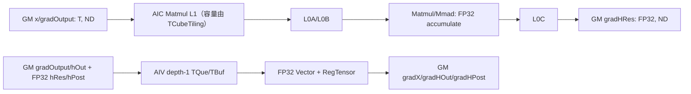

# MhcPostBackward 950 ACLNN 算子知识

## 算子速览

| 项目 | 内容 |
|---|---|
| 实际入口 | `aclnnMhcPostBackwardGetWorkspaceSize` / `aclnnMhcPostBackward`，公开两段式 ACLNN |
| 计算语义 | 同时生成 `gradX,gradHRes,gradHOut,gradHPost`；AIV 负责三项，AIC Matmul 负责 `gradHRes` |
| 输入输出 | TND/BSND，ND；`gradOutput/x/hOut/gradX/gradHOut` 最终同为 FP16 或 BF16，连接矩阵及其梯度 FP32；950 的 `n∈{4,6,8}` |
| 执行类型 | `MIX_CV`（单 Kernel，AIC:AIV=1:2） |
| Kernel 路线 | R-001 arch35 单 launch 混合 Vector/Matmul |
| 核心资源 | GM、AIV UB/TQue/TBuf/寄存器、AIC Matmul L1/L0；user workspace 仅做 entry 非空门禁，body 不读写 |
| 来源闭包 | `source_closed`：公开 ACLNN→arch35 Tiling/POD→MIX entry→AIV body 与 AIC 当前 Matmul 实例→构建接线闭合；Matmul 通用库内部是标注的仓外边界 |
| 验证状态 | 已完成源码闭包检查；本次知识提取未执行编译、真机、数值或性能测试。 |

## 接口与语义

### 计算语义

对每个位置 p，AIC 以 `A=x[p] [n,D]`、`B=gradOutput[p] [n,D]` 且 B 转置，FP32 输出 `gradHRes[p]=A·B^T [n,n]`。AIV 计算 `gradHPost_i=sum_d(hOut_d*gradOutput_{i,d})`、`gradHOut_d=sum_i(hPost_i*gradOutput_{i,d})`、`gradX_{i,d}=sum_j(hRes_{i,j}*gradOutput_{j,d})`。两侧写不同输出，单 launch 中无数据依赖交接。

### 输入、输出与属性

| 参数 | shape/layout | dtype | 约束、默认值与语义 |
|---|---|---|---|
| `gradOutput,x` | `[T,n,D]` 或 `[B,S,n,D]`，ND | 同为 FP16/BF16 | shape 完全相同；公开层分别允许两种 T，arch35 Tiling 再强制二者同 dtype |
| `hRes` | `[T,n,n]` 或 `[B,S,n,n]` | FP32 | `n` 仅 4、6、8 |
| `hOut` | `[T,D]` 或 `[B,S,D]` | 同数据 dtype | arch35 Tiling 强制与 `gradOutput` 同 dtype；AIV reduce 的乘数 |
| `hPost` | `[T,n]` 或 `[B,S,n]` | FP32 | AIV 广播乘数 |
| `gradX,gradHRes,gradHOut,gradHPost` | 对应输入 shape，ND | 分别 T/FP32/T/FP32 | 四输出由同一 MIX launch 写入；所有维必须为正 |

### 入口与版本

ACLNN 接口无版本后缀，故 CANN 9.1.0 的 950 最新公开版本就是该入口。第一段完成完整校验、五输入 Contiguous、L0 四输出分配、任务入队与四次 ViewCopy；第二段运行 executor。OpDef 的 `ascend950` 配置声明 `support_aclnn` 并绑定 `mhc_post_backward_apt`；ascend950 binary config 分别列出全 FP16 数据 tensor 与全 BF16 数据 tensor 两个 ND 二进制实例，simplified key 为 default 0。A2/A3 的 arch22 AIV 实现不合入本卡。

## Host/Launcher 执行流程

### 参数校验与前处理

ACLNN 检查九个 tensor 非空、拒绝任一空输入，再检查 storage format、dtype、rank 与各维一致性；该实现未显式检查 `workspaceSize`/`executor` 输出指针。arch35 Tiling 再检查五输入与四输出的 desc/shape、同 dtype 关系、所有正维和 `n∈{4,6,8}`。Contiguous、L0 launcher 或任一 ViewCopy 失败时停止，不提交后继；空 tensor 返回 `ACLNN_ERR_PARAM_INVALID`，不是零 workspace 成功路径。

### 参数、Workspace 与生命周期

Tiling 的 workspace slot 为 `GetLibApiWorkSpaceSize()`。entry 先检查原 workspace，再取 `GetUserWorkspace(workspace)` 并要求非空，随后把 userWS 传给 `Init`；当前 `Init` 不保存或使用该地址，因此没有算法 workspace 切片。四内部输出与五 contiguous 输入由 executor 持有到 stream 完成；POD 按值消费。

### 启动图与失败传播

`Tiling4MhcPostBackward` 在 `DAV_3510` 走 arch35 registry，key 固定 1。Host `SetBlockDim(usedAic)`，模板表声明 `MIX_AIC_1_2`，因而该 blockDim 对应最多 2×AIV 逻辑核。entry 同时实例化一份类：`ASCEND_IS_AIV` 跑 Vector 图，`ASCEND_IS_AIC` 跑 Matmul 图。workspace/userWS null 会静默 return；Matmul tiling 失败返回 `GRAPH_FAILED`，ACLNN launch 失败转内部错误。

## Route 与参数设计

### 分核与资源计算

令 P 为前导位置数，AIC 核数 C。AIV 使用 `usedCores=min(P,2C)`，`itemsPerCore=P/usedCores`、`remainderItems=P%usedCores`；AIC 使用 `usedAic=min(P,C)` 与对应商余。`alignedN=align_up(n,8)`、`alignedNN=align_up(n*n,8)`。UB 小缓冲为 `(3*alignedN+2*alignedNN)*4`，每 D 元素预算 `(2n+2)*2+(n+3)*4` 字节；`tileD=align_down((UB-small)/bytesPerTileD,16)`，按 `alignedD=align_up(D,16)` 切 `nTilesD`。Cube tiling实例为 GM ND T × GM ND T(transpose) → GM ND FP32，shape `(M,N,K)=(n,n,D)`，无 bias。

### Route 选择

| 顺序 | Route | Key/模板 | 精确选择条件与优先级 | 不适用去向 |
|---:|---|---|---|---|
| 1 | R-001 arch35 MIX Vector/Matmul | key 1 / `MIX_AIC_1_2` | `npuArch==DAV_3510`、所有检查通过、`n∈{4,6,8}`、Matmul tiling 成功 | 任一检查/tiling 失败；非 arch35 进入 arch22 registry，仅 910B/910_93 有可达模板 |

```text
Tiling4MhcPostBackward
  -> DAV_3510：arch35 ComputeTiling -> key=1
      -> 同 launch：AIV 分支写 gradX/gradHOut/gradHPost
      -> 同 launch：AIC 分支写 gradHRes
  -> 非 DAV_3510：arch22（不属于本卡）
```

### 模板/实现执行矩阵

| Route | key/selector | dtype/shape/platform 完整命中条件 | 执行族与 kernel 节点 | 实际模板/body | 内存与同步特征 | tail/fallback |
|---|---|---|---|---|---|---|
| R-001 arch35 MIX Vector/Matmul | `GET_TPL_TILING_KEY(1)` / `MIX_AIC_1_2` | 950 `DAV_3510`；T 为 FP16/BF16 且 `gradOutput/x/hOut/gradX/gradHOut` 同 dtype；TND/BSND；所有维正；`n∈{4,6,8}`；Matmul tiling 成功 | 单 launch：AIV 节点写 `gradX/gradHOut/gradHPost`；AIC/Cube 节点写 `gradHRes` | AIV `Process/ComputeTile/HierarchicalReduceSum/ComputeGrad*Tile`；AIC `MatmulImpl<aType,bType,cType>::IterateAll` | AIV depth-1 TQue/TBuf/RegTensor；AIC 由 `TCubeTiling` 管理 L1/L0；两侧无共享算法 workspace、无交接 flag | AIV `rightPad/gmCopyD/UpdateMask`；AIC K tail 由 Matmul tiling；检查或 tiling 失败无 Device fallback |

### 隐藏性能 Guard

| Guard | Host/Tiling 条件 | Device/资源原因 | 影响 Route | 不满足时去向 | 源码符号 |
|---|---|---|---|---|---|
| 架构与 key | `npuArch==DAV_3510`，arch35 registry priority 0，key 1 | entry 固定 `KERNEL_TYPE_MIX_AIC_1_2` | R-001 | 非 DAV_3510 转 arch22；未命中则失败 | `Tiling4MhcPostBackward`、`REGISTER_TILING_TEMPLATE_WITH_ARCH`、`GetTilingKey` |
| n 集合 | `n==4 \|\| n==6 \|\| n==8` | AIV 的 alignedN/alignedNN 与 AIC `(M,N)=(n,n)` specialization 仅由这些公开值闭合 | R-001 | `GRAPH_FAILED` | `CheckSpecConstraints` |
| AIV UB tile | `maxTileD=align_down((UB-smallBufferBytes)/bytesPerTileD,16)` | T 数据按 16 元素/32 byte 对齐，FP32 小矩阵按 8 元素对齐 | R-001 AIV | 固定仓未检查无符号下溢或 `maxTileD==0`；不存在 fallback | `ComputeTiling` |
| AIC/AIV 分核 | `usedCores=min(P,2*C)`；`usedAic=min(P,C)` | MIX 1:2 为每个 AIC block 配两份 AIV 逻辑资源，双方独立覆盖全部位置 | R-001 | 超出 used 数的 block return | `ComputeTiling`、`Init/Process` |
| Matmul 可构造 | `MultiCoreMatmulTiling::GetTiling(...)!=-1` | 必须得到当前 GM ND T×ND T^T→GM ND FP32 实例的 Cube POD | R-001 AIC | Tiling 失败，整个 route 终止 | `ComputeTiling` |
| workspace 门禁 | 原 `workspace!=nullptr` 且 `GetUserWorkspace(workspace)!=nullptr` | entry 在创建 `TPipe` 前执行门禁，虽然 body 不消费 userWS | R-001 | Device 静默 return，四输出未完成 | `mhc_post_backward<1>` |
| 32 位 shape/POD 边界 | storage dim 先从 `int64_t` 转 `uint32_t`，`totalItems=B*S` 也以 `uint32_t` 计算 | GM extent、offset、分核和 Matmul shape 都消费截断后的值 | R-001 | 固定仓无显式上界、溢出 guard 或 fallback | `CheckShapeConsistency`、`ComputeTiling`、`MhcPostBackwardTilingDataArch35` |

### POD/ABI

| 结构 | 字段 | 类型/位宽 | ABI 布局 | 单位 | Host/launcher producer | Device consumer | 边界 |
|---|---|---|---|---|---|---|---|
| `MhcPostBackwardTilingDataArch35` | `totalItems` | uint32/32 | `sizeof=4, alignof=4, offsetof=0` | 位置 | TND 为 `uint32_t(T)`；BSND 为 `uint32_t(B)*uint32_t(S)` | 两侧 GM extent/分核 | 正数；溢出 guard 不可见 |
| 同上 | `itemsPerCore` | uint32/32 | `sizeof=4, alignof=4, offsetof=4` | item/AIV | `P/usedCores` | AIV `Init` | 商 |
| 同上 | `remainderItems` | uint32/32 | `sizeof=4, alignof=4, offsetof=8` | item | `P%usedCores` | AIV 起点 | 余数 |
| 同上 | `usedCores` | uint32/32 | `sizeof=4, alignof=4, offsetof=12` | AIV 核 | `min(P,2C)` | AIV 空核保护 | 不直接作 blockDim |
| 同上 | `S` | uint32/32 | `sizeof=4, alignof=4, offsetof=16` | 元素 | BSND 取 shape S；TND 在 `CheckShapeConsistency` 置 1 | body 不读取 | inactive |
| 同上 | `n` | uint32/32 | `sizeof=4, alignof=4, offsetof=20` | 元素 | shape | 两侧循环/Matmul | 4、6、8 |
| 同上 | `D` | uint32/32 | `sizeof=4, alignof=4, offsetof=24` | 元素 | shape | GM stride/K | 正数 |
| 同上 | `tileD` | uint32/32 | `sizeof=4, alignof=4, offsetof=28` | 元素 | UB 推导 | AIV queue/loop | 16 对齐 |
| 同上 | `nTilesD` | uint32/32 | `sizeof=4, alignof=4, offsetof=32` | tile | ceil-div | AIV tile loop | 至少 1 |
| 同上 | `alignedD` | uint32/32 | `sizeof=4, alignof=4, offsetof=36` | 元素 | align_up(D,16) | 固定 body 不读取 | inactive |
| 同上 | `lastTileD` | uint32/32 | `sizeof=4, alignof=4, offsetof=40` | 元素 | 尾块公式 | AIV actualTileD | 16 对齐容量 |
| 同上 | `alignedN` | uint32/32 | `sizeof=4, alignof=4, offsetof=44` | FP32 元素 | align_up(n,8) | AIV queue/reduce | 8 对齐 |
| 同上 | `alignedNN` | uint32/32 | `sizeof=4, alignof=4, offsetof=48` | FP32 元素 | align_up(n*n,8) | hRes queue | 8 对齐 |
| 同上 | `itemsPerAic` | uint32/32 | `sizeof=4, alignof=4, offsetof=52` | item/AIC | `P/usedAic` | AIC 起止位置 | 商 |
| 同上 | `remainderItemsAic` | uint32/32 | `sizeof=4, alignof=4, offsetof=56` | item | `P%usedAic` | AIC 起点 | 余数 |
| 同上 | `matmulTiling` | `TCubeTiling` | 前 15 个 uint32 占 60 byte；嵌套字段的 `offsetof/sizeof/alignof` 及结构起始 padding 因外部完整类型未进入固定仓而固定仓不可见 | 复合参数 | `MultiCoreMatmulTiling::GetTiling`，随后覆写 `usedCoreNum=usedAic` | `mm.Init`，并显式读取 `usedCoreNum/singleCoreK` | Host/Device 必须使用同一外部 Matmul ABI，不得手工重排 |

### Route 源码闭包

| Route | Key/selector | Host/Tiling producer | POD/参数 | Kernel entry/router | Kernel body/直接依赖 | 构建接线 |
|---|---|---|---|---|---|---|
| R-001 arch35 MIX Vector/Matmul | arch35/key 1 | `arch35/mhc_post_backward_tiling_base_arch35.cpp: ComputeTiling/GetTilingKey` | arch35 POD + `TCubeTiling` | `mhc_post_backward_apt.cpp: mhc_post_backward<1>` | `arch35/mhc_post_backward_kernel.h: Process/ComputeTile/SetMMParaAndCompute` | `op_host/CMakeLists.txt: ascend950 compile + modules` |

## Kernel 实现

### 公共执行流程

entry 解析同一 POD、验证 user workspace、建立 TPipe。AIV/AIC 共享输入与输出 GM 指针但写集合不重叠：AIV 写 `gradX/gradHOut/gradHPost`，AIC 写 `gradHRes`。两侧各自按完整位置分核，无跨侧 flag、workspace 或 Atomic；该 MIX kernel 在调用 stream 中完成后，四输出才整体可见。

### Route R-001：arch35 MIX Vector/Matmul

#### 适用条件

##### 选择证据

| 层级 | 文件 | 符号 | 源码谓词/参数 | 结果/下一跳 |
|---|---|---|---|---|
| Host/Tiling | mhc/mhc_post_backward/op_host/op_tiling/mhc_post_backward_tiling.cpp | `Tiling4MhcPostBackward` | `npuArch==DAV_3510` | arch35 registry |
| Host/Tiling | mhc/mhc_post_backward/op_host/op_tiling/arch35/mhc_post_backward_tiling_base_arch35.cpp | `CheckSpecConstraints/ComputeTiling` | P>0 且 n 为 4/6/8，Matmul GetTiling 成功 | key 1 |
| Router | mhc/mhc_post_backward/op_kernel/mhc_post_backward_apt.cpp | `mhc_post_backward<1>` | `KERNEL_TYPE_MIX_AIC_1_2`，workspace/userWS 非空 | 同类 AIV/AIC 分支 |

#### Device 数据流

##### 函数级调用链

```text
mhc_post_backward<1>(...,workspace,tiling)
  -> MhcPostBackwardKernel::Init
  -> Process
    -> [AIV] CopyInWeights -> CopyInTile -> ComputeTile -> ComputeGradHOutTile/ComputeGradXTile -> CopyOut*
    -> [AIC] SetMMParaAndCompute -> mm.SetTensorA/B -> mm.IterateAll -> mm.End
```

##### 源码等价伪码

```text
伪码：若 workspace 或 GetUserWorkspace 为空则返回；blockIdx=GetBlockIdx()
if ASCEND_IS_AIV and blockIdx<usedCores:
  for p in 本 AIV 的位置：搬 hPost/hRes 并清零 gradHPost
    for tileId in [0,nTilesD): dStart=tileId*tileD；gmCopyD=min(actualTileD,D-dStart)
      搬 hOut 与 n 行 gradOutput，尾部补零；cast FP32
      reduce(hOut*gradOutput_i) 累加 gradHPost_i
      RegTensor 循环计算 gradHOut 与 gradX，RINT cast；只写 gmCopyD 有效前缀
    写 gradHPost 的 n 项
if ASCEND_IS_AIC and blockIdx<matmulTiling.usedCoreNum:
  for p in 本 AIC 的位置：inputBase=p*n*D；outputBase=p*n*n
    mm.SetSingleShape(n,n,singleCoreK); A=x[inputBase]; B=gradOutput[inputBase],transpose=true
    mm.IterateAll(gradHRes[outputBase]); mm.End()
```

#### 内存与数据搬运

##### 资源与搬运表

| 层级/缓冲区 | offset/地址公式 | extent/容量公式 | dtype/layout | producer | consumer | owner/lifetime | 对齐/复用 |
|---|---|---|---|---|---|---|---|
| GM AIV inputs/outputs | 输入 `gradOutput: p*n*D+i*D+dStart`、`hOut:p*D+dStart`、`hRes:p*n*n`、`hPost:p*n`；输出同对应 offset | T 的每行 `gmCopyD*sizeof(T)`；FP32 权重为 `n*n*4` 或 `n*4` | T/FP32 ND | executor/AIV | AIV/用户 | 当前位置，直到 stream 完成 | AIV 不读 `x`、不写 `gradHRes`；D 尾只提交有效前缀 |
| AIV UB queues | pipe 内部 offset | depth=1；`gradOut/gradX=n*tileD*sizeof(T)`，`hOut/gradHOut=tileD*sizeof(T)`，`hPost/gradHPost=alignedN*4`，`hRes=alignedNN*4` | 线性 | DataCopyPad/Vector | Vector/DataCopyPad | 当前位置/tile | EnQue/DeQue/Free；最后 tile 仅使用 `actualTileD` |
| AIV TBuf/RegTensor | pipe 内部 | `n*tileD*4`、若干 `tileD*4`、`alignedN*4` | FP32/寄存器 | Cast/Load | reduce/MicroAPI | tile/VF repeat | mask 由剩余元素更新 |
| AIC GM A/B/C | `p*n*D`, `p*n*D`, `p*n*n` | n×D、n×D、n×n | T ND / T ND转置 / FP32 ND | executor/Matmul | Matmul/用户 | 当前位置 | Matmul tiling 管理 tail |
| AIC L1/L0A/L0B/L0C | MatmulImpl 内部 offset | 由 `TCubeTiling` 的 base/step/depth 推导 | 外部 Matmul layout | `mm.Init` | `IterateAll` | 当前 Matmul | 具体容量固定仓不可见 |
| workspace | 原 workspace 由 entry 取 `GetUserWorkspace`；`Init` 的 workspace 参数随后未保存 | Host slot=`GetLibApiWorkSpaceSize()`；算法 slice 为 N/A | byte | runtime | 仅 entry 双重非空门禁 | executor/system 生命周期 | 无算法 offset、无 AIC↔AIV 交接 |

##### 分层内存布局



AIC 与 AIV 在同一 MIX launch 内处理同一位置域，但输出集合不重叠；固定算子源码中没有 AIC→AIV、AIV→AIC 或 workspace 中间边。

##### 字节账、交接边与复用顺序

```text
workspace_total = GetLibApiWorkSpaceSize()（system/library workspace）；算法 slice = 0
AIV_UB_actual = [(2*n+2)*tileD*2] + [(n+3)*tileD*4]
              + [(3*alignedN+alignedNN)*4]
Host_tile_budget = bytesPerTileD*tileD + smallBufferBytes
                 = [(2*n+2)*2+(n+3)*4]*tileD + (3*alignedN+2*alignedNN)*4
AIV_UB_actual <= Host_tile_budget <= UB_SIZE
AIC_L1/L0A/L0B/L0C = 由外部 TCubeTiling/MatmulImpl 决定；固定仓不可见，不能填写数值
```

Host 的 `smallBufferBytes` 比本算子 AIV `InitBuffer` 可见常量部分多预留 `alignedNN*4` byte；这是保守预算，不代表额外可见 queue。所有 AIV queue depth 均为 1。

| 边/复用子区 | producer | offset/extent | dtype/layout | consumer | ordering/sync | owner/lifetime | 安全条件 |
|---|---|---|---|---|---|---|---|
| AIV D tile 输入 | MTE `DataCopyPad` | GM `p*n*D+i*D+dStart`；UB `i*actualTileD`，`n*actualTileD*sizeof(T)` | T/ND 行切片 | Cast→FP32 Vector | TQue EnQue/DeQue | 当前 AIV、当前 tile | rightPad 到 actualTileD，GM 只读 gmCopyD |
| AIV FP32 归约 | `Mul` + `HierarchicalReduceSum` | `tileD*4` temp/work，`alignedN*4` tile sums | FP32/UB | `gradHPostLocal` | `PIPE_V` + `V_S` event | 当前位置，跨全部 D tile | padding 补零，完成后才标量读写 |
| AIV T 输出 | RegTensor Cast/Store | UB `tileD*sizeof(T)` 或 `n*tileD*sizeof(T)` | T/contiguous | MTE→GM | TQue VECOUT | 当前 tile | `UpdateMask` + GM `gmCopyD` 防止尾部越界 |
| AIC Matmul | GM `x/gradOutput` | A/B 元素 offset=`p*n*D`、extent=`n*D*sizeof(T)`；C offset=`p*n*n`、extent=`n*n*4` | T ND / T ND transpose / FP32 ND | `MatmulImpl::IterateAll` | MatmulImpl 内部协议 | 当前 AIC、当前位置 | `SetSingleShape(n,n,singleCoreK)` 与 TCubeTiling 一致 |
| AIC↔AIV | N/A：无数据交接 | extent 0 | N/A | N/A | 无 flag/event；同 launch 完成后四输出整体可见 | 各自拥有不同输出 | 禁止把 `gradHRes` 当作 AIV 输入或共享 workspace |

#### 同步、精度与尾块

##### 同步与数值边界表

| 阶段 | primitive/机制 | producer | consumer/等待点 | 保护对象 | 精度/尾块 |
|---|---|---|---|---|---|
| AIV GM↔UB | TQue EnQue/DeQue | MTE/Vector | Vector/MTE | depth=1 queue slot | rightPad 补零；输出 gmCopyD |
| AIV reduce | PIPE_V + `V_S` event | Add/Reduce/WholeReduceSum | scalar GetValue/SetValue | reduce buffer/scalar | FP32 分层 reduce，8 元素对齐补零 |
| AIV MicroAPI | RegTensor mask | LoadAlign/Mul/Add | RINT Cast/StoreAlign | VF lane | `UpdateMask` 保护最后 repeat |
| AIC Matmul | MatmulImpl 内部协议 | GM A/B | FP32 GM C | L1/L0 管线 | T 输入、FP32 accumulate；具体 round/fixpipe 固定仓不可见 |
| 跨执行族 | N/A：不同输出无依赖 | AIV 与 AIC | launch 完成 | 四输出集合 | 无共享 workspace、flag 或 Atomic |

#### 关键实现

##### 符号证据表

| 阶段 | 文件 | 符号/模板实例 | 实现事实 |
|---|---|---|---|
| Host/Tiling producer | mhc/mhc_post_backward/op_host/op_tiling/arch35/mhc_post_backward_tiling_base_arch35.cpp | `ComputeTiling` | AIV/AIC 分核、UB tile、Matmul specialization、POD |
| Kernel entry/router | mhc/mhc_post_backward/op_kernel/mhc_post_backward_apt.cpp | `mhc_post_backward<1>` | MIX 1:2 与 workspace 门禁 |
| Device body/helper | mhc/mhc_post_backward/op_kernel/arch35/mhc_post_backward_kernel.h | `Process/ComputeTile` | AIV任务图、reduce、队列与输出 |
| Device body/helper | mhc/mhc_post_backward/op_kernel/arch35/mhc_post_backward_kernel.h | `ComputeGradHOutTile/ComputeGradXTile` | RegTensor 参数、mask、RINT 与 tail |
| Device body/helper | mhc/mhc_post_backward/op_kernel/arch35/mhc_post_backward_kernel.h | `SetMMParaAndCompute` | AIC Matmul A/B/C offset 与 transpose |

## 算子特定优化

### Trick T-001：同 launch 按输出拆分 AIC 与 AIV 任务图

#### 触发与源码依据

- 适用 Route：R-001
- 触发条件：950 `DAV_3510`、key 1、`MIX_AIC_1_2`。
- Golden 来源：[`mhc_post_backward_kernel.h:225-259`](../../../../../../../cann-ops-raw/ascendc/ops-transformer/be33d95bb755cedec3108f70805c1874d1792540/mhc/mhc_post_backward/op_kernel/arch35/mhc_post_backward_kernel.h#L225-L259)

**官方源码（固定 Commit 连续逐字摘录）**：

```cpp
template<typename T>
__aicore__ inline void MhcPostBackwardKernel<T>::Process()
{
    if ASCEND_IS_AIV {
        if (blockIdx_ >= usedCores_) {
            return;
        }

        for (uint32_t itemIdx = 0; itemIdx < myItemCount_; itemIdx++) {
            uint32_t globalItemIdx = itemStart_ + itemIdx;
            CopyInWeights(globalItemIdx);
            ComputeInitGrads();

            for (uint32_t tileId = 0; tileId < nTilesD_; tileId++) {
                CopyInTile(globalItemIdx, tileId);
                ComputeTile(tileId);
                // Split CopyOut to enable pipeline overlap
                CopyOutGradHOut(globalItemIdx, tileId);
                CopyOutGradX(globalItemIdx, tileId);
            }

            CopyOutWeightGrads(globalItemIdx);
        }
    }
    if ASCEND_IS_AIC {
        if (blockIdx_ >= usedAic_) {
            return;
        }
```

#### 机制与设计原因

AIV 对 D tile 执行逐元素乘、归约和小 n×n 权重应用，写 `gradX/gradHOut/gradHPost`；AIC 把计算量随 D 增长的 `x·gradOutput^T` 映射为 Matmul，单独写 `gradHRes`。两侧没有 producer-consumer 边，因此无需跨核 flag 或中间 GM/workspace 物化；`MIX_AIC_1_2` 只编码执行资源比例，不改变输出所有权。

#### 迁移边界

- 适用：可按互斥输出集合拆分且无跨侧数据依赖的 950 复合反向计算。
- 前提：key 1、AIC/AIV 都覆盖完整位置域、四个输出地址不别名、同一 POD 的分核字段分别正确。
- 失效：若任一侧消费另一侧结果，必须新增可证明的交接内存与同步；A2/A3 为 AIV-only。
- 未验证：本次知识提取未执行编译、真机、数值或性能测试。

#### 错误做法

把 `MIX_AIC_1_2` 解释成 AIC 先写 workspace、AIV 再读取会虚构不存在的依赖；固定 body 表明双方直接写不同 GM 输出。

### Trick T-002：按 UB 预算生成 16 元素对齐的 D tile

#### 触发与源码依据

- 适用 Route：R-001 的 AIV 节点
- 触发条件：所有 `n∈{4,6,8}` 与任意正 D；平台提供 UB size。
- Golden 来源：[`mhc_post_backward_tiling_base_arch35.cpp:694-715`](../../../../../../../cann-ops-raw/ascendc/ops-transformer/be33d95bb755cedec3108f70805c1874d1792540/mhc/mhc_post_backward/op_host/op_tiling/arch35/mhc_post_backward_tiling_base_arch35.cpp#L694-L715)

**官方源码（固定 Commit 连续逐字摘录）**：

```cpp
const uint32_t UB_SIZE = static_cast<uint32_t>(aicoreParams_.ubSize);

uint32_t alignedN = AlignUp(n_, FLOAT32_ALIGN_SIZE);
uint32_t alignedNN = AlignUp(n_ * n_, FLOAT32_ALIGN_SIZE);

uint32_t bytesPerTileD = (2 * n_ + 2) * 2 + (n_ + 3) * 4;
uint32_t smallBufferBytes = (3 * alignedN + 2 * alignedNN) * 4;

uint32_t availableUB = UB_SIZE - smallBufferBytes;
uint32_t maxTileD = availableUB / bytesPerTileD;
maxTileD = AlignDown(maxTileD, BF16_FP16_ALIGN_SIZE);

uint32_t alignedD = AlignUp(D_, BF16_FP16_ALIGN_SIZE);
if (alignedD <= maxTileD) {
    tileD_ = alignedD;
    nTilesD_ = 1;
} else {
    tileD_ = maxTileD;
    nTilesD_ = CeilDiv(alignedD, tileD_);
}

uint32_t lastTileD = alignedD - (nTilesD_ - 1) * tileD_;
```

#### 机制与设计原因

Host 先扣除 n/alignedN/alignedNN 的常量缓冲，再按每个 D 元素需要的两份 T 输入/输出与 FP32 中间量计算 tile 上界，最后向下对齐 16 元素。Device 因此可以用 32-byte 对齐的 `DataCopyPad` 与 MicroAPI load/store，最后 tile 用 rightPad、mask 和 gmCopyD 区分物理容量与有效 D。

#### 迁移边界

- 适用：950 AIV 节点中 buffer 集合与 queue depth 完全相同的实现。
- 前提：`smallBufferBytes<=UB_SIZE` 且 `maxTileD>0`；这些前提在固定 Host 源码中没有显式 guard，迁移时必须补齐或由更外层证明。
- 失效：改变 buffer 数、dtype、queue depth 或 n 集合后必须重新推导 `bytesPerTileD/smallBufferBytes`；不能复用 A2/A3 的固定 1024 tile。
- 未验证：本次知识提取未执行编译、真机、数值或性能测试。

#### 错误做法

直接以 `alignedD` 分配 UB 而忽略平台容量会越过 `UB_SIZE`；固定源码的 fallback 是分成 `nTilesD_`，但对预算下溢或零 tile 未提供可验证反例路径。

## 模板与实现对比

| 对比维度 | R-001 arch35 MIX Vector/Matmul | 设计选择依据 |
|---|---|---|
| 命中条件/优先级 | 950 DAV_3510、key 1、`n=4/6/8`、Matmul tiling 成功 | arch selector 与唯一 arch35 template |
| 执行族/节点图 | 单 MIX kernel：AIV 三输出 + AIC/Cube `gradHRes` | `ASCEND_IS_AIV/AIC` 与互斥 GM 输出集合 |
| M/N/K、tile 与 scheduler | AIC `(M,N,K)=(n,n,D)`；AIV tileD 由 UB 预算；双方按位置商余分核 | Matmul specialization 与 MIX 1:2 资源比例 |
| workspace/L1/L0/UB | 算法 workspace 0；AIV actual/budget 字节公式；AIC L1/L0 数值在外部 TCubeTiling | 当前固定仓可见边界 |
| AIC/AIV 或 kernel 交接 | 无数据边；同 launch 完成后四输出可见 | 双方没有共享 slice、flag 或 Atomic |
| 同步、精度与 tail | AIV TQue/PIPE_V/V_S、FP32+RINT；AIC T 输入/FP32 C；D/K tail 分别处理 | body 与 Matmul tiling职责划分 |
| fallback/失败边界 | 参数/Matmul tiling失败；workspace/userWS null 时 Device 静默 return | 固定源码没有第二 route |

## 平台差异

| 项目 | A2 | A3 | 950 |
|---|---|---|---|
| 支持状态 | 支持，另卡 | 支持，另卡 | 支持 |
| Host/Launcher | arch22 registry | 同 A2 | DAV_3510 arch35 registry，key 1 |
| Kernel/资源 | AIV-only Vector 小矩阵乘 | 同 A2 | MIX 1:2，AIV RegBase + AIC Matmul |

## 限制与失败边界

- 950 只允许 `n=4/6/8` 和所有正维；公开层在 950 不再施加 A2/A3 的 `D≤100000` 或 128 对齐。storage dim 从 `int64_t` 转为 `uint32_t`，`B*S`、GM extent 与 offset 也按 32/64 位混合计算，固定仓没有超大 shape 的窄化/乘法溢出 guard。UB 可用量使用无符号减法，`smallBufferBytes>UB_SIZE` 或 `maxTileD==0` 的防护也不可见。`rightPad=alignedD-D<16` 可由 Host 公式闭合，但 DataCopy `blockLen` 的 uint16 和 MicroAPI `repeatTimes` 的 uint16 窄化仍无显式极值 guard。第一段未显式检查 `workspaceSize`/`executor` 输出指针，成功路径会直接解引用。
- `lib/matmul_intf.h`、`TCubeTiling` 完整 ABI、Matmul 的 GM→L1→L0A/L0B→Mmad→L0C→GM 容量与内部同步位于仓外 CANN 公共库，固定仓不可见；当前卡只复用本算子显式选择的 GM ND T×转置 T→FP32、shape `(n,n,D)`、无 bias 实例，不能推测 base/step/depth/Fixpipe。entry 对 workspace 与 userWS 只作非空门禁，静默 return 无错误码是可见失败终点；`Init` 不使用传入 userWS。

## 源码索引

### 链路索引

| 链路阶段 | 文件 | 关键符号 | 支撑内容 |
|---|---|---|---|
| 公开支持/语义 | mhc/mhc_post_backward/README.md | 产品支持情况/计算公式 | A2、A3、950 公开支持与四项梯度语义 |
| 公开入口约束 | mhc/mhc_post_backward/docs/aclnnMhcPostBackward.md | 产品支持情况/函数原型/约束说明 | 两段式 ACLNN、950 的 `n=4/6/8` 与 shape/dtype 约束 |
| 入口声明/约束 | mhc/mhc_post_backward/op_host/op_api/aclnn_mhc_post_backward.h | `aclnnMhcPostBackward*` | 公开签名 |
| 入口实现 | mhc/mhc_post_backward/op_host/op_api/aclnn_mhc_post_backward.cpp | `CheckParam/GetWorkspaceSize/aclnnMhcPostBackward` | 检查、预处理、执行 |
| L0 Launcher | mhc/mhc_post_backward/op_host/op_api/mhc_post_backward.cpp | `MhcPostBackwardAICore` | 四输出分配与 launch |
| 平台注册 | mhc/mhc_post_backward/op_host/mhc_post_backward_def.cpp | `MhcPostBackward` | 950 ACLNN 与 apt opFile |
| Host/Tiling/Launcher | mhc/mhc_post_backward/op_host/op_tiling/mhc_post_backward_tiling.cpp | `Tiling4MhcPostBackward` | 架构 selector |
| Host/Tiling/Launcher | mhc/mhc_post_backward/op_host/op_tiling/arch35/mhc_post_backward_tiling_base_arch35.cpp | `ComputeTiling/PostTiling/GetTilingKey` | POD、Matmul、workspace/blockDim |
| POD | mhc/mhc_post_backward/op_kernel/arch35/mhc_post_backward_tiling_data_arch35.h | `MhcPostBackwardTilingDataArch35` | ABI |
| Kernel selector | mhc/mhc_post_backward/op_kernel/arch35/mhc_post_backward_tiling_key_arch35.h | `ASCENDC_TPL_SEL` | key 1 与 `MIX_AIC_1_2` 实例 |
| Kernel entry/body | mhc/mhc_post_backward/op_kernel/mhc_post_backward_apt.cpp | `mhc_post_backward` | MIX entry |
| Kernel entry/body | mhc/mhc_post_backward/op_kernel/arch35/mhc_post_backward_kernel.h | `MhcPostBackwardKernel` | AIV/AIC body |
| 构建接线 | mhc/mhc_post_backward/op_host/CMakeLists.txt | `add_ops_compile_options/add_modules_sources` | 950 编译与模块接线 |
| 构建配置 | mhc/mhc_post_backward/op_host/config/ascend950/mhc_post_backward_binary.json | `MhcPostBackward_FP16_*/MhcPostBackward_BF16_*` | 950 两个同 dtype ND binary 实例 |
| 构建配置 | mhc/mhc_post_backward/op_host/config/ascend950/mhc_post_backward_simplified_key.ini | `MhcPostBackward default=0` | simplified key 配置 |

### 实现复用检查

| 检查项 | 可复用事实 | 不得改变的约束 | 源码符号 |
|---|---|---|---|
| ABI/POD | 15 个 uint32 前缀与嵌套 Cube tiling可复用 | 前缀 offset、外部 `TCubeTiling` ABI、key 1 不可改变 | `MhcPostBackwardTilingDataArch35` |
| 调用顺序 | ACLNN→L0→MIX launch 可复用 | workspace 双重非空门禁、四输出对应关系不可改变 | `aclnnMhcPostBackwardGetWorkspaceSize/mhc_post_backward` |
| workspace/内存 | AIV UB 公式和 AIC GM A/B/C 可复用 | tileD、GM offset、queue depth/lifetime 和无 workspace 交接不可改变 | `ComputeTiling/Init` |
| 同步 | AIV queue/PIPE_V/V_S 与 Matmul内部协议可复用 | 不得虚构 AIC-AIV flag；不同输出所有权不可交叉 | `ComputeTile/HierarchicalReduceSum/SetMMParaAndCompute` |
| 精度与尾块 | AIV FP32+RINT、AIC FP32 accumulate 可复用 | mask、rightPad、gmCopyD 和 B transpose 不可改变 | `ComputeGrad*Tile/SetMMParaAndCompute` |
| 失败边界 | n 集合、正维、Matmul tiling失败可复用 | 不得把空 tensor 当零 workspace成功、绕过 workspace/userWS null return 或泛化到非 DAV_3510 | `CheckSpecConstraints/GetTiling/mhc_post_backward` |