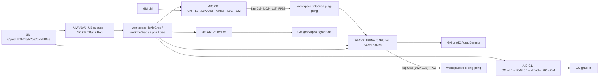

# MhcPreBackward 950 ACLNN 算子知识

## 算子速览

| 项目 | 内容 |
|---|---|
| 实际入口 | CANN 9.1.0 公开两段式接口 `aclnnMhcPreBackwardGetWorkspaceSize` / `aclnnMhcPreBackward`；固定仓没有带版本后缀的更新入口 |
| 计算语义 | 对 MhcPre 的门控、RMS 归一化、特征缩放和投影求反向；输出 `gradX/gradPhi/gradAlpha/gradBias` 与条件输出 `gradGamma` |
| 输入输出 | `x/gradHIn/gradXPostOptional/gradX` 为同一种 FP16 或 BF16；`phi/alpha`、保存量和其余梯度为 FP32；全部为 ND，接受 BSND 或折叠后的 TND |
| 执行类型 | `MIX_CV`；主算子是单 Kernel、AIC:AIV=1:2，同一 launch 内含 AIV V0/V1、两个 AIC FP32 Matmul、AIV V2、AIV V3 |
| Kernel 路线 | R-001 arch35 默认 MIX 四阶段流水：唯一 `TILING_MODE=0`，可选 `gamma`/`gradXPostOptional` 只改变同一 body 内分支 |
| 核心资源 | 输入输出 GM；用户 workspace 的四个 V1 切片和两组 AIC/AIV ping-pong 切片；AIV 四队列、151 KiB `TBuf`、MicroAPI 寄存器；Matmul 管理的 L1/L0A/L0B/L0C |
| 来源闭包 | `source_closed`：公开 ACLNN→参数校验/连续化→L0 launcher→arch35 Tiling/POD→唯一 MIX entry→全部可达 body/helper→Ascend 950 构建/CI 均在固定 Commit 闭合；通用 ACLNN/Matmul 库内部实现为固定仓外依赖边界 |
| 验证状态 | 已完成源码闭包检查；本次知识提取未执行编译、真机、数值或性能测试。 |

## 接口与语义

### 计算语义

令 `M=B*S`（BSND）或 `M=T`（TND），`K=N*D`，`F=N*N+2N`，`G=gradHIn`。Kernel 的可见计算顺序为：

```text
p[b,n] = sum_d fp32(x[b,n,d]) * fp32(G[b,d])
u_pre  = p * (hPre-hcEps) * (1-(hPre-hcEps))
u_post = gradHPost * hPost * (1-hPost/2)
u_res  = gradHRes
g0     = concat(alpha[0]*u_pre, alpha[1]*u_post, alpha[2]*u_res)
hMixGrad    = g0 * invRms
invRmsGrad  = reduce_F(g0 * hMix)
gradAlpha   = reduce_M,F-by-segment(concat(u_pre,u_post,u_res)*invRms*hMix)
gradBias    = reduce_M(concat(u_pre,u_post,u_res))
xRsGradMm   = hMixGrad @ phi                         # C0，FP32
xRs         = fp32(x) * (gamma if present else 1)   # AIV V2，写 workspace
gradPhi     = hMixGrad^T @ xRs                       # C1，FP32
rmsTerm     = x * (-invRmsGrad * invRms^3 / K)      # 按 Kernel 实际 body
gradX_fp32  = G*hPre + rmsTerm + xRsGradMm*(gamma or 1) + (gradXPostOptional or 0)
gradGamma   = reduce_M(x * xRsGradMm)                # 仅 gamma 存在时
gradX       = Cast_RINT‹T›(gradX_fp32)
```

公开文档把 RMS 逆向项的最后一个乘数写成 `x_rs`；固定 body 在 `VFDoV2XCastAndMulGamma` 中把原始 `x` 留在 `xRsFp32Buf_`、把 `x*gamma` 单独写到 `gammaOutUb_`/workspace，随后 `AIV22Process` 读取前者。因此上式按可执行源码写 `x`，该文档/body 差异不得静默合并。

### 输入、输出与属性

| 参数 | shape/layout | dtype | 约束、默认值与语义 |
|---|---|---|---|
| `x` | `[B,S,N,D]` 或 `[T,N,D]`，ND | FP16/BF16 | 必选、非空；Tiling 仅接受 `N∈{4,6,8}`、`D∈[1,16384]` 且 `D%64=0`，故实际最小合法 D 为 64 |
| `phi` | `[F,K]`，ND | FP32 | 必选、非空；C0 的 B 与 C1 梯度目标 |
| `alpha` | `[3]`，ND | FP32 | 必选；顺序为 pre、post、res 三个分支缩放 |
| `gradHIn` | `[B,S,D]` 或 `[T,D]`，ND | 与 `x` 相同 | 必选；决定 `M,D` 和输出 `gradX` dtype |
| `gradHPost` | `[B,S,N]` 或 `[T,N]`，ND | FP32 | 必选；其 N 是 Host/Tiling 的 `N` producer |
| `gradHRes` | `[B,S,N,N]` 或 `[T,N,N]`，ND | FP32 | 必选；rank 必须与 BSND/TND 分支配对 |
| `invRms` | `[B,S]` 或 `[T]`，ND | FP32 | 必选；正向保存的逆均方根 |
| `hMix` | `[B,S,F]` 或 `[T,F]`，ND | FP32 | 必选；参与 `invRmsGrad` 与 `gradAlpha` |
| `hPre`,`hPost` | 各 `[B,S,N]` 或 `[T,N]`，ND | FP32 | 必选；前者含 `hcEps` 偏移，后者按正向 `2*sigmoid` 反传 |
| `gamma` | `[N,D]`，ND | FP32 | 可选；空指针表示全 1，且此时 ACLNN 不要求/不复制 `gradGamma` |
| `gradXPostOptional` | 与 `x` 同 shape；连续化后为 ND | 与 `x` 相同 | 可选；空指针表示全 0，在最终 cast 前以 FP32 相加；ACLNN 只拒绝 private view format，未要求其原始 view format 与 `x` 完全相同 |
| `hcEps` | Host scalar | float | 可选属性，接口/OpDef 默认 `1e-6f`；Tiling 在属性指针缺失时也回落到 `1e-6f` |
| `gradX` | 与 `x` 同 shape，ND | 与 `gradHIn` 相同 | 必选输出；由 FP32 中间按 `CAST_RINT` 转回 T |
| `gradPhi` | `[F,K]`，ND | FP32 | 必选；C1 首个 M 块覆盖，后续 M 块 Atomic 累加 |
| `gradAlpha` | `[3]`，ND | FP32 | 必选；每 AIV 先写 24 元素槽的 0/8/16 位置，V3 再跨核归约 |
| `gradBias` | `[F]`，ND | FP32 | 必选；每 AIV 按 M chunk 累加一行，再由 V3 跨核归约 |
| `gradGamma` | `[N,D]`，ND | FP32 | 仅 `gamma!=nullptr` 时必选并输出；`gamma==nullptr` 时传入值不进入 L0 copy |

ACLNN 拒绝 private view format（NC1HWC0、FRACTAL_Z、NDC1HWC0、FRACTAL_Z_3D、FRACTAL_NZ、NC1HWC0_C04），其余输入先连续化为 ND。输出 view format没有在 `MhcGradCheckFormat` 中单独拒绝，而由内部 ND 输出和 `ViewCopy` 适配。

### 入口与版本

固定源码只声明无后缀的两段式接口，没有 V2/V3 等并行版本，故它是 950 的实际最新公开版本。第一段创建 `aclOpExecutor`、冻结参数和 optional 存在性、构建连续化/主算子/ViewCopy执行图并返回总 workspace；第二段调用 `CommonOpExecutorRun(workspace,workspaceSize,executor,stream)`。OpDef只添加 `ascend950` AICore config，Kernel TU只在 `__CCE_AICORE__==310` 时编译真实 entry。

## Host/Launcher 执行流程

### 参数校验与前处理

`GetWorkspaceSize` 依次执行：必选空指针与 `gamma→gradGamma` 契约检查；拒绝存在的输入空 tensor；按 BSND/TND 校验 rank 和所有 B/S/T/N/D/F/K shape；固定 T/FP32 dtype组合；拒绝输入 private format；按 `x,phi,alpha,gradHIn,gradHPost,gradHRes,invRms,hMix,hPre,hPost` 顺序调用 `Contiguous`，再条件处理两个可选输入。L0分配五个内部 ND tensor，执行 `INFER_SHAPE` 和 `ADD_TO_LAUNCHER_LIST_AICORE`，最后四个必选输出与条件 `gradGamma` 逐个 `ViewCopy`。

`Contiguous/ViewCopy` 的声明可在固定仓公共 stub头确认，具体 Kernel body属于CANN公共运行库、固定仓不可见；它们可能给executor增加辅助节点，但 MhcPreBackward主计算只有一个MIX Kernel launch。任一检查或公共调用返回失败都立即终止。

### 参数、Workspace 与生命周期

令 `C=coreNum`、`V=vecCoreNum`，下式除显式标字节外均为FP32元素数：

```text
Q0=M*F                    # hMixGrad
Q1=24*V                   # alphaGrad局部槽
Q2=V*F                    # biasGrad局部行
Q3=M                      # invRmsGrad
Q=Q0+Q1+Q2+Q3; tile=1024*128
userElements=alignUp(Q,32)+2*tile*C+2*tile*C+2,097,152
opWorkspaceBytes=4*userElements+40 MiB
```

Device先按未对齐Q记录 `xRsGradOffset`，getter再向32元素对齐；`xRsOffset=Q+2*tile*C`也在getter对齐。因 `2*tile*C` 是32元素倍数，Host与Device起点一致。`EXTRA_BUFFER_SIZE=2*1024*1024` 被计入元素数后整体乘4，故是8 MiB，不是2 MiB。40 MiB system workspace由Tiling追加，Kernel经 `GetUserWorkspace` 只访问用户区。

ACLNN返回整个executor的workspace需求；调用者提供的workspace和executor须保持到同一stream执行完成。连续化结果、内部输出和ViewCopy节点由executor管理。TilingData在launch前按值序列化，GM指针只在stream上的Kernel生命周期内使用。

### 启动图与失败传播

```text
aclnn GetWorkspaceSize → check → Contiguous
  → l0op::MhcPreBackward → INFER_SHAPE → ADD_TO_LAUNCHER_LIST_AICORE
  → TilingFunc → DoOpTiling/PostTiling
  → mhc_pre_backward‹0› launch(blockDim=C,scheduleMode=1)
  → ViewCopy
aclnnMhcPreBackward → CommonOpExecutorRun(...,stream)
```

ACLNN、InferShape、launcher和ViewCopy失败返回ACLNN状态；Tiling的输入/平台/属性、任一Matmul tiling、raw buffer或workspace数组失败返回 `GRAPH_FAILED`。Host设置 `blockDim=C`、`scheduleMode=1`；1:2关系由模板key与Kernel task type编码，Host未显式校验 `V==2*C`。无独立fallback。

## Route 与参数设计

### 分核与资源计算

Host从三种梯度storage shape得到M/N/D，计算 `F=N*N+2N,K=N*D` 并取得C/V。AIV V0把M划给V核：`floor(M/V)` 非零时向16行对齐，再求实际 `usedVecCoreNum`；M小于V时只用一个AIV。V0的M chunk对N=4/6为64行、N=8为32行。

AIC/AIV V2沿K划分：AIC份额 `floor(K/GetBlockNum())` 非零时向128元素对齐；每个K tile为128列，两颗AIV各处理前/后最多64列。M tile为1024行；V2再按N=4时128行、N=6/8时64行切chunk。合法K是128倍数，正常输入没有不足128的K尾，但body仍以 `Min` 保护。

| 实例 | 逻辑式 | Host type/layout/transpose | Host shape与最终参数 | Device单tile与输出 |
|---|---|---|---|---|
| `MT_C0` | `[M,F]@[F,K]→[M,K]` | A/B/C均GM、ND、FP32；A/B不转置；无bias | `SetShape(1024,128,F)`,`SetOrgShape(M,K,F)`；GetTiling后强制 `baseM/N/K=256/128/32`，所有step/depth/db为1 | `Single(currentBS,currentND,F)`；连续写本AIC、本buff的 `[1024,128]` workspace，迭代写地址每次加 `256*128` |
| `MT_C1` | `[M,F]^T@[M,currentK]→[F,currentK]` | A为GM/ND/FP32/transpose，B/C不转置；无bias | `SetShape(F,128,1024)`,`SetOrgShape(F,K,M)`；GetTiling后强制所有step/depth/db为1，base保留API结果 | `Org(F,currentND,M,currentBS,K)`,`Single(F,currentND,currentBS)`；写 `gradPhi[offsetND]`，首M块覆盖、后续Atomic |

### Route 选择

| 顺序 | Route | Key/模板 | 精确选择条件与优先级 | 不适用去向 |
|---:|---|---|---|---|
| 1 | R-001 arch35默认MIX四阶段流水 | `MHC_PRE_BACKWARD_DEFAULT=0`；`ASCENDC_TPL_MIX_AIC_1_2`；`MhcPreBackwardKernel‹DTYPE_X,float32_t›` | ascend950注册；ACLNN/Tiling检查通过；平台信息存在；C0/C1 `GetTiling`均成功；编译宏310 | 任一失败即API/Tiling/编译失败；无备用key/body |

```text
ACLNN → ascend950 OpDef → BSND/TND且N=4/6/8、64≤D≤16384、D%64=0
      → C0 tiling+C1 tiling+workspace+POD → key0/MIX_AIC_1_2 → R-001
gamma/gradXPost只选择body内分支，不形成新Route
```

### 模板/实现执行矩阵

| Route | key/selector | dtype/shape/platform 完整命中条件 | 执行族与 kernel 节点 | 实际模板/body | 内存与同步特征 | tail/fallback |
|---|---|---|---|---|---|---|
| R-001 arch35 默认 MIX 四阶段流水 | `MHC_PRE_BACKWARD_DEFAULT=0`；唯一 priority 1000 的 `MhcPreBackwardTiling`；`ASCENDC_TPL_MIX_AIC_1_2` | 公开 API 校验通过；Ascend 950PR/950DT；T=FP16/BF16，其余主要张量 FP32；BSND/TND；N∈{4,6,8}，64≤D≤16384 且 D%64=0；两个 Matmul tiling 成功 | 单个 `mhc_pre_backward<0>` MIX_CV launch；AIV V0/V1 → AIC C0 ↔ AIV V2 → AIC C1，末 AIV 执行 V3 | `MhcPreBackwardKernel<DTYPE_X,float32_t>`；`MT_C0=MatmulImpl<GM/ND/f32,GM/ND/f32,GM/ND/f32>`；`MT_C1` 仅 A 转置 | GM workspace 四个 V1 切片+两组 AIC/AIV 双缓冲；`SyncAll<false>`；0x9/0x8 跨核 flag；C1 与 bias 局部量含 Atomic | M 以 16/32/64/1024 粒度截尾，K 以 128 列 tile、每 AIV 最多 64 列截尾；无其他 key 或 fallback，失败终止 |

### 隐藏性能 Guard

| Guard | Host/Tiling 条件 | Device/资源原因 | 影响 Route | 不满足时去向 | 源码符号 |
|---|---|---|---|---|---|
| 公开平台 | README/API 产品表只对 950PR/950DT 标记支持；OpDef 只有 `AddConfig("ascend950")` | arch35 body 需要 310 目标与 MIX 1:2 编译 | R-001 | A2/A3 公开不支持，不进入本 Route | `MhcPreBackward::MhcPreBackward`、`#if __CCE_AICORE__ == 310` |
| N/D 资源域 | `N∈{4,6,8}`；`1≤D≤16384 && D%64==0` | N 决定 F=24/48/80 和 V0/V2 chunk；D 必须能被 64 元素 MicroAPI/半 tile 路径安全处理 | R-001 | `GRAPH_FAILED` | `ValidateShapeParams`、`InitUBAndAIVBuffers`、`ProcessV2` |
| Matmul C0 特化 | `SetShape(1024,128,F)` 且 `GetTiling` 成功；随后覆盖 `baseM/N/K=256/128/32`，step/depth/db=1 | 锁定 hMixGrad×phi 的 FP32 GM→Cube→GM tile 与 ping-pong 物理行宽 128 | R-001 | C0 tiling 失败，无 fallback | `SetMatmulC0Tiling`、`SetC0TilingParams`、`GetMatmulTiling` |
| Matmul C1 特化 | `SetShape(F,128,1024)` 且 `GetTiling` 成功；step/depth/db=1 | 锁定 hMixGrad转置×xRs 的 FP32 实例；base 值由外部 tiling API 产生 | R-001 | C1 tiling 失败，无 fallback | `SetMatmulC1Tiling`、`SetC1TilingParams`、`GetMatmulTiling` |
| AIV UB 分配 | 4 个深度 1 队列：3×32KiB+1×1KiB；`fp32TBuf_=151KiB` | V0/V1 以 N 选 64/32 行 chunk；V2 以 N=4 选 128 行，N=6/8 选 64 行，使 UB 物理分段可用 | R-001 | 没有另一 UB Route；资源不满足的运行结果固定仓不可见 | `InitUBAndAIVBuffers`、`AllocV0V1Buffers`、`ProcessV2` |
| AIC:AIV 配对 | 模板选择 `MIX_AIC_1_2`；Host 写 `blockDim=coreNum` | 每 AIC 的 128 列 C0/C1 tile 由两个 AIV 分别消费/生产 64 列 | R-001 | Host 未显式校验 `vecCoreNum==2*coreNum`，无 fallback | `ASCENDC_TPL_KERNEL_TYPE_SEL`、`InitStage2AndDataCopy`、`ProcessV2Pipeline` |
| Optional 分支 | `gamma!=nullptr`；`gradXPostOptional!=nullptr` | 只改变 V2 的 UB 首段、乘 gamma、gradGamma reduce 与最终 FP32 加法 | R-001 同一 body | 空指针分别等价 gamma=1、gradXPost=0，不切换 Route | `withGamma_`、`withGradXPost_`、`VFDoV2XCastAndMulGamma` |

### POD/ABI

宏生成结构和外部 `TCubeTiling` 的展开定义不在固定仓；只能确认声明顺序、标量固定宽度、producer/consumer及总序列化长度为8字节倍数，不得推测padding。

| 结构 | 字段 | 类型/位宽 | ABI 布局 | 单位 | Host/launcher producer | Device consumer | 边界 |
|---|---|---|---|---|---|---|---|
| `MhcPreBackwardTilingData` | `matmulTilingC0` | `TCubeTiling`/宽度不可见 | 序号0；sizeof/alignof/offsetof固定仓不可见 | 复合参数 | `GetMatmulTiling(mm0,true)`后`SetC0TilingParams` | `mm0.Init`、`ProcessC0` | FP32 ND无bias；base 256×128×32，step/depth/db=1 |
| 同上 | `matmulTilingC1` | `TCubeTiling`/宽度不可见 | 序号1；`sizeof/alignof/offsetof` 固定仓不可见 | 复合参数 | `GetMatmulTiling(mm1,false)`后`SetC1TilingParams` | `mm1.Init`、`ProcessC1` | FP32 ND无bias；base来自外部tiling，step/depth/db=1 |
| 同上 | `coreNum` | uint32_t/32 | 序号2；`sizeof/alignof/offsetof` 固定仓不可见 | AIC核 | `GetCoreNumAic` | AIC分核、workspace C切片 | 同时作为blockDim；0无显式拒绝 |
| 同上 | `vecCoreNum` | uint32_t/32 | 序号3；`sizeof/alignof/offsetof` 固定仓不可见 | AIV核 | `GetCoreNumAiv` | V0分核、V局部槽 | Host不校验2C关系 |
| 同上 | `totalLength` | uint64_t/64 | 序号4；`sizeof/alignof/offsetof` 固定仓不可见 | M行 | B*S或T | M循环/stride/workspace | Device收窄uint32_t，Host未查M上限 |
| 同上 | `nD` | uint64_t/64 | 序号5；`sizeof/alignof/offsetof` 固定仓不可见 | K元素 | N*D | K分核、x stride、1/K | 最大8×16384 |
| 同上 | `N` | uint64_t/64 | 序号6；`sizeof/alignof/offsetof` 固定仓不可见 | 元素 | gradHPost shape | F/分段/chunk/gather | 4/6/8 |
| 同上 | `D` | uint64_t/64 | 序号7；`sizeof/alignof/offsetof` 固定仓不可见 | 元素 | gradHIn末维 | stride与`offsetND/D` | 64～16384，64对齐 |
| 同上 | `fusionSize` | uint64_t/64 | 序号8；`sizeof/alignof/offsetof` 固定仓不可见 | F元素 | N*N+2N | hMix/bias stride、Matmul | 24/48/80 |
| 同上 | `hcEps` | float/32 | 序号9；`sizeof/alignof/offsetof` 固定仓不可见；整体size%8=0 | 标量 | attr0或1e-6 | `hPre-hcEps` | 不查有限值/范围 |

### Route 源码闭包

| Route | Key/selector | Host/Tiling producer | POD/参数 | Kernel entry/router | Kernel body/直接依赖 | 构建接线 |
|---|---|---|---|---|---|---|
| R-001 arch35默认MIX四阶段流水 | key0；MIX AIC 1:2；T由`DTYPE_X`实例决定 | `mhc_pre_backward_tiling.cpp: ParseInputAndAttr/TilingProcess/GetMatmulTiling/FillTilingData/PostTiling` | 两份`TCubeTiling`+8标量；`WorkspaceBuffer‹float›`六切片 | `mhc_pre_backward_apt.cpp: mhc_pre_backward‹0›`、`mm0/mm1.Init`、`MhcPreBackwardKernel::Init/Process` | `mhc_pre_backward_kernel.h: ProcessV0Main/ProcessV1/ProcessC0C1Pipeline/ProcessC0/ProcessV2Pipeline/ProcessV2ChunkLoop/ProcessC1/ProcessV3`；utils中的Matmul/Workspace helper | 根CMake→mhc CMake→算子CMake→op_host CMake；Ascend950 CI清单显式列名 |

## Kernel 实现

### 公共执行流程

唯一 entry读取TilingData，以 `GetUserWorkspace` 跳过system workspace，声明 `KERNEL_TYPE_MIX_AIC_1_2`，初始化同一 `TPipe` 和两份Matmul对象。AIV先执行V0/V1并写 `hMixGrad/alphaGrad/biasGrad/invRmsGrad`；`SyncAll‹false›` 后AIC才能进入Matmul流水。每个AIC预先执行当前C0并可预取下一C0；两颗配对AIV等待C0 flag、生成gradX/xRs/gradGamma局部量后发C1 flag；AIC再执行C1。最后满足 `GetBlockIdx()==GetBlockNum()-1` 的AIV执行V3，归约全局同步前已写完的alpha/bias局部量。

### Route R-001：arch35 默认 MIX 四阶段流水

#### 适用条件

##### 选择证据

| 层级 | 文件 | 符号 | 源码谓词/参数 | 结果/下一跳 |
|---|---|---|---|---|
| API | mhc/mhc_pre_backward/op_host/op_api/aclnn_mhc_pre_backward.cpp | `MhcGradCheckParams/mhcPreBackwardCommonProcess` | 必选非空、BSND/TND shape一致、T/FP32组合、输入非private format；optional契约合法 | 连续化并进入L0；失败返回ACLNN错误 |
| OpDef | mhc/mhc_pre_backward/op_host/mhc_pre_backward_def.cpp | `MhcPreBackward::MhcPreBackward` | 只有 `AICore().AddConfig("ascend950")`，`opFile.value=mhc_pre_backward_apt` | 950 arch35路线 |
| Tiling | mhc/mhc_pre_backward/op_host/op_tiling/arch35/mhc_pre_backward_tiling.cpp | `ValidateShapeParams/TilingProcess/GetTilingKey` | N=4/6/8，D范围/对齐合法，平台存在，两Matmul GetTiling成功 | key0；失败无下一Route |
| Template | mhc/mhc_pre_backward/op_kernel/arch35/mhc_pre_backward_tiling_key.h | `ASCENDC_TPL_SEL(MhcPreBackward)` | 唯一 `TILING_MODE=0`，`ASCENDC_TPL_MIX_AIC_1_2` | 实例化R-001 |
| Router | mhc/mhc_pre_backward/op_kernel/mhc_pre_backward_apt.cpp | `mhc_pre_backward‹0›` | `__CCE_AICORE__==310` 且constexpr mode0 | 初始化 `MT_C0/MT_C1` 和 `MhcPreBackwardKernel‹DTYPE_X,float32_t›` |
| Device | mhc/mhc_pre_backward/op_kernel/arch35/mhc_pre_backward_kernel.h | `MhcPreBackwardKernel::Process` | `ASCEND_IS_AIV/AIC`编译分支；optional以指针非空选择同body分支 | V0/V1→同步→C0↔V2↔C1→V3 |

#### Device 数据流

##### 函数级调用链

```text
mhc_pre_backward‹0›(17 tensor GM, workspaceGM, tilingGM)
  → mm0.Init(matmulTilingC0), mm1.Init(matmulTilingC1)
  → MhcPreBackwardKernel‹T,float›::Init
     → InitGlobalBuffersAndTiling → WorkspaceBuffer::Init
     → InitUBAndAIVBuffers → TPipe::InitBuffer(4 queues + fp32TBuf)
     → InitStage2AndDataCopy → AIC/AIV K-range mapping
  → Process
     → [AIV] ProcessV0Main
        → ProcessV0MainLoop → AllocV0V1Buffers
        → PreProcessV0 → VFDoPreProcessV0
        → ProcessV0 → VFDoV0HPreGrad/VFDoV0ProcessGradHPost/AIV02Process
        → ProcessV1 → VFDoV1ProcessBiasGradForN4N6或N8/VFDoV1Process
        → ProcessV0MainAlphaReduce
     → SyncAll‹false›
     → [AIC] ProcessC0C1Pipeline
        → ProcessC0(mm0.Iterate/GetTensorC) → CrossCoreSetFlag(0x9)
        → ProcessC1(CrossCoreWaitFlag(0x8), mm1.IterateAll)
     → [AIV] ProcessV2Pipeline
        → CrossCoreWaitFlag(0x9) → ProcessV2 → ProcessV2ChunkLoop
        → ProcessV2ChunkLoadInvRms → AIV21Process
        → ProcessV2ChunkLoadHInGrad → VFDoV2HInMulHPre
        → ProcessV2ChunkLoadXAndGamma → VFDoV2XCastAndMulGamma‹hasGamma,firstChunk›
        → ProcessV2ChunkComputeXRsGrad → AIV22Process
        → ProcessV2ChunkProcessXRsGradMm → VFDoV2GammaMulXRsGradMm‹hasGamma›
        → ProcessV2ChunkProcessGradXPost → ProcessV2ChunkOutputXGrad
        → CrossCoreSetFlag(0x8)
     → [last AIV] ProcessV3 → ProcessV3AlphaGrad/VFDoV3ProcessAlphaGrad
                              → ProcessV3BiasGrad
```

##### 源码等价伪码

```text
伪码（保持body顺序）：
初始化GM；withGamma=(gamma!=null)；withGradXPost=(gradXPost!=null)
计算AIV的[dealStartBS,dealEndBS)及每对2个AIV对应的AIC K区间

if AIV and blockIdx小于usedVecCoreNum:
  for Mchunk in 本核M范围，chunk=(N==8?32:64):
    for b in Mchunk, n in N:
      搬x[(b*N+n)*D]与gradHIn[b*D]到UB
      按64元素mask循环，T→FP32，寄存器reduce D得到p[b,n]
    计算u_pre、u_post，复制u_res；按[N,N,N*N]拼接并乘alpha
    bias局部和：首chunk覆盖workspace，后续chunk AtomicAdd
    广播invRms，算hMixGrad=g0*invRms并写workspace
    算invRmsGrad=reduce_F(g0*hMix)并写workspace
    算三段alpha贡献，跨chunk累加；最终归约到槽[0,8,16]

SyncAll

if AIC and blockIdx小于v1UsedCubeCoreNum:
  先C0(offsetND=dealStartND,offsetBS=0,buff=0)
  for offsetND step128:
    for offsetBS step1024:
      若有下一M/K tile，先C0到nextBuff
      C0: hMixGrad[offsetBS:,:] @ phi[:,offsetND:] → xRsGrad[aic,buff]
      PIPE_FIX SetFlag‹2›(0x9)
      WaitFlag(0x8)
      C1: hMixGrad[offsetBS:,:]^T @ xRs[buff] → gradPhi[:,offsetND:]
      offsetBS==0覆盖，否则Atomic累加

if AIV and blockIdx小于2*v1UsedCubeCoreNum:
  vecIdx=blockIdx%2；各取128列tile的一半
  for offsetNDBase step128:
    sumBuf=AllocTensor(FP32)
    for offsetBS step1024,buff++:
      WaitFlag(0x9)；预载hPre[currentBS,N]
      for bsChunk step(N==4?128:64):
        读invRms/invRmsGrad，算c=-invRmsGrad*invRms^3/K
        读gradHIn半片，算gradHIn*hPre
        读x并cast；算xRs=x*(gamma或1)，写物理row stride=128的workspace
        加x*c；读C0 tile，按gamma分支相乘后加入
        若gamma存在，reduce_M(x*C0tile)到sumBuf
        若gradXPost存在，cast FP32后加入
        Cast_RINT‹T›，只写currentChunkSize*copySizeND有效gradX
      PIPE_MTE3 SetFlag‹2›(0x8)
    若gamma存在，写当前K半片gradGamma

if AIV and blockIdx==GetBlockNum()-1:
  跨usedVecCoreNum归约24元素alpha槽，取0/8/16写gradAlpha
  跨usedVecCoreNum归约F列bias行，写gradBias
```

#### 内存与数据搬运

##### 资源与搬运表

| 层级/缓冲区 | offset/地址公式 | extent/容量公式 | dtype/layout | producer | consumer | owner/lifetime | 对齐/复用 |
|---|---|---|---|---|---|---|---|
| GM输入/输出 | `x[b*K+k]`,`gradHIn[b*D+d]`,`hMix[b*F+f]`,`phi[f*K+k]`；输出同逻辑ND | API shape有效域 | T或FP32/ND | 调用者/前向 | V0/V1/V2、C0/C1 | 调用者/stream | 输入先Contiguous；内部ND输出再ViewCopy |
| ws `hMixGrad` | `b*F` | `M*F` FP32 | `[M,F]` ND | V1 | C0 A、C1转置A | 主Kernel | 起点0；SyncAll发布 |
| ws `alphaGrad` | `M*F+core*24+{0,8,16}` | `24*V` FP32 | `[V,24]` padded | 每AIV | V3 | 主Kernel | 三个8元素槽；只读usedVecCoreNum行 |
| ws `biasGrad` | `M*F+24V+core*F` | `V*F` FP32 | `[V,F]` | V1 | V3 | 主Kernel | F=24/48/80；同核跨chunk Atomic |
| ws `invRmsGrad` | `M*F+24V+V*F+b` | `M` FP32 | `[M]` | V1 reduce | V2 AIV21 | 主Kernel | 四区合计Q；下一段32元素对齐 |
| ws `xRsGrad` | `alignUp(Q,32)+(aic*2+buff%2)*1024*128` | `2*C*1024*128` FP32 | 物理`[1024,128]` | C0 | 配对两AIV | 0x9交接 | 双缓冲；Matmul写地址每次加`256*128` |
| ws `xRs` | `alignUp(Q+2*C*1024*128,32)+(aic*2+buff%2)*1024*128` | `2*C*1024*128` FP32 | 物理`[1024,128]` | 两AIV各写64列 | C1 B | 0x8交接 | `dstStride=(128-copySizeND)*4B`；两半不重叠 |
| extra/system | ping-pong之后 | 2,097,152 FP32（8MiB）+40MiB system | 固定body未解释 | Host | 公共运行时 | executor | Kernel只取user pointer；extra用途不可见 |
| 四个AIV队列 | TPipe管理 | 三个32KiB队列+一个1KiB小队列，深度1 | T/FP32 UB | MTE/Vector | Vector/MTE | alloc至free | 队列本身无double buffer |
| `fp32TBuf_` | V0/V1按32B切；V2从128个uint32 offset表后的512B开始 | 151KiB | FP32/uint32 UB | buffer helper | MicroAPI/Reduce | 当前stage/chunk | SyncAll后从V0/V1布局切换为V2布局 |
| V0/V1 UB | hPreGrad后复用hPre/hPost/hRes/hFusion/gather/invRms/calcTmp/brcb | `step=Mchunk*N`,`hFusion=Mchunk*F` | FP32 | GM/MicroAPI | V0/V1 | 单Mchunk | 重叠区只按源码producer-consumer顺序复用 |
| V2 UB/寄存器 | offset表后依次 `gammaIn?`,`xRaw`,`xGrad`,`xRsGradMm`,`invRms`,`hPre`，段间32B对齐 | `maxChunkND=(128或64)*copySizeND`,`copySizeND≤64` | T/FP32 | GM/ws copy | VF helper | tile/chunk | optional gamma才分配首段；mask只提交有效域 |
| L1 | Matmul内部地址不可见 | depthA1/depthB1=1及平台约束 | FP32/内部layout不可见 | GM copy | L0A/B | Matmul迭代 | 当前仓确认GM ND逻辑输入 |
| L0A | 内部地址不可见 | C0受baseM*baseK；C1受外部base | FP32/fractal不可见 | L1 LoadData | Mmad | 迭代 | stepKa/depthA1=1 |
| L0B | 内部地址不可见 | C0受baseK*baseN；C1受外部base | FP32/fractal不可见 | L1 LoadData | Mmad | 迭代 | stepKb/depthB1=1 |
| L0C | 内部地址不可见 | C0逻辑base `256*128` FP32；C1由外部base决定 | FP32 accumulate | Mmad | GetTensorC/IterateAll→GM | tile | dbL0C=1；C1后续M块GM Atomic |

##### 分层内存布局



V2 的 `fp32TBuf_` 从 512B 的 128 个 `uint32_t` gather offset 表之后开始，再按 32B 对齐依次布置 `gammaIn`(仅 gamma 存在)、raw-x FP32、gradX FP32、C0 输出 FP32、`invRms` 和 `hPre`；队列 tensor 是另外的 TPipe 管理 UB 区。

##### 字节账、交接边与复用顺序

```text
M = B*S 或 T; K=N*D; F=N*N+2*N; C=coreNum; V=vecCoreNum
Q = M*F + 24*V + V*F + M                                  # FP32 元素
workspace_user = 4 * (alignUp(Q,32) + 2*C*1024*128
                      + 2*C*1024*128 + 2,097,152)           # 字节
workspace_total = workspace_user + 40*1024*1024             # 字节
AIV_queue_total = 3*32KiB + 1KiB; fp32TBuf = 151KiB         # 深度均为1
C0 L0C 逻辑 tile = 256*128*4B; C1 L0C/base 容量由外部 TCubeTiling 决定
L1/L0A/L0B 精确字节 = 固定仓不可见（MatmulImpl 外部边界）
```

| 边/复用子区 | producer | offset/extent | dtype/layout | consumer | ordering/sync | owner/lifetime | 安全条件 |
|---|---|---|---|---|---|---|---|
| V1→C0/C1 | `ProcessV1` | `0 .. M*F`，`M*F*4B` | FP32 `[M,F]` ND | C0 A；C1 transpose-A | `SyncAll<false>` 在两个 Matmul 之前 | 主 Kernel user workspace | 仅有效 AIV 写自己 M 分区；全局同步后才读 |
| V1→V2 RMS | `ProcessV1` | `invRmsGradOffset+b`，`M*4B` | FP32 `[M]` | `ProcessV2ChunkLoadInvRms` | `SyncAll<false>` | 主 Kernel user workspace | V2 按 currentChunkSize 只读有效 M |
| C0→两 AIV | `ProcessC0` | `alignUp(Q,32)+(aic*2+buff)*1024*128`，每槽 `1024*128*4B` | FP32 物理 `[1024,128]` | 两个 `ProcessV2ChunkProcessXRsGradMm` | AIC `CrossCoreSetFlag<0x2,PIPE_FIX>(0x9)`；AIV Wait 0x9 | 当前 AIC/AIV 对，至该 buff 下轮覆写 | `buff%2`；两 AIV 分别读 [0,64) / [64,128) 列；tail 以 `copySizeND` 限定 |
| 两 AIV→C1 | `ProcessV2ChunkLoadXAndGamma` | `alignUp(Q+2*C*1024*128,32)+(aic*2+buff)*1024*128`，每槽 `1024*128*4B` | FP32 物理 `[1024,128]` | `ProcessC1` B | 每个 AIV `CrossCoreSetFlag<0x2,PIPE_MTE3>(0x8)`；AIC Wait 0x8 | 当前 AIC/AIV 对，至 C1 消费完 | 两个 64 列半片不重叠；`dstStride=(128-copySizeND)*4B` |
| C1输出复用 | `ProcessC1` | `gradPhi+offsetND`，逻辑 `[F,currentNDBlock]` | FP32 ND 非连续写 | 调用者 | 首个 M tile 覆盖，后续 `enAtomic=true` | 输出 tensor/stream | M tile 顺序不可更改；offsetBS=0 必须首写 |
| V1 局部量→V3 | V0/V1 有效 AIV | alpha: `24*V`；bias:`V*F`，各乘 4B | FP32 `[V,24]` / `[V,F]` | 末 AIV V3 | `SyncAll<false>` 已保证 V0/V1 全部完成；V3 位于同 launch 后段 | 主 Kernel user workspace | V3 只读 `usedVecCoreNum`；alpha 只提交槽 0/8/16 |
| V0/V1 UB 阶段复用 | `AllocV0V1Buffers` 的前一计算段 | `fp32TBuf_` 内按 `globalUbOffset_`/`hFusionBufLen_` 分配 | FP32 UB | 后续 V0/V1 helper | queue 和 `PipeBarrier` | 当前 M chunk | 只按 `AllocV0V1Buffers`→PreProcessV0→V0→V1 顺序复用 |

#### 同步、精度与尾块

##### 同步与数值边界表

| 阶段 | primitive/机制 | producer | consumer/等待点 | 保护对象 | 精度/尾块 |
|---|---|---|---|---|---|
| V0/V1→后段 | `SyncAll‹false›` | 全部有效AIV写四区 | AIC C0与AIV V2 | V1 workspace | 门控、broadcast、reduce均FP32；M末核截到M |
| C0→V2 | `CrossCoreSetFlag‹0x2,PIPE_FIX›(0x9)` / Wait0x9 | AIC C0 | 配对两AIV | `xRsGrad[aic,buff]` | C0全FP32；M尾min1024，K保护min128，每AIV最多64列 |
| V2→C1 | `CrossCoreSetFlag‹0x2,PIPE_MTE3›(0x8)` / Wait0x8 | 两AIV写xRs半片 | AIC C1 | `xRs[aic,buff]` | `buffId%2`轮换，不能打乱顺序 |
| C1跨M | `IterateAll(dst,enAtomic)` | 首M块非Atomic覆盖 | 后续M块Atomic | gradPhi | FP32；固定仓无显式HF32/round设置 |
| bias跨chunk | `SetAtomicAdd‹float›`后`SetAtomicNone` | 同AIV第二及后续V1 chunk | 本核bias行 | bias局部量 | 首chunk普通写；N8用64+16两个Reg mask，N4/6单Reg |
| queue/pipe | enqueue/dequeue、`PipeBarrier‹V/MTE2/MTE3›` | DataCopy或Vector | 后继stage | UB/GM提交 | copy长度/stride为字节；有效长度来自current block |
| alpha/hPre事件 | `V_MTE3 EVENT_ID2`、`V_S EVENT_ID2`、`V_MTE2 EVENT_ID3` | Vector reduce/标量或旧UB使用 | MTE3/scalar/MTE2 | alpha槽、hPre复用区 | V3仅提交3个FP32；hPre只gather有效N |
| 输入cast | `Cast‹float,T,ctHalf2Fp32Zero›` | FP16/BF16 x/G | FP32乘加 | V0/V2中间 | zeroing mask，round为源码UNKNOWN；D为64倍数，无D部分向量尾 |
| RMS/optional | FP32 Mul/Add/Reduce | V1/C0 | V2 | gradX FP32、gradGamma | gamma缺失等价1；gradXPost用CAST_NONE，最终cast前相加 |
| gradX输出 | `CAST_RINT` + strided DataCopyPad | FP32 gradX | GM T | 当前半片 | T=FP16/BF16；只写有效chunk×copySize，dstStride跳过行尾 |
| gradGamma累积 | ReduceSum后Add | 每BS chunk的`x*C0tile` | 当前K半片全部M tile结束后写gradGamma | 当前≤64个K元素 | `sumBuf` 在每个K半片进入M循环前分配并跨全部1024行M tile保持；仅全局首chunk `bsChunkStart==0` 覆盖初始化，后续chunk/tile累加 |

#### 关键实现

##### 符号证据表

| 阶段 | 文件 | 符号/模板实例 | 实现事实 |
|---|---|---|---|
| API producer | mhc/mhc_pre_backward/op_host/op_api/aclnn_mhc_pre_backward.cpp | `MhcGradCheckParams/MhcGradCovertDataContiguous/mhcPreBackwardCommonProcess` | 校验、连续化、L0/ViewCopy顺序、optional契约 |
| Host/Tiling producer | mhc/mhc_pre_backward/op_host/op_tiling/arch35/mhc_pre_backward_tiling.cpp | `ParseBSDFormat/ParseTNDFormat/ValidateShapeParams/CalculateWorkspaceSize` | M/N/D/F、分核、workspace与失败边界 |
| Host/Tiling producer | mhc/mhc_pre_backward/op_host/op_tiling/arch35/mhc_pre_backward_tiling.cpp | `SetMatmulC0Tiling/SetMatmulC1Tiling/GetMatmulTiling/SetC0TilingParams/SetC1TilingParams` | 两FP32实例的type、transpose、shape、base/step/depth/db |
| Kernel entry/router | mhc/mhc_pre_backward/op_kernel/mhc_pre_backward_apt.cpp | `mhc_pre_backward‹0›` | 310 guard、MIX1:2、GM ABI、双Matmul与T实例 |
| Device body/helper | mhc/mhc_pre_backward/op_kernel/arch35/mhc_pre_backward_kernel.h | `InitGlobalBuffersAndTiling/InitUBAndAIVBuffers/InitStage2AndDataCopy/Process` | GM/UB初始化、分核与总顺序 |
| Device body/helper | mhc/mhc_pre_backward/op_kernel/arch35/mhc_pre_backward_kernel.h | `VFDoPreProcessV0/ProcessV0/AIV02Process/ProcessV1/VFDoV1Process/ProcessV0MainAlphaReduce` | 门控、hMixGrad、invRmsGrad、alpha/bias、mask/reduce/atomic |
| Device body/helper | mhc/mhc_pre_backward/op_kernel/arch35/mhc_pre_backward_kernel.h | `ProcessC0C1Pipeline/ProcessC0/ProcessC1` | 双缓冲、实际tensor地址、flags、gradPhi Atomic |
| Device body/helper | mhc/mhc_pre_backward/op_kernel/arch35/mhc_pre_backward_kernel.h | `ProcessV2Pipeline/ProcessV2ChunkLoop/AIV21Process/AIV22Process/ProcessV2ChunkProcessXRsGradMm/ProcessV3` | RMS、optional、gradX cast、gradGamma和最终reduce |
| Device body/helper | mhc/mhc_pre_backward/op_kernel/arch35/mhc_pre_backward_utils.h | `MT_C0/MT_C1/WorkspaceBuffer::Init/Get*Offset` | Matmul模板类型、六切片元素offset与常量 |

## 算子特定优化

### Trick T-001：C0 前瞻与两槽 workspace 流水

#### 触发与源码依据

- 适用 Route：R-001。
- 触发条件：当前 AIC 命中 `blockIdx < v1UsedCubeCoreNum_`，且当前 ND/M tile 之后仍有下一 M tile 或下一 ND tile。
- Golden 来源：[`mhc_pre_backward_kernel.h:933`](../../../../../../../cann-ops-raw/ascendc/ops-transformer/be33d95bb755cedec3108f70805c1874d1792540/mhc/mhc_pre_backward/op_kernel/arch35/mhc_pre_backward_kernel.h#L933-L956)

**官方源码（固定 Commit 连续逐字摘录）**：

```cpp
// 预执行第一个C0
ProcessC0(dealStartND_, currentNDBlock, 0, currentBSBlock, buffId);

for (uint32_t offsetND = dealStartND_; offsetND < dealEndND_; offsetND += ND_BLOCK_SIZE) {
    currentNDBlock = Min(ND_BLOCK_SIZE, dealEndND_ - offsetND);

    for (uint32_t offsetBS = 0; offsetBS < totalLength_; offsetBS += SINGLE_M) {
        currentBSBlock = Min(SINGLE_M, uint32_t(totalLength_ - offsetBS));

        uint32_t nextOffsetBS = offsetBS + SINGLE_M;
        if (nextOffsetBS < totalLength_) { // BS还有未计算
            uint32_t nextBSBlock = Min(SINGLE_M, uint32_t(totalLength_ - nextOffsetBS));
            ProcessC0(offsetND, currentNDBlock, nextOffsetBS, nextBSBlock, (buffId + 1));
```

#### 机制与设计原因

C0 先生成当前 `[M≤1024,K≤128]` FP32 tile，然后在消费当前 tile 的 C1 之前把下一 M/ND tile 的 C0 写入 `buffId+1`。`ProcessC0` 和 `ProcessC1` 内部都对 `buffIdx%2`，因此 Host 分配的 `2*C*1024*128` FP32 切片是实际 ping-pong；0x9/0x8 flag 保护 C0→V2→C1 交接完成后才复用槽。

#### 迁移边界

- 适用：单 launch 内的 1 AIC:2 AIV、C0 产生 128 列而两 AIV 各处理半片的流水。
- 前提：950/arch35，FP32 Matmul，M tile=1024，ND tile=128，buffer depth=2，flag ID/管线方向不变。
- 失效：AIC:AIV 比例、tile 宽度、workspace 物理 stride 或 flag 轮次变化时必须重新设计；本算子无其他 Route。
- 未验证：本次知识提取未执行编译、真机、数值或性能测试。

#### 错误做法

只把 `buffId` 视为单槽、在 C1 等待 0x8 之前覆写当前 `xRs`，或交换 0x9/0x8 的 producer/consumer，都会破坏源码明确的双缓冲生命周期。

### Trick T-002：1C2V 把 128 列 tile 拆成两个 64 列交接

#### 触发与源码依据

- 适用 Route：R-001。
- 触发条件：`ASCENDC_TPL_MIX_AIC_1_2`，`blockIdx < 2*v1UsedCubeCoreNum_`，当前 `offsetND < dealEndND_`。
- Golden 来源：[`mhc_pre_backward_kernel.h:1020`](../../../../../../../cann-ops-raw/ascendc/ops-transformer/be33d95bb755cedec3108f70805c1874d1792540/mhc/mhc_pre_backward/op_kernel/arch35/mhc_pre_backward_kernel.h#L1020-L1043)

**官方源码（固定 Commit 连续逐字摘录）**：

```cpp
// 确定处理范围 （1C2V 模式）
uint32_t vecIdx = blockIdx_ % VEC_CORE_VECIDX_MOD;
uint32_t buffId = 0;
// ND方向切分：每个ND block大小为nDBlockSize_，在1C2V模式下，每个V核处理一半
for (uint32_t offsetNDBase = dealStartND_; offsetNDBase < dealEndND_; offsetNDBase += ND_BLOCK_SIZE) {
    // 根据vecIdx选择处理ND block的前半部分(0)或后半部分(1)
    uint32_t offsetND = offsetNDBase + (ND_BLOCK_SIZE / 2) * vecIdx;
    if (offsetND >= dealEndND_) {
        continue; // 超出范围，跳过
    }
    uint32_t copySizeND = Min(ND_BLOCK_SIZE / 2, dealEndND_ - offsetND);
```

#### 机制与设计原因

AIC C0 产生物理行宽 128 的 tile，`blockIdx%2` 把配对 AIV 固定到前/后 64 列。AIV 从 C0 tile 的对应半片读取，同样以 `dstStride=(128-copySizeND)*4B` 把 `x*gamma` 写回 C1 共享的 128 列物理行，不需要额外拼接 Kernel。

#### 迁移边界

- 适用：K 轴可以 128 列 tile 和两个最多 64 列 AIV 半片表示的 FP32 交接。
- 前提：`ND_BLOCK_SIZE=128`、`VEC_DEAL_VECIDX_DIV=2`，AIC/AIV 必须对同一 `aic,buff` 的 workspace 达成一致。
- 失效：不能将此映射直接用于非 1:2 核比、非 128 列 stride 或非 FP32 交接。
- 未验证：本次知识提取未执行编译、真机、数值或性能测试。

#### 错误做法

将两个 AIV 都从 tile 第 0 列读写，或在 GM 中按紧密 `copySizeND` 行宽交给 C1，会与 `vecIdx*64` 和 128 列 `dstStride` 的官方布局相冲突。

### Trick T-003：raw x 与 x*gamma 在 V2 分流保留

#### 触发与源码依据

- 适用 Route：R-001，特别是 `gamma!=nullptr` 分支。
- 触发条件：V2 已把 T 类型 `x` 搬入 UB；有 gamma 时首 chunk 另外保存 gamma 半片。
- Golden 来源：[`mhc_pre_backward_kernel.h:1077`](../../../../../../../cann-ops-raw/ascendc/ops-transformer/be33d95bb755cedec3108f70805c1874d1792540/mhc/mhc_pre_backward/op_kernel/arch35/mhc_pre_backward_kernel.h#L1077-L1091)

**官方源码（固定 Commit 连续逐字摘录）**：

```cpp
MicroAPI::LoadAlign<T, MicroAPI::LoadDist::DIST_UNPACK_B16>(xInB16Reg, bf16InputAddr + offset);
MicroAPI::Cast<float, T, ctHalf2Fp32Zero>(xFp32Reg, xInB16Reg, mask);

MicroAPI::StoreAlign(xRsFp32Addr + offset, xFp32Reg, mask); // 后续其他计算需要xFp32

if constexpr (hasGamma) {
    MicroAPI::LoadAlign(gammaReg, gammaSrcAddr + vfBlockIdx * eleNumPerVf);
    if constexpr (isFirstChunk) {
        MicroAPI::StoreAlign(gammaInAddr + offset, gammaReg, mask);
    }

    MicroAPI::Mul(resultReg, gammaReg, xFp32Reg, mask); // 逐元素乘：gamma * x
    MicroAPI::StoreAlign(gammaOutAddr + offset, resultReg, mask);
```

#### 机制与设计原因

一次 T→FP32 cast 后，raw x 留在 `xRsFp32Buf_`，`x*gamma` 写到 `gammaOutUb_` 并物化到 C1 的 workspace。raw x 同时用于 RMS 项 `x*(-invRmsGrad*invRms^3/K)` 和 `gradGamma=reduce(x*C0)`；这是 Device body 与公开文档把 RMS 末乘数写为 `x_rs` 之间的可追溯差异。

#### 迁移边界

- 适用：同一 x 的 raw FP32 值和 gamma 缩放值有不同后继 consumer 的融合反向。
- 前提：raw-x 缓冲不能被 `gammaOutUb_` 别名；RMS 与 gradGamma 保持 FP32；最终 gradX 仅在全部 FP32 加法后 `CAST_RINT`。
- 失效：若采用文档的 `x_rs` RMS 语义，必须同步修改 body 和数值验证，不能仅改变缓冲名称。
- 未验证：本次知识提取未执行编译、真机、数值或性能测试。

#### 错误做法

用 `gammaOutUb_` 替换 `xRsFp32Buf_` 给 `AIV22Process` 或 gradGamma reduce，会把固定 body 的 raw-x 语义静默改成 x*gamma。

## 模板与实现对比

| 对比维度 | R-001 arch35 默认 MIX 四阶段流水 | 其他 Route | 设计选择依据 |
|---|---|---|---|
| 命中条件/优先级 | 唯一 priority=1000 的模板；key0；950；API/shape/Matmul tiling 通过 | 不存在 | `IsCapable()` 固定 true，注册表和 key 只有一项 |
| 执行族/节点图 | 单 Kernel MIX_CV：V0/V1→C0↔V2→C1→V3 | 不存在 | 模板固定 AIC:AIV=1:2，两类核在同 launch 内分支 |
| M/N/K、tile 与 scheduler | C0 `[M,F]@[F,K]`、C1 `[M,F]^T@[M,K]`；M tile=1024，K tile=128；C0 base=256×128×32；默认 `MatmulImpl` scheduler 内部固定仓不可见 | 不存在 | Host 确定 shape/base/step/depth，body 确定 tile 遍历和前瞻 |
| workspace/L1/L0/UB | 六个语义切片+两组 depth2 ping-pong；3×32KiB+1KiB 队列和151KiB TBuf；Matmul L1/L0 精确容量在外部实现 | 不存在 | `CalculateWorkspaceSize`、`WorkspaceBuffer`、`InitBuffer`和`TCubeTiling` |
| AIC/AIV 或 kernel 交接 | C0→V2 用 0x9/PIPE_FIX；V2→C1 用 0x8/PIPE_MTE3；128 列由两 AIV 半分 | 不存在 | `ProcessC0`、`ProcessV2Pipeline`、`ProcessC1` |
| 同步、精度与 tail | V1 后全核同步；FP16/BF16→FP32，Matmul/reduce/add 为 FP32，gradX RINT 回 T；M/K/chunk 均 `Min` 截尾 | 不存在 | MicroAPI cast/mask、Matmul type、DataCopy extent 和 current block 保护 |
| fallback/失败边界 | 校验、平台、任一 Matmul tiling 或 raw workspace 失败即终止 | 不存在 | 无备用 key、body 或另一执行族 |

## 平台差异

| 项目 | A2 | A3 | 950 |
|---|---|---|---|
| 支持状态 | 不支持：无产品注册 | 不支持：无产品注册 | 支持Ascend 950PR/950DT，`platforms=["950"]` |
| Host/Launcher | 无公开A2 config/构建路线 | 无公开A3 config/构建路线 | `AddConfig("ascend950")`；Ascend950 CI清单含算子；schedule mode1 |
| Kernel/资源 | 无对应arch/body | 无对应arch/body | arch35、`__CCE_AICORE__==310`、MIX1:2、双FP32 Matmul+AIV MicroAPI |

## 限制与失败边界

- 只接受非空ND输入；N=4/6/8，实际64≤D≤16384且64对齐。Host把uint64_t M/K/N/D/F在Device收窄为uint32_t，但未显式拒绝M大于UINT32_MAX，也未检查workspace算术溢出。
- `gamma!=nullptr` 时 `gradGamma` 必须存在；gamma为空时即使传gradGamma也不复制。gradXPost必须与x shape/dtype一致；hcEps不校验有限值或范围。
- 公开文档的RMS逆向项使用x_rs，Device `AIV22Process` 实际读取保存raw x的 `xRsFp32Buf_`；本卡以Kernel为实现事实。
- gradGamma 的 `sumBuf` 由每个K半片在进入完整M循环前分配，`bsChunkStart==0` 对全局首chunk做一次覆盖初始化；后续1024行M tile继续在同一缓冲上累加，直到该K半片写回 `gradGamma`。
- 1C2V由模板编码，Host不验证V=2C；C/V为0、user workspace为空、extra 8MiB用途的显式处理固定仓不可见。
- 通用 `TCubeTiling/MatmulImpl` 的POD offset、L1/L0 layout/capacity、LoadData/Mmad/Fixpipe循环、HF32/round和内部同步固定仓不可见；只闭合当前实例的GM类型/layout、shape、tiling override和交接边。
- 固定仓没有本Commit的编译产物、真机数值、flag复用并发或性能结果。

## 源码索引

### 链路索引

| 链路阶段 | 文件 | 关键符号 | 支撑内容 |
|---|---|---|---|
| 公开支持约束 | mhc/mhc_pre_backward/README.md | `产品支持情况/约束说明` | 只支持950PR/950DT；N=4/6/8，D范围与64元素对齐 |
| 公开 API 文档 | mhc/mhc_pre_backward/docs/aclnnMhcPreBackward.md | `aclnnMhcPreBackward` | 产品支持表、公开计算语义、两段式接口与参数约束 |
| 入口声明/约束 | mhc/mhc_pre_backward/op_host/op_api/aclnn_mhc_pre_backward.h | `aclnnMhcPreBackwardGetWorkspaceSize/aclnnMhcPreBackward` | 公开签名和workspace/stream契约 |
| 入口实现 | mhc/mhc_pre_backward/op_host/op_api/aclnn_mhc_pre_backward.cpp | `MhcGradCheckParams/mhcPreBackwardCommonProcess/aclnnMhcPreBackward*` | 校验、连续化、L0、ViewCopy、executor |
| 公共声明 | common/stub/op_api/aclnn_kernels/contiguous.h | `l0op::Contiguous/ViewCopy` | 直接调用的公共声明；body不可见 |
| L0 Launcher | mhc/mhc_pre_backward/op_host/op_api/mhc_pre_backward.cpp | `l0op::MhcPreBackward` | 内部输出、InferShape、launcher入队 |
| OpDef/平台 | mhc/mhc_pre_backward/op_host/mhc_pre_backward_def.cpp | `ops::MhcPreBackward` | 输入输出、hc_eps、ascend950/opFile注册 |
| InferShape | mhc/mhc_pre_backward/op_host/mhc_pre_backward_infershape.cpp | `InferShape4mHCPreGrad/InferOutputShapes` | 输出shape/dtype producer |
| POD | mhc/mhc_pre_backward/op_host/op_tiling/arch35/mhc_pre_backward_tiling.h | `MhcPreBackwardTilingData` | 两TCube与八标量字段顺序 |
| Host/Tiling | mhc/mhc_pre_backward/op_host/op_tiling/arch35/mhc_pre_backward_tiling.cpp | `MhcPreBackwardTiling/TilingFunc4mHCPreGrad` | shape、分核、workspace、双Matmul、key、launch参数 |
| Key | mhc/mhc_pre_backward/op_kernel/arch35/mhc_pre_backward_tiling_key.h | `MHC_PRE_BACKWARD_DEFAULT/ASCENDC_TPL_SEL` | 唯一key0与MIX1:2 |
| Kernel entry | mhc/mhc_pre_backward/op_kernel/mhc_pre_backward_apt.cpp | `mhc_pre_backward‹0›` | arch guard、GM ABI、workspace、实例化 |
| Kernel body | mhc/mhc_pre_backward/op_kernel/arch35/mhc_pre_backward_kernel.h | `MhcPreBackwardKernel‹T,float›` | 全部可达body/helper、内存、同步、精度、tail |
| Kernel helper | mhc/mhc_pre_backward/op_kernel/arch35/mhc_pre_backward_utils.h | `InitParams/WorkspaceBuffer/MT_C0/MT_C1` | 参数、workspace、常量、Matmul类型 |
| 算子构建 | mhc/mhc_pre_backward/op_host/CMakeLists.txt | `add_ops_compile_options/add_op_to_compiled_list/add_modules_sources` | Ascend950编译选项与模块收集 |
| 目录构建 | mhc/mhc_pre_backward/CMakeLists.txt | `add_subdirectory`循环 | 算子子目录接入 |
| 类别构建 | mhc/CMakeLists.txt | `CURRENT_DIRS/add_subdirectory` | mhc按算子过滤接入 |
| 仓级构建 | CMakeLists.txt | `add_subdirectory(mhc)` | mhc进入总构建 |
| CI接线 | scripts/ci/ascend950/ops_transformer_operator_list.yaml | `operator_group_1: mhc_pre_backward` | Ascend950 CI显式覆盖 |

每行只对应一个固定Commit文件；公共运行库与通用Matmul实现未伪造为仓内源码。

### 实现复用检查

| 检查项 | 可复用事实 | 不得改变的约束 | 源码符号 |
|---|---|---|---|
| ABI/POD | key0双TCube与C/V/M/K/N/D/F/hcEps映射可复用 | 字段顺序、宽度、C0/C1顺序、按值序列化和整体8B对齐不可改；offset不得推测 | `MhcPreBackwardTilingData::SaveToBuffer`、`GET_TILING_DATA` |
| 调用顺序 | ACLNN check→Contiguous→L0→ViewCopy和V0/V1→SyncAll→C0↔V2↔C1→V3可复用 | optional存在性须在GetWorkspace冻结；不能交换flag两端或移除全局同步 | `mhcPreBackwardCommonProcess`、`Process` |
| workspace/内存 | 四V1切片、两组`2*C*1024*128` ping-pong和offset可复用 | 单位为FP32元素；Q后32元素对齐；AIC/两AIV使用同一aic,buff；extra为8MiB | `CalculateWorkspaceSize`、`WorkspaceBuffer::Init/GetXRs*Offset` |
| 同步 | 0x9 C0→V2、0x8 V2→C1、bias/gradPhi Atomic可复用 | flag索引0x2、PIPE_FIX/PIPE_MTE3方向、等待点、双缓冲轮次、首块非Atomic不可改 | `ProcessC0/ProcessV2Pipeline/ProcessC1/ProcessV1` |
| 精度与尾块 | T先升FP32、双Matmul FP32、optional加法后RINT回T及M/K/chunk有效域可复用 | 不得把文档x_rs替代Kernel raw x RMS项；D需64对齐；gradGamma局部和必须保持跨全部M tile的同一 `sumBuf` 生命周期 | `VFDoPreProcessV0/AIV21Process/AIV22Process/ProcessV2ChunkOutputXGrad` |
| 失败边界 | ACLNN、Tiling、双Matmul失败与无fallback可复用 | 不得扩展A2/A3、空tensor、其他N/D/dtype/layout或假设V=2C已检查；仓外Matmul内部不可补写 | `MhcGradCheckParams/ValidateShapeParams/GetMatmulTiling/GetTilingKey` |