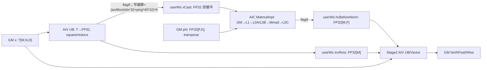
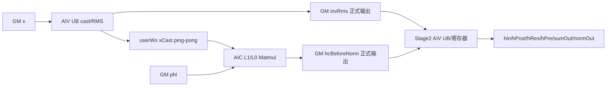

# MhcPreSinkhorn A2/A3 ACLNN 算子知识

## 算子速览

| 项目 | 内容 |
|---|---|
| 实际入口 | `aclnnMhcPreSinkhornGetWorkspaceSize` / `aclnnMhcPreSinkhorn` |
| 计算语义 | RMSNorm(x) 与 FP32 投影生成 hPre/hPost/hRes/hIn，再对 hRes 做 20 轮 Sinkhorn |
| 执行类型 | 单 Kernel `MIX_CV`：Stage1 AIV→AIC，Stage2 AIV；`KERNEL_TYPE_MIX_AIC_1_2` |
| Kernel 路线 | R-001：key0、`needBackward=false`，中间量落 user workspace；R-002：key0、`needBackward=true`，中间量落正式输出 |
| 核心资源 | GM/user workspace、AIC Matmul 管理的 L1/L0A/L0B/L0C、AIV UB/寄存器；AIC:AIV=1:2 |
| 来源闭包 | `source_closed`：公开 ACLNN、L0、平台注册、Host/Tiling、完整 POD、key0 router/body、Matmul/helper、构建接线闭合 |
| 验证状态 | 已完成源码闭包检查；本次知识提取未执行编译、真机、数值或性能测试。 |

## 接口与语义

### 计算语义

令 `M=B*S`、`N=hcMult=4`、`D=C`、`F=N*N+2N`。Stage1 AIV 把 x 转 FP32 并计算 `invRms=1/sqrt(mean(x^2)+normEps)`；AIC 计算 `xFloat [M,N*D] × phi^T [N*D,F]` 得到 `hcBeforeNorm`。Stage2 用 alpha/bias 生成 hPre、hPost、hRes 与 hIn，并对 `N×N` hRes 交替按末维/倒数第二维归一化，共 `numIters=20`；`needBackward=true` 时保存 hPre、hcBeforeNorm、invRms、sumOut、normOut。

### 输入、输出与属性

| 参数 | shape/layout | dtype | 固定源码约束与语义 |
|---|---|---|---|
| `x` | `[B,S,N,D]` ND | FP16/BF16 | ACLNN 只接受 rank 4；空 x 或三个必选输出为空时直接成功不 launch；`N=hcMult=4` |
| `phi` | `[N*N+2N,N*D]` ND | FP32 | Stage1 Matmul B，以 transpose=true 读取 |
| `alpha` / `bias` | `[3]` / `[N*N+2N]` ND | FP32 | pre/post/res 三族 scale 与 bias |
| `hcMult` / `numIters` | int64 属性 | - | ACLNN 分别只接受 4 / 20；L0 属性名为 `hc_mult` / `num_iters` |
| `hcEps` / `normEps` | double→Host float | - | 建议/默认 1e-6；分别参与门控/Sinkhorn 与 RMS |
| `needBackward` | bool | - | false 时五个反向中间输出不做 ACLNN dtype/shape/format 检查，Device 改用 workspace 暂存 invRms/hcBeforeNorm |
| `hin,hPost,hRes` | `[B,S,D]`、`[B,S,N]`、`[B,S,N*N]` | x dtype、FP32、FP32 | 必选输出 |
| `hPre,hcBeforeNorm,invRms` | `[B,S,N]`、`[B,S,F]`、`[B,S,1]` | FP32 | needBackward=true 时必需且被写 |
| `sumOut,normOut` | `[2I,B,S,N]`、`[2I,B,S,N,N]` | FP32 | needBackward=true 时必需；I=numIters |

### 入口与版本

固定仓只公开无版本后缀的两段式 ACLNN。L0 用用户给定输出张量和五个中间输出构造 `OP_OUTPUT`，把 double epsilon 窄化为 float 属性。仓内没有 Grad/原地/量化变体归并到本卡。

## Host/Launcher 执行流程

### 参数校验与前处理

builder 依次检查必选指针、dtype、shape、ND format，将 x/phi/alpha/bias 转 contiguous，再调用 L0；任一步失败即返回错误。x 或三个必选输出之一为空时返回成功、workspaceSize=0，不进入 L0。

### 参数、Workspace 与生命周期

非 Ascend950 进入 `MhcPreSinkhornTiling`。Tiling 可解析 rank3 `[M,N,D]` 或 rank4 `[B,S,N,D]`，但公开 ACLNN 已把输入限制为 rank4。它再次检查 `phi.shape[1]=N*D`、alpha 首维为3、bias 首维为F。固定源码将 AIV/AIC 数量覆写为40/20，最终 `blockDim=aicCoreNum=20`、key恒为0。

Stage1 固定 `stage1BsFactor=32`、`stage1NcFactor=256`，Matmul org/shape 为 `(64,F,N*D)`，GM FP32 ND A × GM FP32 ND B(transpose) → GM FP32 ND C。user workspace 首段为 `32*40*2*N*D*4` bytes 的双缓冲 xCast；`needBackward=false` 再接 `M*4` bytes invRms 与 `M*F*4` bytes hcBeforeNorm；最后无条件增加 16 MiB 与 128 MiB。workspace 与 executor 由第一段 ACLNN 建立，归 executor 所有并须保持到第二段 stream 执行结束。

### 启动图与失败传播

L0 把 contiguous 输入、用户输出和 float 属性排入 executor；runtime 调用非950 Tiling并启动 `mhc_pre_sinkhorn`。Tiling/Matmul API失败返回 `GRAPH_FAILED`；Kernel 先检查 framework workspace，再检查 `GetUserWorkspace`，任一为空直接返回。有效启动的 `blockDim=aicCoreNum=20`，entry 先执行 Stage1，销毁 pipe 后执行 Stage2。

## Route 与参数设计

### 分核与资源计算

Host 从 `M=B*S`、`N=4`、`D` 推导 `K=N*D`、`F=N*N+2N`。Stage1 以40个AIV、20个AIC和每AIV每轮32行分工，ND reduce每段256元素；Stage2以 `ceil(M/40)` 分行，依据 UB 动态搜索 D tile。Host 同时计算若干 key1 预留字段，但最终 key0 的 Stage1 Matmul只采用 `TCubeTiling(64,F,K)`，Stage2只采用行/D字段。

### Route 选择

| 顺序 | Route | Key/模板 | 精确选择条件 | 不适用去向 |
|---:|---|---|---|---|
| 1 | R-001 split-M/不保存中间量 | key 0 / `MhcPreSinkhornStage1+Stage2` | `socVersion!=ASCEND950 && needBackward=false`；`PostTiling()` 固定 key0 | needBackward=true 进入 R-002；Tiling/Matmul失败终止 |
| 2 | R-002 split-M/保存中间量 | key 0 / 同一模板，`needGrad_` 分支 | `socVersion!=ASCEND950 && needBackward=true`；`PostTiling()` 固定 key0 | 无下一 Route；Tiling/Matmul失败终止 |

```text
公开 ACLNN(A2/A3) -> 非 ASCEND950 Tiling
  -> CalcOpTiling(计算部分预留字段) -> CalcStage1Tiling -> workspace
  -> SetTilingKey(0), blockDim=20
  -> needBackward=false: R-001，invRms/hcBeforeNorm写 user workspace
  -> needBackward=true:  R-002，写 hPre/hcBeforeNorm/invRms/sumOut/normOut
  -> 两者均为 Stage1(AIV cast/RMS -> AIC Matmul) -> Stage2(AIV gates/Sinkhorn)
```

key1 的 split-MK 分支虽然存在于同一 Device entry，Host 注释明确标为“预留1”，且此 Host producer 从不选择；因此不作为可达 Route 发布。

### 模板/实现执行矩阵

| Route | key/selector | dtype/shape/platform 完整命中条件 | 执行族与 kernel 节点 | 实际模板/body | 内存与同步特征 | tail/fallback |
|---|---|---|---|---|---|---|
| R-001 不保存中间量 | key0；`needGrad=0` | A2/A3；x=FP16/BF16 rank4；N=4；I=20；必选输出 shape/dtype/ND 合法 | 单 launch MIX_CV：Stage1 AIV→AIC，Stage2 AIV | `MhcPreSinkhornStage1<T>`、`HcCubeCompute<float>`、`MhcPreSinkhornStage2<T>::Process(false)` | xCast 双缓冲；invRms/hcBeforeNorm 追加在 user workspace；flag8/9 与阶段间 `SyncAll` | M、K、D 尾块显式裁剪；无 key fallback |
| R-002 保存中间量 | key0；`needGrad=1` | 同 R-001，且五个中间输出均通过 dtype/shape/format 校验 | 与 R-001 同节点图 | 同模板，`needGrad_` 输出分支 | xCast 双缓冲；invRms/hcBeforeNorm 与迭代历史直接写正式输出 | 同 R-001；中间输出无效时 ACLNN 失败 |

### 隐藏性能 Guard

| Guard | Host/Tiling 条件 | Device/资源原因 | 影响 Route | 不满足时去向 | 源码符号 |
|---|---|---|---|---|---|
| 公开维度 | `x.rank==4 && N==hcMult==4 && numIters==20` | UB helper 固定按 N=4/Nalign=8 布局，文档仅公开 I=20 | R-001/R-002 | ACLNN 参数错误 | `CheckShape` |
| D 对齐契约 | README 要求 `D % 128 == 0` | Stage1 K=N*D 的 Matmul/256 元素归约与 GM 搬运需要该公开约束；ACLNN 代码未重复检查 | R-001/R-002 | 调用方不得进入；固定仓无运行 fallback | `README.md:约束说明`、`CalcStage1Tiling` |
| Stage1 固定任务块 | `stage1BsFactor=32`、`stage1NcFactor=256` | 两个 AIV tile 配对一个 AIC tile，匹配 1:2 MIX 比例与 `(64,F,K)` Matmul | R-001/R-002 | 无其他 specialization | `CalcStage1Tiling` |
| Stage2 UB | 若完整 D tile 超 UB，则递增 `base` 直到 x/y/xCast/yCast 容量不超过 `ubRemain`，`dFactor>32` 时向下 32 对齐 | 所有 Stage2 TQue/TBuf 必须同驻 UB | R-001/R-002 | 更小 D tile；固定仓没有失败上限 | `CalcMKSplitCoreMembasePart2Tiling` |
| Stage2 行 tile | `rowOnceLoop=min(ceil(M/40),1)`；源码扩行循环首句为无条件 `break` | 实际 key0 每次只处理一行，避免超出已核算 UB | R-001/R-002 | 不扩行，循环处理 | 同上 |
| Matmul tiling | `GetTiling(mm1TilingData)!=-1` | Cube specialization 依赖有效 `TCubeTiling` | R-001/R-002 | `GRAPH_FAILED`，不启动 kernel | `CalcStage1Tiling` |
| workspace 非空 | `workspace!=nullptr && GetUserWorkspace(workspace)!=nullptr` | xCast 是 AIV→AIC 必需交接边 | R-001/R-002 | Device 直接 return，无 fallback | `mhc_pre_sinkhorn` |
| 平台 | `socVersion!=ASCEND950` | ASCEND950 被分流到 arch35 selector；但公开产品表明确 950 不支持 | R-001/R-002 | 950 不发布正式 ACLNN Route | `TilingForMhcPreSinkhorn`、公开产品表 |

### POD/ABI

`MhcPreSinkhornTilingData` 使用宏生成布局。所有 int64 字段为64位、float为32位；精确 `sizeof/alignof/offsetof` 与 `TCubeTiling` 完整布局依赖仓外 CANN 头，固定仓不可见，不能手工重排。下表逐字段列出 producer/consumer；“预留”表示 Host 可能写入，但 key0 body 不读，“未写”表示本 producer 没有显式 set 且 key0 不读。

| 结构 | 字段 | 类型/位宽 | ABI 布局 | 单位 | Host/launcher producer | Device consumer | 边界 |
|---|---|---|---|---|---|---|---|
| `MhcPreSinkhornTilingData` | `bs` | int64/64 | 宏生成；精确 offsetof 固定仓不可见 | 计数 | x 前导维乘积 M | Stage1/2 总行数，非负乘积范围 | 保持 Host 取值和有效域 |
| `MhcPreSinkhornTilingData` | `hcMix` | int64/64 | 宏生成；精确 offsetof 固定仓不可见 | 元素 | `phi.shape[0]` | Stage2 投影 stride，公开接口 F=24 | 保持 Host 取值和有效域 |
| `MhcPreSinkhornTilingData` | `hcMult` | int64/64 | 宏生成；精确 offsetof 固定仓不可见 | 元素 | x N（rank3）或 attr 后被 x N 覆盖（rank4） | N=4 | 保持 Host 取值和有效域 |
| `MhcPreSinkhornTilingData` | `d` | int64/64 | 宏生成；精确 offsetof 固定仓不可见 | 元素 | x 最后一维 | Stage1 K=N*D、Stage2 D loop | 保持 Host 取值和有效域 |
| `MhcPreSinkhornTilingData` | `hcMultAlign` | int64/64 | 宏生成；精确 offsetof 固定仓不可见 | 元素 | `RoundUp(N,8)` | Stage2 FP32 UB stride | 保持 Host 取值和有效域 |
| `MhcPreSinkhornTilingData` | `rowOfFormerBlock` | int64/64 | 宏生成；精确 offsetof 固定仓不可见 | 计数 | `ceil(M/40)` | Stage2 前核行域 | 保持 Host 取值和有效域 |
| `MhcPreSinkhornTilingData` | `rowOfTailBlock` | int64/64 | 宏生成；精确 offsetof 固定仓不可见 | 计数 | M 减前核覆盖 | Stage2 尾核行域 | 保持 Host 取值和有效域 |
| `MhcPreSinkhornTilingData` | `rowLoopOfFormerBlock` | int64/64 | 宏生成；精确 offsetof 固定仓不可见 | 计数 | `ceil(rowOfFormerBlock/stage2RowFactor)` | Stage2 前核循环 | 保持 Host 取值和有效域 |
| `MhcPreSinkhornTilingData` | `rowLoopOfTailBlock` | int64/64 | 宏生成；精确 offsetof 固定仓不可见 | 计数 | 同尾核 | Stage2 尾核循环 | 保持 Host 取值和有效域 |
| `MhcPreSinkhornTilingData` | `rowFactor` | int64/64 | 宏生成；精确 offsetof 固定仓不可见 | 计数 | 未写 | key0 不读；实际字段为 stage2RowFactor | 按 Host 公式；inactive 字段不得用于 key0 |
| `MhcPreSinkhornTilingData` | `tailRowFactorOfFormerBlock` | int64/64 | 宏生成；精确 offsetof 固定仓不可见 | 计数 | 前核行尾数 | Stage2 前核尾 tile | 保持 Host 取值和有效域 |
| `MhcPreSinkhornTilingData` | `tailRowFactorOfTailBlock` | int64/64 | 宏生成；精确 offsetof 固定仓不可见 | 计数 | 尾核行尾数 | Stage2 尾核尾 tile | 保持 Host 取值和有效域 |
| `MhcPreSinkhornTilingData` | `dLoop` | int64/64 | 宏生成；精确 offsetof 固定仓不可见 | 计数 | `ceil(D/dFactor)` | Stage2 D 循环 | 保持 Host 取值和有效域 |
| `MhcPreSinkhornTilingData` | `dFactor` | int64/64 | 宏生成；精确 offsetof 固定仓不可见 | 元素 | UB 容量搜索，必要时向下32对齐 | Stage2 D tile，必须正数 | 保持 Host 取值和有效域 |
| `MhcPreSinkhornTilingData` | `tailDFactor` | int64/64 | 宏生成；精确 offsetof 固定仓不可见 | 元素 | D 的尾 tile | Stage2 有效尾长 | 保持 Host 取值和有效域 |
| `MhcPreSinkhornTilingData` | `iterTimes` | int64/64 | 宏生成；精确 offsetof 固定仓不可见 | 计数 | attr numIters | Sinkhorn循环；公开接口20 | 保持 Host 取值和有效域 |
| `MhcPreSinkhornTilingData` | `hcEps` | float/32 | 宏生成；精确 offsetof 固定仓不可见 | 标量 | attr double窄化后的 float | hPre/Softmax 加性 epsilon 与后续 Sinkhorn 分母 epsilon | 保持 Host 取值和有效域 |
| `MhcPreSinkhornTilingData` | `normEps` | float/32 | 宏生成；精确 offsetof 固定仓不可见 | 标量 | attr double窄化后的 float | RMS 防零 | 保持 Host 取值和有效域 |
| `MhcPreSinkhornTilingData` | `kBlockFactor` | int64/64 | 宏生成；精确 offsetof 固定仓不可见 | 计数 | 未写 | key0 不读 | 按 Host 公式；inactive 字段不得用于 key0 |
| `MhcPreSinkhornTilingData` | `kFactor` | int64/64 | 宏生成；精确 offsetof 固定仓不可见 | 元素 | 未写 | key0 不读 | 按 Host 公式；inactive 字段不得用于 key0 |
| `MhcPreSinkhornTilingData` | `tailKFactor` | int64/64 | 宏生成；精确 offsetof 固定仓不可见 | 元素 | 未写 | key0 不读 | 按 Host 公式；inactive 字段不得用于 key0 |
| `MhcPreSinkhornTilingData` | `kLoop` | int64/64 | 宏生成；精确 offsetof 固定仓不可见 | 计数 | 未写 | key0 不读 | 按 Host 公式；inactive 字段不得用于 key0 |
| `MhcPreSinkhornTilingData` | `stage2RowFactor` | int64/64 | 宏生成；精确 offsetof 固定仓不可见 | 计数 | UB 容量求出的 rowFactor | Stage2 每 tile 行数 | 保持 Host 取值和有效域 |
| `MhcPreSinkhornTilingData` | `k` | int64/64 | 宏生成；精确 offsetof 固定仓不可见 | 元素 | N*D | 预留 key1 | 按 Host 公式；inactive 字段不得用于 key0 |
| `MhcPreSinkhornTilingData` | `kLoopOfFormerBlock` | int64/64 | 宏生成；精确 offsetof 固定仓不可见 | 计数 | 未写 | key0 不读 | 按 Host 公式；inactive 字段不得用于 key0 |
| `MhcPreSinkhornTilingData` | `kLoopOfTailBlock` | int64/64 | 宏生成；精确 offsetof 固定仓不可见 | 计数 | 未写 | key0 不读 | 按 Host 公式；inactive 字段不得用于 key0 |
| `MhcPreSinkhornTilingData` | `stage1KFactor` | int64/64 | 宏生成；精确 offsetof 固定仓不可见 | 元素 | 未写 | key0 不读 | 按 Host 公式；inactive 字段不得用于 key0 |
| `MhcPreSinkhornTilingData` | `kFactorOfFormerBlock` | int64/64 | 宏生成；精确 offsetof 固定仓不可见 | 元素 | 未写 | key0 不读 | 按 Host 公式；inactive 字段不得用于 key0 |
| `MhcPreSinkhornTilingData` | `kL1Size` | int64/64 | 宏生成；精确 offsetof 固定仓不可见 | 元素 | `alignDown(min(32768/singleCoreM,1024),128)` | 预留 key1 | key0 不得据此推导 MatmulImpl 的 L1 容量 |
| `MhcPreSinkhornTilingData` | `mL1Size` | int64/64 | 宏生成；精确 offsetof 固定仓不可见 | 行 | `min(256,singleCoreM)` | key0 Stage2 只用它计算未被后续读取的局部 `workspaceSize1` | 不得把该局部量当作 key0 workspace slice |
| `MhcPreSinkhornTilingData` | `cubeBlockDimM` | int64/64 | 宏生成；精确 offsetof 固定仓不可见 | 计数 | M 方向 AIC 分块数 | 预留 key1 | 按 Host 公式；inactive 字段不得用于 key0 |
| `MhcPreSinkhornTilingData` | `cubeBlockDimK` | int64/64 | 宏生成；精确 offsetof 固定仓不可见 | 计数 | CalcOp先推导，CalcStage1最终覆写为1 | Stage2 `stage1UsedCoreNum=1` | 保持 Host 取值和有效域 |
| `MhcPreSinkhornTilingData` | `kUbSize` | int64/64 | 宏生成；精确 offsetof 固定仓不可见 | 元素 | 未写 | key0 不读 | 按 Host 公式；inactive 字段不得用于 key0 |
| `MhcPreSinkhornTilingData` | `cvLoopKSize` | int64/64 | 宏生成；精确 offsetof 固定仓不可见 | 元素 | 固定1024 | Stage2 workspace 辅助 offset公式 | 保持 Host 取值和有效域 |
| `MhcPreSinkhornTilingData` | `multCoreSplitKSize` | int64/64 | 宏生成；精确 offsetof 固定仓不可见 | 元素 | `RoundUp(ceil(K/kDimNum),256)` | 预留 key1 | key0 不读；不得误写为128对齐 |
| `MhcPreSinkhornTilingData` | `multCoreSplitMSize` | int64/64 | 宏生成；精确 offsetof 固定仓不可见 | 计数 | M按 AIC M维分块并向16对齐 | 预留 key1 | 按 Host 公式；inactive 字段不得用于 key0 |
| `MhcPreSinkhornTilingData` | `tailKSizeOfFormerBlock` | int64/64 | 宏生成；精确 offsetof 固定仓不可见 | 元素 | 未写 | key0 不读 | 按 Host 公式；inactive 字段不得用于 key0 |
| `MhcPreSinkhornTilingData` | `tailKSizeOfTailBlock` | int64/64 | 宏生成；精确 offsetof 固定仓不可见 | 元素 | 未写 | key0 不读 | 按 Host 公式；inactive 字段不得用于 key0 |
| `MhcPreSinkhornTilingData` | `mLoopOfFormerBlock` | int64/64 | 宏生成；精确 offsetof 固定仓不可见 | 计数 | 未写 | key0 不读 | 按 Host 公式；inactive 字段不得用于 key0 |
| `MhcPreSinkhornTilingData` | `mLoopOfTailBlock` | int64/64 | 宏生成；精确 offsetof 固定仓不可见 | 计数 | 未写 | key0 不读 | 按 Host 公式；inactive 字段不得用于 key0 |
| `MhcPreSinkhornTilingData` | `formerMSize` | int64/64 | 宏生成；精确 offsetof 固定仓不可见 | 计数 | 未写 | key0 不读 | 按 Host 公式；inactive 字段不得用于 key0 |
| `MhcPreSinkhornTilingData` | `tailMSizeOfFormerBlock` | int64/64 | 宏生成；精确 offsetof 固定仓不可见 | 计数 | 未写 | key0 不读 | 按 Host 公式；inactive 字段不得用于 key0 |
| `MhcPreSinkhornTilingData` | `tailMSizeOfTailBlock` | int64/64 | 宏生成；精确 offsetof 固定仓不可见 | 计数 | 未写 | key0 不读 | 按 Host 公式；inactive 字段不得用于 key0 |
| `MhcPreSinkhornTilingData` | `firstUsedCoreNum` | int64/64 | 宏生成；精确 offsetof 固定仓不可见 | 计数 | 未写 | key0 不读 | 按 Host 公式；inactive 字段不得用于 key0 |
| `MhcPreSinkhornTilingData` | `secondUsedCoreNum` | int64/64 | 宏生成；精确 offsetof 固定仓不可见 | 计数 | `min(ceil(M/rowFormer),40)` | Stage2 有效 AIV 核数 | 保持 Host 取值和有效域 |
| `MhcPreSinkhornTilingData` | `rowInnerFactor` | int64/64 | 宏生成；精确 offsetof 固定仓不可见 | 计数 | 未写 | key0 不读 | 按 Host 公式；inactive 字段不得用于 key0 |
| `MhcPreSinkhornTilingData` | `cubeCoreNum` | int64/64 | 宏生成；精确 offsetof 固定仓不可见 | 计数 | aicCoreNum=20 | Stage2 workspace 辅助 offset公式 | 保持 Host 取值和有效域 |
| `MhcPreSinkhornTilingData` | `stage1MFactor` | int64/64 | 宏生成；精确 offsetof 固定仓不可见 | 计数 | `UB/((2+4)*2*1024)` | 预留 key1 | 按 Host 公式；inactive 字段不得用于 key0 |
| `MhcPreSinkhornTilingData` | `bufferPool0Size` | int64/64 | 宏生成；精确 offsetof 固定仓不可见 | 计数 | 未写 | key0 不读 | 按 Host 公式；inactive 字段不得用于 key0 |
| `MhcPreSinkhornTilingData` | `bufferPool1Size` | int64/64 | 宏生成；精确 offsetof 固定仓不可见 | 计数 | 未写 | key0 不读 | 按 Host 公式；inactive 字段不得用于 key0 |
| `MhcPreSinkhornTilingData` | `mUbSize` | int64/64 | 宏生成；精确 offsetof 固定仓不可见 | 计数 | 未写 | key0 不读 | 按 Host 公式；inactive 字段不得用于 key0 |
| `MhcPreSinkhornTilingData` | `needGrad` | int64/64 | 宏生成；精确 offsetof 固定仓不可见 | bool(0/1) | bool attr映射0/1 | 输出或 workspace 分支 | 保持 Host 取值和有效域 |
| `MhcPreSinkhornTilingData` | `bsSplitThreshold` | int64/64 | 宏生成；精确 offsetof 固定仓不可见 | 计数 | 固定预留阈值 | key0 不读 | 按 Host 公式；inactive 字段不得用于 key0 |
| `MhcPreSinkhornTilingData` | `bsLoop` | int64/64 | 宏生成；精确 offsetof 固定仓不可见 | 计数 | 预留 BS 分段次数 | key0 不读 | 按 Host 公式；inactive 字段不得用于 key0 |
| `MhcPreSinkhornTilingData` | `tailBs` | int64/64 | 宏生成；精确 offsetof 固定仓不可见 | 计数 | 预留尾 BS | key0 不读 | 按 Host 公式；inactive 字段不得用于 key0 |
| `MhcPreSinkhornTilingData` | `curBsSplit` | int64/64 | 宏生成；精确 offsetof 固定仓不可见 | 计数 | 预留当前 BS 段 | key0 不读 | 按 Host 公式；inactive 字段不得用于 key0 |
| `MhcPreSinkhornTilingData` | `tailBsRowOfFormerBlock` | int64/64 | 宏生成；精确 offsetof 固定仓不可见 | 计数 | 尾批次预留 tiling | key0 `Process(false)` 不读 | 保持 Host 取值和有效域 |
| `MhcPreSinkhornTilingData` | `tailBsRowOfTailBlock` | int64/64 | 宏生成；精确 offsetof 固定仓不可见 | 计数 | 同上 | key0不读 | 按 Host 公式；inactive 字段不得用于 key0 |
| `MhcPreSinkhornTilingData` | `tailBsRowLoopOfFormerBlock` | int64/64 | 宏生成；精确 offsetof 固定仓不可见 | 计数 | 同上 | key0不读 | 按 Host 公式；inactive 字段不得用于 key0 |
| `MhcPreSinkhornTilingData` | `tailBsRowLoopOfTailBlock` | int64/64 | 宏生成；精确 offsetof 固定仓不可见 | 计数 | 同上 | key0不读 | 按 Host 公式；inactive 字段不得用于 key0 |
| `MhcPreSinkhornTilingData` | `tailBsUsedCoreNum` | int64/64 | 宏生成；精确 offsetof 固定仓不可见 | 计数 | 同上 | key0不读 | 按 Host 公式；inactive 字段不得用于 key0 |
| `MhcPreSinkhornTilingData` | `tailBsRowFactor` | int64/64 | 宏生成；精确 offsetof 固定仓不可见 | 计数 | 同上 | key0不读 | 按 Host 公式；inactive 字段不得用于 key0 |
| `MhcPreSinkhornTilingData` | `tailBsTailRowFactorOfFormerBlock` | int64/64 | 宏生成；精确 offsetof 固定仓不可见 | 计数 | 同上 | key0不读 | 按 Host 公式；inactive 字段不得用于 key0 |
| `MhcPreSinkhornTilingData` | `tailBsTailRowFactorOfTailBlock` | int64/64 | 宏生成；精确 offsetof 固定仓不可见 | 计数 | 同上 | key0不读 | 按 Host 公式；inactive 字段不得用于 key0 |
| `MhcPreSinkhornTilingData` | `tailBsML1Size` | int64/64 | 宏生成；精确 offsetof 固定仓不可见 | 计数 | 同上 | key0不读 | 按 Host 公式；inactive 字段不得用于 key0 |
| `MhcPreSinkhornTilingData` | `tailBsKL1Size` | int64/64 | 宏生成；精确 offsetof 固定仓不可见 | 计数 | 同上 | key0不读 | 按 Host 公式；inactive 字段不得用于 key0 |
| `MhcPreSinkhornTilingData` | `tailBsMultCoreSplitMSize` | int64/64 | 宏生成；精确 offsetof 固定仓不可见 | 计数 | 同上 | key0不读 | 按 Host 公式；inactive 字段不得用于 key0 |
| `MhcPreSinkhornTilingData` | `tailBsCubeBlockDimM` | int64/64 | 宏生成；精确 offsetof 固定仓不可见 | 计数 | 同上 | key0不读 | 按 Host 公式；inactive 字段不得用于 key0 |
| `MhcPreSinkhornTilingData` | `stage1VecCoreNum` | int64/64 | 宏生成；精确 offsetof 固定仓不可见 | 计数 | aivCoreNum=40 | Stage1 AIV task stride/地址 | 保持 Host 取值和有效域 |
| `MhcPreSinkhornTilingData` | `stage1CubeCoreNum` | int64/64 | 宏生成；精确 offsetof 固定仓不可见 | 计数 | aicCoreNum=20 | Stage1 AIC task stride | 保持 Host 取值和有效域 |
| `MhcPreSinkhornTilingData` | `stage1BsPerVecCore` | int64/64 | 宏生成；精确 offsetof 固定仓不可见 | 计数 | `ceil(M/40)` | 仅记录；当前 Stage1 循环使用 factor/总M | 保持 Host 取值和有效域 |
| `MhcPreSinkhornTilingData` | `stage1TailBsPerVecCore` | int64/64 | 宏生成；精确 offsetof 固定仓不可见 | 计数 | 尾核行数，非正时改为 former | 仅记录；key0 body不直接读 | 保持 Host 取值和有效域 |
| `MhcPreSinkhornTilingData` | `stage1BsLoop` | int64/64 | 宏生成；精确 offsetof 固定仓不可见 | 计数 | `ceil(bsPerVecCore/32)` | 仅记录；body用对齐总任务循环 | 保持 Host 取值和有效域 |
| `MhcPreSinkhornTilingData` | `stage1BsFactor` | int64/64 | 宏生成；精确 offsetof 固定仓不可见 | 计数 | 固定32 | AIV/AIC 每轮任务与 xCast ping-pong | 保持 Host 取值和有效域 |
| `MhcPreSinkhornTilingData` | `stage1NcLoop` | int64/64 | 宏生成；精确 offsetof 固定仓不可见 | 计数 | `ceil(N*D/256)` | AIV reduce分段 | 保持 Host 取值和有效域 |
| `MhcPreSinkhornTilingData` | `stage1NcFactor` | int64/64 | 宏生成；精确 offsetof 固定仓不可见 | 元素 | 固定256 | AIV UB与数据搬运段 | 保持 Host 取值和有效域 |
| `MhcPreSinkhornTilingData` | `stage1TailNcFactor` | int64/64 | 宏生成；精确 offsetof 固定仓不可见 | 元素 | N*D尾段，整除时256 | AIV尾段有效长度 | 保持 Host 取值和有效域 |
| `MhcPreSinkhornTilingData` | `stage1XCastWsSize` | int64/64 | 宏生成；精确 offsetof 固定仓不可见 | bytes | `32*40*2*N*D*4` bytes | workspace 后续 invRms/hcBeforeNorm offset | 保持 Host 取值和有效域 |
| `MhcPreSinkhornTilingData` | `mm1TilingData` | TCubeTiling/复合 | 宏生成；精确 offsetof 固定仓不可见 | 复合参数 | MatmulApiTiling `(64,F,N*D)` | `MatmulImpl::Init`；内部 ABI/offset 固定仓不可见 | 保持 Host 取值和有效域 |

### Route 源码闭包

| Route | Key/selector | Host/Tiling producer | POD/参数 | Kernel entry/router | Kernel body/直接依赖 | 构建接线 |
|---|---|---|---|---|---|---|
| R-001 不保存中间量 | 非950、needBackward=false、`PostTiling`恒key0 | `mhc_pre_sinkhorn_tiling.cpp: DoOpTiling/CalcStage1Tiling/PostTiling` | `MhcPreSinkhornTilingData.needGrad=0` + `mm1TilingData` | `mhc_pre_sinkhorn.cpp: TILING_KEY_IS(0)` | `MhcPreSinkhornStage1/Stage2`、`HcCubeCompute`、base helpers | `op_host/CMakeLists.txt: add_modules_sources` |
| R-002 保存中间量 | 非950、needBackward=true、`PostTiling`恒key0 | 同上 | `MhcPreSinkhornTilingData.needGrad=1` + `mm1TilingData` | 同一 key0 router | 同一 body 的 `needGrad_` 输出分支 | 同上 |

## Kernel 实现

### 公共执行流程

公开 A2/A3 只有 key0，但 `needBackward` 改变中间张量的 owner、workspace 切片和输出提交，故拆为两条 Route。公共 entry 声明 MIX AIC:AIV=1:2，完成 framework/user workspace 空指针门禁并读取 POD；随后依次创建 Stage1 和 Stage2。Stage1 内 AIV 把 x cast 到 FP32 user workspace 并以 flag8 通知 AIC，AIC Matmul 产出 hcBeforeNorm 并以 flag9 通知 AIV。entry 销毁第一条 pipe，Stage2 新建 pipe 并在 `Process` 开头 `SyncAll()`，读取 invRms/hcBeforeNorm 后执行门控、hIn 与 Sinkhorn。

### Route R-001：split-M，不保存中间量

#### 适用条件

##### 选择证据

| 层级 | 文件 | 符号 | 源码谓词/参数 | 结果/下一跳 |
|---|---|---|---|---|
| API | `op_api/aclnn_mhc_pre_sinkhorn.cpp` | `aclnnMhcPreSinkhornGetWorkspaceSize` | `needBackward=false`，只校验三个必选输出 | L0 登记 R-001 参数 |
| 平台 | `op_tiling/mhc_pre_sinkhorn_tiling.cpp` | `TilingForMhcPreSinkhorn` | `socVersion != ASCEND950` | legacy Tiling |
| Host/Tiling | `op_tiling/mhc_pre_sinkhorn_tiling.cpp` | `GetAttr/CalcStage1Tiling/PostTiling` | `needGrad_=false`；无条件 `SetTilingKey(0)` | 追加两个 workspace slice，选择 R-001 |
| Router | `op_kernel/mhc_pre_sinkhorn.cpp` | `mhc_pre_sinkhorn` | `TILING_KEY_IS(0)` | Stage1 后 Stage2(false) |

#### Device 数据流

##### 函数级调用链

```text
mhc_pre_sinkhorn(key0)
  -> MhcPreSinkhornStage1::Init/Process
     -> [AIV] x copy/cast, square-reduce, invRms, xCast workspace
     -> [AIC] HcCubeCompute::ProcessMatmulXPhi -> MatmulImpl::IterateAll
  -> pipe.Destroy
  -> MhcPreSinkhornStage2::Init/Process(false)
     -> ProcessPre -> ProcessY -> ProcessPost
     -> SoftmaxFP32Perf -> alternating row/column normalize -> outputs
```

##### 源码等价伪码

```text
伪码：
if workspace==null or userWs==null: return
Stage1 AIC先发两个 C->V token
for taskOffset=blockIdx*32; taskOffset<alignUp(M,40*32); taskOffset+=40*32:
  for ncIdx=0; ncIdx<ceil(N*D/256); ncIdx++:
    ncOffset=ncIdx*256；搬 x[taskOffset*N*D+ncOffset]，cast并累加平方和
    xCastOffset=blockIdx*32*N*D + ping*40*32*N*D + ncOffset；写 userWs[xCastOffset]
  写 invRms[taskOffset]；发 V->C
for AIC taskOffset=blockIdx*2*32; taskOffset<alignUp(M,40*32); taskOffset+=20*2*32:
  等待 V->C；Matmul(xCast,phi^T)；写 hcBeforeNorm[taskOffset*F]；发 C->V
销毁第一条 pipe；Stage2 SyncAll
for rowOuterIdx=0; rowOuterIdx<rowOuterLoop; rowOuterIdx++:
  rowOffset=(blockIdx*rowOfFormerBlock+rowOuterIdx*stage2RowFactor)
  pre=sigmoid(projected_pre*alpha0+bias0)+hcEps；hIn=weighted x
  post=2*sigmoid(projected_post*alpha1+bias1)
  res=softmax(projected_res*alpha2+bias2)+hcEps
  for iter=1; iter<numIters; iter++: 按末维、倒数第二维交替归一化
  按 needGrad 写或不写五类中间输出，只提交 curRowFactor/curDFactor 有效域
```

#### 内存与数据搬运

##### 资源与搬运表

| 层级/缓冲区 | offset/地址公式 | extent/容量公式 | dtype/layout | producer | consumer | owner/lifetime | 对齐/复用 |
|---|---|---|---|---|---|---|---|
| userWs xCast | AIV 写偏移 `(aivBlockIdx*32 + ping*40*32)*K`；配对 AIC 读偏移 `(aicBlockIdx*64 + ping*40*32)*K` | 两个物理槽，每槽 `40*32*K*4` bytes；合计 `32*40*2*K*4` bytes | FP32 ND | Stage1 AIV | Stage1 AIC | executor/Stage1 | `aicBlockIdx=floor(aivBlockIdx/2)`；双方 ping 同轮翻转 |
| invRms workspace | `stage1XCastWsSize` bytes | `M*4` bytes | FP32 ND | Stage1 AIV | Stage2 | executor/user workspace，至 launch 完成 | 紧随 xCast |
| hcBeforeNorm workspace | `stage1XCastWsSize+M*4` bytes | `M*F*4` bytes | FP32 ND | AIC Matmul | Stage2 | executor/user workspace，至 launch 完成 | 紧随 invRms |
| system reserve | user公式之后 | 16 MiB + 128 MiB | bytes | runtime | Matmul/runtime | executor | 固定加和，细分用途仓内未说明 |
| Stage1 AIV UB | Queue/TBuf | 32×256 的 T/FP32双缓冲、sum/invRms | T/FP32 | MTE2/Vector | Vector/MTE3 | Stage1 tile | nc tail对齐到8元素 |
| Stage2 AIV UB | Queue/TBuf | rowFactor×N/D动态公式 | T/FP32 | GM/Vector | Vector/GM | row/D tile | hcMultAlign=8、D按类型对齐 |
| AIC L1 | MatmulImpl内部 | mm1 tiling决定，精确byte固定仓不可见 | FP32 | GM | L0A/L0B | Matmul tile | TCubeTiling控制 |
| AIC L0A | MatmulImpl内部 | baseM×baseK量级，精确容量固定仓不可见 | FP32 cube tile | L1 A | Mmad | Matmul tile | 库内部管理 |
| AIC L0B | MatmulImpl内部 | baseN×baseK量级，精确容量固定仓不可见 | FP32 transposed B tile | L1 B | Mmad | Matmul tile | 库内部管理 |
| AIC L0C | MatmulImpl内部 | baseM×baseN量级，精确容量固定仓不可见 | FP32 accumulator | Mmad | Fixpipe/GM | Matmul tile | 库内部管理 |

##### 分层内存布局



Stage2 的 `block-beta` 布局是 `rowFactor=1`、`hcMult=4`、`hcMultAlign=8`：投影前两段分别占 `[row,8]`，res 段占 `[row,4,8]`；D 方向以 `dFactor` 切片，最后只搬 `tailDFactor` 有效元素。

##### 字节账、交接边与复用顺序

```text
K = N*D, F = N*N+2*N, N=4
xCast = 32*40*2*K*4 bytes
invRmsTmp = M*4 bytes
hcBeforeNormTmp = M*F*4 bytes
workspace_total(R-001) = xCast + invRmsTmp + hcBeforeNormTmp + 16 MiB + 128 MiB
Stage1 AIV UB = 2*(32*256*sizeof(T)) + 2*(32*256*4) + 32*256*4 + 32*4 + 2*(32*4)
Stage2 UB = CalcMKSplitCoreMembasePart2Tiling 中逐项 totalSize；必须 <= ubSize
L1/L0 = 由 mm1TilingData/MatmulImpl 当前实例决定，固定仓未公开精确 byte
```

| 边/复用子区 | producer | offset/extent | dtype/layout | consumer | ordering/sync | owner/lifetime | 安全条件 |
|---|---|---|---|---|---|---|---|
| xCast ping/pong | Stage1 AIV | 写：`(aivBlockIdx*32 + ping*40*32)*K`；读：`(aicBlockIdx*64 + ping*40*32)*K`；每槽 `40*32*K*4` bytes | FP32 ND | 配对 AIC `HcCubeCompute` | AIC 预发 flag9→AIV 写→AIV flag8→AIC wait；AIC 完成再发 flag9 | user workspace；Stage1 | `aicBlockIdx=floor(aivBlockIdx/2)`，每 AIC 合并两个相邻 AIV 的32行；双方 ping 同轮翻转，禁止提前覆盖 |
| invRms | Stage1 AIV | `xCastBytes + row*4`；总 `M*4` | FP32 `[M]` | Stage2 `ProcessPre/Post/res` | Stage1 结束、pipe 销毁，Stage2 `SyncAll()` | user workspace；Stage2 完成后可释放 | 只写/读有效 M 行 |
| hcBeforeNorm | Stage1 AIC | `xCastBytes+M*4 + row*F*4`；总 `M*F*4` | FP32 ND `[M,F]` | Stage2 AIV | 同上 | user workspace；Stage2 完成后可释放 | Matmul `mm1M` 裁剪到有效行 |
| Stage2 UB queues | GM/MTE2 | 各 `InitBuffer` 公式 | T/FP32，N 尾维 pad 到8 | Vector/MTE3 | TQue EnQue/DeQue、HardEvent、PipeBarrier | 当前 row/D tile | `curRowFactor`、`curDFactor` 限定有效域 |

#### 同步、精度与尾块

##### 同步与数值边界表

| 阶段 | primitive/机制 | producer | consumer/等待点 | 保护对象 | 精度/尾块 |
|---|---|---|---|---|---|
| Stage1 C→V | flag 9，`SYNC_MODE2/PIPE_FIX` | AIC预置/每轮Matmul | AIV每轮与结束 wait | ping-pong xCast槽可复用 | 空任务仍遵循token |
| Stage1 V→C | flag 8，`SYNC_MODE2/PIPE_MTE3` | AIV xCast写回 | AIC Matmul前 wait | xCast GM可见性 | ND尾段用 tailNcFactor |
| 阶段间 | `pipe.Destroy()` 后新建 pipe，Stage2 `SyncAll()` | Stage1 | Stage2 | hcBeforeNorm/invRms | GM交接 |
| Stage2 AIV | Queue、HardEvent、PipeBarrier | 搬运/Vector | 后续Vector/MTE | UB tile与输出 | Cast FP16/BF16→FP32；Matmul开启HF32；Sinkhorn FP32 |
| 尾块 | `curRowFactor/curDFactor` 与 CopyIn/Out stride | Host POD | Stage2 | M/D有效域 | 只写有效行和D尾 |

#### 关键实现

##### 符号证据表

| 阶段 | 文件 | 符号/模板实例 | 实现事实 |
|---|---|---|---|
| Host/Tiling producer | mhc/mhc_pre_sinkhorn/op_host/op_tiling/mhc_pre_sinkhorn_tiling.cpp | `CalcStage1Tiling/PostTiling` | 生成 key0、POD、workspace 与 Matmul tiling |
| Host/Tiling | `op_tiling/mhc_pre_sinkhorn_tiling.cpp` | `CalcStage1Tiling/PostTiling/TilingForMhcPreSinkhorn` | Matmul、workspace、key0与平台分流 |
| Kernel entry/router | mhc/mhc_pre_sinkhorn/op_kernel/mhc_pre_sinkhorn.cpp | `mhc_pre_sinkhorn` | MIX 1:2、null gate、key0映射两阶段 |
| Device body/helper | mhc/mhc_pre_sinkhorn/op_kernel/mhc_pre_sinkhorn_m_split_core.h | `MhcPreSinkhornStage1/Stage2` | cast/RMS、flag、Matmul、门控与Sinkhorn |
| Device body/helper | mhc/mhc_pre_sinkhorn/op_kernel/mhc_pre_sinkhorn_cube_compute.h | `HcCubeCompute::ProcessMatmulXPhi` | FP32 GM Matmul、B transpose、HF32 |
| Device body/helper | mhc/mhc_pre_sinkhorn/op_kernel/mhc_pre_sinkhorn_base.h | `ProcessPre/ProcessY/ProcessPost` | Vector公式、搬运与尾块 helper |

### Route R-002：split-M，保存中间量

#### 适用条件

##### 选择证据

| 层级 | 文件 | 符号 | 源码谓词/参数 | 结果/下一跳 |
|---|---|---|---|---|
| API | `op_api/aclnn_mhc_pre_sinkhorn.cpp` | `CheckDtypeValid/CheckShape/CheckFormat` | `needBackward=true` | 额外校验 hPre/hcBeforeNorm/invRms/sumOut/normOut |
| Tiling | `op_tiling/mhc_pre_sinkhorn_tiling.cpp` | `GetAttr/CalcStage1Tiling` | `needGrad_=true` | 不为 invRms/hcBeforeNorm 追加临时 slice |
| Router | `op_kernel/mhc_pre_sinkhorn.cpp` | `mhc_pre_sinkhorn` | `TILING_KEY_IS(0)`；POD `needGrad=1` | 同一 Stage1→Stage2，启用正式中间输出 |

#### Device 数据流

##### 函数级调用链

```text
mhc_pre_sinkhorn(key0, needGrad=1)
  -> MhcPreSinkhornStage1::Init/Process
     -> AIV xCast + invRmsGm
     -> AIC HcCubeCompute::ProcessMatmulXPhi -> hcBeforeNormGm
  -> pipe.Destroy
  -> MhcPreSinkhornStage2::Init/Process(false)
     -> ProcessPre -> hPreGm；ProcessY -> hin；ProcessPost -> hPost
     -> Softmax/行列归一化 -> hRes + 40级 sumOut/normOut
```

##### 源码等价伪码

```text
伪码：
assert key==0 && needGrad==1
Stage1 与 R-001 同步地生成 xCast、invRms、projection
invRms[row] -> 正式 invRms；projection[row,F] -> 正式 hcBeforeNorm
Stage2 对每个有效 row：
  hPre = sigmoid(invRms*projection_pre*alpha[0]+bias_pre)+hcEps
  hin[d] = cast_T(sum_n(hPre[n]*x[n,d]), CAST_RINT)
  hPost = 2*sigmoid(invRms*projection_post*alpha[1]+bias_post)
  logits = invRms*projection_res*alpha[2]+bias_res
  sumOut[0] = reduce_last(exp(logits-max(logits)))
  normOut[0] = exp(logits-max(logits))/sumOut[0]+hcEps
  sumOut[1] = reduce_col(normOut[0])+hcEps；normOut[1]=normOut[0]/sumOut[1]
  for iter in [1,19]: 保存 sumOut[2i],normOut[2i],sumOut[2i+1],normOut[2i+1]
  hRes = 最后一级 norm
```

#### 内存与数据搬运

##### 资源与搬运表

| 层级/缓冲区 | offset/地址公式 | extent/容量公式 | dtype/layout | producer | consumer | owner/lifetime | 对齐/复用 |
|---|---|---|---|---|---|---|---|
| userWs xCast | 与 R-001 相同 | `32*40*2*K*4` bytes | FP32 ND | Stage1 AIV | Stage1 AIC | executor/Stage1 | 双缓冲 |
| 正式 invRms | `row` | `M*4` bytes | FP32 `[B,S,1]` | Stage1 AIV | Stage2 与调用方 | 用户；stream 完成后可读 | 有效行 |
| 正式 hcBeforeNorm | `row*F` | `M*F*4` bytes | FP32 `[B,S,F]` | Stage1 AIC | Stage2 与调用方 | 用户 | F=24 |
| 正式 hPre | `row*N` | `M*N*4` bytes | FP32 `[B,S,N]` | Stage2 | 调用方 | 用户 | N=4 |
| 正式 sumOut | `(level*M+row)*N` | `2I*M*N*4` bytes | FP32 `[2I,B,S,N]` | Stage2 | 调用方 | 用户 | level 0..39 |
| 正式 normOut | `(level*M+row)*N*N` | `2I*M*N*N*4` bytes | FP32 `[2I,B,S,N,N]` | Stage2 | 调用方 | 用户 | UB pad N→8，GM只写N |
| AIC L1/L0A/L0B/L0C | `MatmulImpl` 管理 | 精确容量由 `TCubeTiling` 决定，固定仓不可见 | FP32 | GM/Matmul | Mmad/Fixpipe | Matmul tile | 与 R-001 同实例 |
| Stage1/2 UB | 与 R-001 相同 | Queue/TBuf 公式与 R-001 相同 | T/FP32 | MTE/Vector | Vector/MTE | tile | needGrad 不改变分配公式 |

##### 分层内存布局



##### 字节账、交接边与复用顺序

```text
workspace_total(R-002) = 32*40*2*K*4 + 16 MiB + 128 MiB
formal_intermediates = M*4 + M*F*4 + M*N*4 + 2I*M*N*4 + 2I*M*N*N*4 bytes
Stage1/Stage2 UB 与 L1/L0 账同 R-001；正式输出不计入 workspace
```

| 边/复用子区 | producer | offset/extent | dtype/layout | consumer | ordering/sync | owner/lifetime | 安全条件 |
|---|---|---|---|---|---|---|---|
| xCast ping/pong | Stage1 AIV | 同 R-001 | FP32 ND | Stage1 AIC | flag9/flag8 握手 | user workspace/Stage1 | 同 R-001 |
| invRms 正式输出 | Stage1 AIV | `row*4`，总 `M*4` | FP32 | Stage2 | 阶段间 `SyncAll()` | 用户输出 | stream 完成前不得释放 |
| hcBeforeNorm 正式输出 | Stage1 AIC | `row*F*4`，总 `M*F*4` | FP32 | Stage2 | 阶段间 `SyncAll()` | 用户输出 | 同上 |
| Sinkhorn 历史 | Stage2 AIV | level-major 公式 | FP32 ND | 调用方 | V↔MTE3 event/queue | 用户输出 | `needGrad=1` 且输出 shape 精确匹配 |

#### 同步、精度与尾块

##### 同步与数值边界表

| 阶段 | primitive/机制 | producer | consumer/等待点 | 保护对象 | 精度/尾块 |
|---|---|---|---|---|---|
| Stage1 MIX | flag8/9，`PIPE_MTE3/PIPE_FIX` | AIV/AIC | 配对 AIC/AIV | xCast ping-pong、Matmul 完成 | 与 R-001 相同 |
| 阶段间 | `pipe.Destroy()` + Stage2 `SyncAll()` | Stage1 | Stage2 | 正式 invRms/hcBeforeNorm | 全局可见后读取 |
| 中间输出 | `VToMTE3Sync/MTE3ToVSync` 与 TQue | Stage2 Vector | GM CopyOut | hPre/sumOut/normOut | FP32；只写 `curRowFactor`×有效 N |
| hIn | `CastTwoDim` | FP32 yCast | GM hin | 必选输出 | FP16/BF16 使用 `CAST_RINT`，D 尾按 `tailDFactor` |

#### 关键实现

##### 符号证据表

| 阶段 | 文件 | 符号/模板实例 | 实现事实 |
|---|---|---|---|
| Host/Tiling producer | `mhc/mhc_pre_sinkhorn/op_host/op_tiling/mhc_pre_sinkhorn_tiling.cpp` | `GetAttr/CalcStage1Tiling` | `needGrad=1` 写 POD，不追加两个临时 slice |
| Kernel entry/router | `mhc/mhc_pre_sinkhorn/op_kernel/mhc_pre_sinkhorn.cpp` | `TILING_KEY_IS(0)` | 与 R-001 共用 key0 节点图 |
| Device body/helper | `mhc/mhc_pre_sinkhorn/op_kernel/mhc_pre_sinkhorn_m_split_core.h` | `Stage1::Init/Process`、`Stage2::Init/Process` | 正式中间量地址与40级历史输出 |
| Device body/helper | `mhc/mhc_pre_sinkhorn/op_kernel/mhc_pre_sinkhorn_base.h` | `ProcessPre/ProcessY/ProcessPost/SoftmaxFP32Perf` | FP32 门控、归约、cast 与 tail |

## 算子特定优化

### Trick T-001：AIV→AIC xCast 双缓冲与 flag 握手

#### 触发与源码依据

- 适用 Route：R-001、R-002
- 触发条件：A2/A3 key0；`stage1BsFactor=32`、AIC:AIV=1:2。
- Golden 来源：[`mhc/mhc_pre_sinkhorn/op_kernel/mhc_pre_sinkhorn_m_split_core.h:105-120`](../../../../../../../cann-ops-raw/ascendc/ops-transformer/be33d95bb755cedec3108f70805c1874d1792540/mhc/mhc_pre_sinkhorn/op_kernel/mhc_pre_sinkhorn_m_split_core.h#L105-L120)

**官方源码（固定 Commit 连续逐字摘录）**：

```cpp
if ASCEND_IS_AIC {
    for (int32_t taskOffset = blockIdx * 2 * tilingData->stage1BsFactor; taskOffset < totalTasksAligned_;
         taskOffset += tilingData->stage1CubeCoreNum * 2 * tilingData->stage1BsFactor) {
        int32_t tileTaskCount = min(static_cast<int32_t>(2 * tilingData->stage1BsFactor),
                                    static_cast<int32_t>(tilingData->bs - taskOffset));
        // 等待 Vector Core 完成 Cast
        CrossCoreWaitFlag(SYNC_AIV_TO_AIC_FLAG);
        // 执行矩阵乘
        if (tileTaskCount > 0) {
            cubeCompute_.ProcessMatmulXPhi(taskOffset, tileTaskCount);
        }
        // 通知 Vector Core 完成
        CrossCoreSetFlag<SYNC_MODE2, PIPE_FIX>(SYNC_AIC_TO_AIV_FLAG);
    }
}
```

#### 机制与设计原因

两个初始 flag9 token 对应 xCast 的两个 GM 槽；AIV 获得可覆写权后 cast/写回并用 flag8 发布，AIC wait 后消费并返还 flag9。32行/AIV 与64行/AIC正好匹配 MIX 1:2，避免 AIC 读取尚未写完或已被覆盖的槽。

#### 迁移边界

- 适用：需要 Vector 类型转换/归约后再由 Cube 消费的单 Kernel MIX 路线。
- 前提：维持 1:2 核映射、两个槽、flag ID 8/9、相同 PIPE 语义及 GM offset 公式。
- 失效：改变 AIC:AIV 比例、tile 行数、槽数或将交接改到 L1 时，必须重做 token 数、owner 与地址账。
- 未验证：本次知识提取未执行编译、真机、数值或性能测试。

#### 错误做法

删除初始双 token 或在 AIC 返回 flag9 前翻转并覆盖 ping/pong，会破坏 producer/consumer 生命周期；固定源码以成对预置信号和逐轮返还作为反例。

### Trick T-002：`needBackward` 决定中间量落正式输出还是 workspace

#### 触发与源码依据

- 适用 Route：R-001、R-002
- 触发条件：非 Ascend950 key0；`needGrad_` 由公开 `needBackward` 产生。
- Golden 来源：[`mhc/mhc_pre_sinkhorn/op_host/op_tiling/mhc_pre_sinkhorn_tiling.cpp:556-570`](../../../../../../../cann-ops-raw/ascendc/ops-transformer/be33d95bb755cedec3108f70805c1874d1792540/mhc/mhc_pre_sinkhorn/op_host/op_tiling/mhc_pre_sinkhorn_tiling.cpp#L556-L570)

**官方源码（固定 Commit 连续逐字摘录）**：

```cpp
// 5. 计算 Workspace 大小
// X_cast: cubeCoreNum * maxBsPerCore * n * c * sizeof(float)
int64_t xCastWsSize = bsFactor * vecCoreNum * 2 * ncSize * sizeof(float);
workspaceSize_ += xCastWsSize;
tilingData_.set_stage1XCastWsSize(xCastWsSize);

// 6. 计算额外的 workspace 大小（needGrad=false 时使用）
if (!needGrad_) {
    // invRms: bs * sizeof(float)
    int64_t invRmsWsSize = bs_ * sizeof(float);
    // hcBeforeNorm: bs * hcMix * sizeof(float)
    int64_t hcMix = hcMult_ * hcMult_ + 2 * hcMult_;
    int64_t hcBeforeNormWsSize = bs_ * hcMix * sizeof(float);

    workspaceSize_ += invRmsWsSize + hcBeforeNormWsSize;
}
```

#### 机制与设计原因

xCast 始终是 MIX 交接所需；只在调用者不要求反向中间量时才为 invRms/hcBeforeNorm 追加临时 slice。Device 用同一 POD 位选择输出指针或 workspace 偏移，使两条 Route 共用计算 body，又保持中间输出 owner 明确。

#### 迁移边界

- 适用：可选保存中间激活且后续同 launch 仍需消费的路线。
- 前提：Host workspace 公式与 Stage1/Stage2 的 float 元素偏移完全一致。
- 失效：变更 F、dtype、对齐或拆成多 Kernel 后，必须重新定义 slice 对齐和跨 launch 生命周期。
- 未验证：本次知识提取未执行编译、真机、数值或性能测试。

#### 错误做法

为 `needBackward=false` 省略 invRms/hcBeforeNorm slice 会让 Stage2 读取越界；为 true 仍指向临时 slice 则不会提交公开中间输出。

### Trick T-003：投影延迟乘 invRms并用 HF32 Matmul

#### 触发与源码依据

- 适用 Route：R-001、R-002
- 触发条件：key0 的 `HcCubeCompute<float>`；A/B/C 均 FP32 ND，B transpose。
- Golden 来源：[`mhc/mhc_pre_sinkhorn/op_kernel/mhc_pre_sinkhorn_cube_compute.h:531-543`](../../../../../../../cann-ops-raw/ascendc/ops-transformer/be33d95bb755cedec3108f70805c1874d1792540/mhc/mhc_pre_sinkhorn/op_kernel/mhc_pre_sinkhorn_cube_compute.h#L531-L543)

**官方源码（固定 Commit 连续逐字摘录）**：

```cpp
mm1_.SetTensorA(xGm_[blockIdx_ * curBs_* 2 * mm1K_ + ping4Cub * vecCoreNum_ * curBs_*  mm1K_]);
mm1_.SetTensorB(phiGm_, true);
mm1_.SetHF32(true, 1);
mm1_.SetOrgShape(mm1M, mm1N_, mm1K_);
mm1_.SetSingleShape(mm1M, mm1N_, mm1K_);
mm1_.template IterateAll<false> (workspaceGlobalAB_[taskOffset * mm1N_]);
mm1_.End();
```

#### 机制与设计原因

AIV 只把 x cast 为 FP32并独立计算 invRms，AIC 先做未归一化投影；Stage2 再把投影各分段乘 invRms。标量对每行共享，线性等价于先 RMSNorm 再投影，同时避免将归一化后的完整 x 再物化一份。HF32 开关是当前 Matmul 实例的精度事实。

#### 迁移边界

- 适用：归一化系数按行标量广播且投影线性的场景。
- 前提：invRms 对同一行所有 K 元素相同，且后续所有投影分支都乘该系数。
- 失效：逐元素 scale、非线性位于投影前或要求严格 FP32 Matmul 语义时不可照搬。
- 未验证：本次知识提取未执行编译、真机、数值或性能测试。

#### 错误做法

固定仓未提供可验证反例。

## 模板与实现对比

| 对比维度 | R-001 不保存中间量 | R-002 保存中间量 | 设计选择依据 |
|---|---|---|---|
| 命中条件/优先级 | needBackward=false | needBackward=true | ACLNN bool 直接写 POD；两者同 key0，无优先级竞争 |
| 执行族/节点图 | 单 Kernel MIX：Stage1 AIV→AIC→Stage2 AIV | 相同 | `KERNEL_TYPE_MIX_AIC_1_2` 与 router 固定 |
| M/N/K、tile 与 scheduler | M=B*S、N=4、K=4D；32行/AIV、64行/AIC、Stage2一行 tile | 相同 | 固定 Host tiling |
| workspace/L1/L0/UB | xCast + invRms + hcBeforeNorm +144MiB | xCast +144MiB；中间量为正式输出 | `CalcStage1Tiling` 的 `!needGrad_` 分支 |
| AIC/AIV 或 kernel 交接 | xCast flag8/9；临时 invRms/hcBeforeNorm | xCast同左；正式 invRms/hcBeforeNorm | Device `needGrad_` 地址分支 |
| 同步、精度与 tail | HF32投影、FP32后处理、hIn RINT；M/K/D tail | 相同，另以 MTE3 提交全部历史 | 同一 body 的输出 guard |
| fallback/失败边界 | 参数/Tiling/workspace失败，无 key fallback | 五个中间输出另需严格校验；无 key fallback | ACLNN检查与 `PostTiling` 固定 key0 |

## 平台差异

| 项目 | A2 | A3 | 950 |
|---|---|---|---|
| 支持状态 | 支持 | 支持 | 不发布正式卡：README/API 产品表明确“×”，与实现接线冲突 |
| Host/Launcher | 共用 `MhcPreSinkhornTiling`，key0，blockDim=20 | 同 A2 | 固定仓存在 `MhcPreSinkhornTilingRegbase`，但不能覆盖公开不支持结论 |
| Kernel/资源 | `mhc_pre_sinkhorn`，MIX 1:2 | 同 A2 | 存在 `_apt`/arch35 body 与配置；仅构成冲突审计事实，不构成公开支持证明 |

## 限制与失败边界

- 公开 ACLNN 强制 rank4、N/hcMult=4、numIters=20 和精确输出 shape；needBackward=true 时五个中间输出必须有效。Host Tiling 未额外检查 D 正值/上界，底层 DataCopy、乘法溢出与资源极限在固定仓中没有完整防护证据。
- Matmul 设置 HF32，其他门控/RMS/Sinkhorn以 FP32 执行，hIn最终 cast回 x dtype。epsilon 从 double 窄化到 float。
- `TCubeTiling` 的精确 ABI、MatmulImpl 的 L1/L0 byte布局和 runtime 144 MiB reserve 细分用途依赖仓外组件，固定仓不可见。
- 950 的公开产品表与 `ascend950`/`mhc_pre_sinkhorn_apt` 接线冲突；按公开 ACLNN 发布规则不生成或覆盖 950 正式卡。实现存在不等于公开平台支持。

## 源码索引

### 链路索引

| 链路阶段 | 文件 | 关键符号 | 支撑内容 |
|---|---|---|---|
| 入口声明/约束 | mhc/mhc_pre_sinkhorn/README.md | 产品支持表/约束说明 | A2/A3支持、950不支持、D需128对齐 |
| 入口声明/约束 | mhc/mhc_pre_sinkhorn/docs/aclnnMhcPreSinkhorn.md | 产品表/接口表 | A2/A3支持、950不支持、语义与公开shape |
| 入口声明/约束 | mhc/mhc_pre_sinkhorn/op_host/op_api/aclnn_mhc_pre_sinkhorn.h | `aclnnMhcPreSinkhorn*` | 真正公开签名 |
| 入口实现 | mhc/mhc_pre_sinkhorn/op_host/op_api/aclnn_mhc_pre_sinkhorn.cpp | `CheckParams/GetWorkspaceSize` | 校验、空张量与contiguous |
| 入口实现 | mhc/mhc_pre_sinkhorn/op_host/op_api/mhc_pre_sinkhorn.cpp | `MhcPreSinkhornAiCore` | OP_INPUT/OUTPUT/ATTR与float窄化 |
| 入口声明/约束 | mhc/mhc_pre_sinkhorn/op_host/mhc_pre_sinkhorn_def.cpp | `MhcPreSinkhorn` | 910B/910_93注册 |
| Host/Tiling/Launcher | mhc/mhc_pre_sinkhorn/op_host/op_tiling/mhc_pre_sinkhorn_tiling.cpp | `MhcPreSinkhornTiling` | key0、workspace与Matmul |
| Host/Tiling/Launcher | mhc/mhc_pre_sinkhorn/op_host/op_tiling/mhc_pre_sinkhorn_tiling.h | `MhcPreSinkhornTilingData` | 全部POD字段 |
| Kernel entry/body | mhc/mhc_pre_sinkhorn/op_kernel/mhc_pre_sinkhorn.cpp | `mhc_pre_sinkhorn` | MIX 1:2、null gate和router |
| Kernel entry/body | mhc/mhc_pre_sinkhorn/op_kernel/mhc_pre_sinkhorn_m_split_core.h | `Stage1/Stage2` | 完整key0数据流 |
| Kernel entry/body | mhc/mhc_pre_sinkhorn/op_kernel/mhc_pre_sinkhorn_cube_compute.h | `HcCubeCompute` | Cube直接依赖 |
| Kernel entry/body | mhc/mhc_pre_sinkhorn/op_kernel/mhc_pre_sinkhorn_base.h | Vector helpers | Vector直接依赖 |
| 构建接线 | mhc/mhc_pre_sinkhorn/op_host/CMakeLists.txt | `add_modules_sources` | 模块与编译选项 |

### 实现复用检查

| 检查项 | 可复用事实 | 不得改变的约束 | 源码符号 |
|---|---|---|---|
| ABI/POD | key0字段和 mm1 tiling可复用 | 不得删改预留字段、猜测offset或启用key1 | `MhcPreSinkhornTilingData/PostTiling` |
| 调用顺序 | ACLNN→L0→Tiling→Stage1→Stage2 | contiguous、pipe销毁、needBackward alias顺序不可改变 | `GetWorkspaceSize/mhc_pre_sinkhorn` |
| workspace/内存 | xCast/invRms/hcBeforeNorm切片公式 | needBackward两种地址空间不得混用 | `CalcStage1Tiling/Stage1::Init/Stage2::Init` |
| 同步 | flag8/9与阶段间GM交接 | AIC预置信号、AIV发信号、等待次数不可删除 | `Stage1::Process` |
| 精度与尾块 | FP32投影、RMS/Sinkhorn与有效域搬运 | HF32开关、epsilon顺序、最后cast不可改变 | `ProcessMatmulXPhi/Stage2::Process` |
| 失败边界 | 参数/Matmul/workspace门禁可复用 | 不得把失败终点改成key1 fallback，也不得把950实现接线当作公开支持 | `CheckParams/PostTiling/TilingForMhcPreSinkhorn` |