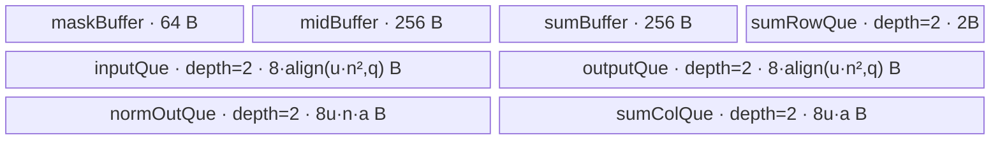
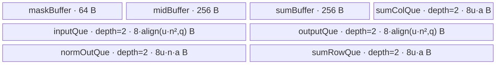

# MhcSinkhorn 950 ACLNN 算子知识

## 算子速览

| 项目 | 内容 |
|---|---|
| 实际入口 | `aclnnMhcSinkhornGetWorkspaceSize` + `aclnnMhcSinkhorn`，CANN 9.1.0 公开两段式 ACLNN；固定 Commit 未出现 `V2/V3` 等更高版本族 |
| 计算语义 | 对每个 `n×n` FP32 矩阵先做末维 softmax，再交替做列、行归一化，共形成 `2*numIters` 个归一化状态；最后状态写入 `output` |
| 输入输出 | `x/output` 为连续化后的 ND、FP32、`(T,n,n)` 或 `(B,S,n,n)`，`n∈{4,6,8}`；两项中间输出同时传入时启用 `normOut/sumOut` |
| 执行类型 | `AIV_VECTOR` |
| Kernel 路线 | R-001 无中间输出（`TEMPLATE_MODE=0`）；R-002 保留中间输出（`TEMPLATE_MODE=1`） |
| 核心资源 | 每核不相交 GM 矩阵片；UB 中五个 `TQue`、三个 `TBuf`、MicroAPI `RegTensor/MaskReg/AddrReg`；用户 workspace tiling 值为 0 |
| 来源闭包 | `source_closed`：公开 ACLNN→L0 AICore launcher→shape/tiling→`MhcSinkhornTilingData`→key 0/1→AIV-only entry→两种模板 body/helper→Ascend 950 binary/CMake/CI 均已闭合 |
| 验证状态 | 已完成源码闭包检查；本次知识提取未执行编译、真机、数值或性能测试。 |

## 接口与语义

### 计算语义

令输入展平后的批维为 `T`：三维输入直接取 `T=x.shape[0]`，四维输入取 `T=B*S`；每个矩阵为 `X_t∈R^(n×n)`。源码的实际顺序是：

1. `CalcSoftmax` 对每一行做稳定 softmax：`S=exp(X-rowMax)/sum(exp(X-rowMax))`，把未加 `eps` 的 `S` 存为第 0 个 norm 状态，同时按列累加 `S+eps`。
2. `CalcColNorm<true>` 再给该列和与分子各加一次 `eps`，得到 `D_1=sum_rows(S+eps)+eps`，并令 `N_1=(S+eps)/D_1`。
3. 对 `i=1..numIters-1`，`CalcRowNorm` 计算 `D_(2i)=sum_cols(N_(2i-1))+eps`、`N_(2i)=N_(2i-1)/D_(2i)`；随后 `CalcColNorm<false>` 计算 `D_(2i+1)=sum_rows(N_(2i))+eps`、`N_(2i+1)=N_(2i)/D_(2i+1)`。
4. `ScatterOutFromNorm` 把 `N_(2*numIters-1)` 从按 `nAlign` 排列的 UB 状态散射回紧凑 `n×n`，`CopyOut` 只提交每个 loop 的 `handleNum*n*n` 个有效 FP32 元素。

因此最终 `output=N_(2*numIters-1)`。R-002 还按 Kernel 的 block/loop 布局把各 `N_k` 写到 `normOut`，把 `D_k` 写到 `sumOut`；源码没有写 `sumOut` 的第 0 槽。公开文档把 `norm_out[0]` 写成 `softmax(x)+eps`，而 body 实际在加 `eps` 前先保存 softmax，这一冲突不能用文档公式覆盖 Device 事实。

### 输入、输出与属性

| 参数 | shape/layout | dtype | 约束、默认值与语义 |
|---|---|---|---|
| `x` | ND；`(T,n,n)` 或 `(B,S,n,n)` | FP32 | 必选、非空；ACLNN 接受非连续 Tensor，先经 `l0op::Contiguous`；`n∈{4,6,8}` 且末两维相等 |
| `eps` | 标量 | C++ `float` | 传入每次归一化的加数；OpDef 默认 `1e-6`，公开 ACLNN 实现不校验有限性、符号或范围 |
| `numIters` | 标量 | `int64_t` | `1..100`；OpDef 默认 20；Device 使用 `iterCnt=2*num_iters` |
| `output` | 与 `x` view shape 相同，storage format 与 `x` 相同 | FP32 | 必选；先连续化为 kernel 输出，之后 `ViewCopy` 回用户 view |
| `normOut` | R-002 公开推导为一维 `2*numIters*T*n*8` 个元素；R-001 使用 executor 分配的空 shape Tensor | FP32 | 与 `sumOut` 同时非空才启用中间输出；Kernel 实际布局由 block/loop offset 公式决定，不是 body 中的普通 `[k,T,n,nAlign]` 下标 |
| `sumOut` | R-002 公开推导为一维 `2*numIters*T*8` 个元素；R-001 使用 executor 分配的空 shape Tensor | FP32 | 保存归一化分母；第 0 槽在 Device body 中无写入 |
| `workspaceSize/executor` | Host 标量/句柄 | `uint64_t*` / `aclOpExecutor**` | 第一段返回整个执行图所需 workspace 和 executor；调用者把两者原样交给第二段 |
| `workspace/workspaceSize/executor/stream` | 第二段执行参数 | 指针/句柄 | `CommonOpExecutorRun` 在给定 stream 上执行 Contiguous、MhcSinkhorn 和 ViewCopy 图并传播状态码 |

### 入口与版本

公开头只声明 CANN 9.1.0 的 `aclnnMhcSinkhornGetWorkspaceSize` 与 `aclnnMhcSinkhorn`，没有版本后缀。第一段签名没有 `outFlag`：实现以 `normOut!=nullptr && sumOut!=nullptr` 推导 `outFlag=1`；任一为空时同时把局部 `normOut/sumOut` 替换成 executor 内部分配的空 shape Tensor，并置 `outFlag=0`。因此“只请求其中一个中间输出”不会形成第三条路线，也不会写调用者提供的单个中间 Tensor。

`l0op::MhcSinkhorn` 无条件进入 `MhcSinkhornAiCore`，通过 `ADD_TO_LAUNCHER_LIST_AICORE` 排入 `MhcSinkhorn` 单 Kernel 任务。固定 Commit 的 OpDef 只对 `ascend950` 注册 AICore config，公开文档也只标支持 Ascend 950PR/950DT；未发现同架构更高 ACLNN 版本或旧 body 复用。

## Host/Launcher 执行流程

### 参数校验与前处理

第一段先 `CREATE_EXECUTOR`，再推导 `outFlag`。`CheckParams` 依次检查：必选指针（`x/output`，R-002 还检查 `normOut/sumOut`）、相关 Tensor 全为 FP32、`output` 与 `x` shape 相等、`numIters∈[1,100]`、派生的 `outFlag∈{0,1}`、输入 rank 为 3 或 4、末两维相等且 `n∈{4,6,8}`、`x/output` storage format 相同。随后显式拒绝 `x->IsEmpty()`。

`eps` 传进 `CheckParams` 但没有被读取。`CheckDtypeValid` 在 R-002 检查两项中间输出的 dtype；`CheckShape` 和 `CheckFormat` 没有检查它们的 shape/format。通过后，`x` 和 `output` 分别经 `l0op::Contiguous`，再把连续 Tensor、三项输出及三个属性交给 L0 launcher；Kernel 返回的连续 `output` 最后经 `l0op::ViewCopy` 回用户 `output`。

### 参数、Workspace 与生命周期

executor 持有 Contiguous、MhcSinkhorn、ViewCopy 三阶段图以及 R-001 的两个内部占位 Tensor。第一段用 `uniqueExecutor->GetWorkspaceSize()` 返回整图 workspace，随后 `ReleaseTo(executor)` 转移 owner；第二段由调用方提供 workspace 和同一 executor，在指定 `aclrtStream` 上运行。

Tiling 的 `GetWorkspaceSize` 把唯一 user workspace 槽写成 0；Kernel entry 仍调用 `GetUserWorkspace(workSpace)`，若结果为 null 就直接返回，且 body 不再读取 `user`。框架系统 workspace、Contiguous/ViewCopy 的额外 workspace 公式及 `GetUserWorkspace` 在 user-size 为 0 时返回何种非空地址，均不在固定仓可见范围，不能把 ACLNN 返回的整图 `workspaceSize` 等同于 tiling 的 user workspace 0。

### 启动图与失败传播

调用图为：`aclnnMhcSinkhornGetWorkspaceSize`→`l0op::Contiguous(x/output)`→`l0op::MhcSinkhorn`→`MhcSinkhornAiCore`→`ADD_TO_LAUNCHER_LIST_AICORE(MhcSinkhorn, inputs, outputs, attrs)`；执行阶段为 `aclnnMhcSinkhorn`→`CommonOpExecutorRun(...,stream)`→Tiling→`mhc_sinkhorn<TEMPLATE_MODE>`。

Tiling prepare 从平台取 `GetCoreNumAiv()` 和 UB size，任一非正即 `GRAPH_FAILED`；shape/dtype/属性、空 Tensor、context/desc/attr/compile-info 空指针均有失败返回。`PostTiling` 设置 `blockDim=usedCoreNum` 和 local memory size。L0 enqueue 失败返回 null，再由 ACLNN 映射成 `ACLNN_ERR_INNER_NULLPTR`；第二段直接透传 `CommonOpExecutorRun` 状态。Device entry 若 user workspace 指针为 null 则静默 return，固定仓没有 Device 到 Host 的附加错误上报。

## Route 与参数设计

### 分核与资源计算

Host 令 `C=GetCoreNumAiv()`、`B=GetUbBlockSize(context)`、`d=sizeof(FP32)=4`、`q=floor(B/d)`、`a=CeilAlign(n,q)`。公共分核量为：

- `tNormCore=ceil(T/C)`，`usedCoreNum=ceil(T/tNormCore)`，`tTailCore=T-tNormCore*(usedCoreNum-1)`；每核初始 GM 偏移为 `blockIdx*tNormCore*n*n`。
- Host 同时计算 forward/backward 两个保守候选，选择 `tUbFactor` 较小者（相等时 forward）；选中结构中的 loop/tail 字段整体进入 POD。
- forward 候选先扣 `64+3*256` 字节，再除以 2 为 double-buffer 的单份预算。每 `u` 个矩阵的元素占用为 `align(u*n²,q)+align(u*n²,q)+align(n*u*a,q)+align(u*a,q)`；保留中间输出模式再加 `align(u*a,q)`，最后乘 4 字节。若整核不适配，则 `u=floor(singleBudget/onePiece)` 后向下 8 对齐，0 被改成 8。
- backward 保守候选扣除同样 `64+3*256` 后除 2；占用为 `[align(u*n²,q)+align(u*n²,q)+align(2*u*n*a,q)+align(2*u*a,q)]*4`。超限时除以单矩阵占用并向下对齐 `floor(256/(8*4))=8`；该分支允许 `u=0`，源码没有显式报错。
- `tNormCoreLoop=ceil(tNormCore/u)`、`tTailCoreLoop=ceil(tTailCore/u)`，普通核尾轮为 `tUbFactorTail=tNormCore-(loops-1)*u`，末核尾轮为 `tUbTailTail=tTailCore-(loops-1)*u`。backward 候选在 `u=0` 时把 loop 置 1，但 tail 字段仍按 0 计算。

Kernel 重新取 `blockDataNum=GetUbBlockSize()/4`、`nAlign=CeilAlign(n,blockDataNum)`、`nnAligSize=n*nAlign`。固定仓没有 `op_kernel/platform_util.h`/`math_util.h` 的实现，也没有 950 的具体 `B`、VREG size、UB 上限常量；文档与 infershape 使用 `n_align=8`，而最终 Device 值仍以这些公共 API 返回值为准。

### Route 选择

| 顺序 | Route | Key/模板 | 精确选择条件与优先级 | 不适用去向 |
|---:|---|---|---|---|
| 1 | R-001 无中间输出 | tiling key 0；`TEMPLATE_MODE=0`；`MhcSinkhornSimd<float,false>` | ACLNN 第一段初始 `outFlag=1`，若 `normOut==nullptr \|\| sumOut==nullptr` 则替换两者并置 0；Tiling `outFlag_!=1` 返回 key 0 | 两者均非空则 R-002；其它 `outFlag` 在 Tiling 校验失败 |
| 2 | R-002 保留中间输出 | tiling key 1；`TEMPLATE_MODE=1`；`MhcSinkhornSimd<float,true>` | `normOut!=nullptr && sumOut!=nullptr`，ACLNN 保持 `outFlag=1`；Tiling `outFlag_==1` 返回 key 1 | 任一为空回 R-001；无其它 fallback |

```text
aclnnMhcSinkhornGetWorkspaceSize
  ├─ normOut == nullptr OR sumOut == nullptr
  │    -> 同时分配内部空 shape Tensor -> outFlag=0
  │    -> GetTilingKey()=GET_TPL_TILING_KEY(0)
  │    -> mhc_sinkhorn<0> -> MhcSinkhornSimd<float,false>  [R-001]
  └─ normOut != nullptr AND sumOut != nullptr
       -> outFlag=1
       -> GetTilingKey()=GET_TPL_TILING_KEY(1)
       -> mhc_sinkhorn<1> -> MhcSinkhornSimd<float,true>   [R-002]
```

### 模板/实现执行矩阵

| Route | key/selector | dtype/shape/platform 完整命中条件 | 执行拓扑与 Kernel 节点 | 实际模板/body | 内存与同步特征 | tail/fallback |
|---|---|---|---|---|---|---|
| R-001 无中间输出 | `GET_TPL_TILING_KEY(0)` / `TEMPLATE_MODE=0` | 950；FP32 ND；rank 3/4；非空；方阵且 `n∈{4,6,8}`；`1≤numIters≤100`；`normOut==nullptr \|\| sumOut==nullptr` | 单节点：`MhcSinkhornAiCore` enqueue → `mhc_sinkhorn<0>`，`blockDim=usedCoreNum`，执行族 `AIV_VECTOR` | `MhcSinkhornSimd<float,false>::Init/Process` 及全部直接 helper | 无中间 GM snapshot；`sumRowQue_` 每 slot 仅一 UB block；Queue、`LocalMemBar` 与固定 `MTE3_V` event | former/tail core 与 tail loop 使用 POD；参数/资源失败即 Host 失败，entry user-workspace null 则静默 return |
| R-002 保留中间输出 | `GET_TPL_TILING_KEY(1)` / `TEMPLATE_MODE=1` | 同上，且 `normOut!=nullptr && sumOut!=nullptr`；两者还须 FP32 | 单节点：`MhcSinkhornAiCore` enqueue → `mhc_sinkhorn<1>`，`blockDim=usedCoreNum`，执行族 `AIV_VECTOR` | `MhcSinkhornSimd<float,true>::Init/Process` 及全部直接 helper | 每次 norm/sum 状态经 MTE3 写 GM；`sumRowQue_` 每 slot 为 `u*nAlign*4` B；源码在初始状态、首次列状态、每次 row 状态后及下一 iter 入口设置 `MTE3_V` event | 同一 former/tail；没有第三模板，任一中间输出为空回 R-001 |

### 隐藏性能 Guard

| Guard | Host/Tiling 条件 | Device/资源原因 | 影响 Route | 不满足时去向 | 源码符号 |
|---|---|---|---|---|---|
| AIV 与 UB 可用 | `GetCoreNumAiv()>0 && ubSize>0` | `blockDim` 来自 AIV 数量，全部 Queue/TBuf 分配在 UB | R-001/R-002 | `TilingPrepareForMhcSinkhorn` / `GetPlatformInfo` 返回 `GRAPH_FAILED` | `mhc_sinkhorn_tiling.cpp:TilingPrepareForMhcSinkhorn/GetPlatformInfo` |
| 单份 UB 预算 | `available=(ubSize-64-3*256)/2`；整核不适配时按 `floor(available/onePiece)` 缩小 `u` | Queue depth=2；Host 先为 mask 与三个 256 B 常量留保守区，再按单 slot 预算 tile | R-001/R-002 | 缩小 `tUbFactor`，无其它 Kernel fallback | `mhc_sinkhorn_base_tiling.cpp:ForwardSplitCore/BackwardSplitCore` |
| tile 非零 | forward 把计算出的 `u==0` 改成 8；backward 候选可保留 0；最终选择两候选较小 `u` | `u` 进入 `CeilDiv`、Buffer 容量、GM stride 与 tail 公式，0 不是合法 Device tile | R-001/R-002 | 固定源码无显式失败；属于资源闭包缺口，不能假定实际 950 永不命中 | `BaseSplitCores/ForwardSplitCore/BackwardSplitCore` |
| 8 矩阵 tile 对齐 | forward 超限时 `FloorAlign(u,8)`；backward 超限时按 `256/(8*4)=8` 对齐 | MicroAPI 以 UB block/VREG 分组，n-mask 固定覆盖每组 8 lane | R-001/R-002 | 向下缩小 tile；forward 的 0 再改 8，backward 无修复 | `ForwardSplitCore/BackwardSplitCore` |
| n 与动态 mask | `n==4 \|\| n==6 \|\| n==8` | `Process` 只有 `MASK_4/MASK_6/MASK_8`，gather/scatter lane 图以 8 为行内槽数 | R-001/R-002 | ACLNN 与 Tiling 均失败，不进入 Kernel | `CheckShape/CheckInputShape/MhcSinkhornSimd::Process` |
| Route 与 POD 一致 | `outFlag∈{0,1}`，key 仅由 `outFlag==1` 决定 | compile-time `OUT_FLAG` 改变 Queue 容量和 GM snapshot 副作用；错误组合会破坏容量/输出语义 | R-001/R-002 | 非 0/1 在 ACLNN/Tiling 失败；框架的 key/POD 一致性实现固定仓不可见 | `GetShapeAttrsInfo/GetTilingKey/mhc_sinkhorn` |
| MTE3→V 复用 | `k=0`、`k=1`、每个 row snapshot 后以及每个 `iter` 入口执行 `SetFlag<HardEvent::MTE3_V>`→`WaitFlag` | 下一 Vector helper 会改写刚由 MTE3 读取的 norm/sum LocalTensor；下一 iter 入口覆盖上一 col snapshot | 两 Route；R-001 也保留同位置的固定 event | 无 fallback；`numIters>1` 的最终 col snapshot 后没有新的显式 `MTE3_V`，其完成边界只能保留为 Queue/Kernel primitive 边界 | `MhcSinkhornSimd::Process` |
| user workspace 指针 | `GetUserWorkspace(workSpace)!=nullptr`，尽管 tiling user workspace 为 0 B | entry 在读取 POD/启动 body 前先做指针 guard | R-001/R-002 | Device 静默 return；无 Host 侧附加错误 | `mhc_sinkhorn_apt.cpp:mhc_sinkhorn` |

### POD/ABI

`MhcSinkhornTilingData` 由普通 C++ class 声明并用 `GET_TILING_DATA_WITH_STRUCT` 消费。固定仓没有 `static_assert(sizeof/alignof/offsetof)`、显式 pack 或序列化宏定义，故表中 ABI 布局只给源码声明序号；最终 target compiler 的字节级 `sizeof/alignof/offsetof` 固定仓不可见，复用时必须以同一工具链实测而不能臆定。

| 结构 | 字段 | 类型/位宽 | ABI 布局 | 单位 | Host/launcher producer | Device consumer | 边界 |
|---|---|---|---|---|---|---|---|
| `MhcSinkhornTilingData` | `eps` | `float`/32 bit | 声明序号 0；`sizeof/alignof/offsetof` 固定仓不可见 | 无量纲 | `SetTilingData: eps=eps_` | `CalcSoftmax/CalcColNorm/CalcRowNorm` 的 `Adds` | ACLNN 不校验有限性/正值 |
| `MhcSinkhornTilingData` | `num_iters` | `int64_t`/64 bit | 声明序号 1；字节布局固定仓不可见 | 次 | `num_iters=*attrs[1]`，`SetTilingData` | `Init: iterCnt=2*num_iters`；`Process` loop 上界 | `1..100` |
| `MhcSinkhornTilingData` | `out_flag` | `int64_t`/64 bit | 声明序号 2；字节布局固定仓不可见 | bool-like | ACLNN 由两个可选输出是否同时非空派生；`SetTilingData` | entry 不读取；模板 key 与 `OUT_FLAG` 是实际 Device 分支 | 只能 0/1；POD 与模板 key 一致性由框架保证，细节固定仓不可见 |
| `MhcSinkhornTilingData` | `n` | `int64_t`/64 bit | 声明序号 3；字节布局固定仓不可见 | 元素 | `CheckInputShape` 取末维；`SetTilingData` | `Init` 尺寸、全部 helper 的 n 循环与 mask | 4、6、8 |
| `MhcSinkhornTilingData` | `usedCoreNum` | `int64_t`/64 bit | 声明序号 4；字节布局固定仓不可见 | AIV 核 | `BaseSplitCores`→`SetTilingData` | `Init` 判断末核；`Process` inactive core guard | 正常应 `1..C`；T>0 由 ACLNN 空 Tensor检查保证 |
| `MhcSinkhornTilingData` | `tNormCoreLoop` | `int64_t`/64 bit | 声明序号 5；字节布局固定仓不可见 | loop | 分核候选→`SetTilingData` | `Init` 普通核 `loop_` | 依赖非零 `tUbFactor` |
| `MhcSinkhornTilingData` | `tUbFactor` | `int64_t`/64 bit | 声明序号 6；字节布局固定仓不可见 | 矩阵/loop | forward/backward 取较小候选→`SetTilingData` | `InitBuffer` 容量、GM/中间输出 stride、每轮 handle | backward 候选可算出 0，Host 无显式失败 |
| `MhcSinkhornTilingData` | `tUbFactorTail` | `int64_t`/64 bit | 声明序号 7；字节布局固定仓不可见 | 矩阵 | `tNormCore-(tNormCoreLoop-1)*tUbFactor` | `Init` 普通核 `tailHandelSize_` | 普通核最后一轮有效量 |
| `MhcSinkhornTilingData` | `tTailCoreLoop` | `int64_t`/64 bit | 声明序号 8；字节布局固定仓不可见 | loop | 分核候选→`SetTilingData` | `Init` 末核覆盖 `loop_` | 末核专用 |
| `MhcSinkhornTilingData` | `tUbTailTail` | `int64_t`/64 bit | 声明序号 9；字节布局固定仓不可见 | 矩阵 | `tTailCore-(tTailCoreLoop-1)*tUbFactor` | `Init` 末核覆盖 `tailHandelSize_` | 末核最后一轮有效量 |
| `MhcSinkhornTilingData` | `tNormCore` | `int64_t`/64 bit | 声明序号 10；字节布局固定仓不可见 | 矩阵/核 | `ceil(T/C)`→`SetTilingData` | `Init` GM 基址；`Process` 中间输出 block 起点 | 非末核覆盖上限；末核实际为 `tTailCore` |

### Route 源码闭包

| Route | Key/selector | Host/Tiling producer | POD/参数 | Kernel entry/router | Kernel body/直接依赖 | 构建接线 |
|---|---|---|---|---|---|---|
| R-001 无中间输出 | `outFlag=0`→key 0→`TEMPLATE_MODE=0` | `aclnnMhcSinkhornGetWorkspaceSize`；`MhcSinkhornTiling::{GetShapeAttrsInfo,GetTilingKey,SetTilingData}`；`MhcSinkhornBaseTiling::BaseSplitCores` | `MhcSinkhornTilingData` 全 11 字段；workspace[0]=0；blockDim=`usedCoreNum` | `mhc_sinkhorn<0>`→`MhcSinkhornSimd<float,false>` | `Init/Process/CopyIn/CalcSoftmax/CalcColNorm/CalcRowNorm/ScatterOutFromNorm/CopyOut` | `mhc_sinkhorn_binary.json`、`op_host/CMakeLists.txt`、`obj_func.cmake`、950 CI list |
| R-002 保留中间输出 | `outFlag=1`→key 1→`TEMPLATE_MODE=1` | 同上，且 forward UB 公式计入 `sumRow` | 同一 POD；模板常量 `OUT_FLAG=true` 控制队列容量与 GM snapshot | `mhc_sinkhorn<1>`→`MhcSinkhornSimd<float,true>` | 同一模板 body，额外可达 norm/sum `DataCopyPad` 与 `StoreUnAlign` | 同一 Ascend 950 动态 binary/config/CMake/CI 接线 |

## Kernel 实现

### 公共执行流程

模板 entry 先取 user workspace；null 时返回。随后声明任务为 `KERNEL_TYPE_AIV_ONLY`，注册并读取 `MhcSinkhornTilingData`，构造唯一 `TPipe` 与对应 `MhcSinkhornSimd<float,OUT_FLAG>`。两条 Route 共用单个 `Process`：inactive core 返回；按 `n` 生成 mask；每个 core/loop 执行 `CopyIn→CalcSoftmax→CalcColNorm<true>→[(CalcRowNorm→CalcColNorm<false>)*(num_iters-1)]→ScatterOutFromNorm→CopyOut`。没有 AIC、跨核 reduce、Atomic、多 Kernel 或 workspace 数据通道；每个 AIV 只处理自己的连续矩阵区间。

### Route R-001：无中间输出

#### 适用条件

##### 选择证据

| 层级 | 文件 | 符号 | 源码谓词/参数 | 结果/下一跳 |
|---|---|---|---|---|
| API | `mhc/mhc_sinkhorn/op_host/op_api/aclnn_mhc_sinkhorn.cpp` | `aclnnMhcSinkhornGetWorkspaceSize` | `normOut==nullptr \|\| sumOut==nullptr`，同时重绑两者并 `outFlag=0` | `l0op::MhcSinkhorn(...,0,...)` |
| Host | `mhc/mhc_sinkhorn/op_host/mhc_sinkhorn_tiling.cpp` | `GetShapeAttrsInfo` / `GetTilingKey` | 先要求 `outFlag_==0 \|\| outFlag_==1`；仅 `outFlag_==1` 才把 key 置 1 | 此 Route 返回 `GET_TPL_TILING_KEY(0)` |
| Router | `mhc/mhc_sinkhorn/op_kernel/arch35/mhc_sinkhorn_tiling_key.h` | `ASCENDC_TPL_SEL` | selector 0 明确配 `ASCENDC_TPL_AIV_ONLY` | 选择 `TEMPLATE_MODE=0` |
| Entry | `mhc/mhc_sinkhorn/op_kernel/mhc_sinkhorn_apt.cpp` | `mhc_sinkhorn<0>` | `if constexpr(TEMPLATE_MODE==0)` | 实例化 `MhcSinkhornSimd<float,false>`；无 fallback |

#### Device 数据流

##### 函数级调用链

```text
mhc_sinkhorn<0>(h_res,y,norm_out,sum_out,workSpace,tiling)
  -> GetUserWorkspace + GET_TILING_DATA_WITH_STRUCT
  -> MhcSinkhornSimd<float,false>::Init
     -> TPipe::InitBuffer(mask/mid/sum,input/output/norm/sumCol,sumRow-one-block)
  -> MhcSinkhornSimd<float,false>::Process
     -> CopyIn
     -> CalcSoftmax
     -> CalcColNorm<true>
     -> [CalcRowNorm -> CalcColNorm<false>] * (num_iters-1)
     -> ScatterOutFromNorm
     -> CopyOut
```

##### 源码等价伪码

```text
// 源码等价伪码；B=UB block bytes，V=VREG bytes，q=B/4，bc=V/B
if blockIdx >= usedCoreNum: return
baseMatrix = blockIdx * tNormCore
loops = (last used core ? tTailCoreLoop : tNormCoreLoop)
tail  = (last used core ? tUbTailTail : tUbFactorTail)
maskUB[0:8] = MASK_4/MASK_6/MASK_8 according to n
for loopIdx in [0,loops):
  h = (last loop ? tail : tUbFactor)
  inputGM  = h_res + (baseMatrix + loopIdx*tUbFactor) * n*n
  outputGM = y     + (baseMatrix + loopIdx*tUbFactor) * n*n
  DataCopyPad inputGM[0:h*n*n] -> inputQue
  for register-group i in [0,ceil(h/bc)):
    active = LoadAlign(maskUB) AND UpdateMask(h*q)
    for row/column selector nIdx in [0,n):
      gather n active values from compact input using lane index (lane mod 8)+floor(lane/8)*n*n+nIdx*n
      reduce-max; UB store barrier/load broadcast; exp(x-max)
      reduce-sum; UB store barrier/load broadcast; softmax=exp/sum
      store softmax to norm queue; accumulate softmax+eps into column-sum register
    store column sums to sumCol queue
  MTE3_V event set/wait (即使 OUT_FLAG=false 也执行)
  CalcColNorm<true>: denom=sumCol+eps; norm=(norm+eps)/denom
  MTE3_V event set/wait
  for iter in [1,num_iters):
    MTE3_V event set/wait
    CalcRowNorm: rowSum=reduce(norm)+eps; norm/=rowSum; accumulate new columnSum
    MTE3_V event set/wait
    CalcColNorm<false>: denom=columnSum+eps; norm/=denom
    free one-block sumRow scratch tensor
  free sumCol tensor
  scatter final padded norm -> compact outputQue using the same lane index map
  DataCopyPad outputQue[0:h*n*n] -> outputGM[0:h*n*n]
```

#### 内存与数据搬运

##### 资源与搬运表

| 层级/缓冲区 | offset/地址公式 | extent/容量公式 | dtype/layout | producer | consumer | owner/lifetime | 对齐/复用 |
|---|---|---|---|---|---|---|---|
| GM `h_res` | core base `blockIdx*tNormCore*n²`；loop `+loopIdx*tUbFactor*n²` | 每轮有效 `handleNum*n²*4` B | FP32，紧凑矩阵 | ACLNN Contiguous | `CopyIn::DataCopyPad` | caller/executor，整次 launch | 单次 blockLen=`handleSize` B，src/dst stride=0；UB capacity 对 `q` 元素上取整 |
| GM `y` | 与输入相同矩阵 offset | 每轮有效 `handleNum*n²*4` B | FP32，紧凑矩阵 | `CopyOut` | ViewCopy/user output | executor/user | 只写有效前缀；不写 UB padding |
| `inputQue_` | queue 分配，无手工 offset | 每 slot `ceilAlign(tUbFactor*n²,q)*4` B，InitBuffer depth=2 | FP32 | MTE2 `CopyIn` EnQue | V `CalcSoftmax` DeQue | `TPipe`，每 loop alloc/free | `TQue<VECIN,1>`；double buffer；尾轮只填 `handleNum*n²` |
| `outputQue_` | queue 分配 | 同 `inputQue_`，depth=2 | FP32 | V `ScatterOutFromNorm` EnQue | MTE3 `CopyOut` DeQue | 每 loop alloc/free | scatter 只生成 mask 内有效 lane，GM 仅提交有效前缀 |
| `normOutQue_` | AddrReg `(i,V/4,nIdx,handleNum*q)` | 每 slot `tUbFactor*n*nAlign*4` B，depth=2 | FP32，按 n 组、handle 方向带 `nAlign` | Softmax/row/col helper | 后续 helper与 scatter | 从 `CalcSoftmax` alloc 至 scatter free，跨迭代复用 | `nAlign=ceilAlign(n,q)`；EnQue/DeQue 交接；不写 GM |
| `sumColQue_` | AddrReg `(i,V/4)` | 每 slot `tUbFactor*nAlign*4` B，depth=2 | FP32 | `CalcSoftmax`/`CalcRowNorm` | `CalcColNorm` | 每 loop，末尾 free | mask 控制有效 handle；同一 LocalTensor 经 DeQue/EnQue 复用 |
| `sumRowQue_` | 无 GM offset | 每 slot `blockDataNum*4=B` B，depth=2 | FP32 scratch | `CalcRowNorm` Alloc/EnQue | `Process` DeQue/Free | 每个迭代 | OUT_FLAG=false 不保存 row sums，容量只需一 UB block；区别于 R-002 |
| `maskBuffer_` | base | 64 B | `uint32_t[8]` 中的 mask pattern | `Process::Duplicate` | 各 MicroAPI helper `LoadAlign` | 整个对象 | mask 与 `UpdateMask(handleNum*q)` AND；跨 loop 复用 |
| `midBuffer_` | base | 256 B | FP32 reduction scratch | reduce store | broadcast load | 整个对象 | `LocalMemBar` 保护 store→load；各 helper 别名复用 |
| `sumBuffer_` | base | 256 B | FP32 softmax sum scratch | `CalcSoftmax` reduce store | broadcast load | 整个对象 | 仅 softmax 使用；store→load barrier |
| MicroAPI 寄存器 | VREG 内部，AddrReg 由 `i/nIdx/handleLen` 生成 | 每个 `RegTensor` 一 VREG；确切字节由 `GetVRegSize()`，固定仓不可见 | FP32/int32/uint32 mask | `DataCopyGather/Arange/Duplicate/reduce` | 算术与 scatter | 单个 `__VEC_SCOPE__` | 无 classic repeat/stride；外层 `i` 等价 repeat，mask/tail 来自动态 `UpdateMask` |
| workspace | user slot 0 | Tiling 写 0 B | N/A | Host Tiling | body 不读；entry 只判 user pointer | framework | `GetUserWorkspace` 返回语义固定仓不可见 |

##### 分层内存布局



图中 `B=GetUbBlockSize()`、`q=B/4`、`a=CeilAlign(n,q)`、`u=tUbFactor`；`align` 的单位为 FP32 元素。每个 Queue 的标签已把 `InitBuffer(...,DOUBLE_BUFFER=2,slotBytes)` 的 depth 乘入。

##### 字节账与复用顺序

```text
Qin   = 2 * 4 * align(u*n²,q)
Qout  = 2 * 4 * align(u*n²,q)
Qnorm = 2 * 4 * u*n*a
Qcol  = 2 * 4 * u*a
Qrow  = 2 * B
TBuf  = 64 + 256 + 256 = 576
UB_total_R001 = 576 + 2B + 8*[2*align(u*n²,q) + u*n*a + u*a]

Host forward guard: 2 * 4*[2*align(u*n²,q)+u*n*a+u*a] + 832 <= ubSize
因此只有在 576+2B <= 832 且最终 u>0 时，forward guard 可直接推出 UB_total_R001<=ubSize；
固定仓未给出 A5 的 B，BaseSplitCores 还可能选更小的 backward 候选，故将这两项保留为显式资源前提。
```

| 复用子区 | 写入者 | 读取者/消费点 | 下一次覆盖 | 同步或释放依据 | 安全条件 |
|---|---|---|---|---|---|
| `normOutQue_` 当前 slot | `CalcSoftmax`，随后各 `CalcRowNorm/CalcColNorm` 原地写回 | 下一归一化 helper；最终 `ScatterOutFromNorm` | 下一 helper 或下一 loop 重新 Alloc | 每步 DeQue→计算→EnQue；阶段间固定 `MTE3_V` event；末尾 `FreeTensor` | 不得绕过 Queue 状态或在 snapshot/event 完成前改写 |
| `sumColQue_` 当前 slot | `CalcSoftmax` / `CalcRowNorm` | `CalcColNorm` | 下一次 row 归一化重新写同一 LocalTensor | DeQue→EnQue；loop 末 DeQue/Free | col consumer 必须完成后才可生成下一列和 |
| `sumRowQue_` 一 block slot | `CalcRowNorm` 的临时 allocation；R-001 不落 GM row sum | `Process` 仅 DeQue/Free | 下一迭代 Alloc | Queue EnQue→DeQue/Free；相邻阶段 event | `OUT_FLAG=false` 时不得误用为 `u*a` 个 row sums |
| `midBuffer_` | softmax max 或 row sum reduce 写入 | `DIST_E2B_B32` 广播 reload | 下一次 reduce | `LocalMemBar<VEC_STORE,VEC_LOAD>`，softmax 还含反向 load→store bar | 单次 broadcast 消费完成后覆盖 |
| `sumBuffer_` | softmax sum reduce 写入 | softmax 分母广播 | 下一行/组 softmax sum | 成对 `LocalMemBar` | 仅 `CalcSoftmax` 生命周期内复用 |
| `inputQue_/outputQue_` slot | MTE2 CopyIn / Vector scatter | Vector softmax / MTE3 CopyOut | 下一 loop | Alloc/EnQue→DeQue/Free，depth=2 | GM 只读写 `handleNum*n²` 有效前缀 |

#### 同步、精度与尾块

##### 同步与数值边界表

| 阶段 | primitive/机制 | producer | consumer/等待点 | 保护对象 | 精度/尾块 |
|---|---|---|---|---|---|
| GM→UB | `TQue` Alloc→`DataCopyPad`→EnQue/DeQue | MTE2 `CopyIn` | `CalcSoftmax` | input slot | FP32；单 block，`blockLen=handleNum*n²*4` B；尾 loop 由 `handleNum` 缩短 |
| softmax reduce | `LocalMemBar<VEC_LOAD,VEC_STORE>` 后接 `LocalMemBar<VEC_STORE,VEC_LOAD>` | V load/reduce→mid/sum TBuf store | broadcast reload | `midBuffer_`/`sumBuffer_` | 全 FP32；先 max-sub、`Exp`、sum、`Div`；mask=`shapeMask AND UpdateMask(handleNum*q)` |
| helper 交接 | `TQue` EnQue/DeQue | `CalcSoftmax/CalcRowNorm/CalcColNorm` | 下一 helper | norm/sum LocalTensor | 不 cast、不 round；`eps` 以 FP32 `Adds` 插入；空域由 API 禁止 empty |
| snapshot/复用 | `SetFlag<HardEvent::MTE3_V>`→`WaitFlag` | 前一 Vector 阶段（R-001 无 snapshot MTE3 仍执行） | 下一 Vector helper | 可被 MTE3/V 复用的 UB Tensor | 每次 col/row 边界；无跨核 barrier/Atomic |
| row reduce scratch | `LocalMemBar<VEC_STORE,VEC_LOAD>` | row sum 写 `midBuffer_` | broadcast reload | row sum | mask/tail 同上；R-001 的 `sumRowQue_` 只作一 block 生命周期占位 |
| UB→GM | output queue EnQue/DeQue→`DataCopyPad` | `ScatterOutFromNorm` | `CopyOut` | output slot | FP32；scatter mask 过滤 n=4/6/8 和尾 handle，GM 仅写 `handleNum*n²` |

#### 关键实现

##### 符号证据表

| 阶段 | 文件 | 符号/模板实例 | 实现事实 |
|---|---|---|---|
| Host/Tiling producer | `mhc/mhc_sinkhorn/op_host/op_api/aclnn_mhc_sinkhorn.cpp` | `aclnnMhcSinkhornGetWorkspaceSize` | 任一中间输出为空即派生 `outFlag=0` 并构造占位 Tensor |
| Host/Tiling producer | `mhc/mhc_sinkhorn/op_host/mhc_sinkhorn_tiling.cpp` | `SplitByCoreNum/SetTilingData/GetTilingKey/PostTiling` | 生产 core/loop/tail/POD，key 0，blockDim=`usedCoreNum` |
| Host/Tiling helper | `mhc/mhc_sinkhorn_common/op_host/arch35/mhc_sinkhorn_base_tiling.cpp` | `BaseSplitCores/ForwardSplitCore/BackwardSplitCore` | 计算两个 UB 候选并选择更小 `tUbFactor` |
| Kernel entry/router | `mhc/mhc_sinkhorn/op_kernel/mhc_sinkhorn_apt.cpp` | `mhc_sinkhorn<0>` | AIV-only entry 实例化 `MhcSinkhornSimd<float,false>` |
| Device body/helper | `mhc/mhc_sinkhorn/op_kernel/arch35/mhc_sinkhorn.h` | `MhcSinkhornSimd<float,false>::Init/Process` | 分核、Buffer 容量、完整迭代序列和无 snapshot 分支 |
| Device body/helper | `mhc/mhc_sinkhorn/op_kernel/arch35/mhc_sinkhorn.h` | `CopyIn/CalcSoftmax/CalcColNorm<true,false>` | GM→UB、稳定 softmax、列归一化和 eps 顺序 |
| Device body/helper | `mhc/mhc_sinkhorn/op_kernel/arch35/mhc_sinkhorn.h` | `CalcRowNorm/ScatterOutFromNorm/CopyOut` | 行 reduce、最终 scatter、有效 GM 输出与 tail |

### Route R-002：保留中间输出

#### 适用条件

##### 选择证据

| 层级 | 文件 | 符号 | 源码谓词/参数 | 结果/下一跳 |
|---|---|---|---|---|
| API | `mhc/mhc_sinkhorn/op_host/op_api/aclnn_mhc_sinkhorn.cpp` | `aclnnMhcSinkhornGetWorkspaceSize` | `normOut!=nullptr && sumOut!=nullptr`，初始 `outFlag=1` 不变 | dtype 检查后 `l0op::MhcSinkhorn(...,1,...)` |
| Host | `mhc/mhc_sinkhorn/op_host/mhc_sinkhorn_tiling.cpp` | `GetShapeAttrsInfo` / `GetTilingKey` | `outFlag_==1` | `GET_TPL_TILING_KEY(1)` |
| Router | `mhc/mhc_sinkhorn/op_kernel/arch35/mhc_sinkhorn_tiling_key.h` | `ASCENDC_TPL_SEL` | selector 1 明确配 `ASCENDC_TPL_AIV_ONLY` | `TEMPLATE_MODE=1` |
| Entry | `mhc/mhc_sinkhorn/op_kernel/mhc_sinkhorn_apt.cpp` | `mhc_sinkhorn<1>` | `else if constexpr(TEMPLATE_MODE==1)` | `MhcSinkhornSimd<float,true>`；无其它模板/失败 fallback |

#### Device 数据流

##### 函数级调用链

```text
mhc_sinkhorn<1>(h_res,y,norm_out,sum_out,workSpace,tiling)
  -> GetUserWorkspace + GET_TILING_DATA_WITH_STRUCT
  -> MhcSinkhornSimd<float,true>::Init
     -> TPipe::InitBuffer(...,sumRow=tUbFactor*nAlign)
  -> MhcSinkhornSimd<float,true>::Process
     -> CopyIn -> CalcSoftmax
     -> DataCopyPad(norm snapshot k=0)
     -> CalcColNorm<true>
     -> DataCopyPad(norm k=1,sum k=1)
     -> [CalcRowNorm -> DataCopyPad(norm/sum k=2i)
         -> CalcColNorm<false> -> DataCopyPad(norm/sum k=2i+1)] * (num_iters-1)
     -> ScatterOutFromNorm -> CopyOut
```

##### 源码等价伪码

```text
// 源码等价伪码；公共 core/loop/mask/softmax/normalize 过程同 R-001
iterCnt = 2*num_iters
normBase = blockIdx * iterCnt * tNormCore * (n*nAlign)
sumBase  = blockIdx * iterCnt * tNormCore * nAlign
normLoopStride = loopIdx * iterCnt * tUbFactor * (n*nAlign)
sumLoopStride  = loopIdx * iterCnt * tUbFactor * nAlign
for each loopIdx with h=handleNum:
  curNorm = h*n*nAlign; curSum = h*nAlign
  CopyIn; CalcSoftmax                    // UB norm=N0, sumCol=Σ(S+eps)
  copy norm[0:curNorm] -> normOut[normBase+normLoopStride]
  MTE3_V set/wait
  CalcColNorm<true>                      // sumCol += eps; N1=(N0+eps)/sumCol
  copy norm -> normOut[base+1*curNorm]
  copy sumCol -> sumOut[sumBase+sumLoopStride+1*curSum]
  MTE3_V set/wait
  for iter=1..num_iters-1:
    MTE3_V set/wait
    CalcRowNorm                          // StoreUnAlign each rowSum+eps; N2i; new colSum
    copy norm -> normOut[base+2*iter*curNorm]
    copy sumRow -> sumOut[base+2*iter*curSum]
    MTE3_V set/wait
    CalcColNorm<false>                   // colSum+eps; N2i+1
    copy norm -> normOut[base+(2*iter+1)*curNorm]
    copy sumCol -> sumOut[base+(2*iter+1)*curSum]
    free sumRow after MTE3_V protection
  free sumCol; scatter final norm; CopyOut compact y
// sumOut slot 0 没有任何写操作
```

#### 内存与数据搬运

##### 资源与搬运表

| 层级/缓冲区 | offset/地址公式 | extent/容量公式 | dtype/layout | producer | consumer | owner/lifetime | 对齐/复用 |
|---|---|---|---|---|---|---|---|
| GM `h_res/y` | `blockIdx*tNormCore*n² + loopIdx*tUbFactor*n²` | 每轮 `handleNum*n²*4` B | FP32 compact | Contiguous / Kernel | Kernel / ViewCopy | launch | 与 R-001 相同，src/dst stride 0 |
| GM `norm_out` | `blockIdx*(2I)*tNormCore*n*nAlign + loopIdx*(2I)*tUbFactor*n*nAlign + k*handleNum*n*nAlign` | 每个 snapshot `handleNum*n*nAlign*4` B；总推导 `2I*T*n*8` 元素 | FP32，block/loop/k 分段，matrix 维按 `nAlign` | `Process::DataCopyPad` | caller/反向算子 | 用户 Tensor | `k=0..2I-1` 全部写；GM blockLen 为当前 snapshot 字节数，stride 0 |
| GM `sum_out` | `blockIdx*(2I)*tNormCore*nAlign + loopIdx*(2I)*tUbFactor*nAlign + k*handleNum*nAlign` | 每个已写 snapshot `handleNum*nAlign*4` B；总推导 `2I*T*8` 元素 | FP32 | `Process::DataCopyPad` | caller/反向算子 | 用户 Tensor | 只写 `k=1..2I-1`；`k=0` 保持调用前内容/未定义 |
| `inputQue_/outputQue_` | queue slot | 各 `ceilAlign(tUbFactor*n²,q)*4` B，depth=2 | FP32 compact | CopyIn/scatter | softmax/CopyOut | 每 loop | 同 R-001 |
| `normOutQue_` | AddrReg `(i,V/4,nIdx,handleNum*q)` | 每 slot `tUbFactor*n*nAlign*4` B，depth=2 | FP32 padded states | 各 Vector helper | snapshot MTE3、下一 helper、scatter | 整个 loop | snapshot 均为 DeQue→MTE3 copy→EnQue；显式 `MTE3_V` 位置以 `Process` 为准，最终 col snapshot 后无额外显式 event |
| `sumColQue_` | AddrReg `(i,V/4)` | 每 slot `tUbFactor*nAlign*4` B，depth=2 | FP32 | softmax/row | snapshot + col norm | loop | DeQue/EnQue 复用；末尾 free |
| `sumRowQue_` | `sumRowOutAddr+i*blockCnt+nIdx*handleNum` | 每 slot `tUbFactor*nAlign*4` B，depth=2 | FP32；n 个非对齐 row-sum 序列 | `CalcRowNorm::StoreUnAlign` | snapshot MTE3 | 每 iter alloc，snapshot 后 free | tail store stride=`postUpdateStride`；这是 Route 拆分所需的 UB 布局差异 |
| `mask/mid/sum TBuf` | pipe 分配 | 64/256/256 B | uint32/FP32 | Process/reduce | helpers | Kernel | 与 R-001 相同，TBuf 跨 helper 别名复用 |
| RegTensor/AddrReg | 由 `i,nIdx,handleLen` 构造 | VREG size 固定仓不可见 | FP32/int32 | MicroAPI loads/reduce | arithmetic/stores | 单 vec scope | `StoreUnAlign` 仅 R-002 的 row sum GM 快照路径可达 |
| workspace | user slot 0 | 0 B | N/A | Tiling | body 不读 | framework | entry 的非空检查同 R-001 |

##### 分层内存布局



`B/q/a/u` 定义同 R-001。R-002 唯一物理布局差异是 `sumRowQue_` 从每 slot 一 UB block 扩为 `u*a*4` B；norm/sum GM 不是 UB 分配，但其 MTE3 读取会延长对应 Queue slot 的不可覆盖期。

##### 字节账与复用顺序

```text
Qin   = 2 * 4 * align(u*n²,q)
Qout  = 2 * 4 * align(u*n²,q)
Qnorm = 2 * 4 * u*n*a
Qcol  = 2 * 4 * u*a
Qrow  = 2 * 4 * u*a
TBuf  = 576
UB_total_R002 = 576 + 8*[2*align(u*n²,q) + u*n*a + 2u*a]

Host forward guard:
  2 * 4*[2*align(u*n²,q)+u*n*a+2u*a] + 832 <= ubSize
=> UB_total_R002 <= ubSize
前提仍是最终 u>0；Host 的 832 B 保守常量大于 body 三个 TBuf 的 576 B。
```

| 复用子区 | 写入者 | 读取者/消费点 | 下一次覆盖 | 同步或释放依据 | 安全条件 |
|---|---|---|---|---|---|
| `normOutQue_` 当前 slot | softmax/row/col helper 原地写状态 | GM norm snapshot、下一 helper、最终 scatter | snapshot 后的下一 helper | DeQue→MTE3 `DataCopyPad`→EnQue；`k=0/k=1/row` 后显式 wait，col snapshot 由下一 iter 入口 wait | 最终 col snapshot 后无额外显式 event；其与 scatter/free 的完成关系依赖固定仓不可见的 Queue/Kernel primitive |
| `sumColQue_` 当前 slot | `CalcSoftmax`/`CalcRowNorm` | GM sum snapshot 与 `CalcColNorm` | 下一 row 归一化 | snapshot 后 EnQue；非最终 col snapshot 由下一 iter 的 `MTE3_V` 后继续；loop 末 Free | `sumOut[k]` 与对应 norm 状态的 k 保持一致；k=0 不存在写入；最终 col snapshot 后无显式 event |
| `sumRowQue_` 当前 slot | `CalcRowNorm::StoreUnAlign` | GM `sumOut[2i]` snapshot | snapshot 完成后的下一 iter | DataCopyPad 后 `MTE3_V`，随后 DeQue/Free | tail VREG 组须用 `tailLoopHandleNum` 的 post-update stride |
| `midBuffer_/sumBuffer_` | reduce 结果 | E2B broadcast | 下一 reduce | `LocalMemBar` | 与 R-001 相同；不与 Queue 物理别名 |
| `inputQue_/outputQue_` slot | CopyIn/scatter | softmax/CopyOut | 下一 loop | Queue lifecycle，depth=2 | 仅当前 handle 有效，padding lane 不写 GM |

#### 同步、精度与尾块

##### 同步与数值边界表

| 阶段 | primitive/机制 | producer | consumer/等待点 | 保护对象 | 精度/尾块 |
|---|---|---|---|---|---|
| Queue 管线 | Alloc/EnQue→DeQue/EnQue | CopyIn/各 Vector helper | 下一 helper/MTE3 | input/norm/sum/output slots | 全 FP32；depth=2；当前 loop 的 `handleNum` 控制有效前缀 |
| softmax/row reduce | `LocalMemBar` | reduce 结果写 TBuf | E2B broadcast load | mid/sum scratch | max、exp、sum、div 均 FP32；无 cast/round；mask=`n-mask AND tail-mask` |
| norm snapshot | `DataCopyPad`；`k=0/k=1/row` 后显式 `MTE3_V`，col 状态由下一 iter 入口 wait | MTE3 从 `normOutQue_` 写 GM | 下一 Vector 修改同一 LocalTensor | 当前 norm state | `blockLen=curNormSize*4`，src/dst stride 0；最终 col snapshot 后源码无新的显式 event |
| col-sum snapshot | `DataCopyPad`；非最终 col 状态由下一 iter 的 `MTE3_V` 覆盖 | MTE3 从 `sumColQue_` 写 GM | 下一 row helper | column denominator | FP32；第 1 次分母含 `Σ(S+eps)+eps`，以后含 `Σ(N)+eps`；最终 col snapshot 后无显式 event |
| row-sum生成 | `StoreUnAlign` + `StoreUnAlignPost` | `CalcRowNorm` | 后续 MTE3 snapshot | `sumRowQue_` | `postUpdateStride=blockCnt`，末 VREG 组改为 `tailLoopHandleNum`；每个 row sum 在 store 前加 eps |
| row-sum snapshot/释放 | `DataCopyPad`→MTE3_V set/wait→DeQue/Free | MTE3 | 下一迭代 UB 复用 | sumRow slot | blockLen=`curSumSize*4`；尾 loop 只提交当前 h |
| 最终 output | scatter→output queue→DataCopyPad | Vector→MTE3 | user output | 紧凑有效域 | mask 去掉 `nAlign` padding，GM 仅写 `h*n²`；无跨核同步/Atomic |

#### 关键实现

##### 符号证据表

| 阶段 | 文件 | 符号/模板实例 | 实现事实 |
|---|---|---|---|
| Host/Tiling producer | `mhc/mhc_sinkhorn/op_host/op_api/aclnn_mhc_sinkhorn.cpp` | `aclnnMhcSinkhornGetWorkspaceSize` | 两项输出均非空时保持 `outFlag=1` |
| Host/Tiling producer | `mhc/mhc_sinkhorn/op_host/mhc_sinkhorn_tiling.cpp` | `SetTilingData/GetTilingKey/GetWorkspaceSize/PostTiling` | key 1、完整 POD、workspace 0、AIV blockDim |
| Host/Tiling helper | `mhc/mhc_sinkhorn_common/op_host/arch35/mhc_sinkhorn_base_tiling.cpp` | `ForwardCalOccupySize(...,outFlag=1)` | UB 预算额外计入 `sumRowSize` |
| Kernel entry/router | `mhc/mhc_sinkhorn/op_kernel/mhc_sinkhorn_apt.cpp` | `mhc_sinkhorn<1>` | 选择 `MhcSinkhornSimd<float,true>` 且任务类型 AIV-only |
| Device body/helper | `mhc/mhc_sinkhorn/op_kernel/arch35/mhc_sinkhorn.h` | `MhcSinkhornSimd<float,true>::Init/Process` | full `sumRowQue_`、所有 norm/sum snapshot offset 与 MTE3_V 边 |
| Device body/helper | `mhc/mhc_sinkhorn/op_kernel/arch35/mhc_sinkhorn.h` | `CalcSoftmax/CalcColNorm<true,false>` | norm/column-sum 状态、eps 精确插入点、MicroAPI mask/AddrReg |
| Device body/helper | `mhc/mhc_sinkhorn/op_kernel/arch35/mhc_sinkhorn.h` | `CalcRowNorm/ScatterOutFromNorm/CopyOut` | 非对齐 row-sum、最终 compact scatter 和有效尾块提交 |

## 算子特定优化

### Trick T-001：编译期中间输出裁剪与 Queue 缩容

#### 触发与源码依据

- 适用 Route：R-001；R-002 是保留完整中间态的对照路线。
- 触发条件：公开 ACLNN 的 `normOut==nullptr || sumOut==nullptr` 派生 `outFlag=0`，Tiling 选择 key 0，entry 实例化 `MhcSinkhornSimd<float,false>`。
- Golden 来源：[`mhc/mhc_sinkhorn/op_kernel/arch35/mhc_sinkhorn.h:105-114`](../../../../../../../cann-ops-raw/ascendc/ops-transformer/be33d95bb755cedec3108f70805c1874d1792540/mhc/mhc_sinkhorn/op_kernel/arch35/mhc_sinkhorn.h#L105-L114)

**官方源码（固定 Commit 连续逐字摘录）**：

```cpp
auto inputNum = Ops::Base::CeilAlign(tilingData_.tUbFactor * nnSize_, blockDataNum_);
pipe_.InitBuffer(inputQue_, DOUBLE_BUFFER, inputNum * sizeof(float));
pipe_.InitBuffer(outputQue_, DOUBLE_BUFFER, inputNum * sizeof(float));
pipe_.InitBuffer(normOutQue_, DOUBLE_BUFFER, tilingData_.tUbFactor * nnAligSize_ * sizeof(float));
pipe_.InitBuffer(sumColQue_, DOUBLE_BUFFER, tilingData_.tUbFactor * nAlign_ * sizeof(float));
if constexpr (OUT_FLAG) {
    pipe_.InitBuffer(sumRowQue_, DOUBLE_BUFFER, tilingData_.tUbFactor * nAlign_ * sizeof(float));
} else {
    pipe_.InitBuffer(sumRowQue_, DOUBLE_BUFFER, blockDataNum_ * sizeof(float));
}
```

#### 机制与设计原因

`OUT_FLAG` 同时参与 template key、Queue 容量和 `Process` 中所有 norm/sum GM snapshot 的 `if constexpr`。R-001 因而不把 `2*numIters` 组中间态写回 GM，并把 `sumRowQue_` 单 slot 从 `u*nAlign*4` B 缩到一个 UB block `B`；主结果仍沿同一个 UB norm 状态原地迭代并最终 scatter。该机制改变 GM 搬运和 UB 占用，不引入运行时输出分支。

#### 迁移边界

- 适用：前向调用者只消费最终双随机矩阵，不需要反向所需中间状态。
- 前提：Host、Tiling key、entry template 与 POD `out_flag` 必须一致；仍需保留 `sumRowQue_` 的一 block allocation/lifecycle。
- 失效：任意两项中间输出均非空时必须用 R-002；只传一项不会得到部分输出，而是回 R-001。
- 未验证：本次知识提取未执行编译、真机、数值或性能测试。

#### 错误做法

不能只删除 GM copy 而仍按 R-002 预算，也不能只缩 Queue 却保留 `OUT_FLAG=true` 的 `StoreUnAlign`；源码以同一 compile-time 常量绑定两者。固定仓未提供除此之外的可验证反例。

### Trick T-002：紧凑 GM 与 nAlign Vector 状态之间的 gather/scatter

#### 触发与源码依据

- 适用 Route：R-001、R-002。
- 触发条件：`n∈{4,6,8}`；Host 生成合法 `u`，Device 按 `n` 选择 lane mask。
- Golden 来源：[`mhc/mhc_sinkhorn/op_kernel/arch35/mhc_sinkhorn.h:419-435`](../../../../../../../cann-ops-raw/ascendc/ops-transformer/be33d95bb755cedec3108f70805c1874d1792540/mhc/mhc_sinkhorn/op_kernel/arch35/mhc_sinkhorn.h#L419-L435)

**官方源码（固定 Commit 连续逐字摘录）**：

```cpp
MicroAPI::Duplicate(dupReg1, INDEX_BLOCK_LEN);
MicroAPI::Duplicate(dupReg2, static_cast<int32_t>(nnSize_));
MicroAPI::Arange(orderReg, static_cast<int32_t>(0));
MicroAPI::Div(tmpReg1, orderReg, dupReg1, maskReg);
MicroAPI::Mul(tmpReg2, tmpReg1, dupReg1, maskReg);
MicroAPI::Sub(tmpReg2, orderReg, tmpReg2, maskReg);
MicroAPI::Mul(tmpReg3, tmpReg1, dupReg2, maskReg);
MicroAPI::Add(indexReg, tmpReg2, tmpReg3, maskReg);
for (uint16_t i = 0; i < loopSize; i++) {
    maskRegFresh = MicroAPI::UpdateMask<uint32_t>(handleSize);
    MicroAPI::LoadAlign(maskRegCalc, maskAddr);
    MicroAPI::MaskAnd(maskRegCalc, maskRegCalc, maskRegFresh, maskReg);
    for (uint16_t nIdx = 0; nIdx < static_cast<uint16_t>(tilingData_.n); nIdx++) {
        auto outOfset = outputAddr + (i * blockCnt * nnSize_) + nIdx * tilingData_.n;
        normAddrReg = MicroAPI::CreateAddrReg<uint32_t>(i, vflen, nIdx, handleLen);
        MicroAPI::DataCopy(normReg, normOutAddr, normAddrReg);
        MicroAPI::DataCopyScatter(outOfset, normReg, (MicroAPI::RegTensor<uint32_t> &)(indexReg), maskRegCalc);
```

#### 机制与设计原因

GM 输入/最终输出保持 `n*n` 紧凑布局，UB 中间态按 `n*nAlign` 排列以便每次 Vector 组同时覆盖多矩阵。`Arange` 生成的 lane index 经除 8、模 8 与 `nnSize` 组合，gather 把紧凑行装入寄存器，scatter 用相同映射只回写有效 lane；`shape mask AND UpdateMask(handleNum*q)` 同时裁掉 n padding 和尾 tile。这样避免把对齐 padding 物化到最终 GM output。

#### 迁移边界

- 适用：小固定方阵、GM 需紧凑而 UB/Vector 需要按 block 对齐的逐矩阵算法。
- 前提：行内槽数仍为 `INDEX_BLOCK_LEN=8`，mask、`nAlign`、AddrReg 的 `handleLen` 与 index 公式必须同步修改。
- 失效：其它 n 没有 mask 分支，当前 ACLNN/Tiling 会直接失败；不能仅扩展 Host n 列表。
- 未验证：本次知识提取未执行编译、真机、数值或性能测试。

#### 错误做法

只放宽 `CheckShape` 而不新增 mask/index 路线会让无效 lane 参与归约或 scatter；这是固定源码可验证的失败边界。

### Trick T-003：稳定 softmax 与 reduction TBuf 广播复用

#### 触发与源码依据

- 适用 Route：R-001、R-002 的初始化状态。
- 触发条件：每个 `n×n` 矩阵的末维 softmax，动态 mask 已排除 padding/tail lane。
- Golden 来源：[`mhc/mhc_sinkhorn/op_kernel/arch35/mhc_sinkhorn.h:216-229`](../../../../../../../cann-ops-raw/ascendc/ops-transformer/be33d95bb755cedec3108f70805c1874d1792540/mhc/mhc_sinkhorn/op_kernel/arch35/mhc_sinkhorn.h#L216-L229)

**官方源码（固定 Commit 连续逐字摘录）**：

```cpp
MicroAPI::ReduceMaxWithDataBlock(midReg, inputReg, maskRegCalc);
MicroAPI::LocalMemBar<AscendC::MicroAPI::MemType::VEC_LOAD, AscendC::MicroAPI::MemType::VEC_STORE>();
MicroAPI::DataCopy(midResAddr, midReg, maskReg);
MicroAPI::LocalMemBar<AscendC::MicroAPI::MemType::VEC_STORE, AscendC::MicroAPI::MemType::VEC_LOAD>();
MicroAPI::DataCopy<float, MicroAPI::LoadDist::DIST_E2B_B32>(midReg, midResAddr);
MicroAPI::Sub(inputReg, inputReg, midReg, maskRegCalc);
MicroAPI::Exp(inputReg, inputReg, maskRegCalc);

MicroAPI::ReduceSumWithDataBlock(sumReg, inputReg, maskRegCalc);
MicroAPI::LocalMemBar<AscendC::MicroAPI::MemType::VEC_LOAD, AscendC::MicroAPI::MemType::VEC_STORE>();
MicroAPI::DataCopy(sumResAddr, sumReg, maskReg);
MicroAPI::LocalMemBar<AscendC::MicroAPI::MemType::VEC_STORE, AscendC::MicroAPI::MemType::VEC_LOAD>();
MicroAPI::DataCopy<float, MicroAPI::LoadDist::DIST_E2B_B32>(sumReg, sumResAddr);
MicroAPI::Div(inputReg, inputReg, sumReg, maskRegCalc);
```

#### 机制与设计原因

源码先减行最大值再 `Exp`，降低指数溢出风险；归约标量通过固定 256 B `midBuffer_/sumBuffer_` 落 UB，再用 `DIST_E2B_B32` 广播回寄存器。两个方向的 `LocalMemBar` 明确保护 VEC load/reduce→UB store→VEC reload，避免另建按矩阵展开的 max/sum Queue；归一化结果继续原地保留在 `inputReg/normOutQue_`。

#### 迁移边界

- 适用：需要稳定 softmax、归约结果必须广播回每个 lane 的纯 Vector 路线。
- 前提：保留动态 mask、两次 barrier 的 producer/consumer 方向、TBuf 容量和 FP32 运算顺序。
- 失效：改成不同 dtype、不同 reduction primitive 或跨核归约时必须重新证明 scratch、广播和同步；当前无其它 Route。
- 未验证：本次知识提取未执行编译、真机、数值或性能测试。

#### 错误做法

删除 store→load barrier 或在求 max 前执行 `Exp` 会改变同步/数值边界；固定仓未提供独立 fallback 实现。

## 模板与实现对比

| 对比维度 | R-001 无中间输出 | R-002 保留中间输出 | 设计选择依据 |
|---|---|---|---|
| 命中条件/优先级 | 任一 `normOut/sumOut` 为空，key 0 | 两者均非空，key 1 | ACLNN 只派生二值 `outFlag`，没有部分输出 Route |
| 模板与 dtype | `MhcSinkhornSimd<float,false>` | `MhcSinkhornSimd<float,true>` | selector 两项均 AIV-only，唯一 dtype FP32 |
| 循环与分核 | 两候选 tile 取较小者；同一 former/tail 公式 | 同一算法，但 forward 占用公式多计 row-sum slot，可能得到更小 `u` | 保留中间态需要更多 UB/GM 搬运 |
| Queue/TBuf/寄存器 | `sumRowQue_` 每 slot `B`；其它相同 | `sumRowQue_` 每 slot `u*a*4` B；其它相同 | compile-time `OUT_FLAG` 只改变必要的 row-sum 物化资源 |
| UB 总占用与复用 | `576+2B+8[2align(un²,q)+una+ua]` | `576+8[2align(un²,q)+una+2ua]` | norm/sum 原地复用相同；R-002 snapshot 延长 Queue 生命周期 |
| 搬运/Vector API | 仅 input/output GM 搬运；全部中间态留 UB | 额外写 `2I` 个 norm 和 `2I-1` 个 sum slot | 是否为反向保留状态决定 GM 副作用；Vector 计算体相同 |
| 同步、精度与 tail | 固定 Queue/LocalMemBar/MTE3_V；全 FP32 动态 mask | R-002 的显式 event 位于初始/row 阶段和下一 iter 入口；同一 FP32/mask/tail | R-001 保留相同位置的统一 event；最终 col snapshot 的完成依赖 Queue/Kernel primitive 边界 |
| fallback/失败边界 | 无中间输出 fallback；entry null workspace 静默 return | 任一输出为空回 R-001；无第三 Kernel | shape/dtype/UB/core 失败在 Host 终止，Device 无算法 fallback |

## 平台差异

| 项目 | A2 | A3 | 950 |
|---|---|---|---|
| 支持状态 | 不支持：公开文档标 ×，OpDef 无配置 | 不支持：公开文档标 ×，OpDef 无配置 | 支持 Ascend 950PR/950DT；`platforms: ["950"]` |
| Host/Launcher | 无可达公开 Route | 无可达公开 Route | OpDef `.AddConfig("ascend950")`；Tiling prepare 取 AIV core/UB；key 0/1 |
| Kernel/资源 | 固定仓无对应 config/body 接线 | 固定仓无对应 config/body 接线 | `arch35` AIV-only，FP32 MicroAPI；具体 UB block/VREG/UB 总量由仓外公共平台 API 提供 |

## 限制与失败边界

- 只支持 FP32、ND、rank 3/4、非空输入、末两维相等且 `n=4/6/8`、`numIters=1..100`；ACLNN 不限制 `eps`，负数、NaN、Inf 的精确数值行为未验证。
- 公开签名没有 `outFlag`，它由两个中间输出是否同时非空推导；只传一个等价于 Route R-001，调用者的单个非空中间输出不会被 Kernel 写。
- ACLNN 对 R-002 的 `normOut/sumOut` 只检查非空和 FP32，没有在本文件内检查 shape/format；框架是否额外对推导 shape 强制校验固定仓不可见。过小 Tensor 可能造成越界的防护也不可见。
- infershape/文档固定使用 `nAlign=8`，Kernel 以 `CeilAlign(n,GetUbBlockSize()/4)` 计算；950 公共 API 实现和值不在固定仓，二者一致性只能由实际 SDK/toolchain 证明。
- 文档公式称 `norm_out[0]=softmax(x)+eps`，但 Kernel 先把未加 `eps` 的 softmax 保存为第 0 个状态；随后用于列和的寄存器与首轮列归一化分子才各自加 `eps`，且实现从不写 `sum_out[0]`。复用和对拍必须以 body 的实际状态序列为准。
- `BaseSplitCores` 选择 forward/backward 候选中较小的 factor；backward 超限分支可能得到 `tUbFactor=0` 且没有显式失败，n≤8 的 950 实际 UB 是否排除该路径需要平台常量或真机验证。
- user workspace tiling 大小为 0，但 entry 要求 `GetUserWorkspace(workSpace)` 非 null，否则静默不写输出；框架如何提供系统 workspace 固定仓不可见。
- R-002 在 `numIters>1` 的最后一次 `CalcColNorm<false>` 快照后没有新的显式 `MTE3_V`，随后即释放 `sumColQue_` 并 scatter/free `normOutQue_`；Queue/Kernel 结束是否隐含足够的 MTE3 完成保证属于固定仓不可见的 AscendC primitive 边界，不能补造同步。
- `MhcSinkhornTilingData` 的精确 `sizeof/alignof/offsetof`、模板 key 的最终编码值、`ADD_TO_LAUNCHER_LIST_AICORE` 到 runtime stub 的生成细节、MicroAPI 的硬件级 repeat/stride 编码、UB/VREG 具体容量均固定仓不可见。
- 本卡没有编译、真机、数值或性能验证；没有为文档“确定性”声明补造 event/atomic 之外的证明，也不推断未写 GM 区域的初始值。

## 源码索引

### 链路索引

| 链路阶段 | 文件 | 关键符号 | 支撑内容 |
|---|---|---|---|
| 公开平台/功能 | `mhc/mhc_sinkhorn/README.md` | 产品支持表、功能说明、调用说明 | 仅 950PR/950DT 公开支持及 ACLNN 调用入口 |
| 公开接口约束 | `mhc/mhc_sinkhorn/docs/aclnnMhcSinkhorn.md` | `aclnnMhcSinkhorn` 文档 | 两段式 API、shape/dtype/numIters、中间输出公开语义与确定性声明 |
| 入口声明/约束 | `mhc/mhc_sinkhorn/op_host/op_api/aclnn_mhc_sinkhorn.h` | `aclnnMhcSinkhornGetWorkspaceSize/aclnnMhcSinkhorn` | 公开两段式签名、workspace/executor/stream ABI |
| 入口实现 | `mhc/mhc_sinkhorn/op_host/op_api/aclnn_mhc_sinkhorn.cpp` | `CheckParams/aclnnMhcSinkhornGetWorkspaceSize/aclnnMhcSinkhorn` | 校验顺序、outFlag 派生、Contiguous/MhcSinkhorn/ViewCopy、执行器生命周期 |
| 入口实现 | `mhc/mhc_sinkhorn/op_host/op_api/mhc_sinkhorn.cpp` | `MhcSinkhornAiCore/l0op::MhcSinkhorn` | 单 AICore launcher 入队和失败返回 |
| Host 定义 | `mhc/mhc_sinkhorn/op_host/mhc_sinkhorn_def.cpp` | `MhcSinkhorn::MhcSinkhorn/OP_ADD` | FP32 ND schema、属性默认值、仅 ascend950 config |
| Host shape | `mhc/mhc_sinkhorn/op_host/mhc_sinkhorn_infershape.cpp` | `InferShape4MhcSinkhorn/InferDtype4MhcSinkhorn` | T 展平、中间输出一维长度、dtype 传播 |
| Host Tiling | `mhc/mhc_sinkhorn/op_host/mhc_sinkhorn_tiling.cpp` | `MhcSinkhornTiling` 全覆盖方法 | shape/dtype/attr、POD、key、workspace、blockDim/local memory |
| Host Tiling helper | `mhc/mhc_sinkhorn_common/op_host/arch35/mhc_sinkhorn_base_tiling.cpp` | `BaseSplitCores/ForwardSplitCore/BackwardSplitCore` | core、UB、tile、loop、former/tail 公式 |
| POD | `mhc/mhc_sinkhorn/op_kernel/arch35/mhc_sinkhorn_struct.h` | `MhcSinkhornTilingData` | 11 字段声明顺序、类型和 Device ABI 载体 |
| Route selector | `mhc/mhc_sinkhorn/op_kernel/arch35/mhc_sinkhorn_tiling_key.h` | `ASCENDC_TPL_ARGS_DECL/ASCENDC_TPL_SEL` | key 0/1 均为 AIV-only 模板 |
| Kernel entry | `mhc/mhc_sinkhorn/op_kernel/mhc_sinkhorn_apt.cpp` | `mhc_sinkhorn<0/1>` | user workspace guard、POD 读取、false/true 实例映射 |
| Kernel body | `mhc/mhc_sinkhorn/op_kernel/arch35/mhc_sinkhorn.h` | `MhcSinkhornSimd::{Init,Process,CopyIn,CalcSoftmax,CalcColNorm,CalcRowNorm,ScatterOutFromNorm,CopyOut}` | 所有可达 AIV body/helper、GM/UB/寄存器、mask/tail/sync/精度 |
| binary config | `mhc/mhc_sinkhorn/op_host/config/ascend950/mhc_sinkhorn_binary.json` | `MhcSinkhorn_8460c4b727ab5cc93a9595333a3fd571` | ascend950 FP32 ND 单 binary schema 与 attrs |
| 构建接线 | `mhc/mhc_sinkhorn/op_host/CMakeLists.txt` | `add_modules_sources/add_ops_compile_options` | API/Host/Tiling 加入目标，950 专用编译选项，共享 base tiling source |
| 构建接线 | `cmake/obj_func.cmake` | `add_modules_sources` | glob `op_api/*.cpp`、`aclnn_*.h`、infershape/tiling/opdef 到各 object target |
| 公开头接线 | `cmake/level2_ops_list` | `aclnn_mhc_sinkhorn.h` | Level-2 ACLNN 公开头清单 |
| CI 接线 | `scripts/ci/ascend950/ops_transformer_operator_list.yaml` | `operator_group_1: mhc_sinkhorn` | Ascend 950 CI 算子分组 |

每行只写一个文件，并确保该文件存在于 Frontmatter `sources`。

### 实现复用检查

| 检查项 | 可复用事实 | 不得改变的约束 | 源码符号 |
|---|---|---|---|
| ABI/POD | 两 Route 复用同一 11 字段声明和 producer | 字段声明顺序/类型、单位与 key/OUT_FLAG 一致性；精确字节布局需同工具链确认 | `MhcSinkhornTilingData`、`SetTilingData`、`GET_TILING_DATA_WITH_STRUCT` |
| 调用顺序 | 两 Route 共用 softmax→首次列归一化→交替行/列→scatter | `eps` 插入点、`num_iters-1` 循环、snapshot 必须位于修改前/后对应位置 | `Process/CalcSoftmax/CalcColNorm/CalcRowNorm` |
| workspace/内存 | core/loop GM 公式、norm/sum block/loop/k 公式可直接复用 | R-001/R-002 的 `sumRowQue_` 容量和 GM 副作用不可互换；user workspace null guard 不可遗漏 | `Init/Process/ForwardCalOccupySize/GetWorkspaceSize` |
| 同步 | Queue 交接、reduce LocalMemBar、源码明确位置的 MTE3_V 可复用 | TBuf store→broadcast load 和已存在的 MTE3→V 边不得删除；最终 col snapshot 不得擅自补造同步保证 | `CalcSoftmax/CalcRowNorm/Process` |
| 精度与尾块 | 全 FP32、动态 mask、former/tail core/loop 公式可复用 | 不得改成文档中的 `softmax+eps` 状态；GM 只提交 `handleNum` 有效域，R-002 `StoreUnAlign` tail stride 必须保留 | `Init/CalcSoftmax/CalcRowNorm/ScatterOutFromNorm/CopyOut` |
| 失败边界 | ACLNN/Tiling 检查和 entry null-workspace return 可复用 | 不得假定中间输出 shape 已校验、`sumOut[0]` 已初始化或 `tUbFactor` 永不为 0 | `CheckParams/CheckInputShape/BaseSplitCores/mhc_sinkhorn` |