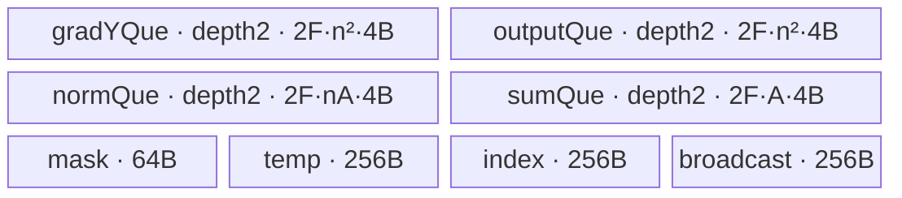

# MhcSinkhornBackward 950 ACLNN 算子知识

## 算子速览

| 项目 | 内容 |
|---|---|
| 实际入口 | 公开两段式 C ABI `aclnnMhcSinkhornBackwardGetWorkspaceSize` → `aclnnMhcSinkhornBackward`；固定仓只有该未版本化入口 |
| 计算语义 | 逆序回放 Sinkhorn 列/行归一化反向：普通阶段 `(G-reduce(G·N))/S`，最终 softmax 行阶段 `(G-reduce(G·N))·N` |
| 输入输出 | FP32 ND；`gradOutput/out` 为 `(T,n,n)` 或 `(B,S,n,n)`，`n∈{4,6,8}`；`normOut/sumOut` 为一维正向保存量 |
| 执行类型 | `AIV_VECTOR`；单节点 `mhc_sinkhorn_backward<1>`，selector 与 entry 均为 AIV-only |
| Kernel 路线 | R-001：固定 key 1 的 FP32 MicroAPI 实现 |
| 核心资源 | GM、4 个由 `InitBuffer(...,2,...)` 建立的双槽 TQue、64 B mask TBuf、3×256 B TBuf、Vector RegTensor；算子 workspace 0 B |
| 来源闭包 | `source_closed`：公开 ACLNN→L0→Tiling/POD/key→单 AIV entry/body/helper→ascend950 构建闭合 |
| 验证状态 | 已完成源码闭包检查；本次知识提取未执行编译、真机、数值或性能测试。 |

## 接口与语义

### 计算语义

令矩阵数 `M=T`（3D）或 `M=B·S`（4D），边长 `n`，对齐宽 `A`，轮数 `I`，初值 `G=gradOutput`。对 `i=I-1,…,1`，阶段 `2i+1` 做列反向 `q_c=Σ_r(G_rc·N_rc)`、`G_rc=(G_rc-q_c)/S_c`，阶段 `2i` 做同行公式的行反向。最后执行阶段 1 列反向；阶段 0 执行 softmax 行反向 `gradInput_rc=(G_rc-Σ_jG_rjN_rj)·N_rc`，不读 `sum[0]`。各核处理互斥矩阵，不做跨核归约；全程 FP32，无 cast、补偿累加或 epsilon。

### 输入、输出与属性

| 参数 | shape/layout | dtype | 约束、默认值与语义 |
|---|---|---|---|
| `gradOutput`/`grad_y` | ND；`(T,n,n)` 或 `(B,S,n,n)` | FP32 | 方阵，`n=4/6/8`；非连续输入先 `Contiguous` |
| `normOut`/`norm` | 一维 `2·I·M·n·A` | FP32 | 正向逐阶段 norm；Tiling 校验精确长度 |
| `sumOut`/`sum` | 一维 `2·I·M·A` | FP32 | 正向逐阶段 sum；与 norm 推出同一 `I` |
| `out`/`grad_input` | 与 gradOutput 同 view shape | FP32 | Kernel 写连续临时输出，再 `ViewCopy` |
| `numIters` | 无公开属性 | Host/POD int64 | `norm.dim0/(2·M·n·A)`，范围 `[1,100]` |
| workspace/executor/stream | 两段式接口参数 | 指针 | executor 总 workspace 含框架节点；算子 Tiling 项为 0 B |

文档声明不支持空 Tensor，并声明默认确定性实现；实现却在基础校验后只对 `gradOutput->IsEmpty()` 成功返回 0 workspace，不再检查 norm/sum 长度，也不排入 Contiguous、Kernel 或 ViewCopy。该代码差异不扩展公开契约；固定仓未执行确定性测试。

### 入口与版本

头文件只声明一对未带版本后缀的两段式接口；对固定 Commit 全仓扫描没有发现 `V2/V3` 或其它 `MhcSinkhornBackward` 950 body，故该未版本化入口就是 950 最新公开版本。第一段构图，第二段只调用 `CommonOpExecutorRun`，L0 无 CPU fallback。文档仅勾选 Ascend 950PR/950DT，并明确 A2/A3 不支持；OpDef 仅 `AddConfig("ascend950")`，ascend950 binary config、simplified-key 配置和 CI 清单一致，无发布冲突。

## Host/Launcher 执行流程

### 参数校验与前处理

顺序为：`CREATE_EXECUTOR`；检查四 Tensor 非空、全 FP32；检查 gradOutput/out view shape 相等、gradOutput rank 3/4、末两维方阵且 `n=4/6/8`、两者 storage format 相同；若 gradOutput 为空则早退；否则依次连续化三个输入和输出；`ADD_TO_LAUNCHER_LIST_AICORE(MhcSinkhornBackward)`；排入 `ViewCopy`。ACLNN 层不检查 norm/sum 的 rank 或长度；Tiling 才用 storage shape 检查 norm/sum 均为一维、精确长度、输出 shape 与 `I`。任一 ACLNN/L0 空返回或 Tiling 失败都终止，不尝试其它实现。

### 参数、Workspace 与生命周期

`TilingBaseClass::DoTiling` 顺序为 `GetShapeAttrsInfo→GetPlatformInfo→IsCapable→DoOpTiling→DoLibApiTiling→GetWorkspaceSize→PostTiling→SetTilingKey`；本类 `IsCapable=true`。prepare 从平台读取 AIV 核数和 UB，非正即失败。第一段 `uniqueExecutor` 拥有 Contiguous/AIV/ViewCopy，随后转移给调用者；完整 workspace 分项与 event 在框架边界不可见。算子写 `workspaces[0]=0`，entry 仍以 `GetUserWorkspace(workSpace)==nullptr` 做静默早退但不读写 payload。workspace/executor 必须存活至调用 stream 完成。

### 启动图与失败传播

```text
GetWorkspaceSize -> CheckParams -> Contiguous×4
  -> MhcSinkhornBackwardAiCore -> ADD_TO_LAUNCHER_LIST_AICORE
  -> MhcSinkhornBackwardTiling::DoTiling
     -> blockDim=needCoreNum, key=1, localMemorySize=ubSize, op workspace=0
  -> mhc_sinkhorn_backward<1> -> MhcSinkhornBackwardSimd::Init -> Process
  -> ViewCopy
aclnnMhcSinkhornBackward -> CommonOpExecutorRun(..., stream)
```

唯一 Device 节点输入连续 GM/POD/framework workspace，输出连续 gradInput。与 ViewCopy 的 ordering 和 owner/lifetime 由同一 executor/stream 保证。API/L0/Tiling 分别传播 ACLNN 错误、空返回、`GRAPH_FAILED`；entry 的空 user workspace 或越界 block 仅 device 早退。

## Route 与参数设计

### 分核与资源计算

设 `C=GetCoreNumAiv()`、`U=UB bytes`、`D=4 B`、`Q=GetUbBlockSize()/4` 个 FP32、`A=ceil_align(n,Q)`：`coreTSize=ceil_div(M,C)`，`needCoreNum=ceil_div(M,coreTSize)`，`tailCoreTSize=M-coreTSize·(needCoreNum-1)`。公共 base 分别计算 forward/backward 的 `F=tUbFactor`，返回 `F` 较小的整组 split 信息；两组的分核公式相同。

令 `align(x)=ceil_align(x,Q)`。反向预算 `O_b(F)=align(Fn²)+align(Fn²)+align(2FnA)+align(2FA)` 个 FP32，源码条件为 `4·O_b(F)<=(U-832)/2`，等价于 `8·O_b(F)+832<=U`；forward 预算 `O_f(F)=align(Fn²)+align(Fn²)+align(FnA)+align(FA)`，条件同理。`832=64+3·256` 是固定 TBuf，预算除 2 对应所有 queue 的双槽。超容量时用 `singleUbSize/onePieceSize`，backward 再按 `256/(8·4)=8` 向下对齐；forward 向下对齐 8 后把 0 改为 8，但最终仍以两者较小 `F` 为准。普通/尾核循环分别为 `F==0?1:ceil_div(coreTSize,F)` 与 `F==0?1:ceil_div(tailCoreTSize,F)`，末轮用余量；源码没有在 `F=0` 后拒绝 Route。

### Route 选择

| 顺序 | Route | Key/模板 | 精确选择条件与优先级 | 不适用去向 |
|---:|---|---|---|---|
| 1 | R-001 | key 1；`mhc_sinkhorn_backward<1>` | ascend950；FP32；非空；rank 3/4；`n=4/6/8`；norm/sum 长度合法；`I=1..100`；`IsCapable=true` | API/Tiling 失败，或 Route 前空输入成功早退；无 fallback |

```text
基础校验失败 -> ACLNN 错误
空 gradOutput -> 成功早退
否则 Tiling 校验失败 -> GRAPH_FAILED
否则固定 key 1 -> R-001 AIV-only
```

### 模板/实现执行矩阵

| Route | key/selector | dtype/shape/platform 完整命中条件 | 执行拓扑与 Kernel 节点 | 实际模板/body | 内存与同步特征 | tail/fallback |
|---|---|---|---|---|---|---|
| R-001 | `TILING_KEY∈{1}`；`ASCENDC_TPL_AIV_ONLY` | 上述 FP32/shape/I/950 条件 | 单节点，grid=`needCoreNum` | `MhcSinkhornBackwardSimd` 全方法 | 四双缓冲 queue；gradY 原位驻留；Queue+local barrier | core/loop/repeat/n/row-pad tail；无 fallback |

### 隐藏性能 Guard

| Guard | Host/Tiling 条件 | Device/资源原因 | 影响 Route | 不满足时去向 | 源码符号 |
|---|---|---|---|---|---|
| AIV 资源 | AIV cores、UB 均 >0 | AIV-only 且依赖 UB 分块 | R-001 | prepare 失败 | `TilingPrepareForMhcSinkhornBackward` |
| n guard | `n=4/6/8` | 三组 mask 与 8-lane index | R-001 | API/Tiling 失败 | `CheckShape`、`Process` |
| UB factor | 取 forward/backward 较小 F；backward 可算出 0 | 覆盖四个双槽 queue+832 B；实际 `InitBuffer` 请求须容纳 | R-001 | 无最终 fallback/断言 | `BaseSplitCores`、`BackwardSplitCore`、`Init` |
| row tail | `perT%8!=0` | sum 的行距要 pad 到 8 | R-001 | Pad helper | `CalcRow`、`CopyInNormAndSumPad` |
| repeat | `repeatSize=GetVRegSize()/32`，`ceil(perT/repeatSize)` 窄化为 uint16 | 每个 repeat 以 `perT_repeat·A` 生成动态 mask | R-001 | 无溢出失败路线 | `Process`、`Calc*Backward` |
| 空域 | ACLNN 提前 `IsEmpty()` | 避免 M=0 分核 | Route 前 | 成功早退 | ACLNN GetWorkspaceSize |

### POD/ABI

`MhcSinkhornBackwardTilingData` 为 16 个顺序声明的 `int64_t`，无基类/虚函数/packing；同一 Host/Device 声明下 `sizeof=128 B`、`alignof=8 B`。

| 结构 | 字段 | 类型/位宽 | ABI 布局 | 单位 | Host/launcher producer | Device consumer | 边界 |
|---|---|---|---|---|---|---|---|
| `MhcSinkhornBackwardTilingData` | `totalLength` | int64/64 | off=0 | 矩阵 | T 或 B·S | 未读 | 溢出未检 |
| 同上 | `tSize` | int64/64 | off=8 | 矩阵 | 3D dim0/否则0 | 未读 | 3D有效 |
| 同上 | `bSize` | int64/64 | off=16 | batch | 4D dim0/否则0 | 未读 | 4D有效 |
| 同上 | `sSize` | int64/64 | off=24 | sequence | 4D dim1/否则0 | 未读 | 4D有效 |
| 同上 | `nSize` | int64/64 | off=32 | 元素 | grad_y末二维 | 循环/mask/地址 | 4/6/8 |
| 同上 | `nAlignSize` | int64/64 | off=40 | FP32元素 | ceil_align(n,Q) | norm/sum地址 | 文档950为8 |
| 同上 | `numIters` | int64/64 | off=48 | 轮 | norm长度反推 | phase循环 | 1..100 |
| 同上 | `needCoreNum` | int64/64 | off=56 | AIV核 | ceil_div(M,coreTSize) | 尾核/越界；blockDim | ≤C |
| 同上 | `coreTSize` | int64/64 | off=64 | 矩阵/核 | ceil_div(M,C) | GM核基址 | 尾核另算 |
| 同上 | `normCoreTLoops` | int64/64 | off=72 | loop | `F==0?1:ceil_div(coreTSize,F)` | 普通核loop | F=0边界无最终检查 |
| 同上 | `normCorePerLoopTSize` | int64/64 | off=80 | 矩阵/loop | F | queue容量/loop步长 | 最大槽 |
| 同上 | `normCoreLastLoopTSize` | int64/64 | off=88 | 矩阵 | 普通核余量 | 普通末loop | 可非8对齐 |
| 同上 | `tailCoreTSize` | int64/64 | off=96 | 矩阵 | 尾核余量 | 未直接读 | 审计字段 |
| 同上 | `tailCoreLoops` | int64/64 | off=104 | loop | `F==0?1:ceil_div(tailCoreTSize,F)` | 尾核loop | 尾核有效 |
| 同上 | `tailCorePerLoopTSize` | int64/64 | off=112 | 矩阵/loop | F | 尾核步长 | 与最大槽兼容 |
| 同上 | `tailCoreLastLoopTSize` | int64/64 | off=120 | 矩阵 | 尾核余量 | 尾核末loop | 有效前缀 |

### Route 源码闭包

| Route | Key/selector | Host/Tiling producer | POD/参数 | Kernel entry/router 节点 | Kernel body/直接依赖 | 构建接线 |
|---|---|---|---|---|---|---|
| R-001 | `GET_TPL_TILING_KEY(1)`；AIV-only | `MhcSinkhornBackwardTiling`、`MhcSinkhornBaseTiling`、`TilingBaseClass::DoTiling` | 128 B POD；blockDim；workspace 0 | `mhc_sinkhorn_backward<1>` | `MhcSinkhornBackwardSimd` 全方法；平台/VReg helper 为外部边界 | OpDef ascend950、CMake、JSON、CI |

## Kernel 实现

### 公共执行流程

仅有 R-001。entry 检查 user workspace、声明 AIV-only、解包 POD，构造 `TPipe`/body。`Init` 绑定四个 GM、选择普通/尾核 loop 并分配 UB。`Process` 一次生成 mask/index，对每 tile 仅 CopyIn gradY 一次，逆序执行全部列/行阶段，最终 softmax 写 output queue 再 CopyOut。无跨 Kernel 边、atomic 或跨核 barrier。

### Route R-001：单键 FP32 MicroAPI 反向实现

#### 适用条件

##### 选择证据

| 层级 | 文件 | 符号 | 源码谓词/参数 | 结果/下一跳 |
|---|---|---|---|---|
| API | `op_host/op_api/aclnn_mhc_sinkhorn_backward.cpp` | `CheckParams`/GetWorkspaceSize | 非空、FP32、shape/format | 连续化或失败/空早退 |
| Tiling | `op_host/mhc_sinkhorn_backward_tiling.cpp` | `CheckShape/GetTilingKey/PostTiling` | norm/sum/I；key=1 | blockDim/local memory |
| Router | `op_kernel/arch35/mhc_sinkhorn_backward_tiling_key.h` | `ASCENDC_TPL_SEL` | key 1、AIV-only | 唯一 entry |
| Entry | `op_kernel/mhc_sinkhorn_backward_apt.cpp` | `mhc_sinkhorn_backward<1>` | user workspace非空、AIV-only | `Init→Process` |

#### Device 数据流

##### 函数级调用链

```text
mhc_sinkhorn_backward<1>
  -> Init(绑定 4 路 GM；选择普通/尾核循环；InitBuffer)
  -> Process
     -> Duplicate(mask) -> CreateGatherIndex(index,broadcast)
     -> CopyInGradY
     -> [CalcCol -> CopyInNormAndSum -> CalcColBackward
         CalcRow -> CopyInNormAndSum[Pad] -> CalcRowBackward] × (I-1)
     -> CalcCol(phase 1)
     -> CalcSoftmax(phase 0) -> CopyInNorm -> CalcSoftmaxBackward
     -> CopyOut
```

##### 源码等价伪码

```text
Init: b=blockIdx; 选普通/尾核 loop,F,last；分配 fixed TBuf 和四个 2-slot queue
Process:
  if b>=needCoreNum return
  mask32=n对应的4/6/8有效位模式；复制8份形成256-bit mask
  index[lane]=floor(lane/8)*n²+lane%8；broadcast[lane]=floor(lane/8)
  for l: perT=末轮?last:F; base=b*coreTSize+l*F; CopyInGradY(base*n²,perT*n²)
    R=GetVRegSize()/32; repeats=ceil(perT,R)
    for iter=I-1..1: Col(2iter+1); Row(2iter)
    Col(1); Softmax(0); CopyOut(base*n²,perT*n²)
normOff=b*n*A*2I*coreTSize+l*F*n*A*2I+phase*n*A*perT
sumOff =b*A*2I*coreTSize  +l*F*A*2I  +phase*A*perT
Col repeat j:
  perTj=min(R,perT-jR); mask=UpdateMask(perTj*A) AND nMask
  load sum[jR*A]；sumCol=0
  for row i: gather G[jR*n²+i*n,index]；load N[jR*A+i*A*perT]；sumCol += G*N
  for row i: gather G；G=(G-sumCol)/sum；scatter 回同一 gradY 槽；LocalMemBar(store->load)
Row repeat j, row k:
  gather G[jR*n²+k*n,index]；load N[k*perT*A+jR*A]
  load sum[k*padT+jR] with DIST_E2B_B32
  q=ReduceSumWithDataBlock(G*N,mask)；broadcast q；G=(G-q)/sum；scatter；barrier
Softmax repeat j, row k:
  gather G；load N；q=ReduceSumWithDataBlock(G*N)；broadcast q
  output=(G-q)*N；scatter 到 output queue；barrier
```

#### 内存与数据搬运

##### 资源与搬运表

| 层级/缓冲区 | offset/地址公式 | extent/容量公式 | dtype/layout | producer | consumer | owner/lifetime | 对齐/复用 |
|---|---|---|---|---|---|---|---|
| GM gradY/out | `(b·coreTSize+lF)n²` 元素 | tile `perT·n²·4B` | FP32连续 | caller/body | `CopyInGradY`/`CopyOut` | executor/stream 完成前 | `blockCount=1`，`blockLen=perT·n²·4B`，stride=0，仅有效前缀 |
| GM norm | `normOff` | phase `perT·nA·4B` | FP32一维；body按 col/row 访问式解释 | 正向保存 | `CalcCol/Row/Softmax` | caller/Kernel期间 | `blockCount=1`，`blockLen=perT·nA·4B`，stride=0 |
| GM sum（col） | `sumOff` | phase `perT·A·4B` | FP32一维，tile×A | 正向保存 | `CalcColBackward` | caller/当前phase | 单 block 连续搬运；寄存器 load `jR·A` |
| GM sum（row） | `sumOff` | 有效 `n·perT·4B`，UB 为 `n·padT·4B` | FP32，body将源解释为 n 个连续 row block | 正向保存 | `CalcRowBackward` | caller/当前phase | `blockCount=n, blockLen=perT·4B, srcStride=dstStride=0`；右 pad `8-perT%8` |
| GM POD/workspace | POD off 0..120；user ptr | 128B；op payload 0B | int64/N/A | Host/framework | entry | framework | workspace只检查指针 |
| `inputGradYQue_` | TPipe offset不可见 | 2 槽，每槽 `F·n²·4B` 请求 | FP32 VECIN | CopyIn/原位scatter | 全阶段 | tile | DeQue→EnQue，softmax 后 Free |
| `inputNormQue_` | 同上 | 2 槽，每槽 `F·nA·4B` 请求 | FP32 VECIN | phase CopyIn | phase body | 单phase | Free后下一 phase 复用 |
| `inputSumQue_` | 同上 | 2 槽，每槽 `F·A·4B` 请求 | FP32 VECIN | phase CopyIn | col/row | 单phase | row tail 的实际写入上界另见限制 |
| `outputQue_` | 同上 | 2 槽，每槽 `F·n²·4B` 请求 | FP32 VECOUT | softmax | CopyOut | 最终phase | EnQue/DeQue/Free |
| mask/temp/index/broadcast | TPipe offset不可见 | 64/256/256/256B | uint32/float/int32 | Process | Vector body | 整Process | temp实参未被解引用 |
| RegTensor | repeat-local | 有效 `perT_repeat·A` lanes | FP32/int32 | load/gather | Vector算术/scatter | `__VEC_SCOPE__` | repeat-mask∩n-mask |

##### 分层内存布局



物理 offset/排序由 TPipe 决定，固定仓不可见；图只表达独立分配和字节组成。

##### 字节账与复用顺序

```text
UB_InitBuffer_request = 2·4F·(n²+nA+A+n²) + 64+3·256
                      = 8F·(2n²+nA+A) + 832 B
UB_host_backward_bound = 8·O_b(F)+832 <= U
UB_host_forward_bound  = 8·O_f(F)+832 <= U
Host 求两个 F 后取较小者；TPipe 的物理 offset/额外舍入固定仓不可见。
dynamic_ub = N/A（AIV 节点使用静态 TPipe UB）
workspace_total(op) = 0 B；executor 的框架 workspace 分项不可见
```

| 复用子区 | 写入者 | 读取者/消费点 | 下一次覆盖 | 同步或释放依据 | 安全条件 |
|---|---|---|---|---|---|
| gradY queue槽 | CopyIn/各阶段scatter | 下一阶段/softmax | 下一tile | body末 local barrier + EnQue/DeQue | 阶段严格逆序；softmax后Free |
| norm/sum槽 | phase CopyIn | 当前phase | Free后下一phase | Queue协议 | 不跨phase保留 |
| output槽 | softmax | CopyOut | Free后下一tile | EnQue/DeQue/Free | 只最终物化 |
| index/broadcast TBuf | CreateGatherIndex | 全部repeat | Process结束 | store后local barrier | n不变，只读 |

#### 同步、精度与尾块

##### 同步与数值边界表

| 阶段 | primitive/机制 | producer | consumer/等待点 | 保护对象 | 精度/尾块 |
|---|---|---|---|---|---|
| GM→UB | Alloc/DataCopyPad/EnQue/DeQue | CopyIn | Calc | queue/DMA | FP32，tile长度 |
| 原位阶段 | `LocalMemBar<VEC_STORE,VEC_LOAD>` | scatter G | 下一phase load | gradY槽 | 无cast，顺序不可交换 |
| 索引 | store+local barrier | CreateGatherIndex | 后续load | 两个TBuf | int32，一次初始化 |
| mask/repeat | `UpdateMask(perT_repeat·A) AND n-mask` | perT/A/n | Vector API | 无效lane | n与末repeat tail |
| row tail | 多block DataCopyPad | GM sum | `DIST_E2B_B32` | sum槽 | `perloopSizePad=ceil(perT,8)` |
| core/loop tail | POD分支 | Host | Init/Process | 矩阵域 | 只输出 `perT·n²` |
| 数值 | FP32 Mul/Add或Reduce/Gather/Sub/Div/Mul | G/N/S | scatter | 当前G/out | 无除零/NaN guard |
| 跨核 | N/A | 各AIV | 各自CopyOut | 互斥切片 | 无atomic/barrier |

#### 关键实现

##### 符号证据表

| 阶段 | 文件 | 符号/模板实例 | 实现事实 |
|---|---|---|---|
| Host/Tiling producer | `op_host/mhc_sinkhorn_backward_tiling.cpp` | `MhcSinkhornBackwardTiling` 全方法 | shape/I、POD、key、blockDim |
| Host/Tiling producer | `mhc_sinkhorn_common/op_host/arch35/mhc_sinkhorn_base_tiling.cpp` | split/occupy helpers | UB、double buffer、tail |
| Kernel entry/router | `op_kernel/mhc_sinkhorn_backward_apt.cpp` | `mhc_sinkhorn_backward<1>` | AIV-only、POD、TPipe |
| Device body/helper | `op_kernel/arch35/mhc_sinkhorn_backward_simd.h` | `Init/Process/Calc*/CopyIn*/CopyOut/CreateGatherIndex` | 地址、DMA、MicroAPI、同步、tail |

## 算子特定优化

### Trick T-001：gradY 单次搬入并跨全部反向阶段原位驻留

#### 触发与源码依据

- 适用 Route：R-001。
- 触发条件：一个 core-local tile 的普通列/行阶段完成、最终 softmax 尚未执行。
- Golden 来源：[`mhc_sinkhorn_backward_simd.h:395-412`](../../../../../../../cann-ops-raw/ascendc/ops-transformer/be33d95bb755cedec3108f70805c1874d1792540/mhc/mhc_sinkhorn_backward/op_kernel/arch35/mhc_sinkhorn_backward_simd.h#L395-L412)

**官方源码（固定 Commit 连续逐字摘录）**：

```cpp
    LocalTensor<float> gradYLocal = inputGradYQue_.DeQue<float>();
    LocalTensor<uint32_t> maskLocal = maskBuffer_.Get<uint32_t>();
    LocalTensor<uint32_t> tempLocal = tempBuffer_.Get<uint32_t>();
    __local_mem__ float *gradYAddr = (__local_mem__ float *)gradYLocal.GetPhyAddr();
    __local_mem__ uint32_t *maskAddr = (__local_mem__ uint32_t *)maskLocal.GetPhyAddr();
    __local_mem__ float *tempAddr = (__local_mem__ float *)tempLocal.GetPhyAddr();

    LocalTensor<float> normLocal = inputNormQue_.DeQue<float>();
    LocalTensor<float> sumLocal = inputSumQue_.DeQue<float>();
    __local_mem__ float *normAddr = (__local_mem__ float *)normLocal.GetPhyAddr();
    __local_mem__ float *sumAddr = (__local_mem__ float *)sumLocal.GetPhyAddr();

    CalcColBackward(gradYAddr, normAddr, sumAddr, maskAddr, tempAddr,
        static_cast<uint32_t>(nSize_), repeatTimes, perloopSize, repeatSize);

    inputGradYQue_.EnQue(gradYLocal);
    inputNormQue_.FreeTensor<float>(normLocal);
    inputSumQue_.FreeTensor<float>(sumLocal);
```

#### 机制与设计原因

gradY 每 tile 只从 GM 搬一次。列/行 body 将新 G scatter 回同一 LocalTensor，barrier 后重新 EnQue 给下一 phase；只释放并重装 norm/sum。这样消除每个 Sinkhorn stage 的中间 GM 写回/重读，最终 softmax 才分配 output queue。

#### 迁移边界

- 适用：同尺寸 tile 上多个顺序依赖、无跨核消费者的纯 Vector stage。
- 前提：原位地址合法，store→load 同步完整，gradY 槽最终消费者前不释放。
- 失效：shape/layout 改变、跨核交换或并行消费者需要中间值时，须物化独立 UB/GM/workspace。
- 未验证：本次知识提取未执行编译、真机、数值或性能测试。

#### 错误做法

最终 softmax 是源码中的真实相反路径：它必须分配 output queue。普通阶段若提前 Free gradY，后续 phase 失去依赖；若删除 local barrier，固定源码不再提供 scatter store 到下一 load 的可见性依据。

### Trick T-002：row-tail 用一次二维 `DataCopyPad` 同时搬运并补齐行距

#### 触发与源码依据

- 适用 Route：R-001。
- 触发条件：row phase 且 `perloopSize % 8 != 0`。
- Golden 来源：[`mhc_sinkhorn_backward_simd.h:321-330`](../../../../../../../cann-ops-raw/ascendc/ops-transformer/be33d95bb755cedec3108f70805c1874d1792540/mhc/mhc_sinkhorn_backward/op_kernel/arch35/mhc_sinkhorn_backward_simd.h#L321-L330)

**官方源码（固定 Commit 连续逐字摘录）**：

```cpp
    DataCopyPadExtParams<float> normPadExtParams{false, 0, 0, 0};
    DataCopyExtParams normParams{1, static_cast<uint32_t>(normProcessNum * sizeof(float)), 0, 0, 0};
    uint8_t padNum = static_cast<uint8_t>(INDEX_BLOCK_LEN - perloopSize % INDEX_BLOCK_LEN);
    DataCopyPadExtParams<float> sumPadExtParams{1, 0, padNum, 0};
    DataCopyExtParams sumParams{
        static_cast<uint16_t>(nSize_), static_cast<uint32_t>(perloopSize  * sizeof(float)), 0, 0, 0};

    DataCopyPad(normLocal, norm_[normOffset], normParams, normPadExtParams);
    DataCopyPad(sumLocal, sum_[sumOffset], sumParams, sumPadExtParams);
```

#### 机制与设计原因

row phase 把 GM sum 当作 `n` 个连续、每块 `perloopSize` 个 FP32 的二维搬运源；单次 `DataCopyPad` 以 `blockCount=n`、`blockLen=perloopSize·4 B` 搬入，并在每块右侧补 `8-perloopSize%8` 个 0。随后 `CalcRowBackward` 用 `perloopSizePad=ceil_align(perloopSize,8)` 作行距，并用 `DIST_E2B_B32` 读取每行的缩放量。该机制把 tail 补零合入 DMA，避免额外逐行填充 pass；norm 仍按一个连续 block 搬入。

#### 迁移边界

- 适用：源数据恰为 `n` 个等长连续 block、消费端需要统一 8-FP32 行距的 tail tile。
- 前提：`n∈{4,6,8}`，目的 queue 对 `n·ceil_align(perloopSize,8)` 个 FP32 有足够容量，padding 值 0 不会进入有效 mask。
- 失效：源 block 有 stride、padding lane 会被消费，或目的容量只按有效元素申请时，必须重新设计搬运或扩大 buffer。
- 未验证：本次知识提取未执行编译、真机、数值或性能测试。

#### 错误做法

不能无条件走无 padding 的一维连续搬运：`CalcRowBackward` 按 padded row stride 取 `sumAddr+k·perloopSizePad+j·repeatSize`。固定源码同时暴露了目的容量可能不足的边界，见“限制与失败边界”；本卡不据此推测运行结果。

## 模板与实现对比

| 对比维度 | R-001 单键 FP32 MicroAPI | 设计选择依据 |
|---|---|---|
| 命中条件/优先级 | 唯一 `IsCapable=true` 模板，key 1 | API/Tiling 已收紧输入 |
| 模板与 dtype | `mhc_sinkhorn_backward<1>`，FP32 | selector/OpDef 唯一组合 |
| 循环与分核 | 矩阵按 AIV 核，核内 F tile，phase 逆序 | 矩阵独立；UB决定F |
| Queue/TBuf/寄存器 | 4 个双槽 queue；64+3×256B；FP32/int32 reg | 驻留G、轮换phase输入 |
| UB 总占用与复用 | InitBuffer 请求 `8F(2n²+nA+A)+832B`；Host 使用对齐后的双模型预算 | 两个模型取较小F |
| 搬运/Vector API | DataCopyPad、gather/scatter、Mul/Reduce/Sub/Div/Mul | 8-lane批量小矩阵 |
| 同步、精度与 tail | Queue+local barrier；FP32；多级tail | 顺序依赖与对齐 |
| fallback/失败边界 | 无 Kernel fallback | 固定仓仅一条路线 |

## 平台差异

| 项目 | A2 | A3 | 950 |
|---|---|---|---|
| 支持状态 | 文档明确不支持 | 文档明确不支持 | 950PR/950DT 支持 |
| Host/Launcher | 无公开路线 | 无公开路线 | OpDef/JSON/CI 仅 ascend950 |
| Kernel/资源 | 无可达实例 | 无可达实例 | arch35 单 AIV-only entry；资源由平台读取 |

## 限制与失败边界

- 仅 FP32 ND、3D/4D 方阵、`n=4/6/8`、`I=1..100`；norm/sum 必须是正向保存布局的一维精确长度。
- sum 为 0、NaN、Inf 无保护；MicroAPI reduction tree/异常浮点模式在外部 AscendC 边界。
- Host 地址/容量用 int64，DMA 长度/repeat 再窄化 uint32/uint16，无显式溢出检查。极小 UB 时 factor 可为 0 或被强制回 8，且无最终 `UB_total<=U` 断言。
- 整核容量满足时 `F=coreTSize` 不强制 8 对齐；row helper 会写 `n·ceil_align(perT,8)` 个 FP32，sum queue 每槽却只按 `F·A` 个 FP32 申请。源码对任一 `perT%8!=0`（包括单循环 `perT=F` 与末轮 `perT<F`）都未检查 `n·ceil_align(perT,8)<=F·A`，也无 fallback；迁移必须逐组合重核目的容量。
- `tempBuffer_` 占 256 B 但 helper 不解引用；若裁剪需同步修改 Host UB 模型并重新验证，不能据此改变固定 ABI。
- 算子 workspace 0 B 但 entry 检查 user workspace；框架 workspace ABI、Contiguous/ViewCopy 分项和异步错误传播不可见。
- 文档不支持空 Tensor，代码却成功早退且不写输出；应遵守公开契约。
- 本次未执行编译、真机、数值、确定性或性能验证。

## 源码索引

### 链路索引

| 链路阶段 | 文件 | 关键符号 | 支撑内容 |
|---|---|---|---|
| 入口声明 | `op_host/op_api/aclnn_mhc_sinkhorn_backward.h` | 两段式 ACLNN | 公开 ABI |
| 公开约束 | `docs/aclnnMhcSinkhornBackward.md` | 产品表/函数/规格 | 950、接口原型、shape/I/n |
| 入口实现 | `op_host/op_api/aclnn_mhc_sinkhorn_backward.cpp` | `CheckParams`/ACLNN函数 | 校验、连续化、构图 |
| L0 | `op_host/op_api/mhc_sinkhorn_backward.cpp` | `MhcSinkhornBackwardAiCore` | 唯一 launcher |
| OpDef | `op_host/mhc_sinkhorn_backward_def.cpp` | `MhcSinkhornBackward` | ascend950/apt绑定 |
| InferShape/Dtype | `op_host/mhc_sinkhorn_backward_infershape.cpp` | `InferShape4MhcSinkhornBackward`/`InferDtype4MhcSinkhornBackward` | 输出沿用 gradY shape/dtype |
| Tiling | `op_host/mhc_sinkhorn_backward_tiling.cpp` | Tiling全方法 | shape、POD、key、grid |
| 公共分核 | `mhc_sinkhorn_common/op_host/arch35/mhc_sinkhorn_base_tiling.cpp` | split/occupy helpers | UB、core/tile/tail |
| Tiling框架 | `common/include/op_host/tiling_base.h` | `DoTiling` | 调用序/失败传播 |
| POD | `op_kernel/arch35/mhc_sinkhorn_backward_tiling_data.h` | POD类 | 16×int64 ABI |
| selector | `op_kernel/arch35/mhc_sinkhorn_backward_tiling_key.h` | `ASCENDC_TPL_SEL` | key1/AIV-only |
| entry | `op_kernel/mhc_sinkhorn_backward_apt.cpp` | `mhc_sinkhorn_backward<1>` | AIV/POD/TPipe |
| body | `op_kernel/arch35/mhc_sinkhorn_backward_simd.h` | `MhcSinkhornBackwardSimd` | GM/UB/Vector/sync/tail |
| 构建 | `op_host/CMakeLists.txt` | module/compile options | Host/Tiling/ascend950编译 |
| binary | `op_host/config/ascend950/mhc_sinkhorn_backward.json` | bin config | FP32/ND 元数据 |
| simplified key | `op_host/config/ascend950/mhc_sinkhorn_backward_simplified_key.ini` | `[MhcSinkhornBackward] default=0` | 950 binary simplified-key 模式 |
| CI | `scripts/ci/ascend950/ops_transformer_operator_list.yaml` | operator_group_1 | 950 活动接线 |

以上路径均相对于 `ops-transformer`，并固定到 Commit `be33d95bb755cedec3108f70805c1874d1792540`；每行文件都在 Frontmatter `sources`。

### 实现复用检查

| 检查项 | 可复用事实 | 不得改变的约束 | 源码符号 |
|---|---|---|---|
| ABI/POD | 128B、16×int64、key1 | 字段顺序/位宽/单位；inactive字段保留 | POD、`SetTilingData`、`GET_TILING_DATA` |
| 调用顺序 | Contiguous→AIV→ViewCopy；phase逆序 | `2i+1` col先于`2i` row；最后1/0 | ACLNN实现、`Process` |
| workspace/内存 | 四双缓冲queue+832B；phase offset | F槽、row pad extent、workspace 0B | `Init`、`CalcCol/Row` |
| 同步 | Queue协议+local barrier | G scatter后再入队；index store后再读 | `Calc*Backward`、`CreateGatherIndex` |
| 精度与尾块 | FP32、双mask、多级tail | 普通除S、最终乘N；只写有效前缀 | 三个body、`Process` |
| 失败边界 | API/Tiling/空早退/workspace guard | 不补造fallback、除零保护或A2/A3支持 | `CheckParams`、`CheckShape`、entry |