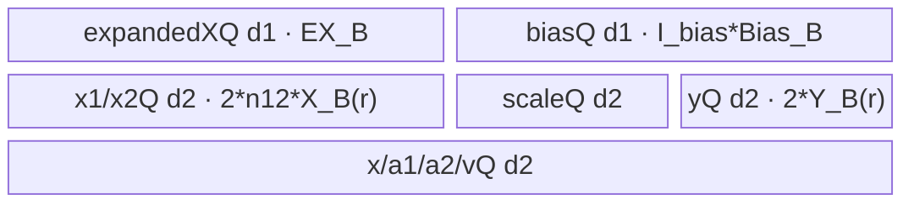
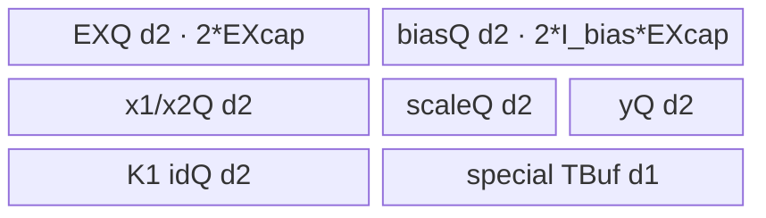
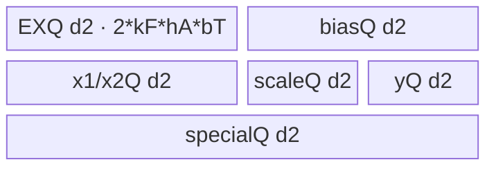
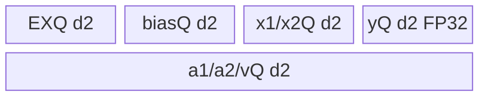

# MoeFinalizeRouting 950 ACLNN 算子知识

## 算子速览

| 项目 | 内容 |
|---|---|
| 实际入口 | CANN 9.1.0 中 950 最新公开 `aclnnMoeFinalizeRoutingV3GetWorkspaceSize/aclnnMoeFinalizeRoutingV3`；内部 OpType 为 `MoeFinalizeRoutingV2` |
| 计算语义 | 以可选残差初始化输出，按 K 路路由累加普通、copy 或 constant expert；zero expert 和无效路由不贡献 |
| 输入输出 | `expandedX:[N*K,H]` 或 `[E,C,H]`，索引 `[N*K]`，可选残差/bias/scales/expertIdx/x/alpha1/alpha2/v，输出 `[N,H]` |
| 执行类型 | 核心 launch graph 为单 Kernel `AIV_VECTOR`；ACLNN executor 还可含框架 `Contiguous/ViewCopy` 节点。未发现可达 Cube/AIC 计算或 `MIX_CV` |
| Kernel 路线 | R-001 Row/K/H 全载；R-002 K/H 全载；R-003 H 全载、切 K；R-004 切 H |
| 核心资源 | GM、AIV UB、`TQue/TBuf`、MicroAPI `RegTensor`；算子 Tiling 保留 16 MiB workspace，但 body 仅做非空检查，不访问 user workspace |
| 来源闭包 | `source_closed`：V3 ACLNN→L0 `MoeFinalizeRoutingV2`→RegBase selector/POD→48 key router→四个 AIV body/helper→ascend950 OpDef/config/CMake 闭合 |
| 验证状态 | 已完成源码闭包检查；本次知识提取未执行编译、真机、数值或性能测试。 |

## 接口与语义

### 计算语义

记输出行数为 `N`、hidden size 为 `H`、每行路由数为 `K`。对 `(n,k)`，`expert=expertIdx[n,k]`；mode 0/1 从 `expandedRowIdx[n+k*N]` 取 `p`，mode 2/3 从 `expandedRowIdx[n*K+k]` 取 `p`。`p==-1` 无效；dropless mode 0/2 还要求 `p<activeNum=expandedX.dim0`。

先令 `y[n,:]=x1[n,:]+x2[n,:]`；不存在的残差视为 0。随后按 k 的源码顺序处理有效贡献：

```text
expert in zeroExpertRange      -> skip
expert in copyExpertRange      -> z = x[n,:]
expert in constantExpertRange  -> z = alpha1[expert-start,:] * x[n,:]
                                    + alpha2[expert-start,:] * v[expert-start,:]
otherwise                      -> z = expandedX[p,:]
y[n,:] += scale[n,k] * (z + bias[expert,:])
```

`scales` 缺省时 Host 令 `K=1`，Device 不乘 scale；bias 只有 `bias` 与 `expertIdx` 同时非空才消费。FP16/BF16 的 `x1/x2`、普通/copy 输入、bias 和 scale 在 MicroAPI 中转 FP32后累加；但 constant expert 的两次乘法和一次加法先以模板类型 `T` 在 UB 中完成，再转 FP32参与路由累加。最终 FP16/BF16 输出使用 `CAST_RINT`。

### 输入、输出与属性

| 参数 | shape/layout | dtype | 约束、默认值与语义 |
|---|---|---|---|
| `expandedX` | dropless `[N*K,H]`；drop-pad `[E,C,H]`；ND | FP16/FP32/BF16 | 必选；dropless 为 2D、drop-pad 为 3D，`H>0` |
| `expandedRowIdx` | `[N*K]`；ND | INT32 | 必选；`-1` 为无效项；dropless Device 另做 `p<activeNum` 保护 |
| `x1Optional` | `[N,H]`；ND | 与 `expandedX` 相同 | 可选；残差一 |
| `x2Optional` | `[N,H]`；ND | 与 `expandedX` 相同 | 可选；存在时 `x1` 必须存在 |
| `biasOptional` | `[E,H]`；ND | 与 `expandedX` 相同 | 可选；公开约束要求同时提供 `expertIdx`，Device 也仅在二者同时存在时加 bias |
| `scalesOptional` | `[N,K]`；ND | FP16/FP32/BF16 | 可选；950 文档允许与 `expandedX` 不同；缺省时 `K=1` |
| `expertIdxOptional` | `[N,K]`；ND | INT32 | 可选；公开有效值 `[0,E-1]`，控制 bias 与特殊专家 |
| `xOptional` | `[N,H]`；ND | 与 `expandedX` 相同 | copy/constant expert 的行输入；特殊专家分流只有 `x && expertIdx` 时生效 |
| `alpha1Optional` | `[constantExpertRangeNum,H]`；ND | 与 `expandedX` 相同 | 与 `alpha2/v` 三者均存在才形成 constant expert body |
| `alpha2Optional` | 同 `alpha1` | 与 `expandedX` 相同 | constant expert 系数 |
| `vOptional` | 同 `alpha1` | 与 `expandedX` 相同 | constant expert 常量向量 |
| `dropPadMode` | 标量 | INT64 | `0/1/2/3` 分别为 dropless-column/drop-pad-column/dropless-row/drop-pad-row |
| `zeroExpertRange` | 长度 2，左闭右开 | INT64 数组 | 默认 `[-1,-1]`；非默认要求 `0<=start<end<=E` |
| `copyExpertRange` | 长度 2，左闭右开 | INT64 数组 | 同上；与另两范围不重叠 |
| `constantExpertRange` | 长度 2，左闭右开 | INT64 数组 | 同上；长度决定 alpha1/alpha2/v 第一维 |
| `out` | `[N,H]`；ND | 与 `expandedX` 相同 | 必选；公开文档不支持非连续 out，源码仍通过内部 ND y 后接 `ViewCopy` |

### 入口与版本

固定 Commit 同时存在 V2 与 V3 ACLNN。V3 文档明确是对 V2 的扩展，新增 `x/alpha1/alpha2/v` 与三种 expert range，因此它是 950 的最新公开版本。V3 wrapper 没有新 OpType：它连续化 11 个输入后调用 `l0op::MoeFinalizeRoutingV2`；950 的 `IsRegbase()` 分支把全部 11 个 tensor 和四个属性加入 `MoeFinalizeRoutingV2` launcher。

公开产品表明确支持 Ascend 950PR/950DT；OpDef 的 `regbaseCfg` 注册 `ascend950`、声明 `support_aclnn` 并绑定 `moe_finalize_routing_v2_apt`。旧目录 `moe/moe_finalize_routing/` 的无版本入口文档明确 950 不支持，且其 OpDef 没有 `ascend950` config，因此不能替代本卡的 V3→V2 实现链。

## Host/Launcher 执行流程

### 参数校验与前处理

1. `aclnnMoeFinalizeRoutingV3GetWorkspaceSize` 先检查 `expandedX`、`expandedRowIdx`、`out` 非空并创建 executor。
2. 两个必选输入及每个存在的可选 tensor 依次经 `l0op::Contiguous`；失败返回 ACLNN 内部空指针错误。
3. L0 按 `out` 的 view shape/dtype 分配 ND `y`。空 `y` 时不加入核心 Kernel；否则 950 `IsRegbase()` 分支加入 11 输入的 `MoeFinalizeRoutingV2` AICORE launcher。
4. Tiling 依序读取 mode/range、必选 shape/dtype、可选存在标志，然后检查输入/输出 shape/dtype、range 合法性和互斥性；任一步失败返回 `GRAPH_FAILED`。
5. wrapper 将内部 `y` 通过框架 `ViewCopy` 交给用户 `out`，读取 executor 总 workspace 并释放 executor 所有权；第二段由 `CommonOpExecutorRun` 在用户 stream 执行。

### 参数、Workspace 与生命周期

`TilingPrepareForMoeFinalizeRoutingV2` 从平台取 AIV 核数 `C` 与 UB 字节 `U`，均须大于 0；RegBase Tiling 另取 UB block 字节 `B` 与 `VL_FP32=VRegBytes/4`。核心算子固定写 `workspace[0]=16*1024*1024` B，并设 `blockDim=usedCoreNum`。Kernel entry 以 `GetUserWorkspace(workspace)` 取得 user 区，只判空后传给 body；四个 body 都不读写该地址。

因此 ACLNN 第一段返回的是 executor 总 workspace：至少包含该算子 16 MiB 保留 slice，还可能包含 `Contiguous/ViewCopy` 的框架临时区；固定算子源码不能把两者合成单一闭式公式。workspace、executor、输入输出和 stream 必须存活到第二段完成；核心 Kernel 结束后 user slice 才可复用。

### 启动图与失败传播

```text
aclnnMoeFinalizeRoutingV3GetWorkspaceSize
  -> Contiguous(required + present optional inputs)              # 框架节点，按需
  -> l0op::MoeFinalizeRoutingV2
    -> TilingForMoeFinalizeRoutingV2
      -> priority 30000 MoeFinalizeRoutingV2Regbase::IsCapable
      -> CalcOpTiling -> CalcTilingKey -> PostTiling
    -> moe_finalize_routing_v2<<<usedCoreNum, stream>>>
      -> exactly one of R-001/R-002/R-003/R-004 AIV bodies
  -> ViewCopy(y, out)                                            # 框架节点
aclnnMoeFinalizeRoutingV3 -> CommonOpExecutorRun(..., stream)
```

核心 launch graph 只有一个 Device 节点：entry 为 `moe_finalize_routing_v2`，输入为 11 个 GM tensor、y、workspace、224 B POD，grid 为 `usedCoreNum`，执行族为 `AIV_VECTOR`。不存在算子拥有的跨 Kernel workspace 边；`Contiguous/ViewCopy` 的内部 POD、Kernel 和临时区属于生成框架边界。第一段任一检查、连续化、launcher 入队或 ViewCopy 失败均不生成可运行 executor；Tiling 失败阻止 launch；entry 的 user workspace 为空或 key 未命中时直接返回，没有 Device fallback。

## Route 与参数设计

### 分核与资源计算

记 `A_B(x)=ceil(x/B)*B`，`bT=sizeof(T)`，`bS=sizeof(S)`，`hA=A_B(H*bT)/bT`。Host 计算：

```text
rowPerCore = ceil(N / C)
usedCoreNum = min(ceil(N / rowPerCore), C)
rowTail = N - (usedCoreNum - 1) * rowPerCore

对 full-load route：
  rowLoopFormer = ceil(rowPerCore / rowFactor)
  rowFactor     = ceil(rowPerCore / rowLoopFormer)
  rowLoopTail   = ceil(rowTail / rowFactor)
  rowTailFormer = rowPerCore - (rowLoopFormer-1)*rowFactor
  rowTailLast   = rowTail - (rowLoopTail-1)*rowFactor
```

R-001/R-002 的 `rowFactor` 由 UB 公式指数扩张后再二分最大可行整数；R-003 先二分 `kFactor`，再用剩余 UB 二分 `rowFactor`；R-004 固定 `rowFactor=1`，以真实可选输入数推导 `hFactor`。所有 shape、POD 和地址计算均用 `int64_t`；Kernel 的部分 `processLen/validK` 窄化为 `uint16_t/int16_t`，源码未给显式上界校验。

### Route 选择

| 顺序 | Route | Key/模板 | 精确选择条件与优先级 | 不适用去向 |
|---:|---|---|---|---|
| 1 | R-001 Row/K/H 全载 | `30000+modeKey+scaleKey`；`RowKHFullLoad<T,S,mode>` | RegBase 且整 expandedX、可选全 bias、单行双缓冲预算 `<=U` | 超限到 R-002 |
| 2 | R-002 K/H 全载 | `40000+modeKey+scaleKey`；`KHFullLoad<T,S,mode>` | R-001 false，且一行 K×H、可选输入、y、K=1 索引双缓冲预算 `<=U` | 超限到 R-003 |
| 3 | R-003 H 全载、切 K | `10000+modeKey+scaleKey`；`HFullLoad<T,S,mode>` | 前两项 false，且单个 H 资源组双缓冲预算 `<=U` | 超限到 R-004 |
| 4 | R-004 切 H | `20000+modeKey+scaleKey`；`HPartialLoad<T,S,mode>` | RegBase 且前三项 false；`IsCapable` 仍返回 true | Tiling 算术/参数失败；无下一 Device route |

```text
非 RegBase -> RegBase template false（membase template 处理非 A5）
RegBase -> RowKH? R-001 : KH? R-002 : H? R-003 : R-004
modeKey={mode0:0,mode1:10,mode2:20,mode3:30}
scaleKey={FP32或scales缺省:0,FP16:1,BF16:2}
```

### 模板/实现执行矩阵

| Route | key/selector | dtype/shape/platform 完整命中条件 | 执行拓扑与 Kernel 节点 | 实际模板/body | 内存与同步特征 | tail/fallback |
|---|---|---|---|---|---|---|
| R-001 Row/K/H 全载 | 30000系列12个离散key | 950；T∈FP32/FP16/BF16；S key 0/1/2；四mode；最高优先级UB谓词 | 单AIV Kernel | `MoeFinalizeRoutingV2RowKHFullLoad<T,S,mode>::Process` | expandedX/bias depth1持久；其余按行depth2；constant用`PIPE_ALL` | row tail；false→R-002 |
| R-002 K/H 全载 | 40000系列12个离散key | R-001 false且KH谓词true；同dtype/mode域 | 单AIV Kernel | `MoeFinalizeRoutingV2KHFullLoad<T,S,mode>::Process` | K=1、K<=4且rowFactor>=16、通用K三子路；validK压紧 | row tail；false→R-003 |
| R-003 H 全载、切K | 10000系列12个离散key | 前两项false且单H谓词true | 单AIV Kernel | `MoeFinalizeRoutingV2HFullLoad<T,S,mode>::Process` | K tile depth2；S_V；validK压紧 | row/K tail；false→R-004 |
| R-004 切H | 20000系列12个离散key | 前三项false；最终950 route | 单AIV Kernel | `MoeFinalizeRoutingV2HPartialLoad<T,S,mode>::Process` | 每行逐H slice；scale直接GM scalar；Queue depth2 | H tail；失败即终止 |

### 隐藏性能 Guard

| Guard | Host/Tiling 条件 | Device/资源原因 | 影响 Route | 不满足时去向 | 源码符号 |
|---|---|---|---|---|---|
| RegBase | `IsRegbaseSocVersion(context_)` | 950需arch35 POD/MicroAPI body | 全部 | false由membase尝试 | `MoeFinalizeRoutingV2Regbase::IsCapable` |
| 整体全载 | `EX_B+I_bias*A_B(EH*bT)+2*(I_scale*A_B(K*bS)+(I_x1+I_x2+I_x+3I_const)*A_B(H*bT)+A_B(4H))<=U` | expandedX/bias常驻UB | R-001 | R-002 | `IsRowKHFullLoad` |
| KH全载 | `2*(K*hA*bT+I_bias*K*hA*bT+I_scale*A_B(K*bS)+I_{K=1}A_B(4K)+I_{bias,K=1}A_B(4K)+(I_x1+I_x2+I_x+3I_const)A_B(H*bT)+A_B(4H))<=U` | 一行K个向量同时进UB | R-002 | R-003 | `IsKHFullLoad` |
| H全载 | `2*(actualInputNum*A_B(H*bT)+I_scale*B+A_B(4H))<=U` | 至少容纳一个完整H资源组 | R-003 | R-004 | `IsHFullLoad` |
| K batch | `K<=4 && rowFactor>=16` | R-002以16行为一批分段gather/计算 | R-002子路 | 否则通用；K=1优先专路 | `Process::k1/k4` |
| 有效K压紧 | `p!=-1`，dropless再要求`p<activeNum`，zero再跳过 | source/bias/scale同序压到validK前缀 | R-002/R-003 | 当前K不贡献 | `IsValidExpandedRowIdx/CopyInnerLoopBody` |
| H mask | 主循环`floor(processLen/VL_FP32)`，尾数取模 | 防止无效lane参与 | 全部 | 尾mask | `VFProcessExpandXBiasScale*` |
| HPartial容量 | `totalBufferNum=actualInputNum+1+(T!=FP32)`；`hFactor=floor(U/2/bT/totalBufferNum)` | 显式Queue depth2，低精度FP32 y需额外容量 | R-004 | 0时后续ceil-div无保护 | `DoOpTilingSplitH` |
| key完整性 | 仅48个`base+modeKey+scaleKey` | router穷举，无default body | 全部 | 未知key直接结束 | `moe_finalize_routing_v2` |

### POD/ABI

`MoeFinalizeRoutingV2RegbaseTilingData` 是28个连续`int64_t`。按源码可推导`sizeof=224 B`、`alignof=8 B`、第n个字段offset为`8*n`；本次未运行编译器验证ABI。

| 结构 | 字段 | 类型/位宽 | ABI 布局 | 单位 | Host/launcher producer | Device consumer | 边界 |
|---|---|---|---|---|---|---|---|
| `MoeFinalizeRoutingV2RegbaseTilingData` | `row` | int64_t/64 | offset 0 | 行 | `CalcOpTiling:row` | index/core地址 | `>0` |
| 同上 | `e` | int64_t/64 | offset 8 | expert | `GetECH/CheckBiasShape:e` | drop-pad/bias全载 | dropless无bias可为0 |
| 同上 | `c` | int64_t/64 | offset 16 | 行/expert | `GetECH:c` | R-001 drop-pad extent | dropless为0 |
| 同上 | `h` | int64_t/64 | offset 24 | 元素 | `GetECH:h` | 地址/Vector长度 | `>0` |
| 同上 | `hAligned` | int64_t/64 | offset 32 | T元素 | `A_B(H*bT)/bT` | K tile stride | block对齐 |
| 同上 | `k` | int64_t/64 | offset 40 | route/行 | `GetK` | K循环/索引 | scales空时1 |
| 同上 | `rowOfFormerBlock` | int64_t/64 | offset 48 | 行/core | `rowPerCore` | core base | 非尾核 |
| 同上 | `rowOfTailBlock` | int64_t/64 | offset 56 | 行 | `rowTail` | 尾核域 | `>=1` |
| 同上 | `rowLoopOfFormerBlock` | int64_t/64 | offset 64 | loop | `SetFullLoadTilingData`或R-004=`rowPerCore` | `Process` | route相关 |
| 同上 | `rowLoopOfTailBlock` | int64_t/64 | offset 72 | loop | 同上或R-004=`rowTail` | `Process` | route相关 |
| 同上 | `rowFactor` | int64_t/64 | offset 80 | 行/loop | UB二分；R-004=1 | row tile/Queue | `>=1` |
| 同上 | `constExpertRangeFactor` | int64_t/64 | offset 88 | expert | full-load=`min(rangeNum,rowFactor)` | 四body未读取 | R-004默认0 |
| 同上 | `tailRowFactorOfFormerBlock` | int64_t/64 | offset 96 | 行 | full-load余数；R-004=`rowPerCore` | full-load tail | R-004不读 |
| 同上 | `tailRowFactorOfTailBlock` | int64_t/64 | offset 104 | 行 | full-load余数；R-004=`rowTail` | full-load tail | R-004不读 |
| 同上 | `hLoop` | int64_t/64 | offset 112 | loop | full-load=1；R-004 ceil-div | H loop | `>=1` |
| 同上 | `hFactor` | int64_t/64 | offset 120 | 元素 | full-load=H；R-004 UB推导 | H地址/Queue | `>=1` |
| 同上 | `tailHFactor` | int64_t/64 | offset 128 | 元素 | full-load=H；R-004余数 | R-004 tail | 有效前缀 |
| 同上 | `kLoop` | int64_t/64 | offset 136 | loop | R-001/2=K；R-003 ceil-div | R-003 | R-004默认0不读 |
| 同上 | `kFactor` | int64_t/64 | offset 144 | route | R-001/2=1；R-003 UB二分 | R-003 | `>=1` |
| 同上 | `tailKFactor` | int64_t/64 | offset 152 | route | R-001/2=1；R-003余数 | R-003 tail | 有效前缀 |
| 同上 | `activeNum` | int64_t/64 | offset 160 | expandedX行 | `dim0OfExpandedX` | dropless p上界 | drop-pad不读 |
| 同上 | `zeroExpertStart` | int64_t/64 | offset 168 | expert id | attr[0] | 特殊分流 | `[start,end)` |
| 同上 | `zeroExpertEnd` | int64_t/64 | offset 176 | expert id | attr[1] | 特殊分流 | `[start,end)` |
| 同上 | `copyExpertStart` | int64_t/64 | offset 184 | expert id | attr[0] | 特殊分流 | `[start,end)` |
| 同上 | `copyExpertEnd` | int64_t/64 | offset 192 | expert id | attr[1] | 特殊分流 | `[start,end)` |
| 同上 | `constantExpertStart` | int64_t/64 | offset 200 | expert id | attr[0] | constant GM offset | `[start,end)` |
| 同上 | `constantExpertEnd` | int64_t/64 | offset 208 | expert id | attr[1] | constant分支 | `[start,end)` |
| 同上 | `constExpertRangeNum` | int64_t/64 | offset 216 | expert | `end-start` | 四body未读取 | R-004默认0 |

### Route 源码闭包

| Route | Key/selector | Host/Tiling producer | POD/参数 | Kernel entry/router 节点 | Kernel body/直接依赖 | 构建接线 |
|---|---|---|---|---|---|---|
| R-001 Row/K/H全载 | 30000系列12key | `IsRowKHFullLoad/DoOpTilingRowKHFullLoad` | RegBase POD全载/row字段 | `moe_finalize_routing_v2` | `row_k_h_full_load.h`+`base.h` | OpDef+950 JSON+CMake |
| R-002 K/H全载 | 40000系列12key | `IsKHFullLoad/DoOpTilingKHFullLoad` | row/K/H/range | 同entry KH宏 | `k_h_full_load.h`+`base.h` | 同上 |
| R-003 H全载切K | 10000系列12key | `IsHFullLoad/DoOpTilingHFullLoad` | kLoop/factor/tail | 同entry H-full宏 | `h_full_load.h`+`base.h` | 同上 |
| R-004 切H | 20000系列12key | `DoOpTilingSplitH` | hLoop/factor/tail | 同entry H-partial宏 | `h_partial_load.h`+`base.h` | 同上 |

## Kernel 实现

### 公共执行流程

entry参数顺序固定为11输入→`y`→`workspace`→`tiling`。它先取user workspace，空则返回；再反序列化POD，构造一个`TPipe`，按48个key中唯一命中项实例化`T=DTYPE_EXPANDED_X`、`S∈{float,half,bfloat16_t}`、`mode∈{0,1,2,3}`的body。`GetBlockIdx()`映射连续输出行；各body先构造FP32 y，再按源码K顺序累加，低精度末端RINT cast，只CopyOut当前row/H有效前缀。

公共`CopyIn/CopyOut`令`blockCount=1`、`blockLen=copyLen*sizeof(dtype)`、`srcStride=dstStride=0`，`DataCopyPad`不加左右padding。MicroAPI主循环使用`VL_FP32`；B16输入以`DIST_UNPACK_B16`/Cast转FP32，scale用`DIST_BRC_B16/B32`广播，尾部`UpdateMask`，每次K更新后以`LocalMemBar<VEC_STORE,VEC_LOAD>`保证下一K可见。

### Route R-001：Row/K/H 全载

#### 适用条件

##### 选择证据

| 层级 | 文件 | 符号 | 源码谓词/参数 | 结果/下一跳 |
|---|---|---|---|---|
| Host | `op_host/op_api/moe_finalize_routing_v2.cpp` | `l0op::MoeFinalizeRoutingV2` | `IsRegbase()`且y非空 | 11输入launcher |
| Tiling | `op_host/moe_finalize_routing_v2_tiling_arch35.cpp` | `IsRowKHFullLoad` | 整expandedX+可选全bias+单行双缓冲`<=U` | base30000；false→R-002 |
| Router | `op_kernel/moe_finalize_routing_v2_apt.cpp` | `ROWKH_FULLLOAD_IMPL` | 30000系列12key | `RowKHFullLoad<T,S,mode>` |

#### Device 数据流

##### 函数级调用链

```text
entry -> RowKHFullLoad::Init/InitQueBuffers -> Process
  -> LoadExpandedX/LoadBiasAndAllocOptionalTensors
  -> ProcessLoopBody -> ProcessInputWithX -> ProcessX1AndX2
    -> ProcessYWithInput/ProcessInnerLoopBody
      -> ProcessCopyExpert/ProcessConstantExpert/ProcessExpandXBiasScale
    -> CastYOutput -> CopyOut -> FreePersistentTensors
```

##### 源码等价伪码

```text
CopyIn(all expandedX); if bias&&expertIdx: CopyIn(E*H bias)
for rowTile: CopyIn residual/scales; y=FP32 residual
  for row,k: read mode-specific p/expert; if invalid/zero continue
    src = normal/copy/T(alpha1*x+alpha2*v); y += FP32(scale)*(FP32(src)+FP32(bias))
  B16 CAST_RINT; CopyOut curRows*H
```

#### 内存与数据搬运

##### 资源与搬运表

| 层级/缓冲区 | offset/地址公式 | extent/容量公式 | dtype/layout | producer | consumer | owner/lifetime | 对齐/复用 |
|---|---|---|---|---|---|---|---|
| GM expandedX | `p*H` | dropless`N*K*H`或drop-pad`E*C*H` | T/ND | caller | `LoadExpandedX` | launch | 一次全载 |
| expandedX/bias Que | 0 | `EX_B`/`A_B(EH*bT)`；depth1 | T | MTE2 | 所有K | Process | 结束释放 |
| x1/x2 Que | 0 | 各`A_B(rH*bT)`；depth2 | T | MTE2 | residual VF | row tile | Free后覆盖 |
| scales Que | 0 | `RoundUp<T>(rK)*bS`；depth2 | S | MTE2 | scalar/BRC | row tile | RoundUp按T |
| x/a1/a2/v Que | 0 | 各`H*bT`；depth2 | T | MTE2/Vector | route VF | special K | 同区逐K覆盖 |
| yQue | `innerRow*H` | `A_B(rH*4)`；depth2 | FP32→T | residual/K VF | MTE3 | row tile | 每K原地更新 |
| user workspace | N/A | 16MiB slice | byte | executor | entry仅判空 | launch | body不访问 |

##### 分层内存布局



##### 字节账与复用顺序

```text
UB_R1=EX_B+I_bias*Bias_B+2*A_B(rH*4)+2*(I_x1+I_x2)*A_B(rH*bT)
     +2*I_scale*RoundUp<T>(rK)*bS+2*(I_x+3I_const)*H*bT <= U
dynamic_ub=N/A；workspace(core)=16MiB reserved，body access=0B
```

| 复用子区 | 写入者 | 读取者/消费点 | 下一次覆盖 | 同步或释放依据 | 安全条件 |
|---|---|---|---|---|---|
| yLocal | residual/K VF | 下一K/CopyOut | 下一K | VF顺序+Queue | K串行 |
| xLocal | copy/constant | route VF | 下一special K | `PIPE_ALL`+Queue | 当前VF完成 |
| persistent EX/bias | 初始MTE2 | 全部row/K | Process结束 | 最终Free | R-001谓词成立 |

#### 同步、精度与尾块

##### 同步与数值边界表

| 阶段 | primitive/机制 | producer | consumer/等待点 | 保护对象 | 精度/尾块 |
|---|---|---|---|---|---|
| 全载/行输入 | Queue | MTE2 | Vector | EX/bias/residual/scales | 有效长度 |
| constant | `PIPE_ALL` | 四路CopyIn | T dtype Mul/Add | special buffers | T内舍入 |
| K累计 | MicroAPI+LocalMemBar | 当前K | 下一K | FP32 y | VL tail mask |
| 输出 | RINT+Queue | Vector | MTE3 | curRows*H | row tail |

#### 关键实现

##### 符号证据表

| 阶段 | 文件 | 符号/模板实例 | 实现事实 |
|---|---|---|---|
| Host/Tiling producer | `op_host/moe_finalize_routing_v2_tiling_arch35.cpp` | `IsRowKHFullLoad/DoOpTilingRowKHFullLoad` | 预算/rowFactor |
| Kernel entry/router | `op_kernel/moe_finalize_routing_v2_apt.cpp` | 30000系列 | key映射 |
| Device body/helper | `op_kernel/arch35/moe_finalize_routing_v2_row_k_h_full_load.h` | `ProcessInnerLoopBody/ProcessConstantExpert` | 地址/special/Queue |
| Device body/helper | `op_kernel/arch35/moe_finalize_routing_v2_base.h` | `VFProcessX1AndX2/VFProcessExpandXBiasScale` | cast/mask/FP32累计 |

### Route R-002：K/H 全载

#### 适用条件

##### 选择证据

| 层级 | 文件 | 符号 | 源码谓词/参数 | 结果/下一跳 |
|---|---|---|---|---|
| Tiling | `op_host/moe_finalize_routing_v2_tiling_arch35.cpp` | `IsKHFullLoad` | R-001 false且KH单行预算`<=U` | base40000；false→R-003 |
| Tiling | 同上 | `DoOpTilingKHFullLoad` | K<=4用KH公式，否则预留一行KH | row POD |
| Router | `op_kernel/moe_finalize_routing_v2_apt.cpp` | `KH_FULLLOAD_IMPL` | 40000系列12key | `KHFullLoad<T,S,mode>` |

#### Device 数据流

##### 函数级调用链

```text
KHFullLoad::Init/InitQueBuffers -> Process -> ProcessInputWithX/ProcessWithId
  -> ProcessX1AndX2 -> K1:ProcessYWithInputK1
                    -> K<=4,batch:LoadBatchAsync/ComputeBatch
                    -> general:ProcessYWithInput/ProcessExpandedXBiasAndScale
  -> ProcessExpandXBiasScaleOptimized -> CAST_RINT -> CopyOut
```

##### 源码等价伪码

```text
for rowTile: y=FP32 residual; choose K1/batch16/general
  for row: validK=0; for k: skip invalid/zero; gather source,bias,scale to validK prefix; validK++
  optimized VF loops compact k and accumulates H into y
B16 CAST_RINT; CopyOut
```

#### 内存与数据搬运

##### 资源与搬运表

| 层级/缓冲区 | offset/地址公式 | extent/容量公式 | dtype/layout | producer | consumer | owner/lifetime | 对齐/复用 |
|---|---|---|---|---|---|---|---|
| compact EX/bias | `offset+validK*hA` | K1:`r*hA`；batch:`16K*hA`；通用:`K*hA`；depth2 | T | gather | optimized VF | row/batch | invalid不占槽 |
| K1 index Que | row offset | 各`A_B(rK*4)`；depth2 | INT32 | MTE2 | scalar | row tile | K1专用 |
| residual/scales | row tile | residual`A_B(rH*bT)`；scale`RoundUp<T>(rK)*bS`；depth2 | T/S | MTE2 | VF | row tile | scale原地压紧 |
| special TBuf | 0 | x/a1/a2/v各`H*bT` | T | MTE2/Vector | compact dst | Process | 每K覆盖 |
| yQue | row*H | `A_B(rH*4)`；depth2 | FP32→T | VF | MTE3 | row tile | 原地累计 |

##### 分层内存布局



##### 字节账与复用顺序

```text
EXcap=(K==1 ? r : (K<=4 && r>=16 ? 16*K : K))*hA*bT
UB_R2=2*(1+I_bias)*EXcap+2*(I_x1+I_x2)*A_B(rH*bT)+2*I_scale*RoundUp<T>(rK)*bS
     +2*A_B(rH*4)+2*I_K1*A_B(rK*4)+2*I_bias,K1*A_B(rK*4)+(I_x+3*I_const)*H*bT <= U
dynamic_ub=N/A；workspace(core)=16MiB reserved，body access=0B
```

| 复用子区 | 写入者 | 读取者/消费点 | 下一次覆盖 | 同步或释放依据 | 安全条件 |
|---|---|---|---|---|---|
| compact slot | gather | optimized VF | 下一row/batch | DeQue→Free | `validK<=K` |
| scale前缀 | scalar SetValue | optimized VF | 下一row | S_V或同序 | 与source同permutation |
| special TBuf | constant/copy | compact Copy | 下一K | PIPE_ALL | 不跨K保存 |

#### 同步、精度与尾块

##### 同步与数值边界表

| 阶段 | primitive/机制 | producer | consumer/等待点 | 保护对象 | 精度/尾块 |
|---|---|---|---|---|---|
| K1 ids | MTE2_S | MTE2 | scalar | local ids | K1批读 |
| scale压紧 | S_V | scalar | Vector | scale前缀 | S→FP32 |
| compact VF | LocalMemBar | 每K store | 下一K load | FP32 y | validK/H tail |
| batch16 | Queue d2 | LoadBatchAsync | ComputeBatch | 16行KH | 尾批<16 |

#### 关键实现

##### 符号证据表

| 阶段 | 文件 | 符号/模板实例 | 实现事实 |
|---|---|---|---|
| Host/Tiling producer | `op_host/moe_finalize_routing_v2_tiling_arch35.cpp` | `IsKHFullLoad/DoOpTilingKHFullLoad` | KH预算 |
| Kernel entry/router | `op_kernel/moe_finalize_routing_v2_apt.cpp` | 40000系列 | KH模板 |
| Device body/helper | `op_kernel/arch35/moe_finalize_routing_v2_k_h_full_load.h` | `ProcessYWithInputK1/K4/ProcessExpandedXBiasAndScale` | 三子路/validK |
| Device body/helper | `op_kernel/arch35/moe_finalize_routing_v2_base.h` | `VFProcessExpandXBiasScaleOptimized` | compact K累计 |

### Route R-003：H 全载、切 K

#### 适用条件

##### 选择证据

| 层级 | 文件 | 符号 | 源码谓词/参数 | 结果/下一跳 |
|---|---|---|---|---|
| Tiling | `op_host/moe_finalize_routing_v2_tiling_arch35.cpp` | `IsHFullLoad` | 前两route false，单H资源组`<=U` | base10000；false→R-004 |
| Tiling | 同上 | `DoOpTilingHFullLoad` | 二分kFactor，再算rowFactor | K/row POD |
| Router | `op_kernel/moe_finalize_routing_v2_apt.cpp` | `H_FULLLOAD_IMPL` | 10000系列12key | `HFullLoad<T,S,mode>` |

#### Device 数据流

##### 函数级调用链

```text
HFullLoad::Init -> Process -> ProcessX1AndX2 -> ProcessYWithInput
  -> ProcessKLoopBody -> CopyExpanedXAndBiasScales/CopyInnerLoopBody
    -> CopyCopyExpertToExpandedX/CopyConstantExpertToExpandedX
  -> EnQueDeQueTensors -> S_V -> ProcessExpandXBiasScaleOptimized
  -> CastYOutput -> CopyOut
```

##### 源码等价伪码

```text
for rowTile,row,kTile: curK=tail?kTail:kFactor; validK=0
  gather valid source/bias/scale to compact prefix; optimized VF accumulates compact K into FP32 y
B16 CAST_RINT; CopyOut curRows*H
```

#### 内存与数据搬运

##### 资源与搬运表

| 层级/缓冲区 | offset/地址公式 | extent/容量公式 | dtype/layout | producer | consumer | owner/lifetime | 对齐/复用 |
|---|---|---|---|---|---|---|---|
| EX/bias Ktile | `validK*hA` | 各`kFactor*hA*bT`；depth2 | T | gather | optimized VF | Ktile | compact前缀 |
| scales Ktile | validK | `RoundUp<T>(kFactor)*bS`；depth2 | S | MTE2+压紧 | BRC VF | Ktile | S_V |
| residual Que | core row offset | 各`A_B(rH*bT)`；depth2 | T | MTE2 | residual VF | rowtile | row tail |
| special Que | 0 | x/a1/a2/v各`hA*bT`；depth2 | T | MTE2/Vector | compact EX | Ktile | 每K覆盖 |
| yQue | `rowInner*H` | `A_B(rH*4)`；depth2 | FP32→T | VF | MTE3 | rowtile | 跨Ktile累计 |

##### 分层内存布局



##### 字节账与复用顺序

```text
UB_R3=2*(1+I_bias)*kFactor*hA*bT+2*I_scale*RoundUp<T>(kFactor)*bS
     +2*(I_x1+I_x2)*A_B(rH*bT)+2*(I_x+3I_const)*hA*bT+2*A_B(rH*4) <= U
dynamic_ub=N/A；workspace(core)=16MiB reserved，body access=0B
```

| 复用子区 | 写入者 | 读取者/消费点 | 下一次覆盖 | 同步或释放依据 | 安全条件 |
|---|---|---|---|---|---|
| K compact Que | CopyInnerLoopBody | optimized VF | 下一Ktile | Queue Free | `validK<=curK` |
| y row slice | residual/Ktile VF | 下一Ktile/CopyOut | 下一rowtile | LocalMemBar+yQueue | 全Ktile完成 |
| special Que | special path | compact copy | 下一special K | PIPE_ALL | 三constant输入存在 |

#### 同步、精度与尾块

##### 同步与数值边界表

| 阶段 | primitive/机制 | producer | consumer/等待点 | 保护对象 | 精度/尾块 |
|---|---|---|---|---|---|
| gather | Queue | MTE2/special Vector | optimized VF | Ktile | validK/Ktail |
| scale | S_V | scalar | Vector | scale前缀 | S→FP32 |
| Ktile累计 | LocalMemBar | 当前K | 后续K | FP32 y | H mask |
| 输出 | RINT+Queue | FP32 y | MTE3 | curRows*H | rowtail |

#### 关键实现

##### 符号证据表

| 阶段 | 文件 | 符号/模板实例 | 实现事实 |
|---|---|---|---|
| Host/Tiling producer | `op_host/moe_finalize_routing_v2_tiling_arch35.cpp` | `DoOpTilingHFullLoad` | K/row factor |
| Kernel entry/router | `op_kernel/moe_finalize_routing_v2_apt.cpp` | 10000系列 | H-full模板 |
| Device body/helper | `op_kernel/arch35/moe_finalize_routing_v2_h_full_load.h` | `ProcessKLoopBody/CopyInnerLoopBody` | Ktile/special/validK |
| Device body/helper | `op_kernel/arch35/moe_finalize_routing_v2_base.h` | `ProcessExpandXBiasScaleOptimized` | compact VF |

### Route R-004：切 H

#### 适用条件

##### 选择证据

| 层级 | 文件 | 符号 | 源码谓词/参数 | 结果/下一跳 |
|---|---|---|---|---|
| Tiling | `op_host/moe_finalize_routing_v2_tiling_arch35.cpp` | `IsCapable/DoOpTilingSplitH` | RegBase且三full-load均false | base20000，最终route |
| Tiling | 同上 | `DoOpTilingSplitH` | `hFactor=U/2/bT/totalBufferNum`后均匀化 | H POD |
| Router | `op_kernel/moe_finalize_routing_v2_apt.cpp` | `H_PARTIALLOAD_IMPL` | 20000系列12key | `HPartialLoad<T,S,mode>` |

#### Device 数据流

##### 函数级调用链

```text
HPartialLoad::Init -> Process -> per row/Hslice ProcessX1AndX2
  -> ProcessYWithInput/ProcessInnerLoopBody -> LoadExpandedXByExpertType
    -> CopyCopyExpert/CopyConstantExpert/normal CopyIn
  -> bias CopyIn -> scale GM GetValue -> ProcessExpandXBiasScale
  -> CastYOutput -> CopyOut
```

##### 源码等价伪码

```text
for row,hTile: curH=tail?hTail:hFactor; y=FP32 residual slice
  for k: read p/expert; skip invalid/zero; load normal/copy/constant slice and bias; scale=GM scalar
    y += FP32(scale)*(FP32(src)+FP32(bias))
  B16 CAST_RINT; CopyOut exactly curH
```

#### 内存与数据搬运

##### 资源与搬运表

| 层级/缓冲区 | offset/地址公式 | extent/容量公式 | dtype/layout | producer | consumer | owner/lifetime | 对齐/复用 |
|---|---|---|---|---|---|---|---|
| GM slice | `globalRow*H+hIdx*hFactor`加p/expert基址 | curH | T/ND | caller | CopyIn | launch | 不读切片外 |
| EX/bias/x1/x2 Que | 0 | 每个`RoundUp<T>(hFactor)*bT`；depth2 | T | MTE2 | VF | Htile/K | Free后覆盖 |
| alpha1/alpha2/v Que | 0 | 每个同上；depth2 | T | MTE2 | constant | special K | x直接写EXLocal |
| yQue | 0 | `RoundUp<float>(hFactor)*4`；depth2 | FP32→T | VF | MTE3 | Htile | K累计 |
| scale | `globalRow*K+k` | 1 S scalar | S | caller | GetValue/BRC | 当前K | 无scale Queue |

##### 分层内存布局



##### 字节账与复用顺序

```text
HA_T=RoundUp<T>(hFactor); HA_F=RoundUp<float>(hFactor)
UB_R4=2*(1+I_bias+I_x1+I_x2+3I_const)*HA_T*bT+2*HA_F*4 <= U
Host另计I_x一份T容量，并以(T!=FP32)额外等效容量覆盖FP32 y差额，故hFactor保守
dynamic_ub=N/A；workspace(core)=16MiB reserved，body access=0B
```

| 复用子区 | 写入者 | 读取者/消费点 | 下一次覆盖 | 同步或释放依据 | 安全条件 |
|---|---|---|---|---|---|
| EXLocal | normal/copy/constant | route VF | 下一K | Queue Free | 当前VF完成 |
| constant Que | MTE2 | T Mul/Add | 下一constant K | PIPE_ALL+Free | 三输入存在 |
| yLocal | residual/K VF | 下一K/CopyOut | 下一Htile | VF顺序+yQueue | K循环完成 |

#### 同步、精度与尾块

##### 同步与数值边界表

| 阶段 | primitive/机制 | producer | consumer/等待点 | 保护对象 | 精度/尾块 |
|---|---|---|---|---|---|
| slice | Queue | MTE2 | Vector | Hslice | `blockLen=curH*bT` |
| constant | PIPE_ALL | CopyIn | T Mul/Add | special buffers | curH前缀 |
| K累计 | MicroAPI mask | 当前K | 下一K | FP32 y | H/VL tail |
| CopyOut | yQueue | Vector/RINT | MTE3 | y slice | 只写curH |

#### 关键实现

##### 符号证据表

| 阶段 | 文件 | 符号/模板实例 | 实现事实 |
|---|---|---|---|
| Host/Tiling producer | `op_host/moe_finalize_routing_v2_tiling_arch35.cpp` | `DoOpTilingSplitH` | hFactor/Htail |
| Kernel entry/router | `op_kernel/moe_finalize_routing_v2_apt.cpp` | 20000系列 | H-partial模板 |
| Device body/helper | `op_kernel/arch35/moe_finalize_routing_v2_h_partial_load.h` | `ProcessInnerLoopBody/CopyConstantExpert` | H地址/special/GM scale |
| Device body/helper | `op_kernel/arch35/moe_finalize_routing_v2_base.h` | `ProcessExpandXBiasScale/StoreOuputDataUnalign` | FP32/mask |

## 算子特定优化

### Trick T-001：按 UB 从整张全载逐级降到切 H

#### 触发与源码依据

- 适用 Route：R-001～R-004。
- 触发条件：950 RegBase；依次执行`IsRowKHFullLoad→IsKHFullLoad→IsHFullLoad`，第一个成立者获选，否则切H。
- Golden 来源：[`moe_finalize_routing_v2_tiling_arch35.cpp:968-985`](../../../../../../../cann-ops-raw/ascendc/ops-transformer/be33d95bb755cedec3108f70805c1874d1792540/moe/moe_finalize_routing_v2/op_host/moe_finalize_routing_v2_tiling_arch35.cpp#L968-L985)

**官方源码（固定 Commit 连续逐字摘录）**：

```cpp
bool MoeFinalizeRoutingV2Regbase::IsCapable()
{
    if (!Ops::Transformer::OpTiling::IsRegbaseSocVersion(context_)) {
        return false;
    }
    // IsRowKHFullLoad（全维度）→ IsKHFullLoad（K-H 维度）→ IsHFullLoad（仅 H 维度），粒度由粗到细，适配不同 MoE 子任务；
    rowKHFullLoad_ = IsRowKHFullLoad();
    if (rowKHFullLoad_) {
        return true;
    }

    kHFullLoad_ = IsKHFullLoad();
    if (kHFullLoad_) {
        return true;
    }
    hFullLoad_ = IsHFullLoad();

    return true;
}
```

#### 机制与设计原因

四route保持相同数学语义，却逐级降低UB常驻范围：R-001将expandedX/bias整体搬入一次；R-002只物化当前K×H；R-003再切K；R-004最终切H。Host把optional tensor数、dtype字节、block对齐、FP32 y和depth2计入谓词。源码可证明UB允许时减少重复GM gather，资源不足时仍有切H实现；未执行性能测试，不能给出收益比例。

#### 迁移边界

- 适用：同一语义存在“全量常驻→轴向切片”多级实现的AIV算子。
- 前提：selector字节账覆盖真实depth、optional条件和FP32中间量，priority不得重排。
- 失效：非RegBase、容量公式遗漏或末route `hFactor==0`时需新模板/失败guard。
- 未验证：本次知识提取未执行编译、真机、数值或性能测试。

#### 错误做法

只按逻辑tensor长度判断全载、漏乘`DOUBLE_BUFFER`会与`InitBuffer(...,2,...)`真实容量不一致；固定仓未提供真机溢出反例。

### Trick T-002：先压紧有效 K，再让一个 VF 循环连续累加

#### 触发与源码依据

- 适用 Route：R-002、R-003。
- 触发条件：当前行/Ktile存在invalid、dropless越界或zero expert；有效项按原K顺序写入`validK`前缀。
- Golden 来源：[`moe_finalize_routing_v2_k_h_full_load.h:430-454`](../../../../../../../cann-ops-raw/ascendc/ops-transformer/be33d95bb755cedec3108f70805c1874d1792540/moe/moe_finalize_routing_v2/op_kernel/arch35/moe_finalize_routing_v2_k_h_full_load.h#L430-L454)

**官方源码（固定 Commit 连续逐字摘录）**：

```cpp
__aicore__ inline void ProcessExpandedXBiasAndScale(int64_t rowOuterIdx, int64_t rowInnerIdx, int64_t offset)
{
    validK = 0;
    for (int64_t kIdx = 0; kIdx < tilingData->k; kIdx += 1) {
        SetExpandedRowIdxOffset(rowOuterIdx, rowInnerIdx, kIdx);
        int64_t expandedRowIdxGmValue = expandedRowIdxGm.GetValue(expandedRowIdxOffset);
        if (!IsValidExpandedRowIdx(expandedRowIdxGmValue)) {
            continue;
        }
        int64_t expertIdx = GetExpertIdxValue(rowInnerIdx, rowOuterIdx, kIdx);
        if (!LoadExpandedXForK(rowOuterIdx, rowInnerIdx, expertIdx, expandedRowIdxGmValue, offset)) {
            continue;
        }
        if (hasBiasAndExpertIdx) {
            int64_t biasGmOffset = expertIdxGm.GetValue(expertIdxOffset) * tilingData->h;
            CopyIn(biasGm[biasGmOffset], biasLocal[offset + validK * tilingData->hAligned], 1, tilingData->h);
        }
        if (hasScales) {
            S scaleValue = scalesLocal[rowInnerIdx * tilingData->k].GetValue(kIdx);
            scalesLocal[rowInnerIdx * tilingData->k].SetValue(validK, scaleValue);
        }
        validK += 1;
    }
}
```

#### 机制与设计原因

source、bias、scale三路使用同一`validK`重排，`ProcessExpandXBiasScaleOptimized`可顺序访问`k*hAligned`，无需在Vector主循环再次判断invalid/zero。scale的`SetValue(validK,scale[k])`是正确性组成部分；该机制减少无效K的Vector计算和分支，但收益未实测。

#### 迁移边界

- 适用：无效槽可在scalar gather阶段判定、累加次序需保持的稀疏K算子。
- 前提：所有伴随数据同permutation压紧，容量至少`K*hAligned`，scalar→Vector有S_V或等价顺序。
- 失效：需保留原K槽输出、各tensor有效谓词不同或压紧会改变规定顺序时不可用。
- 未验证：本次知识提取未执行编译、真机、数值或性能测试。

#### 错误做法

只压紧expandedX、不压紧bias/scale会产生槽位错配；固定仓未提供独立失败测试日志。

## 模板与实现对比

| 对比维度 | R-001 Row/K/H全载 | R-002 K/H全载 | R-003 H全载切K | R-004 切H | 设计选择依据 |
|---|---|---|---|---|---|
| 命中条件/优先级 | 整EX可常驻，1 | KH可装，2 | 单H可装，3 | 最终，4 | 逐级降低常驻范围 |
| 模板与dtype | `RowKHFullLoad<T,S,mode>` | `KHFullLoad<T,S,mode>` | `HFullLoad<T,S,mode>` | `HPartialLoad<T,S,mode>` | T由binary，S/mode由key |
| 循环与分核 | core→rowtile→row→K | core→rowtile→子路→K | core→rowtile→row→Ktile | core→row→Htile→K | 连续行分核，不同切轴 |
| Queue/TBuf/寄存器 | EX/bias d1，其余d2 | KH d2，special TBuf | Ktile d2 | Hslice d2，无scaleQ | 匹配复用粒度 |
| 内存总占用与复用 | 最大常驻 | K<=4批处理 | kFactor控制 | hFactor控制 | `UB<=U` |
| 搬运/Vector API | 全载+普通VF | validK+optimized VF | Ktile+optimized VF | slice+普通VF | compact融合K循环 |
| 同步、精度与tail | Queue/PIPE_ALL | MTE2_S/S_V | Queue/S_V | Queue/PIPE_ALL | FP32累计，constant先T计算，末端RINT |
| fallback/失败边界 | →R-002 | →R-003 | →R-004 | 无fallback | unknown key/userWS null返回 |

## 平台差异

| 项目 | A2 | A3 | 950 |
|---|---|---|---|
| 支持状态 | V3文档支持；非本文件目标 | V3文档支持；非本文件目标 | V3文档、OpDef `ascend950`支持；本卡目标 |
| Host/Launcher | 非RegBase只下传7 tensor，special tensor未入membase launch | 同A2 | RegBase下传11 tensor与四属性 |
| Kernel/资源 | membase旧POD/body | membase旧POD/body | arch35 28×int64 POD、4 MicroAPI AIV body、48key |

## 限制与失败边界

- x2无x1、shape/dtype不符、mode不在0..3、合法E已知时range非法/重叠使Tiling失败；空输出不启动核心Kernel。
- 特殊expert分流条件是`hasX&&hasExpertIdx`；仅给zero range而不提供x不会进入zero分支。constant body还要求alpha1/alpha2/v全存在，调用者必须遵守公开依赖。
- dropless且无bias时Host变量e可保持0，`CheckRange`对`e==0`直接成功；源码不能证明range上界已校验。运行时expertIdx也无统一范围检查，非法值可构造越界地址。
- R-002 K=1专路对invalid/zero从helper返回后，外层仍以`validK=1`调用optimized VF；constant范围分支没有显式`hasConstExpert` guard。固定源码不能证明这些组合读取区已初始化。
- R-004的`hFactor=floor(U/2/bT/totalBufferNum)`无显式非零guard；极端组合若得到0，后续ceil-div不安全。
- 部分长度窄化为`uint16_t`、`validK`为`int16_t`，Host无显式上界检查；大H/K安全界只能由UB route间接约束。
- 950 binary JSON列三条T=S schema，而文档、OpDef九组签名和router允许S不同于T；mixed-scale Host/key/body可闭合，但不能从该JSON单独证明发布包如何匹配mixed schema。本次未检查产物。
- ACLNN总workspace还可含框架Contiguous/ViewCopy临时区；16MiB仅是核心算子Tiling slice。SDK Queue/event展开、实际950 UB/VReg值和框架节点内部不可见。
- 本次知识提取未执行编译、真机、数值或性能测试。

## 源码索引

### 链路索引

| 链路阶段 | 文件 | 关键符号 | 支撑内容 |
|---|---|---|---|
| 入口声明/约束 | `moe/moe_finalize_routing_v2/docs/aclnnMoeFinalizeRoutingV3.md` | 产品表/原型/约束 | 最新V3、950支持、接口域 |
| 入口声明/约束 | `moe/moe_finalize_routing_v2/op_host/op_api/aclnn_moe_finalize_routing_v3.h` | `aclnnMoeFinalizeRoutingV3*` | 两段式ABI |
| 入口实现 | `moe/moe_finalize_routing_v2/op_host/op_api/aclnn_moe_finalize_routing_v3.cpp` | `GetWorkspaceSize/aclnnMoeFinalizeRoutingV3` | null/Contiguous/L0/ViewCopy |
| Host/Launcher | `moe/moe_finalize_routing_v2/op_host/op_api/moe_finalize_routing_v2.cpp` | `l0op::MoeFinalizeRoutingV2` | y/空输出/950 launch |
| 平台/构建 | `moe/moe_finalize_routing_v2/op_host/moe_finalize_routing_v2_def.cpp` | OpDef构造 | 950 RegBase签名/apt |
| Host/Tiling | `moe/moe_finalize_routing_v2/op_host/moe_finalize_routing_v2_tiling.cpp` | `TilingPrepare/PostTiling` | AIV/UB/16MiB/blockDim |
| Host/Tiling | `moe/moe_finalize_routing_v2/op_host/moe_finalize_routing_v2_tiling_arch35.cpp` | `MoeFinalizeRoutingV2Regbase` | 校验/selector/POD producer |
| POD | `moe/moe_finalize_routing_v2/op_kernel/arch35/moe_finalize_routing_v2_tiling_struct.h` | RegBase POD | 28字段ABI |
| Kernel entry/body | `moe/moe_finalize_routing_v2/op_kernel/moe_finalize_routing_v2_apt.cpp` | `moe_finalize_routing_v2` | entry/48key |
| Kernel entry/body | `moe/moe_finalize_routing_v2/op_kernel/arch35/moe_finalize_routing_v2_base.h` | `ProcessX1AndX2/ProcessExpandXBiasScale*` | MicroAPI/cast/mask/copy |
| Kernel entry/body | `moe/moe_finalize_routing_v2/op_kernel/arch35/moe_finalize_routing_v2_row_k_h_full_load.h` | `RowKHFullLoad` | R-001 |
| Kernel entry/body | `moe/moe_finalize_routing_v2/op_kernel/arch35/moe_finalize_routing_v2_k_h_full_load.h` | `KHFullLoad` | R-002 |
| Kernel entry/body | `moe/moe_finalize_routing_v2/op_kernel/arch35/moe_finalize_routing_v2_h_full_load.h` | `HFullLoad` | R-003 |
| Kernel entry/body | `moe/moe_finalize_routing_v2/op_kernel/arch35/moe_finalize_routing_v2_h_partial_load.h` | `HPartialLoad` | R-004 |
| 构建接线 | `moe/moe_finalize_routing_v2/op_host/config/ascend950/moe_finalize_routing_v2_binary.json` | `op_type/op_list` | 950三T schema |
| 构建接线 | `moe/moe_finalize_routing_v2/op_host/CMakeLists.txt` | compile options/modules | 950 auto-sync/模块 |

### 实现复用检查

| 检查项 | 可复用事实 | 不得改变的约束 | 源码符号 |
|---|---|---|---|
| ABI/POD | 四route共享28字段 | 顺序/位宽/单位/inactive字段 | RegBase POD |
| 调用顺序 | residual后按原K顺序累加 | invalid/zero先于gather；constant的T顺序 | `ProcessX1AndX2/Process*` |
| workspace/内存 | UB分级与16MiB slice | depth/hAligned/factor/owner | `Is*FullLoad/InitBuffer` |
| 同步 | Queue/S_V/MTE2_S/PIPE_ALL/LocalMemBar | producer→consumer与Free时点 | 四body/base helper |
| 精度与尾块 | FP32路由累计、末端RINT | constant先T计算；row/K/H/VL前缀 | `LoadInputData/ProcessConstantExpert/CastYOutput` |
| 失败边界 | Host/Tiling失败阻止launch | userWS null/unknown key/空输出/依赖缺失 | `DoGetShapeAttrsInfo/entry/L0` |