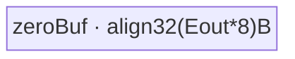
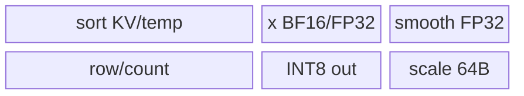
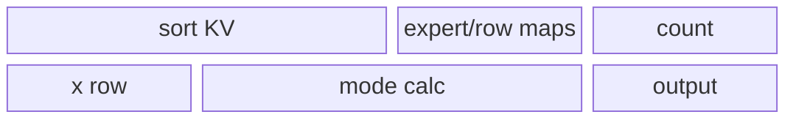
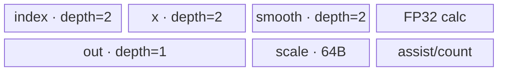

# MoeInitRoutingV3 A2/A3 ACLNN 算子知识

## 算子速览

| 项目 | 内容 |
|---|---|
| 实际入口 | 公开两段式 `aclnnMoeInitRoutingV3GetWorkspaceSize` / `aclnnMoeInitRoutingV3` |
| 计算语义 | 对 `(expertIdx,rowIdx)` 排序，生成 gather/scatter 索引与专家统计，再重排或量化 token |
| 输入输出 | `x[N,H]`、`expertIdx[N,K]`、可选 `scale/offset`；四个 ND 输出 |
| 执行类型 | 单个 Host Kernel 节点，实际 body 全为 `AIV_VECTOR`；entry 的 AIC 分支立即返回，无 Cube/MIX_CV 计算 |
| Kernel 路线 | R-001 空域；R-002 专用低时延；R-003 全载；R-004 gather-first 大 batch；R-005 通用 staged |
| 核心资源 | GM workspace、AIV UB、TQue/TBuf、Vector/标量；无 L1/L0/Cube |
| 来源闭包 | `source_closed`：公开 ACLNN→L0 launcher→fallback Tiling/POD→AIV router/body→A2/A3 binary/CMake |
| 验证状态 | 已完成源码闭包检查；本次知识提取未执行编译、真机、数值或性能测试。 |

## 接口与语义

### 计算语义

令 `L=N*K`，以原始线性位置 `rowIdx=0..L-1` 为 value，对 `expertIdx` 做 key-value sort 得到 `(sortedExpertIdx,sortedRowIdx)`。`rowIdxType=1` 时 `expandedRowIdx[i]=sortedRowIdx[i]`；`rowIdxType=0` 时写逆映射 `expandedRowIdx[sortedRowIdx[i]]=i`。统计仅覆盖 `[expertStart,expertEnd)`，输出 count、cumsum 或紧凑 key-value。Dropless 最多提交 `activeNum` 行；DropPad 为每专家保留 `expertCapacity` 行并丢弃溢出、清零缺口。静态量化计算 `round(x*scale+offset)`；动态 INT8 计算 `s=max(abs(x*smooth))/127`，再对 `x*smooth/s` 做 `CAST_RINT→half→int8`。

### 输入、输出与属性

| 参数 | shape/layout | dtype | 约束、默认值与语义 |
|---|---|---|---|
| `x` | `[N,H]` / ND | INT8/FP16/BF16/FP32 | 必选；INT8 只允许非量化 |
| `expertIdx` | `[N,K]` / ND | INT32 | 必选；与 `x` 的 N 相同，`L=N*K` |
| `scaleOptional` | 非量化 `[N]`；静态 `[1]`；动态 `[1,H]` 或 `[actualExpert,H]` | FP32 | 可选性和 shape 由 `quantMode` 决定 |
| `offsetOptional` | 静态 `[1]` | FP32 | 静态量化必选，其余路径不消费 |
| 属性 | 标量；`activeExpertRange` 长度 0/2 | INT64/BOOL | A2/A3 支持 `quantMode=-1/0/1`；`rowIdxType=0/1`；`dropPadMode=0/1` |
| `expandedXOut` | Dropless `[min(L,activeNum),H]`；DropPad `[expertNum,capacity,H]` | 与非量化输入相同或 INT8 | Host 校验完整 shape/dtype |
| `expandedRowIdxOut` | 路由展开域 | INT32 | gather 逆索引或 scatter 排序索引 |
| `expertTokensCountOrCumsumOut` | actualExpert 或 key-value 二列 | INT64 | flag 为真时有效 |
| `expandedScaleOut` | 动态/复制 scale 的行域 | FP32 | 非消费路线保持调用方约定 |

### 入口与版本

公开文档将 V3 明确描述为相对 V2 增加静态/动态量化并重定义专家统计输出的新版接口，且产品表同时列出 A2、A3、Ascend 950；因此两张卡均选 V3，不把 V1/V2 当同一版本 route。第一段 API 仅显式检查必选输入与四个输出非空，创建 executor，按需对四个输入 `Contiguous`，调用 L0 `MoeInitRoutingV3`，对四个临时输出 `ViewCopy`，返回总 workspace；第二段直接 `CommonOpExecutorRun`。

## Host/Launcher 执行流程

### 参数校验与前处理

`CheckNotNull`→`CREATE_EXECUTOR`→`Contiguous(x,expertIdx[,scale,offset])`→L0 分配四个连续输出→`ADD_TO_LAUNCHER_LIST_AICORE`。设备参数由 `MoeInitRountingV3TilingBase` 依次执行 `GetPlatformInfo`、`GetShapeAttrsInfo`、`DoOpTiling`、`GetTilingKey`、`GetWorkspaceSize`、`PostTiling`。Host 拒绝非法 mode、expert range、DropPad scatter、shape/dtype 和输出不匹配；不存在语义 fallback。

### 参数、Workspace 与生命周期

非空 workspace：`Wsort=4*(6*L)` 字节，`Wsync=coreNum*32*2` 字节，`Wscatter=4*L`，`Wcount=4*actualExpertNum`，`Wtotal=align32(4)`；动态量化另加 `4*coreNum*H`，DropPad 另加 `4*2*coreNum`，并统一加 16 MiB 框架保留区。空域只申请 16 MiB。`GetUserWorkspace(workspace)` 后的用户区贯穿 entry 内所有阶段；executor、连续化 tensor 与 workspace 均由调用者保持到同 stream 完成。

### 启动图与失败传播

```text
aclnnMoeInitRoutingV3GetWorkspaceSize
  -> l0op::MoeInitRoutingV3 -> launcher list: MoeInitRoutingV3
aclnnMoeInitRoutingV3(workspace, executor, stream)
  -> single moe_init_routing_v3(x, expertIdx, scale, offset, outputs, workspace, POD)
     -> entry 内按 key 顺序执行 sort -> count -> row-map -> gather/quant
```

空域 `blockDim=1`，非空 `blockDim=aivNum`。entry 声明 `KERNEL_TYPE_MIX_AIV_1_0` 是调度外壳；`g_coreType==AIC` 在读取 POD 前立即返回，所以实际可达计算只在 AIV。内部阶段共享同一 kernel launch 与 user workspace，依靠 `SyncAll`、HardEvent、Queue 及 atomic 建立可见性；任一 Host 校验失败不 launch，entry 的空 workspace/userWS 直接返回，unknown key 无替代 body。

## Route 与参数设计

### 分核与资源计算

`sortLoopMaxElement=floor((UB-aivNum*32)/(4*2*4)/32)*32`。若 `L<=sortLoopMaxElement`，单核 sort；否则 `perCoreElements=ceilDiv(L,aivNum)` 并调整 former/last core 与最后 loop。VMS 每次最多合并 4 路，`needCoreNum=ceilDiv(vbsNeedCoreNum,4)`。count/gather 均从 `ceilDiv(L,aivNum)` 起步；gather 依据量化模式的 `colMultiple/rowMultiple` 反推 `perLoopCols` 与每 loop 索引数。全载先扣 sort、rowIdx、expert、gather/quant buffer，只有 `remainUb>0` 才准入。

### Route 选择

| 顺序 | Route | Key/模板 | 精确选择条件与优先级 | 不适用去向 |
|---:|---|---|---|---|
| 1 | R-001 空域 | `3000000` | `N==0`；最先返回 | 非空→R-003/R-002 |
| 2 | R-003 全载 | `2100000`,`2200000`,`2300000+ep*10000+smooth*1000` | `IsFullLoad()` 为真；优先于专用性能判断 | 不全载→R-002/R-004/R-005 |
| 3 | R-002 专用低时延 | `2000000` | x `[1,7168]` BF16、expertIdx `[1,8]`、scale `[256,7168]`、无 offset、range `[0,256)`、dynamic、key-value，且未命中全载 | 下一性能/通用路径 |
| 4 | R-004 gather-first 大 batch | `1200000/1201000/1300000/1301000` | expertNum=256、actualExpert≤32、N∈[384,8192]、K=8、非量化、scatter、count；按 L 阈值取 sortMode=2/3 | R-005 |
| 5 | R-005 通用 staged | `1000000 + sortMode*100000 + (quantMode+1)*10000 + rowIdx*1000 + drop*100` | 其余合法非空输入；sortMode 0/1 | 非法组合 Host 失败 |

```text
empty -> 3000000
else compute all POD and IsFullLoad
  -> full-load: 21/22/23xx000
  -> exact 1x7168 dynamic case: 2000000
  -> large-batch gather-first: 12/13xx000
  -> generic decimal composite key
```

### 模板/实现执行矩阵

| Route | key/selector | dtype/shape/platform 完整命中条件 | 执行拓扑与 Kernel 节点 | 实际模板/body | 内存与同步特征 | tail/fallback |
|---|---|---|---|---|---|---|
| R-001 | 3000000 | N=0、A2/A3 | entry 空域分支 | Duplicate/DataCopyPad | block0、zeroBuf | valid bytes；return |
| R-002 | 2000000 | 固定 BF16 动态量化 shape | 专用全流程 | `MoeV3FullLoad` | 全载 UB、每 block 一行 | shape 不符 fallthrough |
| R-003 | 21/22/23xx000 | L 与 mode buffer 可装入 UB | 全载基类+派生 | `MoeV3FullLoad{Unquantized,StaticQuant,DynamicQuant}` | UB 内 sort/map/count | remainUB≤0→后续 |
| R-004 | 12/13xx000 | 大 batch 条件完整成立 | filter→性能 sort→count→map→copy | performance bodies | workspace+SyncAll | 阈值外→R-005 |
| R-005 | composite | 其余合法 -1/0/1 | sort→count→row-map/drop→copy/quant | staged bodies | ping-pong、Queue/Event | unknown key terminal |

### 隐藏性能 Guard

| Guard | Host/Tiling 条件 | Device/资源原因 | 影响 Route | 不满足时去向 | 源码符号 |
|---|---|---|---|---|---|
| 单核排序 | `L<=sortLoopMaxElement` | 四组 KV sort buffer 须落 UB | R-003/R-005 | 多核 sort | `Tiling4VBSCompute` |
| 全载 | `remainUb>0 && L<=sortLoopMaxElement && !dropPad` | sort+map+mode buffer 同驻 | R-003 | R-002/004/005 | `IsFullLoad` |
| gather tile | `perLoopMaxIndicesElements>0`，否则 H 对半 | mode queue 总量须≤UB | R-005 | 继续缩列 | `Tiling4GatherOutCompute` |
| expert bound | key-value `expertEnd<=5120`，其他≤10240 | count/key-value 地址界限 | all | Host failure | `CheckAttr` |
| AIC guard | `g_coreType==AIC` | 算法只实现 AIV | all | return | `moe_init_routing_v3` |

### POD/ABI

`MoeInitRoutingV3TilingData` 的叶字段全为顺序 `int64_t`。注册宏的外层序列化头固定仓不可见；下表 logical offset 按字段自然 8 字节对齐计算，逻辑 payload 为 704B。

| 结构 | 字段 | 类型/位宽 | ABI 布局 | 单位 | Host/launcher producer | Device consumer | 边界 |
|---|---|---|---|---|---|---|---|
| base | `coreNum` | int64/64 | off 0 | 核 | platform | all body | >0 |
| base | `n` | int64/64 | off 8 | 行 | input shape | address | ≥0 |
| base | `cols` | int64/64 | off 16 | 元素/行 | input shape | gather/quant | ≥0 |
| base | `k` | int64/64 | off 24 | 路由/行 | expert shape | `row/K` | ≥0 |
| base | `expertStart` | int64/64 | off 32 | id | attrs | filter/count | ≥0 |
| base | `expertEnd` | int64/64 | off 40 | id | attrs | filter/count | >start |
| base | `actualExpertNum` | int64/64 | off 48 | 个 | end-start | count | ≤expertNum |
| base | `quantMode` | int64/64 | off 56 | enum | attrs | router/quant | -1/0/1 |
| base | `rowIdxType` | int64/64 | off 64 | enum | attrs | map/copy | 0/1 |
| base | `isInputScale` | int64/64 | off 72 | bool | optional input | quant | 0/1 |
| base | `isInputOffset` | int64/64 | off 80 | bool | optional input | static | 0/1 |
| base | `expertNum` | int64/64 | off 88 | 个 | attrs | count/drop | >0 |
| base | `expertTokensNumType` | int64/64 | off 96 | enum | attrs | count | 0/1/2 |
| base | `expertTokensNumFlag` | int64/64 | off 104 | bool | attrs | empty/count | 0/1 |
| base | `gatherFirstFullload` | int64/64 | off 112 | bool | selector | full-load | 0/1 |
| base | `ep` | int64/64 | off 120 | bool | `IsFullLoad` | gather | 0/1 |
| base | `activeNum` | int64/64 | off 128 | 行 | normalized attr | output guard | ≤L |
| base | `dropPadMode` | int64/64 | off 136 | enum | attrs | drop body | 0/1 |
| base | `smoothType` | int64/64 | off 144 | enum | scale shape | dynamic | 0/1/2 |
| base | `expertCountElements` | int64/64 | off 152 | 元素 | empty shape | empty | inactive nonempty |
| base | `expertCapacity` | int64/64 | off 160 | 行/expert | attrs | DropPad | >0 if drop |
| VBS | `needCoreNum` | int64/64 | off 168 | 核 | VBS tiling | sort | ≤aivNum |
| VBS | `perCoreElements` | int64/64 | off 176 | 元素 | same | GM offset | aligned |
| VBS | `perCoreLoops` | int64/64 | off 184 | 次 | same | loop | >0 |
| VBS | `perCorePerLoopElements` | int64/64 | off 192 | 元素 | same | CopyIn | ≤max |
| VBS | `perCoreLastLoopElements` | int64/64 | off 200 | 元素 | same | tail | >0 |
| VBS | `lastCoreElements` | int64/64 | off 208 | 元素 | same | last core | tail |
| VBS | `lastCoreLoops` | int64/64 | off 216 | 次 | same | last core | >0 |
| VBS | `lastCorePerLoopElements` | int64/64 | off 224 | 元素 | same | last loop | aligned |
| VBS | `lastCoreLastLoopElements` | int64/64 | off 232 | 元素 | same | final tail | >0 |
| VBS | `oneLoopMaxElements` | int64/64 | off 240 | 元素 | sort UB | sort | 32-aligned |
| VMS | `needCoreNum` | int64/64 | off 248 | 核 | ceilDiv(VBS,4) | merge | 0 allowed |
| SortOut | `oneLoopMaxElements` | int64/64 | off 256 | 元素 | mrg max | extract | fixed bound |
| Count | `needCoreNum` | int64/64 | off 264 | 核 | count tiling | count | ≤aivNum |
| Count | `perCoreElements` | int64/64 | off 272 | 元素 | same | slice | ceilDiv |
| Count | `lastCoreElements` | int64/64 | off 280 | 元素 | same | tail | >0 |
| Count | `perCoreLoops` | int64/64 | off 288 | 次 | UB budget | loop | >0 |
| Count | `perCorePerLoopElements` | int64/64 | off 296 | 元素 | same | CopyIn | UB bound |
| Count | `perCoreLastLoopElements` | int64/64 | off 304 | 元素 | same | tail | >0 |
| Count | `lastCoreLoops` | int64/64 | off 312 | 次 | same | last | >0 |
| Count | `lastCorePerLoopElements` | int64/64 | off 320 | 元素 | same | last | UB bound |
| Count | `lastCoreLastLoopElements` | int64/64 | off 328 | 元素 | same | final | >0 |
| Gather | `needCoreNum` | int64/64 | off 336 | 核 | gather tiling | gather | ≤aivNum |
| Gather | `perCoreIndicesElements` | int64/64 | off 344 | 索引 | same | slice | ceilDiv |
| Gather | `lastCoreIndicesElements` | int64/64 | off 352 | 索引 | same | tail | >0 |
| Gather | `perCoreIndicesLoops` | int64/64 | off 360 | 次 | same | loop | >0 |
| Gather | `perCorePerLoopIndicesElements` | int64/64 | off 368 | 索引 | UB budget | loop | UB bound |
| Gather | `perCoreLastLoopIndicesElements` | int64/64 | off 376 | 索引 | same | tail | >0 |
| Gather | `lastCoreIndicesLoops` | int64/64 | off 384 | 次 | same | last | >0 |
| Gather | `lastCorePerLoopIndicesElements` | int64/64 | off 392 | 索引 | same | last | UB bound |
| Gather | `lastCoreLastLoopIndicesElements` | int64/64 | off 400 | 索引 | same | final | >0 |
| Gather | `colsLoops` | int64/64 | off 408 | 次 | ceilDiv(H,tile) | col loop | ≥1 |
| Gather | `perLoopCols` | int64/64 | off 416 | 元素 | UB budget | CopyIn/quant | >0 |
| Gather | `lastLoopCols` | int64/64 | off 424 | 元素 | remainder | tail | >0 |
| Gather | `activeNum` | int64/64 | off 432 | 行 | attrs | guard | prefix |
| Drop | `needCoreNum` | int64/64 | off 440 | 核 | DropPad tiling | map | ≤aivNum |
| Drop | `perCoreRows` | int64/64 | off 448 | 行 | same | core slice | ceilDiv |
| Drop | `perCorePerLoopRows` | int64/64 | off 456 | 行 | UB budget | loop | >0 |
| Drop | `perCoreLastLoopRows` | int64/64 | off 464 | 行 | same | tail | >0 |
| Drop | `lastCoreRows` | int64/64 | off 472 | 行 | same | last | tail |
| Drop | `lastCorePerLoopRows` | int64/64 | off 480 | 行 | same | last | >0 |
| Drop | `lastCoreLastLoopRows` | int64/64 | off 488 | 行 | same | final | >0 |
| Drop | `perCoreLoops` | int64/64 | off 496 | 次 | same | loop | >0 |
| Drop | `lastCoreLoops` | int64/64 | off 504 | 次 | same | last | >0 |
| Drop | `perLoopCols` | int64/64 | off 512 | 元素 | H/UB | col loop | >0 |
| Drop | `lastLoopCols` | int64/64 | off 520 | 元素 | remainder | tail | >0 |
| Drop | `colLoops` | int64/64 | off 528 | 次 | ceilDiv | loop | ≥1 |
| DropDyn | `needCoreNum` | int64/64 | off 536 | 核 | dynamic drop tiling | map+quant | ≤aivNum |
| DropDyn | `perCoreRows` | int64/64 | off 544 | 行 | same | core slice | ceilDiv |
| DropDyn | `perCorePerLoopRows` | int64/64 | off 552 | 行 | UB budget | loop | >0 |
| DropDyn | `perCoreLastLoopRows` | int64/64 | off 560 | 行 | same | tail | >0 |
| DropDyn | `lastCoreRows` | int64/64 | off 568 | 行 | same | last | tail |
| DropDyn | `lastCorePerLoopRows` | int64/64 | off 576 | 行 | same | last | >0 |
| DropDyn | `lastCoreLastLoopRows` | int64/64 | off 584 | 行 | same | final | >0 |
| DropDyn | `perCoreLoops` | int64/64 | off 592 | 次 | same | loop | >0 |
| DropDyn | `lastCoreLoops` | int64/64 | off 600 | 次 | same | last | >0 |
| DropDyn | `perLoopCols` | int64/64 | off 608 | 元素 | H/UB | quant | >0 |
| DropDyn | `lastLoopCols` | int64/64 | off 616 | 元素 | remainder | tail | >0 |
| DropDyn | `colLoops` | int64/64 | off 624 | 次 | ceilDiv | loop | ≥1 |
| SrcToDst | `needCoreNum` | int64/64 | off 632 | 核 | src-to-dst tiling | map | ≤aivNum |
| SrcToDst | `perCoreElements` | int64/64 | off 640 | 元素 | same | slice | ceilDiv |
| SrcToDst | `perCorePerLoopElements` | int64/64 | off 648 | 元素 | UB budget | loop | >0 |
| SrcToDst | `perCoreLastLoopElements` | int64/64 | off 656 | 元素 | same | tail | >0 |
| SrcToDst | `lastCoreElements` | int64/64 | off 664 | 元素 | same | last | tail |
| SrcToDst | `lastCorePerLoopElements` | int64/64 | off 672 | 元素 | same | last | >0 |
| SrcToDst | `lastCoreLastLoopElements` | int64/64 | off 680 | 元素 | same | final | >0 |
| SrcToDst | `perCoreLoops` | int64/64 | off 688 | 次 | same | loop | >0 |
| SrcToDst | `lastCoreLoops` | int64/64 | off 696 | 次 | same | last | >0 |

### Route 源码闭包

| Route | Key/selector | Host/Tiling producer | POD/参数 | Kernel entry/router 节点 | Kernel body/直接依赖 | 构建接线 |
|---|---|---|---|---|---|---|
| R-001 | 3000000 | `CheckInputShape/GetTilingKey` | base | `moe_init_routing_v3.cpp` | zero body | 910B/910_93 config+CMake |
| R-002 | 2000000 | exact performance predicate | base+VBS | same | `MoeV3FullLoad` | same |
| R-003 | 21/22/23xx000 | `IsFullLoad/GetTilingKey` | base+sort/count | same | FullLoadBase+derived | same |
| R-004 | 12/13xx000 | `GetPerformanceMode` | relevant POD | same | gather-first/performance bodies | same |
| R-005 | composite | all `Tiling4*` | full 704B payload | same | sort/count/map/gather/quant | same |

## Kernel 实现

### 公共执行流程

entry 读取 POD 与 user workspace 后按 key 选择。staged 路线先执行 one-core 或 multi-core sort；multi-core 将 VBS runs 写 workspace，再以最多四路 `MrgSort` ping-pong 并 `SyncAll`，最终 Extract。`ExpertTokensCount` 对每核 slice 生成局部计数并 atomic-add，block0 输出 count/cumsum/key-value 与 totalCount。gather 索引路线写逆映射，随后专用搬运/量化类按 `(sortedRow/K)*H+col` 与 `outRow*H+col` 地址读写。

### Route R-001：空张量

#### 适用条件

##### 选择证据

| 层级 | 文件 | 符号 | 源码谓词/参数 | 结果/下一跳 |
|---|---|---|---|---|
| Host | `op_host/moe_init_routing_v3_tiling.cpp` | `CheckInputShape/GetTilingKey/PostTiling` | `N==0` | key 3000000，blockDim 1 |
| Router | `op_kernel/moe_init_routing_v3.cpp` | EMPTY branch | block0、count flag | zero then return |

#### Device 数据流

##### 函数级调用链

```text
entry -> EMPTY_TENSOR -> block0 Duplicate<int32_t> -> DataCopyPad(INT64 count) -> return
```

##### 源码等价伪码

```text
if blockIdx!=0: return
if countFlag: zeroBuf=align32(count*8); Duplicate(0); copy count*8 bytes
return
```

#### 内存与数据搬运

##### 资源与搬运表

| 层级/缓冲区 | offset/地址公式 | extent/容量公式 | dtype/layout | producer | consumer | owner/lifetime | 对齐/复用 |
|---|---|---|---|---|---|---|---|
| UB zeroBuf | local | `align32(Eout*8)` | INT64 | Duplicate | MTE3 | branch | 32B |
| GM count | base | `Eout*8` | INT64 | DataCopyPad | caller | stream | valid bytes |

##### 分层内存布局



##### 字节账与复用顺序

```text
UB_total = align32(Eout*8)
workspace_total = 16 MiB
dynamic_ub = N/A
```

| 复用子区 | 写入者 | 读取者/消费点 | 下一次覆盖 | 同步或释放依据 | 安全条件 |
|---|---|---|---|---|---|
| zeroBuf | Duplicate | DataCopyPad | branch end | pipe.Destroy | block0 only |

#### 同步、精度与尾块

##### 同步与数值边界表

| 阶段 | primitive/机制 | producer | consumer/等待点 | 保护对象 | 精度/尾块 |
|---|---|---|---|---|---|
| zero | block guard+DataCopyPad | Vector | GM | count | padding not committed |

#### 关键实现

##### 符号证据表

| 阶段 | 文件 | 符号/模板实例 | 实现事实 |
|---|---|---|---|
| Host/Tiling producer | tiling.cpp | `GetTilingKey/PostTiling` | empty key/block |
| Kernel entry/router | kernel cpp | `EMPTY_TENSOR` | terminal branch |
| Device body/helper | kernel cpp | `Duplicate/DataCopyPad` | exact zero |

### Route R-002：专用低时延模板

#### 适用条件

##### 选择证据

| 层级 | 文件 | 符号 | 源码谓词/参数 | 结果/下一跳 |
|---|---|---|---|---|
| Tiling | tiling.cpp | `IsPerformanceMode_X_1_7168...` | 固定 shape/BF16/range/dynamic/key-value | key 2000000 |
| Router | kernel cpp | performance branch | exact key | `MoeV3FullLoad` |

#### Device 数据流

##### 函数级调用链

```text
MoeV3FullLoad::Init -> CopyIn -> SortCompute -> ExpertCountCompute -> CopyOutDynamicQuant
```

##### 源码等价伪码

```text
8 AIV blocks own routed rows; block0 sorts all 8 KV and builds count/map
each block loads BF16 row + expert FP32 smooth row
BF16->FP32; Mul; Abs; ReduceMax/127; Div; RINT; cast INT8; copy row+scale
```

#### 内存与数据搬运

##### 资源与搬运表

| 层级/缓冲区 | offset/地址公式 | extent/容量公式 | dtype/layout | producer | consumer | owner/lifetime | 对齐/复用 |
|---|---|---|---|---|---|---|---|
| sort queues/TBuf | local | sortNum family | INT32 KV | CopyIn | Sort | route | depth 1 |
| x/smooth/out | row base | `align32(H*2)+align32(H*4)+align32(H)` | mixed | MTE2 | Vector/MTE3 | block | per row |
| scale queue | local | 64B | FP32 | ReduceMax | MTE3 | row | one scalar |

##### 分层内存布局



##### 字节账与复用顺序

```text
UB_total = sort/map/count exact InitBuffer sum + x/smooth/FP32 temp/INT8 out/64B scale
UB_total < platform UB (Host admission)
workspace_total = Host common formula; dynamic_ub=N/A
```

| 复用子区 | 写入者 | 读取者/消费点 | 下一次覆盖 | 同步或释放依据 | 安全条件 |
|---|---|---|---|---|---|
| FP32 temp | Cast/Mul/Abs | ReduceMax/Div | next row | PipeBarrier/Queue | output queued |

#### 同步、精度与尾块

##### 同步与数值边界表

| 阶段 | primitive/机制 | producer | consumer/等待点 | 保护对象 | 精度/尾块 |
|---|---|---|---|---|---|
| sort | Queue/PipeBarrier | CopyIn | Extract | KV | aligned sentinel |
| quant | PIPE_V | Cast/Mul/Reduce | Div/Cast | FP32 temp | exact H |

#### 关键实现

##### 符号证据表

| 阶段 | 文件 | 符号/模板实例 | 实现事实 |
|---|---|---|---|
| Host/Tiling producer | tiling.cpp | exact predicate | selection |
| Kernel entry/router | kernel cpp | 2000000 branch | mapping |
| Device body/helper | `op_kernel/moe_v3_full_load.h` | `MoeV3FullLoad` | fused body |

### Route R-003：通用全载族

#### 适用条件

##### 选择证据

| 层级 | 文件 | 符号 | 源码谓词/参数 | 结果/下一跳 |
|---|---|---|---|---|
| Tiling | tiling.cpp | `IsFullLoad/GetTilingKey` | L≤sort max、非 DropPad、remainUB>0 | 21/22/23xx000 |
| Router | kernel cpp | full-load branches | dtype guards | derived template |

#### Device 数据流

##### 函数级调用链

```text
FullLoadBase::Init -> CopyIn -> Compute(sort/filter/map)
 -> Unquantized::GatherOutX | StaticQuant::ComputeQuant | DynamicQuant::ComputeQuant
 -> CopyOutIdx + ComputeExpertTokenCountOrCumsum + GM
```

##### 源码等价伪码

```text
load all L keys+arange; filter range; sort in UB; derive two row maps; emit stats
for owned row src=(sortedRow/K)*H: copy, static x*scale+offset, or dynamic smooth/max/127/div/RINT
```

#### 内存与数据搬运

##### 资源与搬运表

| 层级/缓冲区 | offset/地址公式 | extent/容量公式 | dtype/layout | producer | consumer | owner/lifetime | 对齐/复用 |
|---|---|---|---|---|---|---|---|
| UB base | local | `FullLoadBase::Init` sum | INT32/INT64 | MTE2/Vector | derived | route | depth 1 |
| UB derived | local | mode formula | T/FP32/INT8 | row load | quant/copy | row | aligned |
| userWS | base | Host total | INT32/FP32 | base | derived | entry | conditional |

##### 分层内存布局



##### 字节账与复用顺序

```text
UB_base = exact sum of map/count/KV queues and TBufs
UB_derived = exact derived InitBuffer sum
workspace_total = common Host formula
```

| 复用子区 | 写入者 | 读取者/消费点 | 下一次覆盖 | 同步或释放依据 | 安全条件 |
|---|---|---|---|---|---|
| map queues | base | derived gather | route end | FreeTensor | gather complete |

#### 同步、精度与尾块

##### 同步与数值边界表

| 阶段 | primitive/机制 | producer | consumer/等待点 | 保护对象 | 精度/尾块 |
|---|---|---|---|---|---|
| base→derived | Queue/Event | sort/map | gather | UB map | L valid |
| dynamic | PipeBarrier | FP32 ops | cast | row | /127, RINT |

#### 关键实现

##### 符号证据表

| 阶段 | 文件 | 符号/模板实例 | 实现事实 |
|---|---|---|---|
| Host/Tiling producer | tiling.cpp | `IsFullLoad/GetTilingKey` | UB gate/key |
| Kernel entry/router | kernel cpp | full-load branches | specialization |
| Device body/helper | full_load_base.h | base methods | sort/map/count |
| Device body/helper | full_load_dynamic_quant.h | `ComputeQuant` | precision |

### Route R-004：gather-first 大 batch 性能族

#### 适用条件

##### 选择证据

| 层级 | 文件 | 符号 | 源码谓词/参数 | 结果/下一跳 |
|---|---|---|---|---|
| Tiling | tiling.cpp | `GetPerformanceMode/GetTilingKey` | exact batch/K/expert/range/mode/index/count | sortMode 2/3 |
| Router | kernel cpp | gather-sort branches | 12/13 keys | compact then sort |

#### Device 数据流

##### 函数级调用链

```text
MoeSortActualExpert OR MoeGatherSortMultiCore
 -> MoeSortMultiCorePerformance -> ExpertTokensCount<true>
 -> RowIdxGather if needed -> MoeGatherOut
```

##### 源码等价伪码

```text
filter narrow active-expert rows into userWS; sort compact list
merge at most four runs/round with SyncAll; count/map; copy source token rows
```

#### 内存与数据搬运

##### 资源与搬运表

| 层级/缓冲区 | offset/地址公式 | extent/容量公式 | dtype/layout | producer | consumer | owner/lifetime | 对齐/复用 |
|---|---|---|---|---|---|---|---|
| compact WS | userWS prefix | ≤L | KV | gather-first | perf sort | entry | SyncAll edge |
| merge WS | route offsets | 6*L*4 family | KV | VBS/VMS | Extract | entry | ping/pong |
| gather UB | tile | POD bound | T/INT32 | MTE2 | MTE3 | tile | depth 2 |

##### 分层内存布局


##### 字节账与复用顺序

```text
sort_UB = 3*buffSize + conditional temp buffSize
gather_UB = 2*align32(indexTile*4)+2*align32(colTile*sizeof(T))+64
workspace_total = Host common formula
```

| 复用子区 | 写入者 | 读取者/消费点 | 下一次覆盖 | 同步或释放依据 | 安全条件 |
|---|---|---|---|---|---|
| merge ping/pong | round r | round r+1 | r+2 | SyncAll | distinct src/dst |

#### 同步、精度与尾块

##### 同步与数值边界表

| 阶段 | primitive/机制 | producer | consumer/等待点 | 保护对象 | 精度/尾块 |
|---|---|---|---|---|---|
| compact→sort | SyncAll | filter | sorter | workspace | active rows only |
| merge | SyncAll | round r | r+1 | ping/pong | POD run length |

#### 关键实现

##### 符号证据表

| 阶段 | 文件 | 符号/模板实例 | 实现事实 |
|---|---|---|---|
| Host/Tiling producer | tiling.cpp | `GetPerformanceMode` | thresholds |
| Kernel entry/router | kernel cpp | gather-sort branches | order |
| Device body/helper | `op_kernel/moe_v3_sort_multi_core_performance.h` | performance sorter | compact merge |

### Route R-005：通用 staged 族

#### 适用条件

##### 选择证据

| 层级 | 文件 | 符号 | 源码谓词/参数 | 结果/下一跳 |
|---|---|---|---|---|
| Tiling | tiling.cpp | final `GetTilingKey` | all other legal nonempty | composite key |
| Router | kernel cpp | staged key groups | sort/mode/row/drop | phase graph |

#### Device 数据流

##### 函数级调用链

```text
MoeSortOneCore OR MoeSortMultiCore
 -> ExpertTokensCount<CUMSUM|COUNT|KEY_VALUE>
 -> RowIdxGather OR capacity map -> copy/static/dynamic gather body
```

##### 源码等价伪码

```text
per core/tile sort expertIdx+arange to workspace; multi-core 4-way merge with SyncAll
local count -> atomic countTemp -> block0 stats+totalCount
inverse/capacity row map; for row/col tile copy or quantize; exact final blockLen/mask
```

#### 内存与数据搬运

##### 资源与搬运表

| 层级/缓冲区 | offset/地址公式 | extent/容量公式 | dtype/layout | producer | consumer | owner/lifetime | 对齐/复用 |
|---|---|---|---|---|---|---|---|
| sort WS | prefix+run offset | `6*L*4` | KV | sort | count/map | entry | ping/pong |
| sync WS | after sort | `coreNum*64` | flags | cores | SyncAll | entry | protocol |
| count/map WS | aligned suffix | `4*L+4*actualE+32` | INT32 | count/map | gather | entry | barriers |
| quant WS | block*H | `4*coreNum*H` | FP32 | partial pass | final quant | dynamic | disjoint |
| dynamic UB | local | input/index/smooth/calc/out queues | mixed | MTE2 | Vector/MTE3 | tile | depth 2 inputs |

##### 分层内存布局



##### 字节账与复用顺序

```text
sort_UB = 4*buffSize (one-core) or 3/4*buffSize (multi stage)
count_UB = align32(loop*4)+2*align32(actualE*4)+align32(Eout*8)+32
dynamic_UB = 2*align32(indexTile*4)+2*xAligned+2*align32(Htile*4)+align32(Htile*4)+align32(Htile)+64
workspace_total = Wsort+Wsync+Wscatter+Wcount+32+[Wquant]+[Wdrop]+16MiB
```

| 复用子区 | 写入者 | 读取者/消费点 | 下一次覆盖 | 同步或释放依据 | 安全条件 |
|---|---|---|---|---|---|
| sort temp/sorted | Vector | Extract/MrgSort | next tile/round | Queue+SyncAll | output committed |
| FP32 calc | Cast/Mul/Abs | ReduceMax/Div/Cast | next row | PipeBarrier | scale/output queued |

#### 同步、精度与尾块

##### 同步与数值边界表

| 阶段 | primitive/机制 | producer | consumer/等待点 | 保护对象 | 精度/尾块 |
|---|---|---|---|---|---|
| multi-sort | SyncAll | VBS/VMS | next stage | WS runs | POD valid lengths |
| count | AtomicAdd+SyncAll | each core | block0 | countTemp | range guard |
| dynamic | PipeBarrier+Queue | FP32 ops | cast/MTE3 | row tile | RINT, valid H |

#### 关键实现

##### 符号证据表

| 阶段 | 文件 | 符号/模板实例 | 实现事实 |
|---|---|---|---|
| Host/Tiling producer | tiling.cpp | `Tiling4VBSCompute/Tiling4ExpertTokensCountCompute/Tiling4GatherOutCompute` | POD |
| Kernel entry/router | kernel cpp | staged branches | order |
| Device body/helper | sort_multi_core.h | VBS/VMS/SortOut | merge/sync |
| Device body/helper | expert_tokens_count.h | `Process/CopyOut` | atomic count |
| Device body/helper | row_idx_gather.h | `Process` | inverse map |
| Device body/helper | gather_dynamic_quant.h | quant methods | precision/tail |

## 算子特定优化

### Trick T-001：全载准入按真实 mode buffer 做 UB 扣账

#### 触发与源码依据

- 适用 Route：R-003。
- 触发条件：`L<=sortLoopMaxElement`、非 DropPad，且所有 buffer 扣除后 `remainUb>0`。
- Golden 来源：[`moe_init_routing_v3_tiling.cpp:770-791`](../../../../../../../cann-ops-raw/ascendc/ops-transformer/be33d95bb755cedec3108f70805c1874d1792540/moe/moe_init_routing_v3/op_host/moe_init_routing_v3_tiling.cpp#L770-L791)

**官方源码（固定 Commit 连续逐字摘录）**：

```cpp
int64_t sortSpace = sortNum * sizeof(int32_t) * ONE_CORE_SORT_BUFFER;
int64_t rowIdxSpace = sortNum * sizeof(int32_t) * NUM_THREE;
int64_t expertSpace = Ops::Base::CeilDiv(this->expertNum_ * int64_t(sizeof(int64_t)), ONE_BLOCK_BYTE) * ONE_BLOCK_BYTE * NUM_TWO;
int64_t gatherSpace = Ops::Base::CeilDiv(cols_ * inuptXDtypeSize_, ONE_BLOCK_BYTE) * ONE_BLOCK_BYTE * perCoreTokens;
int64_t remainUb = aicoreParams_.ubSize - sortSpace - rowIdxSpace - expertSpace - LENGTH_1024;
```

#### 机制与设计原因

Host 用实际 dtype、H、专家数和 mode 逐项扣 UB；命中后 sort/map/count 直接由派生 gather/quant 消费，减少 staged 路线的 workspace 物化和跨核同步。

#### 迁移边界

- 适用：小 L 且 UB 可容纳全部状态的排序重排。
- 前提：相同 32B 对齐和派生 `InitBuffer` 字节式。
- 失效：`remainUb<=0`、L 超限或 DropPad 时用 R-004/R-005。
- 未验证：本次知识提取未执行编译、真机、数值或性能测试。

#### 错误做法

只按 L 小就强制全载会遗漏 H、dtype、统计和量化 buffer；固定源码的 `remainUb` 是可验证反例。

### Trick T-002：动态量化保持 FP32 归约和受控 cast 顺序

#### 触发与源码依据

- 适用 Route：R-003/R-005 动态 INT8。
- 触发条件：`quantMode=1`，输入非 INT8；可选 smooth 先乘。
- Golden 来源：[`moe_v3_full_load_dynamic_quant.h:127-160`](../../../../../../../cann-ops-raw/ascendc/ops-transformer/be33d95bb755cedec3108f70805c1874d1792540/moe/moe_init_routing_v3/op_kernel/moe_v3_full_load_dynamic_quant.h#L127-L160)

**官方源码（固定 Commit 连续逐字摘录）**：

```cpp
if constexpr (!IsSameType<T, float>::value && !IsSameType<T, int8_t>::value) {
    Cast(inLocal, inLocal.ReinterpretCast<T>()[colsAlign_], RoundMode::CAST_NONE, this->cols_);
    PipeBarrier<PIPE_V>();
}
if constexpr (SMOOTHTYPE != NO_SCALE) {
    Mul(inLocal, inLocal, smoothLocal, this->cols_);
    PipeBarrier<PIPE_V>();
}
Abs(tempLocal, inLocal, this->cols_);
PipeBarrier<PIPE_V>();
ReduceMax(dynamicQuantLocal, tempLocal, tempLocal, this->cols_);
```

#### 机制与设计原因

非 FP32 输入先升 FP32，smooth、绝对值和 max 归约都保持 FP32；之后 `/127→Div→CAST_RINT→half→int8`。数据依赖之间的 `PIPE_V` barrier 同时锁定临时区安全复用与数值顺序。

#### 迁移边界

- 适用：逐行对称 INT8 动态量化。
- 前提：FP32 临时区、`/127` 和相同 round 模式。
- 失效：静态量化或其他低精度块量化使用专用 body。
- 未验证：本次知识提取未执行编译、真机、数值或性能测试。

#### 错误做法

在 BF16/FP16 中直接求 max 或改变 cast 次序会改变固定源码数值语义。

## 模板与实现对比

| 对比维度 | R-001 | R-002 | R-003 | R-004 | R-005 | 设计选择依据 |
|---|---|---|---|---|---|---|
| 命中条件/优先级 | N=0 | exact shape | remainUB>0，优先 | large+narrow | final | selector order |
| 模板与 dtype | zero | BF16→INT8 | -1/0/1 | nonquant | -1/0/1 | mode/shape |
| 循环与分核 | block0 | 8 blocks | all-L UB | compact+sort | tiled one/multi | UB/L |
| Queue/TBuf | zeroBuf | fused | base+derived | phase queues | phase queues | lifetime |
| 内存总占用与复用 | minimal | fixed | full-load | WS ping/pong | WS+tile UB | materialization |
| 搬运/Vector API | Duplicate | sort/reduce/cast | fused | filter/sort/copy | staged | semantics |
| 同步、精度与 tail | guard | barriers | queue/event | SyncAll | SyncAll/atomic | dependencies |
| fallback/失败边界 | return | miss | UB miss | threshold miss | terminal | no semantic fallback |

## 平台差异

| 项目 | A2 | A3 | 950 |
|---|---|---|---|
| 支持状态 | 支持，本卡 | 支持，本卡 | 支持，见 `_950` 卡 |
| Host/Launcher | fallback priority 10000 | 同 A2 | Arch35 priority 1000 |
| Kernel/资源 | AIV、静态 UB | 同 A2 | APT RegBase+SIMT、动态 UB、更多 mode |

## 限制与失败边界

- A2/A3 固定 Host 只接受 `quantMode=-1/0/1`；产品差异表限定本平台子集。
- 固定仓公开资料存在 mode 列表冲突：顶层 `README.md` 的 A2/A3 段列 `-1/1`，ACLNN API 文档列 `-1/0/1`，Host `CheckAttr` 与静态量化 body 实现 `0`。本卡按 ACLNN 文档与可达源码记录静态量化，并保留该文档冲突，不推断发行包行为。
- `activeNum` 的 0/-1 规范化为 L，其余截断到 L；DropPad 只允许 gather、全 expert range、`0<capacity<=N`。
- key-value 时 `expertEnd<=5120`，其他统计模式≤10240；极限 workspace 分配与溢出未运行验证。
- AIC 分支立即返回，不能把调度宏当作 Cube 实现；实际计算是 AIV，无 MIX_CV。
- SDK primitive、executor 自动 bridge 与 stream 内部是明确框架边界。

## 源码索引

### 链路索引

| 链路阶段 | 文件 | 关键符号 | 支撑内容 |
|---|---|---|---|
| 入口声明/约束 | `README.md` | 产品/mode 支持段 | 公开支持与 mode 冲突 |
| 入口声明/约束 | `docs/aclnnMoeInitRoutingV3.md` | 产品表/两段接口 | 平台、语义、版本 |
| 入口声明/约束 | `op_host/op_api/aclnn_moe_init_routing_v3.h` | prototypes | ABI |
| 入口实现 | `op_host/op_api/aclnn_moe_init_routing_v3.cpp` | ACLNN functions | executor/contiguous/viewcopy |
| Host/Tiling/Launcher | `op_host/op_api/moe_init_routing_v3.cpp` | L0 function | launcher node |
| Host/Tiling/Launcher | `op_host/moe_init_routing_v3_tiling.h` | POD defs | ABI |
| Host/Tiling/Launcher | `op_host/moe_init_routing_v3_tiling.cpp` | fallback class | validation/key/workspace |
| Kernel entry/body | `op_kernel/moe_init_routing_v3.cpp` | entry | router/graph |
| Kernel entry/body | `op_kernel/moe_v3_full_load_base.h` | FullLoadBase | R-003 |
| Kernel entry/body | `op_kernel/moe_v3_full_load.h` | `MoeV3FullLoad` | R-002 |
| Kernel entry/body | `op_kernel/moe_v3_full_load_dynamic_quant.h` | `ComputeQuant` | precision |
| Kernel entry/body | `op_kernel/moe_v3_sort_multi_core.h` | VBS/VMS/SortOut | merge |
| Kernel entry/body | `op_kernel/moe_v3_sort_multi_core_performance.h` | performance sorter | R-004 |
| Kernel entry/body | `op_kernel/moe_v3_expert_tokens_count.h` | count | atomic |
| Kernel entry/body | `op_kernel/moe_v3_row_idx_gather.h` | row map | inverse map |
| 构建接线 | `op_host/config/ascend910b/moe_init_routing_v3_binary.json` | op_list | A2 binary |
| 构建接线 | `op_host/config/ascend910_93/moe_init_routing_v3_binary.json` | op_list | A3 binary |
| 构建接线 | `op_host/CMakeLists.txt` | target | build wiring |

每行文件均列入 Frontmatter，固定仓为 `cann/ops-transformer@be33d95bb755cedec3108f70805c1874d1792540`。

### 实现复用检查

| 检查项 | 可复用事实 | 不得改变的约束 | 源码符号 |
|---|---|---|---|
| ABI/POD | 704B logical int64 payload | 字段顺序、单位、inactive 值 | POD defs |
| 调用顺序 | single entry phase graph | full-load priority、sort→count→map→gather | selector/router |
| workspace/内存 | Host formulas | userWS、16MiB、conditional slices | `GetWorkspaceSize` |
| 同步 | Queue/Event/SyncAll/atomic | producer→consumer | helpers |
| 精度与尾块 | FP32 dynamic pipeline | /127、RINT/cast、valid blockLen | quant body |
| 失败边界 | Host reject/terminal router | 不得静默改 mode | Check*/router |