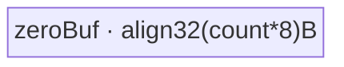
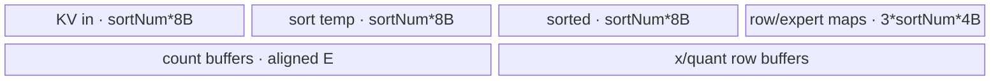
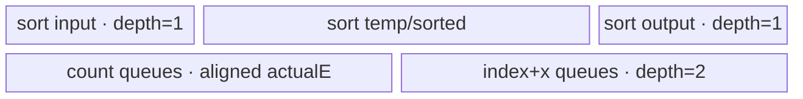
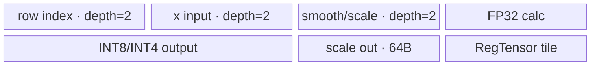

# MoeInitRoutingV3 950 ACLNN 算子知识

## 算子速览

| 项目 | 内容 |
|---|---|
| 实际入口 | 公开两段式 V3：`aclnnMoeInitRoutingV3GetWorkspaceSize`、`aclnnMoeInitRoutingV3` |
| 计算语义 | 排序 `(expertIdx,rowIdx)`，生成 gather/scatter 索引和专家统计，再搬运或量化 token |
| 输入输出 | `x[N,H]`、`expertIdx[N,K]`、可选 scale/offset；四个 ND 输出 |
| 执行类型 | `HYBRID`：单 AIV Kernel 内 RegBase/Vector + SIMT；无 Cube、L1/L0 |
| Kernel 路线 | R-001 空张量；R-002 全载；R-003 staged 非量化/DropPad；R-004 staged 整数量化；R-005 staged MX/HIF8/FP8 |
| 核心资源 | GM、用户 workspace、动态 UB、64 KiB SIMT DCache、TQue/TBuf/RegTensor |
| 来源闭包 | `source_closed`：ACLNN→L0→Arch35 Tiling/POD→APT router→可达 body/helper→950 binary/CMake |
| 验证状态 | 固定源码静态审查；编译、真机、数值、性能未验证 |

## 接口与语义

### 计算语义

令 `L=N*K`。`keyValueSort(expertIdx, arange(L))` 得到 `(sortedExpert,sortedRow)`；`rowIdxType=1` 直接输出 `sortedRow`，`rowIdxType=0` 输出逆映射 `out[sortedRow[i]]=i`。对 `[expertStart,expertEnd)` 统计 count/cumsum/key-value。Dropless 受 `activeNum` 截断；DropPad 为每专家保留 `expertCapacity` 行，超出丢弃、空位补零。静态量化按 `x*scale+offset` 后 cast；动态 INT8/INT4 先求 `max(abs(x*smooth))/127` 或 `/7`，再除 scale、舍入饱和，INT4 两值打包一字节。MXFP8/MXFP4/HIF8/FP8-per-block 由专用 body 保持源码 scale block 与输出布局。

### 输入、输出与属性

| 参数 | shape/layout | dtype | 约束、默认值与语义 |
|---|---|---|---|
| `x` | `[N,H]`/ND | INT8/FP16/BF16/FP32；950 注册另含 HIF8/FP8/FP4 组合 | 必选并连续化；INT4 动态要求 H 偶数 |
| `expertIdx` | `[N,K]`/ND | INT32 | 必选并连续化；定义 L |
| `scale` | 可选标量、行、`[actualExpert,H]`、`[1,H]` 或 MX scale 布局 | FP32/FP8_E8M0 | 是否必选及 shape 由 quantMode 校验 |
| `offset` | 可选标量/ND | FP32 | 仅静态量化必选，其他模式拒绝 |
| 九个属性 | 标量；`activeExpertRange` 长度 2 | INT64/BOOL | mode：`-1,0,1,2,3,6,7,8,9,11,12,13`；rowIdx 0/1；dropPad 0/1 |
| `expandedX` | Dropless 有效行或 `expertNum*capacity` 行 | 随 quantMode | Host 校验 shape/dtype |
| `expandedRowIdx` | 路由展开域/ND | INT32 | gather 逆索引或 scatter 原索引 |
| `expertTokensCountOrCumsum` | actualExpert 或 `[expertNum,2]` | INT64 | flag 控制有效输出 |
| `expandedScale` | 行 scale 或 MX/FP8 block scale | FP32/FP8_E8M0 | mode-specific |

### 入口与版本

第一段只显式判空必选输入和四个输出，创建 executor，按需 `Contiguous` 四个输入，调用 L0 `MoeInitRoutingV3`，再对四个中间输出 `ViewCopy` 并返回 workspace；L0 用 `ADD_TO_LAUNCHER_LIST_AICORE` 记录单个算子 launch。第二段调用 `CommonOpExecutorRun`。固定仓 V3 为本语义最新公开入口；未合并 V1/V2 或 Grad/原地变体。

## Host/Launcher 执行流程

### 参数校验与前处理

Arch35 Tiling 的 `DoOpTiling` 顺序执行平台、attrs、输入、空域、输出校验。`IsCapable` 要求 RegBase SoC；`aivCoreNum>0`，总 UB 减 `SIMT_DCACHE_SIZE=65536` 后仍须为正。950 DropPad 仅允许非量化、gather、全专家范围且 capacity>0；key-value 专家上限 5120，其他 10240；错误返回 graph/ACLNN 状态，无 Device fallback。

### 参数、Workspace 与生命周期

非空 workspace 包括：`6*L*sizeof(float)` 排序区、`coreNum*32*2` 同步区、`L*4` scatter 区、`actualExpertNum*4` count 区、32B totalCount；DropPad 加 `coreNum*2*4`；需要量化临时区时加 `coreNum*H*4`；最后加 16 MiB 框架区。空域仅 16 MiB。executor、连续中间张量和 workspace 存活到调用者 stream 完成；POD by-value 在 launch 前复制。

### 启动图与失败传播

空域 `blockDim=1`，否则全部 AIV 核；`SetLocalMemorySize(totalUB-64KiB)` 下发动态 UB，`SetScheduleMode(1)` 支持全核同步。单个 op_kernel/moe_init_routing_v3_apt.cpp 拒绝 AIC、空 workspace/userWS；内部按 key 执行 sort→count→row-map→gather/quant。SIMT 是同步 `asc_vf_call`，不是独立 Host kernel。未知 key 或 constexpr dtype guard 不成立时不写相应输出。

## Route 与参数设计

### 分核与资源计算

单核排序容量为 `min(availUB` 推导值, `32*255)`；超出则按 AIV 核均分，32 元素对齐，并最多四路逐级 `MrgSort`。count 与 gather 均按 `ceilDiv(L,aivCoreNum)` 分核。gather 从 mode 的 `colMultiple/rowMultiple` 反推行/列 tile；MX 对齐 32 列，FP8-per-block 对齐 128 列，INT4 非末 tile 为偶数列。全载要求 L 未超单核 sort 上限且 sort/row/expert/gather/quant 全部 UB 扣减后 `remainUb>0`。

### Route 选择

| 顺序 | Route | Key/模板 | 精确选择条件与优先级 | 不适用去向 |
|---:|---|---|---|---|
| 1 | R-001 空张量 | 3000000 | `N==0 \|\| K==0 \|\| H==0`，最先返回 | 非空→R-002 |
| 2 | R-002 全载 | 200000/210000/220000 | `IsFullLoad` 且 mode 为 -1/0/1/13；INT4 复用 220000，由 POD 区分 | 不全载→R-003..005 |
| 3 | R-003 staged 非量化/DropPad | 10000000/10001000/11000000/11001000；drop 10000100/11000100 | mode=-1，sortMode/rowIdx/drop 十进制编码 | quant→R-004/005 |
| 4 | R-004 staged 整数量化 | static 10010000..11011000；dynamic 10020000..11021000；INT4 10140000..11141000 | mode 0/1/13，one/multi + gather/scatter | 低精度→R-005 |
| 5 | R-005 staged MX/HIF8/FP8 | MXFP8 10030000..11031000；HIF8 10070000..11091000；MXFP4 10100000..11101000；FP8PB 10120000..11121000 | mode 2/3/6/7/8/9/11/12 | 非法组合失败 |

```text
validate → empty ? 3000000
  → full-load ? 200000 + quantFactor*10000
  → 10000000 + sortMode*1000000 + quantFactor*10000 + rowIdx*1000 + drop*100
```

### 模板/实现执行矩阵

| Route | key/selector | dtype/shape/platform 完整命中条件 | 执行拓扑与 Kernel 节点 | 实际模板/body | 内存与同步特征 | tail/fallback |
|---|---|---|---|---|---|---|
| R-001 空张量 | 3000000 | `N==0 \|\| K==0 \|\| H==0`，950 | entry 空域分支 | `InitGlobalMemory`、`Duplicate`、`DataCopyPad` | block0、单 zeroBuf | 精确有效字节后 return |
| R-002 全载 | 200000/210000/220000 | `IsFullLoad` 且 mode=-1/0/1/13 | 单 entry，FullLoadBase+派生 | `MoeV3FullLoad*` | UB 常驻 sort/map/count；同步 SIMT | UB 不足转 staged |
| R-003 staged 非量化/DropPad | 10/11xx0000 与 drop key | mode=-1；one/multi、gather/scatter/drop | sort→count→row-map→copy | sort/count/nonquant/drop bodies | workspace ping-pong、SIMT、SyncAll | capacity/active tail |
| R-004 staged 整数量化 | static/dynamic/INT4 keys | mode=0/1/13 且 dtype/scale/H 合法 | common producer→integer quant | static/dynamic bodies | FP32 calc、dynamic UB、可选 quant WS | INT4 H 偶数 |
| R-005 staged 低精度量化 | MX/HIF8/FP8 keys | mode=2/3/6/7/8/9/11/12 | common producer→专用 quant | MXFP8/MXFP4/HIF8/FP8PB bodies | 32/128 列块、RegTensor | mode-specific mask |

### 隐藏性能 Guard

| Guard | Host/Tiling 条件 | Device/资源原因 | 影响 Route | 不满足时去向 | 源码符号 |
|---|---|---|---|---|---|
| RegBase 平台 | `socVersion` 属于 Arch35 且 `aivCoreNum>0` | APT body 与显式 POD 仅对 RegBase 接线 | 全部 | fallback template 或 Host 失败 | `IsCapable/GetPlatformInfo` |
| SIMT DCache | `totalUbSize>65536`，`availUbSize=totalUbSize-65536` | SIMT local memory 与 AIV UB 隔离 | 全部非空 | Host 失败 | `GetPlatformInfo` |
| 单核 sort | `L<=sortLoopMaxElement`，上限再受 255 repeats 限制 | Sort32 repeat 与 UB KV 容量 | R-002..005 | multi-core sort | `Tiling4VBSCompute` |
| full-load | `L<=sortMax && remainUb>0` | sort/map/count/gather/quant 同驻 UB | R-002 | staged | `IsFullLoad` |
| MX/FP8 tile | MX 列块 32、FP8PB 列块 128，`perLoopMaxIndicesElements>0` | exponent/scale block 和 double buffer | R-005 | 缩小列 tile；仍不足记录错误 | `Tiling4GatherOutMxQuant/Tiling4GatherOutFP8Quant` |
| INT4 | mode=13、x BF16/FP32、out INT4、H 偶数 | 两个 nibble 打包一字节 | R-002/R-004 | Host 失败 | `ValidateInt4DynamicQuant/AlignInt4DynamicQuantPerLoopCols` |

### POD/ABI

显式 Arch35 POD 全为顺序 `int64_t`，`sizeof=536, alignof=8`。下表逐字段给出 `offsetof`；嵌套名是字段所属子结构。

| 结构 | 字段 | 类型/位宽 | ABI 布局 | 单位 | Host/launcher producer | Device consumer | 边界 |
|---|---|---|---|---|---|---|---|
| base | `coreNum` | int64/64 | sizeof=8, alignof=8, offsetof=0 | 核 | platform | all body | >0 |
| base | `n` | int64/64 | sizeof=8, alignof=8, offsetof=8 | 行 | input check | addresses | ≥0 |
| base | `cols` | int64/64 | sizeof=8, alignof=8, offsetof=16 | 元素 | input check | gather/quant | ≥0 |
| base | `k` | int64/64 | sizeof=8, alignof=8, offsetof=24 | 路由/行 | expert shape | `/K` mapping | ≥0 |
| base | `expertStart` | int64/64 | sizeof=8, alignof=8, offsetof=32 | id | list attrs | sort/count | ≥0 |
| base | `expertEnd` | int64/64 | sizeof=8, alignof=8, offsetof=40 | id | list attrs | sort/count | >start |
| base | `actualExpertNum` | int64/64 | sizeof=8, alignof=8, offsetof=48 | 个 | end-start | count | ≤expertNum |
| base | `quantMode` | int64/64 | sizeof=8, alignof=8, offsetof=56 | enum | ValidateQuantMode | router/body | controlled |
| base | `rowIdxType` | int64/64 | sizeof=8, alignof=8, offsetof=64 | enum | ValidateRowIdxType | sort/gather | 0/1 |
| base | `isInputScale` | int64/64 | sizeof=8, alignof=8, offsetof=72 | bool | optional input | quant | 0/1 |
| base | `isInputOffset` | int64/64 | sizeof=8, alignof=8, offsetof=80 | bool | optional input | static | 0/1 |
| base | `expertNum` | int64/64 | sizeof=8, alignof=8, offsetof=88 | 个 | attrs | drop/key-value | bounded |
| base | `expertTokensNumType` | int64/64 | sizeof=8, alignof=8, offsetof=96 | enum | attrs | count | 0/1/2 |
| base | `expertTokensNumFlag` | int64/64 | sizeof=8, alignof=8, offsetof=104 | bool | attrs | count/empty | 0/1 |
| base | `gatherFirstFullload` | int64/64 | sizeof=8, alignof=8, offsetof=112 | inactive | value-init | not read | keep 0 |
| base | `epFullload` | int64/64 | sizeof=8, alignof=8, offsetof=120 | bool | IsFullLoad | full-load | 0/1 |
| base | `activeNum` | int64/64 | sizeof=8, alignof=8, offsetof=128 | 行 | attrs | output guard | ≥-1 |
| base | `dropPadMode` | int64/64 | sizeof=8, alignof=8, offsetof=136 | enum | attrs | drop body | 0/1 |
| base | `smoothType` | int64/64 | sizeof=8, alignof=8, offsetof=144 | inactive | value-init | not read | keep 0 |
| base | `expertCapacity` | int64/64 | sizeof=8, alignof=8, offsetof=152 | 行/expert | attrs | drop | >0 if drop |
| VBS | `needCoreNum` | int64/64 | sizeof=8, alignof=8, offsetof=160 | 核 | Tiling4VBS | sort | ≤core |
| VBS | `perCoreElements` | int64/64 | sizeof=8, alignof=8, offsetof=168 | 元素 | same | sort offset | aligned |
| VBS | `perCoreLoops` | int64/64 | sizeof=8, alignof=8, offsetof=176 | 次 | same | VBS loop | >0 |
| VBS | `perCorePerLoopElements` | int64/64 | sizeof=8, alignof=8, offsetof=184 | 元素 | same | VBS | ≤max |
| VBS | `perCoreLastLoopElements` | int64/64 | sizeof=8, alignof=8, offsetof=192 | 元素 | same | former tail | >0 |
| VBS | `lastCoreElements` | int64/64 | sizeof=8, alignof=8, offsetof=200 | 元素 | same | last core | tail |
| VBS | `lastCoreLoops` | int64/64 | sizeof=8, alignof=8, offsetof=208 | 次 | same | last core | >0 |
| VBS | `lastCorePerLoopElements` | int64/64 | sizeof=8, alignof=8, offsetof=216 | 元素 | same | last core | aligned |
| VBS | `lastCoreLastLoopElements` | int64/64 | sizeof=8, alignof=8, offsetof=224 | 元素 | same | final tail | >0 |
| VBS | `oneLoopMaxElements` | int64/64 | sizeof=8, alignof=8, offsetof=232 | 元素 | sort max | sort | ≤8160 |
| VMS | `needCoreNum` | int64/64 | sizeof=8, alignof=8, offsetof=240 | 核 | ceilDiv(VBS,4) | merge | 0 allowed |
| SortOut | `oneLoopMaxElements` | int64/64 | sizeof=8, alignof=8, offsetof=248 | 元素 | constant 1024 | merge | ≤1024 |
| Count | `needCoreNum` | int64/64 | sizeof=8, alignof=8, offsetof=256 | 核 | count tiling | count | >0 |
| Count | `perCoreElements` | int64/64 | sizeof=8, alignof=8, offsetof=264 | 元素 | same | GM slice | ceilDiv |
| Count | `lastCoreElements` | int64/64 | sizeof=8, alignof=8, offsetof=272 | 元素 | same | tail | >0 |
| Count | `perCoreLoops` | int64/64 | sizeof=8, alignof=8, offsetof=280 | 次 | UB budget | count | >0 |
| Count | `perCorePerLoopElements` | int64/64 | sizeof=8, alignof=8, offsetof=288 | 元素 | same | count | UB bound |
| Count | `perCoreLastLoopElements` | int64/64 | sizeof=8, alignof=8, offsetof=296 | 元素 | same | tail | >0 |
| Count | `lastCoreLoops` | int64/64 | sizeof=8, alignof=8, offsetof=304 | 次 | same | last | >0 |
| Count | `lastCorePerLoopElements` | int64/64 | sizeof=8, alignof=8, offsetof=312 | 元素 | same | last | UB bound |
| Count | `lastCoreLastLoopElements` | int64/64 | sizeof=8, alignof=8, offsetof=320 | 元素 | same | final | >0 |
| Gather | `needCoreNum` | int64/64 | sizeof=8, alignof=8, offsetof=328 | 核 | gather tiling | gather | ≤core |
| Gather | `perCoreIndicesElements` | int64/64 | sizeof=8, alignof=8, offsetof=336 | 索引 | same | slice | ceilDiv |
| Gather | `lastCoreIndicesElements` | int64/64 | sizeof=8, alignof=8, offsetof=344 | 索引 | same | tail | >0 |
| Gather | `perCoreIndicesLoops` | int64/64 | sizeof=8, alignof=8, offsetof=352 | 次 | same | loop | >0 |
| Gather | `perCorePerLoopIndicesElements` | int64/64 | sizeof=8, alignof=8, offsetof=360 | 索引 | UB budget | gather | UB bound |
| Gather | `perCoreLastLoopIndicesElements` | int64/64 | sizeof=8, alignof=8, offsetof=368 | 索引 | same | tail | >0 |
| Gather | `lastCoreIndicesLoops` | int64/64 | sizeof=8, alignof=8, offsetof=376 | 次 | same | last | >0 |
| Gather | `lastCorePerLoopIndicesElements` | int64/64 | sizeof=8, alignof=8, offsetof=384 | 索引 | same | last | UB bound |
| Gather | `lastCoreLastLoopIndicesElements` | int64/64 | sizeof=8, alignof=8, offsetof=392 | 索引 | same | final | >0 |
| Gather | `colsLoops` | int64/64 | sizeof=8, alignof=8, offsetof=400 | 次 | ceilDiv(H,tile) | cols loop | ≥1 |
| Gather | `perLoopCols` | int64/64 | sizeof=8, alignof=8, offsetof=408 | 元素 | mode UB | quant | aligned |
| Gather | `lastLoopCols` | int64/64 | sizeof=8, alignof=8, offsetof=416 | 元素 | H remainder | tail | >0 |
| Gather | `activeNum` | int64/64 | sizeof=8, alignof=8, offsetof=424 | 行 | attrs | output guard | prefix |
| Gather | `xCopyInQueueBufferNum` | int64/64 | sizeof=8, alignof=8, offsetof=432 | depth | GetXBufferNum | nonquant queue | 2..6 |
| Drop | `needCoreNum` | int64/64 | sizeof=8, alignof=8, offsetof=440 | 核 | drop tiling | row map | ≤core |
| Drop | `perCoreRows` | int64/64 | sizeof=8, alignof=8, offsetof=448 | 行 | same | slice | ceilDiv |
| Drop | `perCorePerLoopRows` | int64/64 | sizeof=8, alignof=8, offsetof=456 | 行 | UB budget | loop | aligned |
| Drop | `perCoreLastLoopRows` | int64/64 | sizeof=8, alignof=8, offsetof=464 | 行 | same | tail | >0 |
| Drop | `lastCoreRows` | int64/64 | sizeof=8, alignof=8, offsetof=472 | 行 | same | last | tail |
| Drop | `lastCorePerLoopRows` | int64/64 | sizeof=8, alignof=8, offsetof=480 | 行 | same | last | UB bound |
| Drop | `lastCoreLastLoopRows` | int64/64 | sizeof=8, alignof=8, offsetof=488 | 行 | same | final | >0 |
| Drop | `perCoreLoops` | int64/64 | sizeof=8, alignof=8, offsetof=496 | 次 | same | former | >0 |
| Drop | `lastCoreLoops` | int64/64 | sizeof=8, alignof=8, offsetof=504 | 次 | same | last | >0 |
| Drop | `perLoopCols` | int64/64 | sizeof=8, alignof=8, offsetof=512 | 元素 | H | drop | H |
| Drop | `lastLoopCols` | int64/64 | sizeof=8, alignof=8, offsetof=520 | 元素 | H | drop | H |
| Drop | `colLoops` | int64/64 | sizeof=8, alignof=8, offsetof=528 | 次 | constant | drop | 1 |

### Route 源码闭包

| Route | Key/selector | Host/Tiling producer | POD/参数 | Kernel entry/router | Kernel body/直接依赖 | 构建接线 |
|---|---|---|---|---|---|---|
| R-001 空张量 | 3000000 | `CheckSetEmptyTensor` | base | op_kernel/moe_init_routing_v3_apt.cpp | entry zero helpers | 950 binary/CMake |
| R-002 全载 | 200000/210000/220000 | `IsFullLoad/GetTilingKey` | base/VBS/Gather | op_kernel/moe_init_routing_v3_apt.cpp | FullLoadBase + three derived bodies | APT opFile/binary |
| R-003 staged 非量化/DropPad | listed composite keys | sort/count/gather/drop tiling | all sub-POD | APT staged router | sort/merge/count/row-gather/nonquant/drop helpers | same |
| R-004 staged 整数量化 | static/dynamic/INT4 keys | generic gather tiling | Gather/base | APT quant router | static/dynamic bodies | same |
| R-005 staged MX/HIF8/FP8 | low-precision keys | MX/FP8/generic tiling | Gather/base | APT low-precision router | MXFP8/MXFP4/FP8PB/HIF8 bodies | same |

## Kernel 实现

### 公共执行流程

分阶段路线：one/multi-core Sort；多核 VBS 后最多四路 `MrgSort` ping-pong；最终 Extract；`ExpertTokensCount` 用 2048-thread SIMT 找首尾、每核 atomic-add 到 countTemp、block0 生成统计和 totalCount；gather 索引用 2048-thread SIMT 普通 store；最后专用搬运/量化 body。`SyncAll`、hard-event 和同步 `asc_vf_call` 保护所有交接。

### Route R-001：空张量

#### 适用条件

##### 选择证据

| 层级 | 文件 | 符号 | 源码谓词/参数 | 结果/下一跳 |
|---|---|---|---|---|
| Tiling | `op_host/moe_init_routing_v3_tiling_arch35.cpp` | `CheckSetEmptyTensor/GetTilingKey` | N/K/H 任一 0 | key 3000000 |
| Router | `op_kernel/moe_init_routing_v3_apt.cpp` | EMPTY branch | block0；H=0 且 N*K>0 特判 | 清零后 return |

#### Device 数据流

##### 函数级调用链

```text
entry -> EMPTY branch -> InitGlobalMemory(row/scale) -> Duplicate -> DataCopyPad(count)
```

##### 源码等价伪码

```text
if block!=0: return
for i in [0,N*K): rowBase[i]=0
if modeNeedsScale: for i in [0,scaleElements): scaleBase[i]=0
if countFlag: for i in [0,countElements): zeroUb[i]=0; GM[countBase+i]=zeroUb[i]
return
```

#### 内存与数据搬运

##### 资源与搬运表

| 层级/缓冲区 | offset/地址公式 | extent/容量公式 | dtype/layout | producer | consumer | owner/lifetime | 对齐/复用 |
|---|---|---|---|---|---|---|---|
| GM outputs | base | mode-dependent | INT32/FP32/INT64 | block0 | caller | stream | valid bytes |
| UB zeroBuf | local | align32(count*8) | INT64 | Duplicate | MTE3 | branch | 32B |
| L1/L0/Reg | N/A | N/A | N/A | unused | GM↔UB | N/A | N/A |

##### 分层内存布局



##### 字节账与复用顺序

```text
UB_total = align32(countElements*8)
dynamic_ub = availUbSize，但本分支只实际分配 zeroBuf
workspace_total = 16 MiB framework reserve
```

| 复用子区 | 写入者 | 读取者/消费点 | 下一次覆盖 | 同步或释放依据 | 安全条件 |
|---|---|---|---|---|---|
| zeroBuf | Duplicate | DataCopyPad | 分支结束 | `pipe.Destroy` | block0 单写者 |

#### 同步、精度与尾块

##### 同步与数值边界表

| 阶段 | primitive/机制 | producer | consumer/等待点 | 保护对象 | 精度/尾块 |
|---|---|---|---|---|---|
| unique writer | block guard | Host | block0 | outputs | no float compute |
| zero copy | queue/DataCopyPad | Duplicate | GM | count | exact valid length |

#### 关键实现

##### 符号证据表

| 阶段 | 文件 | 符号/模板实例 | 实现事实 |
|---|---|---|---|
| Host/Tiling producer | `op_host/moe_init_routing_v3_tiling_arch35.cpp` | `CheckSetEmptyTensor/PostTiling` | empty key/blockDim |
| Kernel entry/router | `op_kernel/moe_init_routing_v3_apt.cpp` | `EMPTY_TENSOR` | terminal branch |
| Device body/helper | `op_kernel/moe_init_routing_v3_apt.cpp` | `InitGlobalMemory/Duplicate/DataCopyPad` | exact zeroing |

### Route R-002：全载

#### 适用条件

##### 选择证据

| 层级 | 文件 | 符号 | 源码谓词/参数 | 结果/下一跳 |
|---|---|---|---|---|
| Tiling | `op_host/moe_init_routing_v3_tiling_arch35.cpp` | `IsFullLoad` | L under sort max and remainUB>0 | full-load |
| Router | op_kernel/moe_init_routing_v3_apt.cpp | three full-load branches | mode/dtype guards | derived body |

#### Device 数据流

##### 函数级调用链

```text
moe_init_routing_v3 -> R-002 FullLoadDerived::Init -> FullLoadBase::Init/CopyIn/SortCompute
 -> FullLoadComputeActualIdxNumSimt -> ComputeGatherIdx -> ComputeExpertTokenCount
 -> FullLoadComputeExpert*Simt -> Derived Gather/Scatter/Compute -> GM
```

##### 源码等价伪码

```text
for i in [0,L): inUb[i]=expertIdxGm[i]; rowUb[i]=i
Vector filter/sort/extract; SIMT for i=threadIdx.x; i<L; i+=2048: atomic actual count
for block row r: srcOffset=(sortedRow[r]/K)*H; dstOffset=outRow*H
build inverse/capacity map; emit stats; copy or static/dynamic quant only when outRow<outputRows
```

#### 内存与数据搬运

##### 资源与搬运表

| 层级/缓冲区 | offset/地址公式 | extent/容量公式 | dtype/layout | producer | consumer | owner/lifetime | 对齐/复用 |
|---|---|---|---|---|---|---|---|
| GM | src=(row/K)*H; dst=outRow*H | valid rows | mixed | caller/body | body/caller | stream | row guard |
| workspace total | `(2*Align(L,4)+Align(E,4))*4B` | 32B | INT32 | count | gather | kernel | scalar |
| UB sort/quant | POD sortNum + mode buffers | ≤availUB | mixed | MTE2 | Vector/MTE3 | route | masked tail |
| SIMT DCache | reserved | 64KiB | opaque | Host | SIMT | kernel | separate from UB |
| L1/L0 | N/A | N/A | N/A | unused | GM→UB→Reg | N/A | N/A |

##### 分层内存布局



##### 字节账与复用顺序

```text
UB_base = 3*sortNum*8 + 3*sortNum*4 + align32(expertCountElements*8) + align32(actualExpertNum*4)
UB_derived = unquant/static/dynamic derived InitBuffer sum
UB_base + UB_derived <= availUbSize
SIMT_DCache = 65536B; workspace_total = Host route formula
```

| 复用子区 | 写入者 | 读取者/消费点 | 下一次覆盖 | 同步或释放依据 | 安全条件 |
|---|---|---|---|---|---|
| sort/map queues | FullLoadBase | derived gather/quant | route end | Queue + synchronous `asc_vf_call` | derived 完成前不 Free |
| FP32 quant temp | load/cast/reduce | scale/cast/store | next row | LocalMemBar/PipeBarrier | output 已提交 |

#### 同步、精度与尾块

##### 同步与数值边界表

| 阶段 | primitive/机制 | producer | consumer/等待点 | 保护对象 | 精度/尾块 |
|---|---|---|---|---|---|
| sort | queues/PipeBarrier | copy/filter | extract | UB | sentinel padding |
| SIMT | synchronous asc_vf_call/atomic | 2048 threads | scalar/Vector | local count | tid stride |
| INT8/INT4 | ReduceMax/cast/pack | FP32 row | GM | scale/output | /127 or /7; H even |

#### 关键实现

##### 符号证据表

| 阶段 | 文件 | 符号/模板实例 | 实现事实 |
|---|---|---|---|
| Host/Tiling producer | op_host/moe_init_routing_v3_tiling_arch35.cpp | `IsFullLoad/GetTilingKey` | UB predicate/key |
| Kernel entry/router | op_kernel/moe_init_routing_v3_apt.cpp | full-load branches | specialization |
| Device body/helper | `arch35/moe_v3_full_load_base.h` | `SortCompute/ComputeExpertTokenCount/FullLoadCompute*Simt` | Vector/SIMT closure |
| Device body/helper | `arch35/moe_v3_full_load_dynamic_quant.h` | `Compute/GatherOutXDynamicQuant/ScatterOutXDynamicQuant` | INT8/INT4 precision/tail |

### Route R-003：staged 非量化与 DropPad

#### 适用条件

##### 选择证据

| 层级 | 文件 | 符号 | 源码谓词/参数 | 结果/下一跳 |
|---|---|---|---|---|
| Tiling | op_host/moe_init_routing_v3_tiling_arch35.cpp | composite key | nonempty, !full, mode=-1 | one/multi/gather/scatter/drop |
| Router | op_kernel/moe_init_routing_v3_apt.cpp | staged branches | key groups | sort→count→map→copy |

#### Device 数据流

##### 函数级调用链

```text
MoeSortOneCore OR MoeSortMultiCore(VBS->MrgSort->MrgSortOut)
 -> ExpertTokensCount(SIMT->AtomicAdd->block0)
 -> RowIdxGather::ComputeSimt OR RowIdxGatherDropPad
 -> MoeGatherOut OR MoeGatherOutDropPad
```

##### 源码等价伪码

```text
for core and tile: gmOffset=core*perCoreElements+tile*perLoopElements; sort to workspace[gmOffset]
SyncAll; for mergeStage: 4-way merge workspace[srcOffset] to workspace[dstOffset]; SyncAll
SIMT boundary count -> atomic countTemp -> block0 stats; SIMT inverse map
for rowTile,colTile: srcOffset=(row/K)*H+colTile; dstOffset=outRow*H+colTile; copy valid tail
if DropPad: drop rank>=capacity and zero missing rows
```

#### 内存与数据搬运

##### 资源与搬运表

| 层级/缓冲区 | offset/地址公式 | extent/容量公式 | dtype/layout | producer | consumer | owner/lifetime | 对齐/复用 |
|---|---|---|---|---|---|---|---|
| workspace | sortedExpert@0; row@Align(L)*4; count@2*Align(L)*4; merge ping/pong after prefix | Host formula | INT32/float KV | sort/count | map/copy | kernel | persists stages |
| UB | per sort/gather POD | ≤availUB | T/INT32/FP32 | MTE2 | Vector/MTE3 | tile | queue depth 1..6 |
| SIMT | DCache+thread scalars | 64KiB+O(1) | INT32 | SIMT | gather | call | 2048 threads |
| L1/L0 | N/A | N/A | N/A | unused | direct path | N/A | N/A |

##### 分层内存布局



##### 字节账与复用顺序

```text
sort_UB = 3*buffSize + conditional temp buffSize
count_UB = align32(loop*4)+2*align32(actualE*4)+align32(Eout*8)+32
gather_UB = xCopyInQueueBufferNum*align32(colTile*sizeof(T))
          + align32(indexTile*4) + xCopyInQueueBufferNum*32
workspace_total = sort/count/map slices + [DropPad slice] + 16MiB
```

| 复用子区 | 写入者 | 读取者/消费点 | 下一次覆盖 | 同步或释放依据 | 安全条件 |
|---|---|---|---|---|---|
| merge ping/pong | VBS/VMS round r | round r+1 | round r+2 | `SyncAll` | src/dst offsets 不同 |
| gather queues | MTE2 | Vector/MTE3 | next tile | EnQue/DeQue/FreeTensor | depth 与 POD 一致 |

#### 同步、精度与尾块

##### 同步与数值边界表

| 阶段 | primitive/机制 | producer | consumer/等待点 | 保护对象 | 精度/尾块 |
|---|---|---|---|---|---|
| merge | SyncAll each stage | runs | next merge | workspace | valid lengths |
| count | AtomicAdd+SyncAll | cores | block0 | countTemp | expert range guard |
| row map | asc_vf_call | sorted rows | copy | GM map | i<elements |
| copy/drop | hard events/SyncAll | map/zero | output | tiles | bit-preserve/drop capacity |

#### 关键实现

##### 符号证据表

| 阶段 | 文件 | 符号/模板实例 | 实现事实 |
|---|---|---|---|
| Host/Tiling producer | op_host/moe_init_routing_v3_tiling_arch35.cpp | `Tiling4VBS*/Tiling4ExpertTokensCountCompute/Tiling4GatherOutDropPadCompute` | POD |
| Kernel entry/router | op_kernel/moe_init_routing_v3_apt.cpp | staged nonquant keys | order |
| Device body/helper | `arch35/moe_v3_sort_multi_core.h` | `VBSProcess/VMSProcess/SortOutProcess` | merge/sync |
| Device body/helper | `arch35/moe_v3_expert_tokens_count.h` | `ComputeExpert*Simt/CopyOut/expertCountCompute` | SIMT/atomic |
| Device body/helper | `arch35/moe_v3_row_idx_gather.h` | `ComputeSimt/Process` | thread mapping |

### Route R-004：staged 静态/动态整数量化

#### 适用条件

##### 选择证据

| 层级 | 文件 | 符号 | 源码谓词/参数 | 结果/下一跳 |
|---|---|---|---|---|
| Host/Tiling | op_host/moe_init_routing_v3_tiling_arch35.cpp | validate/GetMultipleParams | mode 0/1/13；scale/offset/H constraints | quant key/POD |
| Router | op_kernel/moe_init_routing_v3_apt.cpp | static/dynamic/int4 branches | constexpr dtype + runtime mode | quant body |

#### Device 数据流

##### 函数级调用链

```text
moe_init_routing_v3 -> R-004 common staged sort/count/map
 -> MoeV3GatherStaticQuant::CopyInIndices/Compute/GatherCopyOut|ScatterCopyOut
 OR MoeGatherOutDynamicQuant::CopyIn/Compute/CopyOut
```

##### 源码等价伪码

```text
for indexTile,colTile: load rows+x; static x*scale+offset then INT8 cast;
dynamic optional smooth, row max, /127 or /7, divide/round, INT8 store or INT4 pair pack;
colLoops>1 may stage FP32 in per-core workspace; guard active row and final col
```

#### 内存与数据搬运

##### 资源与搬运表

| 层级/缓冲区 | offset/地址公式 | extent/容量公式 | dtype/layout | producer | consumer | owner/lifetime | 对齐/复用 |
|---|---|---|---|---|---|---|---|
| GM temp | per-core `block*H` in quant temp | core*H*4 | FP32 | partial cols | final quant | kernel | conditional |
| UB static/dynamic | mode colMultiple/rowMultiple | ≤availUB | mixed | copy | Reg compute | tile | last mask |
| Reg | repeat `ceil(cols/(256/4))` | register | mixed | load | pack/store | repeat | UpdateMask |
| L1/L0 | N/A | N/A | N/A | unused | GM↔UB↔Reg | N/A | N/A |

##### 分层内存布局



##### 字节账与复用顺序

```text
dynamic_UB = 2*align32(indexTile*4)+2*xAligned+2*align32(colTile*4)
           + align32(colTile*4)+align32(outBytes)+64
static_UB = 2*align32(colTile*sizeof(T))+2*align32(colTile)
          + 2*align32(indexTile*4)+align32(colTile*4)+align32(colTile*2)
workspace_quant = coreNum*H*4 when multi-column dynamic staging is active
```

| 复用子区 | 写入者 | 读取者/消费点 | 下一次覆盖 | 同步或释放依据 | 安全条件 |
|---|---|---|---|---|---|
| FP32 calc | cast/mul/abs/reduce | div/cast/pack | next row/tile | LocalMemBar/PipeBarrier | scale/out 已写 |
| quant GM temp | partial column pass | final pass | route end | SyncAll/phase order | slice 按 block*H 独占 |

#### 同步、精度与尾块

##### 同步与数值边界表

| 阶段 | primitive/机制 | producer | consumer/等待点 | 保护对象 | 精度/尾块 |
|---|---|---|---|---|---|
| index | MTE2_S/S_MTE2 | queue | scalar address | rows | invalid skipped |
| dynamic | LocalMemBar/PipeBarrier | reduce/store | cast/reload | scale/data | /127 or /7 |
| INT4 | V_S + pack | scale | packed GM | nibbles | H and intermediate tiles even |

#### 关键实现

##### 符号证据表

| 阶段 | 文件 | 符号/模板实例 | 实现事实 |
|---|---|---|---|
| Host/Tiling producer | op_host/moe_init_routing_v3_tiling_arch35.cpp | `GetMultipleParams/GetPerLoopParams/AlignInt4DynamicQuantPerLoopCols` | UB/tail |
| Kernel entry/router | op_kernel/moe_init_routing_v3_apt.cpp | integer quant keys | guards |
| Device body/helper | `arch35/moe_v3_gather_dynamic_quant.h` | dynamic `Compute/Process` helpers | reduce/round/pack |
| Device body/helper | op_kernel/arch35/moe_v3_expert_tokens_count.h | methods in R-003 | shared producer chain |

### Route R-005：staged MX/HIF8/FP8 量化

#### 适用条件

##### 选择证据

| 层级 | 文件 | 符号 | 源码谓词/参数 | 结果/下一跳 |
|---|---|---|---|---|
| Host/Tiling | op_host/moe_init_routing_v3_tiling_arch35.cpp | validate + MX/FP8 tiling | mode 2/3/6/7/8/9/11/12 and dtype/shape | specialized key |
| Router | op_kernel/moe_init_routing_v3_apt.cpp | low-precision branches | constexpr types | body |

#### Device 数据流

##### 函数级调用链

```text
common staged producer
 -> MoeGatherOutMxfp8Quant::Process
 -> MoeV3GatherMxfp4Quant::Process
 -> MoeGatherOutFP8PerBlockQuant::Process
 -> MoeGatherOutHif8{,Pertensor,Pertoken}Quant::Process
```

##### 源码等价伪码

```text
for row in ownedRows:
  for colBase in range(0,H,perLoopCols):
    srcOffset=(sortedRow[row]/K)*H+colBase; dstOffset=outRow*H+colBase
    load x[srcOffset]; MX uses 32-block exponent+E8M0 scale and FP8/FP4 cast/pack
    FP8PB uses 128-block max+FP32 scale; HIF8 uses direct/scalar/per-row cast
    write only min(perLoopCols,H-colBase) and its mode-specific scale tail
```

#### 内存与数据搬运

##### 资源与搬运表

| 层级/缓冲区 | offset/地址公式 | extent/容量公式 | dtype/layout | producer | consumer | owner/lifetime | 对齐/复用 |
|---|---|---|---|---|---|---|---|
| GM scale | MX block or FP8PB `[row,M,2]` | public shape | E8M0/FP32 | quant | caller | stream | padded block tail |
| UB MX | x+byte view+scale work+packed out+indices | MX calculator | mixed | MTE2 | exponent/cast | tile | 32 cols |
| UB FP8PB/HIF8 | double buffers+scale | mode budget | mixed | MTE2 | reduce/cast | tile | 128/masked tail |
| L1/L0 | N/A | N/A | N/A | unused | RegBase | N/A | N/A |

##### 分层内存布局


##### 字节账与复用顺序

```text
MX_UB = aligned x input + 2*aligned scale columns + packed output + index capacity
FP8PB_UB = 2*(align32(colTile*sizeof(T))+align32(colTile)+max(align32(ceil(colTile/128)*4),256))
HIF8_UB = exact mode InitBuffer sum
all <= availUbSize; SIMT_DCache remains 65536B
```

| 复用子区 | 写入者 | 读取者/消费点 | 下一次覆盖 | 同步或释放依据 | 安全条件 |
|---|---|---|---|---|---|
| byte/packed view | MX exponent/cast | output store | next 32-col block | Reg/local barrier | current packed bytes committed |
| double buffer slot | MTE2 | Reg compute/MTE3 | depth-2 wrap | queue protocol | producer/consumer parity |

#### 同步、精度与尾块

##### 同步与数值边界表

| 阶段 | primitive/机制 | producer | consumer/等待点 | 保护对象 | 精度/尾块 |
|---|---|---|---|---|---|
| MX | Reg barriers | exponent max | cast/store | x/scale | 32-block special exponents |
| FP8PB | ReduceMax/queue | 128 block | FP8+FP32 scale | tile | masked final block |
| HIF8 | cast trait/mask | input/smooth | HIF8 store | row | per-token scale output |

#### 关键实现

##### 符号证据表

| 阶段 | 文件 | 符号/模板实例 | 实现事实 |
|---|---|---|---|
| Host/Tiling producer | op_host/moe_init_routing_v3_tiling_arch35.cpp | `Tiling4GatherOutMxQuant/Tiling4GatherOutFP8Quant` | 32/128-block UB |
| Kernel entry/router | op_kernel/moe_init_routing_v3_apt.cpp | low precision branches | specialization |
| Device body/helper | `arch35/moe_v3_gather_mxfp8_quant.h` | `MoeGatherOutMxfp8Quant::{Init,Process}` | MXFP8 |
| Device body/helper | `arch35/moe_v3_gather_mxfp4_quant.h` | `MoeV3GatherMxfp4Quant::{Init,Process}` | MXFP4 pack |
| Device body/helper | `arch35/moe_v3_gather_fp8_perblock_quant.h` | `MoeGatherOutFP8PerBlockQuant::{Init,Process}` | FP8PB |
| Device body/helper | `arch35/moe_v3_gather_hif8_pertoken_quant.h` | `MoeGatherOutHif8PertokenQuant::{Init,Process}` | HIF8 row scale |

## 算子特定优化

### Trick T-001：SIMT 只定位有序专家段边界，避免对每个专家扫描全部 token

#### 触发与源码依据

- 适用 Route：R-002～R-005 的专家统计阶段。
- 触发条件：完成按 expert id 排序后，当前核 slice 非空。
- Golden 来源：[`moe_v3_expert_tokens_count.h:81-112`](../../../../../../../cann-ops-raw/ascendc/ops-transformer/be33d95bb755cedec3108f70805c1874d1792540/moe/moe_init_routing_v3/op_kernel/arch35/moe_v3_expert_tokens_count.h#L81-L112)

**官方源码（固定 Commit 连续逐字摘录）**：

```cpp
for (auto i = static_cast<int32_t>(threadIdx.x); i < elementNum;
     i += static_cast<int32_t>(blockDim.x)) {
    auto currExpertId = sortedExpertIdGmAddr[i];
    if (currExpertId >= expertEnd) {
        break;
    }
    auto prevExpertId = (i == 0 ? -1 : sortedExpertIdGmAddr[i - 1]);
    if (currExpertId != prevExpertId) {
        expertFirstIndexLocalAddr[currExpertId - expertStart] = i;
    }
}
```

#### 机制与设计原因

排序使同一 expert 的记录连续；2048 个 SIMT thread 按 `threadIdx.x + q*blockDim.x` 扫描一次 slice，只在相邻 key 变化处写首位置，再用尾边界减首位置得到 count。它把“每 expert 遍历 L”改为“一次并行边界扫描”，并利用 `currExpertId>=expertEnd` 提前停止无效后缀。同步 `asc_vf_call` 完成后，局部 count 才进入 AIV Queue 和跨核 atomic-add。

#### 迁移边界

- 适用：key 已排序、相同 key 连续的直方图/segment count。
- 前提：`expertStart<=key<expertEnd` 的局部数组索引合法，SIMT DCache 已由 Host 预留 64 KiB。
- 失效：未排序 key 或跨 slice 边界未用 atomic 合并时结果错误。
- 未验证：本次知识提取未执行编译、真机、数值或性能测试。

#### 错误做法

省略排序或把每核局部 count 直接当全局 count，会漏掉跨核同 expert 段；固定实现用 `SetAtomicAdd<int32_t>` 合并后再由 block0 输出。

### Trick T-002：低精度量化按格式块宽回退列 tile

#### 触发与源码依据

- 适用 Route：R-005 的 MXFP8/MXFP4 与 FP8 PerBlock。
- 触发条件：整行 H 对应的输入、scale、输出和索引 buffer 无法同时落入 `availUbSize`。
- Golden 来源：[`moe_init_routing_v3_tiling_arch35.cpp:1913-1924`](../../../../../../../cann-ops-raw/ascendc/ops-transformer/be33d95bb755cedec3108f70805c1874d1792540/moe/moe_init_routing_v3/op_host/moe_init_routing_v3_tiling_arch35.cpp#L1913-L1924)

**官方源码（固定 Commit 连续逐字摘录）**：

```cpp
int64_t perLoopCols = Ops::Base::CeilAlign(tilingDataPtr_->cols, MX_QUANT_BLOCK_SIZE);
int64_t perLoopMaxIndicesElements = CalcMaxRowIdxPerLoopMxQuant(perLoopCols);
while (perLoopMaxIndicesElements <= 0 && perLoopCols > MX_QUANT_BLOCK_SIZE) {
    perLoopCols = Ops::Base::CeilAlign(Ops::Base::CeilDiv(perLoopCols, NUM_TWO), MX_QUANT_BLOCK_SIZE);
    perLoopMaxIndicesElements = CalcMaxRowIdxPerLoopMxQuant(perLoopCols);
}
```

#### 机制与设计原因

Host 每次将列数减半，但重新向上对齐到 MX 的 32 列格式块，直到 UB 中至少还能容纳一个 row index；FP8 PerBlock 采用相同策略并保持 128 列块。这样既降低单 tile UB，又不破坏 exponent/scale 的块布局。末 tile 仍由 `lastLoopCols` 与 mask 限制有效列。

#### 迁移边界

- 适用：输出格式要求固定列块且 H 可能很大的量化 gather。
- 前提：对齐块宽、scale shape 和 Device pack 逻辑必须一致。
- 失效：缩到最小块仍无 row 容量时 Host 记录 UB insufficient，不能继续 launch 一个零容量 loop。
- 未验证：本次知识提取未执行编译、真机、数值或性能测试。

#### 错误做法

按任意列数减半会拆断 MX/FP8 scale block；固定源码每轮都重新 `CeilAlign` 到格式块宽。

## 模板与实现对比

| 对比维度 | R-001 空域 | R-002 全载 | R-003 staged 非量化 | R-004 整数量化 | R-005 低精度量化 | 设计选择依据 |
|---|---|---|---|---|---|---|
| 命中条件/优先级 | 任一核心维 0 | remainUB>0 | mode=-1、非全载 | mode=0/1/13 | mode=2/3/6/7/8/9/11/12 | Arch35 selector/key 顺序 |
| 模板与 dtype | zero | base+derived | T bit-copy/drop | FP32→INT8/INT4 | MX/FP8/HIF8 specializations | dtype/layout contract |
| 循环与分核 | block0 | all-L sort+owned rows | one/multi sort、row/col tiles | index×col tiles | 32/128-col blocks | UB 与格式块 |
| Queue/TBuf/寄存器/dynamic UB/通信 window | zeroBuf | sort/map/count+row buffers；SIMT | phase queues+SIMT | calc/scale/out+RegTensor | byte/scale/packed views+RegTensor | exact InitBuffer |
| 内存总占用与复用 | minimal | UB 常驻 | workspace ping-pong | optional FP32 quant WS | double buffer、块 scale | lifetime |
| 搬运/Vector/SIMT/NDDMA/通信 API | Duplicate/DataCopyPad | Vector+SIMT | Vector+SIMT | Vector/Reg+SIMT | RegBase/Vector+SIMT | no NDDMA/communication |
| 同步、精度与 tail | block guard | queue/barrier/SIMT | SyncAll/atomic/events | /127或/7、pack | block mask/scale tail | producer→consumer |
| fallback/失败边界 | return | staged | invalid Host fail | invalid dtype/H fail | UB insufficient fail | no semantic fallback |

## 平台差异

| 项目 | A2 | A3 | 950 |
|---|---|---|---|
| 支持状态 | 支持，见无后缀卡 | 支持，见无后缀卡 | 支持，本卡 |
| Host/Launcher | fallback tiling | fallback tiling | Arch35 priority 1000、RegBase、dynamic UB、schedule_mode 1 |
| Kernel/资源 | old AIV entry | old AIV entry | APT+Arch35 RegBase/SIMT，更多 low-precision modes |

## 限制与失败边界

- DropPad、INT4、optional scale/offset、output shape/dtype、expert range 均由 Host 严格校验；unknown key 无 fallback。
- 固定仓公开资料存在 mode 列表冲突：顶层 `README.md` 的 950 段未列静态量化 `0`，ACLNN API 文档列 `-1/0/1/2/3/6/7/8/9/11/12/13`，Arch35 Host/router 也有 mode 0 路线。本卡按 ACLNN 文档与可达源码记录 mode 0，并保留该冲突，不推断发行包行为。
- SIMT count 的 2048 threads 使用 local memory；actual-count 使用 `asc_atomic_add`，分核 count 对 GM countTemp 用 `SetAtomicAdd<int32_t>`；row inverse map 不用 atomic，依赖原 row id 唯一。
- Host 为 SIMT DCache 固定预留 64 KiB；DCache 物理布局、`asc_vf_call` cooperative completion 与 SDK primitive 内部实现固定仓不可见。
- `kernel_operator.h`、SIMT API、load/store utils 的内部数值语义固定仓不可见；仅记录显式调用、cast trait、mask、地址与同步。
- 未编译、未真机；数值误差、性能、极限 workspace 分配与异常行为固定仓不可见。

## 源码索引

### 链路索引

| 链路阶段 | 文件 | 关键符号 | 支撑内容 |
|---|---|---|---|
| 入口声明/约束 | `README.md` | 产品/mode 支持段 | 公开支持与 mode 冲突 |
| 入口声明/约束 | `docs/aclnnMoeInitRoutingV3.md` | 产品表/两段接口/公式 | 公开平台、语义、版本 |
| 入口声明/约束 | `op_host/op_api/aclnn_moe_init_routing_v3.h` | ACLNN prototypes | public API |
| 入口实现 | `op_host/op_api/aclnn_moe_init_routing_v3.cpp` | two ACLNN functions | executor/contiguous/viewcopy |
| Host/Tiling/Launcher | `op_host/op_api/moe_init_routing_v3.cpp` | `l0op::MoeInitRoutingV3` | launcher list |
| Host/Tiling/Launcher | `op_host/moe_init_routing_v3_def.cpp` | `MoeInitRoutingV3` OpDef | 950 dtype/opFile 注册 |
| Host/Tiling/Launcher | `op_host/moe_init_routing_v3_tiling_arch35.cpp` | Arch35 class | validation/key/POD/workspace |
| Host/Tiling/Launcher | `op_kernel/arch35/moe_init_routing_v3_arch35_tiling_def.h` | explicit structs | POD ABI |
| Kernel entry/body | `op_kernel/moe_init_routing_v3_apt.cpp` | `moe_init_routing_v3` | route router |
| Kernel entry/body | `op_kernel/arch35/moe_v3_full_load_base.h` | FullLoad base/SIMT | R-002 |
| Kernel entry/body | `op_kernel/arch35/moe_v3_full_load_dynamic_quant.h` | dynamic derived body | R-002 INT8/INT4 |
| Kernel entry/body | `op_kernel/arch35/moe_v3_sort_multi_core.h` | VBS/VMS/SortOut | staged sort |
| Kernel entry/body | `op_kernel/arch35/moe_v3_expert_tokens_count.h` | SIMT/atomic helpers | count |
| Kernel entry/body | `op_kernel/arch35/moe_v3_row_idx_gather.h` | `ComputeSimt/Process` | gather inverse map |
| Kernel entry/body | `op_kernel/arch35/moe_v3_gather_dynamic_quant.h` | dynamic body | R-004 |
| Kernel entry/body | `op_kernel/arch35/moe_v3_gather_mxfp8_quant.h` | MXFP8 body | R-005 |
| Kernel entry/body | `op_kernel/arch35/moe_v3_gather_mxfp4_quant.h` | MXFP4 body | R-005 |
| Kernel entry/body | `op_kernel/arch35/moe_v3_gather_fp8_perblock_quant.h` | FP8PB body | R-005 |
| Kernel entry/body | `op_kernel/arch35/moe_v3_gather_hif8_pertoken_quant.h` | HIF8 per-token body | R-005 |
| 构建接线 | `op_host/config/ascend950/moe_init_routing_v3_binary.json` | op_list | 950 binaries |
| 构建接线 | `op_host/CMakeLists.txt` | compile/modules | 950 compile wiring |

每行只写一个文件，并确保该文件存在于 Frontmatter `sources`。

### 实现复用检查

| 检查项 | 可复用事实 | 不得改变的约束 | 源码符号 |
|---|---|---|---|
| ABI/POD | 536B all-int64 POD | order/offset/inactive zero/units | explicit tiling struct |
| 调用顺序 | single entry staged graph | full-load priority and producer→consumer | GetTilingKey/op_kernel/moe_init_routing_v3_apt.cpp |
| workspace/内存 | sort/count/quant formulas | GetUserWorkspace, 32B, 16MiB, 64KiB DCache, lifetime | GetWorkspaceSize/Init |
| 同步 | events/SyncAll/atomic/SIMT call | schedule_mode=1 and exact conflict domains | PostTiling/body helpers |
| 精度与尾块 | mode specializations | /127, INT4 /7, MX/FP8 blocks, masks/guards | quant bodies |
| 失败边界 | Host validation | no silent semantic fallback | Validate*/router |