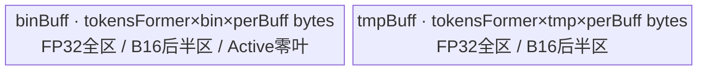

# MoeInitRoutingGrad A2/A3 ACLNN 算子知识

## 算子速览

| 项目 | 内容 |
|---|---|
| 实际入口 | CANN 9.1.0 公开两段式 `aclnnMoeInitRoutingV2GradGetWorkspaceSize` / `aclnnMoeInitRoutingV2Grad`。 |
| 计算语义 | `gradX[i,h]=Σ_t gradExpandedX[expandedRowIdx[i*K+t],h]`；Active越界槽和Drop-Pad的`-1`槽贡献0。 |
| 输入输出 | `gradExpandedX` FP16/BF16/FP32，`expandedRowIdx` INT32，输出`gradX:[N,H]`与输入浮点dtype相同，均为ND。 |
| 执行类型 | `AIV_VECTOR`；entry声明`KERNEL_TYPE_AIV_ONLY`并排除`g_coreType==AIC`。 |
| Kernel 路线 | R-001 Dropless-FP32；R-002 Dropless-B16；R-003 Active-FP32；R-004 Active-B16；R-005 DropPad-FP32；R-006 DropPad-B16。 |
| 核心资源 | GM、两个`TBuf<VECIN>`、Vector Duplicate/Cast/Add、MTE event；无TQue、无跨核归约，Kernel不使用workspace。 |
| 来源闭包 | `source_closed`：ACLNN→L0→Host/Tiling→POD→AIV entry→全部mode/dtype body/helper→A2/A3 config/CMake闭合。 |
| 验证状态 | 已完成源码闭包检查；本次知识提取未执行编译、真机、数值或性能测试。 |

## 接口与语义

### 计算语义

令 `K=topK`、`N=expandedRowIdx.shape[0]/K`、`r=expandedRowIdx[i*K+t]`，Device 实际循环为 `t∈[0,K)`。Dropless 直接 gather；Active 在 A2/A3 对 `r>=activeNum` 置零；Drop-Pad 对 `r==-1` 置零。Dropless/Active 输入按 `[N*K,H]`/`[activeNum,H]` 建址，Drop-Pad 的 `[E,C,H]` 展平成 `[E*C,H]`。FP16/BF16 先升 FP32 累加再 `CAST_RINT`，FP32 原类型累加；源码没有权重张量，公开“加权求和”在此为单位权重。每个输出 token 归属唯一 AIV 核，公开文档声明默认为确定性实现。

### 输入、输出与属性

| 参数 | shape/layout | dtype | 约束、默认值与语义 |
|---|---|---|---|
| `gradExpandedX` | Dropless `[N*K,H]`；Active `[A,H]`；Drop-Pad `[E,C,H]`，ND，可非连续 | FP16/BF16/FP32 | ACLNN先Contiguous；Drop-Pad必须3D。 |
| `expandedRowIdx` | `[N*K]`，ND，可非连续 | INT32 | 长度可被 K 整除；公开值域在 Drop-Pad 为 `[-1,E*C)`，其他场景为 `[0,N*K)`，除 `-1` 外要求唯一；Active body 对其中 `r>=A` 的槽贡献 0。 |
| `topK` | 属性 | INT64 | `K>0`。 |
| `dropPadMode` | 属性，默认0 | INT64 | 仅0/1；值1的选择优先于activeNum。 |
| `activeNum` | 属性，默认0 | INT64 | `>=0`；仅mode0且大于0时生效，输入dim0必须等于它。 |
| `out` | `[N,H]` ND | 与gradExpandedX一致 | L0按用户view分配连续临时输出，ACLNN以ViewCopy提交。 |
| `workspaceSize/executor/stream` | 两段式运行参数 | opaque | 第一段返回executor/总workspace；第二段在调用者stream执行。 |

### 入口与版本

固定范围仅有公开 V2Grad 版本族，因此逻辑算子 `MoeInitRoutingGrad` 在 CANN 9.1.0 的实际最新入口为 `aclnnMoeInitRoutingV2Grad`。公开 API 文档明确支持 A2、A3 和 950；本无后缀卡仅收录 A2/A3。OpDef 把 A2 `ascend910b`、A3 `ascend910_93` 都接到 `moe_init_routing_v2_grad`，两份 binary config 均列出 FP16/BF16/FP32，公开文档与实现接线无冲突。950 转 `moe_init_routing_v2_grad_apt` 与 RegBase POD/body，不混入本卡。

## Host/Launcher 执行流程

### 参数校验与前处理

第一段检查 workspace/executor 指针、创建 executor、检查三个 tensor 非空、非空 tensor dtype 合法且输入输出 dtype 相同；两输入分别 `Contiguous`。公开错误语义中，tensor 空指针返回 `ACLNN_ERR_PARAM_NULLPTR(161001)`，dtype 非法返回 `ACLNN_ERR_PARAM_INVALID(161002)`，属性/shape 在下游检查失败对外表现为 `ACLNN_ERR_INNER_NULLPTR(561103)`。L0 按 out shape/dtype 分配连续 ND `grad_x`，空输出不加入 launcher；非空时按两输入、一输出、`topK/dropPadMode/activeNum` 加入 AICore launcher，最后 `ViewCopy`。infer/tiling 继续检查 mode、K、activeNum、2D/3D/1D/2D 关系、正维规则、尾轴一致、`rowIdxLen%K==0` 及 `out.dim0=rowIdxLen/K`。

### 参数、Workspace 与生命周期

TilingPrepare读取AIV核数与UB字节数；非正即失败。A2/A3选择非RegBase模板，生成N/E/C/H/K、分核、H tile和二分buffer参数；PostTiling设置`blockDim=aivNum`并序列化POD。`GetWorkspaceSize`固定返回`16*1024*1024`字节，Kernel形参不读该地址；executor持有Contiguous、launcher、ViewCopy直到同stream完成，框架额外workspace切片固定仓不可见。

### 启动图与失败传播

```text
GetWorkspaceSize -> CheckParams -> Contiguous -> l0op::MoeInitRoutingV2Grad
  -> InferShape/TilingForMoeInitRoutingV2Grad -> PostTiling(blockDim,key,POD,16MiB)
  -> moe_init_routing_v2_grad -> Route::Init -> Route::Process -> ViewCopy
aclnnMoeInitRoutingV2Grad -> CommonOpExecutorRun(workspace,executor,stream)
```

| 顺序 | 节点 | Host 添加/启动点 | entry/blockDim/POD | 输入→输出 | workspace slice |
|---:|---|---|---|---|---|
| 1 | 输入连续化（框架边界） | 两次 `l0op::Contiguous` | 自动生成节点，固定仓不可见 | 两个用户 view→连续临时 tensor | 由 executor 规划，offset/extent 不可见 |
| 2 | `MoeInitRoutingV2Grad` | `ADD_TO_LAUNCHER_LIST_AICORE` | `moe_init_routing_v2_grad`；`blockDim=aivNum`；本卡 POD | 连续 `gradExpandedX/expandedRowIdx`→连续 `grad_x` | Tiling 预留 16 MiB；Device 不读 `workspace` |
| 3 | 输出提交（框架边界） | `l0op::ViewCopy` | 自动生成节点，固定仓不可见 | 连续 `grad_x`→用户 `out` view | 由 executor 规划，offset/extent 不可见 |

| 边 | producer/consumer | 交接介质 | ordering | owner/lifetime | 失败传播 |
|---|---|---|---|---|---|
| E-001 | Contiguous→算子 Kernel | executor 连续 GM tensor，shape/dtype 不变 | `CommonOpExecutorRun` 在同一 caller stream 按 executor 流程提交；具体 event 固定仓不可见 | executor 分配，至下游消费完有效 | Contiguous 返回空指针时 GetWorkspaceSize 直接失败，不加后续节点 |
| E-002 | 算子 Kernel→ViewCopy | 连续 GM `grad_x:[N,H]`，dtype 与输入一致 | 同 executor/同 stream 顺序，详细 event 为框架边界 | executor 持有至 ViewCopy 完成 | launcher 添加失败返回 `nullptr`，ACLNN 不再构造有效 ViewCopy 流程 |

空 `grad_x` 不添加算子 Kernel，因而不产生 Device 节点。非空时任一 Host 校验、分配、launcher 或 Tiling 失败都阻断后续节点并向 ACLNN 返回；AIC 核和 `blockIdx>=needCoreNum` 的 AIV 核无输出。未知 key 没有 fallback 且不写输出。

## Route 与参数设计

### 分核与资源计算

`P=ceil(N/aivNum)`，`need=ceil(N/P)`，`last=N-(need-1)*P`。dtype字节`s=4/2`，`coe=1/2`。若`K>=128`则`exp=6,bin=64,tmp=64`；否则`exp=max(floor(log2K)-1,0),bin=2^exp,tmp=1`。`perBuff=min(ceil32(H*s)*coe,65536,floor(UB/(bin+tmp)/(coe*32))*coe*32)`字节，`hTile=perBuff/4`，`hLoops=ceil(H/hTile)`。`tokenUB=perBuff*(bin+tmp)`，`tokensFormer=max(1,min(floor(UB/tokenUB),P))`，普通/尾核各自再求group loop及末group token数。Host启动全部aivNum，Device按need保护。

### Route 选择

| 顺序 | Route | Key/模板 | 精确选择条件与优先级 | 不适用去向 |
|---:|---|---|---|---|
| 1 | R-001 Dropless-FP32 | 1000 / `DroplessCompute<float>` | 非RegBase；mode=0、active=0、FP32 | B16或其他mode继续后续路线。 |
| 2 | R-002 Dropless-B16 | 1001/1002 / `DroplessCompute<half/bfloat16_t>` | 同mode，FP16/BF16 | Active或Drop-Pad继续后续路线。 |
| 3 | R-003 Active-FP32 | 1010 / `ActivateCompute<float>` | mode=0、active>0、FP32 | B16继续后续路线。 |
| 4 | R-004 Active-B16 | 1011/1012 / `ActivateCompute<half/bfloat16_t>` | mode=0、active>0、FP16/BF16 | Drop-Pad优先继续后续路线。 |
| 5 | R-005 DropPad-FP32 | 1100 / `PositionPad0Compute<float>` | mode=1、FP32，不看active值 | B16继续后续路线。 |
| 6 | R-006 DropPad-B16 | 1101/1102 / `PositionPad0Compute<half/bfloat16_t>` | mode=1、FP16/BF16 | 非法dtype/未知key失败或无输出。 |

```text
TilingRegistry 按 priority 数值升序尝试；A2/A3 的 priority=10000 模板 IsCapable=true 并终止后续尝试
非RegBase：key=1000；mode==1加100，否则activeNum>0加10；FP16加1，BF16加2，FP32加0
entry按1000,1001,1002,1010,1011,1012,1100,1101,1102顺序匹配
```

### 模板/实现执行矩阵

| Route | key/selector | dtype/shape/platform 完整命中条件 | 执行拓扑与 Kernel 节点 | 实际模板/body | 内存与同步特征 | tail/fallback |
|---|---|---|---|---|---|---|
| R-001 Dropless-FP32 | 1000 | A2/A3，`dropPadMode==0 && activeNum==0`，FP32 | 单 AIV Kernel | `MoeInitRoutingV2GradDroplessCompute<float>` | FP32 `binBuff/tmpBuff`；MTE/V event+树层 barrier | H 尾块只写 `tailCpyCols`；未知 key 无 fallback。 |
| R-002 Dropless-B16 | 1001/1002 | 同上，FP16/BF16 | 单 AIV Kernel | `MoeInitRoutingV2GradDroplessCompute<half/bfloat16_t>` | B16 搬入 slice 后半区，在同一 slice 升 FP32 累加 | H 尾块+`CAST_RINT`。 |
| R-003 Active-FP32 | 1010 | A2/A3，`dropPadMode==0 && activeNum>0`，FP32 | 单 AIV Kernel | `MoeInitRoutingV2GradActivateCompute<float>` | `r>=activeNum` 贡献 0；其余同 R-001 | 负索引无 Device guard。 |
| R-004 Active-B16 | 1011/1012 | 同上，FP16/BF16 | 单 AIV Kernel | `MoeInitRoutingV2GradActivateCompute<half/bfloat16_t>` | Active guard+B16/FP32 别名 slice | H 尾块+`CAST_RINT`。 |
| R-005 DropPad-FP32 | 1100 | A2/A3，`dropPadMode==1`，FP32；该分支优先于 `activeNum` | 单 AIV Kernel | `MoeInitRoutingV2GradPositionPad0Compute<float>` | `r==-1` 贡献 0；其余同 R-001 | 其他越界索引无 guard。 |
| R-006 DropPad-B16 | 1101/1102 | 同上，FP16/BF16 | 单 AIV Kernel | `MoeInitRoutingV2GradPositionPad0Compute<half/bfloat16_t>` | `-1` guard+B16/FP32 别名 slice | H 尾块+`CAST_RINT`。 |

### 隐藏性能 Guard

| Guard | Host/Tiling 条件 | Device/资源原因 | 影响 Route | 不满足时去向 | 源码符号 |
|---|---|---|---|---|---|
| 非 RegBase 平台 | `IsRegbaseSocVersion(context_) == false`；该 helper 仅将 `DAV_3510/DAV_5102` 视为 RegBase | A2/A3 才使用 1000 系列 POD 与两 TBuf body | 全部 | RegBase 继续尝试 priority 20000/30000/40000，不进本卡 | `MoeInitRoutingV2GradTilingBase::IsCapable`; `IsRegbaseSocVersion` |
| AIV/UB 必须可用 | `aivNum>0 && ubSize>0` | 需生成 blockDim 并容纳 `bin+tmp` TBuf | 全部 | TilingPrepare 失败 | `TilingPrepareForMoeInitRoutingV2Grad` |
| 单 slice 上限 | `perBuff=min(align32(H*s)*coe,65536,floor(UB/(bin+tmp)/(coe*32))*coe*32)` | `DataCopyPad` 块长和 UB 容量同时受限；B16 需容纳 FP32 目的区 | 全部 | 缩小 H tile；固定仓无另一 Kernel fallback | `TilingGradCompute` |
| 最小可用 slice（隐含前提） | `floor(UB/(bin+tmp)/(coe*32))>=1` | 否则 `perBuff=0`、`maxCopyElements=0`，后续 `CeilDiv(H,maxCopyElements)` 无定义 | 全部 | 固定仓无显式 IsCapable/fallback；必须由实际平台 UB 满足 | `TilingGradCompute` |
| K 分段 | `K>=128 ? (bin,tmp,exp)=(64,64,6) : (2^max(floor(log2K)-1,0),1,max(...))` | 限制二分叶子数，大 K 把多余项流式累加进 64 个叶子 | 全部 | 同 Route 内改变 TBuf 容量/循环，无 key 切换 | `TilingGradCompute`; `GradProcessTokenAccumulate` |
| B16 别名半区 | `coe=2; cpyOffset=perBuff/2` | B16 源只占后半区，Cast 目的 FP32 覆盖整 slice | R-002/004/006 | dtype 为 FP32 时 `cpyOffset=0`，不执行 Cast | `TilingGradCompute`; `ParseTilingData`; `CopyInWithCastFloat` |
| 有效核/组/尾 H | `blockIdx<needCoreNum`；末组用 tail token；末 H 循环用 `tailCpyCols` | 防止多余核、末组和 DMA/Vector 尾 lane 越界 | 全部 | 多余核 return；尾组/尾 H 用有效长度 | `ParseTilingData`; 各 `Process/TokenLoopProcess` |
| mode 索引域 | 公开值域：Dropless/Active 为 `[0,N*K)`，DropPad 为 `[-1,E*C)` | Device 分别无 guard、Active 仅有 `r>=A` 零贡献 guard、DropPad 只识别 `-1` | 各 mode | 无 fallback；负索引或 DropPad 其他越界值可 GM 越界 | 三个 `GradProcess/GradProcessTokenAccumulate` |

### POD/ABI

全部字段为`TILING_DATA_FIELD_DEF(int64_t,...)`，按声明顺序保存；宏实现来自外部CANN头，固定仓不可见实际sizeof/alignof/offsetof，不能硬编码偏移。

| 结构 | 字段 | 类型/位宽 | ABI 布局 | 单位 | Host/launcher producer | Device consumer | 边界 |
|---|---|---|---|---|---|---|---|
| `MoeInitRoutingV2GradTilingData` | `coreNum` | int64/64 | 序号0；offsetof固定仓不可见 | 核 | `set_coreNum(aivNum)` | body未读 | 正数。 |
| 同上 | `n` | int64/64 | 序号1；offsetof固定仓不可见 | token | `set_n(N)` | GM范围/地址 | `N>0`。 |
| 同上 | `e` | int64/64 | 序号2；offsetof固定仓不可见 | expert | mode1取dim0，否则0 | DropPad Init | mode1活跃。 |
| 同上 | `c` | int64/64 | 序号3；offsetof固定仓不可见 | row/expert | mode1取dim1，否则0 | DropPad Init | mode1活跃。 |
| 同上 | `cols` | int64/64 | 序号4；offsetof固定仓不可见 | 元素 | `set_cols(H)` | 所有body | `H>0`。 |
| 同上 | `k` | int64/64 | 序号5；offsetof固定仓不可见 | 槽/token | `set_k(K)` | 索引/归约 | `K>0`。 |
| 同上 | `activeNum` | int64/64 | 序号6；offsetof固定仓不可见 | 行 | `set_activeNum` | Active guard | `>=0`。 |
| `MoeV2GradComputeTilingData` | `needCoreNum` | int64/64 | 嵌套序号0；sizeof/alignof/offsetof固定仓不可见 | 核 | `ceil(N/P)` | Process guard | `<=aivNum`。 |
| 同上 | `perCoreElements` | int64/64 | 嵌套序号1；offsetof固定仓不可见 | token/核 | `ceil(N/aivNum)` | 核起点 | 正数。 |
| 同上 | `lastCoreElements` | int64/64 | 嵌套序号2；offsetof固定仓不可见 | token | `N-(need-1)P` | 尾核 | `1..P`。 |
| 同上 | `elementCopyLoops` | int64/64 | 嵌套序号3；offsetof固定仓不可见 | 次/token | `ceil(H/hTile)` | H循环 | 正数。 |
| 同上 | `elementPerCopyCols` | int64/64 | 嵌套序号4；offsetof固定仓不可见 | 元素 | `perBuff/4` | 搬运/Add count | UB与65536约束。 |
| 同上 | `elementLastCopyCols` | int64/64 | 嵌套序号5；offsetof固定仓不可见 | 元素 | 余数，0改hTile | H尾块 | `1..hTile`。 |
| 同上 | `binaryAddBufferNum` | int64/64 | 嵌套序号6；offsetof固定仓不可见 | buffer/token | K公式 | TBuf/tree | 1..64幂。 |
| 同上 | `tmpBufferNum` | int64/64 | 嵌套序号7；offsetof固定仓不可见 | buffer/token | K公式 | tmp offset | 1或64。 |
| 同上 | `exponentOfBinary` | int64/64 | 嵌套序号8；offsetof固定仓不可见 | 层 | K公式 | tree循环 | 0..6。 |
| 同上 | `copyBufferSize` | int64/64 | 嵌套序号9；offsetof固定仓不可见 | 字节 | UB公式 | 每slice容量 | `coe*32`对齐。 |
| 同上 | `tokensFormer` | int64/64 | 嵌套序号10；offsetof固定仓不可见 | token/group | UB/tokenUB | group容量 | `1..P`。 |
| 同上 | `perCoreTokensLoop` | int64/64 | 嵌套序号11；offsetof固定仓不可见 | group | `ceil(P/tokensFormer)` | 普通核循环 | 正数。 |
| 同上 | `perCoreTailTokensFormer` | int64/64 | 嵌套序号12；offsetof固定仓不可见 | token | P余数，0改满 | 普通末group | 1..tokensFormer。 |
| 同上 | `lastCoreTokensLoop` | int64/64 | 嵌套序号13；offsetof固定仓不可见 | group | `ceil(last/tokensFormer)` | 尾核循环 | 正数。 |
| 同上 | `lastCoreTailTokensFormer` | int64/64 | 嵌套序号14；offsetof固定仓不可见 | token | last余数，0改满 | 尾末group | 1..tokensFormer。 |

### Route 源码闭包

| Route | Key/selector | Host/Tiling producer | POD/参数 | Kernel entry/router | Kernel body/直接依赖 | 构建接线 |
|---|---|---|---|---|---|---|
| R-001 Dropless-FP32 | 1000 | registry priority10000→`TilingBaseClass::DoTiling`→`TilingGradCompute/GetTilingKey` | 公共 POD，`coe=1` | `moe_init_routing_v2_grad` | `DroplessCompute<float>`+base helper | root/op_host CMake+A2/A3 config |
| R-002 Dropless-B16 | 1001/1002 | 同上，`coe=2` | 公共 POD，`cpyOffset` | 同 entry | `DroplessCompute<B16>`+base helper | 同上 |
| R-003 Active-FP32 | 1010 | 同 registry/base流程→mode/active producer | `activeNum` | 同 entry | `ActivateCompute<float>`+base helper | 同上 |
| R-004 Active-B16 | 1011/1012 | 同上+ B16 producer | `activeNum/cpyOffset` | 同 entry | `ActivateCompute<B16>`+base helper | 同上 |
| R-005 DropPad-FP32 | 1100 | 同 registry/base流程→mode1 producer | `e/c` | 同 entry | `PositionPad0Compute<float>`+base helper | 同上 |
| R-006 DropPad-B16 | 1101/1102 | 同上+ B16 producer | `e/c/cpyOffset` | 同 entry | `PositionPad0Compute<B16>`+base helper | 同上 |

## Kernel 实现

### 公共执行流程

entry 构造 `TPipe`，按 key 调用单个 `Init→Process` 并 `Destroy`。每核按 token group 复用 `binBuff/tmpBuff` 两个 `TBuf<VECIN>`：group 先 `Duplicate` 清零；每 token 按 H tile，用标量 GM 读索引，`DataCopyPad` gather，FP32 二分 `Add`，必要时 cast，最后写有效 H 前缀。`TQue`、RegTensor、dynamic UB、Atomic、跨核同步与通信 window 均为 N/A；实际替代路径是两个 TBuf 加 MTE/V event，Kernel 无 workspace 数据流。编译器寄存器占用固定仓不可见。

### Route R-001：Dropless-FP32

#### 适用条件

##### 选择证据

| 层级 | 文件 | 符号 | 源码谓词/参数 | 结果/下一跳 |
|---|---|---|---|---|
| Tiling | moe/moe_init_routing_v2_grad/op_host/moe_init_routing_v2_grad_tiling.cpp | `GetTilingKey` | mode0、active0、FP32 | 1000。 |
| Router | moe/moe_init_routing_v2_grad/op_kernel/moe_init_routing_v2_grad.cpp | `moe_init_routing_v2_grad` | AIV且key1000 | Dropless FP32实例。 |

#### Device 数据流

##### 函数级调用链

```text
entry -> DroplessCompute<float>::Init/Process -> TokenLoopProcess -> GradProcess
  -> GradProcessTokenAccumulate -> BinaryAddWithMovIn/GradAdd -> CopyOut
```

##### 源码等价伪码

```text
伪码：if blockIdx>=need return；start=blockIdx*P
for group：清零TBuf；for token；for hLoop计算colOffset/colsNow
  for K的偶数槽搬入bin并循环累加；for奇数槽累加；for exp层执行bin[a]+=bin[b]
  写GM[token*H+colOffset]的colsNow个FP32元素
```

#### 内存与数据搬运

##### 资源与搬运表

| 层级/缓冲区 | offset/地址公式 | extent/容量公式 | dtype/layout | producer | consumer | owner/lifetime | 对齐/复用 |
|---|---|---|---|---|---|---|---|
| GM | input=`r*H+colOffset`；index=`i*K+t`；out=`i*H+colOffset` | `N*K*H`,`N*K`,`N*H` | FP32/INT32 | caller | CopyIn/Out | executor | blockLen=colsNow*4。 |
| bin TBuf | `elementLoop*bin*perBuff+binIdx*perBuff` | `tokensFormer*bin*perBuff` bytes | FP32 | CopyIn/Add | tree/CopyOut | group | 无TQue；group barrier后复用。 |
| tmp TBuf | `elementLoop*tmp*perBuff+(multi?binIdx:0)*perBuff` | `tokensFormer*tmp*perBuff` | FP32 | CopyIn | Add | group | event保护复用。 |
| workspace | N/A | 16MiB预留 | opaque | Host | N/A | executor | Kernel不读。 |

##### 分层内存布局


##### 字节账与复用顺序

```text
bin_bytes = tokensFormer * binBufferNum * perBuff
tmp_bytes = tokensFormer * tmpBufferNum * perBuff
UB_total = tokensFormer * perBuff * (binBufferNum + tmpBufferNum) <= ubSize
dynamic_ub = N/A
operator_workspace = 16 * 1024 * 1024 bytes（Host预留，Kernel不读）
ACLNN_workspace_total = operator_workspace + Contiguous/ViewCopy 等 executor 切片（外部框架公式固定仓不可见）
```

| 复用子区 | 写入者 | 读取者/消费点 | 下一次覆盖 | 同步或释放依据 | 安全条件 |
|---|---|---|---|---|---|
| 每 token 的 `binIdx*perBuff` | `CopyInWithCastFloat`/`GradAdd` | 二分树与 `CopyOut` | 下一 token group 的 `Duplicate` | `MTE2_V`、`V_S`、`PIPE_V`、写回 MTE3 events | 只在本 group 所有 token/H tile 完成后重置。 |
| 每 token 的 tmp slice | `CopyIn` | `GradAdd` | 下一个流式加数 | `V_MTE2` 允许 MTE2 覆盖，`MTE2_V` 后才 Add | 新搬入不得早于上次 Vector 消费。 |

#### 同步、精度与尾块

##### 同步与数值边界表

| 阶段 | primitive/机制 | producer | consumer/等待点 | 保护对象 | 精度/尾块 |
|---|---|---|---|---|---|
| 初始化/归约 | Duplicate、PIPE_V、MTE2_V、V_MTE2 | 清零/MTE2/Add | 下一Add/搬运 | 两TBuf slice | FP32 count=colsNow。 |
| 输出 | V_MTE3及MTE3_MTE2/MTE3_V/MTE3_S | tree结果 | MTE3/复用 | bin/GM | 无cast；末块tailCpyCols。 |

#### 关键实现

##### 符号证据表

| 阶段 | 文件 | 符号/模板实例 | 实现事实 |
|---|---|---|---|
| Host producer | moe/moe_init_routing_v2_grad/op_host/moe_init_routing_v2_grad_tiling.cpp | `TilingSplitCore/TilingGradCompute` | 核、UB、tail、key。 |
| Kernel entry | moe/moe_init_routing_v2_grad/op_kernel/moe_init_routing_v2_grad.cpp | entry/key1000 | AIV映射。 |
| Device body | moe/moe_init_routing_v2_grad/op_kernel/moe_init_routing_v2_grad_with_dropless.h | `Process/GradProcess` | group/H/K/tree循环。 |
| Device body/helper | moe/moe_init_routing_v2_grad/op_kernel/moe_init_routing_v2_grad_base.h | `BinaryAddWithMovIn/CopyOut` | 搬运/同步。 |

### Route R-002：Dropless-B16

#### 适用条件

##### 选择证据

| 层级 | 文件 | 符号 | 源码谓词/参数 | 结果/下一跳 |
|---|---|---|---|---|
| Tiling | moe/moe_init_routing_v2_grad/op_host/moe_init_routing_v2_grad_tiling.cpp | `GetTilingKey` | Dropless且FP16/BF16 | 1001/1002。 |
| Router | moe/moe_init_routing_v2_grad/op_kernel/moe_init_routing_v2_grad.cpp | entry | key1001/1002 | Dropless B16实例。 |

#### Device 数据流

##### 函数级调用链

```text
entry -> DroplessCompute<half/bfloat16_t>::Process -> GradProcess
  -> CopyInWithCastFloat -> GradAdd(float) -> CopyOut<T>
```

##### 源码等价伪码

```text
伪码：按block/group/token/H/K计算同R-001的offset
B16搬到slice+perBuff/2，等待MTE2_V后cast FP32；树形Add
if末H块使用tailCpyCols；CAST_RINT回T并写output offset
```

#### 内存与数据搬运

##### 资源与搬运表

| 层级/缓冲区 | offset/地址公式 | extent/容量公式 | dtype/layout | producer | consumer | owner/lifetime | 对齐/复用 |
|---|---|---|---|---|---|---|---|
| GM | 同R-001 offset | input/output元素*2，index*4 bytes | FP16/BF16 | caller | MTE | executor | blockLen=colsNow*2。 |
| bin TBuf | slice base；B16源`+perBuff/2` | tokensFormer*bin*perBuff | FP32+B16原位 | MTE/Cast | Add | group | perBuff为64B粒度。 |
| tmp TBuf | tmp base；B16源/目的`+perBuff/2` | tokensFormer*tmp*perBuff | FP32+B16 | MTE/Cast | Add/输出 | group | event后复用，无TQue。 |

##### 分层内存布局


##### 字节账与复用顺序

```text
perBuff % 64 == 0; cpyOffset = perBuff / 2
bin_bytes = tokensFormer * bin * perBuff
tmp_bytes = tokensFormer * tmp * perBuff
UB_total = tokensFormer * perBuff * (bin + tmp) <= ubSize
dynamic_ub = N/A
operator_workspace = 16 MiB（Kernel不读）
ACLNN_workspace_total = operator_workspace + executor 框架切片（固定仓不可见）
```

| 复用子区 | 写入者 | 读取者/消费点 | 下一次覆盖 | 同步或释放依据 | 安全条件 |
|---|---|---|---|---|---|
| bin slice 后半区 | `DataCopyPad` 写 B16 | `Cast` 读 B16 并向同 slice 写 FP32 | 二分 Add/下一 group | `MTE2_V` 后 Cast，`PIPE_V` 后 Add | `perBuff` 按 `coe=2` 留足 FP32 目的区。 |
| tmp slice | 流式 B16→FP32 或 FP32→B16 | `GradAdd` 或 MTE3 | 下一流式项/输出 | `V_MTE2`、`MTE2_V`、`V_MTE3` 及 MTE3 后续 event | 写回完成前不得重用。 |

#### 同步、精度与尾块

##### 同步与数值边界表

| 阶段 | primitive/机制 | producer | consumer/等待点 | 保护对象 | 精度/尾块 |
|---|---|---|---|---|---|
| 输入/累加 | MTE2_V、Cast、PIPE_V | B16搬入 | FP32 Add | 原位slice | CAST_NONE，count=colsNow。 |
| 输出 | PIPE_V、CAST_RINT、V_MTE3 | FP32 tree | GM | tmp/GM | 仅写tail有效前缀。 |

#### 关键实现

##### 符号证据表

| 阶段 | 文件 | 符号/模板实例 | 实现事实 |
|---|---|---|---|
| Host producer | moe/moe_init_routing_v2_grad/op_host/moe_init_routing_v2_grad_tiling.cpp | `TilingGradCompute` | coe2/cpy布局。 |
| Kernel entry | moe/moe_init_routing_v2_grad/op_kernel/moe_init_routing_v2_grad.cpp | key1001/1002 | B16实例。 |
| Device body | moe/moe_init_routing_v2_grad/op_kernel/moe_init_routing_v2_grad_with_dropless.h | `GradProcess` | B16模板tree。 |
| Device body/helper | moe/moe_init_routing_v2_grad/op_kernel/moe_init_routing_v2_grad_base.h | `ParseTilingData/CopyInWithCastFloat/CopyOut` | cpyOffset、cast、RINT。 |

### Route R-003：Active-FP32

#### 适用条件

##### 选择证据

| 层级 | 文件 | 符号 | 源码谓词/参数 | 结果/下一跳 |
|---|---|---|---|---|
| Tiling | moe/moe_init_routing_v2_grad/op_host/moe_init_routing_v2_grad_tiling.cpp | `GetTilingKey` | mode0、active>0、FP32 | 1010。 |
| Router | moe/moe_init_routing_v2_grad/op_kernel/moe_init_routing_v2_grad.cpp | entry | key1010 | Activate FP32实例。 |

#### Device 数据流

##### 函数级调用链

```text
entry -> ActivateCompute<float>::Init/Process -> GradProcess
  -> GradProcessTokenAccumulate -> BinaryAddWithMovIn -> CopyOut
```

##### 源码等价伪码

```text
伪码：for block/group/token/H/K；r=index[i*K+t]
if r>=activeNum：初始bin Duplicate 0，后续槽跳过；else搬GM[r*H+colOffset]
FP32二分Add后写GM[i*H+colOffset]有效colsNow
```

#### 内存与数据搬运

##### 资源与搬运表

| 层级/缓冲区 | offset/地址公式 | extent/容量公式 | dtype/layout | producer | consumer | owner/lifetime | 对齐/复用 |
|---|---|---|---|---|---|---|---|
| GM | valid input=`r*H+colOffset`；index/out同前 | `activeNum*H`,`N*K`,`N*H` | FP32/INT32 | caller | guard/MTE | executor | body未检查负索引。 |
| bin TBuf | 同R-001 | tokensFormer*bin*perBuff | FP32 | CopyIn或Duplicate | tree | group | V_MTE2保护。 |
| tmp TBuf | 同R-001 | tokensFormer*tmp*perBuff | FP32 | valid CopyIn | Add | group | 无效后续槽跳过。 |

##### 分层内存布局


##### 字节账与复用顺序

```text
UB_total = tokensFormer * perBuff * (bin + tmp) <= ubSize
dynamic_ub = N/A
operator_workspace = 16 MiB（Kernel不读）
ACLNN_workspace_total = operator_workspace + executor 框架切片（固定仓不可见）
```

| 复用子区 | 写入者 | 读取者/消费点 | 下一次覆盖 | 同步或释放依据 | 安全条件 |
|---|---|---|---|---|---|
| bin slice | `CopyInWithCastFloat` 或越界分支 `Duplicate(0)` | 二分 Add/CopyOut | 下一 group | 越界分支 `V_MTE2+PIPE_V`；有效分支 `MTE2_V` | `r>=activeNum` 只能变为零叶子，不能发起 GM 读。 |
| tmp slice | 有效槽搬入 | `GradAdd` | 下一有效槽 | `V_MTE2/MTE2_V` | 越界槽直接 continue，不消费 tmp。 |

#### 同步、精度与尾块

##### 同步与数值边界表

| 阶段 | primitive/机制 | producer | consumer/等待点 | 保护对象 | 精度/尾块 |
|---|---|---|---|---|---|
| guard | Duplicate+V_MTE2+PIPE_V | r>=activeNum置0 | tree/MTE | bin slice | 负r依赖接口约束。 |
| 归约/尾块 | MTE events+PIPE_V | valid搬入/Add | CopyOut | TBuf/GM | FP32；colsNow末轮为tail。 |

#### 关键实现

##### 符号证据表

| 阶段 | 文件 | 符号/模板实例 | 实现事实 |
|---|---|---|---|
| Host producer | moe/moe_init_routing_v2_grad/op_host/moe_init_routing_v2_grad_tiling_base.cpp | `CheckParamsValidity` | active shape校验。 |
| Kernel entry | moe/moe_init_routing_v2_grad/op_kernel/moe_init_routing_v2_grad.cpp | key1010 | Active映射。 |
| Device body | moe/moe_init_routing_v2_grad/op_kernel/moe_init_routing_v2_grad_with_activate.h | `Init/GradProcess` | extent与guard。 |
| Device body/helper | moe/moe_init_routing_v2_grad/op_kernel/moe_init_routing_v2_grad_base.h | `GradAdd/CopyOut` | FP32计算。 |

### Route R-004：Active-B16

#### 适用条件

##### 选择证据

| 层级 | 文件 | 符号 | 源码谓词/参数 | 结果/下一跳 |
|---|---|---|---|---|
| Tiling | moe/moe_init_routing_v2_grad/op_host/moe_init_routing_v2_grad_tiling.cpp | `GetTilingKey` | Active、FP16/BF16 | 1011/1012。 |
| Router | moe/moe_init_routing_v2_grad/op_kernel/moe_init_routing_v2_grad.cpp | entry | key1011/1012 | Activate B16实例。 |

#### Device 数据流

##### 函数级调用链

```text
entry -> ActivateCompute<B16>::Process -> GradProcess
  -> CopyInWithCastFloat或Duplicate -> GradAdd(float) -> CopyOut<T>
```

##### 源码等价伪码

```text
伪码：计算block/group/token/H/K offset；if r>=activeNum则贡献0
else B16搬到slice+perBuff/2并cast FP32；FP32 tree Add
末块用tailCpyCols，CAST_RINT回原B16并写GM
```

#### 内存与数据搬运

##### 资源与搬运表

| 层级/缓冲区 | offset/地址公式 | extent/容量公式 | dtype/layout | producer | consumer | owner/lifetime | 对齐/复用 |
|---|---|---|---|---|---|---|---|
| GM | `r*H+colOffset`,`i*K+t`,`i*H+colOffset` | activeNum*H*T等 | B16/INT32 | caller | guard/MTE | executor | r须非负。 |
| bin TBuf | slice+B16半区 | tokensFormer*bin*perBuff | FP32+B16 | MTE/Cast/0 | tree | group | 64B粒度，无TQue。 |
| tmp TBuf | tmp+B16半区 | tokensFormer*tmp*perBuff | FP32+B16 | MTE/Cast | Add/输出 | group | event保护。 |

##### 分层内存布局



##### 字节账与复用顺序

```text
cpyOffset = perBuff / 2
UB_total = tokensFormer * perBuff * (bin + tmp) <= ubSize
dynamic_ub = N/A
operator_workspace = 16 MiB（Kernel不读）
ACLNN_workspace_total = operator_workspace + executor 框架切片（固定仓不可见）
```

| 复用子区 | 写入者 | 读取者/消费点 | 下一次覆盖 | 同步或释放依据 | 安全条件 |
|---|---|---|---|---|---|
| bin 后半/全 slice | 有效 r 的 B16 DataCopy→FP32 Cast，或越界 r 的 FP32 零化 | tree Add/CopyOut | 下一 group | `MTE2_V`、`V_MTE2`、`PIPE_V` | guard 必须先于任何 GM 建址。 |
| tmp 后半/全 slice | B16→FP32 流式搬入，或 FP32→B16 输出 Cast | Add/MTE3 | 下一有效槽/下一输出 | `V_MTE2/MTE2_V/V_MTE3` 和 MTE3 events | 上一阶段消费完后才覆盖。 |

#### 同步、精度与尾块

##### 同步与数值边界表

| 阶段 | primitive/机制 | producer | consumer/等待点 | 保护对象 | 精度/尾块 |
|---|---|---|---|---|---|
| guard/cast | V_MTE2或MTE2_V、Cast | 0或B16搬入 | Add | slice | 有效值升FP32。 |
| 输出/tail | PIPE_V、CAST_RINT、V_MTE3 | FP32 tree | GM | tmp/GM | 只写colsNow。 |

#### 关键实现

##### 符号证据表

| 阶段 | 文件 | 符号/模板实例 | 实现事实 |
|---|---|---|---|
| Host producer | moe/moe_init_routing_v2_grad/op_host/moe_init_routing_v2_grad_tiling.cpp | `GetTilingKey/TilingGradCompute` | Active B16资源/key。 |
| Kernel entry | moe/moe_init_routing_v2_grad/op_kernel/moe_init_routing_v2_grad.cpp | key1011/1012 | B16映射。 |
| Device body | moe/moe_init_routing_v2_grad/op_kernel/moe_init_routing_v2_grad_with_activate.h | `GradProcess/Process` | guard和循环。 |
| Device body/helper | moe/moe_init_routing_v2_grad/op_kernel/moe_init_routing_v2_grad_base.h | `CopyInWithCastFloat/CopyOut` | cast/event。 |

### Route R-005：DropPad-FP32

#### 适用条件

##### 选择证据

| 层级 | 文件 | 符号 | 源码谓词/参数 | 结果/下一跳 |
|---|---|---|---|---|
| Tiling | moe/moe_init_routing_v2_grad/op_host/moe_init_routing_v2_grad_tiling.cpp | `GetTilingKey` | mode1、FP32 | 1100。 |
| Router | moe/moe_init_routing_v2_grad/op_kernel/moe_init_routing_v2_grad.cpp | entry | key1100 | PositionPad0 FP32实例。 |

#### Device 数据流

##### 函数级调用链

```text
entry -> PositionPad0Compute<float>::Init/Process -> GradProcess
  -> GradProcessTokenAccumulate -> BinaryAddWithMovIn -> CopyOut
```

##### 源码等价伪码

```text
伪码：input展平[E*C,H]；for block/group/token/H/K读取r
if r==-1：初始bin置0、后续槽跳过；else搬GM[r*H+colOffset]
FP32 tree Add；写output token offset的有效colsNow
```

#### 内存与数据搬运

##### 资源与搬运表

| 层级/缓冲区 | offset/地址公式 | extent/容量公式 | dtype/layout | producer | consumer | owner/lifetime | 对齐/复用 |
|---|---|---|---|---|---|---|---|
| GM | valid input=`r*H+colOffset` | E*C*H、N*K、N*H | FP32/INT32 | caller | sentinel/MTE | executor | 仅精确-1受保护。 |
| bin TBuf | 同R-001 | tokensFormer*bin*perBuff | FP32 | CopyIn/0 | tree | group | barrier复用。 |
| tmp TBuf | 同R-001 | tokensFormer*tmp*perBuff | FP32 | valid搬入 | Add | group | -1跳过，无TQue。 |

##### 分层内存布局


##### 字节账与复用顺序

```text
UB_total = tokensFormer * perBuff * (bin + tmp) <= ubSize
dynamic_ub = N/A
operator_workspace = 16 MiB（Kernel不读）
ACLNN_workspace_total = operator_workspace + executor 框架切片（固定仓不可见）
```

| 复用子区 | 写入者 | 读取者/消费点 | 下一次覆盖 | 同步或释放依据 | 安全条件 |
|---|---|---|---|---|---|
| bin slice | 有效 r 的 CopyIn 或 `r==-1` 的 Duplicate | tree Add/CopyOut | 下一 group | `MTE2_V`或`V_MTE2+PIPE_V` | `-1` 分支不能触发 GM 读。 |
| tmp slice | 有效 r 搬入 | `GradAdd` | 下一有效槽 | `V_MTE2/MTE2_V` | `-1` 槽 continue，不消费 tmp。 |

#### 同步、精度与尾块

##### 同步与数值边界表

| 阶段 | primitive/机制 | producer | consumer/等待点 | 保护对象 | 精度/尾块 |
|---|---|---|---|---|---|
| sentinel | Duplicate+V_MTE2+PIPE_V | -1置0 | tree | bin | 其他非法索引无guard。 |
| 归约/写回 | MTE/V events | CopyIn/Add | GM | TBuf/GM | FP32，末H块tail。 |

#### 关键实现

##### 符号证据表

| 阶段 | 文件 | 符号/模板实例 | 实现事实 |
|---|---|---|---|
| Host producer | moe/moe_init_routing_v2_grad/op_host/moe_init_routing_v2_grad_tiling_base.cpp | `GetShapeAttrsInfo` | E/C/H与3D校验。 |
| Kernel entry | moe/moe_init_routing_v2_grad/op_kernel/moe_init_routing_v2_grad.cpp | key1100 | DropPad映射。 |
| Device body | moe/moe_init_routing_v2_grad/op_kernel/moe_init_routing_v2_grad_with_pos_drop_and_pad_zero.h | `Init/GradProcess` | E*C extent和-1。 |
| Device body/helper | moe/moe_init_routing_v2_grad/op_kernel/moe_init_routing_v2_grad_base.h | `BinaryAddWithMovIn/CopyOut` | 搬运/写回。 |

### Route R-006：DropPad-B16

#### 适用条件

##### 选择证据

| 层级 | 文件 | 符号 | 源码谓词/参数 | 结果/下一跳 |
|---|---|---|---|---|
| Tiling | moe/moe_init_routing_v2_grad/op_host/moe_init_routing_v2_grad_tiling.cpp | `GetTilingKey` | mode1、FP16/BF16 | 1101/1102。 |
| Router | moe/moe_init_routing_v2_grad/op_kernel/moe_init_routing_v2_grad.cpp | entry | key1101/1102 | PositionPad0 B16实例。 |

#### Device 数据流

##### 函数级调用链

```text
entry -> PositionPad0Compute<B16>::Process -> GradProcess
  -> CopyInWithCastFloat或Duplicate -> GradAdd(float) -> CopyOut<T>
```

##### 源码等价伪码

```text
伪码：for block/group/token/H/K；if r==-1贡献0
else从展平GM行搬B16到半区并cast FP32；执行tree Add
if末H块用tail；CAST_RINT回T后按i*H+colOffset写GM
```

#### 内存与数据搬运

##### 资源与搬运表

| 层级/缓冲区 | offset/地址公式 | extent/容量公式 | dtype/layout | producer | consumer | owner/lifetime | 对齐/复用 |
|---|---|---|---|---|---|---|---|
| GM | `r*H+colOffset`,`i*K+t`,`i*H+colOffset` | E*C*H*T等 | B16/INT32 | caller | sentinel/MTE | executor | 仅-1受保护。 |
| bin TBuf | slice+B16半区 | tokensFormer*bin*perBuff | FP32+B16 | MTE/Cast/0 | tree | group | 64B粒度。 |
| tmp TBuf | tmp+B16半区 | tokensFormer*tmp*perBuff | FP32+B16 | MTE/Cast | Add/输出 | group | event保护，无TQue。 |

##### 分层内存布局


##### 字节账与复用顺序

```text
cpyOffset = perBuff / 2
UB_total = tokensFormer * perBuff * (bin + tmp) <= ubSize
dynamic_ub = N/A
operator_workspace = 16 MiB（Kernel不读）
ACLNN_workspace_total = operator_workspace + executor 框架切片（固定仓不可见）
```

| 复用子区 | 写入者 | 读取者/消费点 | 下一次覆盖 | 同步或释放依据 | 安全条件 |
|---|---|---|---|---|---|
| bin 后半/全 slice | 有效 r 的 B16 DataCopy→FP32 Cast，或 `-1` 的 FP32 零化 | tree Add/CopyOut | 下一 group | `MTE2_V`、`V_MTE2`、`PIPE_V` | 只有精确 `-1` 进入零分支。 |
| tmp 后半/全 slice | 流式 B16→FP32 或输出 FP32→B16 | Add/MTE3 | 下一有效槽/输出 | `V_MTE2/MTE2_V/V_MTE3` 和 MTE3 events | 当前读取/写回完成后才覆盖。 |

#### 同步、精度与尾块

##### 同步与数值边界表

| 阶段 | primitive/机制 | producer | consumer/等待点 | 保护对象 | 精度/尾块 |
|---|---|---|---|---|---|
| 输入 | V_MTE2或MTE2_V+Cast | -1置0或B16搬入 | Add | slice | B16升FP32。 |
| 输出 | PIPE_V+CAST_RINT+V_MTE3 | tree | GM | tmp/GM | colsNow末轮为tail。 |

#### 关键实现

##### 符号证据表

| 阶段 | 文件 | 符号/模板实例 | 实现事实 |
|---|---|---|---|
| Host producer | moe/moe_init_routing_v2_grad/op_host/moe_init_routing_v2_grad_tiling.cpp | `GetTilingKey/TilingGradCompute` | mode1/B16 key和布局。 |
| Kernel entry | moe/moe_init_routing_v2_grad/op_kernel/moe_init_routing_v2_grad.cpp | key1101/1102 | B16映射。 |
| Device body | moe/moe_init_routing_v2_grad/op_kernel/moe_init_routing_v2_grad_with_pos_drop_and_pad_zero.h | `GradProcess/Process` | sentinel/tree。 |
| Device body/helper | moe/moe_init_routing_v2_grad/op_kernel/moe_init_routing_v2_grad_base.h | `CopyInWithCastFloat/CopyOut` | FP32/RINT/event。 |

## 算子特定优化

### Trick T-001：按 K 选择二分叶子数并封顶 64

#### 触发与源码依据

- 适用 Route：R-001–R-006。
- 触发条件：`K>=128` 固定 `exp=6,bin=64,tmp=64`；否则 `exp=max(floor(log2(K))-1,0),bin=2^exp,tmp=1`。
- Golden 来源：[`moe_init_routing_v2_grad_tiling.cpp:175-182`](../../../../../../../cann-ops-raw/ascendc/ops-transformer/be33d95bb755cedec3108f70805c1874d1792540/moe/moe_init_routing_v2_grad/op_host/moe_init_routing_v2_grad_tiling.cpp#L175-L182)

**官方源码（固定 Commit 连续逐字摘录）**：

```cpp
int64_t K = moeInitRoutingV2GradTilingData.get_k();
int64_t exponentOfBinary = (K >= BOUND_K_FOR_BINARY) ? MAX_EXPONENT_OF_BINARY : static_cast<int64_t>(std::floor(std::log2(K)) - 1);
exponentOfBinary = (exponentOfBinary < 0) ? 0 : exponentOfBinary;
int64_t binaryAddBuffNum =
    (K >= BOUND_K_FOR_BINARY) ? MAX_BINARY_ADD_BUFFER_CNT : static_cast<int64_t>(std::pow(2, exponentOfBinary)); //  2^exp

// 根据K大小，选择tmpBuffer数量
int64_t tmpBuffNum = (K >= BOUND_K_FOR_BINARY) ? binaryAddBuffNum : 1;
```

#### 机制与设计原因

Host 用 K 直接生产 `binaryAddBufferNum/tmpBufferNum/exponentOfBinary`。Device 先将偶数位槽分散到 `bin` 叶子，多余项通过 `GradProcessTokenAccumulate` 流式累加，再按 `stride=1,2,4...` 二分 Add。小 K 不会固定预留 64 个叶子；大 K 封顶 64 防止 TBuf 随 K 无界增长，超出叶子数的项改为流式累加。这是源码可证的调度/内存折中，不代表已实测性能收益。

#### 迁移边界

- 适用：每个输出行对 K 个 gather 行做独立求和。
- 前提：A2/A3 AIV，FP32 累加，UB 可容纳 `tokensFormer*perBuff*(bin+tmp)`。
- 失效：不足以容纳至少一 token 时固定仓无另一 Kernel fallback；950 使用独立 RegBase 实现。
- 未验证：本次知识提取未执行编译、真机、数值或性能测试。

#### 错误做法

固定仓未提供可验证反例；不能在保留同一 POD 的情况下任意改变 `bin/tmp/exp` 三者关系，否则 Device 的 slice 索引与二分循环不再匹配 Host 分配。

### Trick T-002：B16 源与 FP32 目的复用同一 TBuf slice

#### 触发与源码依据

- 适用 Route：R-002、R-004、R-006。
- 触发条件：`T` 为 FP16/BF16，Host 设 `coe=2`，Device 设 `cpyOffset=perBuff/2`。
- Golden 来源：[`moe_init_routing_v2_grad_with_dropless.h:111-117`](../../../../../../../cann-ops-raw/ascendc/ops-transformer/be33d95bb755cedec3108f70805c1874d1792540/moe/moe_init_routing_v2_grad/op_kernel/moe_init_routing_v2_grad_with_dropless.h#L111-L117)

**官方源码（固定 Commit 连续逐字摘录）**：

```cpp
int64_t binBuffOffset = tokenBinBuffSizeOffset + this->perBuffSize * binIdx;
LocalTensor<float> xLocal = this->binBuff.template GetWithOffset<float>(this->perCpyCols, binBuffOffset);
LocalTensor<T> xLocalT =
    this->binBuff.template GetWithOffset<T>(this->perCpyCols, binBuffOffset + this->cpyOffset);
this->CopyInWithCastFloat((int64_t)xRow, xLocal, xLocalT, colOffset, cpyCols);
SetFlag<HardEvent::MTE2_V>(eventMte2V);
WaitFlag<HardEvent::MTE2_V>(eventMte2V);
```

#### 机制与设计原因

`xLocal` 以 FP32 视图覆盖整个 `perBuff`，`xLocalT` 以 B16 视图从后半区开始；B16 的 `perCpyCols=perBuff/4` 个元素恰好占 `perBuff/2` 字节。`DataCopyPad` 先写后半区，`MTE2_V` 后 `Cast(...,CAST_NONE,cpyCols)` 在同 slice 生成 FP32，输出则 `CAST_RINT` 回 tmp slice 后半区。因此无需为 B16 原始值再分配一个 TBuf；同步顺序是别名安全的一部分。

#### 迁移边界

- 适用：B16 搬入后立即升 FP32，且后续不再需要原 B16 值的 Vector 管线。
- 前提：`perBuff` 按 `coe*32=64` 字节对齐，B16 长度与 FP32 目的长度均为 `perCpyCols`，并保留 MTE/V event。
- 失效：FP32 Route 不执行该 Cast；若后续仍需 B16 原值，不能使用这种覆盖式别名。
- 未验证：本次知识提取未执行编译、真机、数值或性能测试。

#### 错误做法

固定仓未提供可验证反例；删除 `MTE2_V`/`V_MTE3` 依赖或把 `cpyOffset` 改为与 `coe=2` 不一致的位置，会破坏源/目的生命期与 slice 边界。

## 模板与实现对比

| 对比维度 | R-001 Dropless-FP32 | R-002 Dropless-B16 | R-003 Active-FP32 | R-004 Active-B16 | R-005 DropPad-FP32 | R-006 DropPad-B16 | 设计选择依据 |
|---|---|---|---|---|---|---|---|
| 命中条件/优先级 | mode0,active0,FP32 | mode0,active0,B16 | mode0,active>0,FP32 | mode0,active>0,B16 | mode1,FP32 | mode1,B16 | mode1 先于 active；dtype 位最后编码。 |
| 模板与 dtype | Dropless<float> | Dropless<B16> | Activate<float> | Activate<B16> | PositionPad0<float> | PositionPad0<B16> | mode 决定索引 guard，dtype 决定 cast。 |
| 循环与分核 | 全部共用 block→group→token→H tile→K 的循环与 former/tail 核逻辑 | 同左 | 同左 | 同左 | 同左 | 同左 | 每个输出 token 唯一归属一核，无跨核归约。 |
| Queue/TBuf/寄存器/dynamic UB/通信 window | 两 FP32 TBuf | 两别名 B16/FP32 TBuf | 两 FP32 TBuf | 两别名 TBuf | 两 FP32 TBuf | 两别名 TBuf | 全部无 TQue/dynamic UB/通信 window；寄存器占用固定仓不可见。 |
| 内存总占用与复用 | `tokensFormer*perBuff*(bin+tmp)` | 同式，B16 后半区别名 | 同 FP32 | 同 B16 | 同 FP32 | 同 B16 | Host 由 UB 上限反推 perBuff/tokensFormer。 |
| 搬运/Vector API | DataCopyPad/Duplicate/Add | +Cast NONE/RINT | +active guard | +guard/cast | +-1 guard | +guard/cast | 只改变必要的 guard 和精度路径。 |
| 同步、精度与 tail | FP32 tree，H tail | B16→FP32 tree→B16 | FP32 tree，零叶 | B16升精度+零叶 | FP32 tree，-1零叶 | B16升精度+-1零叶 | MTE/V event 与每层 `PIPE_V` 不可省略。 |
| fallback/失败边界 | 索引全信任 | 同左 | 仅上界 guard | 同左 | 仅-1 guard | 同左 | 未知 key 静默无输出；无 Device fallback。 |

## 平台差异

| 项目 | A2 | A3 | 950 |
|---|---|---|---|
| 支持状态 | 公开支持，`ascend910b` OpDef/config。 | 公开支持，`ascend910_93` OpDef/config。 | 公开支持且 OpDef 注册 `ascend950`；按知识布局应由 `_950` 后缀卡承载。 |
| Host/Launcher | 共用非 RegBase priority 10000 / key 1000 系列。 | 同 A2。 | 使用 RegBase priority 20000/30000/40000 与独立 POD；本卡不展开。 |
| Kernel/资源 | `moe_init_routing_v2_grad` entry，两 TBuf 二分加，`AIV_ONLY`。 | 同 A2。 | OpDef 接 `moe_init_routing_v2_grad_apt`；详细 Route/资源应在 950 卡中闭合。 |

## 限制与失败边界

- A2/A3 Dropless无row index guard；Active只检查`r>=activeNum`不检查负值；Drop-Pad只检查`r==-1`。违反公开值域可能非法访问GM且无fallback。
- Host以 int64 计算 shape/GM 乘积，固定仓没有另外的乘法溢出检查。`DataCopy` 的 `blockLen` 虽窄化为 uint32，但 `maxCopySize<=65536` 字节将实际值限制在可表示范围内。
- Tiling 只检查 `ubSize>0`，没有显式检查 `UB/(bin+tmp)>=coe*32`；若该隐含平台前提不成立，`perBuff/maxCopyElements` 可为 0 且无 fallback。
- POD 宏物理布局、executor 额外 workspace 切片、SDK primitive body 和寄存器占用固定仓不可见。
- 未知key静默不写输出；AIC和多余AIV核返回。16MiB仅Host预留，Kernel不使用。编译、真机、数值与性能未验证。

## 源码索引

### 链路索引

| 链路阶段 | 文件 | 关键符号 | 支撑内容 |
|---|---|---|---|
| 公开文档 | moe/moe_init_routing_v2_grad/docs/aclnnMoeInitRoutingV2Grad.md | 产品支持表/函数原型/参数说明 | A2/A3/950 公开性、两段式入口、shape/dtype/索引值域与确定性。 |
| 入口声明/约束 | moe/moe_init_routing_v2_grad/op_host/op_api/aclnn_moe_init_routing_v2_grad.h | 两段式ACLNN | 公开原型。 |
| 入口实现 | moe/moe_init_routing_v2_grad/op_host/op_api/aclnn_moe_init_routing_v2_grad.cpp | `CheckParams`及两入口 | executor/Contiguous/ViewCopy/run。 |
| L0 Launcher | moe/moe_init_routing_v2_grad/op_host/op_api/moe_init_routing_v2_grad.cpp | `l0op::MoeInitRoutingV2Grad` | 输出分配、launcher顺序。 |
| 接口约束 | moe/moe_init_routing_v2_grad/op_host/moe_init_routing_v2_grad_infershape.cpp | `CheckParm/InferShape` | shape/属性/N,H。 |
| 平台注册 | moe/moe_init_routing_v2_grad/op_host/moe_init_routing_v2_grad_def.cpp | OpDef构造 | A2/A3 接 `moe_init_routing_v2_grad`，950 接 `_apt`，三平台 dtype 集一致。 |
| Host/POD | moe/moe_init_routing_v2_grad/op_host/moe_init_routing_v2_grad_tiling.h | TilingData | 字段声明顺序。 |
| Host公共 | moe/moe_init_routing_v2_grad/op_host/moe_init_routing_v2_grad_tiling_base.cpp | shape/platform/workspace方法 | 校验、资源、16MiB。 |
| Host路线 | moe/moe_init_routing_v2_grad/op_host/moe_init_routing_v2_grad_tiling.cpp | 非RegBase模板 | key/分核/UB/POD。 |
| Tiling 公共流程 | common/include/op_host/tiling_base.h | `TilingBaseClass::DoTiling` | shape/attr→platform→IsCapable→op/lib/workspace/post→key 的调用与返回语义。 |
| Tiling 注册表 | common/include/op_host/tiling_templates_registry.h | `TilingRegistry::DoTilingImpl`; `REGISTER_OPS_TILING_TEMPLATE` | priority 数值升序、`GRAPH_PARAM_INVALID` 转下一模板。 |
| 平台 helper | common/src/op_host/tiling_util.cpp | `IsRegbaseSocVersion` | RegBase NPU arch 集合与 A2/A3 非 RegBase selector 证据。 |
| Kernel entry | moe/moe_init_routing_v2_grad/op_kernel/moe_init_routing_v2_grad.cpp | entry | AIV及9 key。 |
| Kernel helper | moe/moe_init_routing_v2_grad/op_kernel/moe_init_routing_v2_grad_base.h | base方法 | TBuf、cast、Add、event。 |
| Dropless body | moe/moe_init_routing_v2_grad/op_kernel/moe_init_routing_v2_grad_with_dropless.h | DroplessCompute | 无哨兵body。 |
| Active body | moe/moe_init_routing_v2_grad/op_kernel/moe_init_routing_v2_grad_with_activate.h | ActivateCompute | active guard。 |
| DropPad body | moe/moe_init_routing_v2_grad/op_kernel/moe_init_routing_v2_grad_with_pos_drop_and_pad_zero.h | PositionPad0Compute | -1 guard。 |
| A2 config | moe/moe_init_routing_v2_grad/op_host/config/ascend910b/moe_init_routing_v2_grad_binary.json | 三dtype | A2接线。 |
| A3 config | moe/moe_init_routing_v2_grad/op_host/config/ascend910_93/moe_init_routing_v2_grad_binary.json | 三dtype | A3接线。 |
| 目录构建 | moe/moe_init_routing_v2_grad/CMakeLists.txt | `add_subdirectory` 循环 | 非测试构建纳入 op_host/op_graph 子目录。 |
| 构建接线 | moe/moe_init_routing_v2_grad/op_host/CMakeLists.txt | modules/compile options | 构建汇入。 |

### 实现复用检查

| 检查项 | 可复用事实 | 不得改变的约束 | 源码符号 |
|---|---|---|---|
| ABI/POD | 三mode共享22个int64字段 | 声明顺序/单位/inactive字段不变，offset不可臆定 | 两个TilingData定义 |
| 调用顺序 | ACLNN→L0→Tiling→entry→Init→Process | Contiguous/ViewCopy位置、mode优先级不变 | ACLNN/L0/GetTilingKey |
| workspace/内存 | 分核、H tile、tree公式可复用 | coe/cpyOffset、GM行公式、16MiB不可混用 | TilingGradCompute/各Init |
| 同步 | group清零与MTE/V/MTE3序列共用 | B16 cast event、tree barrier、写回等待不可删 | base helper |
| 精度与尾块 | FP32 tree和tail策略共用 | B16升FP32并RINT回写；只写有效H | Cast/GradAdd/CopyOut |
| 失败边界 | Host校验和未知key无fallback | 三mode Device guard不等价 | CheckParamsValidity/三GradProcess |
