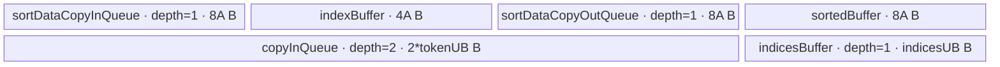
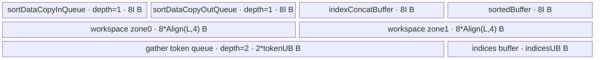
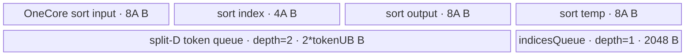
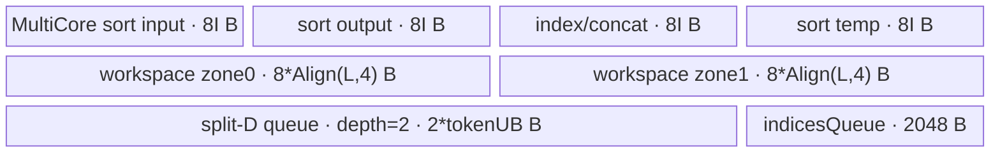

# MoeTokenPermute A2/A3 ACLNN 算子知识

## 算子速览

| 项目 | 内容 |
|---|---|
| 实际入口 | 公开两段式 `aclnnMoeTokenPermuteGetWorkspaceSize` / `aclnnMoeTokenPermute`；固定 9.1.0 中没有后缀或更高 A2/A3 版本。 |
| 计算语义 | 对 `flatten(indices)` 两次 argsort 得逆置换，再把第 `i` 个 token 的 `topK` 个副本散写到排序位置。 |
| 输入输出 | `tokens:[N,...]`，`indices:[N]` 或 `[N,K]`；输出 `permutedTokens:[O,...]`、`sortedIndices:[N*K]`。 |
| 执行类型 | 单 Kernel、三个顺序 AIV 阶段，节点均为 `AIV_VECTOR`；entry 对 `g_coreType==AIC` 立即返回，八个 key 只到 Vector sort/merge/copy body。 |
| Kernel 路线 | R-001 key 1/5 单核+整行；R-002 key 2/6 多核+整行；R-003 key 3/7 单核+split-D；R-004 key 4/8 多核+split-D。 |
| 核心资源 | GM workspace ping-pong，排序 `TQue/TBuf`，4-way `MrgSort`，token 双缓冲 queue，indices 单缓冲与标量索引。 |
| 来源闭包 | `source_closed`：ACLNN、inner 构建规则、OpDef/InferShape、Tiling/POD、八 key router、全部 AIV body 与 A2/A3 binary config 闭合。 |
| 验证状态 | 已完成源码闭包检查；本次知识提取未执行编译、真机、数值或性能测试。生成式 inner bridge 及 AscendC primitive 内部固定仓不可见。 |

## 接口与语义

### 计算语义

令 `L=N*K`，一维 indices 时 `K=1`，`f=flatten(indices)`。第一次排序产生 `p=argSort(f)`，第二次排序产生逆置换 `q=argSort(p)`；`sortedIndicesOut=q`，且 `permutedTokensOut[q[i],:]=tokens[floor(i/K),:]`。Host 把属性归一化为 `O=clamp(numOutTokens<=0 ? numOutTokens+L : numOutTokens,0,L)`；`O!=L` 时仅提交 `q[i]<O` 的 token 行，而 `q` 仍完整输出 L 项。

排序把整数 key `Cast(..., CAST_ROUND)` 到 FP32 后乘 `-1`，value 是原始线性位置；接口把 L 和 indices 值限制在 16777215 以下，位于 FP32 精确整数域。相同专家 id 的稳定次序由 Sort/MrgSort intrinsic 决定，固定仓没有稳定性承诺。

### 输入、输出与属性

| 参数 | shape/layout | dtype | 约束、默认值与语义 |
|---|---|---|---|
| `tokens` | ND，rank≥2，首维 N，尾维积 D | FP16/BF16/FP32 | 支持空 tensor；公开 API 支持非连续输入；首维等于 indices 首维。 |
| `indices` | ND，`[N]` 或 `[N,K]` | INT32/INT64 | `K<=512`，`L<16777215`，文档要求值在 `[0,16777215)`；支持非连续输入。 |
| `numOutTokens` | scalar | `int64_t` | 默认 0；非正数先加 L，再 clamp 到 `[0,L]`。 |
| `paddedMode` | scalar | `bool` | 默认 false；true 在本 Tiling 返回失败。 |
| `permuteTokensOut` | ND，`[O,...]`，尾维积 D | 同 tokens | 公开文档不支持非连续输出。 |
| `sortedIndicesOut` | ND，一维 `[L]` | INT32 | 完整逆置换，不随 O 截断。 |
| `workspaceSize/executor` | Host 输出 | `uint64_t* / aclOpExecutor**` | 第一段返回 workspace 与执行图。 |
| `workspace/stream` | Device 地址/runtime stream | `void* / aclrtStream` | 生命周期覆盖第二段异步执行。 |

### 入口与版本

公开头只有无后缀两段接口。A2/A3 的 `IsRegbase()==false` 分支转发到构建生成的 `aclnnInnerMoeTokenPermute*`；`add_modules_sources(OPTYPE moe_token_permute ACLNNTYPE aclnn_inner)`、`OP_ADD(MoeTokenPermute)`、Tiling 注册与同名 kernel 锁定桥接。生成头与 wrapper 源码固定仓不可见，但 producer、POD、entry、body 和构建接线均可见。950/Regbase 分支改走 `MoeInitRoutingV2`，不是本卡实现族。

## Host/Launcher 执行流程

### 参数校验与前处理

第一段先检查 `workspaceSize/executor`。OpDef 把两输入标为 REQUIRED、AutoContiguous，InferShape 生成 `[L]` 与首维 O 的输出；Tiling 再拒绝 `paddedMode=true`、indices 非 1/2D、两输入首维不等、K 超 512、L 超界，以及输出 rank/长度/尾维积不匹配。公开文档只发布浮点 token；尽管 OpDef/config 含 INT8 binary，本卡不扩张 ACLNN dtype 契约。

### 参数、Workspace 与生命周期

平台提供 AIV 核数和 UB；L≤32 时排序初始核数为 1，否则为全部 AIV。Host workspace 为 `24*L + 64*coreNum + 16*1024*1024` B，`PostTiling` 写 blockDim、POD，并设 `schedule_mode=1`。Kernel 的两个多核排序区各为 `2*Align(L,4)` 个 FP32 槽；两次排序通过 Destroy/recreate pipe 顺序复用 user workspace。`GetUserWorkspace` 的框架偏移和额外 16 MiB 用途固定仓不可见。

### 启动图与失败传播

```text
aclnnMoeTokenPermuteGetWorkspaceSize
 -> aclnnInnerMoeTokenPermuteGetWorkspaceSize
 -> OpDef/InferShape
 -> TilingForMoeTokenPermute
    -> TilingBaseClass::DoTiling
    -> GetShapeAttrsInfo -> GetPlatformInfo -> DoOpTiling
    -> GetWorkspaceSize -> PostTiling -> SetTilingKey
 -> executor/workspaceSize
aclnnMoeTokenPermute -> aclnnInnerMoeTokenPermute
 -> moe_token_permute(blockDim=aivNum, stream, one POD, one user workspace)
    -> phase S1: Sort(indices -> sortedIndices, workspace ping-pong)
    -> pipe Destroy；GM sortedIndices 是阶段边和可见结果
    -> phase S2: Sort(sortedIndices -> sortedIndices, 同一 workspace)
    -> pipe Destroy；GM sortedIndices 是阶段边
    -> phase G: Gather(tokens, sortedIndices -> permuteTokens)
```

这是**单个 Device Kernel 节点**，S1/S2/G 是 entry 内顺序执行的阶段，不是三个 Host launch。Host/executor 拥有 workspace，生命周期覆盖 phase-2 异步提交；S1 和 S2 都以 `userWS` 为排序临时区，前一 `TPipe::Destroy` 后才重建下一 pipe。S1 把第一次排序的 value 写入 GM `sortedIndices`，S2 从同一 GM 读取并原地写回逆置换，G 再消费该 GM；同一 entry 的程序顺序、各排序末尾 `SyncAll` 与 pipe 销毁共同保护阶段交接。Host 的空指针、shape、属性、POD buffer 错误返回状态并阻断 launch；entry 对 AIC、空 workspace/userWS、未知 key 直接返回，没有 fallback 或 Device 状态回传。

## Route 与参数设计

### 分核与资源计算

令 `UB=FloorAlign(platformUB,32)`，单 loop 排序上限 `S=floor((UB-aivNum*32)/(4*2*4)/32)*32`。L≤S 用单核；否则核数先取 `4^ceil(log4(ceil(L/S)))` 并限于 AIV，再按 32 元素对齐生成普通/末核及 loop tail。多核 run 逐级四路归并。

gather 按 N 分核：前核数为 `N%realAiv`（整除时取 realAiv），前核各 `ceil(N/realAiv)` 行，剩余尾核各 `floor(N/realAiv)` 行。若 `UB-2048 >= 2*Align(D*tokenBytes,32)`，整行双缓冲；否则 `oneTokenOnceMove=floor(floor((UB-2048)/2,512)/tokenBytes)`，按 D 切片。base key 为单核 1/多核 2，split-D 加 2，O!=L 加 4。

### Route 选择

| 顺序 | Route | Key/模板 | 精确选择条件与优先级 | 不适用去向 |
|---:|---|---|---|---|
| 1 | R-001 单核排序+整行 gather | 1=`OneCore,CopyOp<T,false>`；5=`OneCore,CopyOp<T,true>` | L≤S，整行 UB 成立；O==L/O!=L | L>S 到 R-002；UB 不足到 R-003。 |
| 2 | R-002 多核排序+整行 gather | 2=`MultiCore,CopyOp<T,false>`；6=`MultiCore,CopyOp<T,true>` | L>S，整行 UB 成立；O==L/O!=L | UB 不足到 R-004。 |
| 3 | R-003 单核排序+split-D gather | 3=`OneCore,SpiltD<T,false>`；7=`OneCore,SpiltD<T,true>` | L≤S，整行 UB 不成立；O==L/O!=L | L>S 到 R-004。 |
| 4 | R-004 多核排序+split-D gather | 4=`MultiCore,SpiltD<T,false>`；8=`MultiCore,SpiltD<T,true>` | L>S，整行 UB 不成立；O==L/O!=L | Host 失败或未知 key 空返回。 |

```text
base=(L<=S?1:2); if wholeRowUB不足 base+=2; if O!=L base+=4
```

### 模板/实现执行矩阵

| Route | key/selector | dtype/shape/platform 完整命中条件 | 执行拓扑与 Kernel 节点 | 实际模板/body | 内存与同步特征 | tail/fallback |
|---|---|---|---|---|---|---|
| R-001 单核排序+整行 gather | 1 / 5 | A2/A3；公开 token dtype FP16/BF16/FP32，indices INT32/INT64；`L<=S`；`UB-2048 >= 2*Align(D*tokenBytes,32)`；key1 `O==L`，key5 `O!=L` | 单 Kernel：S1 OneCore→S2 OneCore→G whole-row | `MoeSortOneCore<DTYPE_INDICES>`→`MoeSortOneCore<int32_t>`→`MoeindexCopyOp<DTYPE_TOKENS,false/true>` | 两次 sort pipe 顺序销毁；gather token queue depth2、indices buffer depth1 | sort 32 元素 mask；former/tail 核与末批；key5 跳过 `q>=O`；Host 失败或 Device 空返回，无 fallback |
| R-002 多核排序+整行 gather | 2 / 6 | 同 dtype/platform；`L>S`；整行 UB 条件成立；key2 `O==L`，key6 `O!=L` | 单 Kernel：S1 MultiCore→S2 MultiCore→G whole-row | `MoeSortMultiCore<DTYPE_INDICES>`→`MoeSortMultiCore<int32_t>`→`MoeindexCopyOp<...,false/true>` | 每次排序两区 GM ping-pong；run/merge 间 `SyncAll`；gather 同 R-001 | 普通/末核 run、末 list、末批；key6 裁剪；无 fallback |
| R-003 单核排序+split-D gather | 3 / 7 | 同 dtype/platform；`L<=S`；`UB-2048 < 2*Align(D*tokenBytes,32)`；key3 `O==L`，key7 `O!=L` | 单 Kernel：S1 OneCore→S2 OneCore→G split-D | `MoeSortOneCore`×2→`MoeindexCopySpiltDOp<...,false/true>` | sort 同 R-001；token queue depth2、indices queue depth1；每行按 D tile 重放到 K 个目的行 | 32 元素 sort tail、former/tail 核、末 outer 与末 D tile；key7 裁剪；无 fallback |
| R-004 多核排序+split-D gather | 4 / 8 | 同 dtype/platform；`L>S`；整行 UB 条件不成立；key4 `O==L`，key8 `O!=L` | 单 Kernel：S1 MultiCore→S2 MultiCore→G split-D | `MoeSortMultiCore`×2→`MoeindexCopySpiltDOp<...,false/true>` | sort workspace/同步同 R-002；gather UB 同 R-003 | run/list/core/D 多级 tail；key8 裁剪；无 fallback |

### 隐藏性能 Guard

| Guard | Host/Tiling 条件 | Device/资源原因 | 影响 Route | 不满足时去向 | 源码符号 |
|---|---|---|---|---|---|
| 排序单 loop UB | `S=floor((UB-aivNum*32)/(4*2*4)/32)*32` | `Sort` 的 key/value、concat/output/sorted 区按 32 元素 repeat 配置；公式还为每个初始 AIV 预留 32 B | 全部；决定 OneCore/MultiCore | `L>S` 进入 R-002/R-004；`S<=0` 没有显式错误分支 | `DoOpTiling/Tiling4VBSCompute` |
| 4 的幂核数 | `needCoreNum=4^ceil(log4(ceil(L/S)))`，再 `min(aivNum)` | `MrgSort` 每轮最多四路，4 的幂减少不完整中间层；随后仍允许尾组 1..4 list | R-002/R-004 | 超物理核数时截为 AIV 数，末组由 `validBitTail` 处理 | `Tinlig4VBSMultiCoreCompute` |
| 32 元素 sort tail | `sortNum=ceil(valid,32)*32` | `Sort/Concat/Extract` repeat 以 32 元素为单位；无效 key 用 `MIN_FP32` 覆盖 | 全部 | 非整 32 时走 mask tail，不换 Route | `MoeSortOneCore::SortCompute/MoeSortMultiCore::UBSortCompute` |
| 四路 merge tile | `oneLoopMaxElements=1024`；每轮 `listNum<=4` | `MrgSortSrcList` 固定四个输入，单轮每 list 至多读 1024 个有效元素 | R-002/R-004 | 超过 4 list 或每 list 超 1024 时循环多轮并 ping-pong | `Tiling4SortOutCompute/MoeMrgsort::Process` |
| 整行 UB | `UB-512*4 >= 2*Align(D*tokenBytes,32)` | token 是 depth2 bound queue，另保留最多 512 个 INT32 indices；整行搬运需两份对齐行 | R-001/R-002 | 不满足加 key 2，进入 split-D R-003/R-004 | `Tiling4IndexCopyCompute` |
| 整行 DMA blockCount | `onceUbTokenNums=min(UB/denominator,4095)` | `DataCopyExtParams.blockCount` 生产时窄化到 `uint16_t`，源码保守限制 4095 | R-001/R-002 | 降低每批行数；不换 Route | `Tiling4IndexCopyCompute/MoeindexCopyOp::Init` |
| split-D 512 B 粒度 | `oneTokenOnceMove=floor(floor((UB-2048)/2,512)/tokenBytes)` | depth2 token queue 的 tile 字节数按 512 B 下取整，indices 固定 2048 B | R-003/R-004 | 没有再下一 Route；结果为 0 时 Host 未显式拒绝 | `Tiling4IndexCopyCompute` |
| 输出裁剪专门化 | `O!=L` 时 key `+4` | `if constexpr(ifNumOutTokens)` 将 `q<O` 分支只实例化在 5/6/7/8，完整输出路线不执行运行时属性分支 | 全部 | O==L 使用 1..4；O!=L 使用 5..8 | `Tiling4IndexCopyCompute/moe_token_permute` |
| 独占全核 | `PostTiling: schedule_mode=1` | 多核排序在 entry 内多次 `SyncAll`，必须保证参与 block 同驻留 | R-002/R-004，亦覆盖单核 key 的统一 launch | 设置失败返回 Host 错误；Device 无替代同步 | `MoeTokenPermuteTilingBase::PostTiling` |
| dtype/build | ACLNN 公开 FP16/BF16/FP32×INT32/INT64；A2/A3 config 另含 INT8 binary | `DTYPE_TOKENS/DTYPE_INDICES` 是编译期实例；公开入口参数检查不发布 INT8 | 全部 | 公开 ACLNN 非支持 dtype 返回参数错误，不把 INT8 config 扩成 API 契约 | `CheckDtypeValidRegbase`、OpDef、binary JSON |

### POD/ABI

生产声明按顺序包含 42 个 `int64_t` 字段。字段宏来自仓外 CANN 头 `register/tilingdata_base.h`，因此固定仓只能证明字段顺序、源码类型和 Host setter/Device getter 对应关系，不能证明宏展开后的 `sizeof/alignof/offsetof`；下表不借测试镜像推断 ABI 数值。

| 结构 | 字段 | 类型/位宽 | ABI 布局 | 单位 | Host/launcher producer | Device consumer | 边界 |
|---|---|---|---|---|---|---|---|
| Main | `coreNum` | int64/64 | 固定仓宏实现不可见 | 核 | `GetPlatformInfo` 的初始 aivNum | `MoeSortOneCore/MultiCore::Init` 缓存；活动 `Process` 直接调用 `AscendC::SyncAll` | gather 可提升最终 blockDim，但此字段不回写；当前 body 中缓存值不改变同步分支。 |
| Main | `n` | int64/64 | 固定仓宏实现不可见 | 行 | indices dim0 | L/offset | 等于 tokens dim0。 |
| Main | `cols` | int64/64 | 固定仓宏实现不可见 | 元素/行 | token 尾维积 | gather | D。 |
| Main | `colsAlign` | int64/64 | 固定仓宏实现不可见 | 元素/行 | ceil 32B | whole-row stride | 32B 对齐。 |
| Main | `topK` | int64/64 | 固定仓宏实现不可见 | 项/行 | indices rank/dim1 | L/gather | 1..512。 |
| VBS | `needCoreNum` | int64/64 | 固定仓宏实现不可见 | 核 | VBS tiling | active sort core | ≤AIV。 |
| VBS | `perCoreElements` | int64/64 | 固定仓宏实现不可见 | 元素 | multi tiling | blockFactor | 32 对齐。 |
| VBS | `perCoreLoops` | int64/64 | 固定仓宏实现不可见 | loop | ceil(perCore/S) | VBS loop | ≥1。 |
| VBS | `perCorePerLoopElements` | int64/64 | 固定仓宏实现不可见 | 元素 | min(perCore,S) | run body | ≤S。 |
| VBS | `perCoreLastLoopElements` | int64/64 | 固定仓宏实现不可见 | 元素 | perCore 余数 | ordinary tail | 有效数。 |
| VBS | `lastCoreElements` | int64/64 | 固定仓宏实现不可见 | 元素 | L-(C-1)*perCore | last core | 有效数。 |
| VBS | `lastCoreLoops` | int64/64 | 固定仓宏实现不可见 | loop | ceil(last/S) | last loop | ≥1。 |
| VBS | `lastCorePerLoopElements` | int64/64 | 固定仓宏实现不可见 | 元素 | min(last,S) | last run | ≤S。 |
| VBS | `lastCoreLastLoopElements` | int64/64 | 固定仓宏实现不可见 | 元素 | last 余数 | mask/tail | 有效数。 |
| VBS | `oneLoopMaxElements` | int64/64 | 固定仓宏实现不可见 | 元素 | S | 当前 Device body 未读取；只消费由它派生的 per-core loop 字段 | 全 Route inactive；32 倍数。 |
| VBS | `lastCoreWSindex` | int64/64 | 固定仓宏实现不可见 | 区号 | VmsLoops 差 | ping-pong | 0/1。 |
| VMS | `needCoreNum` | int64/64 | 固定仓宏实现不可见 | 核 | 0 或 ceil(C/4) | `VMSProcess` 初始化局部值，循环首部立即按 listNum 重算 | list≤4 时不进入循环；当前值不改变实际 stage 核数。 |
| SortOut | `oneLoopMaxElements` | int64/64 | 固定仓宏实现不可见 | 元素/list | 常量 1024 | MrgSort | merge tile。 |
| IndexCopy | `needCoreNum` | int64/64 | 固定仓宏实现不可见 | 核 | front+tail | block guard | ≤realAiv。 |
| IndexCopy | `frontCoreNum` | int64/64 | 固定仓宏实现不可见 | 核 | N%realAiv | core branch | 整除取 realAiv。 |
| IndexCopy | `tailCoreNum` | int64/64 | 固定仓宏实现不可见 | 核 | 条件差值 | 分核记录 | N≤AIV 时 0。 |
| IndexCopy | `coreCalcNum` | int64/64 | 固定仓宏实现不可见 | 行/前核 | ceil(N/AIV) | extent/offset | former。 |
| IndexCopy | `coreCalcTail` | int64/64 | 固定仓宏实现不可见 | 行/尾核 | floor(N/AIV) | extent/offset | tail。 |
| IndexCopy | `oneTokenBtypeSize` | int64/64 | 固定仓宏实现不可见 | B/行 | D*tokenBytes | blockLen | 后续窄化 uint32。 |
| IndexCopy | `onceIndicesTokenMoveTimes` | int64/64 | 固定仓宏实现不可见 | 内批 | UB 除式 | whole-row `Process` inner loop | split-D 中写 1、仅缓存不参与活动循环。 |
| IndexCopy | `onceUbTokenNums` | int64/64 | 固定仓宏实现不可见 | 行/批 | UB 除式，min4095 | whole-row DMA `blockCount/outTokenNum` | split-D 中写 1，仅参与未使用的派生成员。 |
| IndexCopy | `onceIndicesTokenNums` | int64/64 | 固定仓宏实现不可见 | 行/外批 | 前两字段乘积或 floor(512/K) | progress | >0 前提。 |
| IndexCopy | `onceIndices` | int64/64 | 固定仓宏实现不可见 | index 项 | tokenNums*K | 两个 gather `Init` 仅缓存，后续未读取 | 冗余序列化字段；split-D 值≤512。 |
| IndexCopy | `oneTokenlastMove` | int64/64 | 固定仓宏实现不可见 | 元素 | D 余数 | split-D `tokenCopyLastParams.blockLen` | whole route 值 1、缓存后不读。 |
| IndexCopy | `oneTokenOnceMove` | int64/64 | 固定仓宏实现不可见 | 元素 | UB/512B 公式 | split-D 地址步长和普通 tile `blockLen` | whole route 值 1、缓存后不读；split-D 必须>0。 |
| IndexCopy | `oneTokenMoveTimes` | int64/64 | 固定仓宏实现不可见 | D loop | ceil(D/onceMove) | split-D D 循环与末 tile offset | whole route 值 1、缓存后不读。 |
| IndexCopy | `frontCoreLoop` | int64/64 | 固定仓宏实现不可见 | 外 loop | ceil(coreCalc/onceIndicesToken) | former Process | ≥1。 |
| IndexCopy | `frontCoreLastTokenNums` | int64/64 | 固定仓宏实现不可见 | 行 | former 余数 | final outer | 有效数。 |
| IndexCopy | `tailCoreLoop` | int64/64 | 固定仓宏实现不可见 | 外 loop | ceil(tail/onceIndicesToken) | tail Process | 无 tail 时不消费。 |
| IndexCopy | `tailCoreLastTokenNums` | int64/64 | 固定仓宏实现不可见 | 行 | tail 余数 | final outer | 有效数。 |
| IndexCopy | `tailLastonceIndicesTokenMoveTimes` | int64/64 | 固定仓宏实现不可见 | 内 loop | ceil(tailLast/onceUb) | whole tail | 有效数。 |
| IndexCopy | `tailLastIndicesLastTokenNums` | int64/64 | 固定仓宏实现不可见 | 行 | 内批余数 | final copy | 有效数。 |
| IndexCopy | `frontLastonceIndicesTokenMoveTimes` | int64/64 | 固定仓宏实现不可见 | 内 loop | ceil(frontLast/onceUb) | whole former | ≥1。 |
| IndexCopy | `frontLastIndicesLastTokenNums` | int64/64 | 固定仓宏实现不可见 | 行 | 内批余数 | final copy | 有效数。 |
| IndexCopy | `numOutTokens` | int64/64 | 固定仓宏实现不可见 | 行 | O | `q<O` / dst extent | 0..L。 |
| IndexCopy | `tokenUB` | int64/64 | 固定仓宏实现不可见 | B/slot | whole 或 split 公式 | token queue | depth2。 |
| IndexCopy | `indicesUB` | int64/64 | 固定仓宏实现不可见 | B/slot | Align(count*4,32) 或 2048 | indices queue/buffer | depth1。 |

### Route 源码闭包

| Route | Key/selector | Host/Tiling producer | POD/参数 | Kernel entry/router | Kernel body/直接依赖 | 构建接线 |
|---|---|---|---|---|---|---|
| R-001 单核排序+整行 gather | 1/5 | `Tiling4VBSCompute/Tiling4IndexCopyCompute` | 单核 VBS+whole copy | `moe_token_permute` key1/5 | `MoeSortOneCore`+`MoeindexCopyOp` | `add_modules_sources` |
| R-002 多核排序+整行 gather | 2/6 | `Tinlig4VBSMultiCoreCompute/Tiling4VMSMiddleCompute` | VBS/VMS/whole copy | entry key2/6 | `MoeSortMultiCore/MoeMrgsort/MoeindexCopyOp` | A2/A3 binary config |
| R-003 单核排序+split-D gather | 3/7 | `Tiling4VBSCompute/Tiling4IndexCopyCompute` | 单核+split fields | entry key3/7 | `MoeSortOneCore/MoeindexCopySpiltDOp` | inner CMake target |
| R-004 多核排序+split-D gather | 4/8 | multi/VMS/index tiling | VBS/VMS+split fields | entry key4/8 | `MoeSortMultiCore/MrgSort/SpiltDOp` | A2/A3 config |

## Kernel 实现

### 公共执行流程

一个 AIV kernel 内依次执行 `indices -> sortedIndices` 排序、`sortedIndices -> sortedIndices` 排序、按最终逆置换 gather token；每次排序后 Destroy pipe，再创建下一 pipe。key 的低两位选择排序及 D 切分，`+4` 只改变 gather 的编译期 `q<O` 谓词。

### Route R-001：单核排序+整行 gather

#### 适用条件

##### 选择证据

| 层级 | 文件 | 符号 | 源码谓词/参数 | 结果/下一跳 |
|---|---|---|---|---|
| Tiling | moe/moe_token_permute/op_host/moe_token_permute_tiling.cpp | `Tiling4VBSCompute` | `L<=S` | base 1。 |
| Tiling | moe/moe_token_permute/op_host/moe_token_permute_tiling.cpp | `Tiling4IndexCopyCompute` | whole UB；O!=L 加4 | key1/5；UB不足 R-003。 |
| Router | moe/moe_token_permute/op_kernel/moe_token_permute.cpp | key1/5 branch | bool false/true | OneCore+CopyOp。 |

#### Device 数据流

##### 函数级调用链

```text
moe_token_permute -> GENERAL_OP_IMPL
 -> MoeSortOneCore::Process -> CopyIn -> SortCompute -> CopyOut（执行两次）
 -> MoeindexCopyOp::Process -> CopyInIndices -> CopyIn -> CopyOut
```

##### 源码等价伪码

```text
block0: GM key->UB; index[i]=i; Cast FP32; Muls(-1); if L%32 mask填MIN_FP32; Sort repeat=ceil(L,32); value->GM。
全核SyncAll；第二次排序得到q。
for active block/outer/inner: offset按former/tail核计算；indices GM->UB并等待；token整行批量GM->UB；
 for token/topK: dstOffset=q*D; if key5 then 仅q<O写; else 总写；末批使用有效行tail；释放queue/buffer。
```

#### 内存与数据搬运

##### 资源与搬运表

| 层级/缓冲区 | offset/地址公式 | extent/容量公式 | dtype/layout | producer | consumer | owner/lifetime | 对齐/复用 |
|---|---|---|---|---|---|---|---|
| sort GM/UB | input 0；value=`outLocal[sortNum]` | L；sortNum=ceil(L,32)*32 | key FP32/value UINT32 | CopyIn/Sort | CopyOut | sortPipe | queue depth1，32 tail。 |
| token queue | src=`coreOffset*D+batch*D`; dst=`q*D` | depth2，每slot tokenUB | T/ND | CopyIn | CopyOut | gather pipe | UB row stride colsAlign。 |
| indices buffer | GM=`coreOffset*K+progress*onceIndicesNums` | depth1 indicesUB | INT32 | CopyInIndices | GetValue | outer loop | MTE2_S/S_MTE2。 |
| workspace | userWS+0 | Host `24L+64core+16MiB` | GM | Host | entry | stream | active 单核 body不写；两次复用。 |

##### 分层内存布局



其中 `A=ceil(L,32)*32`；图的上、下两行属于先后销毁/创建的不同 `TPipe`，不是同时常驻。

##### 字节账与复用顺序

```text
sort_UB = 8A + 4A + 8A + 8A = 28A B
gather_UB = 2*tokenUB + indicesUB B
UB_peak = max(sort_UB, gather_UB) <= platformUB
dynamic_ub = N/A（AIV TPipe 静态分配）
workspace_total(host) = 24L + 64*coreNum + 16MiB；本 Route 的 OneCore body 未读写 userWS
```

| 复用子区 | 写入者 | 读取者/消费点 | 下一次覆盖 | 同步或释放依据 | 安全条件 |
|---|---|---|---|---|---|
| `sortDataCopyInQueue` slot | `CopyIn` | `SortCompute::DeQue` | 第二次排序重建 pipe | `FreeTensor` + `sortPipe.Destroy` | S1 完成并全核同步后才进入 S2 |
| `sortedIndices` GM | S1 `CopyOut` | S2 `CopyIn` | S2 `CopyOut` 原地写回 | `MoeSortOneCore::Process` 末尾 `SyncAll` | block0 完成有效 L 项写回 |
| token queue 两 slot | `MoeindexCopyOp::CopyIn` | `CopyOut` | 下一 inner batch | bound queue `DeQue/FreeTensor` | 每次只覆盖已释放 slot |
| indices buffer | `CopyInIndices` | 标量 `GetValue` | 下一 outer loop | `MTE2_S` 后读、`S_MTE2` 后 `FreeTensor` | 本批所有 token×topK 索引消费完 |

#### 同步、精度与尾块

##### 同步与数值边界表

| 阶段 | primitive/机制 | producer | consumer/等待点 | 保护对象 | 精度/尾块 |
|---|---|---|---|---|---|
| sort | queue/PIPE_V/SyncAll | DMA/Sort | CopyOut/next sort | sort UB/GM | integer→FP32 exact域；32 mask，仅写L。 |
| indices | MTE2_S、S_MTE2 event | GM2UB | scalar/next DMA | indicesLocal | former/tail outer+inner batch。 |
| token | bound queue | GM2UB | UB2GM | token slot | 原 dtype 不 cast；key5过滤 q≥O。 |

#### 关键实现

##### 符号证据表

| 阶段 | 文件 | 符号/模板实例 | 实现事实 |
|---|---|---|---|
| Host/Tiling producer | moe/moe_token_permute/op_host/moe_token_permute_tiling.cpp | `Tinlig4VBSOneCoreCompute/Tiling4IndexCopyCompute` | key1/5与全部tail字段。 |
| Kernel entry/router | moe/moe_token_permute/op_kernel/moe_token_permute.cpp | `GENERAL_OP_IMPL` key1/5 | 两排序+bool gather。 |
| Device body/helper | moe/moe_token_permute/op_kernel/moe_sort_one_core.h | `CopyIn/SortCompute/CopyOut` | cast、mask、sort、value输出。 |
| Device body/helper | moe/moe_token_permute/op_kernel/moe_index_copy.h | `Init/Process/CopyOut` | 整行双缓冲与q散写。 |

### Route R-002：多核排序+整行 gather

#### 适用条件

##### 选择证据

| 层级 | 文件 | 符号 | 源码谓词/参数 | 结果/下一跳 |
|---|---|---|---|---|
| Tiling | moe/moe_token_permute/op_host/moe_token_permute_tiling.cpp | `Tinlig4VBSMultiCoreCompute` | L>S | base2、former/last run。 |
| Tiling | moe/moe_token_permute/op_host/moe_token_permute_tiling.cpp | `Tiling4VMSMiddleCompute` | list>4 | 多级4-way merge。 |
| Router | moe/moe_token_permute/op_kernel/moe_token_permute.cpp | key2/6 | whole UB，O条件 | MultiCore+CopyOp。 |

#### Device 数据流

##### 函数级调用链

```text
entry -> MoeSortMultiCore::Process
 -> VBSProcess -> UBSortProcess -> VBSCopyIn/UBSortCompute/VBSCopyOut
 -> VMSProcess -> MoeMrgsort::Process -> SortOutProcess -> MoeMrgsortOut::Process
 -> 第二次同链 -> MoeindexCopyOp::Process
```

##### 源码等价伪码

```text
for active block/run: GM->UB，生成全局index，FP32负key Sort，packed KV写workspace[srcWsIndex][core/run offset]。
每核先合并自己的run；SyncAll；while listNum>4: 各核合并最多4 list并切换workspace；SyncAll。
block0合并最后1..4 list，Extract value，只写L个INT32；第二排序后执行整行gather，key6仅q<O写。
```

#### 内存与数据搬运

##### 资源与搬运表

| 层级/缓冲区 | offset/地址公式 | extent/容量公式 | dtype/layout | producer | consumer | owner/lifetime | 对齐/复用 |
|---|---|---|---|---|---|---|---|
| workspace zone | zone1=`2*Align(L,4)` FP32；run=`block*GetSortLen(perCore)+GetSortLen(loop*loopSize)` | 每区 `2*Align(L,4)` FP32 | packed KV | VBS/MrgSort | next merge | sort stage | SyncAll后ping-pong。 |
| sort UB | indexNum=ceil(max(4096,run),32)*32 | input indexNum*8B；KV buffers各indexNum*8B | FP32/UINT32 | InitBuffer | Sort/MrgSort | pipe | queue/TBuf depth1。 |
| gather UB/GM | 与R-001相同 | token depth2，indices depth1 | T/INT32 | CopyIn | CopyOut | gather | whole row和多级tail。 |
| merge标量 | offsets/lengths/listSortedNums[4] | 固定4项，N/A GM | int64/uint32 | loop | MrgSort | object | validBit处理1..4 list。 |

##### 分层内存布局



`I=ceil(max(4*1024, sortCoreLoopElements),32)*32`。`indexLocal` 与 `concatLocal` 是 `indexConcatBuffer` 的两个逻辑子区，不另计；workspace 两区存 packed `(float key,uint32 value)`。

##### 字节账与复用顺序

```text
sort_UB = 8I + 8I + 8I + 8I = 32I B
gather_UB = 2*tokenUB + indicesUB B
UB_peak = max(sort_UB, gather_UB) <= platformUB
workspace_body = 2 zones * (2*Align(L,4) float) * 4 B = 16*Align(L,4) B
workspace_total(host) = 24L + 64*coreNum + 16MiB
dynamic_ub = N/A
```

| 复用子区 | 写入者 | 读取者/消费点 | 下一次覆盖 | 同步或释放依据 | 安全条件 |
|---|---|---|---|---|---|
| workspace zone `srcWsIndex` | VBS/上一 merge | 下一层 `MoeMrgsort::CopyIn` | 隔一层 merge | 每层末 `SyncAll` 后 `srcWsIndex=(srcWsIndex+1)%2` | 所有活动核完成当前 dst zone |
| `indexConcatBuffer` | progression/`Adds` | VBS `Sort` 的 sourceRow | 下一 run 更新 | `PipeBarrier<PIPE_V>` | 前一 run 的 packed KV 已写 GM |
| `sortedBuffer` | Sort/MrgSort 临时输出 | `Extract`/workspace CopyOut | 下一 run/list tile | MTE2_V、V_MTE3 event 与 queue 生命周期 | GM 写完成前不覆盖 |
| user workspace 整体 | S1 multi sort | S1 merge | S2 起始 VBS | S1 `Process` 末 `SyncAll` + pipe Destroy | S1 的最终 value 已落 `sortedIndices` |
| token/indices UB | gather GM2UB | scatter CopyOut | 下一批 | 与 R-001 相同 | queue/event 协议保持 |

#### 同步、精度与尾块

##### 同步与数值边界表

| 阶段 | primitive/机制 | producer | consumer/等待点 | 保护对象 | 精度/尾块 |
|---|---|---|---|---|---|
| run | queue/PIPE_V | DMA/Cast/Sort | workspace copy | UB/KV | 32-lane mask，普通/末核独立tail。 |
| merge | MTE3_MTE2/MTE2_V/V_MTE3 | 前轮/CopyIn/Vector | 下一DMA | UB+workspace | 每list min(1024,remain)，validBit。 |
| stage | SyncAll+schedule_mode1 | 全核写 | 下一stage | ping-pong GM | lastListElements保持有效extent。 |
| gather | 同R-001 events | indices/token DMA | scalar/copy | gather UB | key6 O裁剪。 |

#### 关键实现

##### 符号证据表

| 阶段 | 文件 | 符号/模板实例 | 实现事实 |
|---|---|---|---|
| Host/Tiling producer | moe/moe_token_permute/op_host/moe_token_permute_tiling.cpp | `Tinlig4VBSMultiCoreCompute/Tiling4VMSMiddleCompute` | 多核run与merge参数。 |
| Kernel entry/router | moe/moe_token_permute/op_kernel/moe_token_permute.cpp | key2/6 | MultiCore两次+CopyOp。 |
| Device body/helper | moe/moe_token_permute/op_kernel/moe_sort_multi_core.h | `VBSProcess/VMSProcess/SortOutProcess` | workspace地址和同步。 |
| Device body/helper | moe/moe_token_permute/op_kernel/moe_mrgsort.h | `CopyIn/MrgsortCompute/CopyOut` | 四路归并。 |
| Device body/helper | moe/moe_token_permute/op_kernel/moe_mrgsort_out.h | `Extract/CopyOut` | 最终value输出。 |
| Device body/helper | moe/moe_token_permute/op_kernel/moe_index_copy.h | `Process/CopyOut` | whole-row gather。 |

### Route R-003：单核排序+split-D gather

#### 适用条件

##### 选择证据

| 层级 | 文件 | 符号 | 源码谓词/参数 | 结果/下一跳 |
|---|---|---|---|---|
| Tiling | moe/moe_token_permute/op_host/moe_token_permute_tiling.cpp | `Tiling4VBSCompute` | L≤S | base1。 |
| Tiling | moe/moe_token_permute/op_host/moe_token_permute_tiling.cpp | `Tiling4IndexCopyCompute` | whole UB不足，加2；O!=L加4 | key3/7。 |
| Router | moe/moe_token_permute/op_kernel/moe_token_permute.cpp | key3/7 | SpiltD bool false/true | R-003。 |

#### Device 数据流

##### 函数级调用链

```text
entry -> MoeSortOneCore::Process（两次）
 -> MoeindexCopySpiltDOp::Process -> CopyInIndices -> CopyInAndOut
```

##### 源码等价伪码

```text
两次单核排序得到q；for block/outer/token: indices批GM->UB；
 for dTile: srcOffset=token*D+dTile*oneTokenOnceMove，GM->UB；for topK读取q；
  dstOffset=q*D+dTile*oneTokenOnceMove；key7仅q<O写；末D tile用oneTokenlastMove；末outer只跑CoreLastTokenNums。
```

#### 内存与数据搬运

##### 资源与搬运表

| 层级/缓冲区 | offset/地址公式 | extent/容量公式 | dtype/layout | producer | consumer | owner/lifetime | 对齐/复用 |
|---|---|---|---|---|---|---|---|
| sort | 同R-001，offset 0/value sortNum | L/sortNum | FP32/INT32 | sort | copy | sortPipe | 32 tail。 |
| token tile | src=`coreOffset*D+token*D+dTile*onceMove`; dst=`q*D+dTile*onceMove` | depth2，slot tokenUB | T | GM2UB | UB2GM | tile | 普通/末D长度。 |
| indices queue | GM=`coreOffset*K+progress*onceIndicesNums` | depth1 2048B | INT32 | GM2UB | GetValue | outer | 最多512项。 |
| workspace | userWS+0 | Host公式 | GM | Host | sort | stream | 顺序复用。 |

##### 分层内存布局



`A=ceil(L,32)*32`；sort pipe 与 split-D gather pipe 顺序存在。

##### 字节账与复用顺序

```text
sort_UB = 28A B
split_gather_UB = 2*tokenUB + indicesUB = 2*(oneTokenOnceMove*tokenBytes) + 2048 B
UB_peak = max(sort_UB, split_gather_UB) <= platformUB
workspace_total(host) = 24L + 64*coreNum + 16MiB；OneCore body不使用排序区
dynamic_ub = N/A
```

| 复用子区 | 写入者 | 读取者/消费点 | 下一次覆盖 | 同步或释放依据 | 安全条件 |
|---|---|---|---|---|---|
| `sortedIndices` GM | S1 | S2、再由 G 读取 | S2 原地覆盖 | 每个 OneCore `Process` 的 `SyncAll` | S1 完整写 L 项 |
| token tile slot | `CopyInAndOut` GM2UB | 同函数中 K 次 UB2GM | 下一 D tile | EnQue→DeQue→FreeTensor | K 个目的行的当前 tile 已提交 |
| indices queue | `CopyInIndices` | 当前 outer 的 token×topK 标量索引 | 下一 outer | `PIPE_MTE2` barrier，消费后 `FreeTensor`/`S_MTE2` | `onceIndices<=512`，末批只读有效项 |

#### 同步、精度与尾块

##### 同步与数值边界表

| 阶段 | primitive/机制 | producer | consumer/等待点 | 保护对象 | 精度/尾块 |
|---|---|---|---|---|---|
| sort | R-001 queue/SyncAll | Sort | q | sort数据 | FP32 exact域，32 mask。 |
| indices | PIPE_MTE2+S_MTE2 | GM2UB | scalar/next DMA | indicesLocal | outer tail。 |
| token | bound queue | GM2UB tile | scattered UB2GM | token tile | 原dtype；D tail；key7 O裁剪。 |

#### 关键实现

##### 符号证据表

| 阶段 | 文件 | 符号/模板实例 | 实现事实 |
|---|---|---|---|
| Host/Tiling producer | moe/moe_token_permute/op_host/moe_token_permute_tiling.cpp | split-D else branch | key3/7、tileD与tail。 |
| Kernel entry/router | moe/moe_token_permute/op_kernel/moe_token_permute.cpp | key3/7 | OneCore+SpiltD。 |
| Device body/helper | moe/moe_token_permute/op_kernel/moe_sort_one_core.h | `SortCompute/CopyOut` | 单核逆置换。 |
| Device body/helper | moe/moe_token_permute/op_kernel/moe_index_copy_spilt_d.h | `Init/CopyInIndices/CopyInAndOut/Process` | D tile×topK散写。 |

### Route R-004：多核排序+split-D gather

#### 适用条件

##### 选择证据

| 层级 | 文件 | 符号 | 源码谓词/参数 | 结果/下一跳 |
|---|---|---|---|---|
| Tiling | moe/moe_token_permute/op_host/moe_token_permute_tiling.cpp | multi VBS/VMS methods | L>S | base2。 |
| Tiling | moe/moe_token_permute/op_host/moe_token_permute_tiling.cpp | index split-D branch | whole UB不足；O决定+4 | key4/8。 |
| Router | moe/moe_token_permute/op_kernel/moe_token_permute.cpp | key4/8 | MultiCore+SpiltD bool | 无后续route。 |

#### Device 数据流

##### 函数级调用链

```text
entry -> MoeSortMultiCore::Process -> VBSProcess -> VMSProcess -> SortOutProcess（两次）
 -> MoeindexCopySpiltDOp::Process -> CopyInIndices -> CopyInAndOut
```

##### 源码等价伪码

```text
各block把run排序到workspace；while listNum>4执行4-way ping-pong merge和SyncAll；block0 Extract value；重复得到q。
for gather block/outer/token/dTile/topK: 计算src/dst offset；token tile经queue；key8仅q<O写，key4总写；
末核、末outer、末D tile分别使用coreCalcTail、CoreLastTokenNums、oneTokenlastMove。
```

#### 内存与数据搬运

##### 资源与搬运表

| 层级/缓冲区 | offset/地址公式 | extent/容量公式 | dtype/layout | producer | consumer | owner/lifetime | 对齐/复用 |
|---|---|---|---|---|---|---|---|
| sort workspace | zone=`srcWsIndex*2*Align(L,4)` FP32+core/run offset | 两区各2*Align(L,4) FP32 | packed KV | VBS/Merge | next stage | userWS | SyncAll后切换。 |
| sort UB | indexNum公式 | 各KV buffer indexNum*8B | FP32/UINT32 | CopyIn | Sort/Merge | pipe | TQue/TBuf depth1。 |
| token tile | src/dst同R-003 | depth2 tokenUB | T | GM2UB | UB2GM | gather | 512B推导，D tail。 |
| indices | progress*onceIndicesNums | depth1 2048B | INT32 | GM2UB | scalar | outer | event保护。 |

##### 分层内存布局



##### 字节账与复用顺序

```text
sort_UB = 32I B
split_gather_UB = 2*tokenUB + 2048 B
UB_peak = max(sort_UB, split_gather_UB) <= platformUB
workspace_body = 16*Align(L,4) B；workspace_total(host) = 24L + 64*coreNum + 16MiB
dynamic_ub = N/A
```

| 复用子区 | 写入者 | 读取者/消费点 | 下一次覆盖 | 同步或释放依据 | 安全条件 |
|---|---|---|---|---|---|
| workspace zone0/1 | VBS/MrgSort | 下一 merge stage | 隔 stage | stage `SyncAll` 后切 `srcWsIndex` | schedule_mode=1 且全部 block 到达 barrier |
| workspace 整体 | S1 | S2 | S2 VBS 起始 | S1 `SortOutProcess` 末 `SyncAll` + pipe Destroy | S1 最终 q 前身已写 `sortedIndices` |
| split-D token slot | G 的 `CopyInAndOut` | K 次 UB2GM | 下一 tile | bound queue FreeTensor | 当前 token 的 K 个目标 tile 已写 |
| indices queue | G 的 `CopyInIndices` | 当前 outer scatter | 下一 outer | PIPE_MTE2 / S_MTE2 | 有效 outer/tail 范围闭合 |

#### 同步、精度与尾块

##### 同步与数值边界表

| 阶段 | primitive/机制 | producer | consumer/等待点 | 保护对象 | 精度/尾块 |
|---|---|---|---|---|---|
| multi sort | queue/events/SyncAll | run/merge | next stage | UB/workspace | FP32 exact域；run/list/core tail。 |
| split indices | PIPE_MTE2/S_MTE2 | q DMA | scalar/next DMA | indices UB | former/tail outer。 |
| split token | TQue EnQue/DeQue | token DMA | scatter | token tile | dtype不变；D tail；key8裁剪。 |

#### 关键实现

##### 符号证据表

| 阶段 | 文件 | 符号/模板实例 | 实现事实 |
|---|---|---|---|
| Host/Tiling producer | moe/moe_token_permute/op_host/moe_token_permute_tiling.cpp | multi VBS/VMS/index split methods | key4/8与全部tail。 |
| Kernel entry/router | moe/moe_token_permute/op_kernel/moe_token_permute.cpp | key4/8 | MultiCore两次+SpiltD。 |
| Device body/helper | moe/moe_token_permute/op_kernel/moe_sort_multi_core.h | `VBSProcess/VMSProcess/SortOutProcess` | 多核地址与同步。 |
| Device body/helper | moe/moe_token_permute/op_kernel/moe_mrgsort.h | `MrgsortCompute/UpdateSortInfo` | 四路merge。 |
| Device body/helper | moe/moe_token_permute/op_kernel/moe_index_copy_spilt_d.h | `CopyInAndOut/Process` | split-D散写与裁剪。 |

## 算子特定优化

### Trick T-001：Host 用 UB 容量在整行 DMA 与 split-D 之间专门化

#### 触发与源码依据

- 适用 Route：整行 R-001/R-002；split-D R-003/R-004。
- 触发条件：`ubLeft >= 2*UpAlign(D*tokenBytes,32)` 选择整行，否则按 `floor((ubLeft/2),512)/tokenBytes` 产生 D tile 并把 key 加 2。
- Golden 来源：[`moe_token_permute_tiling.cpp:568-601`](../../../../../../../cann-ops-raw/ascendc/ops-transformer/be33d95bb755cedec3108f70805c1874d1792540/moe/moe_token_permute/op_host/moe_token_permute_tiling.cpp#L568-L601)

**官方源码（固定 Commit 连续逐字摘录）**：

```cpp
if (ubLeft >= BUFFER_NUM * oneTokenBtypeSizeAlign32) {
    onceUbTokenNums = GetDiv(
        static_cast<int64_t>(aicoreParams_.ubSize),
        oneTokenBtypeSizeAlign32 * BUFFER_NUM + topK * BUFFER_NUM * INT32_DTYPE_SIZE);
    onceUbTokenNums = std::min(onceUbTokenNums, MAX_BLOCK_COUNT);
    int64_t TopKUbLeft = aicoreParams_.ubSize - onceUbTokenNums * oneTokenBtypeSizeAlign32 * BUFFER_NUM;
    onceIndicesTokenMoveTimes = GetDiv(TopKUbLeft, onceUbTokenNums * topK * INT32_DTYPE_SIZE);
    onceIndicesTokenNums = onceIndicesTokenMoveTimes * onceUbTokenNums;
    onceIndices = onceIndicesTokenNums * topK;
    tokenUB = onceUbTokenNums * oneTokenBtypeSizeAlign32;
    indicesUB = UpAlign(onceIndices * INT32_DTYPE_SIZE, ONE_BLOCK_BYTE);
} else {
    onceIndicesTokenNums = GetDiv(MAX_INDICES_NUM, topK);
    onceIndices = onceIndicesTokenNums * topK;
    oneTokenOnceMove = GetDiv(FloorAlign(GetDiv(ubLeft, BUFFER_NUM), DATA_MOVE_ALIGN), tokenBtypeSize);
    oneTokenMoveTimes = GetCeilInt(cols, oneTokenOnceMove);
    oneTokenlastMove = cols - (oneTokenMoveTimes - 1) * oneTokenOnceMove;
    tilingKey_ = tilingKey_ + SPILT_D_MODE;
    tokenUB = oneTokenOnceMove * tokenBtypeSize;
    indicesUB = MAX_INDICES_NUM * INT32_DTYPE_SIZE;
}
```

#### 机制与设计原因

整行路线一次 `DataCopyPad` 搬一行，token queue 的两个 slot 各容纳 `Align(D*tokenBytes,32)`，减少 D 循环和同一 token 的重复 queue 管理；当一整行无法双缓冲时，split-D 路线把每个 slot 限在 512 B 整数倍 tile，仍保持 depth2，并对最后一片使用 `oneTokenlastMove`。Host 在 launch 前固化 key，Device 不再动态比较 UB。

#### 迁移边界

- 适用：按索引复制整行、行宽可能超过 UB 的 scatter/gather。
- 前提：A2/A3 AIV；token 行连续；indices 固定预留 2048 B；`oneTokenOnceMove>0`。
- 失效：整行条件不成立必须采用 split-D；若 512 B 下取整后 tile 为 0，固定仓没有第三路线。
- 未验证：本次知识提取未执行编译、真机、数值或性能测试。

#### 错误做法

不能在所有 D 上强制整行双缓冲，否则 `2*Align(rowBytes,32)+indicesUB` 可能超过 UB。固定仓未提供 `oneTokenOnceMove==0` 的可验证 fallback。

### Trick T-002：四路归并使用双 GM 区 ping-pong，避免每层另分 workspace

#### 触发与源码依据

- 适用 Route：R-002、R-004。
- 触发条件：`L>S` 进入 `MoeSortMultiCore`；当 `listNum>4` 时循环四路合并。
- Golden 来源：[`moe_sort_multi_core.h:275-301`](../../../../../../../cann-ops-raw/ascendc/ops-transformer/be33d95bb755cedec3108f70805c1874d1792540/moe/moe_token_permute/op_kernel/moe_sort_multi_core.h#L275-L301)

**官方源码（固定 Commit 连续逐字摘录）**：

```cpp
listNum = currentStageNeedCoreNum;
currentStageNeedCoreNum = Ceil(listNum, MAX_MRGSORT_LIST);
srcWsIndex = (srcWsIndex + 1) % WORK_GM_NUM;

lastListElements = perListElements * (remainListNum - 1) + lastListElements;
perListElements = perListElements * MAX_MRGSORT_LIST;
AscendC::SyncAll();
```

#### 机制与设计原因

VBS 首先把 packed key/value run 写到 `workspaceGms[srcWsIndex]`；每层 merge 从当前区读、向 `1-srcWsIndex` 写，层末切换索引。这样无论 merge 深度多少都只需两区 `2*Align(L,4)` 个 FP32 槽，而不是为每层物化新区。`SyncAll` 放在切换后、下一层读取前，配合 `schedule_mode=1` 保护跨核可见性；最后 block0 从当前区抽取 value。

#### 迁移边界

- 适用：多核生成有序 run、需要固定路数迭代归并的 AIV 算法。
- 前提：workspace 两区不重叠；每层所有生产核参与同一 `SyncAll`；Host 设置独占全核调度。
- 失效：list≤4 时直接进入最终 `SortOutProcess`；去掉 barrier 或在 barrier 前覆盖源区会破坏下一层输入。
- 未验证：本次知识提取未执行编译、真机、数值或性能测试。

#### 错误做法

错误是让下一层在部分核尚未完成 dst 区写回时开始读取；源码以 `AscendC::SyncAll()` 明确给出反例边界。

### Trick T-003：用 key `+4` 把输出裁剪变成编译期分支

#### 触发与源码依据

- 适用 Route：key 1..4 对应 `false`，key 5..8 对应 `true`。
- 触发条件：Host 归一化后的 `O!=L` 时 `tilingKey_ += 4`。
- Golden 来源：[`moe_index_copy.h:118-130`](../../../../../../../cann-ops-raw/ascendc/ops-transformer/be33d95bb755cedec3108f70805c1874d1792540/moe/moe_token_permute/op_kernel/moe_index_copy.h#L118-L130)

**官方源码（固定 Commit 连续逐字摘录）**：

```cpp
for (int32_t topKId = 0; topKId < topK; topKId++) {
    if constexpr (ifNumOutTokens == true) {
        auto indicesValue = indicesLocal.GetValue(offset);
        if (indicesValue < numOutTokens) {
            DataCopyPad(dstGm[indicesValue * cols], inLocal[tokensId * colsAlign], dataCopyExtParams);
        }
    } else {
        DataCopyPad(dstGm[indicesLocal.GetValue(offset) * cols], inLocal[tokensId * colsAlign], dataCopyExtParams);
    }
    offset++;
}
```

#### 机制与设计原因

`ifNumOutTokens` 是 entry 选中的模板布尔实参；完整输出路线编译时消除 `q<O` 判断，裁剪路线只对有效目标行发起 UB→GM DMA。该机制避免为被截断行物化输出，同时保留 `sortedIndicesOut` 的完整 L 项。

#### 迁移边界

- 适用：属性在 Host 已知、且其分支位于高频 scatter 内循环的算子。
- 前提：Host 与 router 的 `+4 ↔ bool true` 映射严格一致；O 已 clamp 到 `[0,L]`。
- 失效：运行期动态 O 无法在 Tiling 时决定时不能沿用此专门化；本实现没有动态 fallback。
- 未验证：本次知识提取未执行编译、真机、数值或性能测试。

#### 错误做法

错误是 key5..8 仍用 `false` 实例，此时会向 `[O,L)` 的逻辑裁剪区写数据；router 的八分支给出可验证映射。

## 模板与实现对比

| 对比维度 | R-001 单核+整行 | R-002 多核+整行 | R-003 单核+split-D | R-004 多核+split-D | 设计选择依据 |
|---|---|---|---|---|---|
| 命中条件/优先级 | `L<=S` 且整行 UB | `L>S` 且整行 UB | `L<=S` 且整行 UB 不足 | `L>S` 且整行 UB 不足 | 排序规模先定 1/2，行宽再加 0/2，O 再加 0/4 |
| 模板与 dtype | `OneCore<indices/int32>` + `CopyOp<T,bool>` | `MultiCore<indices/int32>` + `CopyOp<T,bool>` | `OneCore` + `SpiltDOp<T,bool>` | `MultiCore` + `SpiltDOp<T,bool>` | token dtype 只影响 gather；两次 sort 分别实例化 indices dtype 和 INT32 |
| 循环与分核 | block0 两次 sort；gather 按 N | VBS run+多层 VMS；gather 按 N | block0 sort；gather 再加 D tile | 多核 sort；gather 再加 D tile | L 决定排序并行，N 决定 token 行分核，D 决定是否切片 |
| Queue/TBuf/寄存器/dynamic UB/通信 window | sort 28A B；gather `2tokenUB+indicesUB` | sort 32I B+两 GM 区；gather同左 | sort 28A B；split `2tokenUB+2048` | sort 32I B+两 GM 区；split同左 | 均为 AIV TPipe；dynamic UB/通信 window 为 N/A |
| 内存总占用与复用 | pipe 间峰值取 max；workspace 不被 OneCore body 使用 | 两区 ping-pong；S1/S2 复用整体 workspace | pipe 间峰值取 max；token tile 跨 K 目的复用 | ping-pong + token tile 跨 K 目的复用 | 以 pipe Destroy、queue FreeTensor、event/SyncAll 证明生命周期 |
| 搬运/Vector API | DataCopyPad、Cast/Muls/Sort/Extract、整行 scatter | 同左 + MrgSort、多层 GM 搬运 | sort 同 R-001；D tile DataCopyPad | sort 同 R-002；D tile DataCopyPad | 32 元素 repeat、1024/list、512 B D tile 分别来自 API/资源约束 |
| 同步、精度与 tail | queue/PIPE_V/SyncAll；32 tail、批 tail | 再有 MTE events/stage SyncAll；run/list tail | 再有 PIPE_MTE2/S_MTE2；D tail | 两组同步与所有 tail 叠加 | integer key 先 Cast FP32 再取负；公开值域保证 FP32 整数精确 |
| fallback/失败边界 | Host 失败或 Device 空返回 | 同左 | tile=0 无下一路线 | tile=0 无下一路线 | 未知 key、AIC、空 workspace/userWS 均直接返回 |

## 平台差异

| 项目 | A2 | A3 | 950 |
|---|---|---|---|
| 支持状态 | 支持；公开表、`ascend910b` OpDef/config 与活动 CI 清单一致。 | 支持；公开表、`ascend910_93` OpDef/config 与活动 CI 清单一致。 | 公开 API 支持，但 Regbase 分支走 MoeInitRoutingV2，不属本卡。 |
| Host/Launcher | inner bridge+同一 Tiling，资源从平台查询。 | 与 A2 共用逻辑，实际 AIV/UB 可不同。 | Contiguous/MoeInitRoutingV2/ViewCopy。 |
| Kernel/资源 | 同一 8-key AIV entry。 | 同一 entry/body/公式。 | 本卡目标范围内对应 kernel/tiling 固定仓不可见。 |

## 限制与失败边界

- paddedMode=true 不支持；rank、N、K≤512、L<16777215、输出 shape 必须满足 Host 约束。公开 token dtype 只有 FP16/BF16/FP32。
- 文档限制 indices 值域，但可见 Tiling 不扫描元素；实际逐值校验位置固定仓不可见。极大 D 的 `uint32_t blockLen` 窄化也未见独立上界检查。
- `oneTokenOnceMove` 必须为正，sort UB 公式也要求剩余 UB 为正；支持域依赖 A2/A3 实际资源。
- 空 tensor 被文档允许，但零 block/loop runtime 细节固定仓不可见；未知 key、空 workspace/userWS、AIC core 均无 fallback。
- 生成 inner wrapper、GetUserWorkspace 偏移、额外 16 MiB、Sort/MrgSort/event 底层实现固定仓不可见；未验证编译、真机、数值、性能。

## 源码索引

### 链路索引

| 链路阶段 | 文件 | 关键符号 | 支撑内容 |
|---|---|---|---|
| 入口声明/约束 | moe/moe_token_permute/op_host/op_api/aclnn_moe_token_permute.h | 两段接口 | 公开签名。 |
| 入口实现 | moe/moe_token_permute/op_host/op_api/aclnn_moe_token_permute.cpp | `IsRegbase` branches | A2/A3 inner 转发。 |
| 接口约束 | moe/moe_token_permute/docs/aclnnMoeTokenPermute.md | 参数/公式/产品表 | 公开契约。 |
| Host 定义 | moe/moe_token_permute/op_host/moe_token_permute_def.cpp | `MoeTokenPermute/OP_ADD` | dtype、attrs、A2/A3。 |
| Host 推形 | moe/moe_token_permute/op_host/moe_token_permute_infershape.cpp | `InferShape4MoeTokenPermute` | L/O shape。 |
| Host/Tiling/Launcher | moe/moe_token_permute/op_host/moe_token_permute_tiling.cpp | `MoeTokenPermuteTilingBase::*` | key、POD、workspace、launch。 |
| Tiling 框架 | common/include/op_host/tiling_base.h | `TilingBaseClass::DoTiling` | 固定的 shape→platform→tiling→workspace→PostTiling→key 顺序及失败传播。 |
| POD | moe/moe_token_permute/op_host/moe_token_permute_tiling.h | `MoeTokenPermuteTilingData` | ABI 字段顺序。 |
| Kernel entry/body | moe/moe_token_permute/op_kernel/moe_token_permute.cpp | entry/macro | 八 key 三段路由。 |
| 单核排序 | moe/moe_token_permute/op_kernel/moe_sort_one_core.h | `MoeSortOneCore::*` | sort body。 |
| 多核排序 | moe/moe_token_permute/op_kernel/moe_sort_multi_core.h | `MoeSortMultiCore::*` | run/merge。 |
| 排序公共 helper | moe/moe_token_permute/op_kernel/moe_sort_base.h | progression/B64 | value与搬运。 |
| Device 公共 helper | moe/moe_token_permute/op_kernel/moe_common.h | `Ceil/Align/AlignBytes` | 32 B 对齐和公共常量。 |
| merge | moe/moe_token_permute/op_kernel/moe_mrgsort.h | `MoeMrgsort::*` | 中间归并。 |
| merge output | moe/moe_token_permute/op_kernel/moe_mrgsort_out.h | `MoeMrgsortOut::*` | value提取。 |
| whole gather | moe/moe_token_permute/op_kernel/moe_index_copy.h | `MoeindexCopyOp::*` | 整行散写。 |
| split gather | moe/moe_token_permute/op_kernel/moe_index_copy_spilt_d.h | `MoeindexCopySpiltDOp::*` | D切片散写。 |
| 构建接线 | moe/moe_token_permute/op_host/CMakeLists.txt | `add_modules_sources` | inner/Host/kernel 编译。 |
| A2 config | moe/moe_token_permute/op_host/config/ascend910b/moe_token_permute_binary.json | `MoeTokenPermute` | A2 binary。 |
| A3 config | moe/moe_token_permute/op_host/config/ascend910_93/moe_token_permute_binary.json | `MoeTokenPermute` | A3 binary。 |
| A2 CI 接线 | scripts/ci/ascend910b/ops_transformer_operator_list.yaml | `operator_group_8` | `moe_token_permute` 处于活动构建清单。 |
| A3 CI 接线 | scripts/ci/ascend910_93/ops_transformer_operator_list.yaml | `operator_group_8` | `moe_token_permute` 处于活动构建清单。 |

### 实现复用检查

| 检查项 | 可复用事实 | 不得改变的约束 | 源码符号 |
|---|---|---|---|
| ABI/POD | 42 个 int64 字段与嵌套组的 producer/consumer 映射。 | 字段顺序、64 位源码类型、单位及 coreNum 语义；`sizeof/alignof/offsetof` 需在可见 CANN 宏环境重新确认。 | `MoeTokenPermuteTilingData` |
| 调用顺序 | 两段 ACLNN、单 kernel 三段 body。 | sort1→Destroy→sort2→Destroy→gather。 | `GENERAL_OP_IMPL` |
| workspace/内存 | Host公式、双区KV、gather UB。 | zone stride、queue depth、owner/lifetime。 | `GetWorkspaceSize/MoeSortMultiCore::Init` |
| 同步 | schedule1、SyncAll、merge/gather events。 | 换区、第二排序、UB复用前同步。 | `PostTiling/VMSProcess/Process` |
| 精度与尾块 | int→FP32负key、32 mask、core/list/D tail。 | 16777215精确域、只写L/O有效域。 | `SortCompute/UBSortCompute` |
| 失败边界 | Host拒绝非法输入，Device空返回。 | 不补 fallback，不混入 950 body。 | `GetShapeAttrsInfo/moe_token_permute` |