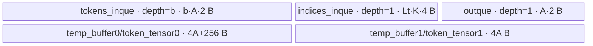

# MoeTokenPermuteGrad A2/A3 ACLNN 算子知识

## 算子速览

| 项目 | 内容 |
|---|---|
| 实际入口 | CANN 9.1.0 公开两段式接口 `aclnnMoeTokenPermuteGradGetWorkspaceSize` / `aclnnMoeTokenPermuteGrad`；固定仓内没有 V2/V3 版本族 |
| 计算语义 | 以每个输出 token 对应的连续 `numTopk` 个 `sortedIndices` 为索引，从 `permutedOutputGrad` gather 行并沿 top-k 维求和 |
| 输入输出 | `permutedOutputGrad:[P,H]` 为 BF16/FP16/FP32，`sortedIndices:[T*K]` 为 INT32，`K=numTopk`，输出 `inputGrad:[T,H]` 且 dtype 与梯度输入相同 |
| 执行类型 | `AIV_VECTOR`；单 Kernel、各核写不相交 token 行，不使用 Cube、Atomic 或跨核归约 |
| Kernel 路线 | R-001 BF16/FP16 的 FP32 累加（key 0/2）；R-002 FP32 原生累加（key 4） |
| 核心资源 | GM 输入/索引/输出；`tokens_inque`、`indices_inque`、`outque`；低精度路线另有两个 FP32 `TBuf`；Kernel 不消费 user workspace |
| 来源闭包 | `source_closed`：公开 ACLNN、A2/A3 native Op、Tiling/POD、entry、实际 `KernelMoeTokenUnpermute` body/helper、binary/CMake/CI 接线闭合；自动生成 inner wrapper 与 AscendC SDK primitive body是仓外边界 |
| 验证状态 | 已完成源码闭包检查；本次知识提取未执行编译、真机、数值或性能测试。 |

## 接口与语义

### 计算语义

令 `X=permutedOutputGrad`、`I=sortedIndices`、`K=numTopk`、`P=X.shape[0]`、`H=X.shape[1]`、`T=I.numel/K`。公开契约在索引有效时等价于：

```text
Y[t,h] = sum(j=0..K-1, X[I[t*K+j], h])，0<=t<T，0<=h<H
```

Host infer-shape 直接令 `T=X.shape[0]/K`，而 Tiling/Kernel 的输出 token 数来自 `I.shape[0]/K`；因此符合公开 shape 契约时应同时满足 `X.shape[0]=I.shape[0]=T*K`。Device 对每个索引仅判断 `I[p] < P`：大于等于 `P` 的项不参与累加；首项无效时先把 FP32 accumulator 清零。公开文档要求索引位于有效范围且无重复，所以该 Device 跳过分支是实现边界，不应当作为扩展接口语义使用。

### 输入、输出与属性

| 参数 | shape/layout | dtype | 约束、默认值与语义 |
|---|---|---|---|
| `permutedOutputGrad` | 二维 ND，`[T*K,H]` | BF16/FP16/FP32 | 必选；支持非连续输入，ACLNN executor/OpDef 负责连续化；第一维也是 Device 的 `num_out_tokens` 上界 |
| `sortedIndices` | 一维 ND，`[T*K]` | INT32 | 必选；支持非连续输入；公开文档要求取值属于有效行号且不重复，Kernel 本身只做有符号值的上界比较 |
| `numTopk` | Host 标量 | INT64 | 必选；公开 A2/A3 约束 `numTopk<=512`；实现中的除法和循环还要求正值 |
| `paddedMode` | Host 标量 | bool | 默认 false；公开文档声明当前仅支持 false；A2/A3 native Tiling 不读取该属性 |
| `out` / `input_grad` | 二维 ND，`[T,H]` | 与 `permutedOutputGrad` 相同 | 必选；公开契约支持非连续 view，自动生成 inner 如何落实回写在固定仓不可见；每个逻辑输出 token 只由一个 AIV 核计算 |
| `workspaceSize` | Host 输出 | uint64_t | 第一段返回完整 executor 所需总 workspace；native op 的可见部分只申请 system workspace |
| `executor` | Host 输出 | `aclOpExecutor*` | 持有连续化、native op 与回写执行图，交给第二段接口消费 |
| `workspace` / `stream` | Device 地址 / runtime stream | `void*` / `aclrtStream` | 第二段在调用者 stream 上执行 executor；workspace 容量必须等于或大于第一段返回值 |

### 入口与版本

固定 Commit 只声明这一组无版本后缀公开接口，因而它就是 A2/A3 在 CANN 9.1.0 的最新公开版本。第一段在 `IsRegbase()==false` 时进入自动生成的 `aclnnInnerMoeTokenPermuteGradGetWorkspaceSize`，第二段对应进入 `aclnnInnerMoeTokenPermuteGrad`；A2 `ascend910b` 与 A3 `ascend910_93` 均注册 native `MoeTokenPermuteGrad` 二进制。公开文档单独说明 Ascend 950 会转调 `MoeInitRoutingV2Grad`，该 Regbase 路线不属于本 A2/A3 卡。

## Host/Launcher 执行流程

### 参数校验与前处理

`aclnnMoeTokenPermuteGradGetWorkspaceSize` 先用 `OP_CHECK_COMM_INPUT` 校验 `workspaceSize/executor`，记录 DFX 信息，再读取 `Ops::Transformer::AclnnUtil::IsRegbase()`。A2/A3 走 `aclnnInnerMoeTokenPermuteGradGetWorkspaceSize`；这个 inner 声明由构建自动生成，生成器 body 在固定仓不可见。可见的 native `OpDef` 把两个输入标成 required/ND/AutoContiguous，限定梯度输入与输出为 BF16、FP16 或 FP32，索引为 INT32，`num_topk` 必选，`padded_mode` 默认 false；infer-shape 计算 `[permuted_dim0/num_topk,H]` 并传播输入 dtype。

Tiling 的 `InputParamCheck` 当前无实际检查。`Init` 从输入 0 读取 `P,H,dtypeSize`，从输入 1 读取 `totalLength`，在不存在 probs 的本算子中令 `topK=(numTopk==-1?1:numTopk)`、`tokensNum=totalLength/topK`。因此文档中的 rank、shape 相等、正 `numTopk`、索引值域和 `paddedMode=false` 不能由这段 Tiling 补证，调用者必须遵守公开契约。

### 参数、Workspace 与生命周期

Tiling 从 `PlatformAscendC` 取得 `GetCoreNumAiv()` 与 UB 字节数，并把 `GetLibApiWorkSpaceSize()` 写入 `context->GetWorkspaceSizes(1)[0]`；user workspace 增量固定为 0。Kernel entry 虽保留 `workspace` 形参，但 `KernelMoeTokenUnpermute::Init/Process` 从不读取它。ACLNN 返回的总 workspace 还可能含框架 `Contiguous` 与 `ViewCopy` 临时区，其切片公式属于 executor/runtime，固定仓不可见。

A2/A3 outer API 直接转发给 inner；executor 的创建、持有和释放实现位于自动生成代码，固定仓只通过公开两段式契约证明其生命周期。输入、输出、executor 和 workspace 必须存活到第二段在指定 stream 上完成。第二段由生成的 inner 执行 native op；本 Kernel 内没有另一个 launch 或 user-workspace 生命周期。

### 启动图与失败传播

启动图为 `aclnnMoeTokenPermuteGradGetWorkspaceSize → aclnnInnerMoeTokenPermuteGradGetWorkspaceSize → MoeTokenPermuteGrad OpDef/infer-shape → Tiling4MoeTokenPermuteGrad → moe_token_permute_grad<<<usedCoreNum, stream>>>`，第二段经 `aclnnInnerMoeTokenPermuteGrad` 提交。Tiling 的可见失败边只有 `InputParamCheck==GRAPH_FAILED`，但当前实现恒返回 success；随后 `PermuteTilingCompute` 依次执行 `Init → SetCoreNum → TilingHiddenSize → SetBufferNum → ComputeRemainMemerySpace → TilingToken → SetTilingKey → SetTilingData` 并返回 `SetTilingKey` 状态。

`usedCoreNum=min(tokensNum,maxAivCoreNum)`，由 `SetTilingData` 写入 `blockDim`。entry 对 key 0/2/4 分别实例化模板；没有匹配 key 的 `else` 错误分支，因此 producer 与 entry 的 key 集合必须保持一致。每核处理不相交的输出 token 区间，不需要 Atomic、barrier 或第二个 Kernel。

| 节点 | Host/提交符号 | Kernel entry | 执行族与 grid | POD | 输入/输出 | workspace slice 与生命周期 | 失败传播 |
|---|---|---|---|---|---|---|---|
| K-001 | 生成的 `aclnnInnerMoeTokenPermuteGrad`（body 固定仓不可见）按 executor/stream 提交 native op | `moe_token_permute_grad` | `AIV_VECTOR`；`blockDim=usedCoreNum=min(T,GetCoreNumAiv())`；单 Kernel | `MoeTokenPermuteGradTilingData`，key 0/2/4 | GM `permuted_output_grad`、`sorted_indices` → GM `input_grad` | Tiling 公开 slice 为 `GetLibApiWorkSpaceSize()+0`；entry 接收 `workspace` 但 body 不读；由 executor 持有到 stream 任务完成 | inner 生成层的 launch 返回传播不可见；可见 Tiling 失败会阻断 launch，未知 key 则 Device 静默不写输出 |

本 Route 只有 K-001，因而没有 Kernel 间 workspace/GM 交接边、event 或中间 buffer owner。入口 executor 中可能的 `Contiguous/ViewCopy` 与 K-001 之间由同一 runtime stream 执行图维持顺序；自动生成图的切片 offset、event 和 cleanup 时机固定仓不可见，不作推测。

## Route 与参数设计

### 分核与资源计算

记平台 UB 容量为 `U`，dtype 字节数为 `S`，低精度时 `castNum=2`，FP32 时为 0。Host 对每个 hidden 元素估算 `unitH=S*(2+bufferNum-1)+4*castNum`；先以最小双缓冲计算 `maxH=align512(floor((U-5120)/unitH)-512)`。若 `align512(H)<=maxH`，则 `hidden_splited_length=H,num=1,remain=0`；否则 `length=maxH,num=floor(H/maxH),remain=H%maxH`。`buffer_num` 从 4 递减到 2，取能容纳当前 hidden tile 的最大值。

设 `C=min(T,maxAivCoreNum)`、`q=floor(T/C)`、`r=T%C`。Host POD 先记录每核基准 `q` 和 former-core 数 `r`；Device 对 `blockIdx<r` 的核把本核 token 数增至 `q+1`。扣除 hidden 相关 UB 和 256 B 后的空间为 `R=U-align512(Lh)*unitH-256`。无 probs 时每个 token 的索引开销是 `K*4 B`：若 `R>=q*K*4`，token tile 为 `q`、一轮且无尾；否则 `Lt=floor(R/(K*4))`、`Nt=floor(q/Lt)`、`Rt=q%Lt`。former core 在 Device 再令 `Rt=Rt+1`，因此最后一轮可以恰好等于一个完整 `Lt`。

### Route 选择

| 顺序 | Route | Key/模板 | 精确选择条件与优先级 | 不适用去向 |
|---:|---|---|---|---|
| 1 | R-001 BF16/FP16 FP32 累加 | key 0：`KernelMoeTokenUnpermute<bfloat16_t,int32_t,bfloat16_t,false>`；key 2：`KernelMoeTokenUnpermute<half,int32_t,half,false>` | `SetTilingKey` 初值为 0；输入 0 为 BF16 时不加位得到 0，为 FP16 时加 2；`haveProbs=false`，不加 probs/mix 位 | FP32 进入 R-002；其它 dtype 应在 Host/OpDef 失败 |
| 2 | R-002 FP32 原生累加 | key 4：`KernelMoeTokenUnpermute<float,int32_t,float,false>` | 输入 0 为 FP32 时 `SetTilingKey` 加 4；entry 在 0/2 之后匹配 4 | 未知 key 无 Device fallback，entry 不写输出 |

```text
A2/A3 native MoeTokenPermuteGrad
  -> input0 dtype == BF16  -> key 0 -> R-001
  -> input0 dtype == FP16  -> key 2 -> R-001
  -> input0 dtype == FP32  -> key 4 -> R-002
  -> 其它 dtype            -> Host/OpDef 应拒绝；若仍到达 entry 则不执行 body
```

### 模板/实现执行矩阵

| Route | key/selector | dtype/shape/platform 完整命中条件 | 执行拓扑与 Kernel 节点 | 实际模板/body | 内存与同步特征 | tail/fallback |
|---|---|---|---|---|---|---|
| R-001 BF16/FP16 FP32 累加 | key 0/2 | A2/A3 native；`X/out` 分别同为 BF16 或 FP16，`sortedIndices=INT32`，ND；公开契约还要求 `X:[T*K,H]`、`I:[T*K]`、`K<=512`、`paddedMode=false` | 单 `AIV_VECTOR` 节点 `moe_token_permute_grad<<<C>>>` | `KernelMoeTokenUnpermute<bfloat16_t/half,int32_t,同T1,false>::Init/Process` 及全部 helper | `tokens_inque` depth 2～4；索引/`outque` depth 1；两个 FP32 TBuf；Queue 加 `PIPE_V` | former core 多 1 token；token/hidden 各有 remain 路径；未知 key 无 body |
| R-002 FP32 原生累加 | key 4 | A2/A3 native；`X/out=FP32`、`sortedIndices=INT32`、ND；同上 shape/属性契约 | 单 `AIV_VECTOR` 节点 `moe_token_permute_grad<<<C>>>` | `KernelMoeTokenUnpermute<float,int32_t,float,false>::Init/Process` 及全部 helper | FP32 accumulator 直接别名 `outque` tensor，不分配 cast TBuf；其它 Queue/tail 同 R-001 | former/token/hidden tail 同 R-001；未知 key 无 body |

### 隐藏性能 Guard

| Guard | Host/Tiling 条件 | Device/资源原因 | 影响 Route | 不满足时去向 | 源码符号 |
|---|---|---|---|---|---|
| hidden tile 可容纳性 | `AlignN(H,512)<=ComputeMaxHiddenSize(param,2)` | 每 hidden 元素须同时容纳 input Queue、output Queue 和可选 FP32 cast TBuf；另为索引保留 5120 B | R-001/R-002 | 不满足则 `Lh=maxHiddenSize`，切分 hidden 并走 `hidden_splited_remain` | `ComputeUnitHSpace/ComputeMaxHiddenSize/TilingHiddenSize` |
| Queue depth 自适应 | 从 `bufferNum=4` 递减，直到 `Lh<=ComputeMaxHiddenSize(param,bufferNum)` 或到 2 | 增加 `tokens_inque` depth 会按 `A*S` 增加 UB；选取可容纳的最大 depth | R-001/R-002 | depth 4 不足时降到 3/2；无低于 2 的 fallback | `SetBufferNum` |
| token tile 索引容量 | `remainMemorySpace>=q*K*4` | `indices_inque` 需一次容纳整个 token tile 的 `INT32` 索引 | R-001/R-002 | 满足则 `Lt=q,Nt=1,Rt=0`；否则 `Lt=floor(R/(4K))` 并切轮 | `ComputeRemainMemerySpace/TilingToken` |
| DMA 32 B 对齐 | `(h_length*sizeof(T1))%32==0` | 对齐段可用 `DataCopy`，非对齐尾段需字节长度 API | R-001/R-002 | 改用 `DataCopyPad`；`__CCE_AICORE__==200` 时经 custom helper | `CopyTokenIn/CopyOut` |
| dtype 精度/内存分流 | `isFloatDtype(tokensDtypeSize)` 与 key 0/2/4 | 低精度累加需两个 FP32 TBuf；FP32 可直接在 `outque` 中累加 | R-001 对 R-002 | 按 OpDef dtype 切到另一 Route；其它 dtype 应在 Host 失败 | `ComputeUnitHSpace/SetTilingKey/KernelMoeTokenUnpermute::Init` |
| 空域与零 tile | `T>0`、`K>0`、`maxHiddenSize>0`、`maxTokenSize>0` 是实现完整执行的隐含前提 | `safeDiv/safeMod` 遇 0 只返回 0，不会产生可用 Kernel fallback | R-001/R-002 | 固定源码未显式拒绝，可得到 `blockDim=0` 或零 tile；属失败边界 | `safeDiv/safeMod/SetCoreNum/TilingHiddenSize/TilingToken` |

### POD/ABI

`TILING_DATA_FIELD_DEF` 的生成定义不在固定仓，因此精确 `sizeof/alignof/offsetof` 不可从仓内求得；下表保持声明顺序、显式 `int64_t` 位宽、producer 和 consumer。序号是声明次序，不是假定的字节 offset。

| 结构 | 字段 | 类型/位宽 | ABI 布局 | 单位 | Host/launcher producer | Device consumer | 边界 |
|---|---|---|---|---|---|---|---|
| `MoeTokenPermuteGradTilingData` | `hidden_size` | int64_t/64 | `sizeof/alignof/offsetof` 固定仓不可见；声明序号 0 | 元素 | `SetTilingData: param.input.hiddenSize` | `KernelMoeTokenUnpermute::Init`，GM 行跨度与 hidden 循环 | 来自输入 0 第二维；乘法未做溢出检查 |
| `MoeTokenPermuteGradTilingData` | `top_k` | int64_t/64 | 固定仓不可见；声明序号 1 | 索引/输出 token | `SetTilingData: param.input.topK` | `Init/CalMultiOutToken/CalPartOutToken` | 文档上限 512；实现需要正值 |
| `MoeTokenPermuteGradTilingData` | `num_out_tokens` | int64_t/64 | 固定仓不可见；声明序号 2 | 可索引输入行 | `Init: input0.storageShape.dim0` | `CalPartOutToken: acl_token_idx<num_out_tokens` | 只做有符号上界比较，不检查负值 |
| `MoeTokenPermuteGradTilingData` | `hidden_splited_length` | int64_t/64 | 固定仓不可见；声明序号 3 | 元素/hidden tile | `TilingHiddenSize` | `InitBuffer/CalSingleOutToken/GM offset` | UB 推导；以 512 元素对齐后分配 |
| `MoeTokenPermuteGradTilingData` | `hidden_splited_num` | int64_t/64 | 固定仓不可见；声明序号 4 | 完整 hidden tile 数 | `TilingHiddenSize` | `Process→CalSingleOutToken` hidden 循环 | `H<=maxH` 时为 1，不是 0 |
| `MoeTokenPermuteGradTilingData` | `hidden_splited_remain` | int64_t/64 | 固定仓不可见；声明序号 5 | 尾元素 | `TilingHiddenSize` | `CalSingleOutToken` hidden 尾调用 | 仅大于 0 时执行 tail |
| `MoeTokenPermuteGradTilingData` | `tokens_core_length` | int64_t/64 | 固定仓不可见；声明序号 6 | 输出 token/核 | `TilingToken: floor(T/C)` | `Init`，本核 GM extent 与循环基数 | former core 在 Device 加 1 |
| `MoeTokenPermuteGradTilingData` | `tokens_core_remain` | int64_t/64 | 固定仓不可见；声明序号 7 | former-core 数 | `TilingToken: T%C` | `Init`，长短核和 GM base 公式 | `blockIdx<remain` 为长核 |
| `MoeTokenPermuteGradTilingData` | `tokens_splited_length` | int64_t/64 | 固定仓不可见；声明序号 8 | 输出 token/token tile | `TilingToken: q 或 floor(R/(K*4))` | `InitBuffer/Process` | 源码未显式拒绝计算结果为 0 |
| `MoeTokenPermuteGradTilingData` | `tokens_splited_num` | int64_t/64 | 固定仓不可见；声明序号 9 | 完整 token tile 数 | `TilingToken` | `Process` 外层循环 | 全装入时固定为 1 |
| `MoeTokenPermuteGradTilingData` | `tokens_splited_remain` | int64_t/64 | 固定仓不可见；声明序号 10 | token 尾数 | `TilingToken` | `Init` 调整 former core，`Process` 尾调用 | former core 加 1 后可等于 tile 长度 |
| `MoeTokenPermuteGradTilingData` | `buffer_num` | int64_t/64 | 固定仓不可见；声明序号 11 | `tokens_inque` depth | `SetBufferNum: 2..4` | `Init: pipe.InitBuffer(tokens_inque,buffer_num,...)` | 仅输入 token queue 使用该 depth |

### Route 源码闭包

| Route | Key/selector | Host/Tiling producer | POD/参数 | Kernel entry/router | Kernel body/直接依赖 | 构建接线 |
|---|---|---|---|---|---|---|
| R-001 BF16/FP16 FP32 累加 | key 0/2，`T1=bfloat16_t/half,T2=int32_t,T3=T1,PROBS=false` | `moe_token_permute_grad_tiling.cpp:SetTilingKey/SetTilingData` | `MoeTokenPermuteGradTilingData` 全 12 字段；低精度 `unitH=2*(buffer_num+1)+8` | `op_kernel/moe_token_permute_grad.cpp:moe_token_permute_grad` | `op_kernel/moe_token_permute_grad.h:Init/Process/CalMultiOutToken/CalPartOutToken/CopyTokenIn/CalFirstToken/CalToken/CopyOut` | `op_host/CMakeLists.txt:add_modules_sources`；A2/A3 binary config 和 CI list |
| R-002 FP32 原生累加 | key 4，`T1=float,T2=int32_t,T3=float,PROBS=false` | `moe_token_permute_grad_tiling.cpp:SetTilingKey/SetTilingData` | 同一 POD；FP32 `unitH=4*(buffer_num+1)` | `op_kernel/moe_token_permute_grad.cpp:moe_token_permute_grad` | 同一 body，`if constexpr(IsSameType<T1,float>)` 选择 out queue accumulator 和无 cast helper 路径 | 同 R-001 |

## Kernel 实现

### 公共执行流程

entry 反序列化 `MoeTokenPermuteGradTilingData`，按 key 实例化 `KernelMoeTokenUnpermute` 且固定 `PROBS=false`，所以 probs GM、`probs_inque`、`temp_buffer2` 和 `Muls` 分支均不分配、不执行。这个类的算法与 `moe_token_unpermute/op_kernel/moe_token_unpermute.h` 同名模板 body 一致；grad 文件只把 TilingData 类型改成 grad POD，并把外部 `TPipe*` 改成类内 `TPipe`，实际执行仍是 `Init → Process → CalMultiOutToken → CalSingleOutToken → CalPartOutToken`。

每个核先定位自身连续的索引片和输出片。每个 token tile 一次性把 `out_tokens_number*K` 个 INT32 索引搬入 `indices_inque`；再逐输出 token、逐 hidden tile，按索引从全局 `permutedOutputGrad` gather 一行片段。第一个有效行初始化 accumulator，后续有效行依次 `Add`；最后将当前 hidden 片段经 `outque` 写回。所有计算均为 AIV Vector/标量索引读取，核间输出地址不重叠。

### Route R-001：BF16/FP16 FP32 累加

#### 适用条件

##### 选择证据

| 层级 | 文件 | 符号 | 源码谓词/参数 | 结果/下一跳 |
|---|---|---|---|---|
| API/OpDef | moe/moe_token_permute_grad/op_host/moe_token_permute_grad_def.cpp | `ops::MoeTokenPermuteGrad` | 输入/输出 dtype 元组包含 BF16 与 FP16，索引固定 INT32，格式 ND | 合法输入进入 native Tiling；其它 dtype 拒绝 |
| Tiling | moe/moe_token_permute_grad/op_host/moe_token_permute_grad_tiling.cpp | `SetTilingKey` | 初始 key=0；BF16 不加值，FP16 加 `TILINGKEY_FLOAT16=2`；`haveProbs=false` | BF16→0，FP16→2 |
| Router | moe/moe_token_permute_grad/op_kernel/moe_token_permute_grad.cpp | `moe_token_permute_grad` | `TILING_KEY_IS(0)` 或 `TILING_KEY_IS(2)`，两者都令 `PROBS=false` | 实例化 BF16 或 half 的 `KernelMoeTokenUnpermute` |

#### Device 数据流

##### 函数级调用链

```text
moe_token_permute_grad
  -> KernelMoeTokenUnpermute<T1,int32_t,T1,false>::Init
  -> KernelMoeTokenUnpermute::Process
    -> CalMultiOutToken -> CalSingleOutToken -> CalPartOutToken
      -> CopyTokenIn -> CalFirstToken 或 CalToken -> CopyOut
```

##### 源码等价伪码

```text
这是源码等价伪码；A=align512(hidden_splited_length)，c=GetBlockIdx()
coreTokens=q + (c<r ? 1 : 0)
indexBase=(c<r) ? c*(q+1)*K : r*(q+1)*K+(c-r)*q*K
outputBase=((c<r) ? c*(q+1) : r*(q+1)+(c-r)*q)*H
for tokenTile=0..tokens_splited_num-1，并在 tokens_splited_remain>0 时再做尾轮:
  outOffset=tokenTile*Lt；n=完整轮取 Lt，尾轮取 tokens_splited_remain
  DataCopyPad indicesGM[indexBase+outOffset*K] -> indicesLocal，blockLen=n*K*4 B
  EnQue/DeQue indices_inque
  for localToken=0..n-1:
    for hTile=0..hidden_splited_num-1，并在 hidden_splited_remain>0 时做 hidden 尾轮:
      hOffset=hTile*hidden_splited_length；hLen=完整轮或 hidden 尾长
      accumulatorReady=false
      for j=0..K-1:
        idx=indicesLocal[localToken*K+j]
        if idx<P:
          GM offset=idx*H+hOffset；CopyTokenIn hLen 个 T1 到 tokens_inque
          Cast T1->FP32；第一个有效项写 token_tensor0，之后写 token_tensor1 并 Add FP32
          accumulatorReady=true
      if 首项无效且尚无有效项则 Duplicate FP32 0；后续有效项仍 Add
      Cast FP32->T1；out offset=(outOffset+localToken)*H+hOffset
      仅 CopyOut hLen 个有效元素到 outputGM[outputBase+out offset]
```

#### 内存与数据搬运

##### 资源与搬运表

| 层级/缓冲区 | offset/地址公式 | extent/容量公式 | dtype/layout | producer | consumer | owner/lifetime | 对齐/复用 |
|---|---|---|---|---|---|---|---|
| GM `permutedOutputGrad` | `idx*H+h_index*Lh` | `[P,H]`，每次有效 `h_length` 元素 | BF16/FP16，ND | 调用者/Contiguous | `CopyTokenIn` | 调用者/executor，整次 launch | 32 B 整除时 `DataCopy(...,h_length)`；否则 `blockCount=1,blockLen=h_length*2,srcStride=dstStride=0` 的 `DataCopyPad` |
| GM `sortedIndices` | 核基址 `indexBase`，轮内 `in_offset=out_offset*K` | 本核 `(q或q+1)*K`；每轮 `n*K*4 B` | INT32，一维连续 | 调用者/Contiguous | `CalMultiOutToken` | 调用者/executor，整次 launch | `DataCopyPad` 参数 `blockCount=1`、两 stride 为 0；SDK 的内部补齐字节固定仓不可见 |
| GM `input_grad` | 核基址 `outputBase*H`，局部 `out_token_index*H+h_index*Lh` | 本核 `(q或q+1)*H`，每次写 `h_length` 元素 | BF16/FP16，ND | `CopyOut` | 用户/后继算子 | 用户输出，整次 launch | 32 B 整除用 `DataCopy`；尾块用 `DataCopyPad`，只提交 `blockLen=h_length*2 B` |
| UB `tokens_inque` | TPipe 管理；每次 tensor 从 offset 0 使用 | depth=`buffer_num`，每槽 `A*2 B` | BF16/FP16 | `CopyTokenIn: AllocTensor→EnQue` | `CalFirstToken/CalToken: DeQue` | 本核 pipeline；每个 gather 行 | DeQue 后 `FreeTensor`；Queue 保证 MTE2→Vector，depth 2～4 支持迭代复用 |
| UB `indices_inque` | TPipe 管理；逻辑第 `localToken*K+j` 项 | depth=1，`Lt*K*4 B` | INT32 | `CalMultiOutToken` | `GetValue` 标量索引 | 本核一个 token tile | 全部 token 完成后 Free；former-core 尾轮长度不超过该槽容量 |
| UB `temp_buffer0` | `token_tensor0=temp_buffer0.Get<float>()` | `A*4+256 B` | FP32 | `Cast` 或 `Duplicate` | `Add`、输出 Cast | 本核，跨 gather/hidden 迭代复用 | 非 Queue TBuf；显式 `PIPE_V` 屏障后覆盖；额外 256 B 纳入 Host 预算 |
| UB `temp_buffer1` | `token_tensor1=temp_buffer1.Get<float>()` | `A*4 B` | FP32 | 后续 gather 的 `Cast` | `Add(token_tensor0,token_tensor0,token_tensor1,h_length)` | 本核，每个后续有效索引 | 非 Queue TBuf；Add 前 `PipeBarrier<PIPE_V>` |
| UB `outque` | TPipe 管理；每次 tensor 从 offset 0 使用 | depth=1，`A*2 B` | BF16/FP16 | `CopyOut` 中 FP32→T1 Cast 后 EnQue | MTE3 CopyOut | 本核一个 hidden 片 | DeQue 后写 GM，再 Free；Queue 保护 Vector→MTE3 |
| GM workspace | entry 形参 `workspace`，body 无地址计算 | Tiling 请求 `GetLibApiWorkSpaceSize()+0` | byte | runtime/executor | Kernel 为 N/A，不读取 | executor/system workspace | 不得改作额外数据区；系统库内部用途固定仓不可见 |
| 寄存器/标量 | `idx,start_token,end_token,h_index,h_length,offset` | 若干 int64_t/int32_t/float 标量 | 标量 | 当前循环与 `indicesLocal.GetValue` | 分支和地址生成 | 本核当前迭代 | `prob_value` 在 `PROBS=false` 时不参与数值计算 |

##### 分层内存布局



其中 `A=AlignN(Lh,512)`、`b=buffer_num∈{2,3,4}`、`Lt=tokens_splited_length`、`K=top_k`。`probs_inque/temp_buffer2` 由 `PROBS=false` 在编译期消除，不占 UB。

##### 字节账与复用顺序

```text
tokens_inque = b * A * 2
indices_inque = Lt * K * 4
outque = A * 2
temp_buffer0 = A * 4 + 256
temp_buffer1 = A * 4
UB_total = A * (2*b + 10) + Lt*K*4 + 256
Host: R = U - A*(2*b+10) - 256，并保证 Lt*K*4 <= R
=> UB_total <= U
dynamic_ub = N/A（AIV TPipe 静态分配）
workspace_total(native visible) = GetLibApiWorkSpaceSize() + 0 user bytes
```

| 复用子区 | 写入者 | 读取者/消费点 | 下一次覆盖 | 同步或释放依据 | 安全条件 |
|---|---|---|---|---|---|
| `tokens_inque` 的 b 个 slot | `CopyTokenIn: AllocTensor→DataCopy(Pad)→EnQue` | `CalFirstToken/CalToken: DeQue` | 后续有效索引的同一 hidden 片 | `FreeTensor(tokensLocal)` 后 Queue 才允许复用，前有 EnQue/DeQue | 必须保留 MTE2→Vector Queue 顺序；depth 不得小于 Host 产生值 |
| `temp_buffer0` | 首个有效行 `Cast`，或首项无效时 `Duplicate(0)` | 每次 `Add` 的 src0 及最终降精度 Cast | 下一个 output token/hidden 片重新初始化 | `PipeBarrier<PIPE_V>` 序列；最终 Cast 后才进入下一片 | 每个片在后续累加前必须由首有效行或零完整初始化 |
| `temp_buffer1` | 每个后续有效行的 `Cast` | `Add(token_tensor0,token_tensor0,token_tensor1,h_length)` | Add 完成后的下一有效行 | Cast 后 `PipeBarrier<PIPE_V>` | 不得在 Add 读完前覆盖 |
| `outque` slot | `CopyOut` 的 FP32→T1 Cast | DeQue 后 MTE3 `DataCopy(Pad)` | GM 写完且 `FreeTensor` 后的下一 hidden 片 | EnQue/DeQue/FreeTensor | 只使用 `h_length`，不得将对齐填充写出 |
| `indices_inque` slot | 每 token tile 的 `CalMultiOutToken` | 该 tile 所有 `GetValue` | 完成该 tile 全部 output token 后 | 轮末 `FreeTensor(indicesLocal)` | former-core 尾轮 `Rt+1<=Lt`；否则会越过槽容量 |

#### 同步、精度与尾块

##### 同步与数值边界表

| 阶段 | primitive/机制 | producer | consumer/等待点 | 保护对象 | 精度/尾块 |
|---|---|---|---|---|---|
| 索引 CopyIn | `AllocTensor→DataCopyPad→EnQue→DeQue` | GM→UB MTE2 | `indicesLocal.GetValue` | 当前 `n*K` 索引 | blockLen 为精确字节数；只循环消费 `n*K` 项 |
| 梯度 CopyIn | `tokens_inque EnQue/DeQue` 加 `PipeBarrier<PIPE_V>` | `CopyTokenIn` | `CalFirstToken/CalToken` | 当前 gather 行 hidden 片 | 搬运精确 `h_length`；非对齐尾用 `DataCopyPad` |
| 低精度提升与累加 | `Cast(CAST_NONE,h_length)`；后续 Cast 后 `PipeBarrier<PIPE_V>` 再 `Add(...,h_length)` | BF16/FP16 `tokensLocal` | FP32 `token_tensor0` | FP32 accumulator 与 `token_tensor1` | 按 j 从 0 到 K-1 顺序累加；API 的显式 repeat/stride/mask 未给出，AscendC 由元素 count=`h_length` 展开完整 repeat 和末尾 mask |
| 无效索引 | `if (idx<num_out_tokens)` 与 `Duplicate(...,0,h_length)` | 索引标量 | accumulator 初始化/后续跳过 | 当前输出 hidden 片 | 上界无效项贡献 0；负 INT32 仍通过比较，是调用前必须排除的失败边界 |
| 输出降精度 | `PipeBarrier<PIPE_V>` 后 Cast，再 `outque EnQue/DeQue` | FP32 accumulator | MTE3 CopyOut | 当前输出片 | 源码以 `__CCE_AICORE__==200` 选 `CAST_NONE`，其它编译分支选 `CAST_RINT`；仅写有效 `h_length`；A2/A3 config 本身不公开宏数值映射 |
| 核/轮/hidden tail | 分核谓词与两个 remain 分支 | Host POD | `Init/Process/CalSingleOutToken` | 输出 token 域与 H 域 | 前 `r` 核多 1 token；token tail 与 hidden tail 均独立调用相同 body，无跨核同步 |
| 自动同步 | `#pragma bisheng auto_sync parallel` 与 Queue 生命周期 | 编译器/TPipe | 下次队列复用 | token 内循环的流水依赖 | 编译器生成的具体 event ID 与指令排程固定仓不可见；源码仍显式保留 Queue 和 V pipe 边 |

#### 关键实现

##### 符号证据表

| 阶段 | 文件 | 符号/模板实例 | 实现事实 |
|---|---|---|---|
| Host/Tiling producer | moe/moe_token_permute_grad/op_host/moe_token_permute_grad_tiling.cpp | `Tiling4MoeTokenPermuteGrad/PermuteTilingCompute/SetTilingKey/SetTilingData` | 生成 key 0/2、分核、hidden/token tile、buffer depth、workspace 与 blockDim |
| Kernel entry/router | moe/moe_token_permute_grad/op_kernel/moe_token_permute_grad.cpp | `moe_token_permute_grad`、`KernelMoeTokenUnpermute<bfloat16_t,...,false>`、`KernelMoeTokenUnpermute<half,...,false>` | key 0/2 到低精度模板实例的唯一映射，probs 固定为空 |
| Device body/helper | moe/moe_token_permute_grad/op_kernel/moe_token_permute_grad.h | `KernelMoeTokenUnpermute::Init/Process/CalMultiOutToken/CalSingleOutToken` | 建立核基址、Queue/TBuf 容量、token 与 hidden 双层切片以及 former/tail core |
| Device body/helper | moe/moe_token_permute_grad/op_kernel/moe_token_permute_grad.h | `CalPartOutToken/CopyTokenIn/CalFirstToken/CalToken/CopyOut` | 索引过滤、GM gather、FP32 顺序累加、Cast、Queue 同步和精确尾写 |
| 复用来源 | moe/moe_token_unpermute/op_kernel/moe_token_unpermute.h | `KernelMoeTokenUnpermute` 同名全方法体 | grad body 与 unpermute body 的算法、地址、Buffer、同步和 tail 相同，仅 POD 类型与 TPipe owner 适配 |

### Route R-002：FP32 原生累加

#### 适用条件

##### 选择证据

| 层级 | 文件 | 符号 | 源码谓词/参数 | 结果/下一跳 |
|---|---|---|---|---|
| API/OpDef | moe/moe_token_permute_grad/op_host/moe_token_permute_grad_def.cpp | `ops::MoeTokenPermuteGrad` | 输入/输出 dtype 元组选择 FP32，索引 INT32，格式 ND | 合法输入进入 native Tiling |
| Tiling | moe/moe_token_permute_grad/op_host/moe_token_permute_grad_tiling.cpp | `SetTilingKey` | `permuted_tokens_dtype==ge::DT_FLOAT` 时加 `TILINGKEY_FLOAT=4`；无 probs 位 | 生成 key 4 |
| Router | moe/moe_token_permute_grad/op_kernel/moe_token_permute_grad.cpp | `moe_token_permute_grad` | 前两个 key 未命中且 `TILING_KEY_IS(4)` | 实例化 `KernelMoeTokenUnpermute<float,int32_t,float,false>` |

#### Device 数据流

##### 函数级调用链

```text
moe_token_permute_grad
  -> KernelMoeTokenUnpermute<float,int32_t,float,false>::Init
  -> KernelMoeTokenUnpermute::Process
    -> CalMultiOutToken -> CalSingleOutToken -> CalPartOutToken
      -> CopyTokenIn -> CalFirstToken 或 CalToken -> CopyOut
```

##### 源码等价伪码

```text
这是源码等价伪码；core/index/output base 与 R-001 完全相同
for 每个 token tile（含 tokens_splited_remain 尾轮）:
  从 indicesGM[indexBase+out_offset*K] 搬 n*K 个 INT32 到 indicesLocal
  for localToken=0..n-1:
    for 每个 hidden tile（含 hidden_splited_remain 尾轮）:
      token_tensor0=outque.AllocTensor<float>()
      for j=0..K-1:
        idx=indicesLocal[localToken*K+j]
        if idx<P:
          inOffset=idx*H+h_index*Lh
          CopyTokenIn float GM[inOffset:inOffset+h_length] 到 tokens_inque
          if 这是第一个有效项: DataCopy align32(h_length*4)/4 个 float 到 token_tensor0
          else: Add(token_tensor0,token_tensor0,tokensLocal,h_length)
        else if accumulator 尚未初始化: Duplicate(token_tensor0,0,h_length)
      outOffset=(localToken+tileBase)*H+h_index*Lh
      outque.EnQue/DeQue；CopyOut 精确 h_length 个 float 到 outputGM[outputBase+outOffset]
```

#### 内存与数据搬运

##### 资源与搬运表

| 层级/缓冲区 | offset/地址公式 | extent/容量公式 | dtype/layout | producer | consumer | owner/lifetime | 对齐/复用 |
|---|---|---|---|---|---|---|---|
| GM `permutedOutputGrad` | `idx*H+h_index*Lh` | `[P,H]`，每次 `h_length` 元素 | FP32，ND | 调用者/Contiguous | `CopyTokenIn` | 调用者/executor，整次 launch | 32 B 整除用 `DataCopy`；否则 `blockLen=h_length*4 B` 的 `DataCopyPad` |
| GM `sortedIndices` | `indexBase+out_offset*K` | 本核 `(q或q+1)*K`；每轮 `n*K*4 B` | INT32 | 调用者/Contiguous | `CalMultiOutToken/GetValue` | 调用者/executor | depth 1 Queue；blockCount=1、stride=0 |
| GM `input_grad` | 核基址加 `(out_token_index*H+h_index*Lh)` | 本核 `(q或q+1)*H`，每次 `h_length` float | FP32，ND | `CopyOut` | 用户/后继算子 | 用户输出 | 对齐块 `DataCopy`，尾块 `DataCopyPad`，有效写长为 `h_length*4 B` |
| UB `tokens_inque` | TPipe 管理 | depth=`buffer_num`，每槽 `A*4 B` | FP32 | `CopyTokenIn` | `CalFirstToken/CalToken` | 本核每个 gather 行 | DeQue 后 Free；Queue 保护 MTE2→Vector |
| UB `indices_inque` | 逻辑 `localToken*K+j` | depth=1，`Lt*K*4 B` | INT32 | `CalMultiOutToken` | 标量 GetValue | 一个 token tile | 轮末 Free；地址/容量与 R-001 相同 |
| UB `outque` / FP32 accumulator | `token_tensor0=outque.AllocTensor<float>()` | depth=1，`A*4 B` | FP32 | 首项 `DataCopy`/零 `Duplicate`/后续 `Add` | `CopyOut` | 一个 output hidden 片 | accumulator 与 VECOUT tensor 别名；EnQue/DeQue 后 MTE3 写回，再 Free |
| UB `temp_buffer0/1/2` | N/A：`if constexpr(!IsSameType<T1,float>)` 与 `PROBS` 均为 false | 0 B | N/A | N/A | N/A | 不分配 | 这是与 R-001 不可合并的 UB 布局差异 |
| GM workspace | entry 形参未读取 | `GetLibApiWorkSpaceSize()+0` | byte | runtime/executor | Kernel N/A | system workspace | 固定仓不公开系统库内部 consumer |
| 寄存器/标量 | 与 R-001 相同 | int64_t/int32_t/float 标量 | 标量 | 循环、POD、GetValue | 地址与条件 | 当前迭代 | 不存在 scale、round 或概率乘法 |

##### 分层内存布局


`token_tensor0` 是 `outque.AllocTensor<float>()` 返回的同一物理子区，不能再计一份 accumulator；`temp_buffer0/1/2` 均不分配。

##### 字节账与复用顺序

```text
tokens_inque = b * A * 4
indices_inque = Lt * K * 4
outque_and_accumulator = A * 4
UB_total = 4*A*(b+1) + Lt*K*4
Host: R = U - 4*A*(b+1) - 256，并保证 Lt*K*4 <= R
=> UB_total <= U - 256 < U（Host 额外保留 256 B）
dynamic_ub = N/A（AIV TPipe 静态分配）
workspace_total(native visible) = GetLibApiWorkSpaceSize() + 0 user bytes
```

| 复用子区 | 写入者 | 读取者/消费点 | 下一次覆盖 | 同步或释放依据 | 安全条件 |
|---|---|---|---|---|---|
| `tokens_inque` 的 b 个 slot | `CopyTokenIn` | `CalFirstToken/CalToken` | 后续有效索引 | DeQue 后 `FreeTensor` | 保留 Queue 的 MTE2→Vector 顺序和 Host depth |
| `outque`/`token_tensor0` | 首个有效行 `DataCopy`、无效首项 `Duplicate`、后续行原地 `Add` | 下一次 Add，最后由 `CopyOut` DeQue 并写 GM | GM 写完且 `FreeTensor` 后 | EnQue/DeQue/FreeTensor；Add 的 dst/src0 是同一 tensor | 整个 top-k 累加期间不得提前 EnQue/Free；只输出 `h_length` |
| `indices_inque` slot | `CalMultiOutToken` | 当前 tile 全部 `GetValue` | 轮末释放后下一 tile | `FreeTensor(indicesLocal)` | `Lt>0` 且 former-core 尾轮不超过 `Lt` |

#### 同步、精度与尾块

##### 同步与数值边界表

| 阶段 | primitive/机制 | producer | consumer/等待点 | 保护对象 | 精度/尾块 |
|---|---|---|---|---|---|
| 索引与输入 CopyIn | `indices_inque/tokens_inque` 的 EnQue→DeQue→Free | GM→UB MTE2 | GetValue、首项 Copy 或 Add | 当前索引块与 gather 行 | 精确 `n*K` 索引及 `h_length` float；不消费补齐区 |
| 首项初始化 | `DataCopy(token_tensor0,tokensLocal,align32(h_length*4)/4)` | 第一个有效 FP32 行 | 后续 Add | outque 中的 accumulator | 复制可能覆盖 UB 对齐后缀，但 Vector Add 和 GM 输出只使用 `h_length` |
| 原生累加 | `Add(token_tensor0,token_tensor0,tokensLocal,h_length)` | 后续有效 FP32 行 | 下一 j 或 CopyOut | FP32 accumulator | 无 cast、scale、round；按 j 顺序累加，末尾 mask 由 count=`h_length` 的高层 Vector API 展开 |
| 无效索引 | `if (idx<P)` 与 `Duplicate(...,0,h_length)` | INT32 idx | accumulator | 当前输出片 | 大于等于 P 的项跳过；负值风险与 R-001 相同 |
| 输出 Queue | `outque EnQue→DeQue→DataCopy/DataCopyPad→Free` | Vector accumulator | MTE3/下一片复用 | accumulator/VECOUT 别名 | 无 dtype 转换；GM 尾写为精确 `h_length*4 B` |
| 核/轮/hidden tail | `blockIdx<r`、`tokens_splited_remain>0`、`hidden_splited_remain>0` | Host POD | Init/Process/CalSingleOutToken | 有效输出域 | 与 R-001 相同，无 Atomic 或跨核 barrier |

#### 关键实现

##### 符号证据表

| 阶段 | 文件 | 符号/模板实例 | 实现事实 |
|---|---|---|---|
| Host/Tiling producer | moe/moe_token_permute_grad/op_host/moe_token_permute_grad_tiling.cpp | `isFloatDtype/ComputeUnitHSpace/SetTilingKey/SetTilingData` | FP32 不分配 cast 空间，生成 key 4 及相应 UB/token tile |
| Kernel entry/router | moe/moe_token_permute_grad/op_kernel/moe_token_permute_grad.cpp | `moe_token_permute_grad`、`KernelMoeTokenUnpermute<float,int32_t,float,false>` | key 4 到 FP32 单 Kernel body 的唯一映射 |
| Device body/helper | moe/moe_token_permute_grad/op_kernel/moe_token_permute_grad.h | `Init/Process/CalMultiOutToken/CalSingleOutToken` | 分核地址、Queue 容量、循环与双重 tail |
| Device body/helper | moe/moe_token_permute_grad/op_kernel/moe_token_permute_grad.h | `CalPartOutToken/CopyTokenIn/CalFirstToken/CalToken/CopyOut` | FP32 outque accumulator、原生 Add、Queue 同步与 GM 精确尾写 |
| 复用来源 | moe/moe_token_unpermute/op_kernel/moe_token_unpermute.h | `KernelMoeTokenUnpermute<float,int32_t,float,false>` | 与 unpermute 的 FP32 no-probs body 保持同一算法和 Buffer/同步图 |

## 算子特定优化

### Trick T-001：在 UB 约束内选取最大 input Queue depth

#### 触发与源码依据

- 适用 Route：R-001、R-002。
- 触发条件：hidden tile 已由 `TilingHiddenSize` 确定；从 depth 4 开始，当 `hiddenTiling.length>ComputeMaxHiddenSize(param,bufferNum)` 时递减，但不低于 2。
- Golden 来源：[`moe/moe_token_permute_grad/op_host/moe_token_permute_grad_tiling.cpp:163-170`](../../../../../../../cann-ops-raw/ascendc/ops-transformer/be33d95bb755cedec3108f70805c1874d1792540/moe/moe_token_permute_grad/op_host/moe_token_permute_grad_tiling.cpp#L163-L170)

**官方源码（固定 Commit 连续逐字摘录）**：

```cpp
static inline void SetBufferNum(MoeTokenUnpermuteParam &param)
{
    const int64_t maxBufferNum = 4;
    int64_t bufferNum = maxBufferNum;
    while (bufferNum > MIN_BUFFER_NUM && param.hiddenTiling.length > ComputeMaxHiddenSize(param, bufferNum)) {
        bufferNum--;
    }
    param.core.bufferNum = bufferNum;
}
```

#### 机制与设计原因

`buffer_num` 同时是 POD producer 和 `InitBuffer(tokens_inque,buffer_num,A*sizeof(T1))` 的 depth。Host 把 dtype 字节数、output Queue 及低精度的两个 FP32 accumulator 都纳入 `ComputeMaxHiddenSize`，因此在不突破 UB 上界时优先保留更深的 GM→UB Queue；只在 hidden tile 无法容纳时降 depth。源码可证明的收益是避免一开始就把所有 shape 锁死在最小双缓冲，不包含未实测的性能幅度。

#### 迁移边界

- 适用：流式 gather/reduce 且 input Queue depth 是主要可调 UB 项的 AIV Kernel。
- 前提：必须使用真实 `InitBuffer` 公式重算每个 dtype/Route，并保留 depth≥2 与 Queue 生命周期。
- 失效：depth 2 仍不能容纳 hidden tile 时，必须先经 `TilingHiddenSize` 继续切 hidden；源码没有更低 depth fallback。
- 未验证：本次知识提取未执行编译、真机、数值或性能测试。

#### 错误做法

固定仓未提供可验证反例；但把 depth 从 2～4 独立增大而不同步缩小 hidden tile，会直接破坏本源码的 `UB_total<=U` 前提。

### Trick T-002：FP32 accumulator 与 output Queue 同区复用

#### 触发与源码依据

- 适用 Route：R-002。
- 触发条件：`T1=float`，即 key 4 的 `KernelMoeTokenUnpermute<float,int32_t,float,false>`。
- Golden 来源：[`moe/moe_token_permute_grad/op_kernel/moe_token_permute_grad.h:231-237`](../../../../../../../cann-ops-raw/ascendc/ops-transformer/be33d95bb755cedec3108f70805c1874d1792540/moe/moe_token_permute_grad/op_kernel/moe_token_permute_grad.h#L231-L237)

**官方源码（固定 Commit 连续逐字摘录）**：

```cpp
template <typename T1, typename T2, typename T3, bool PROBS>
__aicore__ inline void KernelMoeTokenUnpermute<T1, T2, T3, PROBS>::CalPartOutToken(
    const int64_t start_token, const int64_t h_index, const int64_t h_length, const int64_t out_token_index)
{
    if constexpr (IsSameType<T1, float>::value) {
        this->token_tensor0 = this->outque.template AllocTensor<T1>();
    }
```

#### 机制与设计原因

R-002 不把 accumulator 物化到独立 `TBuf`：`token_tensor0` 直接指向 `outque` 的 FP32 tensor，首行复制、后续 `Add(dst=src0=token_tensor0,...)` 和最终 EnQue/CopyOut 都沿用这一子区。这使 R-002 的 UB 只需 `tokens_inque + indices_inque + outque`，避免额外 accumulator 和 UB→UB 转存。

#### 迁移边界

- 适用：accumulator dtype 与输出 dtype 相同，且输出 Queue tensor 能在 EnQue 前完成全部原地累加的 AIV 路线。
- 前提：EnQue 只能发生在 top-k 累加完成后；CopyOut 后才能 Free/复用；Vector API 必须允许 dst 与 src0 别名。
- 失效：BF16/FP16 需 FP32 累加与最后降精度，必须走 R-001 的独立 FP32 TBuf，不能复用低精度 `outque` 作 accumulator。
- 未验证：本次知识提取未执行编译、真机、数值或性能测试。

#### 错误做法

固定仓的 R-001 就是可验证的失效边界：若仍用 BF16/FP16 `outque` 原地累加，就会改变源码规定的 FP32 累加顺序和精度。

### Trick T-003：低精度输入按行即时升精度并复用双 FP32 TBuf

#### 触发与源码依据

- 适用 Route：R-001。
- 触发条件：`T1` 为 BF16 或 FP16，且当前为首行之后的有效 top-k 索引。
- Golden 来源：[`moe/moe_token_permute_grad/op_kernel/moe_token_permute_grad.h:318-332`](../../../../../../../cann-ops-raw/ascendc/ops-transformer/be33d95bb755cedec3108f70805c1874d1792540/moe/moe_token_permute_grad/op_kernel/moe_token_permute_grad.h#L318-L332)

**官方源码（固定 Commit 连续逐字摘录）**：

```cpp
template <typename T1, typename T2, typename T3, bool PROBS>
__aicore__ inline void KernelMoeTokenUnpermute<T1, T2, T3, PROBS>::CalToken(
    const float prob_value, const int64_t h_length)
{
    LocalTensor<T1> tokensLocal = this->tokens_inque.template DeQue<T1>();

    if constexpr (!IsSameType<T1, float>::value) {
        Cast(this->token_tensor1, tokensLocal, RoundMode::CAST_NONE, h_length);
        this->tokens_inque.FreeTensor(tokensLocal);
        if constexpr (PROBS) {
            PipeBarrier<PIPE_V>();
            Muls(this->token_tensor1, this->token_tensor1, prob_value, h_length);
        }
        PipeBarrier<PIPE_V>();
        Add(this->token_tensor0, this->token_tensor0, this->token_tensor1, h_length);
```

#### 机制与设计原因

每个 gather 行从 GM 进入 `tokens_inque` 后立即 Cast 到 `token_tensor1`，释放 input Queue slot，然后与长寿命 `token_tensor0` 做 FP32 原地 Add。因此不需把 K 个低精度行全部留在 UB，同时把舍入延迟到 top-k 和完成后的一次 FP32→BF16/FP16 Cast。`h_length` 是每个 Cast/Add 的元素 count，尾 lane 由高层 Vector API 按 count 屏蔽。

#### 迁移边界

- 适用：K 行 gather 后求和、输入低精度而累加需 FP32 的流式 Vector 实现。
- 前提：UB 必须容纳两个 `A*4` FP32 区（源码还给 `temp_buffer0` 多 256 B）；必须保留 Cast→Add 的 `PIPE_V` 屏障和顺序累加。
- 失效：输入已是 FP32 时切到 R-002；UB 不足时先缩小 hidden tile 或 Queue depth，不能删掉 accumulator 精度空间。
- 未验证：本次知识提取未执行编译、真机、数值或性能测试。

#### 错误做法

固定仓未提供可验证的数值反例；但在每次 Add 后立即降精度会偏离源码的“全程 FP32 累加、最后一次 Cast”精度路线。

## 模板与实现对比

| 对比维度 | R-001 BF16/FP16 FP32 累加 | R-002 FP32 原生累加 | 设计选择依据 |
|---|---|---|---|
| 命中条件/优先级 | BF16→key 0，FP16→key 2 | FP32→key 4 | `SetTilingKey` 按 input0 dtype 生成唯一 key，router 以 0→2→4 的 `if/else if` 命中 |
| 模板与 dtype | `T1/T3=bfloat16_t` 或 `half`，`T2=int32_t`，`PROBS=false` | `T1/T3=float`，`T2=int32_t`，`PROBS=false` | 输出 dtype 跟随梯度输入；Grad 入口没有 probs |
| 循环与分核 | 按 token 连续分核，token tile→output token→hidden tile→K 行 gather | 同 R-001 | dtype 不改变输出域和地址公式 |
| Queue/TBuf/寄存器/dynamic UB/通信 window | `tokens_inque(b)`、`indices_inque(1)`、`outque(1)`、两个 FP32 TBuf；dynamic UB/window N/A | 三个 Queue；`outque` 别名 accumulator；TBuf/dynamic UB/window N/A | 低精度需 FP32 中间值，FP32 无需独立 cast buffer |
| 内存总占用与复用 | `A*(2b+10)+4LtK+256` B；`temp_buffer0/1` 分工 | `4A*(b+1)+4LtK` B；accumulator 与 outque 同区 | `ComputeUnitHSpace` 与 `if constexpr` 保持 Host/Device 一致 |
| 搬运/Vector/SIMT/NDDMA/通信 API | `DataCopy(Pad)`、`Cast`、`Add`、`Duplicate`；SIMT/NDDMA/通信 N/A | `DataCopy(Pad)`、`Add`、`Duplicate`，无 Cast；其它 N/A | 两路均是 AIV gather+Vector reduce，没有第二 Kernel |
| 同步、精度与 tail | Queue 加 `PIPE_V`；FP32 顺序累加后降精度；双 remain tail | Queue 同步；FP32 原生顺序累加；同样 tail | 精度路线不同，因而不能合并 Route |
| fallback/失败边界 | 非 BF16/FP16 转 R-002 或 Host 失败；未知 key 无 body | 非 FP32 由 R-001 处理或 Host 失败；未知 key 无 body | 无 Device 通用 fallback；producer/router key 集必须同步 |

## 平台差异

| 项目 | A2 | A3 | 950 |
|---|---|---|---|
| 支持状态 | 支持；OpDef `ascend910b`、三 dtype binary config、CI operator list 均有接线 | 支持；OpDef `ascend910_93`、三 dtype binary config、CI operator list 均有接线 | 公开 API 文档标为支持，但属于另一实现路线，不在本卡 platforms |
| Host/Launcher | 走 native `MoeTokenPermuteGrad` inner；workspace/tiling 共用本文 producer | 与 A2 共用 Host/Tiling/POD/entry，平台提供各自 AIV 数和 UB 容量 | `IsRegbase` 分支转 `MoeInitRoutingV2Grad(activeNum=P)`，且先显式要求 `paddedMode=false` |
| Kernel/资源 | key 0/2/4，AIV-only；实际 tile、core 数由 A2 平台信息产生 | 同一 key/body；实际 tile、core 数由 A3 平台信息产生 | 本卡固定源码范围未闭合转调算子的 Tiling/Kernel，不可复用本文 native POD/UB 结论 |

## 限制与失败边界

- 公开 A2/A3 契约要求 `paddedMode=false`、`numTopk<=512`、输入为二维、索引为一维且值域合法无重复。native Tiling 不读取 `paddedMode`，`InputParamCheck` 恒成功，不能把“源码未拒绝”解释为支持超出契约的输入。
- `InferShapeForMoeTokenPermuteGrad` 用 `X.shape[0]/numTopk`，Tiling 用 `sortedIndices.shape[0]/numTopk`；`numTopk<=0`、两个第一维不一致或不能整除时，固定源码没有完整防护。尤其 `numTopk=0` 会使 infer-shape 发生未保护除法。
- Device 的 `acl_token_idx < num_out_tokens` 不包含 `acl_token_idx>=0`，负 INT32 索引会形成负 GM offset；不得依赖 Device 跳过负值。大于等于 P 的索引会被当作零贡献，但这也不替代公开值域校验。
- `TilingHiddenSize/TilingToken` 没有显式检查 `maxHiddenSize` 或 `maxTokenSize` 大于 0；UB 极端不足时可能产生零除保护后的零 tile 并遗漏计算。支持平台正常 UB 条件下的实际下界未由固定仓单独断言。
- 所有 shape、offset、extent 和 POD 字段使用 int64_t 连乘，源码没有溢出校验；`DataCopyExtParams.blockLen` 的具体 SDK 字段位宽及超限行为固定仓不可见。
- 未知 TilingKey 进入 entry 后没有错误返回也没有输出写；key producer 与二进制配置必须与 0/2/4 router 同步维护。
- `__CCE_AICORE__==200` 的源码分支会调用 `moe_token_unpermute_common.h` 中自定义 DataCopy helper，并把低精度输出 Cast 设为 `CAST_NONE`；其它分支用 SDK `DataCopyPad` 和 `CAST_RINT`。固定仓的 A2/A3 binary config 没有展开平台到 `__CCE_AICORE__` 数值的工具链映射；两个可编译分支的 body 已闭合，但不凭目录名猜测最终宏值。公共 helper 的 event 分配和 AscendC primitive 内部指令、repeat 拆分、mask 编码也不可见。
- 固定仓没有生成的 `aclnnInner_moe_token_permute_grad.h`/inner launcher body、`TILING_DATA_FIELD_DEF` 展开后的精确 ABI offset、runtime executor workspace 切片、编译器 auto-sync 排程、真机数值与性能结果；本文不对这些内容作推断。

## 源码索引

### 链路索引

| 链路阶段 | 文件 | 关键符号 | 支撑内容 |
|---|---|---|---|
| 入口声明/约束 | moe/moe_token_permute_grad/op_host/op_api/aclnn_moe_token_permute_grad.h | `aclnnMoeTokenPermuteGradGetWorkspaceSize/aclnnMoeTokenPermuteGrad` | 公开两段式 ABI、workspace/executor/stream 参数顺序 |
| 入口实现 | moe/moe_token_permute_grad/op_host/op_api/aclnn_moe_token_permute_grad.cpp | 两个公开入口、`IsRegbase` 分支 | A2/A3 native inner 与 950 转调的入口分流、失败返回 |
| 接口约束 | moe/moe_token_permute_grad/docs/aclnnMoeTokenPermuteGrad.md | 参数表与约束说明 | shape、dtype、非连续、numTopk、paddedMode 和平台公开范围 |
| Op 注册 | moe/moe_token_permute_grad/op_host/moe_token_permute_grad_def.cpp | `ops::MoeTokenPermuteGrad/OP_ADD` | 输入输出 dtype/format、属性默认值、ascend910b/ascend910_93 配置 |
| InferShape | moe/moe_token_permute_grad/op_host/moe_token_permute_grad_infershape.cpp | `InferShapeForMoeTokenPermuteGrad/InferDataTypeForMoeTokenPermuteGrad` | 输出 `[input0.dim0/topK,H]` 与 dtype 传播 |
| POD 声明 | moe/moe_token_permute_grad/op_host/moe_token_permute_grad_tiling.h | `MoeTokenPermuteGradTilingData` | 12 个 int64_t 字段顺序及 Tiling 注册 |
| Host/Tiling | moe/moe_token_permute_grad/op_host/moe_token_permute_grad_tiling.cpp | `PermuteTilingCompute` 及直接 helpers | platform、workspace、分核、UB、token/hidden tile、key、POD producer |
| Kernel entry | moe/moe_token_permute_grad/op_kernel/moe_token_permute_grad.cpp | `moe_token_permute_grad` | key 0/2/4 到三个 no-probs 模板实例 |
| Kernel body | moe/moe_token_permute_grad/op_kernel/moe_token_permute_grad.h | `KernelMoeTokenUnpermute` 全方法 | 地址、Queue/TBuf、gather、FP32 累加、同步、tail 和 CopyOut |
| 复用基线 | moe/moe_token_unpermute/op_kernel/moe_token_unpermute.h | `KernelMoeTokenUnpermute` | grad 版本实际沿用的同名算法 body，仅 POD/TPipe 接口有适配 |
| 架构 helper | moe/moe_token_unpermute/op_kernel/moe_token_unpermute_common.h | `DataCopyPadCustom/DataCopyCustom` | `__CCE_AICORE__==200` 编译分支的直接搬运依赖；其它分支直接用 SDK API |
| A2 binary 接线 | moe/moe_token_permute_grad/op_host/config/ascend910b/moe_token_permute_grad_binary.json | `MoeTokenPermuteGrad_0/1/2` | BF16/FP16/FP32 与 INT32 输入的三份二进制实例 |
| A3 binary 接线 | moe/moe_token_permute_grad/op_host/config/ascend910_93/moe_token_permute_grad_binary.json | `MoeTokenPermuteGrad_0/1/2` | 与 A2 对称的三 dtype 二进制实例 |
| 构建接线 | moe/moe_token_permute_grad/op_host/CMakeLists.txt | `add_modules_sources/add_ops_compile_options` | aclnn_inner 模块、OpDef 源和 auto-sync 编译选项 |
| 构建接线 | moe/moe_token_permute_grad/CMakeLists.txt | `add_subdirectory` 遍历 | 算子子目录接入上层构建 |
| 构建接线 | moe/CMakeLists.txt | 非 RTY `foreach(SUBDIR)` | `moe_token_permute_grad` 接入 moe 类别构建 |
| A2 CI 接线 | scripts/ci/ascend910b/ops_transformer_operator_list.yaml | `operator_group_8` | A2 CI 明确包含 `moe_token_permute_grad` |
| A3 CI 接线 | scripts/ci/ascend910_93/ops_transformer_operator_list.yaml | `operator_group_8` | A3 CI 明确包含 `moe_token_permute_grad` |

每行只写一个文件，并确保该文件存在于 Frontmatter `sources`。

### 实现复用检查

| 检查项 | 可复用事实 | 不得改变的约束 | 源码符号 |
|---|---|---|---|
| ABI/POD | unpermute 的 12 个逻辑 tiling 值可复用 | grad POD 类型名、字段声明顺序、int64_t 位宽和 `buffer_num` 直接读取必须保持；不可猜测 offset | `MoeTokenPermuteGradTilingData`、`SetTilingData`、`KernelMoeTokenUnpermute::Init` |
| 调用顺序 | `Init→Process→CalMultiOutToken→CalSingleOutToken→CalPartOutToken` 及 gather/reduce/copyout 顺序可复用 | `PROBS=false`、每输出 token 连续 K 个索引和 j 顺序累加不可改变 | `moe_token_permute_grad`、`Process`、`CalPartOutToken` |
| workspace/内存 | unpermute 的核基址、hidden/token tile、Queue/TBuf 公式可复用 | grad 自有 TPipe、低精度两个 FP32 TBuf、FP32 outque accumulator、workspace 不被 Kernel 消费；offset/extent 不得互换 | `Init`、`ComputeUnitHSpace`、`TilingToken` |
| 同步 | Queue 的 MTE2→Vector、outque 的 Vector→MTE3 和显式 `PIPE_V` 边可复用 | Free/复用顺序、Cast→Add 与 accumulator→Cast 屏障不能删除；具体 auto-sync event 不得臆造 | `CopyTokenIn`、`CalFirstToken`、`CalToken`、`CopyOut` |
| 精度与尾块 | BF16/FP16 的 FP32 顺序累加、FP32 原生累加、former core 与两级 remain tail 可复用 | key 0/2 与 key 4 的 UB/精度路线不能合并；元素 count=`h_length` 和精确 GM 写长必须保持 | `SetTilingKey`、`Init`、`Process`、`CalSingleOutToken` |
| 失败边界 | Host dtype/format 约束、上界无效索引跳过和未知 key 无 body 是可审计事实 | 不得把负索引、`paddedMode=true`、非正 topK、shape 不一致或 UB 零 tile 宣称为支持 | `OpDef`、`InputParamCheck`、`InferShapeForMoeTokenPermuteGrad`、`CalPartOutToken` |