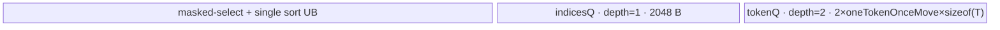
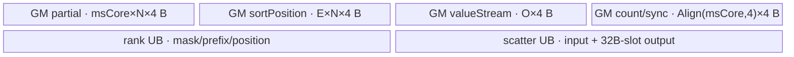
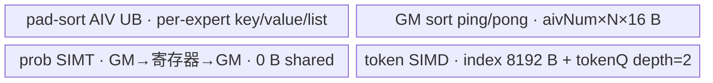

# MoeTokenPermuteWithRoutingMap 950 ACLNN 算子知识

## 算子速览

| 项目 | 内容 |
|---|---|
| 实际入口 | CANN 9.1.0 公开两段式接口 `aclnnMoeTokenPermuteWithRoutingMapGetWorkspaceSize` / `aclnnMoeTokenPermuteWithRoutingMap`；无带版本后缀的更新入口 |
| 计算语义 | 将 token-expert 布尔映射转为按 expert 排列的 token；非 pad 路线压缩有效映射并重排，pad 路线每个 expert 固定保留 `capacity` 项 |
| 输入输出 | `tokens:[N,H]`，`routingMap:[N,E]`，可选 `probs:[N,E]`；输出 `permutedTokens:[O,H]`、可选 `permutedProbs:[O]`、`sortedIndices:[O]`，均为 ND |
| 执行类型 | AIV Vector/RegBase；key 9 的 prob 与 key 19 的 token/prob 使用 `SIMT`，仍在单个 AIV Kernel launch 内按阶段顺序执行 |
| Kernel 路线 | R-001 单核排序整行 gather；R-002 多核归并整行 gather；R-003 单核排序 split-D gather；R-004 多核归并 split-D gather；R-005 非对齐 rank/scatter 整行 gather；R-006 非对齐 rank/scatter split-D；R-007 pad SIMD token/SIMT prob；R-008 pad SIMT token/prob |
| 核心资源 | GM 输入输出；user workspace 的排序 ping-pong、rank/scatter 和核间同步区；AIV UB 的 TQue/TBuf；SIMT 直接 GM 标量读写；无 L1/L0A/L0B/L0C |
| 来源闭包 | `source_closed`：公开 ACLNN、L0 launcher、OpDef、Tiling/POD、key 1/2/3/4/9/19 的全部 950 entry/body/helper 与 CMake 接线闭合 |
| 验证状态 | 固定 Commit 源码审查；未执行本地编译、真机、数值或性能验证 |

## 接口与语义

### 计算语义

令 `N=tokens.shape[0]`、`H=tokens.shape[1]`、`E=routingMap.shape[1]`。ACLNN 先把 `routingMap` 与可选 `probs` 转置为 `[E,N]`。

当 `dropAndPad=false` 时，`K=floor(numOutTokens/N)`、`O=N*K`。设备先对 `[E,N]` mask 做 masked-select，得到按 expert 扫描的 token id 流；若实际有效映射数恰为 `O`，直接按 token id 排序生成每个源 token 的输出位置，再将 `tokens[i]` 写到这些位置。若实际有效数不等于 `O`，则构造每个 `(expert,token)` 的 rank，masked-select 出 rank value 流，再把源 token id scatter 到 rank 位置；未占用的 `sortedIndices` 初始化为 `-1`，token gather 跳过 `-1`。`probs` 仅按 mask 压缩搬运，不改变 FP16/BF16/FP32 位模式。

当 `dropAndPad=true` 时，`capacity=floor(numOutTokens/E)`、`O=E*capacity`。每个 expert 对本行 `routingMap.T[e,:]` 排序并截取前 `capacity` 个 token id，随后 `permutedTokens[o,h]=tokens[sortedIndices[o],h]`。若存在 probs，则 `permutedProbs[e*capacity+j]=probs.T[e,sortedIndices[e*capacity+j]]`。950 的 prob gather 始终为 SIMT。源码写作 `H>=620 && O>=aivNum/2`，但该判断发生在任何函数给成员 `aivNum` 赋正值之前，故固定实现中第二项退化为 `O>=0`；实际 token 分发是 `H>=620` 选 SIMD，否则选 SIMT。

### 输入、输出与属性

| 参数 | shape/layout | dtype | 约束、默认值与语义 |
|---|---|---|---|
| `tokens` | `[N,H]`，ND | FP16/BF16/FP32 | 必选且二维；可非连续，ACLNN 先 `Contiguous`；输出 dtype 必须一致 |
| `routingMap` | `[N,E]`，ND；L0 收到 `[E,N]` | BOOL/INT8 | 必选且二维；可非连续；API 源码只校验 dtype/shape，0/1 值域由文档约束而非代码显式校验 |
| `probsOptional` | `[N,E]`，ND；L0 收到 `[E,N]` | FP16/BF16/FP32 | 可选；shape 必须与 routingMap 两维相同；通常与 tokens 同 dtype，唯一放宽为 tokens=BF16、probs=FP32 |
| `numOutTokens` | Host 标量 | INT64 | `0<=numOutTokens<=N*E`；API 将输出首维对齐到 `E`（pad）或 `N`（非 pad） |
| `dropAndPad` | Host 标量 | BOOL | 默认 false；决定 `capacity`/`topK`、key 和 gather 图 |
| `permutedTokensOut` | `[O,H]`，ND | 同 tokens | 必选；API 要求首维为对齐后的 `O`；非连续输出经 `ViewCopy` |
| `permuteProbsOutOptional` | `[O]`，ND | 同 probs | probs 存在时必选；probs 不存在时 L0 分配 `[0]` 内部张量但不写用户输出 |
| `sortedIndicesOut` | `[O]`，ND | INT32 | 必选；非 pad 非对齐路径可能含 `-1`；pad 为 token id |
| `workspaceSize` | Host 出参 | UINT64 | executor 全图 workspace；包含本算子 user workspace 及连续化/转置等节点需求 |
| `executor` | Host 出参 | `aclOpExecutor*` | 持有转置、L0 launch、ViewCopy 和相关临时 tensor，第二段运行结束前有效 |
| `workspace/stream` | Device 地址/ACL stream | 字节地址/句柄 | 第二段由 `CommonOpExecutorRun` 在给定 stream 顺序执行整张图 |

### 入口与版本

固定 CANN 9.1.0 只有无版本后缀的公开 `aclnnMoeTokenPermuteWithRoutingMapGetWorkspaceSize/aclnnMoeTokenPermuteWithRoutingMap`，是 950 实际支持的最新入口。`MoeTokenPermuteWithRoutingMap` OpDef 明确注册 `ascend950` RegBase 配置；950 ACLNN 的 `IsRegbase()` 为 true，因此 L0 内部直接分配 `[O,H]` token 输出，pad 路线也不追加外部 `GatherV2`。头文件注释中“sortedIndicesOut 在 quantMode=0 时为空”与本接口无 `quantMode` 且实现始终分配/写该输出冲突，本卡按实现处理。

## Host/Launcher 执行流程

### 参数校验与前处理

第一段依次执行 `CheckNotNull→CheckDtypeValid→CheckShapeValid→CheckTokensValid`。它校验必选指针、probs 与输出配对、dtype 组合、tokens/routingMap/probs 维数、probs 两维与 routingMap 一致、`numOutTokens` 范围、`N/E<16777215`，以及用户输出首维等于 `floor(numOutTokens/alignNum)*alignNum`。routingMap 空时创建空 executor 并直接返回。

非空时依次对 tokens/routingMap 做 `Contiguous`，把 routingMap 以 perm `[1,0]` 转置；probs 存在时也连续化并转置。L0 `l0op::MoeTokenPermuteWithRoutingMap` 计算 `O`，分配三项输出并用 `ADD_TO_LAUNCHER_LIST_AICORE` 入图。950 因 `IsRegbase()` 直接使用该 launch 的 token 输出；三项用户输出分别用 `ViewCopy` 提交，任一步返回空指针都立即返回 ACLNN 内部错误。

### 参数、Workspace 与生命周期

Tiling 读取平台 AIV 核数和 UB。950 先从可用于 Vector tiling 的 UB 扣除 `40960 B`；pad 路线再调用 `SetLocalMemorySize(扣减后的ubSize)`。非 pad 的 user workspace 至少覆盖 `max(4*O*sizeof(float), nonAlignedBytes)+coreSyncBytes+16 MiB`，其中 `nonAlignedBytes=(Align(msCore,4)+msCore*N+E*N+N*K)*4`，`coreSyncBytes=coreNum*32*2`。pad 为 `aivNum*N*4*4+aivNum*32*2+16 MiB`。排序 ping-pong 在 user workspace 起点复用；非对齐路径把同一起点解释为 `int32` rank/scatter 网络。

executor 拥有连续化、转置、中间输出和 ViewCopy 节点；调用者拥有传入 workspace 与用户 tensor。Tiling POD 由框架在 launch 前按值序列化，Kernel 用 `GET_TILING_DATA` 读取；workspace 与 executor 必须存活到给定 stream 上第二段完成。

### 启动图与失败传播

启动图为 `GetWorkspaceSize→Contiguous(tokens/routingMap[/probs])→Transpose(routingMap[/probs])→l0op::MoeTokenPermuteWithRoutingMap→moe_token_permute_with_routing_map<<<aivNum,stream>>>→ViewCopy(outputs)`。`PostTiling` 写 `blockDim=aivNum`、`schedule_mode=1` 并保存 POD；entry 在 AIC 立即返回，仅 AIV 执行。workspace 或 `GetUserWorkspace` 为空时 entry 静默返回；未知 key 也无 fallback。Host 校验、tensor 分配、图节点创建或 `CommonOpExecutorRun` 失败时沿 ACLNN 状态返回，不再提交后继。

## Route 与参数设计

### 分核与资源计算

公共维度为 `n=N`、`cols=H`、`colsAlign=ceil(H/(32/sizeof(T)))*(32/sizeof(T))`。非 pad 的 `topK=numOutTokens/N`，`totalLength=N*topK`；masked-select 按 expert 分核，`needCore=min(E,realAiv)`，former 核处理 `ceil(E/needCore)*N`，tail 核处理剩余行；tile 上限由扣减后的 UB 和 probs dtype 推导并按 128 元素对齐。

排序上限 `sortLoopMax=floor((UB-aivNum*32)/(4*2*4)/32)*32`。`totalLength<=sortLoopMax` 选单核排序基 key 1，否则选多核基 key 2；多核数先上取至 `4^ceil(log4(ceil(totalLength/sortLoopMax)))`，再限于物理 AIV 并按 32 元素调整每核分片。token 行若 `UB-512*4 >= 2*align32(H*sizeof(T))` 使用整行 gather；否则 key 加 2 并按 `floor((UB-2048)/2/512)*512/sizeof(T)` 切 hidden 维。

pad 先计算 `isSimd=(H>=620 && O>=aivNum/2)`，此时成员 `aivNum` 仍是构造默认值 0；随后 `Tiling4VBSComputeLastdim` 才把 key 设为 9 并按 expert 写 `aivNum`。因此固定源码实际以 `H>=620` 选择 `Tiling4GatherCompute`/key 9，否则 key 加 10 得 19 并调 SIMT tiling。SIMT `threadNum` 从 2048 开始，当 `threadNum>=256` 且 `floor(ySize/threadNum)<aivNum/2` 时不断减半；这里的 `aivNum` 已由 pad sort 写入，所以线程折半条件有效。每核元素对齐到 threadNum；prob 的 `ySize=O`，token 的 `ySize=O*H`。源码声明的 `DCACHE_SIZE=128 KiB` 与 `DCACHE=32 KiB` 未进入任何计算；不得把它们解释为已分配 cache。

### Route 选择

Route ID 冻结顺序为 `R-001`、`R-002`、`R-003`、`R-004`、`R-005`、`R-006`、`R-007`、`R-008`；表格、Kernel 章节、平台结论与源码闭包均使用该顺序。

| 顺序 | Route | Key/模板 | 精确选择条件与优先级 | 不适用去向 |
|---:|---|---|---|---|
| 1 | R-001 单核排序整行 gather | key 1；`MoeSortOneCore<int32_t>` + `MoeindexCopyOp<T,false>` | `!dropAndPad && totalLength<=sortLoopMax && UB-2048>=2*align32(H*sizeof(T)) && actualOutTokens==N*topK` | actual 不等到 R-005；UB 不足到 R-003 |
| 2 | R-002 多核归并整行 gather | key 2；`MoeSortMultiCore<int32_t>` + `MoeindexCopyOp<T,false>` | `!dropAndPad && totalLength>sortLoopMax &&` 整行 UB 条件成立且 `actualOutTokens==N*topK` | actual 不等到 R-005；UB 不足到 R-004 |
| 3 | R-003 单核排序 split-D gather | key 3；`MoeSortOneCore<int32_t>` + `MoeindexCopySplitDOp<T,false>` | 单核排序条件成立且 `UB-2048<2*align32(H*sizeof(T))`，并且 `actualOutTokens==N*topK` | actual 不等到 R-006 |
| 4 | R-004 多核归并 split-D gather | key 4；`MoeSortMultiCore<int32_t>` + `MoeindexCopySplitDOp<T,false>` | 多核排序条件成立且整行 UB 条件不成立，并且 `actualOutTokens==N*topK` | actual 不等到 R-006 |
| 5 | R-005 非对齐 rank/scatter 整行 gather | key 1/2 的 Device runtime 分支；`MoeRoutingRankMultiCore` + `MoeSortIndicesScatterMultiCore` + `MoeindexCopyOp<T,true>` | Host 选择 key 1/2 后，首轮 masked-select 得 `actualOutTokens!=N*topK` | key 3/4 到 R-006；相等返回 R-001/R-002 |
| 6 | R-006 非对齐 rank/scatter split-D | key 3/4 的 Device runtime 分支；rank/scatter + `MoeindexCopySplitDOp<T,true>` | Host 选择 key 3/4 后，首轮 masked-select 得 `actualOutTokens!=N*topK` | 相等返回 R-003/R-004 |
| 7 | R-007 pad SIMD token/SIMT prob | key 9；`MoeSortMultiLastDimCore` + `Gatherv2SimdTwoDim`，有 probs 时 `Gatherv2SimtTwoDim::ProbProcess` | `dropAndPad && regBase && H>=620`；源码第二项 `O>=aivNum/2` 在判断时因 `aivNum==0` 恒真 | 谓词 false 到 R-008 |
| 8 | R-008 pad SIMT token/prob | key 19；`Gatherv2SimtTwoDim::Process/ProbProcess` | `dropAndPad && regBase && H<620`；由上述初始化顺序化简 | 无 fallback；未知 key 静默终止 |

```text
dropAndPad=false
  -> totalLength<=sortLoopMax ? baseKey=1 : baseKey=2
  -> 整行 token 双缓冲可容纳 ? key=baseKey : key=baseKey+2
  -> Device masked-select actualOutTokens==N*topK ? 对应排序+gather Route : 对应 rank/scatter Route
dropAndPad=true（A5 RegBase）
  -> key=9，先生成 prob SIMT 参数
  -> 判断时 aivNum=0，所以 H>=620 ? R-007(key 9, token SIMD) : R-008(key 19, token SIMT)
```

### 模板/实现执行矩阵

| Route | key/selector | dtype/shape/platform 完整命中条件 | 执行拓扑与 Kernel 节点 | 实际模板/body | 内存与同步特征 | tail/fallback |
|---|---|---|---|---|---|---|
| R-001 | 1 + `actualOutTokens==O` | 950；非 pad；`O<=sortLoopMax`；整行 UB 可容纳 | 单 launch：masked-select→单核 sort→row gather | `KernelMaskedSelectV3<T>`、`MoeSortOneCore<int32_t>`、`MoeindexCopyOp<T,false>` | masked-select UB + sort UB + token/indices Queue；阶段间 `SyncAll` | tile、token chunk 尾；actual 不等转 R-005 |
| R-002 | 2 + `actualOutTokens==O` | 950；非 pad；`O>sortLoopMax`；整行 UB 可容纳 | 单 launch：masked-select→VBS/VMS/final merge→row gather | `MoeSortMultiCore<int32_t>`、`MoeMrgsort`、`MoeMrgsortOut`、`MoeindexCopyOp<T,false>` | 两片 GM ping-pong workspace + 多核 barrier | former/tail core 与末 list；actual 不等转 R-005 |
| R-003 | 3 + `actualOutTokens==O` | R-001 的 sort 条件；整行 UB 不可容纳 | 单 launch：masked-select→单核 sort→split-D gather | `MoeindexCopySplitDOp<T,false>` | 固定 2048 B indices UB + 双 token segment | hidden 末段由 `oneTokenlastMove` |
| R-004 | 4 + `actualOutTokens==O` | R-002 的 sort 条件；整行 UB 不可容纳 | 单 launch：masked-select→多核 merge→split-D gather | `MoeSortMultiCore<int32_t>`、`MoeindexCopySplitDOp<T,false>` | ping-pong workspace + split-D UB；全核同步 | merge 与 hidden 双重 tail |
| R-005 | 1/2 + `actualOutTokens!=O` | 950；非 pad；整行 UB 可容纳；真实 mask 数不等于属性 O | 单 launch：rank→external-index select→scatter→row gather | `MoeRoutingRankMultiCore`、`MoeSortIndicesScatterMultiCore`、`MoeindexCopyOp<T,true>` | int32 rank/scatter workspace；每阶段 `SyncAll` | `-1` 槽跳过；无其它 fallback |
| R-006 | 3/4 + `actualOutTokens!=O` | R-005 且整行 UB 不可容纳 | 单 launch：rank→select→scatter→split-D gather | 同 R-005 + `MoeindexCopySplitDOp<T,true>` | rank/scatter workspace + split-D UB | `-1` 与 hidden tail 同时保护 |
| R-007 | 9 | 950；pad；`H>=620`（源码判断时 `aivNum=0`） | 单 launch：per-expert sort→SIMT prob→SIMD token | `MoeSortMultiLastDimCore<uint8_t>`、`Gatherv2SimtTwoDim::ProbProcess`、`Gatherv2SimdTwoDim::Process` | sort UB/workspace；SIMT 无 AIV Queue；SIMD 双 buffer | expert/capacity、row 与 col tail |
| R-008 | 19 | 950；pad；上述 SIMD 谓词为假 | 单 launch：per-expert sort→SIMT prob→SIMT token | `Gatherv2SimtTwoDim::{ProbProcess,Process}` | sort UB/workspace；thread 直接 GM/寄存器，dynamic local memory 由 Host 设置 | 每线程 `idx<endIdx`；未知 key 终止 |

### 隐藏性能 Guard

| Guard | Host/Tiling 条件 | Device/资源原因 | 影响 Route | 不满足时去向 | 源码符号 |
|---|---|---|---|---|---|
| 排序单核上限 | `O<=floor((UB-aivNum*32)/(4*2*4)/32)*32` | 一个排序元素需要 key/value、输入/输出与双区预算 | R-001/R-003 | R-002/R-004 | `DoOpTiling`、`Tiling4VBSCompute` |
| 整行双缓冲 | `UB-512*4>=2*align32(H*sizeof(T))` | 完整 token 行需双缓冲，另保留最多 512 个 int32 index | R-001/R-002/R-005 | key 加 2，进入 R-003/R-004/R-006 | `Tiling4IndexCopyCompute` |
| 多核归并扇入 | 初始核数上取为 `4^ceil(log4(ceil(O/sortLoopMax)))`，再限于物理 AIV | `MrgSort` 每次最多合并 4 个 list | R-002/R-004 | 末级少于四路仍由真实 list 长度处理 | `Tinlig4VBSMultiCoreCompute`、`MoeMrgsort::UpdateMrgParam` |
| masked-select UB | `ubLength=floor((UB-128)/(4*sizeof(prob)+7+12)/128)*128`，再限于 N；`ubLength!=0` | Host 以 `DOUBLE_BUFFER=2` 做保守预算；Device `SetPipeBuffer` 的 Queue depth 实为 1，并另有 mask/index/辅助 TBuf | R-001～R-006 | Tiling 记录错误；无 Device fallback | `CalcMaskedSelectUb`、`KernelMaskedSelectV3::SetPipeBuffer` |
| 950 SIMT 预留 | RegBase 时 `UB-=40960`，pad 再 `SetLocalMemorySize(UB)` | SIMT 与 RegBase 本地内存需从 Vector tiling 预算隔离 | 全部 950；尤其 R-007/R-008 | 无降级路线；资源不足在 Tiling/编译期失败 | `DoOpTiling` |
| pad token SIMD | 源码式 `H>=620 && O>=aivNum/2`；求值时成员 `aivNum==0`，故实际为 `H>=620` | 宽行采用 UB 批量二维搬运；源码并未实现有效的 O 门槛 | R-007 | R-008 | `DoOpTiling` |
| SIMT 线程数 | 从 2048 开始，在 `threadNum>=256 && floor(ySize/threadNum)<aivNum/2` 时折半 | 避免小域使用过多线程块；保证末核由显式元素数保护 | R-007 prob、R-008 | 最低降到 128（非 FPGA） | `Tiling4GatherComputeSimt` |
| 平台编译 guard | `__NPU_ARCH__==3510` 才实例化 arch35 SIMD/SIMT | key 9/19 的 950 body 只在 arch3510 编译 | R-007/R-008 | 非 950 key9 使用 `MoePermuteProb` 且 token 外置 gather | entry 的预处理 guard |
| 空指针/未知 key | `workspace!=nullptr && GetUserWorkspace(workspace)!=nullptr` 且 key∈{1,2,3,4,9,19} | entry 没有设备错误回写或默认分支 | 全部 | 静默 return/无输出 | `moe_token_permute_with_routing_map` |

### POD/ABI

`TILING_DATA_FIELD_DEF` 宏的展开定义不在固定源码范围内，故确切 `sizeof/alignof/offsetof` 固定仓不可见。下表按声明序号逐字段固定 producer/consumer；所有子结构字段均为 64 bit，外层五个子结构的宽度与 offset 由同一生成宏决定。

| 结构 | 字段 | 类型/位宽 | ABI 布局 | 单位 | Host/launcher producer | Device consumer | 边界 |
|---|---|---|---|---|---|---|---|
| `PermuteVBSComputeRMTilingData` | `needCoreNum` | int64_t/64 | `sizeof/alignof/offsetof` 固定仓不可见；序号 0 | AIV 核 | `Tinlig4VBS*` | `MoeSortOne/Multi/LastDimCore::Process` | 1～物理 AIV |
| `PermuteVBSComputeRMTilingData` | `perCoreElements` | int64_t/64 | 固定仓不可见；序号 1 | 元素 | `Tinlig4VBS*` | 排序 GM/WS 核偏移 | 多核非 pad 按 32 元素调整 |
| `PermuteVBSComputeRMTilingData` | `perCoreLoops` | int64_t/64 | 固定仓不可见；序号 2 | 循环 | `Tinlig4VBS*` | `VBSProcess` | 至少 1 |
| `PermuteVBSComputeRMTilingData` | `perCorePerLoopElements` | int64_t/64 | 固定仓不可见；序号 3 | 元素 | `Tinlig4VBS*` | UB sort tile | `<=sortLoopMax` |
| `PermuteVBSComputeRMTilingData` | `perCoreLastLoopElements` | int64_t/64 | 固定仓不可见；序号 4 | 元素 | `Tinlig4VBS*` | 前核最后 sort tile | 有效尾块 |
| `PermuteVBSComputeRMTilingData` | `lastCoreElements` | int64_t/64 | 固定仓不可见；序号 5 | 元素 | `Tinlig4VBS*` | 末核排序总量 | 非 pad 覆盖总长度 |
| `PermuteVBSComputeRMTilingData` | `lastCoreLoops` | int64_t/64 | 固定仓不可见；序号 6 | 循环 | `Tinlig4VBS*` | 末核 `VBSProcess` | 至少 1 |
| `PermuteVBSComputeRMTilingData` | `lastCorePerLoopElements` | int64_t/64 | 固定仓不可见；序号 7 | 元素 | `Tinlig4VBS*` | 末核 UB tile | `<=sortLoopMax` |
| `PermuteVBSComputeRMTilingData` | `lastCoreLastLoopElements` | int64_t/64 | 固定仓不可见；序号 8 | 元素 | `Tinlig4VBS*` | 末核最后 tile | 有效尾块 |
| `PermuteVBSComputeRMTilingData` | `oneLoopMaxElements` | int64_t/64 | 固定仓不可见；序号 9 | 元素 | `Tiling4VBS*` | sort/merge UB 上限 | `sortLoopMax` |
| `PermuteVBSComputeRMTilingData` | `lastCoreWSindex` | int64_t/64 | 固定仓不可见；序号 10 | ping-pong index | `Tinlig4VBSMultiCoreCompute` | `MoeSortMultiCore::Init` | 0/1 |
| `PermuteVBSComputeRMTilingData` | `frontcoreTask` | int64_t/64 | 固定仓不可见；序号 11 | expert/核 | `Tinlig4VBSMultiCoreComputeLastdim` | pad sort/prob | `ceil(E/realAiv)` |
| `PermuteVBSComputeRMTilingData` | `tailcoreTask` | int64_t/64 | 固定仓不可见；序号 12 | expert/核 | 同上 | pad sort/prob | `floor(E/realAiv)` |
| `PermuteVBSComputeRMTilingData` | `frontCoreNum` | int64_t/64 | 固定仓不可见；序号 13 | 核 | 同上 | pad expert 起点 | `E%realAiv` 或 realAiv |
| `PermuteVBSComputeRMTilingData` | `tailCoreNum` | int64_t/64 | 固定仓不可见；序号 14 | 核 | 同上 | pad expert 起点 | 可能为 0 |
| `PermuteVMSMiddleComputeRMTilingData` | `needCoreNum` | int64_t/64 | `sizeof/alignof/offsetof` 固定仓不可见；序号 0 | 核 | `Tiling4VMSMiddleCompute` | `MoeSortMultiCore::VMSProcess` | VBS 核数<=4 时为 0 |
| `PermuteSortOutComputeRMTilingData` | `oneLoopMaxElements` | int64_t/64 | `sizeof/alignof/offsetof` 固定仓不可见；序号 0 | 元素 | `Tiling4SortOutCompute` | `MoeMrgsort/MoeMrgsortOut` | 固定 1024 |
| `IndexCopyComputeRMTilingData` | `needCoreNum` | int64_t/64 | `sizeof/alignof/offsetof` 固定仓不可见；序号 0 | 核 | `SetIndexCopyParams/Tiling4Gather*` | index copy、SIMD/SIMT token | route 专属 |
| `IndexCopyComputeRMTilingData` | `frontCoreNum` | int64_t/64 | 固定仓不可见；序号 1 | 核 | `SetIndexCopyParams` 或 prob SIMT tiling | index copy 分片或 SIMT prob | 两种语义由 key 唯一选择 |
| `IndexCopyComputeRMTilingData` | `tailCoreNum` | int64_t/64 | 固定仓不可见；序号 2 | 核或末核元素 | `SetIndexCopyParams/Tiling4Gather*` | index copy 或 token gather | key 19 中为末核元素数 |
| `IndexCopyComputeRMTilingData` | `coreCalcNum` | int64_t/64 | 固定仓不可见；序号 3 | token 或元素/核 | `SetIndexCopyParams/Tiling4Gather*` | gather 核起点/循环 | route 专属 |
| `IndexCopyComputeRMTilingData` | `coreCalcTail` | int64_t/64 | 固定仓不可见；序号 4 | token/核 | `SetIndexCopyParams` | tail index copy | pad inactive |
| `IndexCopyComputeRMTilingData` | `oneTokenBtypeSize` | int64_t/64 | 固定仓不可见；序号 5 | 字节或 SIMD 合并 dtype 字节 | `SetIndexCopyParams/Tiling4GatherCompute` | DataCopy blockLen/SIMD 地址 | 非 pad=`H*sizeof(T)`；key9 为 improve dtype bytes |
| `IndexCopyComputeRMTilingData` | `onceIndicesTokenMoveTimes` | int64_t/64 | 固定仓不可见；序号 6 | 次 | `SetIndexCopyParams` | 整行 index copy 内循环 | pad inactive |
| `IndexCopyComputeRMTilingData` | `onceUbTokenNums` | int64_t/64 | 固定仓不可见；序号 7 | token 或合并元素 | `SetIndexCopyParams/Tiling4Gather*` | index copy/SIMD/SIMT `innerSize` | route 专属 |
| `IndexCopyComputeRMTilingData` | `onceIndicesTokenNums` | int64_t/64 | 固定仓不可见；序号 8 | token | `SetIndexCopyParams` | indices chunk | pad inactive |
| `IndexCopyComputeRMTilingData` | `onceIndices` | int64_t/64 | 固定仓不可见；序号 9 | index 或 thread | `SetIndexCopyParams/Tiling4Gather*` | indices UB 或 prob SIMT threadNum | route 专属 |
| `IndexCopyComputeRMTilingData` | `oneTokenlastMove` | int64_t/64 | 固定仓不可见；序号 10 | token 元素 | `SetIndexCopyParams` | split-D 末段 | key 3/4/非对齐 split-D |
| `IndexCopyComputeRMTilingData` | `oneTokenOnceMove` | int64_t/64 | 固定仓不可见；序号 11 | token 元素 | `SetIndexCopyParams` | split-D 普通段 | 512 B 对齐换算 |
| `IndexCopyComputeRMTilingData` | `oneTokenMoveTimes` | int64_t/64 | 固定仓不可见；序号 12 | 次 | `SetIndexCopyParams` | split-D hidden 循环 | `ceil(H/oneTokenOnceMove)` |
| `IndexCopyComputeRMTilingData` | `frontCoreLoop` | int64_t/64 | 固定仓不可见；序号 13 | 循环或 prob 每核元素 | `SetIndexCopyParams/Tiling4GatherComputeSimt(true)` | index copy/prob SIMT | route 专属 |
| `IndexCopyComputeRMTilingData` | `frontCoreLastTokenNums` | int64_t/64 | 固定仓不可见；序号 14 | token | `SetIndexCopyParams` | front 末 indices chunk | pad inactive |
| `IndexCopyComputeRMTilingData` | `tailCoreLoop` | int64_t/64 | 固定仓不可见；序号 15 | 循环或 prob 末核元素 | `SetIndexCopyParams/Tiling4GatherComputeSimt(true)` | index copy/prob SIMT | route 专属 |
| `IndexCopyComputeRMTilingData` | `tailCoreLastTokenNums` | int64_t/64 | 固定仓不可见；序号 16 | token | `SetIndexCopyParams` | tail 末 indices chunk | pad inactive |
| `IndexCopyComputeRMTilingData` | `tailLastonceIndicesTokenMoveTimes` | int64_t/64 | 固定仓不可见；序号 17 | 次 | `SetIndexCopyParams` | tail 核最后 indices 批 | pad inactive |
| `IndexCopyComputeRMTilingData` | `tailLastIndicesLastTokenNums` | int64_t/64 | 固定仓不可见；序号 18 | token | `SetIndexCopyParams` | tail 最后 token 数 | pad inactive |
| `IndexCopyComputeRMTilingData` | `frontLastonceIndicesTokenMoveTimes` | int64_t/64 | 固定仓不可见；序号 19 | 次 | `SetIndexCopyParams` | front 核最后 indices 批 | pad inactive |
| `IndexCopyComputeRMTilingData` | `frontLastIndicesLastTokenNums` | int64_t/64 | 固定仓不可见；序号 20 | token | `SetIndexCopyParams` | front 最后 token 数 | pad inactive |
| `IndexCopyComputeRMTilingData` | `numOutTokens` | int64_t/64 | 固定仓不可见；序号 21 | token | `InitIndexCopyParams/Tiling4GatherCompute` | index copy 输出界限 | 非 pad=`N*topK`；pad=`E*capacity` |
| `IndexCopyComputeRMTilingData` | `tokenUB` | int64_t/64 | 固定仓不可见；序号 22 | 字节或 SIMD 元素预算 | `SetIndexCopyParams/Tiling4GatherCompute` | `InitBuffer`/SIMD tile | route 专属，key19 inactive |
| `IndexCopyComputeRMTilingData` | `indicesUB` | int64_t/64 | 固定仓不可见；序号 23 | 字节 | `SetIndexCopyParams` | index copy indices queue | pad inactive |
| `MaskedSelectRMTilingData` | `formerNum` | uint64_t/64 | `sizeof/alignof/offsetof` 固定仓不可见；序号 0 | 核 | `Tiling4MaskedSelect` | masked-select/rank expert 分片 | 至少 1 |
| `MaskedSelectRMTilingData` | `formerLength` | uint64_t/64 | 固定仓不可见；序号 1 | mask 元素/核 | 同上 | GM 核基址 | `ceil(E/core)*N` |
| `MaskedSelectRMTilingData` | `formertileNum` | uint64_t/64 | 固定仓不可见；序号 2 | tile | 同上 | masked-select loop | 含尾 tile |
| `MaskedSelectRMTilingData` | `formertileLength` | uint64_t/64 | 固定仓不可见；序号 3 | 元素 | 同上 | UB tile/rank tile 上限 | Host 按 UB 推导 |
| `MaskedSelectRMTilingData` | `formerlasttileLength` | uint64_t/64 | 固定仓不可见；序号 4 | 元素 | 同上 | former 尾搬运 | 有效长度 |
| `MaskedSelectRMTilingData` | `tailNum` | uint64_t/64 | 固定仓不可见；序号 5 | 核 | 同上 | tail 分片 | 可为 0 |
| `MaskedSelectRMTilingData` | `tailLength` | uint64_t/64 | 固定仓不可见；序号 6 | mask 元素/核 | 同上 | tail GM 基址 | 均分剩余 |
| `MaskedSelectRMTilingData` | `tailtileNum` | uint64_t/64 | 固定仓不可见；序号 7 | tile | 同上 | tail loop | tailNum=0 时 inactive |
| `MaskedSelectRMTilingData` | `tailtileLength` | uint64_t/64 | 固定仓不可见；序号 8 | 元素 | 同上 | tail UB tile | tailNum=0 时 inactive |
| `MaskedSelectRMTilingData` | `taillasttileLength` | uint64_t/64 | 固定仓不可见；序号 9 | 元素 | 同上 | tail 尾搬运 | tailNum=0 时 inactive |
| `MaskedSelectRMTilingData` | `tokenNum` | uint64_t/64 | 固定仓不可见；序号 10 | token | 同上 | index progression/rank | `N>0` |
| `MaskedSelectRMTilingData` | `needCoreNum` | int64_t/64 | 固定仓不可见；序号 11 | 核 | 同上 | masked-select/rank barrier 域 | `min(E,realAiv)` |
| `MoeTokenPermuteWithRoutingMapTilingData` | `coreNum` | int64_t/64 | `sizeof/alignof/offsetof` 固定仓不可见；外层序号 0 | AIV 核 | `GetPlatformInfo` | sort/index copy 同步域 | 小输入可设 1 |
| `MoeTokenPermuteWithRoutingMapTilingData` | `n` | int64_t/64 | 固定仓不可见；外层序号 1 | token | `InitShapeAttrsInfo` | 全部 route 地址/长度 | `N>0` |
| `MoeTokenPermuteWithRoutingMapTilingData` | `cols` | int64_t/64 | 固定仓不可见；外层序号 2 | 元素/行 | 同上 | token gather 地址 | `H` |
| `MoeTokenPermuteWithRoutingMapTilingData` | `colsAlign` | int64_t/64 | 固定仓不可见；外层序号 3 | 元素/行 | 同上 | index copy UB stride | 32 B 对齐 |
| `MoeTokenPermuteWithRoutingMapTilingData` | `topK` | int64_t/64 | 固定仓不可见；外层序号 4 | 映射/token | `GetShapeAttrsInfo` | masked-select/index copy | 非 pad `<=512`；pad 为属性商但排序用 capacity |
| `MoeTokenPermuteWithRoutingMapTilingData` | `expertNum` | int64_t/64 | 固定仓不可见；外层序号 5 | expert | `InitShapeAttrsInfo` | 非对齐 rank | `E>0` 由 API 非空路由保证 |
| `MoeTokenPermuteWithRoutingMapTilingData` | `capacity` | int64_t/64 | 固定仓不可见；外层序号 6 | token/expert | `GetShapeAttrsInfo` | pad sort/SIMT prob | 非 pad 为 0 |
| `MoeTokenPermuteWithRoutingMapTilingData` | `hasProb` | int64_t/64 | 固定仓不可见；外层序号 7 | 0/1 | `InitShapeAttrsInfo` | entry/masked-select/pad prob | optional tensor 是否存在 |
| `MoeTokenPermuteWithRoutingMapTilingData` | `vbsComputeParamsOp` | struct/宽度固定仓不可见 | `sizeof/alignof/offsetof` 固定仓不可见；外层序号 8 | ABI 子结构 | `Tiling4VBS*` | sort route | 字段次序不可变 |
| `MoeTokenPermuteWithRoutingMapTilingData` | `vmsMiddleComputeParamsOp` | struct/宽度固定仓不可见 | 固定仓不可见；外层序号 9 | ABI 子结构 | `Tiling4VMSMiddleCompute` | multi sort | pad producer 未调用，consumer pad 不读 |
| `MoeTokenPermuteWithRoutingMapTilingData` | `sortOutComputeParamsOp` | struct/宽度固定仓不可见 | 固定仓不可见；外层序号 10 | ABI 子结构 | `Tiling4SortOutCompute` | merge helper | 固定 1024 |
| `MoeTokenPermuteWithRoutingMapTilingData` | `indexCopyComputeParamsOp` | struct/宽度固定仓不可见 | 固定仓不可见；外层序号 11 | ABI 子结构 | `Tiling4IndexCopy/Gather*` | gather route | 同字段按 key 复用 |
| `MoeTokenPermuteWithRoutingMapTilingData` | `maskedSelectParamsOp` | struct/宽度固定仓不可见 | 固定仓不可见；外层序号 12 | ABI 子结构 | `Tiling4MaskedSelect` | 非 pad select/rank | pad inactive |

### Route 源码闭包

| Route | Key/selector | Host/Tiling producer | POD/参数 | Kernel entry/router | Kernel body/直接依赖 | 构建接线 |
|---|---|---|---|---|---|---|
| R-001 单核排序整行 gather | key 1 + runtime aligned | `moe_token_permute_with_routing_map_tiling.cpp:Tiling4VBSCompute/Tiling4IndexCopyCompute` | VBS、MaskedSelect、IndexCopy 子结构 | `moe_token_permute_with_routing_map.cpp:TILING_KEY_IS(1)/GENERAL_OP_IMPL` | `KernelMaskedSelectV3`、`MoeSortOneCore`、`MoeindexCopyOp` | `op_host/CMakeLists.txt:add_modules_sources/add_ops_compile_options` |
| R-002 多核归并整行 gather | key 2 + runtime aligned | 同文件 `Tinlig4VBSMultiCoreCompute/Tiling4VMSMiddleCompute` | VBS/VMS/SortOut/IndexCopy | entry key 2 | `MoeSortMultiCore`、`MoeMrgsort`、`MoeMrgsortOut`、`MoeindexCopyOp` | 同 R-001 |
| R-003 单核排序 split-D gather | key 3 + runtime aligned | `Tiling4IndexCopyCompute` 的 UB 不足分支 | key 1 POD + split-D 字段 | entry key 3 | `MoeSortOneCore`、`MoeindexCopySplitDOp` | 同 R-001 |
| R-004 多核归并 split-D gather | key 4 + runtime aligned | multi sort producer + split-D 分支 | VBS/VMS/SortOut + split-D | entry key 4 | `MoeSortMultiCore`、merge helpers、`MoeindexCopySplitDOp` | 同 R-001 |
| R-005 非对齐 rank/scatter 整行 gather | key 1/2 + runtime mismatch | masked-select 与 nonAligned workspace producer | MaskedSelect + workspace offset + IndexCopy | `GENERAL_OP_IMPL→NONALIGNED_SORT_COPY_IMPL` | `MoeRoutingRankMultiCore`、external-index masked-select、`MoeSortIndicesScatterMultiCore`、`MoeindexCopyOp<T,true>` | 同 R-001 |
| R-006 非对齐 rank/scatter split-D | key 3/4 + runtime mismatch | 同 R-005 + split-D tiling | 同 R-005 + split-D 字段 | `NONALIGNED_SORT_COPY_IMPL` | rank/scatter helpers、`MoeindexCopySplitDOp<T,true>` | 同 R-001 |
| R-007 pad SIMD token/SIMT prob | key 9 | `Tiling4VBSComputeLastdim/Tiling4GatherCompute/Simt(true)` | capacity、pad VBS、复用 IndexCopy 字段 | entry key 9/arch3510 guard | `MoeSortMultiLastDimCore`、`Gatherv2SimtTwoDim::ProbProcess`、`Gatherv2SimdTwoDim::Process` | ascend950 OpDef + 950 compile options |
| R-008 pad SIMT token/prob | key 19 | `Tiling4GatherComputeSimt(false/true)` | thread/core 元素字段、localMemorySize | entry key 19/arch3510 guard | `Gatherv2SimtTwoDim::Process/ProbProcess/GatherSimt*` | ascend950 OpDef + 950 compile options |

## Kernel 实现

### 公共执行流程

统一 entry 先排除 AIC，反序列化 POD，校验 workspace/user workspace，然后按 key 展开宏。非 pad 首阶段 `KernelMaskedSelectV3::Process` 先逐核统计 mask 数，`SyncAll` 后所有核读取计数并得到 `actualOutTokens`；相等时输出 prob/token-id 流并进入排序，非相等时改走 rank/scatter。每个阶段销毁自己的 `TPipe`，显式 `SyncAll` 保护跨阶段 GM/workspace 可见性。pad 先为每个 expert 排序/截断，随后在同一 launch 内 gather prob 和 token。

全部路线都是 AIV 或 SIMT，Cube 层级 `L1/L0A/L0B/L0C` 均为 `N/A`；实际替代路径是 `GM↔UB↔Vector/标量`，SIMT 则为 thread 直接 `GM→寄存器→GM`。无独立多 Kernel workspace 边，ACLNN 中的 Contiguous/Transpose/ViewCopy 由 executor 同 stream 排序。

### Route R-001：单核排序整行 gather

#### 适用条件

##### 选择证据

| 层级 | 文件 | 符号 | 源码谓词/参数 | 结果/下一跳 |
|---|---|---|---|---|
| Tiling | moe/moe_token_permute_with_routing_map/op_host/moe_token_permute_with_routing_map_tiling.cpp | `Tiling4VBSCompute/Tiling4IndexCopyCompute` | `!paddedMode && totalLength<=sortLoopMaxElement`；`ubLeft>=2*oneTokenBtypeSizeAlign32` | base key 1 且整行 index copy |
| Router | moe/moe_token_permute_with_routing_map/op_kernel/moe_token_permute_with_routing_map.cpp | `GENERAL_OP_IMPL` key 1 | masked-select 返回 `actualOutTokens==t->n*t->topK` | `SORT_COPY_IMPL(MoeSortOneCore,MoeindexCopyOp)`；否则 R-005 |

#### Device 数据流

##### 函数级调用链

```text
moe_token_permute_with_routing_map -> KernelMaskedSelectV3::Init/Process
  -> MoeSortOneCore<int32_t>::Init -> CopyIn -> SortCompute -> CopyOut
  -> MoeindexCopyOp<DTYPE_TOKENS,false>::Init -> Process -> CopyInIndices/CopyIn/CopyOut
```

##### 源码等价伪码

```text
伪码：for 每个 masked-select tile：读取 routingMap[核偏移+tileOffset]，生成 bitMask，压缩 token id/prob
if actualOutTokens==N*topK：
  blockIdx=0 读取 sortedIndices[0:O]，Cast 为 FP32 后乘 -1，Sort 携带 arange value，写回输出位置
  for 本核 token chunk：读取 indices[offset*topK] 与连续 tokens[offset*H]
    for token、for k：dstOffset=indicesValue*H；写 permutedTokens[dstOffset:dstOffset+H]
```

#### 内存与数据搬运

##### 资源与搬运表

| 层级/缓冲区 | offset/地址公式 | extent/容量公式 | dtype/layout | producer | consumer | owner/lifetime | 对齐/复用 |
|---|---|---|---|---|---|---|---|
| GM mask/prob/id | former `blockIdx*formerLength+tile*tileLength`；tail `formerNum*formerLength+(blockIdx-formerNum)*tailLength+tile*tileLength` | 当前 tile 的 `length` | uint8/T、ND | ACLNN transpose | masked-select | executor/阶段 1 | UB 长度按 128 元素对齐，写回 `rsvdCnt` |
| UB sort | `index=0`，sort data/out 由 TPipe 分区 | `sortNum=ceil(O/32)*32`；in=`sortNum*8 B`，index=`sortNum*4 B`，out/sorted 各 `2*sortNum*4 B` | int32→FP32 key/value | `CopyIn/ArithProgression` | `Sort/Extract` | 单核 sort 阶段 | 尾 key 塞 `MIN_FP32` |
| GM token gather | `src=(coreTokenBase+token)*H`；`dst=indicesValue*H` | 每行 `H*sizeof(T)`，每批 `onceUbTokenNums` 行 | FP16/BF16/FP32 ND | tokens/排序输出 | index copy | 调用者/末阶段 | `colsAlign` 为 32 B 步长，GM 只写 H |
| UB gather | TPipe queue 双缓冲，无固定物理 offset | token `tokenUB=onceRows*align32(H*sizeof(T))`，indices=`align32(onceRows*topK*4)` | T + int32 | MTE2 | 标量索引+MTE3 | 每核 chunk | depth=2 token、depth=1 indices |
| L1/L0A/L0B/L0C | N/A；实际路径 GM↔UB | 0 B | N/A | N/A | N/A | 未使用 | 纯 Vector |

##### 分层内存布局


##### 字节账与复用顺序

```text
L=tileLengthAlign
masked_select_device_UB = hasProb·2·L·sizeof(P) + L·1 + L·4 + L·(4+1+4) + 96 + is1B(P)·4L
masked_select_host_budget = (4·sizeof(P)+7+12)·L + 128
single_sort_UB = sortData(2·S·4)+index(S·4)+sortOut(2·S·4)+sorted(2·S·4) = 7·S·4, S=Align32(O)
gather_UB = 2·tokenUB + indicesUB
workspace_total = max(4·O·sizeof(float), nonAlignedBytes) + coreNum·64 + 16 MiB
```

| 复用子区 | 写入者 | 读取者/消费点 | 下一次覆盖 | 同步或释放依据 | 安全条件 |
|---|---|---|---|---|---|
| masked-select Queue | `CopyIn/Compute` | `GatherMask/CopyOut` | 下一 tile | `DeQue/FreeTensor` 与 V/MTE event | depth=2 且只在释放后复用 |
| sort LocalTensor | `CopyIn/Sort` | `Extract/CopyOut` | sort 阶段结束 | `PipeBarrier`、`SyncAll` | `S` 按 32 元素对齐 |
| gather tokenQ | token `CopyIn` | 多目标 `CopyOut` | 下一批行 | Queue 生命周期 | `onceRows` 与尾批计数来自 POD |

#### 同步、精度与尾块

##### 同步与数值边界表

| 阶段 | primitive/机制 | producer | consumer/等待点 | 保护对象 | 精度/尾块 |
|---|---|---|---|---|---|
| mask count→输出 | `V_MTE3` + `SyncAll` + `PIPE_ALL` | 每核 offsetGlobal | 所有核读取计数 | actualOutTokens/每核输出基址 | mask uint8→half→float 求和→int32 round；最后 tile 用 lasttileLength |
| sort | `PIPE_V`、末尾 `SyncAll` | Cast/Muls/Sort | Extract/CopyOut/index copy | sortedIndices GM | int32 key 临时转 FP32；有效 O，补齐项为 `MIN_FP32` |
| gather | `MTE2_S` 与 `S_MTE2`，TQue producer/consumer | indices/tokens MTE2 | 标量读取和 MTE3 | indicesLocal/token UB | token/prob 无算术；front/tail 核和最后 chunk 使用专属计数 |

#### 关键实现

##### 符号证据表

| 阶段 | 文件 | 符号/模板实例 | 实现事实 |
|---|---|---|---|
| Host/Tiling producer | moe/moe_token_permute_with_routing_map/op_host/moe_token_permute_with_routing_map_tiling.cpp | `Tiling4VBSCompute/Tiling4IndexCopyCompute` | 生成 key 1、整行 UB、分核与尾 chunk |
| Kernel entry/router | moe/moe_token_permute_with_routing_map/op_kernel/moe_token_permute_with_routing_map.cpp | key 1 `GENERAL_OP_IMPL` | runtime aligned 分支映射单核排序和整行 gather |
| Device body/helper | moe/moe_token_permute_with_routing_map/op_kernel/masked_select_v3.h | `KernelMaskedSelectV3::Process/ComputeOffset/Compute` | mask 计数、压缩和实际输出数 |
| Device body/helper | moe/moe_token_permute_with_routing_map/op_kernel/moe_sort_one_core.h | `MoeSortOneCore::SortCompute/CopyOut` | 单核携带 index 的 FP32 sort |
| Device body/helper | moe/moe_token_permute_with_routing_map/op_kernel/moe_index_copy.h | `MoeindexCopyOp<T,false>::Process/CopyOut` | 按排序位置复制完整 token 行 |

### Route R-002：多核归并整行 gather

#### 适用条件

##### 选择证据

| 层级 | 文件 | 符号 | 源码谓词/参数 | 结果/下一跳 |
|---|---|---|---|---|
| Tiling | moe/moe_token_permute_with_routing_map/op_host/moe_token_permute_with_routing_map_tiling.cpp | `Tiling4VBSCompute/Tinlig4VBSMultiCoreCompute` | `totalLength>sortLoopMaxElement`，整行 UB 条件成立 | key 2，VBS/VMS/SortOut 参数 |
| Router | moe/moe_token_permute_with_routing_map/op_kernel/moe_token_permute_with_routing_map.cpp | key 2 `GENERAL_OP_IMPL` | `actualOutTokens==N*topK` | `MoeSortMultiCore` + `MoeindexCopyOp`；否则 R-005 |

#### Device 数据流

##### 函数级调用链

```text
entry -> KernelMaskedSelectV3::Process
  -> MoeSortMultiCore<int32_t>::Process -> VBSProcess/UBSortProcess
    -> OneCoreVMSProcess -> MoeMrgsort::Process -> VMSProcess -> SortOutProcess/MoeMrgsortOut::Process
  -> MoeindexCopyOp<DTYPE_TOKENS,false>::Process
```

##### 源码等价伪码

```text
伪码：if actualOutTokens==O：
  for blockIdx<sortNeedCore：for local tile：读取 id，Cast/Muls/Sort，写 ws[srcPing][blockIdx*coreStride+tileOffset]
  while 每核 listNum>1：每次最多四路从 ws[srcPing] 归并到 ws[1-srcPing]
  SyncAll；while 全局 listNum>4：多核四路归并并翻转 ping；SyncAll
  blockIdx=0 最终 MrgsortOut/Extract 写 sortedIndices[0:O]
  for 每核 token chunk：dstOffset=sortedIndices[token*topK+k]*H，整行复制 token
```

#### 内存与数据搬运

##### 资源与搬运表

| 层级/缓冲区 | offset/地址公式 | extent/容量公式 | dtype/layout | producer | consumer | owner/lifetime | 对齐/复用 |
|---|---|---|---|---|---|---|---|
| workspace ping/pong | `ws0=0`；`ws1=Align(O,4)*2*sizeof(float)`；每核 `blockIdx*GetSortLen(perCoreElements)` | 每片 `Align(O,4)*2` 个 float | FP32 key/value packed | VBS sort/merge | 后级 merge | executor/排序阶段 | 每轮翻转 `srcWsIndex` |
| UB multi-sort | index/concat 共用 `indexConcatBuffer` 前后半 | `indexNum=ceil(max(4*1024,loopElements)/32)*32`；各关键 buffer `2*indexNum*4 B` | FP32 + uint32 index | MTE2/ArithProgression | Sort/MrgSort | 每核阶段 | 每次最多 4 list，尾 list 独立长度 |
| GM token gather | `src=tokenBase*H`；`dst=sortedPosition*H` | O 行输出，每行 H | T/ND | tokens/sortedIndices | index copy | 末阶段 | front/tail 核 chunk |
| UB gather | TPipe 管理 | `tokenUB` + `indicesUB` | T/int32 | MTE2 | MTE3 | 每核 | 32 B 对齐 |
| L1/L0A/L0B/L0C | N/A；实际为 GM↔UB | 0 B | N/A | N/A | N/A | 未使用 | 纯 Vector |

##### 分层内存布局


##### 字节账与复用顺序

```text
sort_workspace = 4·O·sizeof(float)
core_sync = coreNum·32·2 B
workspace_total = max(sort_workspace, nonAlignedBytes) + core_sync + 16 MiB
gather_UB = 2·tokenUB + indicesUB
```

| 复用子区 | 写入者 | 读取者/消费点 | 下一次覆盖 | 同步或释放依据 | 安全条件 |
|---|---|---|---|---|---|
| ping/pong 当前 dst | `VBS/MoeMrgsort::CopyOut` | 下一轮 `CopyIn` | 下一归并层翻转后 | 每层 `SyncAll` | `srcWsIndex` 与 `lastCoreWSindex` 一致 |
| merge UB input/output | `CopyIn/Mrgsort` | `CopyOut` | 下一 list group | Queue/event | 每次最多 4 路且真实长度写入 `MrgSortSrcList` |
| gather Queue | MTE2 | MTE3 | 下一 token 批 | `FreeTensor` | former/tail chunk 有效长度 |

#### 同步、精度与尾块

##### 同步与数值边界表

| 阶段 | primitive/机制 | producer | consumer/等待点 | 保护对象 | 精度/尾块 |
|---|---|---|---|---|---|
| VBS→VMS→final | 每阶段 `AscendC::SyncAll`；merge 内 `MTE3_MTE2/MTE2_V/V_MTE3` | 各核 workspace 写 | 下一层 merge/核0 final | ping-pong list | 每核/末核 loop 与 lastCoreWSindex 防止误读 |
| sort 数值 | Cast int32→FP32、乘 -1、`Sort/MrgSort` | id stream | Extract index | 排序 key/value | O<2^24，int32→FP32 可精确表示；padding 为 `MIN_FP32` |
| gather | `MTE2_S/S_MTE2` | indices chunk | 标量目的地址 | token 行 | 无 cast；最后 chunk 只搬有效行 |

#### 关键实现

##### 符号证据表

| 阶段 | 文件 | 符号/模板实例 | 实现事实 |
|---|---|---|---|
| Host/Tiling producer | moe/moe_token_permute_with_routing_map/op_host/moe_token_permute_with_routing_map_tiling.cpp | `Tinlig4VBSMultiCoreCompute/Tiling4VMSMiddleCompute` | 4 叉核数、32 元素分片、merge 核数 |
| Kernel entry/router | moe/moe_token_permute_with_routing_map/op_kernel/moe_token_permute_with_routing_map.cpp | key 2 `GENERAL_OP_IMPL` | 选择 multi sort + row gather |
| Device body/helper | moe/moe_token_permute_with_routing_map/op_kernel/moe_sort_multi_core.h | `VBSProcess/VMSProcess/SortOutProcess` | 多核排序网络与 workspace offset |
| Device body/helper | moe/moe_token_permute_with_routing_map/op_kernel/moe_mrgsort.h | `MoeMrgsort::Process/CopyIn/CopyOut` | 四路 ping-pong 归并 |
| Device body/helper | moe/moe_token_permute_with_routing_map/op_kernel/moe_mrgsort_out.h | `MoeMrgsortOut::Process/Extract` | 最终 index 提取与有效长度写回 |
| Device body/helper | moe/moe_token_permute_with_routing_map/op_kernel/moe_index_copy.h | `MoeindexCopyOp<T,false>::Process` | 整行 token 复制 |

### Route R-003：单核排序 split-D gather

#### 适用条件

##### 选择证据

| 层级 | 文件 | 符号 | 源码谓词/参数 | 结果/下一跳 |
|---|---|---|---|---|
| Tiling | moe/moe_token_permute_with_routing_map/op_host/moe_token_permute_with_routing_map_tiling.cpp | `Tiling4IndexCopyCompute` | base key 1 且 `ubLeft<2*oneTokenBtypeSizeAlign32` | key 3；生成 `oneTokenOnceMove/MoveTimes/lastMove` |
| Router | moe/moe_token_permute_with_routing_map/op_kernel/moe_token_permute_with_routing_map.cpp | key 3 | `actualOutTokens==O` | 单核 sort 后 `MoeindexCopySplitDOp<T,false>`；否则 R-006 |

#### Device 数据流

##### 函数级调用链

```text
entry -> KernelMaskedSelectV3::Process -> MoeSortOneCore<int32_t>::Process
  -> MoeindexCopySplitDOp<DTYPE_TOKENS,false>::Init
    -> Process -> CopyInIndices -> CopyInAndOut -> DataCopyPadCustom
```

##### 源码等价伪码

```text
伪码：完成 masked-select 与单核 sort 后：
for 本核 indices chunk：读取 token 对应 topK 个输出位置
  for token：for hiddenChunk=0..oneTokenMoveTimes-2：
    srcOffset=token*H+hiddenChunk*oneTokenOnceMove
    for k：dstOffset=indices[token*topK+k]*H+hiddenChunk*oneTokenOnceMove；搬普通段
  末段从 `(moveTimes-1)*oneTokenOnceMove` 搬 `oneTokenlastMove`
```

#### 内存与数据搬运

##### 资源与搬运表

| 层级/缓冲区 | offset/地址公式 | extent/容量公式 | dtype/layout | producer | consumer | owner/lifetime | 对齐/复用 |
|---|---|---|---|---|---|---|---|
| GM sort | 与 R-001 相同 | O 个 id | int32 | masked-select | single sort | 排序阶段 | 32 元素 sort 尾 |
| GM split-D | `src=token*H+inner*oneTokenOnceMove`；`dst=position*H+inner*oneTokenOnceMove` | 普通段 `oneTokenOnceMove*sizeof(T)`；末段 `oneTokenlastMove*sizeof(T)` | T/ND | tokens/id | split-D copy | 末阶段 | 普通段基于 512 B floor；末段精确 |
| UB split-D | queue depth=2，indices depth=1 | token `oneTokenOnceMove*sizeof(T)`；indices `512*4 B` | T/int32 | MTE2 | MTE3 | 每 token/chunk | 不要求整行进入 UB |
| L1/L0A/L0B/L0C | N/A；实际 GM↔UB | 0 B | N/A | N/A | N/A | 未使用 | 纯 Vector |

##### 分层内存布局



##### 字节账与复用顺序

```text
splitD_UB = 2·oneTokenOnceMove·sizeof(T) + 512·sizeof(int32)
oneTokenOnceMove = floor((UB-2048)/2, 512 B)/sizeof(T)
workspace_total = max(4·O·sizeof(float), nonAlignedBytes) + coreNum·64 + 16 MiB
```

| 复用子区 | 写入者 | 读取者/消费点 | 下一次覆盖 | 同步或释放依据 | 安全条件 |
|---|---|---|---|---|---|
| tokenQ | `CopyInAndOut` MTE2 | 当前 k 个目标的 MTE3 | 下一 hidden chunk | Queue/event | 普通段固定，末段用 `oneTokenlastMove` |
| indicesQ | `CopyInIndices` | 标量 position | 下一 token 批 | `S_MTE2`/释放 | 仅读取有效 topK |

#### 同步、精度与尾块

##### 同步与数值边界表

| 阶段 | primitive/机制 | producer | consumer/等待点 | 保护对象 | 精度/尾块 |
|---|---|---|---|---|---|
| indices→copy | `PIPE_MTE2`、`S_MTE2` | indices GM→UB | 标量 index 与下一 chunk | indicesLocal | int32 不转换 |
| token chunk | TQue EnQue/DeQue | MTE2 普通/末段 | MTE3 多目标复制 | 单个 hidden chunk | T 仅搬运；末段严格 `oneTokenlastMove` |
| 阶段边界 | single sort `SyncAll` | sortedIndices 写 | split-D 读 | sortedIndices | 排序尾同 R-001 |

#### 关键实现

##### 符号证据表

| 阶段 | 文件 | 符号/模板实例 | 实现事实 |
|---|---|---|---|
| Host/Tiling producer | moe/moe_token_permute_with_routing_map/op_host/moe_token_permute_with_routing_map_tiling.cpp | `Tiling4IndexCopyCompute` | UB 不足时 key+2 和 hidden 分段参数 |
| Kernel entry/router | moe/moe_token_permute_with_routing_map/op_kernel/moe_token_permute_with_routing_map.cpp | key 3 `GENERAL_OP_IMPL` | 单核 sort + split-D 实例 |
| Device body/helper | moe/moe_token_permute_with_routing_map/op_kernel/moe_sort_one_core.h | `MoeSortOneCore::Process` | 生成排序位置 |
| Device body/helper | moe/moe_token_permute_with_routing_map/op_kernel/moe_index_copy_split_d.h | `MoeindexCopySplitDOp<T,false>::Process/CopyInAndOut` | hidden 分段、多目的地址与末段 |

### Route R-004：多核归并 split-D gather

#### 适用条件

##### 选择证据

| 层级 | 文件 | 符号 | 源码谓词/参数 | 结果/下一跳 |
|---|---|---|---|---|
| Tiling | moe/moe_token_permute_with_routing_map/op_host/moe_token_permute_with_routing_map_tiling.cpp | `Tiling4VBSCompute/Tiling4IndexCopyCompute` | multi sort 且整行 UB 条件不成立 | key 4 |
| Router | moe/moe_token_permute_with_routing_map/op_kernel/moe_token_permute_with_routing_map.cpp | key 4 | `actualOutTokens==O` | multi sort/merge 后 split-D；否则 R-006 |

#### Device 数据流

##### 函数级调用链

```text
entry -> KernelMaskedSelectV3::Process
  -> MoeSortMultiCore<int32_t>::Process -> MoeMrgsort::Process -> MoeMrgsortOut::Process
  -> MoeindexCopySplitDOp<DTYPE_TOKENS,false>::Process -> CopyInAndOut
```

##### 源码等价伪码

```text
伪码：for 每核 sort tile 写 workspace ping；while listNum>1 四路归并并 SyncAll
blockIdx=0 写最终 sortedIndices
for 本核 token：for hiddenChunk：
  srcOffset=tokenBase*H+chunkOffset
  for k：if 输出位置有效，dstOffset=sortedIndices[token*topK+k]*H+chunkOffset，提交本 chunk
```

#### 内存与数据搬运

##### 资源与搬运表

| 层级/缓冲区 | offset/地址公式 | extent/容量公式 | dtype/layout | producer | consumer | owner/lifetime | 对齐/复用 |
|---|---|---|---|---|---|---|---|
| workspace sort | 与 R-002 相同的 `ws0/ws1` 与每核 GetSortLen offset | `4*O*sizeof(float)` 级 ping-pong | FP32 packed | multi sort | merge/final | 排序阶段 | 每轮 ping-pong |
| GM/UB split-D | 与 R-003 的 `token*H+chunkOffset`/`position*H+chunkOffset` | tokenUB=`oneTokenOnceMove*sizeof(T)`；indicesUB=2048 B | T/int32 | sortedIndices/tokens | split-D | 末阶段 | 512 B 普通段，精确尾段 |
| L1/L0A/L0B/L0C | N/A；实际 GM↔UB↔workspace | 0 B | N/A | N/A | N/A | 未使用 | 纯 Vector |

##### 分层内存布局


##### 字节账与复用顺序

```text
sort_workspace = 4·O·sizeof(float)
splitD_UB = 2·oneTokenOnceMove·sizeof(T) + 2048
workspace_total = max(sort_workspace, nonAlignedBytes) + coreNum·64 + 16 MiB
```

| 复用子区 | 写入者 | 读取者/消费点 | 下一次覆盖 | 同步或释放依据 | 安全条件 |
|---|---|---|---|---|---|
| workspace ping/pong | VBS/VMS | 下一 merge 层 | 层间翻转 | `SyncAll` | source/destination 不同片 |
| split-D tokenQ | MTE2 | 多目标 MTE3 | 下一 hidden 段 | TQue 生命周期 | 排序阶段完成且末段精确 |

#### 同步、精度与尾块

##### 同步与数值边界表

| 阶段 | primitive/机制 | producer | consumer/等待点 | 保护对象 | 精度/尾块 |
|---|---|---|---|---|---|
| 多核 merge | `SyncAll` + `MTE3_MTE2/MTE2_V/V_MTE3` | sort/每层 merge | 下一层/final | workspace ping-pong | FP32 exact id；per-core/last-core 尾 |
| split-D | `PIPE_MTE2`、TQue、`S_MTE2` | indices/token chunk | scalar/MTE3 | indicesLocal/token UB | token 无 cast；末 hidden chunk 有效长度 |

#### 关键实现

##### 符号证据表

| 阶段 | 文件 | 符号/模板实例 | 实现事实 |
|---|---|---|---|
| Host/Tiling producer | moe/moe_token_permute_with_routing_map/op_host/moe_token_permute_with_routing_map_tiling.cpp | `Tinlig4VBSMultiCoreCompute/Tiling4IndexCopyCompute` | multi sort 与 split-D key 4 |
| Kernel entry/router | moe/moe_token_permute_with_routing_map/op_kernel/moe_token_permute_with_routing_map.cpp | key 4 `GENERAL_OP_IMPL` | 多核 sort + split-D |
| Device body/helper | moe/moe_token_permute_with_routing_map/op_kernel/moe_sort_multi_core.h | `MoeSortMultiCore::Process` | VBS/VMS/final 归并 |
| Device body/helper | moe/moe_token_permute_with_routing_map/op_kernel/moe_mrgsort_out.h | `MoeMrgsortOut::CopyOut` | 最终有效 index 写回 |
| Device body/helper | moe/moe_token_permute_with_routing_map/op_kernel/moe_index_copy_split_d.h | `MoeindexCopySplitDOp<T,false>::CopyInAndOut` | hidden 分段复制 |

### Route R-005：非对齐 rank/scatter 整行 gather

#### 适用条件

##### 选择证据

| 层级 | 文件 | 符号 | 源码谓词/参数 | 结果/下一跳 |
|---|---|---|---|---|
| Device | moe/moe_token_permute_with_routing_map/op_kernel/moe_token_permute_with_routing_map.cpp | `GENERAL_OP_IMPL/NONALIGNED_SORT_COPY_IMPL` | key 1/2 且首轮 `actualOutTokens!=t->n*t->topK` | 跳过单/多核 sort，执行 rank/scatter |
| Tiling | moe/moe_token_permute_with_routing_map/op_host/moe_token_permute_with_routing_map_tiling.cpp | `CalcNonAlignedScatterWorkspaceBytes/GetWorkspaceSize` | `paddedMode==false` | workspace 容量至少覆盖 rank/scatter；整行 gather 字段来自 key 1/2 |

#### Device 数据流

##### 函数级调用链

```text
entry -> KernelMaskedSelectV3::Process（仅统计，发现 mismatch）
  -> MoeRoutingRankMultiCore::Process -> AccumulatePartialCount -> BuildSortPosition
  -> KernelMaskedSelectV3::ProcessGatherExternalIndex -> ComputeExternalIndex
  -> MoeSortIndicesScatterMultiCore::Process -> InitMinusOne/Compute/CopyOut
  -> MoeindexCopyOp<DTYPE_TOKENS,true>::Process
```

##### 源码等价伪码

```text
伪码：partialOffset=Align(msCore,4)；sortPosOffset=partialOffset+msCore*N；valueOffset=sortPosOffset+E*N
for 每核 token tile：累加本核 expert rows 的 mask，写 partial[blockIdx*N+token]
SyncAll；for 本核 expert row：running=sum(partial[priorCore,*])；sortPos[e,t]=running+t*topK；running+=mask[e,t]
SyncAll；masked-select 以 sortPos 为 external index，输出 valueStream 中的 rank position
先把 sortedIndices[0:O] 初始化 -1；for value：outOffset=valueStream[value]，写 sortedIndices[outOffset]=valueOrdinal
for 源 token：若 indices!=-1 且 <O，整行复制到对应输出位置
```

#### 内存与数据搬运

##### 资源与搬运表

| 层级/缓冲区 | offset/地址公式 | extent/容量公式 | dtype/layout | producer | consumer | owner/lifetime | 对齐/复用 |
|---|---|---|---|---|---|---|---|
| workspace partial | `partialOffset=Align(msCore,4)` int32 元素 | `msCore*N` int32 | int32 `[core,N]` | `AccumulatePartialCount` | prior-core prefix | rank 阶段 | 起点避开 mask count |
| workspace sortPosition | `partialOffset+msCore*N` | `E*N` int32 | int32 `[E,N]` | `BuildSortPosition` | external-index masked-select | rank→select | token tile<=4096，UB calcLength 按 32 B |
| workspace valueStream | `sortPositionOffset+E*N` | `actualOutTokens`，容量按 `N*topK` | int32 | external-index select | scatter | select→scatter | 仅有效 mask 项 |
| GM sortedIndices | `0:O` 初始化 -1；scatter 目标 `valueStream[i]` | O int32 | int32 | InitGlobalMemory/scatter | sparse index copy | scatter→gather | 越界 position 不写 |
| UB rank/scatter | rank 每项约 mask+5*int32+float+half；scatter in=`perLoopRows*32 B`、out=`ceil(rows/32)*32*32 B` | rank tile `min(maskTile,4096,N)`；scatter 受 192 KiB 公式限制 | uint8/int32/float/half | MTE2/Vector | Vector/scalar/MTE3 | 每核 tile | scatter assist 每 8 个 int32 放一个 ordinal |
| L1/L0A/L0B/L0C | N/A；实际 GM↔UB | 0 B | N/A | N/A | N/A | 未使用 | 纯 Vector |

##### 分层内存布局



##### 字节账与复用顺序

```text
nonAlignedBytes = (Align(msCore,4)+msCore·N+E·N+O)·4
workspace_total = max(4·O·sizeof(float), nonAlignedBytes) + coreNum·64 + 16 MiB
rank_UB = tile·(1+5·4+4+2) + source-visible fixed assist
gather_UB = 2·tokenUB + indicesUB
```

| 复用子区 | 写入者 | 读取者/消费点 | 下一次覆盖 | 同步或释放依据 | 安全条件 |
|---|---|---|---|---|---|
| workspace 起点 | mask count | rank partial | rank 阶段重解释 | 首轮 `SyncAll` | offset 用 `Align(msCore,4)` 避开计数 |
| sortPosition | rank prefix | external-index masked-select | launch 结束 | rank 后 `SyncAll` | 覆盖全部 E×N |
| valueStream | external select | scatter | launch 结束 | select 后 `SyncAll` | 只读 `actualOutTokens` 有效项 |
| sortedIndices | `InitMinusOne`/scatter | sparse gather | launch 结束 | init/scatter barrier | 未命中槽保持 -1 |

#### 同步、精度与尾块

##### 同步与数值边界表

| 阶段 | primitive/机制 | producer | consumer/等待点 | 保护对象 | 精度/尾块 |
|---|---|---|---|---|---|
| rank 两阶段 | 三次 `AscendC::SyncAll` | partial/rank rows | prefix/external select | partial/sortPosition GM | mask uint8→half→float→int32，0/1 精确；末 token tile 有效长度 |
| select→scatter | entry 阶段间 `SyncAll`；scatter init 前后 `SyncAll` | valueStream/InitGlobalMemory | scatter/gather | valueStream/sortedIndices | 无浮点；空 `actualOutTokens` 只保留 -1 |
| scatter 单项写 | `MTE2_S` + 32 B assist block CopyOut | value index | GM outOffset | sortedIndices 单元素 | 仅 `outOffset<O` 写；末 loopRows 限定 |
| sparse gather | `ifNumOutTokens=true` 的 -1/上界 guard | sortedIndices | token CopyOut | permutedTokens | token 无 cast；H 大时逐 token，H 小时批量 |

#### 关键实现

##### 符号证据表

| 阶段 | 文件 | 符号/模板实例 | 实现事实 |
|---|---|---|---|
| Host/Tiling producer | moe/moe_token_permute_with_routing_map/op_host/moe_token_permute_with_routing_map_tiling.cpp | `CalcNonAlignedScatterWorkspaceBytes/GetWorkspaceSize` | 三个 workspace offset 和容量上界 |
| Kernel entry/router | moe/moe_token_permute_with_routing_map/op_kernel/moe_token_permute_with_routing_map.cpp | `NONALIGNED_SORT_COPY_IMPL` | runtime mismatch 到 rank/select/scatter/true gather |
| Device body/helper | moe/moe_token_permute_with_routing_map/op_kernel/moe_routing_rank_multi_core.h | `AccumulatePartialCount/BuildSortPosition` | per-token expert prefix 与 rank 位置 |
| Device body/helper | moe/moe_token_permute_with_routing_map/op_kernel/masked_select_v3.h | `ProcessGatherExternalIndex/ComputeExternalIndex` | 以 sortPosition 压缩 value 流 |
| Device body/helper | moe/moe_token_permute_with_routing_map/op_kernel/moe_sortindices_scatter_multi_core.h | `InitMinusOne/Compute/CopyOut` | -1 初始化与无 GM SetValue 的 scatter |
| Device body/helper | moe/moe_token_permute_with_routing_map/op_kernel/moe_index_copy.h | `MoeindexCopyOp<T,true>::Process` | sparse guard 与整行 token 复制 |

### Route R-006：非对齐 rank/scatter split-D

#### 适用条件

##### 选择证据

| 层级 | 文件 | 符号 | 源码谓词/参数 | 结果/下一跳 |
|---|---|---|---|---|
| Device | moe/moe_token_permute_with_routing_map/op_kernel/moe_token_permute_with_routing_map.cpp | key 3/4 `GENERAL_OP_IMPL` | `actualOutTokens!=O` | `NONALIGNED_SORT_COPY_IMPL(MoeindexCopySplitDOp)` |
| Tiling | moe/moe_token_permute_with_routing_map/op_host/moe_token_permute_with_routing_map_tiling.cpp | `Tiling4IndexCopyCompute/GetWorkspaceSize` | UB 不能容纳双缓冲整行，同时非 pad | split-D 字段 + rank/scatter 容量 |

#### Device 数据流

##### 函数级调用链

```text
entry -> MoeRoutingRankMultiCore::Process
  -> KernelMaskedSelectV3::ProcessGatherExternalIndex
  -> MoeSortIndicesScatterMultiCore::Process
  -> MoeindexCopySplitDOp<DTYPE_TOKENS,true>::Process -> CopyInAndOut
```

##### 源码等价伪码

```text
伪码：按 R-005 构造 partial/sortPosition/valueStream 并 scatter 得含 -1 的 sortedIndices
for 每核源 token：if 首 index==-1 则跳过
  for hiddenChunk：srcOffset=token*H+chunkOffset
    for k：position=indices[token*topK+k]
      if position!=-1 && position<O：dstOffset=position*H+chunkOffset；搬本 chunk
```

#### 内存与数据搬运

##### 资源与搬运表

| 层级/缓冲区 | offset/地址公式 | extent/容量公式 | dtype/layout | producer | consumer | owner/lifetime | 对齐/复用 |
|---|---|---|---|---|---|---|---|
| rank/scatter workspace | 与 R-005 完全相同的三段 int32 offset | `(Align(msCore,4)+msCore*N+E*N+N*K)*4 B` | int32 | rank/select | scatter | 前三阶段 | 不与 token UB 别名 |
| GM/UB split-D | `src=token*H+chunkOffset`；`dst=position*H+chunkOffset` | 普通 `oneTokenOnceMove`，末段 `oneTokenlastMove` | T/ND | tokens/sparse positions | split-D | 末阶段 | 512 B 普通段、精确末段 |
| L1/L0A/L0B/L0C | N/A；实际 GM↔UB↔workspace | 0 B | N/A | N/A | N/A | 未使用 | 纯 Vector |

##### 分层内存布局


##### 字节账与复用顺序

```text
workspace_total = max(4·O·sizeof(float), (Align(msCore,4)+msCore·N+E·N+O)·4) + coreNum·64 + 16 MiB
splitD_UB = 2·oneTokenOnceMove·sizeof(T) + 2048
```

| 复用子区 | 写入者 | 读取者/消费点 | 下一次覆盖 | 同步或释放依据 | 安全条件 |
|---|---|---|---|---|---|
| rank/scatter 三段 | rank/select/scatter | 后继阶段 | launch 结束 | 三次 `SyncAll` | offset/extent 使用 int32 元素单位 |
| split-D tokenQ | MTE2 | 有效 position 的 MTE3 | 下一 hidden 段 | TQue 生命周期 | position!=-1 且 position<O |

#### 同步、精度与尾块

##### 同步与数值边界表

| 阶段 | primitive/机制 | producer | consumer/等待点 | 保护对象 | 精度/尾块 |
|---|---|---|---|---|---|
| rank/scatter | 与 R-005 相同的全核 barrier 和 MTE/Vector event | partial/value/scatter | 下一阶段 | 三段 workspace | int32 rank；token tile/loop tail |
| split-D | `PIPE_MTE2`、`S_MTE2`、TQue | indices/chunk | scalar guard/MTE3 | sparse positions/token chunk | -1 与 `<O` 双 guard；末 hidden chunk 精确长度 |

#### 关键实现

##### 符号证据表

| 阶段 | 文件 | 符号/模板实例 | 实现事实 |
|---|---|---|---|
| Host/Tiling producer | moe/moe_token_permute_with_routing_map/op_host/moe_token_permute_with_routing_map_tiling.cpp | `Tiling4IndexCopyCompute/CalcNonAlignedScatterWorkspaceBytes` | 同时生成 split-D 与非对齐容量 |
| Kernel entry/router | moe/moe_token_permute_with_routing_map/op_kernel/moe_token_permute_with_routing_map.cpp | key 3/4 `NONALIGNED_SORT_COPY_IMPL` | true split-D 实例 |
| Device body/helper | moe/moe_token_permute_with_routing_map/op_kernel/moe_routing_rank_multi_core.h | `MoeRoutingRankMultiCore::Process` | rank 网络 |
| Device body/helper | moe/moe_token_permute_with_routing_map/op_kernel/moe_sortindices_scatter_multi_core.h | `MoeSortIndicesScatterMultiCore::Process` | sparse index 生成 |
| Device body/helper | moe/moe_token_permute_with_routing_map/op_kernel/moe_index_copy_split_d.h | `MoeindexCopySplitDOp<T,true>::CopyInAndOut` | sparse guard、hidden 分段和尾段 |

### Route R-007：pad SIMD token/SIMT prob

#### 适用条件

##### 选择证据

| 层级 | 文件 | 符号 | 源码谓词/参数 | 结果/下一跳 |
|---|---|---|---|---|
| Tiling | moe/moe_token_permute_with_routing_map/op_host/moe_token_permute_with_routing_map_tiling.cpp | `DoOpTiling/Tiling4GatherCompute` | `paddedMode && regBase && cols>=620`；源码额外的 `numOutTokens>=aivNum/2` 因判断时 `aivNum==0` 恒真 | key 9；token SIMD，prob 参数仍由 SIMT producer 写 |
| Router | moe/moe_token_permute_with_routing_map/op_kernel/moe_token_permute_with_routing_map.cpp | key 9 arch3510 分支 | 先 pad sort；`hasProb` 时 SIMT prob；随后 `Gatherv2SimdTwoDim` token | 完成；谓词 false 为 R-008 |

#### Device 数据流

##### 函数级调用链

```text
entry -> MoeSortMultiLastDimCore<uint8_t>::Process -> VBSProcess/OneCoreVMSProcess
  -> MoeMrgsortOut<int32_t,int32_t>::Process(capacity)
  -> Gatherv2SimtTwoDim<ProbT,int32_t,uint32_t>::ProbProcess -> GatherSimtProb
  -> Gatherv2SimdTwoDim<int32_t>::Process -> NoSplitColProcess或SplitColProcess
```

##### 源码等价伪码

```text
伪码：for blockIdx 分到的每个 expert：对 routingMap.T[expert,0:N] sort，截取 capacity 个 token id 写 sortedIndices
SyncAll；if hasProb：for thread=threadIdx.x; local<O_core; local+=blockDim.x：
  yIndex=coreBase+local；expert=floor(yIndex/capacity)；yProb[yIndex]=probs[expert*N+sortedIndices[yIndex]]
SyncAll；计算 token 的 yStart/yEnd
if colsAlign<=tokenUB*oneTokenBtypeSize：for 输出行批量 gather 整行；else for 输出行、for hidden tile gather
```

#### 内存与数据搬运

##### 资源与搬运表

| 层级/缓冲区 | offset/地址公式 | extent/容量公式 | dtype/layout | producer | consumer | owner/lifetime | 对齐/复用 |
|---|---|---|---|---|---|---|---|
| pad sort workspace | `ws0=0`；`ws1=Align(N*sortCore,4)*2*sizeof(float)` | 每 ping `Align(N*sortCore,4)*2` float | FP32 packed | per-expert sort | `MoeMrgsortOut(capacity)` | sort 阶段 | 每 expert 复用；只提交 capacity |
| SIMT prob GM | `yIndex=blockBase+thread+k*threadNum`；`xIndex=floor(yIndex/capacity)*N+sortedIndices[yIndex]` | 每核 `frontCoreLoop`，末核 `tailCoreLoop` | ProbT ND | thread direct GM load | thread direct GM store | SIMT call | 无 UB/shared/atomic；每线程循环保护 `<currentCoreElements` |
| SIMD token GM | `xOffset=sortedIndices[row]*H*bytes`；`yOffset=row*H*bytes` | O×H×bytes | 原字节流 int8 | token GM | output GM | token gather | improve dtype 把连续字节合并为 2/4/8 B 单元 |
| SIMD token UB | queue depth=2；indexBuf 独立 | queue=`tokenUB*oneTokenBtypeSize`；index=`onceIndices*4 B` | int8 + int32 | MTE2 | Copy/MTE3 | 每核循环 | `colsAlign` 用平台 UB block；尾行/尾 hidden tile精确 blockLen |
| dynamic local memory | context 值=`platformUB-40960 B` | 固定仓只见 `SetLocalMemorySize` 数值 | local-memory 配置 | Host Tiling | 编译/运行时 | 单 launch | SIMT body未显式取动态 UB 地址 |
| DCACHE | N/A；`DCACHE_SIZE/DCACHE` 常量无 consumer | 0 B 可证明分配 | N/A | N/A | N/A | 未使用 | CMake 禁用 kernel-end 自动 dcci；无手工 dcci/flush |
| L1/L0A/L0B/L0C | N/A；实际 GM↔UB 或 GM↔SIMT 寄存器 | 0 B | N/A | N/A | N/A | 未使用 | 无 Cube |

##### 分层内存布局



##### 字节账与复用顺序

```text
sort_workspace = aivNum·N·sizeof(float)·4
core_sync = aivNum·64 B
workspace_total = sort_workspace + core_sync + 16 MiB
token_SIMD_UB = 8192 + 2·tokenUB·improveDtypeSize
dynamic_ub = platformUB - 40960 B（SetLocalMemorySize 的配置值）
prob_SIMT_shared = 0 B
```

| 复用子区 | 写入者 | 读取者/消费点 | 下一次覆盖 | 同步或释放依据 | 安全条件 |
|---|---|---|---|---|---|
| pad sort UB/workspace | per-expert VBS/MrgSortOut | sortedIndices consumer | 下一 expert/归并轮 | TPipe + `SyncAll` | capacity 截断后才进入 gather |
| SIMD tokenQ | `CopyIn` | `CopyOut` | 下一 row/hidden tile | TQue/event | `colsAlign`/tail blockLen 与 POD 一致 |
| SIMT 寄存器标量 | thread GM load | 同 thread GM store | 下一 thread-loop index | 单线程顺序 | 每 thread 独占 yIndex |

#### 同步、精度与尾块

##### 同步与数值边界表

| 阶段 | primitive/机制 | producer | consumer/等待点 | 保护对象 | 精度/尾块 |
|---|---|---|---|---|---|
| sort→prob→token | entry `AscendC::SyncAll` | sortedIndices/prob 写 | SIMT prob/SIMD token | sortedIndices、输出阶段 | sort mask 截断到 capacity；阶段顺序同一 launch |
| SIMT prob | `asc_vf_call(dim3(threadNum))`；无 cooperative group/atomic | 每 thread GM load | 同 thread GM store | 独立 yIndex | ProbT 位拷贝；每线程 stride=`blockDim.x`，末尾 `<currentCoreElements` |
| SIMD token | `MTE3_V/V_MTE3/MTE2_S` 和 TQue | GM/index/UB Copy | CopyOut | UB queue/index cache | 无 cast；最后 core、rows、hidden tile使用精确长度 |
| cache 可见性 | 构建 `-cce-aicore-dcci-before-kernel-end=false` | Kernel GM store | launch 结束 | GM 输出 | 固定 body 无显式 DCache primitive，cache 行为固定仓不可见 |

#### 关键实现

##### 符号证据表

| 阶段 | 文件 | 符号/模板实例 | 实现事实 |
|---|---|---|---|
| Host/Tiling producer | moe/moe_token_permute_with_routing_map/op_host/moe_token_permute_with_routing_map_tiling.cpp | `Tiling4GatherComputeSimt(true)/Tiling4GatherCompute/SetLocalMemorySize` | prob thread、SIMD token tile、UB/local memory |
| Kernel entry/router | moe/moe_token_permute_with_routing_map/op_kernel/moe_token_permute_with_routing_map.cpp | key 9 arch3510 分支 | pad sort→SIMT prob→SIMD token |
| Device body/helper | moe/moe_token_permute_with_routing_map/op_kernel/moe_sort_multi_core_last_dim.h | `MoeSortMultiLastDimCore::Process/VBSProcess` | per-expert sort 与 capacity 截断 |
| Device body/helper | moe/moe_token_permute_with_routing_map/op_kernel/arch35/gather_v2_simt_two_dim.h | `ProbProcess/GatherSimtProb` | prob thread/block 映射和 GM 地址 |
| Device body/helper | moe/moe_token_permute_with_routing_map/op_kernel/arch35/gather_v2_simd_two_dim.h | `Process/NoSplitColProcess/SplitColProcess` | token UB、地址、尾块与同步 |

### Route R-008：pad SIMT token/prob

#### 适用条件

##### 选择证据

| 层级 | 文件 | 符号 | 源码谓词/参数 | 结果/下一跳 |
|---|---|---|---|---|
| Tiling | moe/moe_token_permute_with_routing_map/op_host/moe_token_permute_with_routing_map_tiling.cpp | `DoOpTiling/Tiling4GatherComputeSimt(false)` | `paddedMode && regBase && cols<620`；由判断时 `aivNum==0` 化简 | key `9+10=19`；thread/core element POD |
| Router | moe/moe_token_permute_with_routing_map/op_kernel/moe_token_permute_with_routing_map.cpp | key 19 arch3510 分支 | pad sort；可选 SIMT prob；`Gatherv2SimtTwoDim<DTYPE_TOKENS>::Process` | 完成；无 Device fallback |

#### Device 数据流

##### 函数级调用链

```text
entry -> MoeSortMultiLastDimCore<uint8_t>::Process -> MoeMrgsortOut::Process(capacity)
  -> Gatherv2SimtTwoDim<ProbT,int32_t,uint32_t>::ProbProcess -> GatherSimtProb（hasProb）
  -> Gatherv2SimtTwoDim<TokenT,int32_t,uint32_t>::Process -> GatherSimt
```

##### 源码等价伪码

```text
伪码：完成每 expert sort/capacity 截断并 SyncAll
if hasProb：每个 block 启动 threadNum，for thread-local yIndex 写 probs[expert*N+index]
SyncAll；for blockIdx<needCore：asc_vf_call(threadNum)
  for local=threadIdx.x; local<currentCoreElements; local+=blockDim.x：
    yIndex=blockIdx*CoreElements+local
    gatherRow=floor(yIndex/H)；inner=yIndex-gatherRow*H
    xIndex=sortedIndices[gatherRow]*H+inner；permutedTokens[yIndex]=tokens[xIndex]
```

#### 内存与数据搬运

##### 资源与搬运表

| 层级/缓冲区 | offset/地址公式 | extent/容量公式 | dtype/layout | producer | consumer | owner/lifetime | 对齐/复用 |
|---|---|---|---|---|---|---|---|
| SIMT token GM | `yIndex=blockIdx*CoreElements+thread+k*threadNum`；`xIndex=indices[floor(yIndex/H)]*H+(yIndex%H)` | `O*H` 元素；每核普通/末核元素来自 POD | TokenT ND | GM tokens/indices | volatile GM y | SIMT call | 直接元素访问，无 UB/shared |
| SIMT prob GM | 与 R-007 相同的 `expert*N+indices[yIndex]` | O 元素 | ProbT ND | probs/indices | prob output | 可选 SIMT call | 直接元素访问 |
| thread/block | `threadNum` 由 2048 逐次减半；block 数=`needCoreNum`，每核基址=`blockIdx*CoreElements` | 每线程寄存器为 index/division/value 标量 | uint32/int32/T | Host POD | `asc_vf_call` | 每次 VF call | `LAUNCH_BOUND(2048)`；无 warp/cooperative group/atomic |
| dynamic local memory | `SetLocalMemorySize(platformUB-40960)` | 固定仓仅见配置值 | local-memory | Host | runtime | 单 launch | SIMT token/prob body不分配 LocalTensor |
| DCACHE | N/A；两个常量未使用，body 无 cache 地址/atomic/flush | 0 B 可证明分配 | N/A | N/A | N/A | 未使用 | kernel-end auto dcci 被禁用；其余固定仓不可见 |
| L1/L0A/L0B/L0C/UB | N/A；SIMT 路径实际为 GM→寄存器→GM | 0 B | N/A | N/A | N/A | 未使用 | pad sort 阶段另用 UB，SIMT 阶段不复用其地址 |

##### 分层内存布局

pad sort 阶段使用 AIV UB 与 GM ping-pong；token/prob SIMT 阶段不分配 AIV Queue、shared/dynamic UB 子区，实际布局为每线程若干地址/除法/value 寄存器。`SetLocalMemorySize(platformUB-40960)` 是 launch 配置，固定 body 未显式取得这段地址。

##### 字节账与复用顺序

```text
sort_workspace = aivNum·N·sizeof(float)·4
workspace_total = sort_workspace + aivNum·64 + 16 MiB
token_SIMT_shared = 0 B
prob_SIMT_shared = 0 B
dynamic_ub_config = platformUB - 40960 B
```

| 复用子区 | 写入者 | 读取者/消费点 | 下一次覆盖 | 同步或释放依据 | 安全条件 |
|---|---|---|---|---|---|
| pad sort workspace | VBS/merge | final capacity index | 下一层/下一 expert | `SyncAll` | ping/pong index 正确 |
| SIMT thread registers | GM load/division | GM store | 下一 `local+=threadNum` | thread program order | `local<currentCoreElements` |

#### 同步、精度与尾块

##### 同步与数值边界表

| 阶段 | primitive/机制 | producer | consumer/等待点 | 保护对象 | 精度/尾块 |
|---|---|---|---|---|---|
| sort→prob→token | 每阶段前 `AscendC::SyncAll` | sortedIndices/prob | SIMT consumer/下一阶段 | GM indices/output | capacity 截断；无跨 block partial 输出遗留 |
| SIMT 调度 | `asc_vf_call(dim3(threadNum))` | AIV entry | SIMT VF threads | 当前 block 的 y slice | thread stride=`blockDim.x`，`index<currentCoreElements` 处理末尾 |
| 地址与精度 | `GetUintDivMagicAndShift/Simt::UintDiv` | Host 的 H/capacity | `GatherSimt*` | row/expert 计算 | uint32 地址域；TokenT/ProbT 单元素位拷贝，无 cast/round |
| atomic/cooperative | N/A | 各 thread 独占 yIndex | N/A | 输出无冲突 | 无 atomic、shared、warp barrier；indices 只读 |
| cache | 无源码 primitive | GM volatile token 输出 | Kernel 结束 | 输出可见性 | 固定仓不可见自动 cache 协议，不推测 |

#### 关键实现

##### 符号证据表

| 阶段 | 文件 | 符号/模板实例 | 实现事实 |
|---|---|---|---|
| Host/Tiling producer | moe/moe_token_permute_with_routing_map/op_host/moe_token_permute_with_routing_map_tiling.cpp | `Tiling4GatherComputeSimt(false/true)` | threadNum、needCore、普通/末核元素与 key 19 |
| Kernel entry/router | moe/moe_token_permute_with_routing_map/op_kernel/moe_token_permute_with_routing_map.cpp | key 19 arch3510 分支 | 同 launch 的 pad sort、prob/token SIMT 顺序 |
| Device body/helper | moe/moe_token_permute_with_routing_map/op_kernel/arch35/gather_v2_simt_two_dim.h | `Init/Process/GatherSimt` | token block/thread、fast division、GM 地址与 tail |
| Device body/helper | moe/moe_token_permute_with_routing_map/op_kernel/arch35/gather_v2_simt_two_dim.h | `ProbProcess/GatherSimtProb` | prob expert 地址、无 atomic 与线程尾保护 |
| Device body/helper | moe/moe_token_permute_with_routing_map/op_kernel/moe_sort_multi_core_last_dim.h | `MoeSortMultiLastDimCore::Process` | SIMT 前的 per-expert capacity 索引 producer |

## 算子特定优化

### Trick T-001：按行字节整除提升 950 SIMD 搬运粒度

#### 触发与源码依据

- 适用 Route：R-007。
- 触发条件：pad、950、token SIMD 路线；`H*sizeof(T)` 可整除 8/4/2 B 时依次选择最大的合并 dtype。
- Golden 来源：[`moe_token_permute_with_routing_map_tiling.cpp:558-578`](../../../../../../../cann-ops-raw/ascendc/ops-transformer/be33d95bb755cedec3108f70805c1874d1792540/moe/moe_token_permute_with_routing_map/op_host/moe_token_permute_with_routing_map_tiling.cpp#L558-L578)

**官方源码（固定 Commit 连续逐字摘录）**：

```cpp
int64_t lastAxisBytes = moeTokenPermuteWithRoutingMapTilingData.get_cols() * tokenBtypeSize;
if ((tokenBtypeSize < INPUT_DTYPE_B64) && (lastAxisBytes % INPUT_DTYPE_B64) == 0) {
  improveDtypeSize_ = INPUT_DTYPE_B64;
  return INPUT_DTYPE_B64;
}
```

#### 机制与设计原因

Host 把连续 token 行重解释为最大可整除的 8/4/2 B 单元，并把 `improveDtypeSize_`、`innerSize=H/(improve/original)` 与按该单元计算的 `tokenUB` 写入 POD。Device `Gatherv2SimdTwoDim` 因而以更宽单元执行相同字节流的 `DataCopy`，减少一行的逻辑元素数；它不做数值 cast，输出位模式不变。

#### 迁移边界

- 适用：连续最后一维的纯搬运 gather。
- 前提：整行字节数可被所选宽度整除，输出 dtype/布局与输入一致，且命中 R-007。
- 失效：不能整除时保留原 dtype 字节；pad SIMD 谓词不成立时进入 R-008 SIMT。
- 未验证：本次知识提取未执行编译、真机、数值或性能测试。

#### 错误做法

不能只按 `H` 而忽略 `sizeof(T)` 选宽，也不能在行字节不整除时扩大单元；源码的逐级整除判断就是防止跨行或尾字节误读的边界。固定仓未提供可验证的性能反例。

### Trick T-002：actualOutTokens 不一致时改用 rank/select/scatter，避免错误假设固定 topK

#### 触发与源码依据

- 适用 Route：R-005、R-006。
- 触发条件：非 pad；首轮 masked-select 统计的 `actualOutTokens != N*topK`。
- Golden 来源：[`moe_token_permute_with_routing_map.cpp:104-113`](../../../../../../../cann-ops-raw/ascendc/ops-transformer/be33d95bb755cedec3108f70805c1874d1792540/moe/moe_token_permute_with_routing_map/op_kernel/moe_token_permute_with_routing_map.cpp#L104-L113)

**官方源码（固定 Commit 连续逐字摘录）**：

```cpp
int32_t actualOutTokens = 0;
MASKSELECT_ONLY_IMPL();
if (actualOutTokens != t->n * t->topK) {
    NONALIGNED_SORT_COPY_IMPL(indexCopyClass, tokenDtype);
} else {
    SORT_COPY_IMPL(sortClass2, indexCopyClass, tokenDtype, ifNumOutTokens);
}
```

#### 机制与设计原因

通常路线把每个 token 固定复制 `topK` 次，要求 mask 真值总数恰为 `N*topK`。运行时统计发现不一致后，源码不再用普通 sort，而以逐 token 的 expert 前缀生成 rank，masked-select 压缩真实 rank，再把源 token ordinal scatter 到正确位置，并以 `-1` 标记洞。这样把不规则映射安全转换为可被整行或 split-D gather 消费的稀疏位置流。

#### 迁移边界

- 适用：Host 只能给出容量 O、真实稀疏项数需 Device 才能知道的压缩/重排。
- 前提：workspace 至少为 `CalcNonAlignedScatterWorkspaceBytes`，阶段间全核同步，scatter consumer 保留 `-1`/上界 guard。
- 失效：若删除 runtime 统计或复用普通 sort，非固定 topK 输入会产生错误位置；整行 UB 不足仍必须用 R-006。
- 未验证：本次知识提取未执行编译、真机、数值或性能测试。

#### 错误做法

把公开文档的“每行固定 topK”当成无条件 Device 事实并删除 fallback，会使源码已经支持的不规则 mask 失去闭包；真实错误后果是位置流与 O 不一致。固定仓未给出量化性能反例。

### Trick T-003：四叉归并与 GM ping-pong 限制同步层数

#### 触发与源码依据

- 适用 Route：R-002、R-004。
- 触发条件：`O>sortLoopMaxElement`，需要多核排序。
- Golden 来源：[`moe_token_permute_with_routing_map_tiling.cpp:781-816`](../../../../../../../cann-ops-raw/ascendc/ops-transformer/be33d95bb755cedec3108f70805c1874d1792540/moe/moe_token_permute_with_routing_map/op_host/moe_token_permute_with_routing_map_tiling.cpp#L781-L816)

**官方源码（固定 Commit 连续逐字摘录）**：

```cpp
int64_t needCoreNum = GetCeilInt(totalLength, sortLoopMaxElement);
needCoreNum = static_cast<int64_t>(std::pow(4, CeilLog4(needCoreNum)));
needCoreNum = std::min(needCoreNum, realCoreNumAiv);
```

#### 机制与设计原因

Host 将初始有序段数量提升到 4 的幂并限制到物理 AIV；Device 的 `MrgSort` 每层最多四路合并，源/目的在两片 GM workspace 间翻转。分支消除了不规则大扇入，`lastCoreWSindex` 则修正普通核与末核层数不同产生的最终片选择。源码可证明减少归并层数和分支复杂度，但未提供真机收益。

#### 迁移边界

- 适用：可用四路 `MrgSort` 且中间结果可在两片 workspace ping-pong 的全局排序。
- 前提：每层 `SyncAll`、32 元素分片、末 list 真实长度与 workspace 片索引全部保留。
- 失效：单核路线不需要该网络；若物理核数截断后 list 数不规则，必须依赖源码的末 list 参数，不能假设每路等长。
- 未验证：本次知识提取未执行编译、真机、数值或性能测试。

#### 错误做法

只保留 `4^x` 核数而删除 `min(realCoreNumAiv)`、32 元素调整或 `lastCoreWSindex` 会让 offset/最终 ping-pong 片错误。固定仓未提供可验证的性能反例。

## 模板与实现对比

| 对比维度 | R-001/R-002 整行 | R-003/R-004 split-D | R-005/R-006 非对齐 | R-007/R-008 pad 950 | 设计选择依据 |
|---|---|---|---|---|---|
| 命中条件/优先级 | 非 pad、actual=O；先单/多核，再看 UB | 非 pad、actual=O；整行 UB 不足 | 非 pad、actual!=O；继承整行/split-D | pad；先计算 key9，再按 SIMD 谓词保留 9 或加 10 | Host shape/UB + Device 实际 mask 数 + 950 模式 |
| 模板与 dtype | One/Multi sort + `MoeindexCopyOp<T,false>` | sort + `MoeindexCopySplitDOp<T,false>` | rank/select/scatter + `ifNumOutTokens=true` gather | uint8 mask sort；token/prob 原 dtype SIMD/SIMT | token/prob 不做数值转换；id 排序临时 FP32 |
| 循环与分核 | token 行批处理；多核时四叉 merge | token×hiddenChunk×topK | expert/token rank tile→value scatter→token gather | expert sort；row/element SIMD 或 thread stride | UB 是否容纳整行、真实稀疏度、H/O 阈值 |
| Queue/TBuf/寄存器/dynamic UB | masked-select/sort/gather Queue/TBuf | 2048 B index + 双 token segment | rank/scatter TBuf + gather Queue | R-007 SIMD Queue；R-008 SIMT 标量寄存器；local memory 配置 | 按实际执行族分配，不为 SIMT 伪造 Queue |
| 内存总占用与复用 | sort workspace 可被 fallback 最大值覆盖 | 同左 + segment UB | 三段 int32 workspace；阶段 barrier 后交接 | `aivNum*N*16` sort workspace + 16 MiB 保留 | Host 统一取 route 所需最大值，Device 分阶段复用 |
| 搬运/Vector/SIMT API | `DataCopyPad/Sort/MrgSort/GatherMask` | `DataCopyPadCustom` hidden segment | Cast/ReduceSum/GatherMask + 32 B scatter | `asc_vf_call` 或二维 SIMD Copy | 处理规则/不规则索引与宽/窄行 |
| 同步、精度与 tail | Queue/event + `SyncAll`；FP32 exact id | 同左 + hidden 尾 | 多次全核 barrier；-1/越界 guard | sort→prob→token barrier；thread/row/col tail | producer GM 完成后 consumer 才可读取 |
| fallback/失败边界 | actual 不等转非对齐 | actual 不等转非对齐 split-D | 无更低路线；未知 key 终止 | key9/19 互选；无未知 key fallback | 所有可达 body 均无 Cube/AIC 计算，AIC entry 分支立即返回 |

## 平台差异

| 项目 | A2 | A3 | 950 |
|---|---|---|---|
| 支持状态 | OpDef/README 支持，但本卡不覆盖 | OpDef/README 支持，但本卡不覆盖 | `ascend950` OpDef 与 README 明确支持 |
| Host/Launcher | 非 RegBase；pad token 由 executor 追加外部 GatherV2 | 同 A2 | RegBase；pad token/prob gather 均在本算子 Kernel 内 |
| Kernel/资源 | key 1～4/9，纯 Vector；固定仓内 key9 不 gather token | 同 A2 | key 1～4/9/19；扣减 40960 B UB 预算，pad 设置 local memory；arch3510 SIMD/SIMT helper |

## 限制与失败边界

- API 要求 tokens/routingMap 二维，probs 存在时两维与 routingMap 一致；`N/E<16777215`，非 pad `topK<=512`。源码未显式校验 routingMap 的 0/1 值域，也未校验每 token 恰有 topK 个真值，后者由 R-005/R-006 安全处理。
- routingMap 空时 ACLNN 返回空 executor 图；非空进入 Tiling 后要求 `N>0`。`E=0` 的非空形态会在 Host 分核除法中形成风险，但 API 空判断通常以元素数为 0 提前返回；具体空 tensor 判定实现固定仓不可见。
- `workspace==nullptr`、user workspace 为空或 key 未匹配时 Device entry 静默返回，没有设备 fallback 或错误码回写。
- Tiling 的乘积和若干 `DataCopyExtParams.blockLen` 从 int64_t 缩窄到 uint32_t/uint16_t；固定源码没有统一溢出检查。SIMT 地址模板使用 uint32_t，公开约束与 workspace 公式共同限制实际域，但未见独立上界证明。
- `DoOpTiling` 在 pad sort 给成员 `aivNum` 赋值前计算 `isSimd`，所以源码中的 `O>=aivNum/2` 固定为 `O>=0`；当前实际 key 9/19 只由 `H>=620` 区分。迁移时若改变初始化顺序，Route 谓词也会改变。
- 950 CMake 设置 `-cce-aicore-dcci-before-kernel-end=false`；SIMT body 没有显式 dcci/flush，DCACHE 常量也没有 consumer。具体硬件 cache 一致性协议固定仓不可见。
- `TILING_DATA_FIELD_DEF` 的生成布局、AscendC `Sort/MrgSort/GatherMask/SyncAll/asc_vf_call` primitive 内部实现、实际 UB 物理地址、编译产物二进制与真机数值/性能均固定仓不可见。
- 文档末尾称默认非确定性、op_api_list 又称默认确定性；固定 Host/Kernel 未见确定性开关消费，不能从当前源码消解该文档冲突。

## 源码索引

### 链路索引

| 链路阶段 | 文件 | 关键符号 | 支撑内容 |
|---|---|---|---|
| 公开产品/语义 | moe/moe_token_permute_with_routing_map/README.md | 产品支持表、功能说明、约束说明 | A2/A3/950 公开支持与数学语义 |
| ACLNN 公开文档 | moe/moe_token_permute_with_routing_map/docs/aclnnMoeTokenPermuteWithRoutingMap.md | `aclnnMoeTokenPermuteWithRoutingMap*` | 两段式接口、参数、错误码与公开平台 |
| 入口声明/约束 | moe/moe_token_permute_with_routing_map/op_host/op_api/aclnn_moe_token_permute_with_routing_map.h | `aclnnMoeTokenPermuteWithRoutingMap*` | 两段式公开 ABI、参数顺序与公开 dtype |
| 入口实现 | moe/moe_token_permute_with_routing_map/op_host/op_api/aclnn_moe_token_permute_with_routing_map.cpp | `CheckParams/GetWorkspaceSize/aclnnMoeTokenPermuteWithRoutingMap` | 校验、连续化、转置、L0、ViewCopy 与执行 |
| L0 Launcher | moe/moe_token_permute_with_routing_map/op_host/op_api/moe_token_permute_with_routing_map.cpp | `l0op::MoeTokenPermuteWithRoutingMap` | 输出 shape、950 内部 gather 与 launcher 参数顺序 |
| 平台约束 | moe/moe_token_permute_with_routing_map/op_host/moe_token_permute_with_routing_map_def.cpp | `MoeTokenPermuteWithRoutingMap::MoeTokenPermuteWithRoutingMap` | dtype 组合、属性、ascend950 注册 |
| POD 声明 | moe/moe_token_permute_with_routing_map/op_host/moe_token_permute_with_routing_map_tiling.h | `MoeTokenPermuteWithRoutingMapTilingData` | 全部子结构字段顺序 |
| Host/Tiling | moe/moe_token_permute_with_routing_map/op_host/moe_token_permute_with_routing_map_tiling.cpp | `MoeTokenPermuteWithRoutingMapTilingBase` | key、分核、UB/local memory、workspace、blockDim |
| Kernel entry/body | moe/moe_token_permute_with_routing_map/op_kernel/moe_token_permute_with_routing_map.cpp | `moe_token_permute_with_routing_map` | key router、阶段图和 arch3510 分支 |
| Device body | moe/moe_token_permute_with_routing_map/op_kernel/masked_select_v3.h | `KernelMaskedSelectV3` | mask 计数/压缩与 external-index 模式 |
| Device body | moe/moe_token_permute_with_routing_map/op_kernel/moe_sort_one_core.h | `MoeSortOneCore` | 单核排序 |
| Device body | moe/moe_token_permute_with_routing_map/op_kernel/moe_sort_multi_core.h | `MoeSortMultiCore` | 非 pad 多核排序 |
| Device body | moe/moe_token_permute_with_routing_map/op_kernel/moe_sort_multi_core_last_dim.h | `MoeSortMultiLastDimCore` | pad per-expert capacity 排序 |
| Device helper | moe/moe_token_permute_with_routing_map/op_kernel/moe_sort_base.h | `MoeSortBase` | sort 公共 GM/workspace 与 UB 成员 |
| Device helper | moe/moe_token_permute_with_routing_map/op_kernel/moe_common.h | `Align/DataCopyPadCustom/SetWaitFlag` | 32 B 对齐、搬运与事件公共实现 |
| Device helper | moe/moe_token_permute_with_routing_map/op_kernel/moe_mrgsort.h | `MoeMrgsort` | 四路中间归并 |
| Device helper | moe/moe_token_permute_with_routing_map/op_kernel/moe_mrgsort_out.h | `MoeMrgsortOut` | 最终 index 提取/capacity 截断 |
| Device body | moe/moe_token_permute_with_routing_map/op_kernel/moe_index_copy.h | `MoeindexCopyOp` | 整行 token gather |
| Device body | moe/moe_token_permute_with_routing_map/op_kernel/moe_index_copy_split_d.h | `MoeindexCopySplitDOp` | hidden split-D gather |
| Device body | moe/moe_token_permute_with_routing_map/op_kernel/moe_routing_rank_multi_core.h | `MoeRoutingRankMultiCore` | 非对齐 rank 网络 |
| Device body | moe/moe_token_permute_with_routing_map/op_kernel/moe_sortindices_scatter_multi_core.h | `MoeSortIndicesScatterMultiCore` | -1 初始化与 scatter |
| Device body | moe/moe_token_permute_with_routing_map/op_kernel/moe_permute_prob.h | `MoePermuteProb` | 非 950 pad prob Vector body；950 arch3510 分支不实例化，作为平台对照 |
| 950 SIMD body | moe/moe_token_permute_with_routing_map/op_kernel/arch35/gather_v2_simd_two_dim.h | `Gatherv2SimdTwoDim` | key 9 token gather |
| 950 SIMT body | moe/moe_token_permute_with_routing_map/op_kernel/arch35/gather_v2_simt_two_dim.h | `Gatherv2SimtTwoDim/GatherSimt*` | key 9 prob、key 19 token/prob |
| 构建接线 | moe/moe_token_permute_with_routing_map/op_host/CMakeLists.txt | `add_modules_sources/add_ops_compile_options` | Host/API 接入与 ascend950 编译参数 |
| 构建接线 | moe/moe_token_permute_with_routing_map/CMakeLists.txt | `add_subdirectory` 循环 | 算子子目录接入 |

每行只写一个固定 Commit 文件；950 不使用 ascend910b/ascend910_93 binary json，平台准入由 OpDef 的 `ascend950` 动态编译配置和 CMake 完成。

### 实现复用检查

| 检查项 | 可复用事实 | 不得改变的约束 | 源码符号 |
|---|---|---|---|
| ABI/POD | 五个子结构和外层标量可作为 Host/Device 共用 schema | 声明顺序、int64/uint64 位宽及 IndexCopy 字段的 route 复用语义不可改 | `MoeTokenPermuteWithRoutingMapTilingData`、`GET_TILING_DATA` |
| 调用顺序 | 非 pad select→aligned sort 或 rank/scatter→token copy；pad sort→prob→token | 每个 `TPipe::Destroy` 与 `SyncAll` 的先后不可移除，950 不得追加外部 GatherV2 | `GENERAL_OP_IMPL/NONALIGNED_SORT_COPY_IMPL/GENERAL_PAD_OP_IMPL_3510` |
| workspace/内存 | 排序 ping-pong与非对齐 partial/sortPosition/valueStream 公式可复用 | offset 单位为 int32 元素、workspace Host 最大值、40960 B UB 扣减与 local-memory 设置不可混用 | `GetWorkspaceSize/CalcNonAlignedScatterWorkspaceBytes/Init` |
| 同步 | MTE/Vector event、全核 barrier、SIMT 阶段顺序可复用 | schedule_mode=1 和 producer GM 写完成后 consumer 读的 barrier 边不可删除 | `PostTiling/SyncAll/MoeMrgsort/Gatherv2*` |
| 精度与尾块 | token/prob 位拷贝、id 的 FP32 sort 与 int32 rank 可复用 | O<16777215、`MIN_FP32` padding、capacity 截断、thread/tile/hidden 尾保护不可改变 | `SortCompute/CopyOutCapacity/GatherSimt/CopyInAndOut` |
| 失败边界 | Host 错误返回、空 routingMap 快返、Device null/key 静默终点可复用 | 不得把未知 key、空 workspace、DCACHE 常量或固定仓不可见 primitive 补成 fallback/保证 | `CheckParams/aclnnMoeTokenPermuteWithRoutingMap/entry` |
