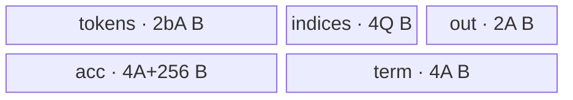
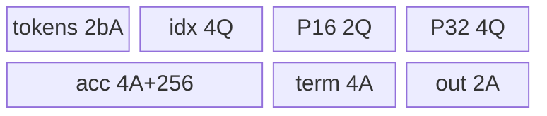
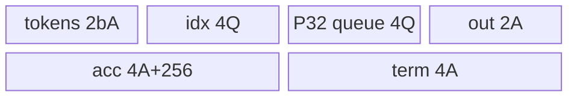
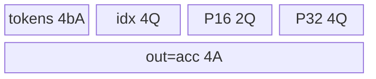
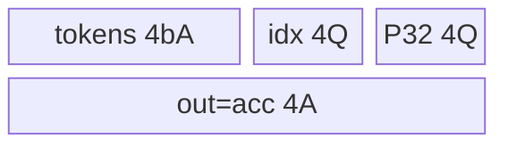

# MoeTokenUnpermute A2/A3 ACLNN 算子知识

## 算子速览

| 项目 | 内容 |
|---|---|
| 实际入口 | `aclnnMoeTokenUnpermuteGetWorkspaceSize` / `aclnnMoeTokenUnpermute`，无版本后缀的公开两段式 ACLNN；固定仓没有同语义的更新版入口。 |
| 计算语义 | 用 `sortedIndices` 从 `permutedTokens` 恢复输出 token；有 `probsOptional` 时逐 `topK` 乘权并以 FP32 累加。 |
| 输入输出 | `permutedTokens:[M,H]`，`sortedIndices:[N*K]`，可选 `probs:[N,K]`，`out:[N,H]`，均为 ND。 |
| 执行类型 | 单节点 `AIV_VECTOR`；无 SIMT、NDDMA、通信、Cube/AIC 计算或 `MIX_CV`。`__aicore__` 入口的实际 body 只有 GM/UB 搬运和 Vector API。 |
| Kernel 路线 | R-001 16 位无权重；R-002 FP32 无权重；R-003 16 位 token/16 位权重；R-004 16 位 token/FP32 权重；R-005 FP32 token/16 位权重；R-006 全 FP32。 |
| 核心资源 | GM、`TPipe`；`tokens_inque` 深度 2～4，其余 Queue 深度 1；按 dtype 条件分配 FP32 `TBuf`。Kernel 不读取 `workspace`。 |
| 来源闭包 | `source_closed`：公开 ACLNN→自动生成 inner bridge 边界→OpDef/InferShape/Tiling/POD→AIV entry/router/body→A2/A3 binary config、CMake、CI。 |
| 验证状态 | 已完成源码闭包检查；本次知识提取未执行编译、真机、数值或性能测试。 |

## 接口与语义

### 计算语义

记 `X=permutedTokens`、`S=sortedIndices`、`P=probsOptional`、`H=X.shape[1]`。有权重时 `P.shape=[N,K]`：

```text
Y[i,h] = Σ(j=0..K-1) valid(S[i*K+j]) * X[S[i*K+j],h] * P[i,j]
valid(s) := s < X.shape[0]
```

Device 对第一个无效项把累加器清零，后续无效项跳过；有权重时 `P[i,j]==0` 也在 gather 前跳过。公开契约另要求 `S` 在 `[0,N*K-1]` 且无重复；Kernel 只检查上界、没有 `s>=0`，不能把 Device 行为理解为支持负索引。无权重时 `K=1`、`N=sortedIndices.shape[0]`，退化为 `Y[i,:]=X[S[i],:]`。

### 输入、输出与属性

| 参数 | shape/layout | dtype | 约束、默认值与语义 |
|---|---|---|---|
| `permutedTokens` | `[M,H]` / ND，2D | FP16、BF16、FP32 | 必选；Device 以 M 作为索引上界，输出 dtype 与其相同。 |
| `sortedIndices` | `[N*K]` / ND，1D | INT32 | 必选；公开范围 `[0,N*K-1]` 且无重复。 |
| `probsOptional` | `[N,K]` / ND，2D | FP16、BF16、FP32 | 可选，可与 token dtype 不同；存在时 `K<=512`，缺失时 K=1。 |
| `paddedMode` | 标量 | BOOL | 默认 false；A2/A3 公开接口目前只支持 false。 |
| `restoreShapeOptional` | 整数数组 | `aclIntArray*` | A2/A3 目前只支持 nullptr；可见 Tiling/InferShape 不消费。 |
| `out` | `[N,H]` / ND，2D | 同 token | 必选；InferShape 直接写 `[N,H]`。 |

### 入口与版本

固定 Commit 只有无版本后缀的两段式 ACLNN，因此这是 A2/A3 实际支持的最新公开版本。A2/A3 的 `IsRegbase()==false`，两段接口分别进入固定仓不可见的自动生成 `aclnnInnerMoeTokenUnpermuteGetWorkspaceSize` / `aclnnInnerMoeTokenUnpermute`；生成 bridge 是框架边界，算子拥有的 OpDef、Tiling、POD 与 Kernel 已继续闭合。

README/API 文档也公开 950。`IsRegbase()` 把 `DAV_3510`/`DAV_5102` 判作 RegBase，此时入口改组装 `MoeFinalizeRoutingV2(..., READ_INDEX_BY_ROW=2, ...)`，不再使用本卡 body。按项目规则 950 应写独立 `_950` 文件；本任务唯一目标不含该文件，故仅在平台差异记录。

## Host/Launcher 执行流程

### 参数校验与前处理

1. ACLNN 第一段检查公共输出参数并记录 DFX，然后按 `IsRegbase()` 分流。
2. A2/A3 直接进入自动生成 inner bridge；确切 ACLNN executor 编排不可见。OpDef 给三个输入声明 `AutoContiguous()`，非连续输入处理属于框架边界。
3. OpDef 注册 token/out 的 BF16、FP16、FP32，indices INT32，以及三种 probs dtype组合；InferShape 以 `probs.dim0` 或 `indices.dim0` 得 N，输出 `[N,H]`。
4. `InputParamCheck` 要求 token/indices tensor 和 shape 非空、token 为 2D；有 probs 时要求 probs 为 2D、`indices.dim0==probs.dim0*probs.dim1`、`topK<=512`。A2/A3 不进入 310P 专属 H/dtype guard。
5. 显式检查失败返回 `GRAPH_FAILED`；成功才生成 POD、blockDim、workspace 与 key。

### 参数、Workspace 与生命周期

令 `U=UB容量`、`Cmax=AIV核数`、`sX=sizeof(T1)`、`sP=sizeof(T3)`：

```text
C = min(N,Cmax); q=floor(N/C); r=N%C
unitH(b) = sX*(b+1) + (sX==4 ? 0 : 8)
Hmax = AlignUp(floor((U-5120)/unitH(2))-512,512)
Htile = H if AlignUp(H,512)<=Hmax else Hmax
Hloops/Htail = 整段 1/0，否则 floor(H/Htile), H%Htile
b = 从 4 向 2 递减，取满足 Htile<=ComputeMaxHiddenSize(b) 的最大值
Uremain = U - AlignUp(Htile,512)*unitH(b) - 256
unitToken = 4 + (hasP ? sP + (sP==4 ? 0 : 4) : 0)
B = q if Uremain>=q*K*unitToken else floor(Uremain/(K*unitToken))
Bloops=floor(q/B); Btail=q%B
```

前 r 个 core 在 Device `Init` 中把本核 token 数由 q 增至 q+1，并把 `tokens_splited_remain` 加 1。Host 设置 `blockDim=C`；TilingKey 是运行时元数据，不在 POD 内。

Tiling 设置 `workspaces[0]=GetLibApiWorkSpaceSize()`，owner 是运行时 library API；Kernel 的 workspace 形参未读，无算子自有跨 Kernel slice。ACLNN 总 `workspaceSize` 由自动生成 executor 连同框架连续化开销计算，固定仓无展开公式；workspace、executor 必须存活到第二段在指定 stream 完成。

### 启动图与失败传播

```text
GetWorkspaceSize -> IsRegbase()==false -> aclnnInner...GetWorkspaceSize [框架边界]
  -> OpDef/InferShape/TilingCompute -> executor(blockDim=C,key,POD,workspace)
aclnnMoeTokenUnpermute -> aclnnInnerMoeTokenUnpermute [框架边界]
  -> K0: moe_token_unpermute<<<C,stream>>> [AIV_VECTOR]
```

核心语义只有 K0；无 Device 节点间 workspace/GM 边。框架可能安排 AutoContiguous 节点，其 entry/slice/event 在生成 bridge 中不可见，由 executor 同 stream 编排。Tiling 失败阻断 K0。router 未提供 unknown-key fallback：未知 key 时函数直接结束且不写输出。

## Route 与参数设计

### 分核与资源计算

对 core c：

```text
Lc=q+1, tokenBase=c*(q+1)                    if c<r
Lc=q,   tokenBase=r*(q+1)+(c-r)*q           if c>=r
indices/probs base=tokenBase*K; out base=tokenBase*H
```

每个 token tile 一次搬 `Bcur*K` 个 indices/probs，再逐输出 token、逐 H tile、逐 K gather。GM token offset=`S[i*K+j]*H+hLoop*Htile`；output offset=`i*H+hLoop*Htile`。`Hcur*sizeof(T1)` 是 32 B 倍数时用 `DataCopy`，否则 A2/A3 用 `DataCopyPad`；Vector 有效长度和 GM 写出长度均为 Hcur。

### Route 选择

| 顺序 | Route | Key/模板 | 精确选择条件与优先级 | 不适用去向 |
|---:|---|---|---|---|
| 1 | R-001 16 位无权重 | 0:`<bf16,int32,bf16,false>`；2:`<half,int32,half,false>` | probs=null；token BF16/FP16 | token FP32→R-002；有 probs→后续。 |
| 2 | R-002 FP32 无权重 | 4:`<float,int32,float,false>` | probs=null；token FP32 | 有 probs→R-005/R-006。 |
| 3 | R-003 16/16 | 1、3、11、17 | probs存在；token/prob均为 BF16/FP16 | prob FP32→R-004。 |
| 4 | R-004 16/FP32 | 25、27 | token BF16/FP16；prob FP32 | token FP32→R-006。 |
| 5 | R-005 FP32/16 | 13、21 | token FP32；prob BF16/FP16 | prob FP32→R-006。 |
| 6 | R-006 FP32/FP32 | 5:`<float,int32,float,true>` | token/prob均 FP32 | 未知 key→不写出。 |

```text
base: BF16=0, FP16=2, FP32=4
probs absent -> key=base
probs present -> key=base+1；dtype不同再加 prob BF16:8 / FP16:16 / FP32:24
router keys: 0,1,17,25,2,3,11,27,4,5,13,21
```

### 模板/实现执行矩阵

| Route | key/selector | dtype/shape/platform 完整命中条件 | 执行拓扑与 Kernel 节点 | 实际模板/body | 内存与同步特征 | tail/fallback |
|---|---|---|---|---|---|---|
| R-001 | 0/2 | A2/A3；无 P；T1 16 位 | 单 K0 | `KernelMoeTokenUnpermute<T1,int32,T1,false>` | 两 H FP32 TBuf；Queue/barrier | core/token/H tail；未知 key无输出。 |
| R-002 | 4 | A2/A3；无 P；T1 FP32 | 单 K0 | `<float,int32,float,false>` | accumulator复用 out Queue；无 TBuf | 同上。 |
| R-003 | 1/3/11/17 | A2/A3；P存在；T1/T3 16 位 | 单 K0 | `<16,int32,16,true>` | 两 H TBuf + probs FP32 TBuf | 零权重/越界跳过；三层 tail。 |
| R-004 | 25/27 | A2/A3；T1 16，T3 FP32 | 单 K0 | `<16,int32,float,true>` | 两 H TBuf；probs复用 Queue | 同上。 |
| R-005 | 13/21 | A2/A3；T1 FP32，T3 16 | 单 K0 | `<float,int32,16,true>` | acc复用 out Queue；probs TBuf | 同上。 |
| R-006 | 5 | A2/A3；T1/T3 FP32 | 单 K0 | `<float,int32,float,true>` | acc/probs均复用 Queue；无 TBuf | 同上。 |

### 隐藏性能 Guard

| Guard | Host/Tiling 条件 | Device/资源原因 | 影响 Route | 不满足时去向 | 源码符号 |
|---|---|---|---|---|---|
| topK | 有 P 时 K<=512 | H预算预留 5120 B 给 indices/probs/cast | R-003～006 | `GRAPH_FAILED` | `InputParamCheck` |
| H 512分片 | `AlignUp(H,512)>Hmax` | Queue/TBuf按 `AlignUp(Htile,512)` 分配 | 全部 | 同 Route多 H循环 | `TilingHiddenSize` |
| Queue depth | 从4递减到2 | UB允许时扩大流水 depth，最少双缓冲 | 全部 | 减 depth，不换 key | `SetBufferNum` |
| token分片 | `Uremain<q*K*unitToken` | metadata/cast必须装下 | 全部 | 减 B、增加循环 | `TilingToken` |
| 32 B对齐 | `Hcur*sizeof(T1)%32==0` | 对齐路径走 `DataCopy` | 全部 | `DataCopyPad` | `CopyTokenIn`/`CopyOut` |
| 有效贡献 | `idx<M && (!PROBS \|\| prob!=0)` | 避免无贡献随机 gather/乘加 | 全部 | 首项清零或后续跳过 | `CalPartOutToken` |
| 空域 | C、Htile、B必须为正 | 分核/分片分母与 blockDim依赖 | 全部 | 固定源码无显式 N=0 fallback | `SetCoreNum`/`TilingToken` |
| package tuple | A2/A3 binary JSON列表 | 交付 binary签名 | R-003 | key17 tuple缺失且 BF16/FP32重复，见限制 | 两平台 binary JSON |

### POD/ABI

`BEGIN_TILING_DATA_DEF` 宏定义来自外部 CANN 头。固定仓可证 12 个连续声明的 `int64_t` 字段、Host `SaveToBuffer` 与 Device `GET_TILING_DATA` 使用同名类型；精确 `sizeof/alignof/offsetof` 不可见，不能擅自写成普通 C struct 的 96 B。

| 结构 | 字段 | 类型/位宽 | ABI 布局 | 单位 | Host/launcher producer | Device consumer | 边界 |
|---|---|---|---|---|---|---|---|
| `MoeTokenUnpermuteTilingData` | `hidden_size` | int64/64 | 第1字段；offset不可见 | 元素/行 | `input.hiddenSize` | GM行 stride | 应为正。 |
| 同上 | `top_k` | int64/64 | 第2字段 | 项/输出 | `input.topK` | block length、归约 | 有P<=512；无P=1。 |
| 同上 | `num_out_tokens` | int64/64 | 第3字段 | 输入行 M | `tokensShape.dim0` | `idx<M` | 名称不是输出 N。 |
| 同上 | `hidden_splited_length` | int64/64 | 第4字段 | 元素 | `hiddenTiling.length` | H tile/容量 | 分配时512元素对齐。 |
| 同上 | `hidden_splited_num` | int64/64 | 第5字段 | 次数 | `hiddenTiling.num` | 主 H循环 | 整段时1。 |
| 同上 | `hidden_splited_remain` | int64/64 | 第6字段 | 元素 | `hiddenTiling.remain` | H tail | 0则无 tail。 |
| 同上 | `tokens_core_length` | int64/64 | 第7字段 | token/core | q | Device former core加1 | GM extent基础。 |
| 同上 | `tokens_core_remain` | int64/64 | 第8字段 | core数 | r | core地址公式 | `0<=r<C`。 |
| 同上 | `tokens_splited_length` | int64/64 | 第9字段 | token/tile | B | Process/Queue容量 | 必须>0。 |
| 同上 | `tokens_splited_num` | int64/64 | 第10字段 | 次数 | Bloops | 主 token循环 | 基于 q。 |
| 同上 | `tokens_splited_remain` | int64/64 | 第11字段 | token | Btail | token tail | former core加1。 |
| 同上 | `buffer_num` | int64/64 | 第12字段；总大小不可见 | Queue depth | `core.bufferNum` | `InitBuffer(tokens_inque,...)` | 2、3、4。 |

### Route 源码闭包

| Route | Key/selector | Host/Tiling producer | POD/参数 | Kernel entry/router 节点 | Kernel body/直接依赖 | 构建接线 |
|---|---|---|---|---|---|---|
| R-001 | 0/2 | `SetTilingKey`及Tiling helper | 同一POD | entry keys0/2 | `<16,int32,16,false>`全部方法 | OpDef、A2/A3 config、CMake、CI |
| R-002 | 4 | 同上 | 同上 | key4 | `<float,int32,float,false>` | 同上 |
| R-003 | 1/3/11/17 | 同上 | 同上 | 四 key | `<16,int32,16,true>` | 同上；key17缺口见限制 |
| R-004 | 25/27 | 同上 | 同上 | 两 key | `<16,int32,float,true>` | 同上 |
| R-005 | 13/21 | 同上 | 同上 | 两 key | `<float,int32,16,true>` | 同上 |
| R-006 | 5 | 同上 | 同上 | key5 | `<float,int32,float,true>` | 同上 |

## Kernel 实现

### 公共执行流程

entry 解 POD、按 key 实例化模板并顺序调用 `Init`、`Process`。`Init` 计算本核 indices/probs/out GM base并条件分配 UB。`Process` 遍历完整 token tile与 tail；每个输出 token又遍历 H tile与 tail。`CalMultiOutToken` 一次搬入本批 indices/probs；`CalPartOutToken` 从 UB标量读索引/权重，逐 K gather。首个有效项建立 FP32 accumulator，后续项可选 `Muls` 后 `Add`；非 FP32输出在 A2/A3 以 `CAST_RINT` 降精度。Queue、`PipeBarrier<PIPE_V>`、`FreeTensor` 约束 MTE2/Vector/MTE3与复用。

### Route R-001：16 位无权重

#### 适用条件

##### 选择证据

| 层级 | 文件 | 符号 | 源码谓词/参数 | 结果/下一跳 |
|---|---|---|---|---|
| Host/Tiling | `moe/moe_token_unpermute/op_host/moe_token_unpermute_tiling.cpp` | `SetTilingKey` | 无P；BF16/FP16 base 0/2 | key0/2 |
| Router | `moe/moe_token_unpermute/op_kernel/moe_token_unpermute.cpp` | entry | `TILING_KEY_IS(0/2)` | `<bf16/half,int32,same,false>` |
| Body | `moe/moe_token_unpermute/op_kernel/moe_token_unpermute.h` | `Init` | `T1!=float && !PROBS` | 两 H FP32 TBuf，无P资源。 |

#### Device 数据流

##### 函数级调用链

```text
TilingCompute -> key0/2 -> entry -> Init -> Process -> CalMultiOutToken
  -> CalSingleOutToken -> CalPartOutToken -> CopyTokenIn
  -> CalFirstToken/CalToken -> CopyOut
```

##### 源码等价伪码

```text
for token tile: copy indices
  for output token, H tile, j(仅0):
    if idx<M: gather X16；Cast(CAST_NONE)到FP32 accumulator
    else: Duplicate(acc,0,Hcur)
    Cast(acc,CAST_RINT)到Y16；只写Hcur
```

#### 内存与数据搬运

##### 资源与搬运表

令 `A=AlignUp(Htile,512)`元素、`Q=B*K`条目、`b=buffer_num`。

| 层级/缓冲区 | offset/地址公式 | extent/容量公式 | dtype/layout | producer | consumer | owner/lifetime | 对齐/复用 |
|---|---|---|---|---|---|---|---|
| GM X/Y | `idx*H+hOff` / `i*H+hOff` | Hcur | T1/ND | caller/K0 | K0/caller | K0 | 32B尾用Pad。 |
| `tokens_inque` | slot | `2bA`B | T1 | CopyIn | Cast | gather项 | depth b。 |
| `indices_inque` | slot | `4Q`B | INT32 | CopyIn | GetValue | token tile | depth1。 |
| `temp_buffer0/1` | 独立 | `4A+256` / `4A`B | FP32 | Cast | Add/output Cast | H tile | acc/当前项。 |
| `outque` | slot | `2A`B | T1 | output Cast | CopyOut | H tile | depth1。 |

##### 分层内存布局



##### 字节账与复用顺序

```text
UB_total=(2b+10)A+4Q+256 B
dynamic_ub=N/A；workspace_total(operator-owned)=0
```

| 复用子区 | 写入者 | 读取者/消费点 | 下一次覆盖 | 同步或释放依据 | 安全条件 |
|---|---|---|---|---|---|
| token Queue | CopyIn | Cast | 下一项 | EnQue/DeQue/Free+PIPE_V | Cast完成。 |
| temp1 | 后续项Cast | Add | 下一项 | PIPE_V | Add已读。 |
| out Queue | output Cast | MTE3 | 下一H tile | FreeTensor | CopyOut提交。 |

#### 同步、精度与尾块

##### 同步与数值边界表

| 阶段 | primitive/机制 | producer | consumer/等待点 | 保护对象 | 精度/尾块 |
|---|---|---|---|---|---|
| CopyIn→Cast | Queue/PIPE_V | MTE2 | Vector | token slot | Hcur有效。 |
| Cast→Add | PIPE_V | Cast | Add | temp0/1 | FP32累加。 |
| Cast→CopyOut | Queue | Vector | MTE3 | out slot | A2/A3 RINT；只写Hcur。 |
| core tail | q/r | Host | Device Init | 独占GM | 前r核多1 token。 |

#### 关键实现

##### 符号证据表

| 阶段 | 文件 | 符号/模板实例 | 实现事实 |
|---|---|---|---|
| Host/Tiling producer | `moe/moe_token_unpermute/op_host/moe_token_unpermute_tiling.cpp` | H/token切分helper | A、b、Q与tail。 |
| Kernel entry/router | `moe/moe_token_unpermute/op_kernel/moe_token_unpermute.cpp` | keys0/2 | 16位无P实例。 |
| Device body/helper | `moe/moe_token_unpermute/op_kernel/moe_token_unpermute.h` | Copy/Cal/Out方法 | gather、升精度、RINT与tail。 |

### Route R-002：FP32 无权重

#### 适用条件

##### 选择证据

| 层级 | 文件 | 符号 | 源码谓词/参数 | 结果/下一跳 |
|---|---|---|---|---|
| Host/Tiling | `moe/moe_token_unpermute/op_host/moe_token_unpermute_tiling.cpp` | `SetTilingKey` | 无P、T1 FP32 | key4 |
| Router | `moe/moe_token_unpermute/op_kernel/moe_token_unpermute.cpp` | entry key4 | 精确匹配 | `<float,int32,float,false>` |
| Body | `moe/moe_token_unpermute/op_kernel/moe_token_unpermute.h` | `CalPartOutToken` | `T1==float` | out Queue直接作为acc。 |

#### Device 数据流

##### 函数级调用链

```text
key4 -> Init -> Process -> CalMulti/Single/Part -> CopyTokenIn -> CalFirstToken -> CopyOut
```

##### 源码等价伪码

```text
copy indices；acc=outque.Alloc<float>()；K=1
valid idx: gather FP32并按32B对齐量复制到acc；invalid: acc清零
EnQue/DeQue同一acc后写Hcur到GM
```

#### 内存与数据搬运

##### 资源与搬运表

| 层级/缓冲区 | offset/地址公式 | extent/容量公式 | dtype/layout | producer | consumer | owner/lifetime | 对齐/复用 |
|---|---|---|---|---|---|---|---|
| GM X/Y/indices | 同R-001 | Hcur/Q | FP32/INT32 | caller/K0 | K0/caller | K0 | tail Pad。 |
| token Queue | slot | `4bA`B | FP32 | CopyIn | DataCopy | gather项 | depth b。 |
| indices Queue | slot | `4Q`B | INT32 | CopyIn | GetValue | tile | depth1。 |
| out Queue/acc | 同一tensor | `4A`B | FP32 | DataCopy/Duplicate | CopyOut | H tile | 零中间物化。 |

##### 分层内存布局


##### 字节账与复用顺序

```text
UB_total=4(b+1)A+4Q B；Host额外保守扣256B
dynamic_ub=N/A；workspace_total(operator-owned)=0
```

| 复用子区 | 写入者 | 读取者/消费点 | 下一次覆盖 | 同步或释放依据 | 安全条件 |
|---|---|---|---|---|---|
| out/acc | DataCopy/Duplicate | CopyOut | 下一H tile | Queue Free | MTE3消费完成。 |
| token Queue | CopyIn | DataCopy到acc | 下一token | Queue lifecycle | 当前读完成。 |

#### 同步、精度与尾块

##### 同步与数值边界表

| 阶段 | primitive/机制 | producer | consumer/等待点 | 保护对象 | 精度/尾块 |
|---|---|---|---|---|---|
| ingest | Queue | MTE2 | Vector/DataCopy | token | 全FP32。 |
| output | out Queue | acc | MTE3 | 同一tensor | 无cast；Hcur写出。 |
| tail | q/r、B/H tail | Host/loop | 地址计算 | GM | 无跨核共享。 |

#### 关键实现

##### 符号证据表

| 阶段 | 文件 | 符号/模板实例 | 实现事实 |
|---|---|---|---|
| Host/Tiling producer | `moe/moe_token_unpermute/op_host/moe_token_unpermute_tiling.cpp` | `ComputeUnitHSpace` | FP32 castNum=0。 |
| Kernel entry/router | `moe/moe_token_unpermute/op_kernel/moe_token_unpermute.cpp` | key4 | FP32无P。 |
| Device body/helper | `moe/moe_token_unpermute/op_kernel/moe_token_unpermute.h` | `CalFirstToken`/`CopyOut` | out Queue/acc复用。 |

### Route R-003：16 位 token 与 16 位权重

#### 适用条件

##### 选择证据

| 层级 | 文件 | 符号 | 源码谓词/参数 | 结果/下一跳 |
|---|---|---|---|---|
| Host/Tiling | `moe/moe_token_unpermute/op_host/moe_token_unpermute_tiling.cpp` | `SetTilingKey` | P存在，T1/T3均16位 | 1/3/11/17 |
| Router | `moe/moe_token_unpermute/op_kernel/moe_token_unpermute.cpp` | 四 key分支 | 精确key | `<16,int32,16,true>` |
| Body | `moe/moe_token_unpermute/op_kernel/moe_token_unpermute.h` | `Init` | T1/T3均非float | 两H TBuf+probs TBuf。 |

#### Device 数据流

##### 函数级调用链

```text
keys1/3/11/17 -> Init -> CalMulti(copy indices/probs；Cast probs)
  -> CalPart -> gather token -> Cast -> Muls -> Add -> Cast_RINT/CopyOut
```

##### 源码等价伪码

```text
probs16 tile一次Cast到probs32
for i,h,j: idx,p从UB标量读取；idx<M且p!=0才gather
token16->FP32；Muls；顺序Add；首项无效则acc清零
acc以RINT转16位并写Hcur
```

#### 内存与数据搬运

##### 资源与搬运表

| 层级/缓冲区 | offset/地址公式 | extent/容量公式 | dtype/layout | producer | consumer | owner/lifetime | 对齐/复用 |
|---|---|---|---|---|---|---|---|
| token/indices/out | 同R-001 | A/Q | 16/INT32 | MTE2/Vector | Vector/MTE3 | tile | 32B tail Pad。 |
| probs Queue | slot | `2Q`B | 16位 | CopyIn | Cast | Cast前 | depth1。 |
| probs TBuf | 独立 | `4Q`B | FP32 | Cast | GetValue | token tile | 每tile覆盖。 |
| temp0/1 | 独立 | `4A+256`/`4A`B | FP32 | Cast/Muls | Add/output Cast | H tile | acc/项。 |
| out Queue | slot | `2A`B | T1 | Cast | CopyOut | H tile | depth1。 |

##### 分层内存布局



##### 字节账与复用顺序

```text
UB_total=(2b+10)A+10Q+256 B
dynamic_ub=N/A；workspace_total(operator-owned)=0
```

| 复用子区 | 写入者 | 读取者/消费点 | 下一次覆盖 | 同步或释放依据 | 安全条件 |
|---|---|---|---|---|---|
| probs Queue | CopyIn | Cast | 下一tile | Free+PIPE_V | Cast完成。 |
| probs TBuf | Cast | 全部H循环GetValue | 下一tile | 外层顺序 | 当前tile完成。 |
| temp1 | Cast/Muls | Add | 下一j | PIPE_V | Add完成。 |

#### 同步、精度与尾块

##### 同步与数值边界表

| 阶段 | primitive/机制 | producer | consumer/等待点 | 保护对象 | 精度/尾块 |
|---|---|---|---|---|---|
| P升精度 | Queue+PIPE_V | Cast | GetValue | P queue/TBuf | CAST_NONE，长度Bcur*K。 |
| token乘加 | PIPE_V | Cast/Muls | Add | temp0/1 | FP32。 |
| output | Queue | CAST_RINT | MTE3 | out | Hcur有效。 |
| 稀疏项 | 条件 | idx/p | Duplicate/skip | acc | 零权重不gather。 |

#### 关键实现

##### 符号证据表

| 阶段 | 文件 | 符号/模板实例 | 实现事实 |
|---|---|---|---|
| Host/Tiling producer | `moe/moe_token_unpermute/op_host/moe_token_unpermute_tiling.cpp` | `SetTilingKey`/`TilingToken` | mix key与每项10B元数据。 |
| Kernel entry/router | `moe/moe_token_unpermute/op_kernel/moe_token_unpermute.cpp` | 1/3/11/17 | 16/16实例。 |
| Device body/helper | `moe/moe_token_unpermute/op_kernel/moe_token_unpermute.h` | `CalMultiOutToken`/`CalPartOutToken` | P整tile升精度、零权重剪枝。 |

### Route R-004：16 位 token 与 FP32 权重

#### 适用条件

##### 选择证据

| 层级 | 文件 | 符号 | 源码谓词/参数 | 结果/下一跳 |
|---|---|---|---|---|
| Host/Tiling | `moe/moe_token_unpermute/op_host/moe_token_unpermute_tiling.cpp` | `SetTilingKey` | T1 16、T3 FP32，mix+24 | 25/27 |
| Router | `moe/moe_token_unpermute/op_kernel/moe_token_unpermute.cpp` | keys25/27 | 精确key | `<16,int32,float,true>` |
| Body | `moe/moe_token_unpermute/op_kernel/moe_token_unpermute.h` | `CalMultiOutToken` | T3=float | probs tensor别名Queue。 |

#### Device 数据流

##### 函数级调用链

```text
keys25/27 -> Init(two H TBuf,no P TBuf) -> CalMulti(copy FP32 P并DeQue保留)
  -> CalPart -> token Cast/Muls/Add -> output Cast/CopyOut -> tile末Free P
```

##### 源码等价伪码

```text
probs32=DeQue(probsQueue)，无Cast
逐i/h/j按idx<M且p!=0 gather token16，FP32乘加
RINT写16位；所有H循环完成后才释放probs32
```

#### 内存与数据搬运

##### 资源与搬运表

| 层级/缓冲区 | offset/地址公式 | extent/容量公式 | dtype/layout | producer | consumer | owner/lifetime | 对齐/复用 |
|---|---|---|---|---|---|---|---|
| token/idx/temp/out | 同R-003 | 同R-003 | T1/INT32/FP32 | 同R-003 | 同R-003 | H tile | 同R-003。 |
| probs Queue/tensor | 同一slot | `4Q`B | FP32 | CopyIn | GetValue | 整个token tile | 无P TBuf。 |

##### 分层内存布局



##### 字节账与复用顺序

```text
UB_total=(2b+10)A+8Q+256 B
dynamic_ub=N/A；workspace_total(operator-owned)=0
```

| 复用子区 | 写入者 | 读取者/消费点 | 下一次覆盖 | 同步或释放依据 | 安全条件 |
|---|---|---|---|---|---|
| P Queue | CopyIn | 全i/h/j GetValue | 下一tile | tile末Free | H循环未结束不能释放。 |
| H buffers | Cast/Muls | Add/output | 下一H/j | PIPE_V | 当前消费者完成。 |

#### 同步、精度与尾块

##### 同步与数值边界表

| 阶段 | primitive/机制 | producer | consumer/等待点 | 保护对象 | 精度/尾块 |
|---|---|---|---|---|---|
| P ingest | Queue | MTE2 | scalar读 | P Queue | 已FP32。 |
| token/acc | PIPE_V | Cast/Muls | Add | temp0/1 | FP32乘加。 |
| output/tail | Queue/RINT | Vector | MTE3 | out | 三层tail。 |

#### 关键实现

##### 符号证据表

| 阶段 | 文件 | 符号/模板实例 | 实现事实 |
|---|---|---|---|
| Host/Tiling producer | `moe/moe_token_unpermute/op_host/moe_token_unpermute_tiling.cpp` | `SetTilingKey` | FP32 P mix常量24。 |
| Kernel entry/router | `moe/moe_token_unpermute/op_kernel/moe_token_unpermute.cpp` | 25/27 | 16/FP32实例。 |
| Device body/helper | `moe/moe_token_unpermute/op_kernel/moe_token_unpermute.h` | `CalMultiOutToken` | P Queue原位复用并延后Free。 |

### Route R-005：FP32 token 与 16 位权重

#### 适用条件

##### 选择证据

| 层级 | 文件 | 符号 | 源码谓词/参数 | 结果/下一跳 |
|---|---|---|---|---|
| Host/Tiling | `moe/moe_token_unpermute/op_host/moe_token_unpermute_tiling.cpp` | `SetTilingKey` | T1 FP32；T3 BF16/FP16 | 13/21 |
| Router | `moe/moe_token_unpermute/op_kernel/moe_token_unpermute.cpp` | keys13/21 | 精确key | `<float,int32,16,true>` |
| Body | `moe/moe_token_unpermute/op_kernel/moe_token_unpermute.h` | `Init` | T1=float、T3非float | 无H TBuf，有P TBuf。 |

#### Device 数据流

##### 函数级调用链

```text
keys13/21 -> Init(out=acc,P TBuf) -> CalMulti(P16 Cast到P32)
  -> CalPart -> gather FP32 token -> Muls/Add in out Queue -> direct CopyOut
```

##### 源码等价伪码

```text
P16整tile升FP32；acc=outQueue
首个有效FP32 token复制到acc后Muls；后续token原位Muls后Add
无output cast，直接写Hcur
```

#### 内存与数据搬运

##### 资源与搬运表

| 层级/缓冲区 | offset/地址公式 | extent/容量公式 | dtype/layout | producer | consumer | owner/lifetime | 对齐/复用 |
|---|---|---|---|---|---|---|---|
| token Queue | slot | `4bA`B | FP32 | CopyIn | Muls/Add | gather项 | depth b。 |
| idx Queue | slot | `4Q`B | INT32 | CopyIn | GetValue | tile | depth1。 |
| P Queue/TBuf | 独立 | `2Q`/`4Q`B | 16/FP32 | Copy/Cast | GetValue | tile | Cast后释放Queue。 |
| out Queue/acc | 同一tensor | `4A`B | FP32 | Copy/Muls/Add | CopyOut | H tile | 无output物化。 |

##### 分层内存布局



##### 字节账与复用顺序

```text
UB_total=4(b+1)A+10Q B；Host额外保守扣256B
dynamic_ub=N/A；workspace_total(operator-owned)=0
```

| 复用子区 | 写入者 | 读取者/消费点 | 下一次覆盖 | 同步或释放依据 | 安全条件 |
|---|---|---|---|---|---|
| P TBuf | Cast | 全H循环 | 下一tile | 外层顺序 | 当前tile完成。 |
| out/acc | Copy/Muls/Add | CopyOut | 下一H | Queue Free | MTE3完成。 |
| token Queue | Copy/Muls | Add | 下一j | PIPE_V+Free | Add完成。 |

#### 同步、精度与尾块

##### 同步与数值边界表

| 阶段 | primitive/机制 | producer | consumer/等待点 | 保护对象 | 精度/尾块 |
|---|---|---|---|---|---|
| P Cast | Queue/PIPE_V | Cast | GetValue | P buffers | 16→FP32。 |
| token乘加 | PIPE_V | Muls | Add | token/acc | token已FP32。 |
| output | out Queue | acc | MTE3 | 同一tensor | FP32直写Hcur。 |

#### 关键实现

##### 符号证据表

| 阶段 | 文件 | 符号/模板实例 | 实现事实 |
|---|---|---|---|
| Host/Tiling producer | `moe/moe_token_unpermute/op_host/moe_token_unpermute_tiling.cpp` | `TilingToken` | 16位P每项2+4B。 |
| Kernel entry/router | `moe/moe_token_unpermute/op_kernel/moe_token_unpermute.cpp` | 13/21 | FP32/16实例。 |
| Device body/helper | `moe/moe_token_unpermute/op_kernel/moe_token_unpermute.h` | `CalToken`/`CopyOut` | P升精度、out/acc复用。 |

### Route R-006：全 FP32

#### 适用条件

##### 选择证据

| 层级 | 文件 | 符号 | 源码谓词/参数 | 结果/下一跳 |
|---|---|---|---|---|
| Host/Tiling | `moe/moe_token_unpermute/op_host/moe_token_unpermute_tiling.cpp` | `SetTilingKey` | T1/T3 FP32且P存在 | key5 |
| Router | `moe/moe_token_unpermute/op_kernel/moe_token_unpermute.cpp` | key5 | 精确key | `<float,int32,float,true>` |
| Body | `moe/moe_token_unpermute/op_kernel/moe_token_unpermute.h` | `Init` | T1/T3均float | 无TBuf；P/out复用Queue。 |

#### Device 数据流

##### 函数级调用链

```text
key5 -> Init(queues only) -> CalMulti(copy idx/P32)
  -> CalPart -> gather FP32 -> Muls/Add -> out Queue direct CopyOut
```

##### 源码等价伪码

```text
P32=DeQue(P Queue)；acc=Alloc(out Queue)
valid且非零项才gather；首项复制/Muls，后续原位Muls/Add
acc直接写GM；tile末释放P Queue
```

#### 内存与数据搬运

##### 资源与搬运表

| 层级/缓冲区 | offset/地址公式 | extent/容量公式 | dtype/layout | producer | consumer | owner/lifetime | 对齐/复用 |
|---|---|---|---|---|---|---|---|
| token Queue | slot | `4bA`B | FP32 | CopyIn | Muls/Add | gather项 | depth b。 |
| idx Queue | slot | `4Q`B | INT32 | CopyIn | GetValue | tile | depth1。 |
| P Queue/tensor | 同一slot | `4Q`B | FP32 | CopyIn | GetValue | tile | 无P TBuf。 |
| out Queue/acc | 同一slot | `4A`B | FP32 | Copy/Muls/Add | CopyOut | H tile | 无H TBuf。 |

##### 分层内存布局



##### 字节账与复用顺序

```text
UB_total=4(b+1)A+8Q B；Host额外保守扣256B
dynamic_ub=N/A；workspace_total(operator-owned)=0
```

| 复用子区 | 写入者 | 读取者/消费点 | 下一次覆盖 | 同步或释放依据 | 安全条件 |
|---|---|---|---|---|---|
| P Queue | CopyIn | 全H循环GetValue | 下一tile | tile末Free | 当前tile完成。 |
| out/acc | Copy/Muls/Add | CopyOut | 下一H | Queue Free | MTE3完成。 |
| token Queue | Copy/Muls | Add | 下一j | PIPE_V+Free | Add完成。 |

#### 同步、精度与尾块

##### 同步与数值边界表

| 阶段 | primitive/机制 | producer | consumer/等待点 | 保护对象 | 精度/尾块 |
|---|---|---|---|---|---|
| ingest | Queue | MTE2 | scalar/Vector | idx/P/token | 无cast。 |
| 乘加 | PIPE_V | Muls | Add/CopyOut | token/acc | FP32顺序累加。 |
| output/tail | out Queue | acc | MTE3 | output | Hcur有效；三层tail。 |

#### 关键实现

##### 符号证据表

| 阶段 | 文件 | 符号/模板实例 | 实现事实 |
|---|---|---|---|
| Host/Tiling producer | `moe/moe_token_unpermute/op_host/moe_token_unpermute_tiling.cpp` | `ComputeUnitHSpace`/`TilingToken` | H每元素4(b+1)B；metadata每项8B。 |
| Kernel entry/router | `moe/moe_token_unpermute/op_kernel/moe_token_unpermute.cpp` | key5 | 全FP32实例。 |
| Device body/helper | `moe/moe_token_unpermute/op_kernel/moe_token_unpermute.h` | `CalMultiOutToken`/`CalToken` | P/acc Queue原位复用。 |

## 算子特定优化

### Trick T-001：联合调节 H tile、Queue depth 与 token tile

#### 触发与源码依据

- 适用 Route：R-001～R-006。
- 触发条件：所有合法输入；H与UB决定分片。
- Golden 来源：[`moe_token_unpermute_tiling.cpp:193-205`](../../../../../../../cann-ops-raw/ascendc/ops-transformer/be33d95bb755cedec3108f70805c1874d1792540/moe/moe_token_unpermute/op_host/moe_token_unpermute_tiling.cpp#L193-L205)

**官方源码（固定 Commit 连续逐字摘录）**：

```cpp
static inline void TilingHiddenSize(MoeTokenUnpermuteParam& param)
{
    int64_t maxHiddenSize = ComputeMaxHiddenSize(param, MIN_BUFFER_NUM);
    if (AlignN(param.input.hiddenSize, ALIGN_512) <= maxHiddenSize) {
        param.hiddenTiling.length = param.input.hiddenSize;
        param.hiddenTiling.remain = 0;
        param.hiddenTiling.num = 1;
    } else {
        param.hiddenTiling.length = maxHiddenSize;
        param.hiddenTiling.remain = safeMod(param.input.hiddenSize, maxHiddenSize);
        param.hiddenTiling.num = safeDiv(param.input.hiddenSize, maxHiddenSize);
    }
}
```

#### 机制与设计原因

Host 先用最小双缓冲求最大 H tile，再在相同 H tile 下把 token Queue depth从4向2回退，最后用剩余UB求 token tile。dtype经 `unitH`/`unitToken`进入字节账，Device无需再做资源分支；这同时平衡 H循环次数、搬运流水深度和metadata批量复用。

#### 迁移边界

- 适用：大向量数据加小型索引/权重的 gather-reduce。
- 前提：Host可查询真实UB/AIV核数，最小depth=2可行。
- 失效：`Hmax<=0`、`B<=0`或N=0时当前源码无fallback，需显式失败或新Route。
- 未验证：本次知识提取未执行编译、真机、数值或性能测试。

#### 错误做法

固定仓未提供可验证反例；不能只预算H而遗漏 `Q*K` metadata/cast区，也不能遗漏Queue depth乘数。

### Trick T-002：零权重与越界项在 gather 前剪枝

#### 触发与源码依据

- 适用 Route：全部；零权重条件仅R-003～006。
- 触发条件：`idx>=M`或有P且`prob==0`。
- Golden 来源：[`moe_token_unpermute.h:238-255`](../../../../../../../cann-ops-raw/ascendc/ops-transformer/be33d95bb755cedec3108f70805c1874d1792540/moe/moe_token_unpermute/op_kernel/moe_token_unpermute.h#L238-L255)

**官方源码（固定 Commit 连续逐字摘录）**：

```cpp
    bool needCopyIn = false;
    float prob_value = 0;
    T2 acl_token_idx = this->indicesLocal.GetValue(start_token);
    if constexpr (PROBS) {
        prob_value = this->probs_tensor.GetValue(start_token);
        needCopyIn = acl_token_idx < this->num_out_tokens && prob_value != 0;
    } else {
        needCopyIn = acl_token_idx < this->num_out_tokens;
    }
    if (needCopyIn) {
        CopyTokenIn(acl_token_idx, h_index, h_length);
        PipeBarrier<PIPE_V>();
        CalFirstToken(prob_value, h_length);
    } else {
        PipeBarrier<PIPE_V>();
        Duplicate(this->token_tensor0, static_cast<float>(0), h_length);
    }
```

#### 机制与设计原因

idx/P已在UB，先用标量谓词可避免无贡献项的 Hcur随机GM gather、Queue占用和Vector乘加。首项无效时显式清零，后续无效项跳过，保证accumulator初始化。

#### 迁移边界

- 适用：稀疏权重或padding索引的gather-sum。
- 前提：零权重严格表示无贡献，M与GM行数一致。
- 失效：若需NaN特殊传播、负索引语义或越界报错，不能复用；当前无 `idx>=0`。
- 未验证：本次知识提取未执行编译、真机、数值或性能测试。

#### 错误做法

不要把 `idx<M` 当完整合法性检查；公开接口仍要求非负索引。

### Trick T-003：模板条件消除 cast buffer并复用输出 Queue

#### 触发与源码依据

- 适用 Route：T1=FP32的R-002/R-005/R-006消除H TBuf；T3=FP32的R-004/R-006消除P TBuf。
- 触发条件：编译期 `IsSameType<T1,float>` / `IsSameType<T3,float>`。
- Golden 来源：[`moe_token_unpermute.h:139-148`](../../../../../../../cann-ops-raw/ascendc/ops-transformer/be33d95bb755cedec3108f70805c1874d1792540/moe/moe_token_unpermute/op_kernel/moe_token_unpermute.h#L139-L148)

**官方源码（固定 Commit 连续逐字摘录）**：

```cpp
    pipe->InitBuffer(tokens_inque, tiling_data->buffer_num, hidden_splited_length_align512 * sizeof(T1));
    pipe->InitBuffer(indices_inque, 1, block_splited_length * (sizeof(T2)));
    pipe->InitBuffer(outque, 1, hidden_splited_length_align512 * sizeof(T1));

    if constexpr (!IsSameType<T1, float>::value) {
        pipe->InitBuffer(temp_buffer0, hidden_splited_length_align512 * sizeof(float) + 256);
        pipe->InitBuffer(temp_buffer1, hidden_splited_length_align512 * sizeof(float));
        this->token_tensor0 = this->temp_buffer0.template Get<float>();
        this->token_tensor1 = this->temp_buffer1.template Get<float>();
    }
```

#### 机制与设计原因

16位token需要FP32 accumulator/当前项两个H buffer；FP32 token则直接从out Queue取得accumulator，`CopyOut`提交同一tensor，省去中间物化和output cast。P同理：16位整tile cast到TBuf，FP32直接保留DeQue后的Queue tensor。`if constexpr`还消除运行时分支。

#### 迁移边界

- 适用：输出dtype与累加dtype同为FP32，或metadata本来就是计算dtype。
- 前提：Queue tensor生命周期覆盖所有消费者。
- 失效：低精度输出、跨tile/Kernel accumulator或MTE3前Queue可能复用时，必须保留独立buffer。
- 未验证：本次知识提取未执行编译、真机、数值或性能测试。

#### 错误做法

固定仓未提供可验证反例；不能在H循环结束前释放FP32 P Queue，也不能在MTE3消费前覆盖out Queue/accumulator。

## 模板与实现对比

| 对比维度 | R-001 | R-002 | R-003 | R-004 | R-005 | R-006 | 设计选择依据 |
|---|---|---|---|---|---|---|---|
| 命中条件/优先级 | 16/noP | FP32/noP | 16/16 | 16/FP32 | FP32/16 | FP32/FP32 | dtype与P存在性编码key。 |
| 模板与 dtype | T1 16 | T1 float | T1/T3 16 | T1 16/T3 float | T1 float/T3 16 | 均float | 编译期条件决定资源。 |
| 循环与分核 | q/r、B、H | 同 | 同+K | 同 | 同 | 同 | shape只改POD。 |
| Queue/TBuf | 两H TBuf | 无 | 两H+P | 两H | P | 无 | 非FP32才cast/acc buffer。 |
| 内存总占用 | `(2b+10)A+4Q+256` | `4(b+1)A+4Q` | `(2b+10)A+10Q+256` | `(2b+10)A+8Q+256` | `4(b+1)A+10Q` | `4(b+1)A+8Q` | 真实InitBuffer字节账。 |
| 搬运/Vector API | Copy/Pad/Cast | Copy/Pad | +P Cast/Muls/Add | 无P Cast | P Cast、直写 | 无Cast、直写 | Hcur是有效长度。 |
| 同步、精度与 tail | FP32acc→RINT | FP32直写 | FP32乘加→RINT | 同 | FP32直写 | FP32直写 | Queue+PIPE_V；三层tail。 |
| fallback/失败边界 | unknown无输出 | 同 | key17 config缺口 | unknown无输出 | 同 | 同 | 无Device fallback。 |

## 平台差异

| 项目 | A2 | A3 | 950 |
|---|---|---|---|
| 支持状态 | README/API支持；OpDef `ascend910b`、binary config、CI存在。 | README/API支持；OpDef `ascend910_93`、binary config、CI存在。 | README/API支持，但不属于本文件平台。 |
| Host/Launcher | 非RegBase→自动生成inner→本算子Tiling/Kernel。 | 与A2共用Host/Tiling/POD/body；两平台JSON逐字相同。 | RegBase→`MoeFinalizeRoutingV2`；应由 `_950` 卡闭合。 |
| Kernel/资源 | 本卡12 keys、6 Route、单AIV_VECTOR；A2/A3使用标准DataCopyPad，低精度output为RINT。 | 同A2。 | 不使用本卡body；本任务未生成950文件。 |

## 限制与失败边界

- A2/A3只公开 `paddedMode=false`、`restoreShapeOptional=nullptr`；非RegBase inner bridge自动生成，固定仓看不到其精确错误码，可见Tiling/InferShape不消费两属性。
- 可见Tiling未完整检查sortedIndices rank、非负/无重复、output shape等；这些依赖公开契约、OpDef/框架。Device只检查 `idx<M`，负INT32会形成负GM偏移。
- `N==0` 会使 `usedCoreNum=0`，最终可能 `SetBlockDim(0)`；固定源码无空tensor成功Route，不能声称支持空域。
- 分片算术是int64，但底层copy部分参数更窄；固定源码无全局乘法溢出检查。
- A2/A3 binary JSON完全相同，但都重复列BF16 token+FP32 probs，未列BF16 token+FP16 probs；OpDef、key17与router/body却支持后者。固定仓无法证明key17预编译package接线，部署前须核对交付物；本文保留实现Route，不宣称已运行验证。
- unknown TilingKey无错误/fallback，只是entry结束且不写输出；Host key表必须与router同步。
- Kernel不读workspace，但ACLNN executor仍可能有框架连续化开销；必须使用第一段实际返回的大小。
- 950公开入口改走 `MoeFinalizeRoutingV2`；任务仅允许无后缀文件，未创建 `_950` 卡。
- 本次知识提取未执行编译、真机、数值或性能测试。

## 源码索引

### 链路索引

| 链路阶段 | 文件 | 关键符号 | 支撑内容 |
|---|---|---|---|
| 入口声明 | `moe/moe_token_unpermute/op_host/op_api/aclnn_moe_token_unpermute.h` | 两段ACLNN | 符号与参数。 |
| 公开约束 | `moe/moe_token_unpermute/README.md` | 产品/参数/约束 | 平台、公式、dtype、K。 |
| 公开约束 | `moe/moe_token_unpermute/docs/aclnnMoeTokenUnpermute.md` | API文档 | shape、确定性、错误。 |
| 入口实现 | `moe/moe_token_unpermute/op_host/op_api/aclnn_moe_token_unpermute.cpp` | 两段实现 | RegBase分流与950转调。 |
| selector | `common/include/external/aclnn_kernels/aclnn_platform.h` | `IsRegbase` | DAV_3510/5102。 |
| OpDef | `moe/moe_token_unpermute/op_host/moe_token_unpermute_def.cpp` | `MoeTokenUnpermute` | dtype、AutoContiguous、平台注册。 |
| InferShape | `moe/moe_token_unpermute/op_host/moe_token_unpermute_infershape.cpp` | `InferShapeFor...` | 输出[N,H]。 |
| POD | `moe/moe_token_unpermute/op_host/moe_token_unpermute_tiling.h` | TilingData | 12字段。 |
| Tiling | `moe/moe_token_unpermute/op_host/moe_token_unpermute_tiling.cpp` | `TilingCompute` | guard、分片、key、workspace。 |
| Kernel entry | `moe/moe_token_unpermute/op_kernel/moe_token_unpermute.cpp` | entry | 12 key映射。 |
| Kernel body | `moe/moe_token_unpermute/op_kernel/moe_token_unpermute.h` | 模板类 | 全部Device流程。 |
| A2 config | `moe/moe_token_unpermute/op_host/config/ascend910b/moe_token_unpermute_binary.json` | `op_list` | package签名与缺口。 |
| A3 config | `moe/moe_token_unpermute/op_host/config/ascend910_93/moe_token_unpermute_binary.json` | `op_list` | 同A2。 |
| 构建 | `moe/moe_token_unpermute/op_host/CMakeLists.txt` | module/compile options | inner、auto sync、依赖。 |
| A2 CI | `scripts/ci/ascend910b/ops_transformer_operator_list.yaml` | group8 | 活动构建。 |
| A3 CI | `scripts/ci/ascend910_93/ops_transformer_operator_list.yaml` | group8 | 活动构建。 |

### 实现复用检查

| 检查项 | 可复用事实 | 不得改变的约束 | 源码符号 |
|---|---|---|---|
| ABI/POD | 12个int64字段与独立key | 顺序、单位、former core在Device修正tail | TilingData/`Init` |
| 调用顺序 | metadata tile→token/H/K gather | `CalMulti`→`CalSingle`→`CalPart` | 同名方法 |
| workspace/内存 | H/token联合预算、depth2～4 | 512元素对齐、256B余量、depth乘数、条件TBuf | Tiling helper/`InitBuffer` |
| 同步 | Queue与PIPE_V | Cast→Muls→Add→output/MTE3；不得提前Free | `CalMulti`/`CalToken`/`CopyOut` |
| 精度与尾块 | FP32乘加、A2/A3 RINT、三层tail | 非FP32先升精度；Hcur有效；q/r地址 | `CalFirst/CalToken/CopyOut` |
| 失败边界 | 显式Tiling失败与unknown key | N=0、负索引、key17 config缺口、inner不可见不得推测成功 | `InputParamCheck`/router/config |