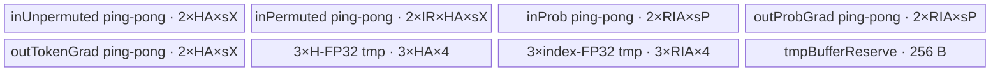

# MoeTokenUnpermuteGrad A2/A3 ACLNN 算子知识

## 算子速览

| 项目 | 内容 |
|---|---|
| 实际入口 | CANN 9.1.0 公开两段式接口 `aclnnMoeTokenUnpermuteGradGetWorkspaceSize` / `aclnnMoeTokenUnpermuteGrad`；A2/A3 走 `aclnnInnerMoeTokenUnpermuteGrad*` 生成入口 |
| 计算语义 | 无 `probs` 时按 `sortedIndices` 把 `unpermutedTokensGrad` 行散写为 `permutedTokensGrad`；有 `probs` 时再乘权，并以 FP32 点积产生 `probsGrad` |
| 输入输出 | token/梯度为 FP16、BF16 或 FP32，`sortedIndices` 为 INT32，均为 ND；有概率时 token dtype 与概率 dtype 可独立组合 |
| 执行类型 | `AIV_VECTOR`；Host 可达的 key 0/1 均只启动一个 AIV entry，不含 Cube、跨 Kernel 或 Atomic 路线 |
| Kernel 路线 | R-001 无概率直接散写；R-002 有概率乘权与点积双梯度 |
| 核心资源 | GM、UB、R-001 的 `TQueBind/TQue`，R-002 的手工双缓冲 `TBuf`、标量数组、FP32 临时区和硬事件；Kernel 不消费 user workspace |
| 来源闭包 | `source_closed`：公开 ACLNN→生成 inner 边界→OpDef/InferShape→Tiling/POD→key 0/1 AIV entry/body/helper→A2/A3 binary、CMake 与 CI 接线闭合 |
| 验证状态 | 已完成源码闭包检查；本次知识提取未执行编译、真机、数值或性能测试。 |

## 接口与语义

### 计算语义

令 `T=unpermutedTokensGrad.shape[0]`、`H=shape[1]`；有 `probs` 时令 `K=probs.shape[1]`，否则 `K=1`；`N=sortedIndices.shape[0]=T*K`。对扁平路由项 `j=i*K+k`，有效索引 `r=sortedIndices[j]` 满足 `0<=r<N`。无概率路线写 `permutedTokensGrad[r,h]=unpermutedTokensGrad[i,h]`。有概率路线写 `permutedTokensGrad[r,h]=unpermutedTokensGrad[i,h]*probs[i,k]`，并写 `probsGrad[i,k]=sum_h(permutedTokens[r,h]*unpermutedTokensGrad[i,h])`。Kernel 对 `r>=N` 的截断项不写 token 梯度，并在概率梯度的点积输入上补零；公开约束要求索引落在有效范围且互不重复，所以正常输入不会依赖该防护分支。

`paddedMode=true` 在固定版本不是公开可达语义：文档声明目前仅支持 false，两平台 binary config 也固定 false，Tiling 虽读取属性却将 `paddedModeKey` 常量置 0。因此 entry 中接受 key 10/11 的条件是 Device 休眠接线，不构成 Host 可达 Route；`restoreShapeOptional` 当前仅支持空指针，Host/Tiling/Kernel 都不消费其内容。

### 输入、输出与属性

| 参数 | shape/layout | dtype | 约束、默认值与语义 |
|---|---|---|---|
| `permutedTokensOptional` | `[T*K,H]`，ND | FP16/BF16/FP32 | API 命名为 optional，A2/A3 inner OpDef 标为 OPTIONAL；R-002 点积必读该输入，R-001 不读；generated inner 的精确非空校验固定仓不可见 |
| `unpermutedTokensGrad` | `[T,H]`，ND | 与 `permutedTokensOptional` 及 `permutedTokensGradOut` 相同 | 必选；InferShape 要求二维；Tiling 拒绝 `T==0` 或 `H==0` |
| `sortedIndices` | `[T*K]`，ND | INT32 | 必选一维；公开约束为 `[0,T*K-1]` 且不重复；Kernel 只显式检查上界，没有负值保护 |
| `probsOptional` | `[T,K]`，ND | FP16/BF16/FP32 | 空指针选择 R-001 并令 `K=1`；存在时选择 R-002，dtype 可与 token dtype不同，`K<=512` |
| `paddedMode` | Host 标量 | bool | 默认 false；固定 A2/A3 实现只产生 non-padded key 0/1，true 没有公开可达 key |
| `restoreShapeOptional` | Host `aclIntArray` | INT64 列表 | 当前仅支持 `nullptr`；固定 A2/A3 Host/Tiling 不读取 |
| `permutedTokensGradOut` | `[T*K,H]`，ND | 与 token dtype 相同 | 必选；ACLNN 文档要求连续输出；Kernel 仅对有效 `sortedIndices` 对应行写回 |
| `probsGradOut` | `[T,K]`，ND | 与 `probsOptional` 相同 | API 参数必选；InferShape 在无 `probs` 时没有形成有效 shape 的输出；R-001 Kernel 不写该 GM |
| `workspaceSize` | Host `uint64_t*` | UINT64 | 第一段返回 executor 所需空间；Tiling另声明 16 MiB system workspace，Kernel 获取 user workspace 后未使用 |
| `executor` / `stream` | Host 句柄 | 不适用 | executor 保存连续化、launch 与 ViewCopy 图；第二段在调用者 stream 上运行 |

### 入口与版本

固定仓只公开无版本后缀的 `aclnnMoeTokenUnpermuteGradGetWorkspaceSize/aclnnMoeTokenUnpermuteGrad`，没有 A2/A3 的 V2/V3 版本族，因此它就是该架构在 CANN 9.1.0 的最新公开入口。第一段在非 regbase 平台直接调用构建期生成的 `aclnnInnerMoeTokenUnpermuteGradGetWorkspaceSize`，第二段调用对应执行函数；A2/A3 注册和 config 属于这条 legacy inner 路线。源码同时含 regbase 转调 `MoeFinalizeRoutingV2Grad` 的分支，但它面向 950，且明确拒绝 paddedMode，不进入本卡 A2/A3 Route。

## Host/Launcher 执行流程

### 参数校验与前处理

第一段先用 `OP_CHECK_COMM_INPUT` 校验 `workspaceSize/executor` 并记录 DFX。A2/A3 上 `IsRegbase()==false`，随后立即把全部输入、属性和输出传给自动生成的 inner GetWorkspaceSize。生成文件 `aclnnInner_moe_token_unpermute_grad.h` 位于 build/autogen，固定源码仓不保存其正文；可见的 `OpDef` 提供四输入、两输出、`padded_mode/restore_shape` 属性、ND/AutoContiguous 和 dtype 组合，`InferShape4MoeTokenUnpermuteGrad` 要求梯度二维、索引一维，并推导输出 shape/dtype。

自动 inner 的逐语句校验、Contiguous 与 executor 加图实现固定仓不可见，不能把同文件中仅供 regbase 转调的 `MoeTokenUnpermuteGradCheck`、显式 `Contiguous/ViewCopy` 当作 A2/A3 已执行步骤。能够闭合的边界是：API 原样转交 inner；`add_modules_sources(OPTYPE moe_token_unpermute_grad ACLNNTYPE aclnn_inner)` 生成 inner；OpDef 的 `AutoContiguous` 与 Host Tiling/Kernel 消费连续 ND storage。

### 参数、Workspace 与生命周期

`Tiling4MoeTokenUnpermuteGrad` 从 storage shape 生成 `T/H/N/K`、平台 AIV 核数、UB 容量、former/tail 核和两类核内 reserve。它把完整 `MoeTokenUnpermuteGradTilingData` 序列化到 raw tiling buffer，声明 `currentWorkspace[0]=16*1024*1024` 字节 system workspace，并把全部平台 AIV 核数设为 `blockDim`。Kernel entry 调用 `GetUserWorkspace(workspace)`，但 `usrWorkspace` 后续没有 consumer；运行期 workspace 的 owner 和具体 system/user 切分由公共 executor/runtime 管理，固定仓不可见。

调用者持有输入、输出和 workspace；生成 inner executor 持有算子图以及 AutoContiguous 所需临时对象，生命周期至少覆盖第二段执行完成。stream 仅传给 `aclnnInnerMoeTokenUnpermuteGrad`；固定仓未公开生成执行函数怎样把 launch 状态映射到 `aclnnStatus`。

### 启动图与失败传播

可见启动图为 `aclnnMoeTokenUnpermuteGradGetWorkspaceSize → aclnnInnerMoeTokenUnpermuteGradGetWorkspaceSize → MoeTokenUnpermuteGrad OpDef/InferShape → Tiling4MoeTokenUnpermuteGrad → moe_token_unpermute_grad → Route::Init/Process`，第二段用同一 executor 和 stream 提交。

| 节点 | Host/Launcher producer | entry / 执行族 | grid/blockDim | POD | 输入→输出 | workspace slice / 生命周期 |
|---|---|---|---|---|---|---|
| K-001 | generated inner executor；具体 launch 语句固定仓不可见，`Tiling4MoeTokenUnpermuteGrad` 生产参数 | `moe_token_unpermute_grad` / `AIV_VECTOR` | `blockDim=GetCoreNumAiv()`；无 SIMT thread grid | `MoeTokenUnpermuteGradTilingData` + key 0/1 | 六个 GM 参数：四输入→`permutedTokensGrad/probsGrad`；R-001 不消费 `permutedTokens/probs/probsGrad` | Tiling 声明单个 16 MiB system workspace；entry 取得 user workspace 指针但 body 消费 0 B；调用者/运行时持有到 stream 执行结束 |

| 边 | producer→consumer | 介质与范围 | ordering | owner/lifetime | 失败传播 |
|---|---|---|---|---|---|
| API 参数边 | 调用者→K-001 | 连续 ND GM 输入、输出与 raw tiling buffer；生成 inner 负责非连续输入的 AutoContiguous 边界 | executor 在调用者 stream 提交；生成 launch 的更细顺序固定仓不可见 | 输入输出由调用者持有；executor 持有图和临时对象至执行完成 | 第一段 inner 失败直接返回；第二段 launch 返回怎样映射 `aclnnStatus` 固定仓不可见 |
| 输出边 | K-001→调用者 | `permutedTokensGrad[N,H]`；R-002 另有 `probsGrad[T,K]` | 单 Kernel stream 完成后可见；无跨 Kernel edge | 调用者持有输出 | entry 未识别 key 时静默不写；Kernel 内没有显式错误返回 |
| workspace 边 | runtime→K-001 | system workspace 16 MiB；user slice 的 offset/头布局固定仓不可见 | 与同一 launch 绑定 | runtime/executor；完成后可释放 | body 不读 `usrWorkspace`，不存在跨节点 producer/consumer |

空 `T/K/H/N`、`K>512`、空 shape/attrs 会在 `Tiling4MoeTokenUnpermuteGrad` 本体直接失败；dtype 长度未知或 R-002 UB 切分失败则由 `MoeTokenUnpermuteGradCoreSplitInfo` 返回失败。但 caller 没有检查后者返回值，这是固定源码缺陷：这些核内失败可能继续序列化未完整字段，而不是按被调用函数的 `GRAPH_FAILED` 终止。R-001 还会把 `R` 强制抬到至少 8，之后未检查缩小得到的 `HA` 是否为正，因此极端 UB 不足没有可靠错误终点。

未知 TilingKey 在 entry 中没有 fallback，也不会写输出。key 10/11 只能由仓外或异常 producer 注入；正常 A2/A3 Host 固定生成 key 0/1。Kernel 运行期没有跨核归约或 Atomic，每核持有不重叠的 `T` 行与其连续 `T*K` 路由项；公开“不重复索引”约束保证 token 梯度散写之间无冲突。

## Route 与参数设计

### 分核与资源计算

设平台 AIV 核数为 `C`、UB 字节数为 `U`、token/prob/索引元素字节数分别为 `sX/sP/4`。Host 固定 launch `C` 核：`tokenTail=floor(T/C)`、`former=T%C`、`tokenFormer=(former==0?tokenTail:tokenTail+1)`、`tailCore=C-former`，对应路由项数分别乘 `K`。`blockIdx<former` 的起点为 `blockIdx*tokenFormer`，其余核起点为 `former*tokenFormer+(blockIdx-former)*tokenTail`；路由起点用对应 token 起点乘 `K`。当 `T<C` 时尾核覆盖 0 个 token，Process 的外循环为 0。

R-001 令 `aX=ceil(H/(32/sX))*(32/sX)`，先算 `R=floor(U/(2*(aX*sX+4)))`，再向下对齐到 8 个 INT32 元素且至少为 8；若 `2*R*4` 后可给每路由项的 token tile 小于 `aX`，就把 `hiddenSizeAlign` 向下对齐到 token 的 32 B 元素数。最终 `hiddenLoops=ceil(H/hiddenSizeAlign)`、`hiddenTail=H-(hiddenLoops-1)*hiddenSizeAlign`，且 `inputReserveNum=indicesReserveNum=indicesReserveNumAlign=R`。

R-002 先令 `hiddenSizeAlign=ceil(H/(512/sX))*(512/sX)`。`indicesReserveNum` 在 `K<=256` 时为 `min(tokenFormer*K,floor(256/K)*K)`，否则为 `K`，再按 `32/sP` 对齐成 `indicesReserveNumAlign`。UB 预算先尝试容纳多个 permuted token：分子扣除双份 prob/probGrad、三个索引宽 FP32 区、256 B reserve、双份 unpermuted/permuted-grad 与三个 H 宽 FP32 区，分母为 `2*sX*hiddenSizeAlign`。若所得 `inputReserveNumMax>=1`，把它截到 K 后取 K 的最大因子；否则按源码公式把 H 切成 512 B 对齐段并固定 `inputReserveNum=1`。所有 reserve 与地址字段在 Host 以 int64 生成，DataCopy 的 `blockLen` 再窄化到 uint32。

### Route 选择

| 顺序 | Route | Key/模板 | 精确选择条件与优先级 | 不适用去向 |
|---:|---|---|---|---|
| 1 | R-001 无概率直接散写 | key 0；`MoeTokenUnpermuteGradProbNone<DTYPE_PERMUTED_TOKENS,int32_t>` | `probTensor==nullptr`，Tiling 固定 `paddedModeKey=0`，故 `tilingKey=0`；在 entry 先判断 | 有 `probs` 到 R-002；空 shape 失败；极端 UB 不足无可靠终点 |
| 2 | R-002 有概率乘权与点积双梯度 | key 1；`MoeTokenUnpermuteGradProbNotNone<DTYPE_PERMUTED_TOKENS,int32_t,DTYPE_PROBS>` | `probTensor!=nullptr` 且编译实例定义 `DTYPE_PROBS`；Tiling 固定 `paddedModeKey=0`，故 `tilingKey=1` | 无 `probs` 已由 R-001 接收；核内 split failure 未被 caller 传播；未知 key 无 fallback |

```text
A2/A3 公开入口
  -> paddedMode 当前公开契约必须为 false；restoreShape 必须为空
  -> Tiling 读取 probs tensor
       -> probs == nullptr: CoreSplitInfoProbIsNone -> key 0 -> R-001
       -> probs != nullptr: CoreSplitInfoProbIsNotNone -> key 1 -> R-002
  -> key 10/11 仅存在于 entry 条件，Host 的 paddedModeKey 常量为 0，故不可达
```

### 模板/实现执行矩阵

| Route | key/selector | dtype/shape/platform 完整命中条件 | 执行拓扑与 Kernel 节点 | 实际模板/body | 内存与同步特征 | tail/fallback |
|---|---|---|---|---|---|---|
| R-001 无概率直接散写 | key 0；`probTensor==nullptr` | A2/A3 legacy inner；`T,H,N>0`；`K=1`；token 为 BF16/FP16/FP32、索引 INT32；公开属性 `paddedMode=false` | 单节点：`moe_token_unpermute_grad`，`blockDim=GetCoreNumAiv()`，每核处理连续 token/index 域 | `MoeTokenUnpermuteGradProbNone<DTYPE_PERMUTED_TOKENS,int32_t>::Init/Process` | index `TQue` 与梯度 `TQueBind` 均分配两份；Queue 管理 MTE2→MTE3；workspace 无 Device consumer | index/H 最后 tile 只搬有效字节；`r>=N` 不写；未知 key 无输出 |
| R-002 有概率乘权与点积双梯度 | key 1；`probTensor!=nullptr` | A2/A3 legacy inner；`T,K,H,N>0`、`K<=512`；token 与 prob 各为 BF16/FP16/FP32 的 3×3 组合；索引 INT32；`paddedMode=false` | 单节点：同一 entry 与全 AIV `blockDim`；每核处理完整 token 及其 K 个路由项 | `MoeTokenUnpermuteGradProbNotNone<DTYPE_PERMUTED_TOKENS,int32_t,DTYPE_PROBS>::Init/Process`，调用 `ReduceSumFunc/BinaryAddFunc` | 12 个 `TBuf`、五组实际使用的手工 ping-pong 状态、MTE2/V/MTE3 硬事件；FP32 临时区；workspace 无 Device consumer | index tile 为 K 倍数、input tile 为 K 的因子；H 可切片；`r>=N` 的 token 输入补零且 tokenGrad 不写；未知 key 无输出 |

### 隐藏性能 Guard

| Guard | Host/Tiling 条件 | Device/资源原因 | 影响 Route | 不满足时去向 | 源码符号 |
|---|---|---|---|---|---|
| 非空计算域 | `tokensNum!=0 && topK!=0 && hiddenSize!=0 && numOutTokens!=0` | 两 Route 的除法、loop 次数和 UB tile 都以这些维度为除数或有效长度 | R-001/R-002 | Tiling 返回 `GRAPH_FAILED` | `op_host/moe_token_unpermute_grad_tiling.cpp:Tiling4MoeTokenUnpermuteGrad` |
| Top-K 上限 | `topK<=512` | R-002 的 `indicesArray/probsArray` 各固定 512 项，且内层循环按 K 分组 | R-002 | Tiling 返回 `GRAPH_FAILED` | `Tiling4MoeTokenUnpermuteGrad`；`ProbNotNone::indicesArray/probsArray` |
| 公开 padded 模式 | binary 属性为 false；Host 中 `paddedModeKey=0` | 当前 POD/body 没有 padded capacity/restore-shape 参数；key 10/11 仅 router 接受 | R-001/R-002 | 公开调用应在生成 inner 校验失败；固定仓看不到其逐语句实现 | `docs/aclnnMoeTokenUnpermuteGrad.md`；`Tiling4MoeTokenUnpermuteGrad` |
| prob 编译实例 | key 1 且定义 `DTYPE_PROBS` | 三类型模板需要确定 ProbT，未定义时 key 1 分支不编译 | R-002 | entry 不执行任何 body | `op_kernel/moe_token_unpermute_grad.cpp:moe_token_unpermute_grad` |
| R-001 32 B 对齐 | `HA` 向上/向下对齐到 `32/sX`；`R=max(align_down(floor(U/(2*(HA*sX+4))),8),8)` | `DataCopyPad` 后每行 UB stride 与 index queue 容量按 32 B 块组织 | R-001 | 固定源码强制 `R>=8`，`indicesReserveNum<=0` 分支实际不可达 | `CoreSplitInfoProbIsNone` |
| R-001 UB 上界 | 预期 `2*R*4 + 2*R*HA*sX <= U` | 两份 index tensor 与两份 token tensor必须同时由 `TPipe` 分配 | R-001 | 先缩小 `HA`；但源码未检查所得 `HA>0`，极端不足没有可靠 fallback | `CoreSplitInfoProbIsNone`；`ProbNone::Init` |
| R-002 K 整除关系 | `RI%K==0` 且 `K%IR==0`；`IR=GetGreatestDivisor(K,min(IRmax,K))` 或 1 | 外层每个 index tile覆盖完整 token 的 K 项，内层 K chunk 不需要残块 | R-002 | 缩小 IR 到 K 的因子；若 RI/IR 为 0 则 helper false | `CoreSplitInfoProbIsNotNone`；`ProbNotNone::Process` |
| R-002 512 B H tile | 初值 `HA=align_up(H,512/sX)`；容量不足时 `hiddenSizeLoopMax=align_down(...,512/sX)` | H 临时区和双缓冲按 HA 分配，FP32 Copy/Reduce 需要固定槽宽 | R-002 | `hiddenSizeLoopMax==0` 时 helper false，但 caller 未检查 | `CoreSplitInfoProbIsNotNone` |
| R-002 UB 上界 | `4*RIA*sP + 12*RIA + (4*sX+12)*HA + 2*IR*HA*sX + 256 <= U` | 覆盖五个双份输入/输出 TBuf、六个 FP32 TBuf 与 256 B reserve | R-002 | 先令 IR=1 并切 H；仍无法容纳则 helper false | `CoreSplitInfoProbIsNotNone`；`ProbNotNone::Init` |
| FP32 Copy repeat/tail | `repeat=alignedElements/64`，`tailMask=alignedElements%64` | `Copy(...,mask=64,{1,1,8,8})` 每 repeat 处理 64 个 FP32 元素，余数单独提交 | R-002 的 FP32 dtype | full repeat 后用单次 tail mask；mask 为 0 时该尾 Copy 的底层零 mask 语义固定仓不可见 | `Base::Init`；`ProbNotNone::Process` |
| 索引合法且不重复 | 公开要求 `0<=r<N` 且无重复 | Device 无 Atomic；负数未被 `r<N` 排除，重复索引会冲突 | R-001/R-002 | 由调用者遵守；Device 只对 `r>=N` 做截断防护 | `docs/aclnnMoeTokenUnpermuteGrad.md`；两个 Route `Process` |
| DataCopy 长度窄化 | `validH*sX`、`validI*sP` 等 int64 表达式转 `uint32_t blockLen` | `DataCopyExtParams.blockLen` 是 32 位字节数 | R-001/R-002 | 固定 Host 未给显式上界或溢出 fallback | 两个 Route `Process` |
| 未知 key | key 不是 0/1（或 Device dormant 10/11） | entry 只有独立 `if`，没有 default/failure body | R-001/R-002 | Kernel 直接退出且不写输出 | `op_kernel/moe_token_unpermute_grad.cpp:moe_token_unpermute_grad` |

### POD/ABI

`TILING_DATA_FIELD_DEF` 的生成宏定义属于外部编译依赖，固定仓没有展开后的结构，因此确切 `sizeof/alignof/offsetof` 不可见。下表按声明顺序逐字段记录；17 个字段均为 int64_t/64 位。Host 还独立产生 `TilingKey`、`blockDim` 与 workspace，它们不在此 POD 内。

| 结构 | 字段 | 类型/位宽 | ABI 布局 | 单位 | Host/launcher producer | Device consumer | 边界 |
|---|---|---|---|---|---|---|---|
| `MoeTokenUnpermuteGradTilingData` | `tokensNum` | int64_t/64 | `sizeof/alignof/offsetof` 固定仓不可见；声明序号 0 | token 行 | `Tiling4MoeTokenUnpermuteGrad: storage dim0` | `Base::Init` 保存；Host 分核 producer 使用 | Device Process 不直接读取，必须保持 ABI 位置 |
| `MoeTokenUnpermuteGradTilingData` | `topK` | int64_t/64 | 固定仓不可见；声明序号 1 | 路由数/token | `Tiling4...: probs dim1`，无 probs 为 1 | `Base::Init`；R-002 循环除数 | 1～512，不能为 0 |
| `MoeTokenUnpermuteGradTilingData` | `hiddenSize` | int64_t/64 | 固定仓不可见；声明序号 2 | 元素/行 | `Tiling4...: grad dim1` | `Base::Init`；两 Route GM stride | 必须非 0；Copy blockLen 后续窄化 |
| `MoeTokenUnpermuteGradTilingData` | `numOutTokens` | int64_t/64 | 固定仓不可见；声明序号 3 | 路由输出行 | `Tiling4...: sortedIndices dim0` | `Base::Init`；两 Route 索引上界判断 | 必须非 0；Kernel 未检查负索引 |
| `MoeTokenUnpermuteGradTilingData` | `formerCoreNum` | int64_t/64 | 固定仓不可见；声明序号 4 | 核 | `MoeTokenUnpermuteGradInitSplitInfo: T%C` | `Base::Init`、`Process` 选择 former/tail | 0～C-1；整除时为 0 |
| `MoeTokenUnpermuteGradTilingData` | `tailCoreNum` | int64_t/64 | 固定仓不可见；声明序号 5 | 核 | `InitSplitInfo: C-formerCoreNum` | `Base::Init` 保存，不参与 Device 分支 | 整除时为 C；字段仍须传递 |
| `MoeTokenUnpermuteGradTilingData` | `tokenNumEachCore` | int64_t/64 | 固定仓不可见；声明序号 6 | token/前核 | `InitSplitInfo` | `Base::Init`、former token 起点 | former 为 0 时等于 tail 值 |
| `MoeTokenUnpermuteGradTilingData` | `tokenNumTailCore` | int64_t/64 | 固定仓不可见；声明序号 7 | token/尾核 | `InitSplitInfo: floor(T/C)` | `Base::Init`、tail token 起点 | `T<C` 时为 0 |
| `MoeTokenUnpermuteGradTilingData` | `rowIdMapEachCore` | int64_t/64 | 固定仓不可见；声明序号 8 | 索引/前核 | `InitSplitInfo: tokenNumEachCore*K` | `Base::Init`、两 Route loop extent | 乘积溢出检查固定仓不可见 |
| `MoeTokenUnpermuteGradTilingData` | `rowIdMapTailCore` | int64_t/64 | 固定仓不可见；声明序号 9 | 索引/尾核 | `InitSplitInfo: tokenNumTailCore*K` | `Base::Init`、两 Route loop extent | 可为 0 |
| `MoeTokenUnpermuteGradTilingData` | `hiddenSizeAlign` | int64_t/64 | 固定仓不可见；声明序号 10 | 元素 | `CoreSplitInfoProbIsNone/NotNone` | `Base::Init`、UB 容量、H loop 地址与 Vector repeat | R-001 为 32 B 元素对齐；R-002 正常段为 512 B 元素对齐 |
| `MoeTokenUnpermuteGradTilingData` | `hiddenSizeLoopTimes` | int64_t/64 | 固定仓不可见；声明序号 11 | 循环次数 | 两个 CoreSplit producer | 两个 `Process` 的 H 外循环 | split 失败时可能未初始化且 caller 未检查返回值 |
| `MoeTokenUnpermuteGradTilingData` | `hiddenSizeTail` | int64_t/64 | 固定仓不可见；声明序号 12 | 元素 | 两个 CoreSplit producer | 最后一 H loop 的 DataCopy/Vector mask | 1～hiddenSizeAlign |
| `MoeTokenUnpermuteGradTilingData` | `inputReserveNum` | int64_t/64 | 固定仓不可见；声明序号 13 | token/tile | R-001 取 R；R-002 取 K 的因子或 1 | UB 容量；R-002 permuted token 内循环 | 必须非 0；R-002 必须整除 K |
| `MoeTokenUnpermuteGradTilingData` | `indicesReserveNum` | int64_t/64 | 固定仓不可见；声明序号 14 | 索引/tile | 两个 CoreSplit producer | 两 Route 索引 loop 与 UB extent | R-002 必须是 K 的整数倍，最大为 256 或 K，且 K 最大 512 |
| `MoeTokenUnpermuteGradTilingData` | `indicesReserveNumAlign` | int64_t/64 | 固定仓不可见；声明序号 15 | 对齐元素/tile | R-001 等于 reserve；R-002 向上对齐到 `32/sP` | R-002 TBuf、Copy repeat/tail | R-002 可能大于有效 `indicesNumLoop` |
| `MoeTokenUnpermuteGradTilingData` | `totalUbSize` | int64_t/64 | 固定仓不可见；声明序号 16 | 字节 | `InitSplitInfo: platform UB bytes` | entry 反序列化但 body 不读取 | inactive ABI 字段，不能删改 |

### Route 源码闭包

| Route | Key/selector | Host/Tiling producer | POD/参数 | Kernel entry/router | Kernel body/直接依赖 | 构建接线 |
|---|---|---|---|---|---|---|
| R-001 无概率直接散写 | key 0；prob-null selector | `op_host/moe_token_unpermute_grad_tiling.cpp:Tiling4MoeTokenUnpermuteGrad/CoreSplitInfoProbIsNone` | `MoeTokenUnpermuteGradTilingData` 的 core、H tile、index reserve | `op_kernel/moe_token_unpermute_grad.cpp:moe_token_unpermute_grad` | `op_kernel/moe_token_unpermute_grad_prob_none.h:Init/Process`；`op_kernel/moe_token_unpermute_grad_base.h:Init` | `op_host/CMakeLists.txt:add_modules_sources/add_ops_compile_options`；A2/A3 binary config 与 CI list |
| R-002 有概率乘权与点积双梯度 | key 1；prob-present selector | `op_host/moe_token_unpermute_grad_tiling.cpp:Tiling4MoeTokenUnpermuteGrad/CoreSplitInfoProbIsNotNone` | 同一 POD，使用 K、prob dtype、H/indices/input reserve | `op_kernel/moe_token_unpermute_grad.cpp:moe_token_unpermute_grad` | `op_kernel/moe_token_unpermute_grad_prob_not_none.h:Init/Process`；`op_kernel/moe_token_unpermute_grad_base.h:Init/ReduceSumFunc/BinaryAddFunc` | 同一 CMake；两平台 JSON 各列 9 个 token/prob dtype 二进制实例 |

## Kernel 实现

### 公共执行流程

单一 entry `moe_token_unpermute_grad` 用 `GET_TILING_DATA` 反序列化 POD，取得但不使用 user workspace，再按 key 实例化 route。两条 Route 都先在 `Base::Init` 绑定六个 GM 指针、读取 POD、计算 `blockIdx` 的 token/索引起点以及 FP32 Copy 的 64 元素 repeat/tail。R-001 使用 `TQue` 的 Alloc→EnQue→DeQue→Free 协议完成 GM→UB→GM；R-002 使用 `TBuf.GetWithOffset` 管理五组实际使用的 ping-pong buffer，以硬事件在 MTE2、Vector、MTE3 之间交接；类中还声明了未被 `Process` 读取的 `pingPongFlagIndices`。没有跨核同步、workspace 数据流或 Atomic。

### Route R-001：无概率直接散写

#### 适用条件

##### 选择证据

| 层级 | 文件 | 符号 | 源码谓词/参数 | 结果/下一跳 |
|---|---|---|---|---|
| API | moe/moe_token_unpermute_grad/op_host/op_api/aclnn_moe_token_unpermute_grad.cpp | `aclnnMoeTokenUnpermuteGradGetWorkspaceSize` | A2/A3 上 `IsRegbase()==false`，参数原样进入 generated inner | 进入 `MoeTokenUnpermuteGrad` Host 图 |
| Tiling | moe/moe_token_unpermute_grad/op_host/moe_token_unpermute_grad_tiling.cpp | `MoeTokenUnpermuteGradCoreSplitInfo/Tiling4MoeTokenUnpermuteGrad` | `probTensor==nullptr` 调 `CoreSplitInfoProbIsNone`；`probKey=0` 且 `paddedModeKey=0` | 设置 key 0、全 AIV blockDim |
| Router | moe/moe_token_unpermute_grad/op_kernel/moe_token_unpermute_grad.cpp | `moe_token_unpermute_grad` | `TILING_KEY_IS(0)`；同一条件还列 key 10，但 Host 不产生 10 | 构造 `MoeTokenUnpermuteGradProbNone` |

#### Device 数据流

##### 函数级调用链

```text
moe_token_unpermute_grad(tiling key 0)
  -> MoeTokenUnpermuteGradProbNone::Init
    -> MoeTokenUnpermuteGradBase::Init
  -> MoeTokenUnpermuteGradProbNone::Process
    -> TQue::AllocTensor/EnQue/DeQue -> DataCopyPad -> TQue::FreeTensor
```

##### 源码等价伪码

```text
伪码：
blockIdx = GetBlockIdx()
若 blockIdx < formerCoreNum:
  indexBase = blockIdx * rowIdMapEachCore；indexCount = rowIdMapEachCore
否则:
  indexBase = formerCoreNum*rowIdMapEachCore + (blockIdx-formerCoreNum)*rowIdMapTailCore
  indexCount = rowIdMapTailCore
for indexTile in ceil(indexCount / indicesReserveNum):
  validI = 最后 tile ? indexCount - tile*reserve : reserve
  从 sortedIndices[indexBase + tile*reserve] 搬 validI*4 B 到双缓冲 TQue
  for hTile in hiddenSizeLoopTimes:
    validH = 最后 H tile ? hiddenSizeTail : hiddenSizeAlign
    srcOffset = (indexBase + tile*reserve)*H + hTile*hiddenSizeAlign
    以 blockCount=validI、blockLen=validH*sizeof(OriT)、srcStride=(H-validH)*sizeof(OriT)
      把 validI 行 unpermutedTokensGrad 搬到 TQueBind UB；每行 UB stride 为 align32(validH*sizeof(OriT))
    for j in validI:
      r = indexUb[j]
      if r < numOutTokens:
        dstOffset = r*H + hTile*hiddenSizeAlign
        从 UB[j*align32(validH*sizeof(OriT))] 向 permutedTokensGrad[dstOffset] 搬 validH*sizeof(OriT)
    Free token UB
  Free index UB
```

#### 内存与数据搬运

##### 资源与搬运表

| 层级/缓冲区 | offset/地址公式 | extent/容量公式 | dtype/layout | producer | consumer | owner/lifetime | 对齐/复用 |
|---|---|---|---|---|---|---|---|
| GM `sortedIndices` | `indexBase+tile*R` | `validI` 元素，`blockLen=validI*4` B，`blockCount=1` | INT32/ND | 调用者 | index `TQue` | 调用者/整次 launch | DataCopyPad 对尾 tile 补齐，读取仅 validI |
| GM `unpermutedTokensGrad` | `(indexBase+tile*R)*H+hTile*HA` | `blockCount=validI`；每块 `validH*sX` B；`srcStride=(H-validH)*sX` B | OriT/二维 ND | 调用者 | `inOutque` | 调用者/launch | 每行 UB 自动 pad 到 32 B；跨行 GM 不 pad |
| UB `inQueueRowIdMap` | TPipe 管理；每次 AllocTensor 起点固定仓不可见 | depth=2，每块 `R*4` B | INT32/VECIN `TQue` | MTE2 `DataCopyPad` | 标量 `GetValue(j)` | route/一个 index tile | EnQue/DeQue 后读；Free 后复用 |
| UB `inOutque` | 行内 `j*ceil(validH/(32/sX))*(32/sX)` | depth=2，每块 `R*HA*sX` B | OriT，VECIN→VECOUT `TQueBind` | MTE2 `DataCopyPad` | MTE3 `DataCopyPad` | route/一个 H tile | 原位透传，未调用算术 Vector API；Free 后复用 |
| GM `permutedTokensGrad` | `r*H+hTile*HA` | 每个有效 r 写 `validH*sX` B，`blockCount=1` | OriT/二维 ND | MTE3 from `inOutque` | 调用者 | 调用者/输出生命周期 | `r>=N` 不写；公开索引不重复避免核间覆盖 |
| workspace/寄存器 | workspace `N/A`；标量 `r=GetValue(j)` | user workspace 0 B 被 body 消费；标量一个 INT32/循环 | 标量寄存器 | index UB | GM 地址生成 | 当前 j | entry 仅取得 workspace 指针；无别名与 Atomic |

##### 分层内存布局


`ProbNone::Init` 按上述两类、各两份容量调用 `InitBuffer`；`TPipe` 的具体物理 offset 和 padding 策略属于外部 AscendC 实现，固定仓不可见。`TQueBind<VECIN,VECOUT>` 让同一个 `inOutLocal` 在搬入后直接作为搬出源，未另设计算 buffer。

##### 字节账与复用顺序

```text
index_queue_bytes = 2 * R * sizeof(int32_t) = 2*R*4
inout_queue_bytes = 2 * R * HA * sizeof(OriT) = 2*R*HA*sX
UB_total = 2*R*(4 + HA*sX)
Host 初始 R = max(align_down(floor(U / (2*(align_up(H,32/sX)*sX + 4))), 8), 8)
若 UB 剩余不足以容纳该 HA，Host 再把 HA 向下对齐到 32/sX
UB_total <= U  # 设计意图；源码未在强制 R>=8 和缩小 HA 后重新校验，极端不足时不保证
dynamic_ub = N/A；AIV 使用静态 TPipe UB
workspace_total = 16 MiB system workspace；Device user-workspace slice 的消费量为 0 B
```

| 复用子区 | 写入者 | 读取者/消费点 | 下一次覆盖 | 同步或释放依据 | 安全条件 |
|---|---|---|---|---|---|
| `inQueueRowIdMap` 当前 tensor | `DataCopyPad(sortedIndices→UB)` | `GetValue(index)` 地址生成 | 下一 index tile 的 `AllocTensor` | `EnQue→DeQue` 保证搬入完成，内层所有 H tile 结束后 `FreeTensor` | 必须在整个 index tile 的所有 H 循环结束后才释放 |
| `inOutque` 当前 tensor | 多行 `DataCopyPad(unpermutedTokensGrad→UB)` | 对每个 r 的 `DataCopyPad(UB→permutedTokensGrad)` | 下一 H tile 的 `AllocTensor` | `TQueBind` 的 `EnQue→DeQue→FreeTensor` | 所有 `validI` 行散写完成后才能 Free；行 stride 使用 32 B 对齐值 |
| 两份 queue 槽 | `TPipe` 在相邻 tile 分配 | MTE2/MTE3 | depth=2 的另一槽可先被生产 | Queue 状态机 | 逻辑容量必须是分配容量 `R*...`，不能按最后 tile 的 `validI/validH` 缩账 |

#### 同步、精度与尾块

##### 同步与数值边界表

| 阶段 | primitive/机制 | producer | consumer/等待点 | 保护对象 | 精度/尾块 |
|---|---|---|---|---|---|
| 索引 GM→UB | `TQue EnQue/DeQue` | MTE2 `DataCopyPad` | `DeQue` 后 `GetValue` | 双缓冲 index tensor | 无 cast；最后 tile 仅 `validI*4` B |
| 梯度 GM→UB→GM | `TQueBind EnQue/DeQue/FreeTensor` | MTE2 行搬入 | DeQue 后 MTE3 行散写 | 同一 OriT UB tensor | 无算术和舍入，dtype 位级透传；H tail 用 `validH`，UB 行 stride 向上对齐 32 B |
| 跨核写回 | 无 barrier/Atomic | 各核独立连续 j 域 | stream 完成 | `permutedTokensGrad[r,:]` | 正常输入索引不重复；源码仅上界判断，负索引或重复索引行为未保护 |
| 空核 | 外循环次数为 0 | Host `tokenNumTailCore=0` | Process 自然退出 | 无 UB 有效数据 | 不读写 GM；`indicesLastLoop` 的中间值不被循环消费 |

#### 关键实现

##### 符号证据表

| 阶段 | 文件 | 符号/模板实例 | 实现事实 |
|---|---|---|---|
| Host/Tiling producer | moe/moe_token_unpermute_grad/op_host/moe_token_unpermute_grad_tiling.cpp | `CoreSplitInfoProbIsNone/Tiling4MoeTokenUnpermuteGrad` | 生成 32 B 对齐 H tile、index reserve、core split、key 0、blockDim 和 16 MiB workspace |
| Kernel entry/router | moe/moe_token_unpermute_grad/op_kernel/moe_token_unpermute_grad.cpp | `moe_token_unpermute_grad` | key 0 实例化 `MoeTokenUnpermuteGradProbNone<DTYPE_PERMUTED_TOKENS,int32_t>` |
| Device body/helper | moe/moe_token_unpermute_grad/op_kernel/moe_token_unpermute_grad_prob_none.h | `MoeTokenUnpermuteGradProbNone::Init/Process` | 配置两个 TQue，执行多行 strided CopyIn 和按 index 散写 CopyOut |
| Device body/helper | moe/moe_token_unpermute_grad/op_kernel/moe_token_unpermute_grad_base.h | `MoeTokenUnpermuteGradBase::Init` | 绑定 GM、消费 POD、计算 former/tail 核的 token 与索引起点 |

### Route R-002：有概率乘权与点积双梯度

#### 适用条件

##### 选择证据

| 层级 | 文件 | 符号 | 源码谓词/参数 | 结果/下一跳 |
|---|---|---|---|---|
| API/OpDef | moe/moe_token_unpermute_grad/op_host/moe_token_unpermute_grad_def.cpp | `MoeTokenUnpermuteGrad::MoeTokenUnpermuteGrad` | `probs` 存在；token 与 prob 各可取 BF16/FP16/FP32 的 3×3 dtype 组合 | binary config 选择对应实例 |
| Tiling | moe/moe_token_unpermute_grad/op_host/moe_token_unpermute_grad_tiling.cpp | `MoeTokenUnpermuteGradCoreSplitInfo/Tiling4MoeTokenUnpermuteGrad` | `probTensor!=nullptr` 调 `CoreSplitInfoProbIsNotNone`；`probKey=1` 且 `paddedModeKey=0` | 设置 key 1、K/reserve/H tile |
| Router | moe/moe_token_unpermute_grad/op_kernel/moe_token_unpermute_grad.cpp | `moe_token_unpermute_grad` | 定义 `DTYPE_PROBS` 且 `TILING_KEY_IS(1)`；key 11 是 Host 不可达同 body | 构造 `MoeTokenUnpermuteGradProbNotNone` |

#### Device 数据流

##### 函数级调用链

```text
moe_token_unpermute_grad(tiling key 1)
  -> MoeTokenUnpermuteGradProbNotNone::Init
    -> MoeTokenUnpermuteGradBase::Init
  -> MoeTokenUnpermuteGradProbNotNone::Process
    -> DataCopyPad/Copy/Cast -> Muls -> Mul
    -> MoeTokenUnpermuteGradBase::ReduceSumFunc -> BinaryAddFunc/BlockReduceSum/WholeReduceSum
    -> Cast/Copy -> DataCopyPad
```

##### 源码等价伪码

```text
伪码：
blockIdx = GetBlockIdx()；由 Base::Init 得 indexBase 与 tokenBase
indexCount = blockIdx < formerCoreNum ? rowIdMapEachCore : rowIdMapTailCore
初始化 V_MTE2 event 0..7 与 MTE3_V event 0..1
for indexTile in ceil(indexCount / indexReserve):
  validI = 最后 tile ? indexCount - tile*indexReserve : indexReserve
  loopOffset = indexBase + tile*indexReserve
  逐元素 GetValue(sortedIndices[loopOffset+i]) -> indicesArray[i]
  等待 prob ping-pong 的 V_MTE2；搬 probs[loopOffset] 的 validI*sP B；MTE2_V 后 Cast/Copy 到 FP32
  逐元素 GetValue -> probsArray；把 probGradAccum[0:indexReserveAlign] 清零
  for hTile in hiddenSizeLoopTimes:
    validH = 最后 H tile ? hiddenSizeTail : hiddenSizeAlign
    for tokenGroup in validI/K:
      tokenRow = tokenBase + tile*indexReserve/K + tokenGroup
      等待 unpermuted ping-pong；搬 grad[tokenRow*H+hTile*HA] 的 validH*sX B；转 FP32
      for kChunk in K/inputReserve:
        start = tokenGroup*K + kChunk*inputReserve
        等待 permuted ping-pong
        for q in inputReserve:
          r = indicesArray[start+q]
          if r < N: 搬 permutedTokens[r*H+hTile*HA] 的 validH*sX B
          else: Duplicate 0 到该 HA 槽
        MTE2_V 后 for q in inputReserve:
          j = start+q；r=indicesArray[j]
          tokenGradFp32 = r < N ? gradFp32 * probsArray[j] : 0
          等待 tokenGrad MTE3_V；按 OriT Copy/Cast_RINT；若 r < N 则写 tokenGrad[r*H+hTile*HA]
          permutedFp32 = Copy/Cast(permuted UB[q*HA])
          product = permutedFp32 * gradFp32
          ReduceSumFunc(probGradPartial[j], product, validH)
        释放 permuted ping-pong 给 MTE2
    probGradAccum[0:validI] += probGradPartial[0:validI]
  等待 probGrad MTE3_V；按 ProbT Copy/Cast_RINT；写 probsGrad[loopOffset:loopOffset+validI]
等待并清理全部 V_MTE2 与 MTE3_V event
```

#### 内存与数据搬运

##### 资源与搬运表

| 层级/缓冲区 | offset/地址公式 | extent/容量公式 | dtype/layout | producer | consumer | owner/lifetime | 对齐/复用 |
|---|---|---|---|---|---|---|---|
| GM `sortedIndices` / 标量数组 | GM `indexBase+tile*RI+i`；数组槽 i | `validI` INT32；数组固定 512 项 | INT32/ND→标量寄存器数组 | `GlobalTensor::GetValue` | r 地址与有效性判断 | route/一个 index tile | 不走 TQue；Host 保证 RI 最大 512 |
| GM/UB `probs` | GM `loopOffset`；UB ping-pong offset `flag*RIA*sP` | 两份 `RIA*sP` B；本轮搬 `validI*sP` B | ProbT→FP32 | MTE2 DataCopyPad，随后 Copy/Cast | `probsArray[i]`、Muls | route/index tile | TBuf depth 等价 2；32 B 对齐 RIA，事件 2/3 控制复用 |
| GM/UB `unpermutedTokensGrad` | GM `(tokenBase+tile*RI/K+group)*H+hTile*HA`；UB `flag*HA*sX` | 两份 `HA*sX` B；本轮 `validH*sX` B | OriT→FP32 | MTE2，随后 Copy/Cast | Muls 和 Mul | route/token×H tile | 事件 4/5；非 FP32 `Cast(CAST_NONE,validH)` |
| GM/UB `permutedTokens` | GM `r*H+hTile*HA`；UB `flag*IR*HA*sX+q*HA*sX` | 两份 `IR*HA*sX` B；每 q 搬 `validH*sX` B | OriT→FP32 | MTE2 或无效 r 时 Duplicate | probGrad 点积 | route/K chunk | 事件 6/7；无效 r 的整 HA 槽清零 |
| UB tokenGrad 输出 | ping-pong `flag*HA*sX` | 两份 `HA*sX` B；有效域 validH | FP32→OriT | Muls，Copy 或 Cast_RINT | MTE3 写 GM | route/一个 q | 事件 0/1；FP32 Copy 用 64-mask full repeat 加 tail mask |
| GM `permutedTokensGrad` | `r*H+hTile*HA` | 每次 `validH*sX` B | OriT/ND | MTE3 DataCopyPad | 调用者 | 输出生命周期 | `r>=N` 不写；无 Atomic，依赖索引不重复 |
| UB probGrad partial/accum | partial j；accum j，offset 由独立 TBuf 管理 | 各 `RIA*4` B | FP32 | Mul→ReduceSum；Duplicate 0/Add | 最终 cast/copy | route/index tile | H 多 tile 在 accum 中 FP32 顺序累加；两个 TBuf 不别名 |
| UB probGrad 输出 / GM | UB `flag*RIA*sP`；GM `loopOffset` | 两份 `RIA*sP` B；写 `validI*sP` B | FP32→ProbT/ND | Copy 或 Cast_RINT | MTE3 DataCopyPad | route/index tile→输出 | 与 tokenGrad 共用 MTE3 event 0/1，但各自 ping-pong flag 独立且顺序等待 |
| UB FP32 H 临时区 | 各独立起点，TPipe offset 固定仓不可见 | permuted、unpermuted、tokenGrad 各 `HA*4` B；reserve 256 B | FP32/VECCALC | Cast/Copy/Mul/Muls | ReduceSum/输出 cast | route/H tile | 不别名；reserve 已分配但 body 无直接 consumer |
| workspace | `N/A` | user workspace 0 B 被 body 消费 | 不适用 | runtime | 无 consumer | launch | entry 的 `usrWorkspace` 局部变量未使用 |

##### 分层内存布局



图中 `H-FP32 tmp` 分别是 permuted cast、unpermuted cast、tokenGrad FP32；`index-FP32 tmp` 分别是 prob cast、probGrad partial、probGrad accumulator。所有条目对应 `ProbNotNone::Init` 的独立 `InitBuffer`，没有可证明的物理别名；`TPipe` 真实 offset/额外 padding 固定仓不可见。

##### 字节账与复用顺序

```text
input/output OriT bytes = 2*HA*sX + 2*IR*HA*sX + 2*HA*sX
input/output ProbT bytes = 2*RIA*sP + 2*RIA*sP
H-width FP32 bytes = 3*HA*4
index-width FP32 bytes = 3*RIA*4
reserve bytes = 256
UB_total = 4*HA*sX + 2*IR*HA*sX + 4*RIA*sP + 12*HA + 12*RIA + 256
         = (4*sX+12)*HA + 2*IR*HA*sX + (4*sP+12)*RIA + 256
UB_total <= U  # 正是 Host 计算 inputReserveNumMax/hiddenSizeLoopMax 时扣除的项目
dynamic_ub = N/A；AIV 使用静态 TPipe UB
workspace_total = 16 MiB system workspace；Device user-workspace slice 的消费量为 0 B
register/scalar storage = indicesArray[512] 的 int64_t + probsArray[512] 的 float；编译后寄存器/栈落点固定仓不可见
```

| 复用子区 | 写入者 | 读取者/消费点 | 下一次覆盖 | 同步或释放依据 | 安全条件 |
|---|---|---|---|---|---|
| `inQueueProb` 两槽 | MTE2 `DataCopyPad` | Vector `Copy/Cast`，随后读入 `probsArray` | 下一 index tile 的同 parity 槽 | event 2/3 的 `V_MTE2→MTE2_V→V_MTE2` 握手 | Vector 完成转换并读出标量后才归还 MTE2 |
| `inQueueUnpermuted` 两槽 | MTE2 `DataCopyPad` | Vector `Copy/Cast` 到 `tmpBufferUnpermutedFp32` | 下一个 token/H tile | event 4/5 同类握手 | 当前 token 的所有 K chunk 完成前，FP32 临时副本必须保持有效；原 OriT 槽在 cast 后即可归还 |
| `inQueuePermutedTokens` 两槽 | MTE2 多次行搬运或无效 r 的 `Duplicate(0)` | Vector cast、原地 `Mul` 与 reduce | 下一个 K chunk | event 6/7 同类握手 | 当前 chunk 的 `IR` 个点积全部完成后才 `SetFlag<V_MTE2>` |
| `outQueuePermutedTokensGrad` 两槽 | Vector `Copy/Cast_RINT` | MTE3 `DataCopyPad` | 下一个 q 的同 parity 槽 | event 0/1 的 `MTE3_V→V_MTE3→MTE3_V` 握手 | MTE3 写完 `validH` 字节后 Vector 才能覆盖 |
| `outQueueProbGrad` 两槽 | Vector `Copy/Cast_RINT` | MTE3 `DataCopyPad` | 下一 index tile | 同一 event 0/1 协议；与 tokenGrad 输出按程序顺序共享事件编号 | tokenGrad 的每次传输已归还对应事件，才能复用编号处理 probGrad |
| `tmpBufferPermutedTokensFp32` | 当前 q 的 `Copy/Cast` | `Mul` 原地覆盖后 `ReduceSumFunc` | 下一 q 的 `Copy/Cast` | 同一 Vector pipe 指令顺序 | reduce 必须在下一次覆盖前完成 |
| `tmpBufferProbGradFp32` | 当前 H tile 的逐 j `ReduceSumFunc` | H tile 末的 `Add` | 下一 H tile 的逐 j reduce | 同一 Vector pipe 顺序 | 本 tile 的 `validI` 个 partial 全部生成后才能整体 Add |
| `tmpBufferProbGradReduceSumFp32` | index tile 开头 `Duplicate(0)`；每 H tile `Add` | 最终 probGrad `Copy/Cast` | 下一 index tile重新清零 | 同一 Vector pipe；输出通过 V/MTE3 event 提交 | 必须覆盖所有 H tile 后才输出并清零 |
| `indicesArray/probsArray` | 每个 index tile 逐元素写 | 地址生成、Muls 标量参数 | 下一 index tile | 顺序标量循环 | `RI<=512`；只读取 `validI` 槽 |

#### 同步、精度与尾块

##### 同步与数值边界表

| 阶段 | primitive/机制 | producer | consumer/等待点 | 保护对象 | 精度/尾块 |
|---|---|---|---|---|---|
| prob 输入 | `WaitFlag<V_MTE2> → DataCopyPad → Set/WaitFlag<MTE2_V> → SetFlag<V_MTE2>`，event 2/3 | MTE2 | Vector Copy/Cast；下一次 MTE2 等 V 释放 | 两份 prob TBuf | FP32 用 mask 64、repeat=`RIA/64`、tail mask=`RIA%64`；FP16/BF16 只 cast validI |
| grad 输入 | 同协议，event 4/5 | MTE2 | Muls/Mul 前等待 | 两份 unpermuted TBuf | FP32 Copy 的 repeat/tail 来自 HA；非 FP32 cast validH |
| token 输入 | 同协议，event 6/7 | MTE2 或 Duplicate | 点积计算前等待，K chunk 后释放 | 两份 `IR*HA` TBuf | 每行仅 validH 搬入；无效 r 清整 HA，阻止旧数据进入 reduce |
| tokenGrad 输出 | `WaitFlag<MTE3_V> → Copy/Cast → Set/WaitFlag<V_MTE3> → DataCopyPad → SetFlag<MTE3_V>`，event 0/1 | Vector | MTE3；下次 Vector 写前等待 | 两份 HA 输出 TBuf | 运算恒在 FP32；FP16/BF16 回写 `CAST_RINT(validH)`，FP32 full repeat+tail mask，GM 只写 validH |
| probGrad reduce | `Mul → BinaryAddFunc → BlockReduceSum/WholeReduceSum → Add` | Vector product | 同一 Vector pipe 的后继 reduce/add | FP32 product、partial、accum | H 小于 64 直接 WholeReduce；64/512/4096 阈值走二分加与 64-lane block reduce；H tile 间按源码顺序 FP32 累加 |
| probGrad 输出 | 与 tokenGrad 共用 event 类型 0/1 | Vector Copy/Cast | MTE3 DataCopyPad | 两份 RIA 输出 TBuf | FP16/BF16 `CAST_RINT(validI)`；FP32 full repeat+tail；GM 只提交 validI |
| 收尾/跨核 | Process 末尾 WaitFlag 清理 8 个 V_MTE2 与 2 个 MTE3_V；跨核 N/A | 各 pipe | Kernel 退出/stream | 全部 ping-pong 槽 | 无 barrier/Atomic；空核循环为 0 但仍完成初始 flag 的清理 |

#### 关键实现

##### 符号证据表

| 阶段 | 文件 | 符号/模板实例 | 实现事实 |
|---|---|---|---|
| Host/Tiling producer | moe/moe_token_unpermute_grad/op_host/moe_token_unpermute_grad_tiling.cpp | `CoreSplitInfoProbIsNotNone/Tiling4MoeTokenUnpermuteGrad` | 生成 K 倍数 index tile、K 因子 input tile、512 B H tile、key 1 和全 AIV blockDim |
| Kernel entry/router | moe/moe_token_unpermute_grad/op_kernel/moe_token_unpermute_grad.cpp | `moe_token_unpermute_grad` | key 1 在 `DTYPE_PROBS` 实例中路由到三类型模板 |
| Device body/helper | moe/moe_token_unpermute_grad/op_kernel/moe_token_unpermute_grad_prob_not_none.h | `MoeTokenUnpermuteGradProbNotNone::Init/Process` | 建立 12 个 TBuf 分配、五组实际使用的 ping-pong 状态，执行乘权、散写和概率点积；`pingPongFlagIndices` 未使用 |
| Device body/helper | moe/moe_token_unpermute_grad/op_kernel/moe_token_unpermute_grad_base.h | `MoeTokenUnpermuteGradBase::ReduceSumFunc/BinaryAddFunc` | 按 64/512/4096 阈值做 FP32 二分累加、BlockReduceSum 与 WholeReduceSum |

## 算子特定优化

### Trick T-001：无概率 Route 用绑定 Queue 原位透传梯度

#### 触发与源码依据

- 适用 Route：R-001。
- 触发条件：`probsOptional==nullptr`、key 0；当前 H tile 已搬入 `inOutque`。
- Golden 来源：[`moe_token_unpermute_grad_prob_none.h:104-119`](../../../../../../../cann-ops-raw/ascendc/ops-transformer/be33d95bb755cedec3108f70805c1874d1792540/moe/moe_token_unpermute_grad/op_kernel/moe_token_unpermute_grad_prob_none.h#L104-L119)

**官方源码（固定 Commit 连续逐字摘录）**：

```cpp
// copy out permuted_tokens_grad,循环x搬出
// copyParams值为{1, hiddenLoopNum * this->inputTypeSize, 0, 0, 0}
copyParams.blockCount = 1;
copyParams.srcStride = 0;
int64_t hiddenSizeUbAlign =
    (hiddenLoopNum + inputBlockNum - 1) / inputBlockNum * inputBlockNum; // pad搬运自动补齐32B
for (int64_t index = 0; index < indicesLoopNum; index++) {
    int64_t offset = inQueueRowIdMapLocal.GetValue(index);
    int64_t permutedTokensGradOffset = offset * this->hiddenSize + hiddenLoopOffset;
    int64_t inOutOffset = index * hiddenSizeUbAlign;
    if (offset < this->numOutTokens) {
        DataCopyPad(
            this->permutedTokensGradGm[permutedTokensGradOffset], inOutLocal[inOutOffset], copyParams);
    }
}
inOutque.FreeTensor(inOutLocal);
```

#### 机制与设计原因

`inOutque` 是 `TQueBind<VECIN,VECOUT>`，同一个 `inOutLocal` 先承接多行 strided GM→UB 搬入，再按索引直接成为 UB→GM 散写源。R-001 数学语义没有乘权或 cast，因此无需额外 Vector 计算或中间输出 Queue；`hiddenSizeUbAlign` 只修正 `DataCopyPad` 在 UB 内的 32 B 行 stride，GM 每次仍只写 `hiddenLoopNum*sX` 有效字节。该机制减少一个 UB 中间物化和一次 UB 内复制。

#### 迁移边界

- 适用：只需重排/散写、元素值和 dtype 位模式不变的数据移动路线。
- 前提：索引有效且不重复；输入输出 dtype 一致；每行 UB stride 按 32 B padding 计算。
- 失效：需要乘权或产生 `probsGrad` 时必须转 R-002，不能继续原位透传。
- 未验证：本次知识提取未执行编译、真机、数值或性能测试。

#### 错误做法

不能把 `index*hiddenLoopNum` 当作 UB 行起点；源码明确使用 `index*hiddenSizeUbAlign`，忽略 padding 会从第二行起读错。固定仓未提供其它可验证反例。

### Trick T-002：把 permuted-token tile 收敛为 K 的最大可容纳因子

#### 触发与源码依据

- 适用 Route：R-002 的 H 无需切片分支。
- 触发条件：UB 预算得到 `inputReserveNumMax>=1`。
- Golden 来源：[`moe_token_unpermute_grad_tiling.cpp:223-227`](../../../../../../../cann-ops-raw/ascendc/ops-transformer/be33d95bb755cedec3108f70805c1874d1792540/moe/moe_token_unpermute_grad/op_host/moe_token_unpermute_grad_tiling.cpp#L223-L227)

**官方源码（固定 Commit 连续逐字摘录）**：

```cpp
} else { // indicesNumPerLoop是topK的倍数，topK是permutedTokenNumPerLoop的倍数
    OP_LOGD("MoeTokenUnpermuteGradTiling, hiddensize is not split.");
    inputReserveNumMax = std::min(inputReserveNumMax, topK);
    inputReserveNum = GetGreatestDivisor(topK, inputReserveNumMax);
}
```

#### 机制与设计原因

Host 不是直接使用 UB 能容纳的任意 token 数，而是选择不超过预算和 K 的最大 K 因子 `IR`。Device 因而可用固定的 `K/IR` 次 chunk 覆盖一个 token 的全部专家项，不需要每个 token 的 K-tail 分支；一次装入的 `unpermutedTokensGrad` FP32 tile 可被这些 chunk 的所有专家共同复用。选择最大的可容纳因子同时尽量扩大每次 permuted-token 搬入的批量。

#### 迁移边界

- 适用：内层工作天然按固定 K 分组、同一 token 数据可跨多个路由项复用的路线。
- 前提：`RI%K==0`、`K%IR==0`，且完整 R-002 UB 字节账不超过平台 U。
- 失效：`inputReserveNumMax<1` 时源码固定 `IR=1` 并切 H；不得选择不整除 K 的 tile。
- 未验证：本次知识提取未执行编译、真机、数值或性能测试。

#### 错误做法

直接令 `IR=inputReserveNumMax` 可能使 `K/IR` 截断并遗漏专家项；源码以 `GetGreatestDivisor` 明确避免该路径。

### Trick T-003：用显式硬事件管理 prob 输入双缓冲

#### 触发与源码依据

- 适用 Route：R-002；prob 输入的每个 index tile。
- 触发条件：进入 `indicesLoop`，由 `pingPongFlagProbs` 选择两份 `RIA*sP` 槽之一。
- Golden 来源：[`moe_token_unpermute_grad_prob_not_none.h:162-180`](../../../../../../../cann-ops-raw/ascendc/ops-transformer/be33d95bb755cedec3108f70805c1874d1792540/moe/moe_token_unpermute_grad/op_kernel/moe_token_unpermute_grad_prob_not_none.h#L162-L180)

**官方源码（固定 Commit 连续逐字摘录）**：

```cpp
eventIdProbsVMte2 = pingPongFlagProbs ? EVENT_ID2 : EVENT_ID3;
WaitFlag<HardEvent::V_MTE2>(eventIdProbsVMte2);
inQueueProbLocal = inQueueProb.GetWithOffset<ProbT>(
    this->indicesReserveNumAlign, this->indicesReserveNumAlign * this->probTypeSize * pingPongFlagProbs);
copyParams.blockLen = (uint32_t)indicesNumLoop * this->probTypeSize;
DataCopyPad(inQueueProbLocal, this->probGm[loopOffset], copyParams, this->probPadParams);
SetFlag<HardEvent::MTE2_V>(eventIdProbsVMte2);
WaitFlag<HardEvent::MTE2_V>(eventIdProbsVMte2);
if constexpr (IsSameType<ProbT, float>::value) { // fp32类型输入做Copy
    Copy(tmpBufferProbFp32, inQueueProbLocal, 64, this->indicesReserveNumAlignFp32RepeatTimes, {1, 1, 8, 8});
    Copy(
        tmpBufferProbFp32[this->indicesReserveNumAlignFp32TailOffset],
        inQueueProbLocal[this->indicesReserveNumAlignFp32TailOffset], this->indicesReserveNumAlignFp32TailMask,
        1, {1, 1, 8, 8});
} else { // fp16和bf16类型输入做cast
    Cast(tmpBufferProbFp32, inQueueProbLocal, RoundMode::CAST_NONE, indicesNumLoop);
}
SetFlag<HardEvent::V_MTE2>(eventIdProbsVMte2);
pingPongFlagProbs = 1 - pingPongFlagProbs; // probs的空间切换
```

#### 机制与设计原因

event 2/3 分别保护两个物理子区。`V_MTE2` 确认上一轮 Vector 已释放目标槽，`MTE2_V` 确认本轮 DMA 完成后 Vector 才读取；转换完成立即归还该槽并翻转 flag。FP32 路线用 `mask=64`、repeat=`RIA/64`、stride `{1,1,8,8}` 加尾 mask，低精度路线只 cast `indicesNumLoop` 个有效元素。此协议允许相邻 tile 交替使用两个槽，同时阻止提前覆盖。

#### 迁移边界

- 适用：MTE2 与 Vector 交替消费固定容量槽、尾 tile 有独立有效长度的输入流。
- 前提：初始化时预置 event 2/3，退出前逐一 `WaitFlag<V_MTE2>` 清理；offset 必须是 `flag*RIA*sP`。
- 失效：若改成单缓冲，必须重建等待图；若增加 buffer 数，也必须增加不冲突的 event/状态编码。
- 未验证：本次知识提取未执行编译、真机、数值或性能测试。

#### 错误做法

在 `WaitFlag<V_MTE2>` 前启动下一次 DMA 会覆盖 Vector 尚未释放的槽；源码中的相反 pipe 握手就是该风险的直接防护。

### Trick T-004：按 H 长度分层做 FP32 点积归约

#### 触发与源码依据

- 适用 Route：R-002 的每个 `(token,k,H-tile)` 点积。
- 触发条件：`ReduceSumFunc(dst,tmp,hiddensizeLen)`；按 4096、512、64 三个阈值选择路径。
- Golden 来源：[`moe_token_unpermute_grad_base.h:125-145`](../../../../../../../cann-ops-raw/ascendc/ops-transformer/be33d95bb755cedec3108f70805c1874d1792540/moe/moe_token_unpermute_grad/op_kernel/moe_token_unpermute_grad_base.h#L125-L145)

**官方源码（固定 Commit 连续逐字摘录）**：

```cpp
if (hiddensizeLen >= 4096) { // 二分累加到8192以内，再累加成4096大小，用blockreducesum
    this->BinaryAddFunc(tmpBuffer, hiddensizeLen, 8192, 4096); // 累加成4096大小
    // 用BlockReduceSum+WholeReduceSum 把4096 reduce成1个
    BlockReduceSum(tmpBuffer, tmpBuffer, 64, 64, 1, 1, 8); // 输出512
    BlockReduceSum(tmpBuffer, tmpBuffer, 8, 64, 1, 1, 8);  // 输出64
    BlockReduceSum(tmpBuffer, tmpBuffer, 1, 64, 1, 1, 8);  // 输出8
    WholeReduceSum(dstBuffer, tmpBuffer, 8, 1, 1, 1, 8);   // 输出1
} else if (hiddensizeLen >= 512) { // 二分累加到1024以内，再累加成512大小，用blockreducesum
    this->BinaryAddFunc(tmpBuffer, hiddensizeLen, 1024, 512); // 累加成512大小
    // 用BlockReduceSum+WholeReduceSum 把512 reduce成1个
    BlockReduceSum(tmpBuffer, tmpBuffer, 8, 64, 1, 1, 8); // 输出64
    BlockReduceSum(tmpBuffer, tmpBuffer, 1, 64, 1, 1, 8); // 输出8
    WholeReduceSum(dstBuffer, tmpBuffer, 8, 1, 1, 1, 8);  // 输出1
} else if (hiddensizeLen >= 64) { // 二分累加到128以内，再累加成64大小，用blockreducesum
    this->BinaryAddFunc(tmpBuffer, hiddensizeLen, 128, 64); // 累加成64大小
    // 用BlockReduceSum+WholeReduceSum 把64 reduce成1个
    BlockReduceSum(tmpBuffer, tmpBuffer, 1, 64, 1, 1, 8); // 输出8
    WholeReduceSum(dstBuffer, tmpBuffer, 8, 1, 1, 1, 8);  // 输出1
} else {                                                  // 64个以内的元素直接WholeReduceSum成1个
    WholeReduceSum(dstBuffer, tmpBuffer, hiddensizeLen, 1, 1, 1, 8);
}
```

#### 机制与设计原因

小于 64 的 tile 直接一次 `WholeReduceSum`；更长 tile 先用 `BinaryAddFunc` 原地折叠到适合 64-lane block reduce 的规模，再按 512→64→8→1 或更短链路归约。阈值决定需要多少次 `BlockReduceSum`，避免所有 H 都套用最长固定链。乘法、二分累加、block/whole reduce 与跨 H tile 的最终 `Add` 均在 FP32 中完成。

#### 迁移边界

- 适用：FP32 连续向量点积，允许按固定树形顺序原地覆盖乘积临时区。
- 前提：`tmpBuffer` 至少为 `HA*4` B；二分 offset 和 32 B 对齐规则保持不变；最终输出舍入仍由 ProbT 决定。
- 失效：改变累加顺序、dtype 或 Vector reduce stride 会改变数值与资源行为，必须重新证明。
- 未验证：本次知识提取未执行编译、真机、数值或性能测试。

#### 错误做法

不能在 `ReduceSumFunc` 前复用 `tmpBufferPermutedTokensFp32`；`Mul` 后该区被原地折叠，直到 `WholeReduceSum` 完成才可覆盖。固定仓未提供其它可验证反例。

## 模板与实现对比

| 对比维度 | R-001 无概率直接散写 | R-002 有概率乘权与点积双梯度 | 设计选择依据 |
|---|---|---|---|
| 命中条件/优先级 | `probs==nullptr`，key 0；entry 先判断 | `probs!=nullptr`，key 1；受 `DTYPE_PROBS` guard | 是否需要权重输入与概率梯度决定完全不同的 body |
| 模板与 dtype | `<OriT,int32_t>`；OriT 为 BF16/FP16/FP32 | `<OriT,int32_t,ProbT>`；OriT×ProbT 共 9 组合 | prob dtype 可独立于 token dtype，输出分别回到 OriT/ProbT |
| 循环与分核 | 全 AIV 核；index tile→H tile→逐 index scatter | 全 AIV 核；index tile→H tile→token group→K chunk→逐 q | 两者都按 token 分核；R-002 必须保持完整 K 分组和 H 点积 |
| Queue/TBuf/寄存器/dynamic UB/通信 window | 两类 Queue，各两份；一个索引标量；dynamic UB/通信 N/A | 12 个 TBuf；`indicesArray[512]`、`probsArray[512]`；dynamic UB/通信 N/A | R-001 是纯搬运；R-002 需要输入/输出 ping-pong、FP32 临时和标量复用 |
| 内存总占用与复用 | `2*R*(4+HA*sX)`；`TQueBind` 原位透传 | `(4*sX+12)*HA + 2*IR*HA*sX + (4*sP+12)*RIA + 256`；五组 ping-pong 与 FP32 临时区复用 | Host 用与 `InitBuffer` 对应的完整字节账决定 reserve 与 H 切片 |
| 搬运/Vector/SIMT/NDDMA/通信 API | `DataCopyPad`；无算术 Vector API；SIMT/NDDMA/通信 N/A | `DataCopyPad/Copy/Cast/Duplicate/Muls/Mul/Add/BlockReduceSum/WholeReduceSum`；其它执行族 N/A | 有 prob 时同时计算 tokenGrad 与 probGrad，需要 FP32 Vector 管线 |
| 同步、精度与 tail | Queue 状态机；位级透传；32 B 行 pad，写 validH/validI | event 0..7；FP32 计算、低精度 `CAST_RINT`；512 B H tile 与 repeat/tail mask | R-002 显式隔离 MTE2/V/MTE3，R-001 交给 Queue 管理 |
| fallback/失败边界 | `R` 强制至少 8，缩小后的 HA 未校验正值；`r>=N` 不写；负/重复 r 未保护 | 先减 IR，再切 H；仍不足 helper false；无效 r 输入补零/tokenGrad 不写 | R-002 helper false 被 caller 忽略；R-001 极端 UB 不足无可靠终点；未知 key 均无 fallback |

## 平台差异

| 项目 | A2 | A3 | 950 |
|---|---|---|---|
| 支持状态 | 支持；`ascend910b` OpDef/config/CI 接线 | 支持；`ascend910_93` OpDef/config/CI 接线 | 公开 API 支持但转调 `MoeFinalizeRoutingV2Grad`，不属于本卡目标与 body |
| Host/Launcher | legacy generated inner；binary config 固定 padded false，9 个 token/prob dtype 组合 | 与 A2 同一 Host/Tiling/POD；独立但内容等价的 `ascend910_93` config | `IsRegbase` 分支显式校验 padded false，Contiguous 后加入 `MoeFinalizeRoutingV2Grad` |
| Kernel/资源 | `GetCoreNumAiv/GetCoreMemSize(UB)` 取实际平台值，运行同一 key 0/1 AIV body | 与 A2 共用源码，core/UB 数值由平台查询，固定源码没有硬编码数值 | 本卡 Kernel/config 不作为 950 实际 body；950 资源与 Route 应查被转调算子 |

## 限制与失败边界

- A2/A3 只支持 `paddedMode=false` 和 `restoreShapeOptional=nullptr`。Tiling 读取 padded 属性但将 key 十位常量置 0；entry 的 key 10/11 是休眠分支，不得解释成公开可达 padded Route。
- Tiling 拒绝 `T/K/H/N` 任一为 0 和 `K>512`。`CoreSplitInfoProbIsNotNone` 在 H tile 连 512 B 对齐段都无法容纳时返回 false，但 caller 忽略该返回值，可能继续输出不完整 POD；这是源码失败传播缺口。
- `sortedIndices` 公开要求范围有效且互不重复；Kernel 只判断 `r<numOutTokens`，没有 `r>=0` 检查。负索引会形成负 GM offset，重复索引会无 Atomic 地覆盖同一输出行，均不应依赖其结果。
- R-001 不读 `permutedTokens/probs`，也不写 `probsGrad`；API 却保留这些参数/输出。无 probs 时 `probsGradOut` 的有效 shape、是否允许空输出，以及 generated inner 的精确非空校验在固定仓不可见。
- Host 中 shape 乘积、UB 公式和 int64→uint32 `blockLen` 窄化没有完整溢出检查；超大 `H`、`T*K` 或字节数必须由上游约束，固定仓未给出最大 shape。
- R-002 的 `indicesArray/probsArray` 固定 512 项；Host 令 reserve 最大为 256 或 K，且 K 最大 512。修改 reserve 上界会直接破坏寄存器数组边界。
- 所有精度计算只在 R-002 中发生：输入 FP16/BF16 转 FP32，乘法、点积和 H-tile 累加用 FP32，输出转回低精度用 `CAST_RINT`。源码未给出误差界、NaN/Inf 特例或确定性在不同 core/UB 配置间的数值证明。
- 编译器自动同步选项、AscendC `DataCopyPad/SetFlag/WaitFlag/Reduce` primitive 的内部实现、生成 inner 文件、实际 `sizeof/alignof/offsetof`、设备 UB/core 数值和 runtime system-workspace 头布局均为固定仓不可见。

## 源码索引

### 链路索引

| 链路阶段 | 文件 | 关键符号 | 支撑内容 |
|---|---|---|---|
| 入口声明/约束 | moe/moe_token_unpermute_grad/op_host/op_api/aclnn_moe_token_unpermute_grad.h | `aclnnMoeTokenUnpermuteGradGetWorkspaceSize/aclnnMoeTokenUnpermuteGrad` | 公开两段式 ABI、参数顺序、workspace/executor/stream |
| 入口实现 | moe/moe_token_unpermute_grad/op_host/op_api/aclnn_moe_token_unpermute_grad.cpp | 两个 ACLNN entry | A2/A3 到 generated inner 的分发以及 950 regbase 转调边界 |
| 接口约束 | moe/moe_token_unpermute_grad/docs/aclnnMoeTokenUnpermuteGrad.md | 公式、参数表、产品支持与约束 | shape/dtype、padded false、restoreShape 空、K 上限和确定性声明 |
| Host 注册 | moe/moe_token_unpermute_grad/op_host/moe_token_unpermute_grad_def.cpp | `MoeTokenUnpermuteGrad/OP_ADD` | 输入输出属性、ND/dtype 组合、A2/A3 config |
| shape/dtype 推导 | moe/moe_token_unpermute_grad/op_host/moe_token_unpermute_grad_infershape.cpp | `InferShape4MoeTokenUnpermuteGrad/InferDataType4MoeTokenUnpermuteGrad` | rank 检查、两个输出的 shape 与混合概率 dtype |
| POD 声明 | moe/moe_token_unpermute_grad/op_host/moe_token_unpermute_grad_tiling.h | `MoeTokenUnpermuteGradTilingData` | 17 个 int64 字段的 ABI 声明顺序 |
| Host/Tiling | moe/moe_token_unpermute_grad/op_host/moe_token_unpermute_grad_tiling.cpp | `Tiling4MoeTokenUnpermuteGrad` 及 split helper | core/UB/tile/key/workspace producer 与失败边界 |
| Kernel entry/body | moe/moe_token_unpermute_grad/op_kernel/moe_token_unpermute_grad.cpp | `moe_token_unpermute_grad` | key 0/1 到两个纯 AIV 模板的映射 |
| Kernel 公共 helper | moe/moe_token_unpermute_grad/op_kernel/moe_token_unpermute_grad_base.h | `Base::Init/ReduceSumFunc/BinaryAddFunc` | GM/POD/core offset、FP32 reduce 算法 |
| Kernel body | moe/moe_token_unpermute_grad/op_kernel/moe_token_unpermute_grad_prob_none.h | `ProbNone::Init/Process` | R-001 Queue、搬运、scatter 与 tail |
| Kernel body | moe/moe_token_unpermute_grad/op_kernel/moe_token_unpermute_grad_prob_not_none.h | `ProbNotNone::Init/Process` | R-002 TBuf、事件、乘权、reduce 与双输出 |
| A2 binary config | moe/moe_token_unpermute_grad/op_host/config/ascend910b/moe_token_unpermute_grad_binary.json | `MoeTokenUnpermuteGrad` op_list | A2 的 3×3 dtype 实例及 padded false 属性 |
| A3 binary config | moe/moe_token_unpermute_grad/op_host/config/ascend910_93/moe_token_unpermute_grad_binary.json | `MoeTokenUnpermuteGrad` op_list | A3 的 3×3 dtype 实例及 padded false 属性 |
| 构建接线 | moe/moe_token_unpermute_grad/op_host/CMakeLists.txt | `add_modules_sources/add_ops_compile_options` | inner ACLNN 生成、OpDef source、auto-sync 与依赖接线 |
| 构建接线 | moe/moe_token_unpermute_grad/CMakeLists.txt | `add_subdirectory` 目录循环 | op_host/tests 子目录接入上层构建 |
| A2 CI | scripts/ci/ascend910b/ops_transformer_operator_list.yaml | `operator_group_8` | A2 CI 显式包含该算子 |
| A3 CI | scripts/ci/ascend910_93/ops_transformer_operator_list.yaml | `operator_group_8` | A3 CI 显式包含该算子 |

每行只写一个文件，并确保该文件存在于 Frontmatter `sources`。

### 实现复用检查

| 检查项 | 可复用事实 | 不得改变的约束 | 源码符号 |
|---|---|---|---|
| ABI/POD | A2/A3 共用同一 17×int64 POD 和 key 0/1 | 字段声明顺序、位宽、元素/字节单位以及 inactive `totalUbSize` 均不能删改；实际 offset 固定仓不可见 | `MoeTokenUnpermuteGradTilingData`、`GET_TILING_DATA` |
| 调用顺序 | ACLNN inner→Infer/Host Tiling→单 entry→`Base::Init`→route `Process` | generated inner 参数顺序、六个 GM 参数、workspace、tiling 顺序和 `Init` 先于 `Process` | `aclnnMoeTokenUnpermuteGrad*`、`moe_token_unpermute_grad` |
| workspace/内存 | 两平台都由运行期 core/UB 查询驱动，同 Route 可复用地址公式 | R-001 Queue depth/32 B 行 pad；R-002 各 TBuf 容量、两份 ping-pong、256 B reserve 和寄存器数组 512 上限不可独立修改 | `CoreSplitInfoProbIsNone/NotNone`、两个 route `Init` |
| 同步 | R-001 复用 Queue 交接；R-002 复用 event 0/1、2/3、4/5、6/7 的固定职责 | 每次复用前必须等待相反 pipe，Process 末必须清理全部预置 flag；tokenGrad 与 probGrad 的 MTE3 event 共享顺序不能并行改写 | `ProbNone::Process`、`ProbNotNone::Process` |
| 精度与尾块 | R-001 位级搬运；R-002 统一 FP32 计算并按 OriT/ProbT 回写 | 64 元素 Copy repeat/tail、H 的 32/512 B 对齐、最后 validH/validI、低精度 `CAST_RINT` 和 reduce 阈值不可改变 | `Base::ReduceSumFunc/BinaryAddFunc`、`ProbNotNone::Process` |
| 失败边界 | K 上限、空 shape、无效 dtype、UB tile 为 0 和未知 key 规则可复用 | 不得把 key 10/11 宣称为可达，不得忽略负/重复索引风险，也不得把未传播的 CoreSplit false 写成可靠 Host 失败 | `Tiling4MoeTokenUnpermuteGrad`、entry key 条件、两 Route index 判断 |