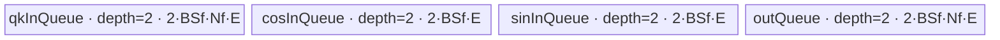

# ApplyRotaryPosEmb 950 ACLNN 算子知识

## 算子速览

| 项目 | 内容 |
|---|---|
| 实际入口 | CANN 9.1.0最新公开V2两段式接口；支持显式`rotaryMode` |
| 计算语义 | q/k前`realD`执行half、quarter或相邻元素interleave旋转，再做`x*cos+rotate(x)*sin`；输出写q_out/k_out并由引用接口原地更新 |
| 输入输出 | BSND/SBND/BNSD四维或TND三维，ND，同dtypeFP16/BF16/FP32；`D<=1024`、realD<=D、cos/sin N=1、cosB=1或B |
| 执行类型 | R-001～R-003 为 `AIV_VECTOR`，apt entry 的 AIC 分支立即返回且无 Cube/MIX_CV 计算；R-004 在 AIV entry 以未知 key 0 静默返回，不进入 Device body |
| Kernel 路线 | R-001 AB通用；R-002 BNSD逐B；R-003 BNSD广播B；R-004 BSND广播B 的 key 0 无写出失败终点 |
| 核心资源 | q/k/cos/sin与独立输出GM，四个双缓冲TQue，FP32 RegTensor/MaskReg；16MiB保留workspace不被body访问 |
| 来源闭包 | `source_closed`：V2、OpDef、arch35 selector、两套POD、Host实际发出的 key 20030/20010/20011/0、entry/body/common helper、config/CMake闭合；`BAB` 的 20020 body 在固定 Commit 中 Host 不可达，外部load_store_utils转换细节为固定仓外依赖边界 |
| 验证状态 | 已完成源码闭包检查；本次知识提取未执行编译、真机、数值或性能测试。 |

## 接口与语义

### 计算语义

half按两半成对：`(-x1,x0)`；quarter按四段成对：`(-x1,x0,-x3,x2)`；interleave按偶奇对：`(-odd,even)`。三者均只在前`realD=cosD`生效，部分RoPE通过分段DataCopy只写该前缀。MicroAPI helper把T加载到FP32 RegTensor计算并存回T；外部load/store helper的精确舍入模式固定仓不可见。

### 输入、输出与属性

| 参数 | shape/layout | dtype | 约束、默认值与语义 |
|---|---|---|---|
| `queryRef/keyRef` | BSND/SBND/BNSD `[4D]`或TND `[T,N,D]` | FP16/BF16/FP32 | 输入输出引用；源码要求正维；D<=1024；除N外公开契约要求一致 |
| `cos/sin` | 对应layout且N=1 | 同q | shape相同；S同q/k；cosB=1或B；realD<=D |
| `layout` | Host标量 | int64 | 1/2/3/4分别BSND/SBND/BNSD/TND |
| `rotaryMode` | Host字符串 | char* | half/interleave/quarter；half/interleave要求D偶数，quarter要求D被4整除 |
| `workspaceSize/executor` | Host输出 | uint64/指针 | 两段式生命周期 |
| `workspace/stream` | Device/Runtime | byte/stream | 各route请求16MiB；body不访问；第二段指定stream |

### 入口与版本

V2是最新公开入口，V1仅固定half。V2包装转发生成式inner；OpDef在`ascend950`把opFile指向`apply_rotary_pos_emb_apt`。950支持四layout及三mode，不能复用A2/A3的key1/3/4正文。

## Host/Launcher 执行流程

### 参数校验与前处理

OpDef提供ND同dtype和AutoContiguous。arch35 base按顺序执行`GetPlatformInfo→GetShapeAttrsInfo→CheckParam`：检查六个desc/shape、mode/layout、同dtype、rank、q/k输出shape、cos=sin、N=1、S关系、B广播、D<=1024及正维；随后归一化为B/S/QN/KN/D/realD和`isPartialRope`。

### 参数、Workspace 与生命周期

平台提供AIV数与UB。四个 selector 模板都请求16MiB workspace；三个可达 body 不读 workspace，R-004 也在 entry 未消费 workspace 即结束。AB使用专用18字段POD，BNSD两条可达 key 与 R-004 Host producer 使用25字段POD；R-004 因 key 0 未被 entry 解析。生成式inner的连续化、ref别名和executor内部owner固定仓不可见。

### 启动图与失败传播

`V2GetWorkspaceSize→inner→OpDef/InferShape→TilingRegistry(优先级10000/20000/30000/40000)→apply_rotary_pos_emb_apt<<<blockDim,stream>>>`。不合法shape/dtype/UB返回`GRAPH_FAILED`；entry在AIC返回并仅AIV执行。R-001～R-003 分别发出 20030/20010/20011；R-004 的 `PostTiling` 把从未赋值的成员 `tilingKey_`（默认0）写入 context，entry没有 key 0 分支，因而静默不写 q_out/k_out，且不会 fall through 到 priority 40000。

## Route 与参数设计

### 分核与资源计算

优先级越小越先匹配。令 `E=dAlign*sizeof(T)`。AB 对 BSND/TND 使用 `BS=B*S`；SBND 且 `cosB=1` 时把 B 并入 head，改为 `BS=S, QN=B*QN, KN=B*KN`。其 `blockFactorBS=ceil(BS/AIV)`、`blockNumBS=ceil(BS/blockFactorBS)`，尾核为 `BS-(blockNumBS-1)*blockFactorBS`；`dAlign=ceilAlign(realD/dSplitCoef,32/sizeof(T))*dSplitCoef`，`baseBlockInUb=floorAlign(UB/4,32)/E`，再计算 N tile 与可同时处理的 BS 数。

BNSD 两路先处理 B 或 S 能整除 AIV 核数的情形，否则分别构造 B-first 与 S-first 切分并选使用核数更多者；`dSize=ceilAlign(D*sizeof(T)/dSplitCoef,32)*dSplitCoef`、`numOfDAvailable=floor(UB/(4*dSize))`，依次扩 `ubFactorS`、共同的 `ubFactorQN/KN` 和 `ubFactorB`。R-004 的 Host 仍会执行 `SplitUb/SplitCore`：比较 B-first/S-first，评分为 `usedCoreNum*min(ubFactorS,blockFactorS)`，并按 `canLoadDNum=floor(UB/dAlign)/4` 产生 QN/KN factor；但这些 POD 字段因最终 key 为0而没有 Device consumer，不能据此把 `BAB` body 视为可达实现。

### Route 选择

| 顺序 | Route | Key/模板 | 精确选择条件与优先级 | 不适用去向 |
|---:|---|---|---|---|
| 1 | R-001 AB通用 | 20030 `ApplyRotaryPosEmbAB` | regbase且BSND cosB=B、SBND cosB=B/1、TND | BNSD到R-002/3；BSND cosB=1到R-004 |
| 2 | R-002 BNSD逐B | 20010 `ABAAndBA<T,false>` | BNSD且cosB=B | cosB=1到R-003 |
| 3 | R-003 BNSD广播B | 20011 `ABAAndBA<T,true>` | BNSD且cosB=1 | 非BNSD继续 |
| 4 | R-004 BSND广播B key缺陷 | selector 声明20020，`PostTiling`实际写0 | BSND且cosB=1；priority 30000 `IsCapable` 成功 | entry 未知 key 0 静默返回；不会继续尝试 priority 40000，`BAB` body 不可达 |

```text
校验并归一化 -> AB谓词 ? R-001 -> BNSD ? (cosB==1?R-003:R-002)
  -> BSND且cosB==1 ? R-004 Host产生POD并写key0 -> entry未知key返回且不写输出
  -> 其它组合失败
```

### 模板/实现执行矩阵

| Route | key/selector | dtype/shape/platform 完整命中条件 | 实际模板/类 | body/helper | 内存与同步特征 | tail/fallback |
|---|---|---|---|---|---|---|
| R-001 AB通用 | 20030 | 950 RegBase；BSND且`cosB=B`，或SBND且`cosB∈{1,B}`，或TND（归一化后`B=cosB=1`）；三种dtype、三种mode | `ApplyRotaryPosEmbAB<DTYPE_QUERY>` | `Process→ProcessQKLoop/ProcessLoop→*AlignVF` | qk/cos/sin/out 四个 depth-2 TQue；FP32 RegTensor；无TBuf | `blockTailBS`、`ubTailN`；不命中按优先级尝试BNSD/BAB模板 |
| R-002 BNSD逐B | 20010 | 950 RegBase；BNSD且`cosB=B`；三种dtype、三种mode | `ApplyRotaryPosEmbABAAndBA<DTYPE_QUERY,false>` | `ProcessInSLoop→ProcessInSBLoop→ProcessInSBNLoop→Batch*VF` | 四个 depth-2 TQue；cos/sin容量含B tile | B/S/N循环均现场计算tail；UB不足失败 |
| R-003 BNSD广播B | 20011 | 950 RegBase；BNSD且`cosB=1`；三种dtype、三种mode | `ApplyRotaryPosEmbABAAndBA<DTYPE_QUERY,true>` | 同R-002，`IsBBoardcast=true`编译期分支 | cos/sin每个S tile只搬一次并跨B tile复用；容量不含B factor | 同R-002；不再读取其它B的cos/sin |
| R-004 BSND广播B key缺陷 | selector `GetTilingKey()`为20020，但 context 实际 key=0 | 950 RegBase；BSND且`cosB=1`；三种dtype、三种mode | Host `ApplyRotaryPosEmbTilingBAB`；Device为 entry 未知-key 终点 | `PostTiling→SetTilingKey(tilingKey_=0)→entry` 无分支命中 | 不初始化TQue、不读写GM、无同步；16MiB workspace仅被保留 | `SplitUb`可先失败；成功则launch后静默无写出；仓内 `BAB<T>` 为 dormant body |

### 隐藏性能 Guard

| Guard | Host/Tiling 条件 | Device/资源原因 | 影响 Route | 不满足时去向 | 源码符号 |
|---|---|---|---|---|---|
| RegBase平台 | `IsRegbaseSocVersion(context_)` | 20030/20010/20011 与预期20020只由arch35模板和apt entry实现 | 全部 | 非RegBase由注册框架尝试旧通用优先级40000 | 三个arch35 `IsCapable` |
| D分段与32B对齐 | `dSplitCoef={2,1,4}`；`dAlign=ceilAlign(realD/dSplitCoef,32/typeSize)*dSplitCoef` | half/quarter分段DMA的每段需独立对齐，interleave整段搬运 | R-001～R-003 | 非法mode或query D整除失败在base终止；base未校验realD的同类整除，见限制 | `ConvertRotaryMode`、各`DoOpTiling/SplitUb` |
| DMA blockCount上限 | N或S factor `<=4095/dSplitCoef` | partial half/quarter会把一次逻辑行展开为2/4个DataCopy block | 全部 | Host缩小factor；算得0则失败 | `MAX_COPY_BLOCK_COUNT/MIN_COPY_BLOCK_COUNT` |
| AB最小UB | `baseBlockInUb>=2`，其中`baseBlockInUb=floorAlign(UB/4,32)/E` | 至少容纳一组qk/out和一组cos/sin的四类双缓冲区 | R-001 | `GRAPH_FAILED`，无950 kernel fallback | `ApplyRotaryPosEmbTilingAB::DoOpTiling` |
| BNSD最小UB | `floor(UB/(4*dSize))>=ubFactorB+1`，初值`ubFactorB=1` | 非广播至少需要一组q/out和一组cos/sin；系数4计入输入输出与double buffer | R-002/R-003 | `GRAPH_FAILED` | `ComputeUbFactor` |
| R-004 Host UB gate | `floor(UB/dAlign)>=8` 后再除4 | selector 在发起缺陷 launch 前仍按 dormant BAB 的双缓冲预算切 UB | R-004 | 不足则 `GRAPH_FAILED`；满足后仍发 key 0 | `ApplyRotaryPosEmbTilingBAB::SplitUb` |
| R-004 key producer | 成员 `tilingKey_{0}` 从未赋值，`PostTiling`执行`SetTilingKey(tilingKey_)` | entry只处理20030/20020/20010/20011 | R-004 | key 0 静默返回，不写输出 | `ApplyRotaryPosEmbTilingBAB::PostTiling/GetTilingKey` |
| 部分RoPE | `isPartialRope=(realD!=D)` | 必须跳过每个完整head的未旋转后缀，不能用连续整head DMA | R-001～R-003；R-004字段无consumer | `realD==D`走连续DataCopyPad；R-004均为key0终点 | `SetBsnd`、`CopyIn/CopyOut*Mode` |
| AIV-only门 | `g_coreType==AIC`立即return | apt二进制可在混合发射环境中只让Vector核执行 | 全部 | AIC不写输出；AIV继续router | `apply_rotary_pos_emb_apt.cpp:apply_rotary_pos_emb` |

### POD/ABI

宏生成的`sizeof/alignof/offsetof`固定仓不可见；字段按声明顺序逐项如下。

| 结构 | 字段 | 类型/位宽 | ABI 布局 | 单位 | Host/launcher producer | Device consumer | 边界 |
|---|---|---|---|---|---|---|---|
| `ApplyRotaryPosEmbRegbaseTilingData` | `B` | int64_t/64 | 固定仓不可见；序号0 | 维 | SetBsnd | R-002/R-003地址；R-004无consumer | >0 |
| 同上 | `CosB` | int64_t/64 | 固定仓不可见；序号1 | 维 | SetBsnd；R-004 PostTiling覆写0 | R-002/R-003广播选择；R-004无consumer | R-004值0只进入未解析POD |
| 同上 | `S` | int64_t/64 | 固定仓不可见；序号2 | 维 | SetBsnd | GM跨度 | >0 |
| 同上 | `D` | int64_t/64 | 固定仓不可见；序号3 | 元素 | qD | GM跨度 | <=1024 |
| 同上 | `QN` | int64_t/64 | 固定仓不可见；序号4 | head | qN | Q循环 | >0 |
| 同上 | `KN` | int64_t/64 | 固定仓不可见；序号5 | head | kN | K循环 | >0 |
| 同上 | `blockNumB` | int64_t/64 | 固定仓不可见；序号6 | 核维 | SplitCore | block映射 | 乘S<=AIV |
| 同上 | `blockFactorB` | int64_t/64 | 固定仓不可见；序号7 | B | SplitCore | former/tail B | ceil分配 |
| 同上 | `blockNumS` | int64_t/64 | 固定仓不可见；序号8 | 核维 | SplitCore | block映射 | 正数 |
| 同上 | `blockFactorS` | int64_t/64 | 固定仓不可见；序号9 | S | SplitCore | former/tail S | ceil分配 |
| 同上 | `ubLoopNumS` | int64_t/64 | 固定仓不可见；序号10 | 循环 | 默认0 | R-002/R-003 body自行重算；R-004无consumer | inactive |
| 同上 | `ubFactorS` | int64_t/64 | 固定仓不可见；序号11 | S | UB计算 | S tile | >=1 |
| 同上 | `ubTailFactorS` | int64_t/64 | 固定仓不可见；序号12 | S | 默认0 | body自行重算尾值 | inactive |
| 同上 | `ubLoopNumB` | int64_t/64 | 固定仓不可见；序号13 | 循环 | 默认0 | body自行CeilDiv | inactive |
| 同上 | `ubFactorB` | int64_t/64 | 固定仓不可见；序号14 | B | ABA UB计算；R-004默认1 | R-002/R-003 B tile；R-004无consumer | 可达body要求>=1 |
| 同上 | `ubTailFactorB` | int64_t/64 | 固定仓不可见；序号15 | B | 默认0 | body自行尾值 | inactive |
| 同上 | `ubLoopNumQN` | int64_t/64 | 固定仓不可见；序号16 | 循环 | R-004 SplitUb | 无可达consumer；R-002/R-003 body重算 | inactive |
| 同上 | `ubFactorQN` | int64_t/64 | 固定仓不可见；序号17 | head | UB计算 | Q tile/共用N factor | >=1 |
| 同上 | `ubTailFactorQN` | int64_t/64 | 固定仓不可见；序号18 | head | R-004 SplitUb | 无可达consumer；R-002/R-003重算 | inactive |
| 同上 | `ubLoopNumKN` | int64_t/64 | 固定仓不可见；序号19 | 循环 | R-004 SplitUb | 无可达consumer；R-002/R-003重算 | inactive |
| 同上 | `ubFactorKN` | int64_t/64 | 固定仓不可见；序号20 | head | UB计算 | K tile | >=1 |
| 同上 | `ubTailFactorKN` | int64_t/64 | 固定仓不可见；序号21 | head | R-004 SplitUb | 无可达consumer；R-002/R-003重算 | inactive |
| 同上 | `rotaryMode` | int64_t/64 | 固定仓不可见；序号22 | enum | ConvertRotaryMode | helper选择 | 1/2/3 |
| 同上 | `realDim` | int64_t/64 | 固定仓不可见；序号23 | 元素 | cosD | 搬运/RegTensor | <=D |
| 同上 | `isPartialRope` | bool/实现宽度 | 固定仓不可见；序号24 | bool | realD!=D | 分段搬运 | offset未知 |
| `ApplyRotaryPosEmbRegbaseABTilingData` | `B` | int64_t/64 | 固定仓不可见；序号0 | 维 | SetBsnd | AB地址 | >0 |
| 同上 | `CosB` | int64_t/64 | 固定仓不可见；序号1 | 维 | SetBsnd | 仅审计 | 1或B |
| 同上 | `S` | int64_t/64 | 固定仓不可见；序号2 | 维 | SetBsnd | BS映射 | >0 |
| 同上 | `D` | int64_t/64 | 固定仓不可见；序号3 | 元素 | qD | GM跨度 | <=1024 |
| 同上 | `QN` | int64_t/64 | 固定仓不可见；序号4 | head | qN | Q段 | >0 |
| 同上 | `KN` | int64_t/64 | 固定仓不可见；序号5 | head | kN | K段 | >0 |
| 同上 | `dAlign` | int64_t/64 | 固定仓不可见；序号6 | 元素 | DoOpTiling | UB行距 | 32B对齐 |
| 同上 | `dSplitCoef` | int64_t/64 | 固定仓不可见；序号7 | 段 | ConvertMode | 分段copy | 2/1/4 |
| 同上 | `blockNumBS` | int64_t/64 | 固定仓不可见；序号8 | 核 | ceil(BS/factor) | block门域 | <=AIV |
| 同上 | `blockFactorBS` | int64_t/64 | 固定仓不可见；序号9 | BS | ceil(BS/AIV) | 核offset | >0 |
| 同上 | `blockTailBS` | int64_t/64 | 固定仓不可见；序号10 | BS | BS-(num-1)*factor | 尾核 | 有效尾 |
| 同上 | `ubFactorBS` | int64_t/64 | 固定仓不可见；序号11 | BS | UB余量 | Process循环 | >=1 |
| 同上 | `ubLoopN` | int64_t/64 | 固定仓不可见；序号12 | 循环 | ceil((QN+KN)/factor) | 单BS N循环 | >=1 |
| 同上 | `ubFactorN` | int64_t/64 | 固定仓不可见；序号13 | head | UB计算且<=4095/coef | N tile | >=1 |
| 同上 | `ubTailN` | int64_t/64 | 固定仓不可见；序号14 | head | totalN-(loop-1)*factor | N尾 | 有效尾 |
| 同上 | `rotaryMode` | int64_t/64 | 固定仓不可见；序号15 | enum | ConvertMode | helper选择 | 1/2/3 |
| 同上 | `realDim` | int64_t/64 | 固定仓不可见；序号16 | 元素 | cosD | 搬运/计算 | <=D |
| 同上 | `isPartialRope` | bool/实现宽度 | 固定仓不可见；序号17 | bool | realD!=D | 分段copy | offset未知 |

### Route 源码闭包

| Route | Key/selector | Host/Tiling producer | POD/参数 | Kernel entry/router | Kernel body/直接依赖 | 构建接线 |
|---|---|---|---|---|---|---|
| R-001 AB通用 | 20030 | `tiling_ab:DoOpTiling/PostTiling` | AB POD | `apt.cpp:entry` | `ab.h:ApplyRotaryPosEmbAB`+common | ascend950 config/CMake |
| R-002 BNSD逐B | 20010 | `tiling_aba:SplitCore/ComputeUbFactor` | 通用POD | 同entry | `aba_and_ba.h:<T,false>`+common | 同上 |
| R-003 BNSD广播B | 20011 | 同producer且cosB=1 | 通用POD | 同entry | `aba_and_ba.h:<T,true>`+common | 同上 |
| R-004 BSND广播B key缺陷 | selector期望20020、实际0 | `tiling_bab:SplitCore/SplitUb/PostTiling` | 通用POD已序列化但不被解析 | `apt.cpp:entry` 的未知-key终点 | 无可达body；`bab.h:BAB`仅为dormant实现，不纳入正式Route | 同上 |

## Kernel 实现

### 公共执行流程

apt entry过滤AIC；对 key 20030/20010/20011 创建TPipe并解析对应POD，三个可达 body 均 CopyIn 到 VECIN TQue，MicroAPI以FP32 RegTensor按mode计算，再经VECOUT写独立输出GM。Queue EnQue/DeQue是这些可达 body 的唯一显式同步机制；无TBuf、workspace通信、Atomic或跨核barrier。R-004 的 key 0 不命中任何分支，route对象不构造；文件中的 key 20020 `BAB` 分支是固定 Commit 的Host-unreachable代码。

### Route R-001：AB通用

#### 适用条件

##### 选择证据

| 层级 | 文件 | 符号 | 源码谓词/参数 | 结果/下一跳 |
|---|---|---|---|---|
| Tiling | posembedding/apply_rotary_pos_emb/op_host/apply_rotary_pos_emb_tiling_ab_arch35.cpp | `IsCapable/GetTilingKey` | regbase且AB列出的layout/cosB | 20030/下一模板 |
| Router | posembedding/apply_rotary_pos_emb/op_kernel/apply_rotary_pos_emb_apt.cpp | `apply_rotary_pos_emb` | key20030且AIV | `ApplyRotaryPosEmbAB` |

#### Device 数据流

##### 函数级调用链

```text
entry -> ApplyRotaryPosEmbAB::Init -> Process -> ProcessQKLoop/ProcessLoop -> CopyInByRotaryMode -> HalfAlignVF/QuarterAlignVF/InterleaveModeVF -> CopyOutByRotaryMode
```

##### 源码等价伪码

```text
BSNum=尾核?blockTail:blockFactor；for bsTile计算GM offset并搬cos/sin
if currBSNum>1: 分别整块处理Q与K；else for nTile跨QN+KN并处理交界
按mode分段CopyIn；RegTensor循环以mask处理realD尾；out=x*cos+rotate*sin
按partial分段CopyOut，仅提交realD前缀
```

#### 内存与数据搬运

##### 资源与搬运表

| 层级/缓冲区 | offset/地址公式 | extent/容量公式 | dtype/layout | producer | consumer | owner/lifetime | 对齐/复用 |
|---|---|---|---|---|---|---|---|
| q/k/cos/sin/out GM | `blockIdx*blockFactorBS*{N*D或realD}` | currBS*{N*realD} | T/各layout | caller | Process | launch | partial分2/1/4段 |
| qkIn/out TQue | TPipe offset | 2槽*`dAlign*ubFactorBS*ubFactorN*sizeof(T)` | T | GM/Reg | Reg/GM | tile | 模板depth1但InitBuffer DB_FLAG=2 |
| cos/sin TQue | TPipe offset | 各2槽*`ubFactorBS*dAlign*sizeof(T)` | T | GM | Reg | BS tile | Queue事件 |
| RegTensor/MaskReg | VEC寄存器 | half 8FP32reg；quarter16；interleave10 | FP32 | UB load helper | store helper | D循环 | UpdateMask保护尾 |
| TBuf/workspace | N/A/user base | 0/16MiB | byte | Host | entry | launch | body不使用 |

##### 分层内存布局



这里 `E=dAlign*sizeof(T)`、`BSf=ubFactorBS`、`Nf=ubFactorN`。类成员声明的 Queue 模板 depth 为1，但 `InitBuffer(..., DB_FLAG=2, ...)` 明确建立两个物理槽，字节账采用真实初始化参数。

##### 字节账与复用顺序

```text
UB_total = 2·BSf·Nf·E + 2·BSf·E + 2·BSf·E + 2·BSf·Nf·E
         = 4·BSf·(Nf+1)·E
baseBlockInUb = floorAlign(UB/4, 32)/E
=> Host 先约束 Nf，再令 BSf=min(floor(baseBlockInUb/(QN+KN+1)), blockFactorBS)
```

| 复用子区 | 写入者 | 读取者/消费点 | 下一次覆盖 | 同步或释放依据 | 安全条件 |
|---|---|---|---|---|---|
| `cosInQueue`/`sinInQueue`当前槽 | `Process`的`DataCopyPad` | 同一BS tile内全部Q/K N tile的`*AlignVF` | 下一个BS tile重新Alloc | EnQue→DeQue；完成Q/K后Free | Q与K都结束前不得释放 |
| `qkInQueue`当前槽 | `CopyInByRotaryMode`或连续`DataCopyPad` | `Half/Quarter/Interleave*VF` | 下一N tile | EnQue→DeQue→Free | Reg计算完成后才可Free |
| `outQueue`当前槽 | Reg helper store | `CopyOutByRotaryMode`或连续`DataCopyPad` | 下一N tile | EnQue→DeQue→Free | 只写`realDim`，后缀保持原输出内容 |

#### 同步、精度与尾块

##### 同步与数值边界表

| 阶段 | primitive/机制 | producer | consumer/等待点 | 保护对象 | 精度/尾块 |
|---|---|---|---|---|---|
| GM→UB→GM | 四TQue EnQue/DeQue/Free | DataCopyPad/Reg | Reg/DataCopyPad | 双缓冲槽 | blockTailBS、ubTailN、Q/K交界 |
| Reg计算 | UpdateMask | FP32 load | FP32 store到T | RegTensor | realD/VL尾；store舍入细节固定仓不可见 |

#### 关键实现

##### 符号证据表

| 阶段 | 文件 | 符号/模板实例 | 实现事实 |
|---|---|---|---|
| Host/Tiling producer | posembedding/apply_rotary_pos_emb/op_host/apply_rotary_pos_emb_tiling_ab_arch35.cpp | `DoOpTiling/PostTiling/IsCapable` | key/POD/资源 |
| Kernel entry/router | posembedding/apply_rotary_pos_emb/op_kernel/apply_rotary_pos_emb_apt.cpp | `apply_rotary_pos_emb` | key20030 |
| Device body/helper | posembedding/apply_rotary_pos_emb/op_kernel/arch35/apply_rotary_pos_emb_ab.h | `Process/ProcessLoop/ProcessQKLoop` | 地址/Queue/tail |
| Device body/helper | posembedding/apply_rotary_pos_emb/op_kernel/arch35/apply_rotary_pos_emb_common.h | `HalfAlignVF/QuarterAlignVF/InterleaveModeVF` | RegTensor公式/mask |

### Route R-002：BNSD逐B

#### 适用条件

##### 选择证据

| 层级 | 文件 | 符号 | 源码谓词/参数 | 结果/下一跳 |
|---|---|---|---|---|
| Tiling | posembedding/apply_rotary_pos_emb/op_host/apply_rotary_pos_emb_tiling_aba_and_ba_arch35.cpp | `IsCapable/GetTilingKey` | BNSD且cosB=B | 20010 |
| Router | posembedding/apply_rotary_pos_emb/op_kernel/apply_rotary_pos_emb_apt.cpp | `apply_rotary_pos_emb` | key20010 | `<T,false>` |

#### Device 数据流

##### 函数级调用链

```text
entry -> ABAAndBA<T,false>::Init -> Process -> ProcessInSLoop -> ProcessInSBLoop -> ProcessInSBNLoop -> CopyInQOrK -> Compute -> Batch*VF -> CopyOutQOrK
```

##### 源码等价伪码

```text
core映射B块和S块；for sTile for bTile: 搬每个B自己的cos/sin
for qN tile再for kN tile: offset=b*N*S*D+n*S*D+s*D；LoopMode二维搬运
按mode Batch*VF<T,false>，FP32 RegTensor mask尾；partial只写realD前缀
```

#### 内存与数据搬运

##### 资源与搬运表

| 层级/缓冲区 | offset/地址公式 | extent/容量公式 | dtype/layout | producer | consumer | owner/lifetime | 对齐/复用 |
|---|---|---|---|---|---|---|---|
| BNSD GM | `b*N*S*D+n*S*D+s*D` | bTile*nTile*sTile*realD | T/BNSD | caller | LoopMode Copy | launch | partial分段 |
| qIn/qOut TQue | TPipe offset | 各2槽*Bf*Sf*Nf*dAlign*sizeof(T) | T | GM/Reg | Reg/GM | N tile | double buffer |
| cos/sin TQue | TPipe offset | 各2槽*Bf*Sf*dAlign*sizeof(T) | T | GM | BatchVF | BS tile | 不广播B |
| RegTensor/MaskReg | VEC寄存器 | 6/12/6 FP32主reg | FP32 | UB | UB | D loop | UpdateMask |
| TBuf/workspace | N/A/user base | 0/16MiB | byte | Host | entry | launch | body不用 |

##### 分层内存布局


`Edev=dAlign*sizeof(T)`、`Bf=ubFactorB`、`Sf=ubFactorS`、`Nf=ubFactorQN=ubFactorKN`。此 Route 的 cos/sin 不广播B，因此编码Queue容量包含 `Bf`。Kernel 的 `dAlign` 按 `realDim` 分配；Host 用 `Ehost=ceilAlign(D*sizeof(T)/dSplitCoef,32)*dSplitCoef` 做更保守的factor预算，partial RoPE时 `Ehost>=Edev`。

##### 字节账与复用顺序

```text
UB_total_device = 4·Bf·Sf·Nf·Edev + 4·Bf·Sf·Edev
                = 4·Bf·Sf·(Nf+1)·Edev
Host numOfDAvailable = floor(UB/(4·Ehost))，按 Sf -> Nf -> Bf 顺序扩大
```

| 复用子区 | 写入者 | 读取者/消费点 | 下一次覆盖 | 同步或释放依据 | 安全条件 |
|---|---|---|---|---|---|
| cos/sin当前BS tile槽 | `CopyInCosAndSin` | 该B tile内Q、K所有N tile的`Batch*VF<T,false>` | 下一B tile | EnQue→DeQue；`ProcessInSBLoop`返回后Free | Q/K遍历完成前保持有效 |
| qIn/qOut槽 | `CopyInQOrK`/Reg store | `Compute`/`CopyOutQOrK` | 下一N tile | qIn EnQue→DeQue→Free；qOut EnQue→DeQue→Free | 各自GM搬出完成后才能覆盖 |

#### 同步、精度与尾块

##### 同步与数值边界表

| 阶段 | primitive/机制 | producer | consumer/等待点 | 保护对象 | 精度/尾块 |
|---|---|---|---|---|---|
| Queue链 | EnQue/DeQue/Free | LoopMode copy/Reg | Reg/GM | 四双缓冲Queue | B/S/N均CeilDiv重算尾长 |
| Reg链 | UpdateMask+FP32 RegTensor | T load | T store | 当前D段 | half/quarter/interleave顺序不可换 |

#### 关键实现

##### 符号证据表

| 阶段 | 文件 | 符号/模板实例 | 实现事实 |
|---|---|---|---|
| Host/Tiling producer | posembedding/apply_rotary_pos_emb/op_host/apply_rotary_pos_emb_tiling_aba_and_ba_arch35.cpp | `SplitCore/ComputeUbFactor/GetTilingKey` | key20010 |
| Kernel entry/router | posembedding/apply_rotary_pos_emb/op_kernel/apply_rotary_pos_emb_apt.cpp | `apply_rotary_pos_emb` | false实例 |
| Device body/helper | posembedding/apply_rotary_pos_emb/op_kernel/arch35/apply_rotary_pos_emb_aba_and_ba.h | `ProcessInSBNLoop/CopyInQOrK/Compute` | BNSD地址/Queue |

### Route R-003：BNSD广播B

#### 适用条件

##### 选择证据

| 层级 | 文件 | 符号 | 源码谓词/参数 | 结果/下一跳 |
|---|---|---|---|---|
| Tiling | posembedding/apply_rotary_pos_emb/op_host/apply_rotary_pos_emb_tiling_aba_and_ba_arch35.cpp | `GetTilingKey` | BNSD且cosB=1 | 20011 |
| Router | posembedding/apply_rotary_pos_emb/op_kernel/apply_rotary_pos_emb_apt.cpp | `apply_rotary_pos_emb` | key20011 | `<T,true>` |

#### Device 数据流

##### 函数级调用链

```text
entry -> ABAAndBA<T,true>::Process -> ProcessInSLoop -> CopyInCosAndSin -> ProcessInSBLoop -> Compute -> Batch*VF<T,true> -> CopyOutQOrK
```

##### 源码等价伪码

```text
for sTile: 仅从B=0搬一次cos/sin；for bTile复用该Queue tensor
for Q/K nTile按BNSD offset搬输入；if mode选择Batch*VF<T,true>
RegTensor以s索引cos/sin而不加b偏移；仅写有效B/S/N/realD
```

#### 内存与数据搬运

##### 资源与搬运表

| 层级/缓冲区 | offset/地址公式 | extent/容量公式 | dtype/layout | producer | consumer | owner/lifetime | 对齐/复用 |
|---|---|---|---|---|---|---|---|
| q/k/out GM | `b*N*S*D+n*S*D+s*D` | 有效tile*realD | T/BNSD | caller | body | launch | D后缀不写 |
| cos/sin GM | `s*realD` | sTile*realD | T/BNSD广播 | caller | CopyInCosAndSin | sTile | B=0 |
| 四TQue | TPipe offset | q/out 2槽*Bf*Sf*Nf*dAlign；cos/sin 2槽*Sf*dAlign | T | GM/Reg | Reg/GM | sTile | 广播区更小 |
| RegTensor/MaskReg | VEC寄存器 | mode对应FP32集合 | FP32 | UB | UB | D loop | IsBBoardcast编译期分支 |
| TBuf/workspace | N/A/user base | 0/16MiB | byte | Host | entry | launch | body不用 |

##### 分层内存布局


`Edev=dAlign*sizeof(T)`。与 R-002 相比，`IsBBoardcast=true` 使 cos/sin 每槽只分配 `Sf·Edev`，不乘 `Bf`；qIn/qOut 仍覆盖 B、S、N 三轴 tile。Host仍以完整 `D` 形成保守的 `Ehost`，Kernel以 `realDim` 形成 `Edev`。

##### 字节账与复用顺序

```text
UB_total_device = 4·Bf·Sf·Nf·Edev + 4·Sf·Edev
                = 4·Sf·(Bf·Nf+1)·Edev
Host 以Ehost先为广播cos/sin保留1份D行，再用余量扩N与B
```

| 复用子区 | 写入者 | 读取者/消费点 | 下一次覆盖 | 同步或释放依据 | 安全条件 |
|---|---|---|---|---|---|
| cos/sin当前S tile槽 | `CopyInCosAndSin(sStart,sLength,0,1)` | 该S tile的全部B tile、Q/K N tile | 下一个S tile | 外层仅一次DeQue；固定源码却执行`sinQueue.FreeTensor(cosUb)`与`cosQueue.FreeTensor(sinUb)` | 复用读阶段有完整生命周期；释放的Queue ownership交叉，固定仓无法证明安全，须保留为缺陷边界 |
| qIn/qOut双缓冲槽 | 每个B/N tile的CopyIn/Reg store | Reg计算/GM CopyOut | 下一tile | Queue事件与Free | 不能因cos/sin跨B复用而延长qIn/qOut生命周期 |

#### 同步、精度与尾块

##### 同步与数值边界表

| 阶段 | primitive/机制 | producer | consumer/等待点 | 保护对象 | 精度/尾块 |
|---|---|---|---|---|---|
| 广播Queue | cos/sin EnQue/DeQue；交叉Free | 单次GM copy | 全部bTile | sTile编码 | 完成全部bTile后才释放，但FreeTensor所属Queue与tensor来源相反，未验证运行影响 |
| 数值/tail | Reg mask+qIn/qOut Queue | input | output | 当前tile | FP32计算；B/S/N尾由循环长度保护 |

#### 关键实现

##### 符号证据表

| 阶段 | 文件 | 符号/模板实例 | 实现事实 |
|---|---|---|---|
| Host/Tiling producer | posembedding/apply_rotary_pos_emb/op_host/apply_rotary_pos_emb_tiling_aba_and_ba_arch35.cpp | `GetTilingKey/ComputeUbFactor` | key20011与广播容量 |
| Kernel entry/router | posembedding/apply_rotary_pos_emb/op_kernel/apply_rotary_pos_emb_apt.cpp | `apply_rotary_pos_emb` | true实例 |
| Device body/helper | posembedding/apply_rotary_pos_emb/op_kernel/arch35/apply_rotary_pos_emb_aba_and_ba.h | `ProcessInSLoop/CopyInCosAndSin/Compute` | B广播复用与Reg路径 |

### Route R-004：BSND广播B key 0 无写出终点

#### 适用条件

##### 选择证据

| 层级 | 文件 | 符号 | 源码谓词/参数 | 结果/下一跳 |
|---|---|---|---|---|
| Tiling selector | posembedding/apply_rotary_pos_emb/op_host/apply_rotary_pos_emb_tiling_bab_arch35.cpp | `IsCapable/GetTilingKey` | regbase、BSND、cosB=1；方法返回20020 | 选择 priority 30000 模板 |
| Tiling producer | posembedding/apply_rotary_pos_emb/op_host/apply_rotary_pos_emb_tiling_bab_arch35.cpp | `PostTiling` | `tilingKey_` 声明时为0且文件内无赋值；`SetTilingKey(tilingKey_)` | context实际key为0 |
| Router | posembedding/apply_rotary_pos_emb/op_kernel/apply_rotary_pos_emb_apt.cpp | `apply_rotary_pos_emb` | 仅有20030/20020/20010/20011分支 | key0未命中，函数自然结束 |

#### Device 数据流

##### 函数级调用链

```text
ApplyRotaryPosEmbTilingBAB::DoOpTiling
  -> SplitUb -> SplitCore
  -> PostTiling: SaveToBuffer -> SetBlockDim(usedCoreNum) -> SetTilingKey(0)
apply_rotary_pos_emb(key=0, AIV)
  -> 不命中20030/20020/20010/20011
  -> return；q_out/k_out未写
```

##### 源码等价伪码

```text
# 源码等价伪码
if (!IsRegbase || layout != BSND || cosB != 1): try next selector
if (SplitUb失败): GRAPH_FAILED
SplitCore并序列化25字段POD
context.blockDim = usedCoreNum
context.tilingKey = tilingKey_  # 成员默认0，固定文件内无producer赋值
launch apt entry
if (key不属于{20030, 20020, 20010, 20011}): end without writes
```

#### 内存与数据搬运

##### 资源与搬运表

| 层级/缓冲区 | offset/地址公式 | extent/容量公式 | dtype/layout | producer | consumer | owner/lifetime | 对齐/复用 |
|---|---|---|---|---|---|---|---|
| q/k/cos/sin GM | caller地址 | 完整输入 | T/BSND | caller | 无 | executor生命周期 | entry不读取 |
| q_out/k_out GM | caller/inner提供 | 完整输出 | T/BSND | 无 | caller | launch后仍为原状态或框架预置状态 | 固定Kernel无写入 |
| raw tiling POD | tiling buffer | 25字段 | `ApplyRotaryPosEmbRegbaseTilingData` | `PostTiling::SaveToBuffer` | 无 | launch | key0使entry不解析 |
| UB/TQue/RegTensor | N/A | 0 B | N/A | 无 | 无 | 未构造 | dormant `BAB` 的资源不能计入可达Route |
| workspace | user/system base | 16MiB | byte | Host/inner | 无 | executor/launch | entry的key0路径不访问 |

##### 分层内存布局

N/A：可达 entry 不构造 `ApplyRotaryPosEmbBAB`，因此没有 AIV UB/TQue/RegTensor 布局。Host 的 `SplitUb` 预算只解释 selector 是否返回 `GRAPH_SUCCESS`，不是本 Route 的实际 Device 分配。

##### 字节账与复用顺序

```text
UB_total = 0 B  # key0路径无Device对象
dynamic_ub = N/A
workspace_total = 16 MiB reserved, 0 B consumed by reachable entry path
Host-only guard: canLoadDNum=floor(UB/dAlign)/4；小于2组双缓冲预算时先GRAPH_FAILED
```

| 复用子区 | 写入者 | 读取者/消费点 | 下一次覆盖 | 同步或释放依据 | 安全条件 |
|---|---|---|---|---|---|
| N/A | 无 | 无 | 无 | entry只构造空`TPipe`对象，未`InitBuffer`、无Queue/event数据依赖 | 不得把dormant `BAB` 的复用证明套到固定Commit的Host可达路径 |

#### 同步、精度与尾块

##### 同步与数值边界表

| 阶段 | primitive/机制 | producer | consumer/等待点 | 保护对象 | 精度/尾块 |
|---|---|---|---|---|---|
| launch终点 | 未知key自然结束 | Host launch | entry函数结束 | q_out/k_out | 无计算、无cast、无tail写出 |
| AIC门 | `g_coreType==AIC` return | launch | entry首分支 | 全部GM | AIC与AIV key0路径都不产生结果 |

#### 关键实现

##### 符号证据表

| 阶段 | 文件 | 符号/模板实例 | 实现事实 |
|---|---|---|---|
| Host/Tiling producer | posembedding/apply_rotary_pos_emb/op_host/apply_rotary_pos_emb_tiling_bab_arch35.cpp | `SplitCore/SplitUb/PostTiling` | POD、blockDim与实际key0 |
| Kernel entry/router | posembedding/apply_rotary_pos_emb/op_kernel/apply_rotary_pos_emb_apt.cpp | `apply_rotary_pos_emb` | 未知key无else诊断、自然结束 |
| Device body/helper | posembedding/apply_rotary_pos_emb/op_kernel/arch35/apply_rotary_pos_emb_bab.h | `ApplyRotaryPosEmbBAB` | 文件存在且entry有20020映射，但固定Host不发20020；不属于可达Route |

## 算子特定优化

### Trick T-001：把B广播的cos/sin提升到B循环外复用

#### 触发与源码依据

- 适用 Route：R-003。
- 触发条件：`layout=BNSD && cosB=1`，Host发 key 20011，entry实例化 `ApplyRotaryPosEmbABAAndBA<T,true>`。
- Golden 来源：[`apply_rotary_pos_emb_aba_and_ba.h:185-196`](../../../../../../../cann-ops-raw/ascendc/ops-transformer/be33d95bb755cedec3108f70805c1874d1792540/posembedding/apply_rotary_pos_emb/op_kernel/arch35/apply_rotary_pos_emb_aba_and_ba.h)

**官方源码（固定 Commit 连续逐字摘录）**：

```cpp
if constexpr (IsBBoardcast) {
    // cos和sin需要在B轴广播的情况
    this->CopyInCosAndSin(sUbStart, sUbLength, 0, 1);
    LocalTensor<T> cosUb = this->cosInQueue_.template DeQue<T>();
    LocalTensor<T> sinUb = this->sinInQueue_.template DeQue<T>();
    for (int64_t ubLoopIdx = 0; ubLoopIdx < ubLoopCount; ubLoopIdx++) {
        this->ProcessInSBLoop(
            sUbStart, sUbLength, bBlockStart_ + ubLoopIdx * ubFactorB_,
            ubLoopIdx != ubLoopCount - 1 ? ubFactorB_ : bBlockLength_ - ubLoopIdx * ubFactorB_, cosUb, sinUb);
    }
    this->sinInQueue_.FreeTensor(cosUb);
    this->cosInQueue_.FreeTensor(sinUb);
```

#### 机制与设计原因

编译期布尔模板把广播选择从内层运行时分支变成两套实例。广播实例对每个S tile仅从 `B=0` 搬一次 cos/sin，然后让所有B tile和Q/K N tile读取同一Dequeued LocalTensor；相应 `InitBuffer` 的cos/sin容量也从每槽 `Bf·Sf·E`降为`Sf·E`。它从源码结构上减少GM搬运和UB分配，释放出的D行可由Host继续扩大N或B tile。连续片段末尾同时暴露固定源码缺陷：cos/sin tensor被交叉传给另一条Queue的`FreeTensor`；本卡只确认复用机制，不把释放安全性补推为已证明。

#### 迁移边界

- 适用：位置编码或其它只读系数在B轴严格广播、内层输入按B分块的逐元素算子。
- 前提：Host必须以 `cosB==1` 选择专用模板；helper地址不得再叠加B偏移；编码tensor生命周期覆盖该S tile的全部B/Q/K循环。
- 失效：`cosB=B` 时必须转R-002，每个B重新搬运自己的编码。
- 未验证：本次知识提取未执行编译、真机、数值或性能测试。

#### 错误做法

不能在 `cosB=B` 时强行复用B=0的编码；源码用 key 20010/20011 和 `IsBBoardcast` 实例边界防止这种错配。固定源码自身的 `sinInQueue_.FreeTensor(cosUb)` / `cosInQueue_.FreeTensor(sinUb)` 也不能作为可迁移释放写法；tensor应由其实际所属Queue释放，但固定仓未提供修正版或运行反例。

### Trick T-002：部分RoPE按旋转段搬运，保留head后缀

#### 触发与源码依据

- 适用 Route：R-001/R-002/R-003；R-004 固定 Host 不会到达该 helper。
- 触发条件：`isPartialRope=(realDim!=D)`；half/quarter/interleave分别按2/4/1个段搬运。
- Golden 来源：[`apply_rotary_pos_emb_common.h:782-812`](../../../../../../../cann-ops-raw/ascendc/ops-transformer/be33d95bb755cedec3108f70805c1874d1792540/posembedding/apply_rotary_pos_emb/op_kernel/arch35/apply_rotary_pos_emb_common.h)

**官方源码（固定 Commit 连续逐字摘录）**：

```cpp
__aicore__ inline void CopyInHalfMode(
    LocalTensor<T>& inTensor, GlobalTensor<T>& gmTensor, const int64_t offset,
    const uint32_t blockCount, const uint32_t blockLen, const DataCopyPadExtParams<T>& padParams,
    const int64_t D, const int64_t realDim, const uint32_t dSplitCoef)
{
    DataCopyExtParams copyParams;
    copyParams.blockCount = blockCount;
    copyParams.blockLen = blockLen;
    int64_t srcStride = D - realDim / dSplitCoef;
    copyParams.srcStride = srcStride * sizeof(T);
    int64_t dstStride = Ops::Base::CeilAlign<int64_t>(realDim / dSplitCoef, BLOCK_TYPE_SIZE / sizeof(T));
    copyParams.dstStride = dstStride * sizeof(T) / BLOCK_TYPE_SIZE;
    DataCopyPad(inTensor, gmTensor[offset], copyParams, padParams);
    DataCopyPad(inTensor[dstStride], gmTensor[offset + realDim / dSplitCoef], copyParams, padParams);
}

template <typename T>
__aicore__ inline void CopyOutHalfMode(
    LocalTensor<T>& outTensor, GlobalTensor<T>& gmTensor, const int64_t offset,
    const uint32_t blockCount, const uint32_t blockLen,
    const int64_t D, const int64_t realDim, const uint32_t dSplitCoef)
{
    DataCopyExtParams copyOutParams;
    copyOutParams.blockCount = blockCount;
    copyOutParams.blockLen = blockLen;
    int64_t srcStride = Ops::Base::CeilAlign<int64_t>(realDim / dSplitCoef, BLOCK_TYPE_SIZE / sizeof(T));
    copyOutParams.srcStride = srcStride * sizeof(T) / BLOCK_TYPE_SIZE;
    int64_t dstStride = D - realDim / dSplitCoef;
    copyOutParams.dstStride = dstStride * sizeof(T);
    DataCopyPad(gmTensor[offset], outTensor, copyOutParams);
    DataCopyPad(gmTensor[offset + realDim / dSplitCoef], outTensor[srcStride], copyOutParams);
```

#### 机制与设计原因

half 的两个旋转半段分别进入UB相邻的对齐子区，GM侧用 `dstStride=(D-realDim/2)*sizeof(T)` 跨过每个head未旋转后缀；quarter展开为四段，interleave因旋转域本身连续而整段搬运。CopyOut只覆盖这些前缀段，因此 `D-realDim` 后缀保持调用前内容，并避免无用的GM→UB→GM流量。`dSplitCoef`同时进入Host对齐、blockCount上限和Device offset，三者必须一致。

#### 迁移边界

- 适用：输出与输入同shape、仅连续前缀参与融合且未参与部分必须原样保留的原地/引用算子。
- 前提：输出GM已含原输入后缀；每个分段的 `blockLen`、GM stride和UB对齐容量均按同一 `realDim/dSplitCoef` 计算。
- 失效：若输出是新分配且后缀未预填、旋转域不是前缀或分段不连续，必须显式复制其余区域或设计新DMA。
- 未验证：本次知识提取未执行编译、真机、数值或性能测试。

#### 错误做法

不能把partial路径替换成从每个head起点连续搬 `realDim` 后再紧密写回；half/quarter的旋转分段和完整head的GM stride不同，会破坏段间地址及后缀保持语义。

### Trick T-003：SBND广播B时折叠B到head轴

#### 触发与源码依据

- 适用 Route：R-001。
- 触发条件：`layout=SBND && cosB=1`。
- Golden 来源：[`apply_rotary_pos_emb_tiling_ab_arch35.cpp:55-60`](../../../../../../../cann-ops-raw/ascendc/ops-transformer/be33d95bb755cedec3108f70805c1874d1792540/posembedding/apply_rotary_pos_emb/op_host/apply_rotary_pos_emb_tiling_ab_arch35.cpp)

**官方源码（固定 Commit 连续逐字摘录）**：

```cpp
int64_t bs = b_ * s_;
if (layout_ == ApplyRotaryPosEmbLayout::SBND && cosb_ == 1) {
    bs = s_;
    qn_ = b_ * qn_;
    kn_ = b_ * kn_;
}
```

#### 机制与设计原因

SBND的内存顺序使固定S下的B×N数据相邻；编码又沿B广播，因此Host把 `B` 从分核域折叠进Q/K head数。AB body可继续使用同一BS×N模板和一次cos/sin读取，无需新增layout分支，同时让一个S位置内的多个B/head共享编码。

#### 迁移边界

- 适用：物理布局允许把相邻两轴合并，且只读系数在被折叠轴广播。
- 前提：POD中的QN/KN必须写入折叠后的值，BS只保留S；GM offset和N循环全部消费同一解释。
- 失效：`cosB=B` 时仍使用原 `BS=B*S`；BNSD内存顺序不同，转R-002/R-003。
- 未验证：本次知识提取未执行编译、真机、数值或性能测试。

#### 错误做法

若仅修改 `BS` 而不同时把B乘入QN/KN，Kernel会遗漏B批次；若 `cosB=B` 仍折叠，则不同B的编码无法由单个cos行表达。

## 模板与实现对比

| 对比维度 | R-001 AB通用 | R-002 BNSD逐B | R-003 BNSD广播B | R-004 BSND广播B key缺陷 | 设计选择依据 |
|---|---|---|---|---|---|
| 命中条件/优先级 | priority10000；BSND非广播、SBND、TND | priority20000；BNSD、`cosB=B` | priority20000；BNSD、`cosB=1` | priority30000；BSND、`cosB=1` | 前三个进入Vector body；第四个selector成功后暴露key producer缺陷 |
| POD/key | AB 18字段/20030 | 通用25字段/20010 | 通用25字段/20011 | 通用25字段已写；实际key0 | entry必须按key选择正确POD；R-004恰好违反此约束 |
| 循环与分核 | BS核→BS tile→合并Q/K N tile | B×S核→S/B/N tile | B×S核→S tile→复用编码→B/N tile | 仅Host `SplitUb/SplitCore`；无Device循环 | dormant BAB循环不能归入Host可达路线 |
| Queue/TBuf/寄存器 | 四个depth2 Queue；无TBuf；FP32 RegTensor | 同左，cos/sin含Bf | 同左，cos/sin不含Bf；释放ownership交叉 | N/A，0 B | 只有实际构造body才能记Device资源 |
| UB总占用 | `4·BSf·(Nf+1)·E` | Device `4·Bf·Sf·(Nf+1)·Edev`，Host以完整D的Ehost保守预算 | Device `4·Sf·(Bf·Nf+1)·Edev`，Host以Ehost预算 | Device 0 B；Host仍做BAB预算 | Host预算不等于key0路径实际分配 |
| 搬运/Vector API | 单/多BS两条子循环，Q/K可跨tile交界 | LoopMode搬BNSD，多B编码 | 编码跨B复用 | 无 | R-001～R-003调用common三mode helper |
| 同步、精度与tail | Queue事件；blockTailBS/ubTailN | Queue事件；B/S/N现场tail | 编码生命周期跨B；交叉Free缺陷 | 无同步、无计算、无写出 | 无Atomic、barrier或跨核通信；load/store舍入在仓外helper |
| fallback/失败边界 | UB最小容量失败即失败 | UB不足失败 | UB不足或Queue ownership问题未验证 | UB不足则失败；否则key0静默不写 | AIC直接return；未知key没有错误传播 |

## 平台差异

| 项目 | A2 | A3 | 950 |
|---|---|---|---|
| 支持状态 | 支持但属非950卡 | 支持但属非950卡 | 支持：ascend950 OpDef/config/arch35 |
| Host/Launcher | half、BSND/TND | 同A2 | 四layout、三mode；三条有效key与一条实际key0路径 |
| Kernel/资源 | arch22 Vector API、key1/3/4 | 同A2 | arch35 MicroAPI FP32 RegTensor用于20030/20010/20011；20020 body固定Host不可达 |

## 限制与失败边界

- 源码要求所有维正数；与公开文档“950支持空Tensor”冲突，实际Tiling对非正维返回失败，本卡按可执行源码写无空域route。
- 公开契约要求q/k除N外一致；base源码对D的显式关系是`cosD<=qD && kD<=qD`，没有显式`kD==qD`，调用方不得利用该校验缺口。
- base只允许各tensor rank为3或4，却没有校验layout 1/2/3必须配4D、layout 4必须配3D；错误组合会让`SetBsnd`按不存在或错误的维下标解释shape，调用方必须遵守公开layout-rank契约。
- mode整除检查只作用于query D；partial RoPE真正按`realD=cosD`除以2或4分段，固定Host未验证realD同样可整除。公开调用应保证half/interleave的旋转D可被2整除、quarter可被4整除，不能利用该校验缺口。
- BSND且`cosB=1`时 priority 30000 selector虽然`GetTilingKey()`返回20020，`PostTiling()`却把从未赋值的`tilingKey_`默认值0写入context；apt entry对key0静默结束，q_out/k_out无Kernel写入。仓内`BAB` body不可作为该固定Commit的正式实现。
- D<=1024；mode整除关系必须满足；UB不能装下最小双缓冲时Tiling失败且无fallback。
- common helper依赖固定仓不可见的`op_kernel/load_store_utils.h`，因此T→FP32 load及FP32→T store的精确round mode不可见。
- 两个POD的offset/align及bool padding、生成式inner executor细节固定仓不可见。
- BNSD广播body源码执行`sinInQueue_.FreeTensor(cosUb)`和`cosInQueue_.FreeTensor(sinUb)`，Queue owner与tensor来源交叉；固定源码未说明其运行影响，未做真机验证，不推定安全或结果。

## 源码索引

### 链路索引

| 链路阶段 | 文件 | 关键符号 | 支撑内容 |
|---|---|---|---|
| 入口声明/约束 | posembedding/apply_rotary_pos_emb/op_host/op_api/aclnn_apply_rotary_pos_emb_v2.h | V2两接口 | 签名 |
| 入口实现 | posembedding/apply_rotary_pos_emb/op_host/op_api/aclnn_apply_rotary_pos_emb_v2.cpp | V2包装 | inner转发 |
| 公开契约 | posembedding/apply_rotary_pos_emb/docs/aclnnApplyRotaryPosEmbV2.md | 950章节 | layout/mode/shape |
| 公开说明 | posembedding/apply_rotary_pos_emb/README.md | 产品支持与950约束 | 950公开支持、三mode与shape关系 |
| OpDef/平台 | posembedding/apply_rotary_pos_emb/op_host/apply_rotary_pos_emb_def.cpp | `ApplyRotaryPosEmb` | ascend950 apt接线 |
| InferShape | posembedding/apply_rotary_pos_emb/op_host/apply_rotary_pos_emb_infershape.cpp | InferShape | 输出shape |
| POD | posembedding/apply_rotary_pos_emb/op_host/apply_rotary_pos_emb_tiling.h | 两个Regbase POD | 字段顺序 |
| Tiling base | posembedding/apply_rotary_pos_emb/op_host/apply_rotary_pos_emb_tiling_base_arch35.cpp | `CheckParam/SetBsnd` | 归一化/校验 |
| Tiling AB | posembedding/apply_rotary_pos_emb/op_host/apply_rotary_pos_emb_tiling_ab_arch35.cpp | `ApplyRotaryPosEmbTilingAB` | R-001 |
| Tiling BNSD | posembedding/apply_rotary_pos_emb/op_host/apply_rotary_pos_emb_tiling_aba_and_ba_arch35.cpp | `ApplyRotaryPosEmbTilingABAAndBA` | R-002/3 |
| Tiling BAB | posembedding/apply_rotary_pos_emb/op_host/apply_rotary_pos_emb_tiling_bab_arch35.cpp | `ApplyRotaryPosEmbTilingBAB::PostTiling/GetTilingKey` | R-004 selector期望20020但实际写key0 |
| Kernel entry | posembedding/apply_rotary_pos_emb/op_kernel/apply_rotary_pos_emb_apt.cpp | `apply_rotary_pos_emb` | 四key router |
| Kernel AB | posembedding/apply_rotary_pos_emb/op_kernel/arch35/apply_rotary_pos_emb_ab.h | `ApplyRotaryPosEmbAB` | R-001 |
| Kernel BNSD | posembedding/apply_rotary_pos_emb/op_kernel/arch35/apply_rotary_pos_emb_aba_and_ba.h | `ABAAndBA` | R-002/3 |
| Kernel BAB | posembedding/apply_rotary_pos_emb/op_kernel/arch35/apply_rotary_pos_emb_bab.h | `BAB` | 仅证明仓内dormant 20020 body存在；不属于固定Host可达Route |
| Kernel common | posembedding/apply_rotary_pos_emb/op_kernel/arch35/apply_rotary_pos_emb_common.h | `*VF/CopyIn*Mode` | RegTensor与分段搬运 |
| 950 binary | posembedding/apply_rotary_pos_emb/op_host/config/ascend950/apply_rotary_pos_emb_binary.json | 三dtype实例 | binary接线 |
| 构建接线 | posembedding/apply_rotary_pos_emb/op_host/CMakeLists.txt | arch35模块/auto-sync | Host/Kernel构建 |
| 算子接线 | posembedding/apply_rotary_pos_emb/CMakeLists.txt | 子目录循环 | 算子构建 |
| 总构建 | CMakeLists.txt | ascend950→arch35/gen_aclnn | 平台与inner生成 |

### 实现复用检查

| 检查项 | 可复用事实 | 不得改变的约束 | 源码符号 |
|---|---|---|---|
| ABI/POD | R-002/R-003共用通用POD且R-001用AB POD；R-004也序列化通用POD但无人解析 | 字段顺序/位宽/单位/bool布局不可猜；key必须配对结构，禁止复用R-004的key0生产方式 | `GET_TILING_DATA_WITH_STRUCT` |
| 调用顺序 | V2→inner→TilingRegistry→apt | 优先级、20030/20010/20011映射与AIC返回不可改；R-004必须先修正实际key producer才可复用BAB | 注册宏/entry、`BAB::PostTiling` |
| workspace/内存 | 16MiB保留区和三个可达body的Queue模型 | 各route buffer公式、广播cos容量、partial分段offset不可混用；Host-only预算不得冒充key0路径Device分配 | 各`PostTiling/InitBuffer` |
| 同步 | R-001/R-002的TQue流水可复用 | R-003的交叉Free ownership未证明安全；R-004无同步/无body；无跨核同步 | 各Process |
| 精度与尾块 | 三mode FP32 RegTensor公式 | half/quarter符号、interleave奇偶、mask、B/S/N尾和store边界不可换 | common `*VF` |
| 失败边界 | base校验和UB失败可复用 | 正维、D<=1024、layout-rank与realD整除校验缺口、R-003交叉Free、R-004 key0无写出及外部round缺口不得补造 | `CheckParam/SplitUb/PostTiling` |