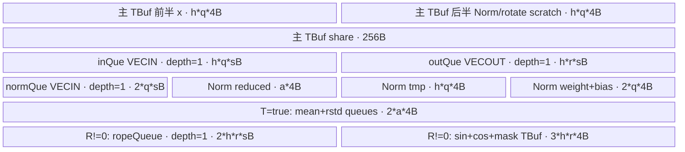

# NormRopeConcat 950 ACLNN 算子知识

## 算子速览

| 项目 | 内容 |
|---|---|
| 实际入口 | CANN 9.1.0 公开两段式 `aclnnNormRopeConcatGetWorkspaceSize` / `aclnnNormRopeConcat`；固定 Commit 未发现带版本后缀的新入口 |
| 计算语义 | query/key 与 encoder 分支做可选 LayerNorm/RMSNorm、沿 S concat、BSND→BNSD 与可选 RoPE；value 只做 concat+转置 |
| 输入输出 | 主输入 `[B,S,N,D]`，主输出 `[B,N,S_total,D]`；FP16/BF16/FP32、ND；训练 LayerNorm stats 由实现推导为 FP32 `[B,S,N,1]` |
| 执行类型 | `AIV_VECTOR`；模板注册固定为 `ASCENDC_TPL_AIV_ONLY`，950/arch3510 的 LayerNorm affine 尾段使用 SIMD VF RegTensor |
| Kernel 路线 | R-001 参数化 AIV 路线族；叶路线记为 `R-001[DT,N,AN,R,C,T]`。每个 dtype binary 内五轴形成 `5×5×3×2×2=300` 个可达 specialization，三 binary 合计 900 个 dtype×tuple 叶身份。它们共享 entry/POD，但精度、Norm/RoPE/concat/training 的 body、资源或地址由 DT/tuple 固化，不能当作行为相同的 key 合并 |
| 核心资源 | 16 路输入 GM、11 路输出 GM、system workspace、1 个主 TBuf、Norm/RoPE TBuf、最多 6 个 TQue；950 LayerNorm affine 临时使用 3 个 FP32 RegTensor 与 MaskReg |
| 来源闭包 | `source_closed`：公开 ACLNN→inner 框架边界→OpDef/InferShape→Tiling/POD→AIV entry→arch3510 body/helper→ascend950 binary/CMake 已闭合 |
| 验证状态 | 已完成固定 Commit 源码闭包检查；本次知识提取未执行编译、真机、数值或性能测试。 |

## 接口与语义

### 计算语义

对任意 D 向量 `x`，`normType`/`normAddedType` 的 0..4 分别为：恒等；`(x-mean)/sqrt(mean((x-mean)^2)+eps)`；前式再乘 `weight` 加 `bias`；`x/sqrt(mean(x^2)+eps)`；前式再乘 `weight`。query/key 使用 `normType`，encoderQuery/encoderKey 使用 `normAddedType`，value/encoderValue 固定 `NONE`。Device 将输入先提升到 FP32，完成 Norm 与 RoPE，再以 `CAST_ROUND` 降回 FP16/BF16；FP32 输出走 `Adds(..., 0)` 复制。

`concatOrder=0` 时 main 分支占输出 S 的前段，encoder 分支占后段；`concatOrder=1` 时相反。Kernel 不物化 BSND concat 或 transpose，而是直接按 `b*N*S_total*D+n*S_total*D+p*D` 写 BNSD。

当输出位置 `p<ropeActualSeq` 时：INTERLEAVE 将相邻偶奇元素换位并给原奇数项对应的旋转项取负；HALF 交换前后半并给移到前半的值取负；最终计算 `y=x*cos[p]+rotate(x)*sin[p]`。超出 `ropeActualSeq` 或 `ropeType=NONE` 时保持 Norm 结果。只有 training 且 Norm 类型为 LayerNorm/LayerNorm affine 时实际产生 mean/rstd；RMS 路径不写 stats。

### 输入、输出与属性

| 参数 | shape/layout | dtype | 约束、默认值与语义 |
|---|---|---|---|
| `query` | `[B,Sq,N,D]` / ND | FP16/BF16/FP32 | 必选；作为所有 B/N/D 与 dtype 的基准 |
| `key` / `value` | `[B,Sk,N,D]` / `[B,Sv,N,D]` | 同 query | 必选；Tiling 要求 `Sk=Sv` |
| `encoderQuery` | `[B,Seq,N,D]` / ND | 同 query | 可选；缺省时 `Seq=0` |
| `encoderKey` / `encoderValue` | `[B,Sek,N,D]` / `[B,Sev,N,D]` | 同 query | 可选；Tiling 要求 `Sek=Sev` |
| 四组 `*Weight` | `[D]` / ND | 同 query | 对应类型 2/4 时由接口契约要求提供 |
| 四组 `*Bias` | `[D]` / ND | 同 query | 对应类型 2 时需要；文档对 `normQueryBias` 的表述把类型 4 也列入，但 RMS affine body 不读取 bias |
| `ropeSin` / `ropeCos` | `[Sr,D]` / ND | 同 query | `ropeType!=0` 时要求提供；文档要求 `1<=Sr<=min(totalQ,totalK)` |
| `normType` / `normAddedType` | Host 标量 | INT64 | 默认 0；合法值 0..4 |
| `ropeType` | Host 标量 | INT64 | 默认 0；0 NONE、1 INTERLEAVE、2 HALF |
| `concatOrder` | Host 标量 | INT64 | 默认 0；0 main 在前、1 encoder 在前 |
| `eps` | Host double，OpDef/POD 为 float | FP32 Device | 默认 `1e-5`；公开原型到生成 inner 的窄化位置固定仓不可见 |
| `isTraining` | Host 标量 | bool | 默认 false；决定模板与 stats Queue 是否实例化 |
| `queryOutput` / `keyOutput` / `valueOutput` | `[B,N,S_total,D]` / ND | 同 query | 必选；分别使用 totalQ/totalK/totalV |
| 四组 `*Mean` / `*Rstd` | InferShape 为 `[B,S,N,1]` / ND | FP32 | training 且对应类型 1/2 时写出；公开文档参数表写 `[BS]`，与 InferShape 存在表述差异 |

### 入口与版本

固定 Commit 的 docs、`op_host/op_api` 只公开无版本后缀的 `aclnnNormRopeConcatGetWorkspaceSize` 与 `aclnnNormRopeConcat`，未发现 V2/V3 等更高入口，因此它是 950 实际支持的最新公开版本。docs 产品表明确 Ascend 950PR/950DT 支持；`NormRopeConcat` OpDef 同时 `AddConfig("ascend950")`，ascend950 binary config 发布 BF16、FP16、FP32 三个 binary，平台证据无冲突。

公开 wrapper 原样转发到自动生成的 `aclnnInnerNormRopeConcat*`。inner executor 的连续化、输出回写和 launch 封装属于固定仓允许的框架边界；算子自有 InferShape、Tiling、POD、entry、body 与构建接线均可见。

## Host/Launcher 执行流程

### 参数校验与前处理

OpDef 将 query/key/value 和三个主输出声明为 REQUIRED，其余 tensor 为 OPTIONAL；所有输入启用 `AutoContiguous()`。公开文档声明必选空指针报 161001、dtype 非法报 161002。InferShape 先检查 query/key/value 为 4D并统一 B/N/D，再检查可选 encoder 分支，生成三个 BNSD 主输出；training 且类型为 1/2 时生成对应 `[B,S,N,1]` stats 与 FP32 dtype。

Tiling 的真实顺序是 `GetShapeInfo→CheckInput→ComputeTilingKey→ComputeCoreTilingStrategy→ComputeUBTilingStrategy→ComputeWorkSpace→FillTilingData→PrintTilingData`。`CheckInput` 校验所有已提供输入与 query 同 dtype、数据输入为 4D且 B/N/D 一致、Norm tensor 为 `[D]`、RoPE 为 `[Sr,D]`、`D` 为偶数且 `D<=1024`、K/V 的 S 相等及两个 Norm 类型在 0..4。它未显式调用 `IsRopeTypeValid`/`IsConcatOrderValid`，也未按属性强制 affine、RoPE、stats 可选指针存在。

### 参数、Workspace 与生命周期

`DoTiling` 从 `PlatformAscendC` 取得 `aivNum`、UB 字节数与 `GetLibApiWorkSpaceSize()`。workspace 仅以 system workspace 写入 `workspace_[0]`；Kernel entry 虽接收 `workspace`，body 不读取。第一段 API 返回 workspaceSize 与 executor，调用者分配其 Device 内存；第二段传入 workspace、executor、stream 提交。executor、连续化临时 tensor 和输出回写的 owner/lifetime 由自动生成 inner 管理，固定仓没有更细实现。

### 启动图与失败传播

```text
aclnnNormRopeConcatGetWorkspaceSize
  -> aclnnInnerNormRopeConcatGetWorkspaceSize（生成框架边界）
    -> NormRopeConcat InferShape/AutoContiguous
    -> TilingNormRopeConcat -> SetTilingKey/SetBlockDim/SaveToBuffer
    -> ascend950 dtype binary + tuple specialization
aclnnNormRopeConcat(workspace, executor, stream)
  -> aclnnInnerNormRopeConcat（生成框架边界）
    -> norm_rope_concat<N,AN,R,C,T>
      -> NormRopeConcat<N,AN,R,C,T>::Init/Process
```

| 节点 | Host/launcher | entry/执行族 | blockDim/POD | 输入、输出与 workspace slice | ordering、owner/lifetime 与失败传播 |
|---|---|---|---|---|---|
| K-001 | generated inner launcher，固定仓不可见 | `norm_rope_concat<N,AN,R,C,T>` / `AIV_VECTOR` | `blockDim=usedCore`；`NormRopeConcatTilingData` 21 字段 | 16 个输入 GM、11 个输出 GM；system workspace 由 executor 持有但 entry/body 不读取，无算子自有 slice | 由第二段 ACLNN 在调用者 stream 上提交；单节点，无 Kernel→Kernel 边、event 或跨节点 buffer；launcher 返回如何映射 ACLNN status 固定仓不可见 |

`DoTiling` 的八个步骤任一失败即返回 `GRAPH_FAILED`，没有第二实现或 fallback；但 `TilingNormRopeConcat` 在 `DoTiling` 成功后调用 `SetTiling(ctx)` 时没有检查其返回值，而是直接返回成功，这是固定源码可见的失败传播缺口。合法 tuple 由 binary/runtime 选择；template 范围外的 rope/concat 属性没有 specialization，固定仓也不展示 inner 如何把 binary/launch 失败映射到 ACLNN status。

## Route 与参数设计

### 分核与资源计算

记 `s=sizeof(DTYPE_QUERY)`，`q=ceilAlign(D,32/s)`，`r=ceilAlign(ropeDim,32/s)`，`N=(normType!=0 || normAddedType!=0)`，`R=(ropeType!=0)`，`T=isTraining`。`usedCore=min(max(max(Sq,Sk),max(Seq,Sek)),aivNum)`；每个分支分别按自身 S 在 `usedCore` 上前余数分配，前 `S%usedCore` 核多处理 1 个序号，每核覆盖所有 batch 与 head。

Host 的容量估式保持源码原式：

```text
ropeUsed = 2*r*s + 12*r
normUsed = 2*q*s + 8*q + 256
oneHead  = 8*q + 2*q*s + R*ropeUsed + N*(4*q + (2*T+1)*4)
h0       = floor((UB - R*ropeUsed - N*normUsed) / oneHead)
h        = min(h0, 4096, N_heads)
splitHeadNum = ceilDiv(N_heads, h)
tailHeads = N_heads - (splitHeadNum-1)*h
```

单位均为字节，`h`/`tailHeads` 为 head 数；`h==0` 返回失败。活动 RoPE 经 shape 校验有 `ropeDim=D`，故 `r=q`。Device 使用 `uint32_t` 保存这些 POD 值，Host 只在 POD 中声明 `int64_t`，没有显式检查全部窄化与乘法溢出。

### Route 选择

| 顺序 | Route | Key/模板 | 精确选择条件与优先级 | 不适用去向 |
|---:|---|---|---|---|
| 1 | R-001 参数化 AIV 路线族；叶路线 `R-001[DT,N,AN,R,C,T]` | dtype binary + `GET_TPL_TILING_KEY(N,AN,R,C,T)` → `NormRopeConcat<N,AN,R,C,T>` | `DT∈{BF16,FP16,FP32}`，`N,AN∈[0,4]`、`R∈[0,2]`、`C∈[0,1]`、`T∈{false,true}`，950 binary 可用；tuple 注册为 AIV-only；这是直接 binary/tuple 选择，没有候选优先级 | 校验、UB、序列化、binary/tuple 选择失败即终止 |

```text
先检查 shape/dtype/Norm 范围
  -> 按原属性顺序形成 (N, AN, R, C, T)
  -> 300 个合法 tuple 之一
    -> BF16 / FP16 / FP32 ascend950 binary
      -> 唯一参数化 AIV entry/class
        -> N、AN、R、C、T 各自以编译期分支固化
```

| 叶路线轴 | 取值 | 编译期 body 差异 | 资源、地址或精度差异 |
|---|---|---|---|
| `N` | 0/1/2/3/4 | query/key 分别为 identity/LN/LN affine/RMS/RMS affine | 类型 2 在 950 使用 VF affine；类型 1/2 且 T=1 写 main stats |
| `AN` | 0/1/2/3/4 | encoderQuery/encoderKey 对应五种 Norm；value 两分支不受此轴影响 | 类型 2 在 950 使用 VF affine；类型 1/2 且 T=1 写 encoder stats |
| `R` | 0/1/2 | NONE/INTERLEAVE/HALF；1 与 2 的 Gather mask 和 sin 取负位置不同 | R=0 不分配 `ropeQueue_`/RoPE TBuf；R=1/2 分配相同容量但执行不同旋转 |
| `C` | 0/1 | 六个 branch 顺序不变 | 只改变 main/encoder 的 `outputSeq`，从而改变 concat 后 GM 基址与 RoPE 位置索引 |
| `T` | false/true | false 编译掉 stats 生成与 CopyOut；true 仅 LN 分支实际写 stats | true 为 `meanQue_`、`rstdQue_` 各分配 `a*4` B；RMS/NONE 即使不写 stats 也保留这两个 Queue |
| dtype binary | BF16/FP16/FP32 | 不进入 tuple；由 `NormRopeConcat_{bf16,fp16,fp32}` 选择 `DTYPE_QUERY` | 改变 `s`、q 对齐和 GM↔FP32 的 Cast/Adds 路径；所有 Norm/RoPE 算术仍在 FP32 |

### 模板/实现执行矩阵

| Route | key/selector | dtype/shape/platform 完整命中条件 | 执行拓扑与 Kernel 节点 | 实际模板/body | 内存与同步特征 | tail/fallback |
|---|---|---|---|---|---|---|
| `R-001[DT,N,AN,R,C,T]` 参数化叶路线集合 | 三 dtype binary × 300 个 `(N,AN,R,C,T)` tuple | docs/OpDef 支持 950；输入 dtype 一致、4D B/N/D 一致、D 偶数且≤1024、K/V S 相等、Norm 0..4、Host UB 可容纳至少 1 head | 单节点 K-001：`AIV_VECTOR norm_rope_concat<N,AN,R,C,T>` | `DTYPE_QUERY=DT`；`NormRopeConcat<NormType(N),NormType(AN),RopeType(R),ConcatOrder(C),T>::Process/ProcessOne`；Norm/RoPE helper 由 tuple 决定；3510 类型 2 调 `DoMulAddVf` | 单 TPipe；Queue producer/consumer；Vector PipeBarrier；VF 程序顺序；DT/R/T 控制精度或资源，N/AN/C 改变计算或地址 | S 按核余数、head 以 `h` 分块最后 `tailHeads`；无 fallback |

三 dtype binary 与 300 个 tuple 共用 entry、POD 布局和参数化源码，正文因此用 `R-001[DT,N,AN,R,C,T]` 对叶路线作源码等价归纳，而不是把 dtype/key 宣称为行为相同。DT 改变对齐、Cast 与精度路径，N/AN 改变六个 `ProcessOne` 的 Norm 指令链，R 改变 RoPE 分配、mask 与旋转，C 改变输出 S 基址，T 改变 stats Queue/写出；任一轴变化都保留在叶路线身份中。若迁移为静态实例，必须保留 DT 与五维 tuple，不可把其中任一维降为无条件运行时分支。

### 隐藏性能 Guard

| Guard | Host/Tiling 条件 | Device/资源原因 | 影响 Route | 不满足时去向 | 源码符号 |
|---|---|---|---|---|---|
| 纯 AIV | `ASCENDC_TPL_AIV_ONLY` | body 只使用 Vector/Reg/DMA 资源 | R-001 全部 tuple | 无 Cube fallback | `op_kernel/norm_rope_concat_tiling_key.h` `ASCENDC_TPL_SEL` |
| headDim | `(D%2==0)&&(D<=1024)` | RoPE 成对/半分；Norm repeat、UB 容量有界 | 全部 | `GRAPH_FAILED` | `NormRopeConcatTiling::CheckInput` |
| UB 至少一 head | `h0>0` | Queue/TBuf 必须容纳一个 head 块 | 全部 | `GRAPH_FAILED` | `ComputeUBTilingStrategy` |
| head 块上限 | `h=min(h0,4096,N_heads)` | 限制局部 tensor/repeat 与实例规模 | 全部 | 切分为更多 head 块 | `ComputeUBTilingStrategy` |
| 64-float 对齐归约 | `D % B32_DATA_NUM_PER_REPEAT == 0` | 使用 Add 累加 64 元素片再 WholeReduceSum；否则 `Sum` 处理有效 D/tail | Norm 1..4 | 同 Route 的 `Sum` 分支 | `NormOperationForward::DoSum` |
| 活动 RoPE | `R!=0 && outputSeq+s<ropeActualSeq` | 只对有 sin/cos 的位置做 Gather/Mul/MulAddDst | R=1/2 tuple | 跳过旋转、仍输出 Norm | `PreProcess` / `RopeOperationForward::Compute` |
| 950 affine VF | `__NPU_ARCH__==3510 && actualNormType==LAYER_NORM_AFFINE` | 用 3 RegTensor 与 MaskReg 融合 `x*weight+bias` | N=2 或 AN=2 对应分支 | 非 3510 用 `FusedMulAdd`；950 RMS affine 仍用 `Mul` | `DoLayerNorm` / `DoMulAddVfCall` |
| template 属性范围 | `N,AN 0..4; R 0..2; C 0..1; T 0/1` | 仅这些 tuple 有编译实例 | 全部 | 无 specialization；固定仓无错误映射 | tiling key 声明/选择 |
| 分核非零 | `usedCore=min(maxSeq,aivNum)` | `GetSeqRange` 会除 `usedCore` | 全部 | 源码未显式保护 0；依赖 0 block 不启动的仓外语义 | `ComputeCoreTilingStrategy` / `GetSeqRange` |
| RoPE DMA/输出维 | 活动 RoPE 要求 `ropeDim=D`；NONE 时源码未强制 rope tensor存在 | `outQue_` 与输出 `blockLen` 使用 `alignedRopeDim_/ropeDim_` 而非 normDim | 全部 | NONE 且无 rope tensor时出现 0 容量/0 blockLen 源码冲突 | `RopeOperationForward` ctor/`CopyOut` |

### POD/ABI

`BEGIN_TILING_DATA_DEF` 的宏实现不在固定仓，因而 `sizeof/alignof/offsetof` 不可从本仓证明；以下“序号”仅表示源码字段声明顺序，不替代 ABI offset。

| 结构 | 字段 | 类型/位宽 | ABI 布局 | 单位 | Host/launcher producer | Device consumer | 边界 |
|---|---|---|---|---|---|---|---|
| `NormRopeConcatTilingData` | `batch` | int64_t/64 | 序号 0；offset 不可见 | batch | `batchSize_` | `Init→batch_` | Device 窄化 uint32 |
| 同上 | `querySeq` | int64_t/64 | 序号 1 | 序列元素 | `querySeq_` | query `ProcessOne` | Device uint32 |
| 同上 | `keySeq` | int64_t/64 | 序号 2 | 序列元素 | `keySeq_` | key `ProcessOne` | 应等于 valueSeq |
| 同上 | `valueSeq` | int64_t/64 | 序号 3 | 序列元素 | `valueSeq_` | value `ProcessOne` | 应等于 keySeq |
| 同上 | `encoderQuerySeq` | int64_t/64 | 序号 4 | 序列元素 | optional S 或 0 | encoderQuery | Device uint32 |
| 同上 | `encoderKeySeq` | int64_t/64 | 序号 5 | 序列元素 | optional S 或 0 | encoderKey | 应等于 encoderValueSeq |
| 同上 | `encoderValueSeq` | int64_t/64 | 序号 6 | 序列元素 | optional S 或 0 | encoderValue | 应等于 encoderKeySeq |
| 同上 | `totalQuerySeq` | int64_t/64 | 序号 7 | 序列元素 | `Sq+Seq` | query BNSD stride | 加法溢出未查 |
| 同上 | `totalKeySeq` | int64_t/64 | 序号 8 | 序列元素 | `Sk+Sek` | key BNSD stride | 加法溢出未查 |
| 同上 | `totalValueSeq` | int64_t/64 | 序号 9 | 序列元素 | `Sv+Sev` | value BNSD stride | 加法溢出未查 |
| 同上 | `ropeActualSeq` | int64_t/64 | 序号 10 | 序列元素 | `ropeSin.shape[0]` 或 0 | active 判定 | 不取 cos.S |
| 同上 | `splitHeadNum` | int64_t/64 | 序号 11 | head 块 | `ceilDiv(N_heads,h)` | head 循环 | `h>0` |
| 同上 | `avgHeads` | int64_t/64 | 序号 12 | head | UB 公式后 cap | buffer/循环 | 最大 4096 |
| 同上 | `tailHeads` | int64_t/64 | 序号 13 | head | `N_heads-(split-1)h` | 尾块 | 只用缓冲前缀 |
| 同上 | `normDim` | int64_t/64 | 序号 14 | 元素 | `D` | Norm | 偶数且≤1024 |
| 同上 | `ropeDim` | int64_t/64 | 序号 15 | 元素 | sin.D 或 0 | RoPE/输出 | active 时等于 D |
| 同上 | `headNum` | int64_t/64 | 序号 16 | head | query.N | BSND/BNSD stride | 正值未显式查 |
| 同上 | `headDim` | int64_t/64 | 序号 17 | 元素 | query.D | GM 地址/对齐 | Device uint32 |
| 同上 | `usedCore` | int64_t/64 | 序号 18 | AIV core | `min(maxCoreSeq,aivNum)` | `GetSeqRange` | 0 除数风险 |
| 同上 | `eps` | float/32 | 序号 19 | 数值 | OpDef float 属性 | Norm | API double 的 inner 窄化不可见 |
| 同上 | `scale` | float/32 | 序号 20 | `1/D` | `1/float(headDim_)` | Norm reduction | D=0 未显式拒绝 |

### Route 源码闭包

| Route | Key/selector | Host/Tiling producer | POD/参数 | Kernel entry/router | Kernel body/直接依赖 | 构建接线 |
|---|---|---|---|---|---|---|
| `R-001[DT,N,AN,R,C,T]` 参数化叶路线集合 | 三 dtype binary × 300 个五维 tuple，AIV-only | `norm_rope_concat_tiling.cpp`: `DoTiling/ComputeTilingKey/Compute*Strategy` | `NormRopeConcatTilingData` 21 字段 | `norm_rope_concat<N,AN,R,C,T>` | `DTYPE_QUERY=DT`；`NormRopeConcat`、`NormOperationForward`、`RopeOperationForward`、`RopeOperation`；3510 `DoMulAddVf` | ascend950 binary/simplified-key；host/leaf/category CMake；`add_modules_sources` 收入 API、InferShape、Tiling 与 OpDef |

## Kernel 实现

### 公共执行流程

entry 用 `GET_TILING_DATA` 解析 POD、创建一条 `TPipe`，将五个 template 参数转成强类型后构造 `NormRopeConcat`。`Process` 只构造一套 Norm/RoPE 对象并依次复用到 query、encoderQuery、key、encoderKey、value、encoderValue；value 两分支强制 `NormType::NONE,RopeType::NONE`。每分支先按 S 分核，再按 batch、head 块循环：GM BSND→`inQue_`→FP32 主 TBuf→可选 Norm→可选 RoPE→`outQue_`→GM BNSD。不同核拥有互斥 S 片，不使用 workspace、Atomic 或跨核 barrier。

### Route R-001：参数化 AIV 叶路线集合

#### 适用条件

##### 选择证据

| 层级 | 文件 | 符号 | 源码谓词/参数 | 结果/下一跳 |
|---|---|---|---|---|
| ACLNN | `op_host/op_api/aclnn_norm_rope_concat.cpp` | `aclnnNormRopeConcat*` | wrapper 无分支，参数原序转发 | generated inner |
| OpDef | `op_host/norm_rope_concat_def.cpp` | `NormRopeConcat` | ascend950；BF16/FP16/FP32、ND | 950 Host/Tiling |
| Tiling | `op_host/norm_rope_concat_tiling.cpp` | `CheckInput` | dtype/shape/D/KV/Norm 通过 | 继续；否则失败 |
| selector | 同上 | `ComputeTilingKey` | `GET_TPL_TILING_KEY(normType,normAddedType,ropeType,concatOrder,isTraining)` | 五维 tuple |
| 模板注册 | `op_kernel/norm_rope_concat_tiling_key.h` | `ASCENDC_TPL_ARGS_DECL/SEL` | 5×5×3×2×2，`ASCENDC_TPL_AIV_ONLY` | specialization |
| Router | `op_kernel/norm_rope_concat.cpp` | `norm_rope_concat<N,AN,R,C,T>` | template 参数转 enum/bool | `Init→Process` |
| 950 body | `op_kernel/norm_rope_concat.h` | `DoLayerNorm` | `__NPU_ARCH__==3510 && actualNormType==LAYER_NORM_AFFINE` | `DoMulAddVfCall`；其它 Norm 走 Vector API |

#### Device 数据流

##### 函数级调用链

```text
norm_rope_concat<N,AN,R,C,T>
  -> NormRopeConcat<N,AN,R,C,T>::Init
  -> Process
    -> ProcessOne<N,R>(query)
    -> ProcessOne<AN,R>(encoderQuery)
    -> ProcessOne<N,R>(key)
    -> ProcessOne<AN,R>(encoderKey)
    -> ProcessOne<NONE,NONE>(value)
    -> ProcessOne<NONE,NONE>(encoderValue)
      -> RopeOperationForward::Prepare/PreProcess
      -> NormOperationForward::Prepare/Process
        -> CopyIn -> Compute -> DoLayerNorm/DoRMSNorm/identity
        -> [A5 LN affine] DoMulAddVfCall -> DoMulAddVf
        -> [training LN] CopyOutMeanAndRstd
      -> RopeOperationForward::Process -> Compute -> CopyOut
```

##### 源码等价伪码

```text
# 源码等价伪码；q/eq/k/ek/v/ev 依次执行
for branch(actualNorm, actualRope, x, y, xSeq, totalSeq, outputSeq):
  [start,end) = xSeq 按 usedCore 前余数分配
  if start < end:
    output.dstStride = (totalSeq-1)*D*s
    affine weight/bias 仅在本 branch Prepare 一次并转 FP32
    for seq in [start,end):
      if actualRope != NONE and outputSeq+seq < ropeActualSeq:
        sin/cos[D] CopyIn、FP32 化、旋转符号处理，再复制到 h 个 head 槽
      for b in [0,batch):
        in = ((b*xSeq+seq)*N_heads)*D
        stat = (b*xSeq+seq)*N_heads
        out = b*N_heads*totalSeq*D + (outputSeq+seq)*D
        for headBlock in [h,...,h,tailHeads]:
          DataCopyPad GM BSND[headBlock,D] -> inQue[h,q]
          Cast/Adds -> FP32 x[h,q]
          actualNorm==LN: sum/mean/center/square/sum/eps/sqrt/div；可选 stats；type2 再 x*w+b
          actualNorm==RMS: square/sum/eps/sqrt/div；type4 再 x*w
          actualNorm==NONE: 保留 FP32 x
          active RoPE: Gather rotate 到主 TBuf 后半；x=x*cos+rotate*sin
          CastRound/Adds -> outQue[h,r]
          DataCopyPad outQue 每个 head 的 D 元素 -> GM BNSD，dstStride 跳过其余 S
          in/stat/out 分别前进 headBlock*D、headBlock、headBlock*totalSeq*D
```

#### 内存与数据搬运

##### 资源与搬运表

| 层级/缓冲区 | offset/地址公式 | extent/容量公式 | dtype/layout | producer | consumer | owner/lifetime | 对齐/复用 |
|---|---|---|---|---|---|---|---|
| 六路数据 GM | `(b*xSeq+s)*N*D+n*D` | 各 `B*xSeq*N*D` | input/BSND | caller | `CopyIn` | caller | 每 head 搬 D，UB 右 pad 到 q |
| 八路 affine GM | `d` | D | input/[D] | caller | `Prepare` | caller | 每 branch 一次；pad 到 q |
| `ropeSin/ropeCos` GM | `(outputSeq+s)*D+d` | 各 `Sr*D` | input/[S,D] | caller | `PreProcess` | caller | 每输出 S 一次，广播 batch/head |
| 三路主输出 GM | `b*N*totalS*D+n*totalS*D+p*D` | 各 `B*N*totalS*D` | input/BNSD | `CopyOut` | caller | caller | `blockCount=heads, blockLen=D*s, dstStride=(totalS-1)D*s` |
| 八路 stats GM | `(b*xSeq+s)*N+n` | 各 `B*xSeq*N` | FP32 | mean/rstd Queue | caller | caller | 只 training LN；连续 heads |
| workspace | body 无 offset | system workspace | opaque | ACLNN | system；Kernel N/A | executor | entry 收到但不读 |
| 主 `buf_` TBuf | x=0；`tmp1/rotate=x[h*q]` | `2*h*q*4+256` B | FP32 | Norm input/compute | Norm 与 RoPE | 整个 kernel | 后半先作 Norm scratch，再作 rotate scratch |
| `inQue_` VECIN | TPipe slot | `h*q*s` B，depth=1 | input | `CopyIn` | `Compute` | Norm 对象 | DeQue/Free 后复用 |
| `normQue_` VECIN | weight=0,bias=q | `2*q*s` B，depth=1 | input | affine GM | `Prepare` cast | Norm 对象 | 所有 tuple 都分配，非 affine 不使用 |
| `meanQue_` VECOUT | TPipe slot | `a*4` B，depth=1 | FP32 | LayerNorm | stats GM | training 实例 | `a=ceilAlign(h,8)` |
| `rstdQue_` VECOUT | TPipe slot | `a*4` B，depth=1 | FP32 | LayerNorm | stats GM | training 实例 | 同上 |
| Norm `buf_` TBuf | reduced=0；tmp=`a`；weight=`a+h*q`；bias 再加 q | `(a+h*q+2*q)*4` B | FP32 | reduce/affine Prepare | Norm | Norm 对象 | 分区不别名；非 affine 固定分区闲置 |
| `ropeQueue_` VECIN | sin=0,cos=h*r | `2*h*r*s` B，depth=1 | input | GM CopyIn | FP32 cast | R!=0 | 每 S Free 后复用 |
| RoPE `buf_` TBuf | sin=0,cos=`h*r*4`,mask=`2*h*r*4` | `3*h*r*4` B | FP32+u32 | ctor/PreProcess | Gather/Collect | R!=0 | 三分区不别名 |
| `outQue_` VECOUT | TPipe slot | `h*r*s` B，depth=1 | output | Cast/Adds | `CopyOut` | RopeForward 对象 | 无论 R 均调用 InitBuffer；tail 用前缀 |
| 3 个 RegTensor + MaskReg | 从主 x、Norm weight/bias 物理地址 Load | 各一 VF 向量；持久 UB 0 B | FP32 register | `LoadAlign/UpdateMask` | `MulDstAdd/StoreAlign` | 每 head/repeat | 仅 950 LN affine；最后 repeat 由 MaskReg 保护 |

##### 分层内存布局



##### 字节账与复用顺序

Device 真实 `InitBuffer` 字节账（`a=ceilAlign(h,8)`）为：

```text
UB_exact = (8*h*q + 256)                    # 主 TBuf
         + h*q*s                           # inQue, depth=1
         + 2*q*s                           # normQue, depth=1
         + 4*(a + h*q + 2*q)               # Norm TBuf
         + T*8*a                           # meanQue + rstdQue
         + R*(2*h*r*s + 12*h*r)            # ropeQueue + RoPE TBuf
         + h*r*s                           # outQue, depth=1
```

`DOUBLE_BUFFER` 在本实现中常量值就是 1，不能按名字误乘为 2。RegTensor 不增加持久 UB。Host 估式不是该精确和式的代数重写：它在 `R=1` 时额外预留一个 `ropeUsed`，而 stats 以每 head 标量估算；更重要的是 Device 无条件分配 `normQue_` 与 Norm `buf_`，但 Host 在 `N=0` 时把 `normUsed` 和 Norm 每-head 项置零。因此只能把 `UB_exact<=平台 UB` 作为复用实现的必要条件，不能据源码宣称所有 tuple 的 Host 估式与 Device 分配严格等价。

| 复用子区 | 写入者 | 读取者/消费点 | 下一次覆盖 | 同步或释放依据 | 安全条件 |
|---|---|---|---|---|---|
| 主 TBuf 前半 `x[0:h*q]` | input Cast/Adds | Norm、Rotate/Collect、output cast | 下一 head 块 `Compute` | input Queue 已 Free；各 Vector 阶段间 `PipeBarrier<PIPE_V>` | 一个 head 块完成 CopyOut 后才进入下一块 |
| 主 TBuf 后半 `x[h*q:2h*q]` | LayerNorm variance scratch `tmp1` | `DoSum` | RoPE `Gather` 写 rotate scratch | LayerNorm 在返回前完成且有 PipeBarrier；Rotate 后 Collect | `r=q` 的活动 RoPE；tail 只用前缀 |
| `normQue_` slot | `Prepare` 的 weight/bias DMA | Cast/Adds 到 Norm TBuf | 下一 branch affine Prepare | `EnQue→DeQue→FreeTensor` | affine 参数在 branch 的所有 S/batch/head 循环前完成 |
| Norm weight/bias TBuf | branch `Prepare` | 所有该 branch head 块 | 下一 branch `Prepare` | branch `ProcessOne` 完成后顺序进入下一分支 | 不跨并行 branch，共用同一 TPipe 顺序执行 |
| ropeQueue slot | 当前 S 的 sin/cos DMA | FP32 sin/cos TBuf | 下一 S `PreProcess` | `EnQue→DeQue→FreeTensor` | 当前 S 的所有 batch/head 只读 TBuf，下一 S 才覆盖 |
| outQue slot | Cast/Adds | GM `CopyOut` | 下一 head 块 | `EnQue→DeQue→FreeTensor` | `CopyOut` 完成才 Free |

#### 同步、精度与尾块

##### 同步与数值边界表

| 阶段 | primitive/机制 | producer | consumer/等待点 | 保护对象 | 精度/尾块 |
|---|---|---|---|---|---|
| 数据 GM→UB | `Alloc→DataCopyPad→EnQue→DeQue→Free` | GM | `Compute` | inQue slot | `blockCount=heads, blockLen=D*s`，右 pad 到 q |
| input 提升 | `Cast(CAST_NONE)` 或 `Adds(0)` + `PipeBarrier(V)` | inQue | Norm/RoPE | 主 x | 覆盖 `heads*q`，padding lane 由 DataCopyPad 填充 |
| aligned64 sum | `Add` repeat + `WholeReduceSum` | x/tmp | mean/variance | Norm buf | 每次 64 FP32；repeat stride 来自 `D/8` 的 uint8 参数 |
| 非 aligned64 sum | `SumParams{heads,q,D}` | x/tmp | mean/variance | Norm buf | 只归约有效 D，q 是行 stride |
| LayerNorm | 多次 `PipeBarrier(V)` | Sum/Broadcast/Axpy/Mul/Muls/Adds/Sqrt | 下一 Vector op | x/reduced/tmp | 全 FP32；`scale=1/D`；stats 保存 mean 与 `1/sqrt(var+eps)` |
| 950 LN affine | VF 程序顺序、`UpdateMask<float>(len)` | 3×LoadAlign | MulDstAdd/StoreAlign | RegTensor/x | `oneRepeatSize=GetVecLen()/4`；最后 repeat 由 mask 控制 |
| RMS affine | Vector `Mul` + barrier | weight TBuf | RoPE | x | 全 FP32；未进入 VF helper |
| RoPE 预处理 | Queue + Cast/Adds + barriers | sin/cos GM | sign/replicate | sin/cos TBuf | Interleave 用 alternating mask，Half 对前 D/2 取负；padding不写 GM |
| Rotate/Collect | `Gather→barrier→Mul→barrier→MulAddDst` | mask/sin/cos | output cast | 主 TBuf 两半 | 只在 `p<Sr` 活动；FP32 |
| 输出降精度 | `Cast(CAST_ROUND)` 或 `Adds(0)` + barrier | FP32 x | outQue | output slot | 计算 `heads*r`；GM 只搬每 head 的 D 字节 |
| 输出 GM | `DeQue→DataCopyPad→Free` | outQue | GM | BNSD 片 | `dstStride=(totalS-1)D*s`，head tail 只用缓冲前缀 |
| S/core tail | 前余数分核 | `GetBlockIdx` | 分支循环 | GM S 片 | 前 `S%usedCore` 核多 1 个 S；无跨核同步 |

#### 关键实现

##### 符号证据表

| 阶段 | 文件 | 符号/模板实例 | 实现事实 |
|---|---|---|---|
| Host/Tiling producer | `op_host/norm_rope_concat_tiling.cpp` | `DoTiling/CheckInput/ComputeTilingKey/ComputeCoreTilingStrategy/ComputeUBTilingStrategy/FillTilingData` | 校验、tuple、core/UB/workspace 与 21 字段 producer |
| Kernel entry/router | `op_kernel/norm_rope_concat.cpp` | `norm_rope_concat<N,AN,R,C,T>` | POD 解析、强类型 template 实例、单 TPipe launch |
| Device body/helper | `op_kernel/norm_rope_concat.h` | `NormRopeConcat::Process/ProcessOne/GetSeqRange` | 六分支顺序、S/core/head 循环、GM offset 与 tail |
| Device body/helper | 同上 | `NormOperationForward::Prepare/DoSum/DoLayerNorm/DoRMSNorm` | affine 常驻、FP32 归约、Queue/barrier |
| 950 Device helper | 同上 | `DoMulAddVfCall/DoMulAddVf` | 3 RegTensor、MaskReg、VF repeat 与 masked store |
| Device body/helper | `op_kernel/norm_rope_concat_base.h` | `RopeOperation::PreProcess/Rotate/Collect` | sin/cos 广播、mask Gather、FP32 RoPE |
| Device body/helper | `op_kernel/norm_rope_concat.h` | `RopeOperationForward::Prepare/Compute/CopyOut` | BNSD stride、cast/round 与有效 D 写出 |

## 算子特定优化

### Trick T-001：950 用 RegTensor 融合 LayerNorm affine 尾段

#### 触发与源码依据

- 适用 Route：R-001 中 `N=2` 或 `AN=2` 对应的 q/k 或 encoder q/k 分支。
- 触发条件：`__NPU_ARCH__==3510` 且 `actualNormType==LAYER_NORM_AFFINE`。
- Golden 来源：[`posembedding/norm_rope_concat/op_kernel/norm_rope_concat.h:136-150`](../../../../../../../cann-ops-raw/ascendc/ops-transformer/be33d95bb755cedec3108f70805c1874d1792540/posembedding/norm_rope_concat/op_kernel/norm_rope_concat.h#L136-L150)

**官方源码（固定 Commit 连续逐字摘录）**：

```cpp
uint32_t oneRepeatSize = AscendC::GetVecLen() / sizeof(float);
uint32_t repeatTimes = (this->alignedNormDim_ + oneRepeatSize - 1) / oneRepeatSize;
for (uint32_t i = 0; i < heads; ++i) {
    uint32_t len = this->alignedNormDim_;
    __ubuf__ float* tempXBuf = xBuf + i * len;
    __ubuf__ float* tempWeightBuf = weightBuf;
    __ubuf__ float* tempBiasBuf = biasBuf;
    for (uint32_t j = 0; j < repeatTimes; ++j) {
        MaskReg maskReg = UpdateMask<float>(len);
        LoadAlign(xRegTensor, tempXBuf + j * oneRepeatSize);
        LoadAlign(weightRegTensor, tempWeightBuf + j * oneRepeatSize);
        LoadAlign(biasRegTensor, tempBiasBuf + j * oneRepeatSize);
        MulDstAdd(xRegTensor, weightRegTensor, biasRegTensor, maskReg);
        StoreAlign(tempXBuf + j * oneRepeatSize, xRegTensor, maskReg);
    }
}
```

#### 机制与设计原因

每个 head 的 q 个 FP32 元素按 950 vector length 分片；三次 aligned load 把 x/weight/bias 放入寄存器，`MulDstAdd` 在寄存器内完成 `x=x*weight+bias` 并 masked store 回原主 TBuf。`weight/bias` 已在 branch `Prepare` 中从 GM 搬一次并转 FP32，VF 循环不再申请中间 UB tensor；MaskReg 处理最后向量片。该机制改变的是 950 affine 指令与寄存器数据流，不改变此前 LayerNorm FP32 次序。

#### 迁移边界

- 适用：已有 FP32 x/weight/bias UB 指针、按最后一维逐 head 的 affine 尾段。
- 前提：950 arch3510、LayerNorm affine、q 按输入 dtype 的 32B 对齐、VF Load/Store 与 `UpdateMask` 语义可用。
- 失效：非 3510 必须使用 `DoMulAdd`/`FusedMulAdd`；RMS affine 使用 `DoMul`，不能误加 bias。
- 未验证：本次知识提取未执行编译、真机、数值或性能测试。

#### 错误做法

固定仓提供的真实分支表明：把 VF helper 无条件用于 RMS affine 会错误加入 bias；其余固定仓未提供可验证反例。

### Trick T-002：RoPE 编码按输出 S 预取一次并跨 batch/head 复用

#### 触发与源码依据

- 适用 Route：R-001 中 R=1/2 且当前 `outputSeq+s<ropeActualSeq`。
- 触发条件：`PreProcess` 位于 batch/head 循环外，且 `ropeNum=avgHeads`。
- Golden 来源：[`posembedding/norm_rope_concat/op_kernel/norm_rope_concat.h:649-659`](../../../../../../../cann-ops-raw/ascendc/ops-transformer/be33d95bb755cedec3108f70805c1874d1792540/posembedding/norm_rope_concat/op_kernel/norm_rope_concat.h#L649-L659)

**官方源码（固定 Commit 连续逐字摘录）**：

```cpp
for (uint32_t s = startSeq; s < endSeq; ++s) {
    ropeOp.template PreProcess<actualRopeType>(outputSeq + s);
    for (uint32_t b = 0; b < batch_; ++b) {
        uint64_t inOffset = static_cast<uint64_t>(b * xSeq + s) * headNum_ * headDim_;
        uint64_t normOffset = static_cast<uint64_t>(b * xSeq + s) * headNum_;
        uint64_t ropeOffset = static_cast<uint64_t>(b) * headNum_ * totalSeq * headDim_ +
                              static_cast<uint64_t>(outputSeq + s) * headDim_;
        for (uint32_t n = 0; n < splitHeadNum_ - 1; ++n) {
            LocalTensor<float> buf = buf_.Get<float>();
            normOp.template Process<actualNormType>(buf, inOffset, normOffset, avgHeads_);
            ropeOp.template Process<actualRopeType>(buf, ropeOffset, avgHeads_);
```

#### 机制与设计原因

`PreProcess` 对一个输出位置只从 GM 读取一行 sin/cos，升到 FP32、处理旋转符号后复制成 h 份；随后所有 batch 与同一 head 块都从 RoPE TBuf 读取，不随 batch 重复 GM 搬运。下一 S 覆盖前，当前 S 的所有 batch/head 已按程序顺序完成；Queue 的 DeQue/Free 与 Vector barriers 保证预处理完成。

#### 迁移边界

- 适用：位置编码只依赖 S、对 B/N 广播的 RoPE/位置函数。
- 前提：单核按 S 独占输出片，RoPE TBuf 能容纳 h 份，active 边界使用 concat 后位置 `outputSeq+s`。
- 失效：若 sin/cos 依赖 batch/head，必须移入相应循环并改变地址与 UB 账；`p>=Sr` 时走不旋转分支。
- 未验证：本次知识提取未执行编译、真机、数值或性能测试。

#### 错误做法

把 `PreProcess` 移进 batch/head 循环会改变源码已证明的 GM 搬运次数；固定仓未提供数值或性能反例。

### Trick T-003：用带 dstStride 的 DMA 融合 concat 与 BSND→BNSD

#### 触发与源码依据

- 适用 Route：R-001 全部 tuple，包括 value 的 NONE/NONE 分支。
- 触发条件：branch 的 `outputSeq` 已由 `concatOrder` 决定，`totalSeq` 为拼接后 S。
- Golden 来源：[`posembedding/norm_rope_concat/op_kernel/norm_rope_concat.h:399-405`](../../../../../../../cann-ops-raw/ascendc/ops-transformer/be33d95bb755cedec3108f70805c1874d1792540/posembedding/norm_rope_concat/op_kernel/norm_rope_concat.h#L399-L405)

**官方源码（固定 Commit 连续逐字摘录）**：

```cpp
template <RopeType actualRopeType>
__aicore__ inline void Prepare(GM_ADDR y, uint32_t curSeq, uint32_t totalSeq)
{
    outParams_.dstStride = (totalSeq - 1) * outParams_.blockLen;
    this->yGm_.SetGlobalBuffer((__gm__ DTYPE_QUERY *)y);
    this->isActive_ = curSeq < this->actualSeq_;
}
```

#### 机制与设计原因

`CopyOut` 把 head 设为 `blockCount`，每块只写 D 个元素，并以 `(totalSeq-1)*D*s` 跨过同一 head 的其余序列位置；首地址已经含 concat 后的 `outputSeq+s`。因此 BSND 输入的连续 head 行被直接散写到 BNSD 的对应 S 槽，concat 顺序也由基址完成，不需要额外 GM concat/transpose 中间张量或 workspace。

#### 迁移边界

- 适用：输入 head 行连续、输出目标是 BNSD 且 DMA dstStride 可表达 `(totalS-1)D*s` 的 concat+transpose。
- 前提：`blockLen=D*s`、`blockCount=heads`、输出各 branch 的 S 区间不重叠，stride 参数位宽不溢出。
- 失效：目标 layout、stride 上限或不规则拼接不能表达时，必须改地址策略或显式重排。
- 未验证：本次知识提取未执行编译、真机、数值或性能测试。

#### 错误做法

固定仓未提供可验证反例。

## 模板与实现对比

| 对比维度 | `R-001[DT,0,0,0,C,T]` 叶路线 | `R-001[DT,N,AN,R,C,T]` 活动 Norm/RoPE 叶路线 | 设计选择依据 |
|---|---|---|---|
| 命中条件/优先级 | N/AN 可为 0，R=0，T 可为 0/1；C 仍决定地址 | N/AN 1..4、R 1/2、T 0/1 的任意组合 | 同一五维 tuple 直达，无优先级 fallback |
| 模板与 dtype | 同一 class；BF16/FP16/FP32 binary | 同一 class；950 仅 LN affine 切 VF helper | dtype 不进入 tuple，binary 决定 DTYPE 宏 |
| 循环与分核 | 六分支、S/core、batch/head 块相同 | 相同；额外 Norm/RoPE 指令 | `if constexpr` 消除不适用计算 |
| Queue/TBuf/寄存器 | Rope Queue/TBuf 不分配；Norm 固定 Queue/TBuf 仍分配；outQueue 依赖 r | R!=0 增加 ropeQueue/RoPE TBuf；T 增加 stats Queue；LN affine 使用寄存器 | 构造函数条件与 template bool 决定资源 |
| UB 总占用与复用 | Host `N=0` 估式与 Device 无条件 Norm 分配不严格等价 | Host 额外 rope 预留；主后半按 Norm scratch→rotate scratch 复用 | 必须以真实 InitBuffer 字节账复核 |
| 搬运/Vector API | input Cast/Adds→output Cast/Adds | Norm reduction、Gather/MulAdd；950 affine VF | 按数学语义编译期固化 |
| 同步、精度与 tail | Queue + barriers；FP32 中转；S/head tail | 同步更多但仍单 Pipe；Norm/RoPE 全 FP32；masked VF tail | 无跨核共享 |
| fallback/失败边界 | ropeDim=0 时 outQueue/blockLen 源码冲突 | Sr/optional/UB 不满足即失败或未定义边界 | 无第二 Kernel Route |

## 平台差异

| 项目 | A2 | A3 | 950 |
|---|---|---|---|
| 支持状态 | 公开 docs 支持；不在本目标卡展开 | 公开 docs 支持；不在本目标卡展开 | 公开 docs 明确支持 Ascend 950PR/950DT；OpDef/config 接线一致 |
| Host/Launcher | 共用 Tiling 源码，平台资源值来自 `PlatformAscendC` | 同左 | 共用 Tiling；读取 950 `aivNum/UB/system workspace`，选 ascend950 binary |
| Kernel/资源 | 固定仓非 3510 编译分支对 LN affine 使用 `FusedMulAdd` | 同左 | `__NPU_ARCH__==3510` 的 LN affine 使用 RegTensor VF；RMS/RoPE/Queue/TBuf 逻辑共用 |

## 限制与失败边界

- 公开契约要求 `1<=D<=1024` 且 D 偶数；手写 Tiling 只检查偶数和 `D<=1024`，未显式拒绝 D=0、负维、N=0，也未系统检查 int64→uint32、地址乘法及 DMA stride 的溢出。
- docs 要求 `1<=Sr<=min(totalQ,totalK)`；Tiling 仅检查每个 RoPE tensor的 `Sr<=max(totalQ,totalK,totalV)` 与 D 一致，`ropeActualSeq` 只取 sin.S，未检查 sin.S==cos.S。
- `IsRopeTypeValid`、`IsConcatOrderValid` 虽定义但 `CheckInput` 未调用；范围外值没有合法 tuple specialization，失败映射不可见。
- affine、RoPE 与 training stats 所需 optional tensor 未由手写 Tiling 按属性强制非空；调用者必须遵循公开文档，不能依赖 optional 声明自动补值。
- `RopeOperationForward` 无条件以 `ropeDim/alignedRopeDim` 分配 outQueue 并设置输出 blockLen；`ropeType=NONE` 且 ropeSin 缺省会令二者为 0，却仍需写 D 元素，形成固定源码表面的 0 容量/0 blockLen 冲突。
- Device 无条件分配 Norm Queue/TBuf，而 Host `N=0` 时从 UB 公式删除对应固定与 per-head 项；Host 公式与 `UB_exact` 不严格闭合，固定仓没有 950 真机证据证明所有 NONE/NONE shape 均安全。
- `ComputeUBTilingStrategy` 直接计算 `ubSize-fixed` 后再检查 `avgHeads==0`；当固定预留大于可用 UB 时，`uint64_t ubSize` 与有符号估式的混合运算可能先发生下溢/窄化，固定源码没有显式的 `ubSize>=fixed` guard。
- `usedCore=0` 时 Host 写 blockDim 0，若 Device 被启动则 `GetSeqRange` 会除 0；安全性依赖 0 block 不启动的仓外运行时语义。
- `TilingNormRopeConcat` 忽略 `SetTiling(ctx)` 的返回值；即使 `GetRawTilingData()` 为空使 `SetTiling` 返回失败，外层仍在 `DoTiling` 成功后返回 `GRAPH_SUCCESS`。
- POD 宏的实际 `sizeof/alignof/offsetof`、generated inner 的连续化/回写/错误映射、system workspace 内部用途固定仓不可见；默认确定性来自公开文档。本次未执行编译、真机、数值或性能验证。

## 源码索引

### 链路索引

| 链路阶段 | 文件 | 关键符号 | 支撑内容 |
|---|---|---|---|
| 入口声明/约束 | `posembedding/norm_rope_concat/docs/aclnnNormRopeConcat.md` | 产品表、公式、接口与约束 | 950 公开支持、API 语义/错误与 shape/dtype |
| 入口声明/约束 | `posembedding/norm_rope_concat/op_host/op_api/aclnn_norm_rope_concat.h` | `aclnnNormRopeConcat*` | 两段式原型与参数顺序 |
| 入口实现 | `posembedding/norm_rope_concat/op_host/op_api/aclnn_norm_rope_concat.cpp` | 两个 wrapper | 到 generated inner 的转发边界 |
| OpDef | `posembedding/norm_rope_concat/op_host/norm_rope_concat_def.cpp` | `NormRopeConcat` | required/optional、AutoContiguous、dtype、默认属性、ascend950 |
| InferShape | `posembedding/norm_rope_concat/op_host/norm_rope_concat_infershape.cpp` | `InferShape4NormRopeConcat/InferDataType4NormRopeConcat` | BNSD 与 stats shape/dtype |
| Host 公共定义 | `posembedding/norm_rope_concat/op_host/norm_rope_concat_base.h` | enums/index/valid helper | 属性语义、输入输出索引与常量 |
| Host/POD | `posembedding/norm_rope_concat/op_host/norm_rope_concat_tiling.h` | `NormRopeConcatTilingData/NormRopeConcatTiling` | 21 字段、context、producer 声明 |
| Host/Tiling | `posembedding/norm_rope_concat/op_host/norm_rope_concat_tiling.cpp` | `DoTiling/SetTiling` | 校验、tuple、core/UB/workspace/POD |
| 模板注册 | `posembedding/norm_rope_concat/op_kernel/norm_rope_concat_tiling_key.h` | `ASCENDC_TPL_ARGS_DECL/SEL` | 300 tuple 与 AIV-only |
| Kernel entry | `posembedding/norm_rope_concat/op_kernel/norm_rope_concat.cpp` | `norm_rope_concat<N,AN,R,C,T>` | GM 参数、POD、TPipe、class 实例 |
| Kernel body | `posembedding/norm_rope_concat/op_kernel/norm_rope_concat.h` | main/Norm/RopeForward/VF symbols | 循环、地址、Queue/TBuf、同步、精度与 950 VF |
| Kernel helper | `posembedding/norm_rope_concat/op_kernel/norm_rope_concat_base.h` | `RopeOperation/NormOperation` | RoPE mask/Gather 与 GM/UB owner |
| 950 binary | `posembedding/norm_rope_concat/op_host/config/ascend950/norm_rope_concat_binary.json` | `NormRopeConcat_{bf16,fp16,fp32}` | ascend950 三 dtype binary |
| 950 simplified key | `posembedding/norm_rope_concat/op_host/config/ascend950/norm_rope_concat_simplified_key.ini` | `[NormRopeConcat] default=0` | 950 simplified-key mode |
| 构建接线 | `posembedding/norm_rope_concat/op_host/CMakeLists.txt` | `target_sources/add_modules_sources` | OpDef 与 aclnn_inner 接入 |
| 构建接线 | `posembedding/norm_rope_concat/CMakeLists.txt` | `add_subdirectory` | leaf 全子目录接入 |
| 构建接线 | `posembedding/CMakeLists.txt` | `add_subdirectory` | posembedding 类别接入 |
| 构建接线 | `cmake/obj_func.cmake` | `add_modules_sources` | 旧式 `op_host/op_api` 的 `.cpp/.h`、`*_infershape*.cpp`、`*_tiling*.cpp` 与 `*_def*.cpp` 分别接入 opapi/infer/tiling/aclnn_inner object |

每行只写一个文件，并确保该文件存在于 Frontmatter `sources`。

### 实现复用检查

| 检查项 | 可复用事实 | 不得改变的约束 | 源码符号 |
|---|---|---|---|
| ABI/POD | 21 字段的声明/producer/consumer 顺序 | 不得换序、改位宽或猜测 offset；19 个 int64 后接 2 个 float | `NormRopeConcatTilingData/FillTilingData/Init` |
| 调用顺序 | q→eq→k→ek→v→ev；每 S 的 RoPE 预处理在 batch/head 外 | value 固定 NONE/NONE；concat 后位置必须参与 RoPE active 索引 | `Process/ProcessOne` |
| workspace/内存 | system workspace、h/q/r Host 公式、真实 Queue/TBuf 字节账 | body 不读 workspace；`DOUBLE_BUFFER=1`；Host 估式不得冒充 exact UB | `ComputeWorkSpace/ComputeUBTilingStrategy/InitBuffer` |
| 同步 | Queue 生命周期、Vector PipeBarrier、VF 程序顺序 | Queue Free 后才复用；Norm/RoPE barrier 与 masked store 顺序不可省 | `CopyIn/DoLayerNorm/PreProcess/DoMulAddVf` |
| 精度与尾块 | Norm/RoPE FP32、低精度 `CAST_ROUND`、S/core/head tail | LN affine VF 仍为 FP32；归约只含有效 D；GM 只写 D | `DoSum/DoLayerNorm/GetSeqRange/CopyOut` |
| 失败边界 | 校验/UB/tuple 失败无 fallback | 保留 optional、Sr、ropeDim=0、N=0 UB、usedCore=0 与窄化缺口 | `CheckInput/ComputeUBTilingStrategy/DoTiling` |
