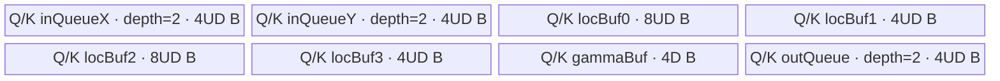
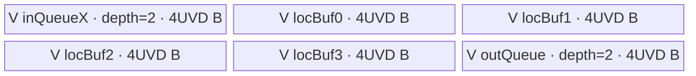

# QkvRmsNormRopeCache A2/A3 ACLNN 算子知识

## 算子速览

| 项目 | 内容 |
|---|---|
| 实际入口 | CANN 9.1.0 公开两段式接口 `aclnnQkvRmsNormRopeCacheGetWorkspaceSize` / `aclnnQkvRmsNormRopeCache`；固定仓没有更高版本入口 |
| 计算语义 | 将 `[BS,(Nq+Nk+Nv)D]` 按头拆为 Q/K/V；Q、K 分别做 FP32 RMSNorm 与 half-and-half RoPE，V 保持原值；K/V 可逐元素量化，再按 `index` scatter 到 PA_NZ cache |
| 输入输出 | `D=128`；QKV、gamma、cos/sin 与 Q 输出为 FP16/BF16；K/V cache 各自可为同 dtype 或 INT8；cache 为 `[BlockNum,Nrole*D/D0,BlockSize,D0]`，`D0=16` 或 32 |
| 执行类型 | `AIV_VECTOR`；entry 显式设置 `KERNEL_TYPE_AIV_ONLY`，全部可达计算均在单个纯 Vector Kernel 内完成 |
| Kernel 路线 | R-001 PA_NZ Q/K RMSNorm-RoPE、K/V 可选量化与 scatter；单 key 内按核号分别进入 `ProcessK`、`ProcessV`、`ProcessQ`，不能压成统一 body |
| 核心资源 | GM 原地 Q/cache 与可选 proto；Q/K 核使用两个 depth-2 VECIN TQue、一个 depth-2 VECOUT TQue、五个 TBuf，V 核使用一个 depth-2 VECIN、一个 depth-2 VECOUT 与四个 TBuf；Kernel 不消费 user workspace |
| 来源闭包 | `source_closed`：公开声明/实现、L0 launcher、OpDef/InferShape、Tiling producer、27 字段 POD、key=3 router、Q/K/V body/helper、二进制配置和 CMake 接线均闭合 |
| 验证状态 | 已完成源码闭包检查；本次知识提取未执行编译、真机、数值或性能测试。 |

## 接口与语义

### 计算语义

记 `B=batchSize`、`S=seqLength`、`D=128`、`N=Nq+Nk+Nv`，输入逻辑视图为 `qkv:[B*S,N,D]`。第 `t` 个 token 的头区按 `[0,Nq)`、`[Nq,Nq+Nk)`、`[Nq+Nk,N)` 切成 Q、K、V，且 Host 强制 `Nk=Nv`、`Nq%Nk=0`。对 Q/K 的每个 head 行 `x∈R^D`，Device 以 FP32 执行：

```text
sumSq = Σ(x[d]^2), d=0..127
rms = sqrt(sumSq * (1/128) + epsilon)
norm[d] = x[d] / rms * gamma[d]
real = norm[0:64], imag = norm[64:128]
rope = concat(real,imag)*cos + concat(-imag,real)*sin
```

Q 将 `rope` 写到连续 ND `qOut[(t*Nq+h)*D+d]`。K 以 `rope`、V 以原始 `v` 作为 cache payload。cache dtype 与 QKV 相同时，payload 转回 FP16/BF16；cache 为 INT8 时逐 `(head,d)` 读取 FP32 scale，执行 `payload/scale`，offset 存在时再加 offset，最后按源码的 `FP32 --RINT→ INT32 → FP16 --TRUNC→ INT8` 链量化。

对角色内线性行号 `j=t*Nrole+h`，`pageOffset=index[t]`。`pageOffset<0` 时跳过更新；否则 `pageId=pageOffset/BlockSize`、`slot=pageOffset%BlockSize`，将 D=128 行写到 PA_NZ：非量化使用 `D1=8,D0=16`，INT8 使用 `D1=4,D0=32`，逻辑地址为 `[pageId,h*D1+d1,slot,d0]`。可选 proto 打开时，Q/K 输出 RoPE 后、量化前的值，V 输出拆分后的原值。

### 输入、输出与属性

| 参数 | shape/layout | dtype | 约束、默认值与语义 |
|---|---|---|---|
| `qkv` | `[B*S,N*D]`，ND | FP16/BF16 | 必选、非空；`N=Nq+Nk+Nv`，`D=128` |
| `qGamma` | `[D]`，ND | 与 `qkv` 相同 | Q 的 RMSNorm gamma；一维且长度 D |
| `kGamma` | `[D]`，ND | 与 `qkv` 相同 | K 的 RMSNorm gamma；V 不做 RMSNorm |
| `cos` | `[B*S,D]` 或 Host 也接受 `[B,D]`，ND | 与 `qkv` 相同 | RoPE 系数；Device 实际总按 token `t*D` 取数，`[B,D]` 在 `S>1` 时存在源码冲突 |
| `sin` | 与 `cos` 相同 | 与 `qkv` 相同 | 与 cos 首维必须相等，Device 地址规则同上 |
| `index` | `[B*S]`，ND | INT64 | cache 线性 page offset；文档要求 `[-1,BlockNum*BlockSize)` 且不重复，Host 不检查值本身 |
| `qOut` | `[B*S,Nq*D]`，ND，输入/输出同地址 | 与 `qkv` 相同 | Q 的 RMSNorm+RoPE 结果；Kernel 使用输入位置 `q_out` 指针 |
| `kCache` | 非量化 `[BlockNum,Nk*D/16,BlockSize,16]`；量化 `[BlockNum,Nk*D/32,BlockSize,32]` | 与 `qkv` 相同或 INT8 | 原地 PA_NZ；Host 实际要求 `BlockSize%32=0` |
| `vCache` | 非量化 `[BlockNum,Nv*D/16,BlockSize,16]`；量化 `[BlockNum,Nv*D/32,BlockSize,32]` | 与 `qkv` 相同或 INT8 | 与 K 共用 BlockNum/BlockSize；V 不经过 RMSNorm/RoPE |
| `kScaleOptional` | `[Nk,D]`，ND | FP32 | K cache 为 INT8 时必选；非 INT8 时必须为空；不检查数值非零 |
| `vScaleOptional` | `[Nv,D]`，ND | FP32 | V cache 为 INT8 时必选；非 INT8 时必须为空 |
| `kOffsetOptional` | 文档为 `[Nk,D]`，ND | FP32 | 仅 INT8 K 可提供；非空选非对称量化，Host 不检查 shape |
| `vOffsetOptional` | 文档为 `[Nv,D]`，ND | FP32 | 仅 INT8 V 可提供；非空选非对称量化，Host 不检查 shape |
| `qkvSize` | Host `aclIntArray=[B,S,N,D]` | INT64 元素 | 必选、恰好 4 项、均大于 0；必须与 qkv shape 一致 |
| `headNums` | Host `aclIntArray=[Nq,Nk,Nv]` | INT64 元素 | 必选、恰好 3 项、均大于 0；`Nk=Nv`、`Nq%Nk=0` |
| `epsilon` | Host 标量 | double，L0 窄化为 float | OpDef 默认 `1e-6f`；公开函数无 C++ 默认实参；Host 不检查有限性、正值或下界 |
| `cacheModeOptional` | Host 字符串 | `char*` | 空指针或 `"PA_NZ"`；其它字符串 Tiling 失败 |
| `qOutBeforeQuant` | `[B*S,Nq*D]`，ND | 与 `qkv` 相同 | 可选用户输出；总开关只由本指针是否为空决定；Q 本身不量化 |
| `kOutBeforeQuant` | InferShape 实际 `[B*S,Nk*D]`，ND | 与 `qkv` 相同 | K RoPE 后、量化/scatter 前；未单独检查用户指针非空 |
| `vOutBeforeQuant` | InferShape 实际 `[B*S,Nv*D]`，ND | 与 `qkv` 相同 | V 拆分后、量化/scatter 前；未单独检查用户指针非空 |
| `workspaceSize/executor` | Host 输出 | uint64_t / `aclOpExecutor*` | 第一段返回 executor 图与系统 workspace 大小 |
| `workspace/workspaceSize/executor/stream` | 第二段执行参数 | Device 地址/Host 句柄 | 与第一段结果配对并保持到 stream 完成 |

### 入口与版本

固定仓只公开 `aclnnQkvRmsNormRopeCacheGetWorkspaceSize` 与 `aclnnQkvRmsNormRopeCache`，没有 V2/V3；它就是 A2/A3 在 CANN 9.1.0 的最新入口。ACLNN 实现中的“调用v3版本的l0接口”仅是注释，实际调用符号仍是不带版本号的 `l0op::QkvRmsNormRopeCache`，固定仓没有可独立发布的 V3 API 或 body。公开文档支持 Atlas A2、A3，不支持 950。OpDef 只注册 `ascend910b`、`ascend910_93`，两套 binary config 都列出 FP16/BF16 下 K/V 不量化、仅 K、仅 V、K/V 都量化共八个实例。

公开文档“当前支持场景”写明三个 before-quant 输出不输出，但 ACLNN 签名、L0 `isOutputQkv`、InferShape 和 Kernel 都保留可达路径。本卡记录源码路径，同时将其标成公开文档未承诺边界，不扩成另一版本。

## Host/Launcher 执行流程

### 参数校验与前处理

第一段先检查 `workspaceSize/executor`，`CheckNotNull` 只检查 QKV、两个 gamma、cos/sin、index、三个原地目标和两个 Host 数组非空。创建 executor 后，依次对 QKV、gamma、cos/sin、index、qOut、kCache、vCache 调 `Contiguous`；四个 scale/offset 仅非空时连续化。必选输入逐步检查返回值，但三个原地目标的 `Contiguous` 结果没有显式空检查。

`isOutputQkv` 仅取决于 `qOutBeforeQuant!=nullptr`。L0 总为三份 proto 分配 ND tensor，InferShape 复制三个原地输入 shape；启用 proto 时 Q 复制 qOut shape，K/V 从 qkv shape 出发把末维改为 cache 的 `dim1*dim3=Nk*D/Nv*D`。L0 加入一次 AICore launcher。若返回 proto，ACLNN 检查三返回指针全有或全空，再依次 ViewCopy 到用户 before-quant 目标；用户 K/V 目标未先验判空。

shape/dtype/cacheMode/量化配对由 `GetShapeAttrsInfoInner` 按 `qkvSize→headNums→属性→QKV→gamma→cos/sin→index→qOut→K cache→V cache→scale→offset` 校验；任一步失败终止 Tiling。

### 参数、Workspace 与生命周期

L0 以 13 个 tensor 输入、3 个原地输出、3 个 proto 输出和五个属性调用 launcher；`epsilon` 在此由 double 窄化 float。`PostTiling` 不申请算子私有中间区，只把 `GetLibApiWorkSpaceSize()` 写入 workspace[0]。Kernel entry 接收 workspace 却完全不读，实际内部切片属于固定仓不可见的运行时 LibApi 边界。

executor 持有连续化临时 tensor、三份 proto、launcher 和 ViewCopy 节点；调用者持有输入、原地目标、可选 proto 目标与 user workspace，均需存活到同一 stream 上执行完成。Kernel 直接写 qOut/kCache/vCache 的输入地址；entry 的 `q_out_out/k_cache_out/v_cache_out` 未被消费。

### 启动图与失败传播

启动图为 `GetWorkspaceSize → Contiguous → l0op::QkvRmsNormRopeCache → InferShape → ADD_TO_LAUNCHER_LIST_AICORE → Tiling → qkv_rms_norm_rope_cache<<<blockDim,stream>>> → 可选 ViewCopy×3 → CommonOpExecutorRun`。`ADD_TO_LAUNCHER_LIST_AICORE` 是 Host 注册宏名，不代表 Device 使用 AIC；entry 的 `KERNEL_TYPE_AIV_ONLY` 将唯一 Device 节点限定为 AIV。`TilingPrepare` 取得 AIV core 数与 UB 字节数，非正即失败；模板仅 `!isRegbase_` capable。Tiling 设置 key=3、总 blockDim 与 system workspace。

| 节点 | Host producer/启动点 | entry/执行族 | blockDim/POD | 输入→输出 | workspace/ordering/lifetime | 失败传播 |
|---|---|---|---|---|---|---|
| N-001 融合 Device Kernel | `l0op::QkvRmsNormRopeCache` 中 `ADD_TO_LAUNCHER_LIST_AICORE`，运行时在同一 executor/stream 发射 | `qkv_rms_norm_rope_cache` / `AIV_VECTOR` | `PostTiling` 写 `blockDim=blockDimQ+blockDimK+blockDimV`；`QkvRmsNormRopeCacheTilingData` 27 字段；key=3 | 连续化后的 qkv/gamma/cos/sin/index、原地 q/cache 与可选量化参数 → qOut/kCache/vCache 和可选三份 proto | Kernel 不读 workspace；输入、原地目标、POD 与 proto 均至少存活到 N-001 完成；同 stream 后续 ViewCopy 消费 proto | InferShape、launcher、Tiling 或 launch 失败均阻断后续节点 |
| N-002（Q/K/V）可选框架 ViewCopy | ACLNN 第一段在三份内部 proto 均非空时依次加入 `ViewCopy` | 框架边界，非本算子 Device body | N/A | N-001 的 q/k/v proto → 用户 `qOutBeforeQuant/kOutBeforeQuant/vOutBeforeQuant` | executor 持有内部 proto；与 N-001 及三次 copy 的可见性由同一 executor/stream 图顺序保证，固定仓不暴露独立 event | 任一 ViewCopy 构图失败使第一段返回错误；不执行余下图 |

ACLNN 的空指针、executor、Contiguous、InferShape、launcher 和 ViewCopy 失败直接返回错误；L0 将 InferShape/launcher 失败返回成三空指针，前端再映射内部空指针错误。第二段透传运行状态。没有空 tensor 快路径，B/S/N/D 均必须为正。

## Route 与参数设计

### 分核与资源计算

令平台核数 `C`，角色行数 `TK=B*S*Nk`、`TV=B*S*Nv`、`TQ=B*S*Nq`。Host 算 `CKV = C*(Nk+Nv)>=N ? floor(C*(Nk+Nv)/N) : 2`；`CKV=2` 时 K/V 各 1 个候选核，否则 `CK=ceil(0.6*CKV)`（等于 CKV 时减 1）、`CV=CKV-CK`。再算 `factorK=ceil(TK/CK)`、`dimK=ceil(TK/factorK)`，V 同理；Q 用 `CQ=C-dimK-dimV`，得到 `factorQ=ceil(TQ/CQ)`、`dimQ=ceil(TQ/factorQ)`。Device 以 K→V→Q 划分 blockIdx，并修正各角色最后一核为 `Trole-(dimRole-1)*factorRole`。

Q/K 的每行 UB 系数为 `36*D` 字节，`UQ=UK=floor((UB-1024-4D)/(36D))`；V 为 `UV=floor((UB-1024)/(24D))`。其中 1 KiB 是 Host 主动保留，`4D` 是只在 Q/K 核分配的 `gammaBuf`。Host 只检查公共 `ubFactor=UQ>=1`。每核以 `loop=floor(currentRows/U)` 个满 tile 加 `tail=currentRows-loop*U` 个尾 tile 处理；D 固定 128，无维内 tail。

### Route 选择

| 顺序 | Route | Key/模板 | 精确选择条件与优先级 | 不适用去向 |
|---:|---|---|---|---|
| 1 | R-001 PA_NZ Q/K RMSNorm-RoPE 与 K/V 可选量化 scatter | 唯一模板 priority=1000（数值越小优先级越高）；key `3=(CacheMode::PA_NZ+1)`；`KernelQkvRmsNormRopeCacheQuantB16PANZ<DTYPE_QKV,DTYPE_K_CACHE,DTYPE_V_CACHE>`；8 个 dtype binaries | `!isRegbase_`、cacheMode 为空或 PA_NZ、D=128、shape/dtype/量化配对全通过；K/V 量化和对称性分别由 quant flag 与 offset 指针控制 | `IsCapable=false` 返回 `GRAPH_PARAM_INVALID` 后注册表尝试下一模板；固定仓无下一模板，最终失败；其它校验失败直接中止 |

```text
priority=1000（唯一候选，数值越小越先尝试）
-> GetPlatformInfo -> IsCapable(!isRegbase_)
-> cacheMode 为空或 PA_NZ -> 校验 shape/dtype/head/scale
-> key=PA_NZ(2)+1=3 -> K/V dtype 产生 isKQuant/isVQuant，offset 指针产生非对称分支
-> R-001；Device 再按 blockIdx 进入 K、V 或 Q
```

### 模板/实现执行矩阵

| Route | key/selector | dtype/shape/platform 完整命中条件 | 执行拓扑与 Kernel 节点 | 实际模板/body | 内存与同步特征 | tail/fallback |
|---|---|---|---|---|---|---|
| R-001 PA_NZ 融合实现 | key=3；`QKV_DTYPE` 为 FP16/BF16，`K_DTYPE/V_DTYPE` 各为同 QKV dtype 或 INT8，共 8 个 binary 实例 | A2/A3、`!isRegbase_`、`D=128`、`Nk=Nv`、`Nq%Nk=0`、PA_NZ、cache/scale 配对通过 | 单 Kernel：N-001 `qkv_rms_norm_rope_cache`；blockIdx 在同一 launch 内静态分成 K→V→Q 三段；可选 N-002（Q/K/V）只是框架 ViewCopy | `KernelQkvRmsNormRopeCacheQuantB16PANZ<QKV_DTYPE,K_DTYPE,V_DTYPE>::Init/Process`；角色 body 为 `ProcessK/ProcessV/ProcessQ`，直接 helper 包括 `SplitQkv/RmsNorm/Rope/Quant/ScatterUpdateNZWithQuant/CopyoutProto` | Q/K 为双 VECIN + 双缓冲 VECOUT + gamma；V 条件消除 `inQueueY/gammaBuf`；全部以 Queue 与 HardEvent/Vector barrier 同步 | 每角色末核修正 `currentBlockFactor*`，每核满 tile 后处理 `ubTail*`；不满足 Host 谓词无 fallback |

### 隐藏性能 Guard

| Guard | Host/Tiling 条件 | Device/资源原因 | 影响 Route | 不满足时去向 | 源码符号 |
|---|---|---|---|---|---|
| 非 regbase | `QkvRmsNormRopeCacheTilingDs::IsCapable() == !isRegbase_` | 当前 body 使用传统 Vector API、TQue/TBuf 与固定 HardEvent，同仓无 regbase 实现 | R-001 | 模板不 capable，固定仓无下一 Route | `op_host/qkv_rms_norm_rope_cache_tiling.cpp:QkvRmsNormRopeCacheTilingDs::IsCapable` |
| 角色核池非零 | 源码无显式 guard；公式要求 `coreNumK>0`、`coreNumV>0`、`coreNumQ=coreNum-blockDimK-blockDimV>0` 才能作为除数 | `blockFactorK/V/Q` 分别以三个候选核数做向上取整；零除数会使 Tiling 公式失效 | R-001 | 固定仓无 fallback，也无单独错误返回；A2/A3 实际 AIV 核数由平台取得 | `op_host/qkv_rms_norm_rope_cache_tiling.cpp:CalUbTiling` |
| Q/K UB 上界 | `U=floor((UB-1024-4D)/(36D))` 且 `U>=1` | Q/K 实际分配 `36UD+4D`，另主动保留 1024B；D=128 时要求至少容纳一行 | R-001 Q/K | `DoOpTiling` 返回 `GRAPH_FAILED` | `op_host/qkv_rms_norm_rope_cache_tiling.cpp:CalUbTiling/DoOpTiling` |
| V UB 上界 | `UV=floor((UB-1024)/(24D))` | V 条件布局为 `24UV·D`；Host 未单独判断 `UV>=1`，但同一平台上 Q/K 的更大逐行布局先受约束 | R-001 V | 固定仓只有公共 `U>=1` 失败终点；无独立 V fallback | `op_host/qkv_rms_norm_rope_cache_tiling.cpp:CalUbTiling` |
| `blockSize` 非零 | 源码在显式 `%32` guard 之前计算 `(seqLength+blockSize-1)/blockSize`，因此隐含要求 `blockSize>0`；固定仓没有先验正值判断 | 零值会在 Host cache 容量校验中成为除数，不能到达 Device scatter | R-001 K/V | 无安全 fallback；调用方必须遵守文档的非空 cache/正 BlockSize 前提 | `op_host/qkv_rms_norm_rope_cache_tiling.cpp:CheckKCacheValid` |
| cache DMA 对齐 | `D=128`，K/V cache dim3 为 16（低精度）或 32（INT8），且 `blockSize%32==0` | scatter 固定为 8×32B 或 4×32B burst，`dstGap=(blockSize-1)*32B` | R-001 K/V | shape/对齐校验失败，无 fallback | `CheckKCacheValid/CheckVCacheValid/ScatterUpdateNZWithQuant` |
| Vector mask/stride | `D=ropeRange=128` | RMSNorm/RoPE/Quant 以 64-lane half、`D/8=16` blocks/repeat stride 编码，相关 stride 窄化为 `uint8_t` | R-001 Q/K，量化 K/V | `D!=128` 在 Host 失败 | `GetShapeAttrsInfoInner/RmsNorm/Rope/Quant` |
| 输出 DMA blockCount | `rows` 写入 `uint16_t blockCount`，`D*sizeof(T)` 写入 `uint32_t blockLen` | `CopyoutProto` 的 ND 多 block DMA 使用窄化字段；固定仓没有额外上界检查 | R-001 Q/K/V proto 与 Q 输出 | 无 fallback；调用方必须保持 Host 计算出的 tile 在 API 字段可表示范围内 | `op_kernel/qkv_rms_norm_rope_cache_b16_pa_nz_quant.h:CopyoutProto` |
| cache 写入唯一性 | 文档要求 `index` 非负值小于 `BlockNum*BlockSize` 且不重复；Device 只检查 `pageOffset>=0` | scatter 无 Atomic/跨核 barrier，重复位置会产生并发写；越界值直接形成越界 GM 地址 | R-001 K/V | 负值跳过；重复/越界非负值无 Device fallback | `ScatterUpdateNZWithQuant` |

### POD/ABI

`TILING_DATA_FIELD_DEF` 的宏展开与最终 `sizeof/alignof/offsetof` 固定仓不可见；下表按声明序号逐字段记录，不能按普通 C++ padding 推断。所有字段都由 `DoOpTiling` 写入，包括 Device 当前不读的 ABI 槽。

| 结构 | 字段 | 类型/位宽 | ABI 布局 | 单位 | Host/launcher producer | Device consumer | 边界 |
|---|---|---|---|---|---|---|---|
| `QkvRmsNormRopeCacheTilingData` | `batchSize` | int64_t/64 | `sizeof/alignof/offsetof` 固定仓不可见；序号0 | batch | `qkvSize[0]`→`set_batchSize` | `Init` 三角色末核行数 | 必须为正数 |
| `QkvRmsNormRopeCacheTilingData` | `seqLength` | int64_t/64 | 固定仓不可见；序号1 | token/batch | `qkvSize[1]` | `Init` 尾核；`SplitQkv` batch/seq/offset | 必须为正数 |
| `QkvRmsNormRopeCacheTilingData` | `numHead` | int64_t/64 | 固定仓不可见；序号2 | head | `qkvSize[2]` | `InitSharedData` 与融合行 stride | Nq+Nk+Nv |
| `QkvRmsNormRopeCacheTilingData` | `qkvDim` | int64_t/64 | 固定仓不可见；序号3 | 元素/head | `qkvSize[3]` | `rmsNormLength`、地址/vector extent | 固定128 |
| `QkvRmsNormRopeCacheTilingData` | `ropeRange` | int64_t/64 | 固定仓不可见；序号4 | 元素/head | `ropeRange_=qkvDim_` | `ropeLength`、`CopyInRopeFac/Rope` | 固定128 |
| `QkvRmsNormRopeCacheTilingData` | `numHeadQ` | int64_t/64 | 固定仓不可见；序号5 | head | `headNums[0]` | Q 尾核与 split/地址 | 正数，Nq%Nk=0 |
| `QkvRmsNormRopeCacheTilingData` | `numHeadK` | int64_t/64 | 固定仓不可见；序号6 | head | `headNums[1]` | K 尾核、split/scale/scatter | =Nv |
| `QkvRmsNormRopeCacheTilingData` | `numHeadV` | int64_t/64 | 固定仓不可见；序号7 | head | `headNums[2]` | V 尾核、split/scale/scatter | =Nk |
| `QkvRmsNormRopeCacheTilingData` | `blockNum` | int64_t/64 | 固定仓不可见；序号8 | page | `kCache.dim0` | Device 不读，ABI inactive | Host 只查容量下界 |
| `QkvRmsNormRopeCacheTilingData` | `blockSize` | int64_t/64 | 固定仓不可见；序号9 | token/page | `kCache.dim2` | scatter page/slot/NZ stride | `%32==0` |
| `QkvRmsNormRopeCacheTilingData` | `epsilon` | float/32 | 固定仓不可见；序号10 | FP32标量 | attr，空则1e-6 | `RmsNorm::Adds` | L0 已从 double 窄化 |
| `QkvRmsNormRopeCacheTilingData` | `blockFactor` | int64_t/64 | 固定仓不可见；序号11 | 行/core | 默认0→setter | Device 不读，ABI inactive | 不替代角色 factor |
| `QkvRmsNormRopeCacheTilingData` | `blockFactorQ` | int64_t/64 | 固定仓不可见；序号12 | Q行/core | `ceil(TQ/CQ)` | `Init/ProcessQ` 起点与尾核 | int64 运算 |
| `QkvRmsNormRopeCacheTilingData` | `blockFactorK` | int64_t/64 | 固定仓不可见；序号13 | K行/core | `ceil(TK/CK)` | `Init/ProcessK` | int64 运算 |
| `QkvRmsNormRopeCacheTilingData` | `blockFactorV` | int64_t/64 | 固定仓不可见；序号14 | V行/core | `ceil(TV/CV)` | `Init/ProcessV` | int64 运算 |
| `QkvRmsNormRopeCacheTilingData` | `blockDim` | int64_t/64 | 固定仓不可见；序号15 | launch核 | `dimQ+dimK+dimV` | Device 不读；Host `PostTiling` 以 `get_blockDim()` 传给 `SetBlockDim` | 设计上不超过平台核数；固定仓无独立上界 guard |
| `QkvRmsNormRopeCacheTilingData` | `blockDimQ` | int64_t/64 | 固定仓不可见；序号16 | Q核 | `ceil(TQ/factorQ)` | `Init` Q末核 | 与K/V合成总dim |
| `QkvRmsNormRopeCacheTilingData` | `blockDimK` | int64_t/64 | 固定仓不可见；序号17 | K核 | `ceil(TK/factorK)` | 角色边界、K末核、V/Q归一化 | K核最前 |
| `QkvRmsNormRopeCacheTilingData` | `blockDimV` | int64_t/64 | 固定仓不可见；序号18 | V核 | `ceil(TV/factorV)` | 角色边界、V末核、Q归一化 | V核居中 |
| `QkvRmsNormRopeCacheTilingData` | `ubFactor` | int64_t/64 | 固定仓不可见；序号19 | Q/K行/tile | `ubFactorQ_` | Q/K loop/tail与InitBuffer | 必须>=1 |
| `QkvRmsNormRopeCacheTilingData` | `ubFactorQ` | int64_t/64 | 固定仓不可见；序号20 | Q行/tile | `ubFactorQ_` | Device 不读，ABI inactive | =ubFactor |
| `QkvRmsNormRopeCacheTilingData` | `ubFactorK` | int64_t/64 | 固定仓不可见；序号21 | K行/tile | `ubFactorK_=ubFactorQ_` | Device 不读，ABI inactive | =ubFactor |
| `QkvRmsNormRopeCacheTilingData` | `ubFactorV` | int64_t/64 | 固定仓不可见；序号22 | V行/tile | V容量公式 | V loop/tail与InitBuffer | 未独立检查其为正数 |
| `QkvRmsNormRopeCacheTilingData` | `reciprocal` | float/32 | 固定仓不可见；序号23 | FP32标量 | `1.0f/D` | `RmsNorm::Muls` | D=128即0.0078125 |
| `QkvRmsNormRopeCacheTilingData` | `isOutputQkv` | int64_t/64 | 固定仓不可见；序号24 | bool编码 | `is_output_qkv` attr | 绑定/写三份proto | 只由Q用户指针设置 |
| `QkvRmsNormRopeCacheTilingData` | `isKQuant` | int64_t/64 | 固定仓不可见；序号25 | bool编码 | K cache dtype==INT8 | K offset绑定与quant分支 | INT8需scale |
| `QkvRmsNormRopeCacheTilingData` | `isVQuant` | int64_t/64 | 固定仓不可见；序号26 | bool编码 | V cache dtype==INT8 | V offset绑定与quant分支 | INT8需scale |

### Route 源码闭包

| Route | Key/selector | Host/Tiling producer | POD/参数 | Kernel entry/router | Kernel body/直接依赖 | 构建接线 |
|---|---|---|---|---|---|---|
| R-001 PA_NZ Q/K RMSNorm-RoPE 与 K/V 可选量化 scatter | `PA_NZ+1=3`；8个dtype binaries；offset选对称性 | `qkv_rms_norm_rope_cache_tiling.cpp:GetShapeAttrsInfoInner/CalUbTiling/DoOpTiling/PostTiling` | 27字段 POD；system workspace only | `op_kernel/qkv_rms_norm_rope_cache.cpp:qkv_rms_norm_rope_cache` | `Init/Process/ProcessK/ProcessV/ProcessQ/SplitQkv/RmsNorm/Rope/Quant/ScatterUpdateNZWithQuant/CopyoutProto` | `op_host/CMakeLists.txt:add_modules_sources/add_ops_compile_options`；算子目录CMake递归接入 |

## Kernel 实现

### 公共执行流程

统一 entry 声明 `KERNEL_TYPE_AIV_ONLY`，创建 `TPipe`，仅在 key=3 时反序列化 POD 并实例化 `KernelQkvRmsNormRopeCacheQuantB16PANZ<DTYPE_QKV,DTYPE_K_CACHE,DTYPE_V_CACHE>`。`InitSharedData` 取得 D、ropeRange 和 head 数；`Init` 根据 blockIdx 分出 K→V→Q 三段核，修正各类末核行数，计算 UB 满循环与尾循环，绑定 GM，并按角色分配不同 UB。`Process` 不执行统一融合循环，而是互斥调用 `ProcessK`、`ProcessV` 或 `ProcessQ`。

三类核真实顺序不同：Q 是 split→RMSNorm→RoPE→连续 qOut；K 是 split→RMSNorm→RoPE→可选 proto→可选量化→PA_NZ scatter；V 是 split→可选 proto→可选量化→PA_NZ scatter。Kernel 不读 workspace，也不读 entry 的三个独立 required-output 地址，直接更新输入侧 q/cache GM。

### Route R-001：PA_NZ Q/K RMSNorm-RoPE 与 K/V 可选量化 scatter

#### 适用条件

##### 选择证据

| 层级 | 文件 | 符号 | 源码谓词/参数 | 结果/下一跳 |
|---|---|---|---|---|
| API | posembedding/qkv_rms_norm_rope_cache/op_host/op_api/aclnn_qkv_rms_norm_rope_cache.cpp | `aclnnQkvRmsNormRopeCacheGetWorkspaceSize/CheckNotNull` | 必选指针非空、连续化成功；`isOutputQkv=(qOutBeforeQuant!=nullptr)` | 调用 L0；失败返回 ACLNN 错误 |
| Tiling | posembedding/qkv_rms_norm_rope_cache/op_host/qkv_rms_norm_rope_cache_tiling.cpp | `IsCapable/GetShapeAttrsInfoInner` | `!isRegbase_`；cacheMode仅PA_NZ；D=128；shape/dtype/head/scale配对成立 | 进入 DS tiling；否则无 fallback |
| Tiling | posembedding/qkv_rms_norm_rope_cache/op_host/qkv_rms_norm_rope_cache_tiling.cpp | `CalUbTiling/DoOpTiling/PostTiling` | `ubFactorQ>=1`；`tilingKey=static_cast<int64_t>(PA_NZ)+1` | key=3，设置 blockDim/POD/workspace |
| Router | posembedding/qkv_rms_norm_rope_cache/op_kernel/qkv_rms_norm_rope_cache.cpp | `qkv_rms_norm_rope_cache` | `TILING_KEY_IS(3)` | 实例化 route 类并调用 `Init/Process` |
| Device | posembedding/qkv_rms_norm_rope_cache/op_kernel/qkv_rms_norm_rope_cache_b16_pa_nz_quant.h | `Init/Process` | `blockIdx<dimK` 为K；其次 `<dimK+dimV` 为V；否则Q；K/V再按quant flag/offset分支 | 进入真实 Q/K/V body 与量化子路径 |

#### Device 数据流

##### 函数级调用链

```text
qkv_rms_norm_rope_cache(args,tiling)
  -> KernelQkvRmsNormRopeCacheQuantB16PANZ::Init
    -> KernelQkvRmsNormRopeCacheBase::InitSharedData
  -> KernelQkvRmsNormRopeCacheQuantB16PANZ::Process
    -> ProcessK -> SplitQkv -> RmsNorm -> CopyInRopeFac -> Rope
                -> CopyoutProto(可选) -> CopyInQuantFac/Quant/RoundFloat2Int8(可选)
                -> ScatterUpdateNZWithQuant
    -> ProcessV -> SplitQkv -> CopyoutProto(可选)
                -> CopyInQuantFac/Quant/RoundFloat2Int8(可选)
                -> ScatterUpdateNZWithQuant
    -> ProcessQ -> SplitQkv -> RmsNorm -> CopyInRopeFac -> Rope
                -> CopyoutProto(可选) -> CopyoutProto(qOut)
```

##### 源码等价伪码

```text
这是按源码控制流改写的伪码。
Init:
  isK = blockIdx < dimK
  isV = dimK <= blockIdx < dimK+dimV
  各角色最后一核 currentRows = B*S*Nrole - (dimRole-1)*factorRole
  Q/K: U=ubFactor；V: U=ubFactorV；loop=currentRows/U，tail=currentRows-loop*U

if isK:
  DataCopyPad gammaK[D] -> gammaBuf低精度别名；MTE2_V；Cast -> gammaFp32[D]
  for rows in [U的loop次, tail若非零]:
    startIdx = blockIdx*factorK + tileIdx*U
    for i=0..rows-1:
      j=startIdx+i；token=j/Nk；head=j%Nk
      qkvOffset=(token*N + Nq+head)*D；S_MTE2后搬D元素到inQueueX[i*D]
    DeQue；Cast两份FP32：locBuf0=x，locBuf3=dst
    xSquare=x*x；把[64:128]加到[0:64]；WholeReduceSum每行前64项
    rms=sqrt(sum*reciprocal+epsilon)；Brcb；dst/=rms；dst*=gammaK
    for i: cos/sinOffset=((startIdx+i)/Nk)*D；分别搬到两个VECIN queue
    Cast cos/sin到locBuf0的前后两个rows*D分段
    real=dst[:64]，imag=dst[64:]；dst=[real,imag]*cos+[-imag,real]*sin
    Copy dst回locBuf0，使proto source与dst都是RoPE结果
    if isOutputQkv: Cast并连续写kProto[startIdx*D, rows*D]
    if isKQuant:
      for i: head=(startIdx+i)%Nk；搬scale[head*D:(head+1)*D]；offset存在时同搬
      对d=0..127分两段mask<=64、repeat=rows：tmp=dst/scale；offset存在时tmp+=offset
      RINT FP32->INT32；SetDeqScale(1)；INT32->FP16；TRUNC FP16->INT8
      用D1=4,D0=32 scatter
    else:
      Cast dst到K_DTYPE（BF16 RINT，FP16 CAST_NONE）；用D1=8,D0=16 scatter

else if isV:
  for rows in [U的loop次, tail若非零]:
    localCore=blockIdx-dimK；startIdx=localCore*factorV+tileIdx*U
    SplitQkv从融合head偏移Nq+Nk搬V；Cast到locBuf3 FP32
    if isOutputQkv: Cast并连续写vProto[startIdx*D, rows*D]
    if isVQuant: 按V head搬scale/可选offset，执行与K相同的Div/Add/RINT/TRUNC，D1=4,D0=32 scatter
    else: Cast到V_DTYPE，D1=8,D0=16 scatter

else:
  DataCopyPad gammaQ[D] -> gammaBuf别名；MTE2_V；Cast -> gammaFp32[D]
  for rows in [U的loop次, tail若非零]:
    localCore=blockIdx-dimK-dimV；startIdx=localCore*factorQ+tileIdx*U
    SplitQkv从融合head偏移0搬Q
    Cast两份FP32；执行与K相同的RMSNorm和half-and-half RoPE
    if isOutputQkv: Cast并连续写qProto[startIdx*D, rows*D]
    Cast并连续写qOut[startIdx*D, rows*D]

ScatterUpdateNZWithQuant(dst,out,startIdx,rows,D,Nrole):
  for i=0..rows-1:
    token=(startIdx+i)/Nrole；head=(startIdx+i)%Nrole；pageOffset=index[token]
    if pageOffset>=0:
      page=pageOffset/blockSize；slot=pageOffset%blockSize
      gmOffset=page*Nrole*D1*blockSize*D0 + head*D1*blockSize*D0 + slot*D0
      S_MTE3后以burstNum=D1、burstLen=D0*sizeof(dtype)、dstGap=(blockSize-1)*D0*sizeof(dtype)写PA_NZ
```

#### 内存与数据搬运

##### 资源与搬运表

| 层级/缓冲区 | offset/地址公式 | extent/容量公式 | dtype/layout | producer | consumer | owner/lifetime | 对齐/复用 |
|---|---|---|---|---|---|---|---|
| GM `qkv` | `((t*N)+(headBefore+h))*D+d`；Q/K/V的headBefore为0/Nq/Nq+Nk | `B*S*N*D`元素 | FP16/BF16，ND | caller/Contiguous | `SplitQkv` | caller或executor/launch | 每行256B；单burst |
| GM `qGamma` | `offset=d` | `D`元素 | QKV dtype，ND | caller | Q核gamma copy | launch | 每个Q核搬完整256B |
| GM `kGamma` | `offset=d` | `D`元素 | QKV dtype，ND | caller | K核gamma copy | launch | 每个K核搬完整256B |
| GM `cos` | Device固定`token*D+d` | Host允许`B*S*D`或`B*D` | QKV dtype，ND | caller | `CopyInRopeFac`的cos copy | launch | 每行256B；B-only与Device地址冲突 |
| GM `sin` | Device固定`token*D+d` | 与cos相同，为`B*S*D`或`B*D` | QKV dtype，ND | caller | `CopyInRopeFac`的sin copy | launch | 与cos首维相同；不实现广播 |
| GM `index` | `token=(startIdx+i)/Nrole` | `B*S`个int64 | INT64，ND | caller | scatter标量读取 | launch | 负值跳过；无上界检查 |
| GM `qOut` | `startIdx*D+i*D+d` | `B*S*Nq*D`元素 | QKV dtype，连续ND | Q RoPE后的`CopyoutProto` | caller | 原地目标/launch | blockCount=rows，blockLen=256B |
| GM `qProto` | `startIdx*D+i*D+d` | `B*S*Nq*D`元素 | QKV dtype，连续ND | Q RoPE | ViewCopy | executor | 仅isOutputQkv写 |
| GM `kProto` | `startIdx*D+i*D+d` | `B*S*Nk*D`元素 | QKV dtype，连续ND | K RoPE | ViewCopy | executor | 量化/scatter前，仅isOutputQkv写 |
| GM `vProto` | `startIdx*D+i*D+d` | `B*S*Nv*D`元素 | QKV dtype，连续ND | V split | ViewCopy | executor | 量化/scatter前，仅isOutputQkv写 |
| GM `kCache` PA_NZ非量化 | `page*Nk*8*blockSize*16 + head*8*blockSize*16 + slot*16` | `BlockNum*Nk*8*BlockSize*16`元素 | FP16/BF16 `[BlockNum,Nk*8,BlockSize,16]` | K scatter MTE3 | caller cache | 原地持久cache | 8 bursts×32B，burst间跨(blockSize-1)*32B |
| GM `kCache` PA_NZ INT8 | `page*Nk*4*blockSize*32 + head*4*blockSize*32 + slot*32` | `BlockNum*Nk*4*BlockSize*32`元素 | INT8 `[BlockNum,Nk*4,BlockSize,32]` | K quant scatter | caller cache | 原地持久cache | 4 bursts×32B |
| GM `vCache` PA_NZ非量化 | `page*Nv*8*blockSize*16 + head*8*blockSize*16 + slot*16` | `BlockNum*Nv*8*BlockSize*16`元素 | FP16/BF16 `[BlockNum,Nv*8,BlockSize,16]` | V scatter MTE3 | caller cache | 原地持久cache | 8 bursts×32B |
| GM `vCache` PA_NZ INT8 | `page*Nv*4*blockSize*32 + head*4*blockSize*32 + slot*32` | `BlockNum*Nv*4*BlockSize*32`元素 | INT8 `[BlockNum,Nv*4,BlockSize,32]` | V quant scatter | caller cache | 原地持久cache | 4 bursts×32B |
| GM `kScale` | `((startIdx+i)%Nk)*D+d` | `Nk*D` FP32 | FP32，ND | caller | K `CopyInQuantFac` | launch | 每行512B，每tile重复搬 |
| GM `vScale` | `((startIdx+i)%Nv)*D+d` | `Nv*D` FP32 | FP32，ND | caller | V `CopyInQuantFac` | launch | 每行512B，每tile重复搬 |
| GM `kOffset` | 与kScale相同 | 存在时`Nk*D` FP32 | FP32，ND | caller | K非对称Quant | launch | 非空才绑定；Host不查shape |
| GM `vOffset` | 与vScale相同 | 存在时`Nv*D` FP32 | FP32，ND | caller | V非对称Quant | launch | 非空才绑定；Host不查shape |
| UB Q/K `inQueueX` | slot内`i*D+d` | depth2，每slot`U*D*sizeof(QKV_DTYPE)` | QKV dtype，VECIN | Split，后复用为cos | Cast/RoPE | 当前core | EnQue/DeQue/Free；两阶段别名 |
| UB Q/K `inQueueY` | slot内`i*D+d` | depth2，每slot`U*D*sizeof(QKV_DTYPE)` | QKV dtype，VECIN | sin copy | FP32 Cast | 当前tile | 仅RoPE使用 |
| UB Q/K `locBuf0` | 先`0:U*D`为x/tmp；RoPE时前后各rows*D为cos/sin | `2*U*D*sizeof(float)` | FP32，TBuf | qkv/cos/sin Cast，Quant Div | RMS/RoPE/Quant | core全launch | 跨阶段时序复用 |
| UB Q/K `locBuf1` | xSquare；或real/imag；或scale | `U*D*sizeof(float)` | FP32，TBuf | Mul/Copy/GM scale | reduce/RoPE/Quant | tile | 三用途不并存 |
| UB Q/K `locBuf2` | xSum；或`y0=0:rows*D,y1=rows*D:2rows*D`；或offset | `2*U*D*sizeof(float)` | FP32，TBuf | reduce/RoPE/GM offset | Brcb/Add/Quant | tile | RoPE需两倍容量 |
| UB Q/K `locBuf3` | `i*D+d` | `U*D*sizeof(float)` | FP32，TBuf | qkv Cast→RMS→RoPE | Q输出/K量化或cast | tile | RoPE另拷回locBuf0供proto |
| UB Q/K `gammaBuf` | FP32 dst从0；低精度src为`ReinterpretCast<QKV_DTYPE>()[D]` | `D*sizeof(float)=512B` | FP32/QKV别名 | gamma MTE2/Cast | RMS Mul | core全launch | 低精度256B在后半；保留重叠顺序 |
| UB Q/K `outQueue` | slot内`i*D+d` | depth2，每slot`U*D*sizeof(QKV_DTYPE)` | QKV/K dtype或INT8前缀，VECOUT | Cast/Quant | ND copy/scatter | tile | INT8只占半数slot字节 |
| UB V `inQueueX` | slot`i*D+d` | depth2，每slot`UV*D*sizeof(QKV_DTYPE)` | QKV dtype，VECIN | Split | Cast | V core | 无inQueueY/gammaBuf |
| UB V `locBuf0` | `offset=0`，quant tmp为`i*D+d` | `UV*D*sizeof(float)` | FP32，TBuf | Quant Div/Add | RoundFloat2Int8 | V core | 非量化时仍分配但不计算 |
| UB V `locBuf1` | `offset=i*D+d` | `UV*D*sizeof(float)` | FP32，TBuf | vScale MTE2 | Quant Div | V tile | quant factor buffer |
| UB V `locBuf2` | `offset=i*D+d` | `UV*D*sizeof(float)` | FP32，TBuf | 可选vOffset MTE2 | Quant Add | V tile | 对称量化时仍分配但不读 |
| UB V `locBuf3` | `offset=i*D+d` | `UV*D*sizeof(float)` | FP32，TBuf | V split后的Cast | proto、Quant或非量化Cast | V tile | 保存V的FP32 payload |
| UB V `outQueue` | slot`i*D+d` | depth2，每slot`UV*D*sizeof(QKV_DTYPE)` | V dtype或INT8前缀，VECOUT | Cast/Quant | proto/scatter | V tile | proto与cache顺序复用 |
| Vector寄存器/状态 | API内部；mask来自128/64 | extent固定仓不可见；repeat=rows | FP32/INT32/FP16/INT8 | Vector API | 后继API | 单指令 | `SetDeqScale(half(1))`为quant状态 |
| user workspace | `N/A（Kernel body不读取）` | `0+GetLibApiWorkSpaceSize()`字节 | 固定仓不可见 | runtime | LibApi/runtime | executor/launch | 算子私有workspace为0 |

##### 分层内存布局

Q/K 核与 V 核由 `Init` 按 `isV` 条件分配两套不同物理布局；下图中的 `U=ubFactor`、`UV=ubFactorV`、`D=128`，QKV dtype 固定占 2B。





两图只表示 `TPipe::InitBuffer` 的逐块容量，不把同一个 `TBuf` 内随时间变化的逻辑张量误画成额外物理区。寄存器由 Vector primitive 内部管理，固定仓不能给出可计入 UB 的字节数。

##### 字节账与复用顺序

```text
Q/K:
  inQueueX = 2 * U * D * 2B = 4UD
  inQueueY = 2 * U * D * 2B = 4UD
  locBuf0 + locBuf1 + locBuf2 + locBuf3 = (8+4+8+4)UD = 24UD
  outQueue = 2 * U * D * 2B = 4UD
  gammaBuf = D * 4B = 4D
  UB_alloc_QK = 36UD + 4D
  U = floor((UB_size - 1024 - 4D) / (36D))
  => UB_alloc_QK + 1024 <= UB_size

V:
  inQueueX = 2 * UV * D * 2B = 4UVD
  locBuf0..3 = 16UVD
  outQueue = 2 * UV * D * 2B = 4UVD
  UB_alloc_V = 24UVD
  UV = floor((UB_size - 1024) / (24D))
  => UB_alloc_V + 1024 <= UB_size

dynamic_ub = N/A（唯一 Device 节点为 AIV_VECTOR，launch 不生产 SIMT dynamic UB）
workspace_total = 0B 算子私有切片 + GetLibApiWorkSpaceSize()B 系统切片
```

| 复用子区 | 写入者 | 读取者/消费点 | 下一次覆盖 | 同步或释放依据 | 安全条件 |
|---|---|---|---|---|---|
| `inQueueX` depth-2 slots | `SplitQkv` 先写 QKV 行；Q/K 随后由 `CopyInRopeFac` 写 cos | 两次 FP32 Cast 后 `FreeTensor`；RoPE factor Cast 后再次 `FreeTensor` | 同 tile 的 cos 阶段或下一 tile | `EnQue→DeQue→FreeTensor`；逐 GM 地址前 `S_MTE2` | 必须完成两份 QKV Cast 并释放 slot 后才能把同一 Queue 用作 cos |
| `locBuf0[0:UD]` / `[UD:2UD]` | 初始 QKV Cast；随后 cos/sin Cast；量化时 `Div/Add` 写前半 | RMS 输入、RoPE factor、`RoundFloat2Int8` | Q/K 按 RMS→RoPE→proto→quant 顺序覆盖 | `PIPE_V` barrier；factor GM 前 `V_MTE2`、后 `MTE2_V` | sin 区需要 `2UD` 容量；K 的 proto 必须在量化覆盖 `locBuf0` 前完成 |
| `locBuf1` | RMS square，随后接收 `Brcb` 的每行 rms；RoPE real/imag；K/V quant scale | reduce 与 RMS Div；RoPE Mul；Quant Div | 同一 tile 的下一阶段 | 各 Vector 依赖边 `PipeBarrier<PIPE_V>`；scale copy 使用 `V_MTE2/MTE2_V` | 三种用途严格串行，V 非量化时虽分配但不读 |
| `locBuf2` | RMS 行 sum/rms 标量；RoPE y0/y1；K/V quant offset | `Muls/Adds/Sqrt` 与 `Brcb` 源；RoPE Add；Quant Add | 同一 tile 的下一阶段 | Vector barriers；可选 offset copy 后 `MTE2_V` | RoPE 需要 `2UD`；对称量化不读取 offset |
| `locBuf3` | Q/K 原始 Cast 后原地 RMSNorm/RoPE；V 原始 Cast | proto、量化或低精度 Cast | 下一 tile 的 Split/Cast | Vector barrier 与输出 Queue 提交顺序 | K/V scatter 消费前不得覆盖；Rope 还会把结果复制到 `locBuf0` 供 proto |
| `outQueue` depth-2 slots | `CopyoutProto` 或 cache cast/quant | ND `DataCopyPad` 或 PA_NZ scatter | `FreeTensor` 后的下一输出/下一 tile | `EnQue→DeQue→FreeTensor` | INT8 只使用按 QKV dtype 分配 slot 的前 `rows*D` 字节；同一角色输出顺序不可交换 |
| `gammaBuf` 物理 512B | GM gamma 先写低精度视图 `[256B,512B)`，Cast 再写 FP32 `[0,512B)` | Q/K RMS `Mul` | 该 core 不再覆盖 | `MTE2_V` 后 Cast；gamma 在角色循环外只搬一次 | 保留源码的重叠别名和同步次序；V 核不分配此 buffer |

#### 同步、精度与尾块

##### 同步与数值边界表

| 阶段 | primitive/机制 | producer | consumer/等待点 | 保护对象 | 精度/尾块 |
|---|---|---|---|---|---|
| gamma GM→UB | `SetWaitFlag<MTE2_V>` | gamma DataCopyPad | FP32 Cast | gammaBuf | 完整D；FP16/BF16→FP32 |
| split地址→MTE2 | 每行`SetWaitFlag<S_MTE2>` | 标量batch/seq/head offset | DataCopyPad | qkv地址与queue slot | blockLen=D*sizeof，无D tail |
| split queue | depth2 EnQue/DeQue/Free | MTE2 qkv copy | FP32 Cast | inQueueX slot | 满tile U；尾tile只消费tail*D |
| RMS square/reduce | 每依赖边`PipeBarrier<PIPE_V>` | Mul→两半Add→WholeReduceSum→Muls→Adds→Sqrt→Brcb | 下一Vector stage | locBuf1/2 | FP32；两个64半段先加，repeatTimes=rows |
| RMS normalize | `PipeBarrier<PIPE_V>` | broadcast rms | 每行Div→gamma Mul | locBuf3 | Div mask64/repeat2/stride8 blocks；gamma长D |
| cos/sin queue | 两个depth2 TQue + barrier | MTE2 copy、FP32 Cast | Rope/Free | queue与locBuf0 | 每行D；GM offset固定token*D |
| RoPE split | `PipeBarrier<PIPE_V>` | Copy real/imag | cos/sin Mul | locBuf1 | mask64，repeat=rows，src stride16/dst8 blocks |
| RoPE计算 | 每依赖边barrier | cos积、imag取负、sin积、Add | Copy回locBuf0/输出 | locBuf2/3/0 | 全FP32，half-and-half，无D tail |
| quant factor复用 | `V_MTE2`→copy→`MTE2_V` | 前一Vector与GM factor | Quant | locBuf1/2 | offset缺失时不搬不加；scale零未校验 |
| quant Div/Add | 分段与Add前barrier | payload/scale/offset | RoundFloat2Int8 | locBuf0 | D分两个mask64，repeat=rows，stride16 blocks |
| quant round/cast | barrier + `SetDeqScale(1)` | FP32 Div/Add | INT8 queue | locBuf0 reinterpret | RINT→INT32→FP16→TRUNC INT8；饱和细节固定仓不可见 |
| nonquant cast | Vector Cast + outQueue | FP32 payload | ND copy/scatter | outQueue | BF16 RINT；FP16 CAST_NONE；只处理rows*D |
| VECOUT→GM | depth2 EnQue/DeQue/Free | Cast/Quant | Copyout或scatter | queue slot | 只提交rows个D行；INT8有效前缀 |
| scatter标量→MTE3 | 每行`SToMTE3Sync` | index与GM offset | DataCopyPad | cache目标 | pageOffset为负数时跳过；无atomic/跨核barrier |
| scatter burst | MTE3多burst | 连续UB payload | PA_NZ GM | 一个page/head/slot | 低精度8×32B，INT8 4×32B，dstGap=(BlockSize-1)*32B |
| 核尾/UB尾 | currentRows/ubLoop/ubTail | Host factor和末核修正 | 角色循环 | 有效head行 | 每角色末核、每核末tile可为tail；未写后缀不提交 |
| page冲突 | 文档协议，无Device同步 | caller index | 多核scatter | cache slot | 重复或越界无保护，不能视作有序覆盖 |

#### 关键实现

##### 符号证据表

| 阶段 | 文件 | 符号/模板实例 | 实现事实 |
|---|---|---|---|
| Host/Tiling producer | posembedding/qkv_rms_norm_rope_cache/op_host/qkv_rms_norm_rope_cache_tiling.cpp | `GetShapeAttrsInfoInner/CalUbTiling/DoOpTiling/PostTiling` | 校验、Q/K/V分核、UB公式、27字段、key=3、blockDim/workspace |
| Kernel entry/router | posembedding/qkv_rms_norm_rope_cache/op_kernel/qkv_rms_norm_rope_cache.cpp | `qkv_rms_norm_rope_cache`、route模板实例 | AIV-only、key=3与具体dtype实例 |
| Device body/helper | posembedding/qkv_rms_norm_rope_cache/op_kernel/qkv_rms_norm_rope_cache_b16_pa_nz_quant.h | `Init/Process/ProcessK/ProcessV/ProcessQ` | 三角色互斥控制流、末核/tile tail、专属UB与操作序列 |
| Device body/helper | posembedding/qkv_rms_norm_rope_cache/op_kernel/qkv_rms_norm_rope_cache_b16_pa_nz_quant.h | `SplitQkv/CopyInRopeFac/RmsNorm/Rope` | 融合地址、reduce参数、RoPE mask/repeat/stride |
| Device body/helper | posembedding/qkv_rms_norm_rope_cache/op_kernel/qkv_rms_norm_rope_cache_b16_pa_nz_quant.h | `CopyInQuantFac/Quant/RoundFloat2Int8/ScatterUpdateNZWithQuant/CopyoutProto` | factor、精度链、PA_NZ地址/多burst、连续输出 |
| Device body/helper | posembedding/qkv_rms_norm_rope_cache/op_kernel/qkv_rms_norm_rope_cache_comm.h | `KernelQkvRmsNormRopeCacheBase/KernelQkvRmsNormRopeCacheCutBSN/SetWaitFlag/SToMTE3Sync` | GM/TQue/TBuf声明与HardEvent边 |

## 算子特定优化

### Trick T-001：按 Q/K/V 计算量分池并压缩实际 launch 核数

#### 触发与源码依据

- 适用 Route：R-001。
- 触发条件：所有通过校验的 A2/A3 调用；`Nk=Nv`，但 K 比 V 多 RMSNorm/RoPE，Host 将 KV 候选核的约 60% 给 K，V 取剩余核，Q 再使用总 AIV 核中未被实际 K/V 占用的部分。
- Golden 来源：[`posembedding/qkv_rms_norm_rope_cache/op_host/qkv_rms_norm_rope_cache_tiling.cpp:355-367`](../../../../../../../cann-ops-raw/ascendc/ops-transformer/be33d95bb755cedec3108f70805c1874d1792540/posembedding/qkv_rms_norm_rope_cache/op_host/qkv_rms_norm_rope_cache_tiling.cpp#L355-L367)

**官方源码（固定 Commit 连续逐字摘录）**：

```cpp
int64_t coreNumKv_ = coreNum_ * (numHeadK_ + numHeadV_) >= numHead_ ? coreNum_ * (numHeadK_ + numHeadV_) / numHead_ : NUM_TWO;
int64_t coreNumK_ = coreNumKv_ == NUM_TWO ? NUM_ONE : static_cast<int64_t>(coreNumKv_ * FAC_K + NEAR_ONE);
coreNumK_ = coreNumKv_ == coreNumK_ ? coreNumK_ - NUM_ONE : coreNumK_;
int64_t coreNumV_ = coreNumKv_ == NUM_TWO ? NUM_ONE : coreNumKv_ - coreNumK_;
blockFactorK_ = (tokenSumK + coreNumK_ - 1) / coreNumK_; // 头核处理K token数量
blockFactorV_ = (tokenSumV + coreNumV_ - 1) / coreNumV_; // 头核处理V token数量

blockDimK_ = (tokenSumK + blockFactorK_ - 1) / blockFactorK_; // K使用的核数
blockDimV_ = (tokenSumV + blockFactorV_ - 1) / blockFactorV_; // V使用的核数

int64_t coreNumQ_ = coreNum_ - blockDimK_ - blockDimV_;
blockFactorQ_ = (tokenSumQ + coreNumQ_ - 1) / coreNumQ_; // 头核处理Q token数量
blockDimQ_ = (tokenSumQ + blockFactorQ_ - 1) / blockFactorQ_; // Q使用的核数
```

#### 机制与设计原因

这不是平均三分核：先按 `(Nk+Nv)/N` 给 KV 预留候选核，至少保证 K/V 各一核；K 因多出 RMSNorm 和 RoPE 取得约 60%，V 取余数。`blockDimK/V` 又按实际 token 数压缩，Q 使用未占用的核，最后只 launch `blockDimQ+blockDimK+blockDimV`。该机制改变核级调度与每核行数，而不在 Device 运行时做动态抢占；最后一核的真实行数由 `Init` 修正。

#### 迁移边界

- 适用：Q/K/V 三支计算量明显不同、每行互相独立且可按角色静态分核的融合算子。
- 前提：平台提供正数 AIV core；三角色 token 数为正；必须重算各角色 `factor/dim` 并保留末核修正。
- 失效：角色有跨核依赖、动态负载无法由 shape 估计，或剩余 Q 核数不能保持为正时，需重新设计 selector/分核；固定仓无另一 Route。
- 未验证：本次知识提取未执行编译、真机、数值或性能测试。

#### 错误做法

固定仓未提供可验证反例；不能把 `coreNumK/coreNumV` 候选值直接当 launch 核数，源码还会按 token 数压缩成 `blockDimK/blockDimV`。

### Trick T-002：按角色条件分配 UB，V 路删除 RoPE/gamma 专属缓冲

#### 触发与源码依据

- 适用 Route：R-001 的 V 核与 Q/K 核。
- 触发条件：`isV` 由 `blockIdx` 落在中间 V 核区间决定；V 不执行 RMSNorm/RoPE，因此不分配 `inQueueY` 和 `gammaBuf`，且 `locBuf0/2` 都从双倍容量缩为单倍。
- Golden 来源：[`posembedding/qkv_rms_norm_rope_cache/op_kernel/qkv_rms_norm_rope_cache_b16_pa_nz_quant.h:103-110`](../../../../../../../cann-ops-raw/ascendc/ops-transformer/be33d95bb755cedec3108f70805c1874d1792540/posembedding/qkv_rms_norm_rope_cache/op_kernel/qkv_rms_norm_rope_cache_b16_pa_nz_quant.h#L103-L110)

**官方源码（固定 Commit 连续逐字摘录）**：

```cpp
if (this->isV) {
    this->pipe_->InitBuffer(this->inQueueX, NUM_TWO, this->ubFactorV * this->rmsNormLength * sizeof(QKV_DTYPE));  // 2 * ubFactorV * 128 * 2 / 1024 = 32K
    this->pipe_->InitBuffer(this->locBuf0, this->ubFactorV * this->rmsNormLength * sizeof(float));                // ubFactorV * 128 * 4 / 1024 = 32K
    this->pipe_->InitBuffer(this->locBuf1, this->ubFactorV * this->rmsNormLength * sizeof(float));                // ubFactorV * 128 * 4 / 1024 = 32K
    this->pipe_->InitBuffer(this->locBuf2, this->ubFactorV * this->rmsNormLength * sizeof(float));                // ubFactorV * 128 * 4 / 1024 = 32K
    this->pipe_->InitBuffer(this->locBuf3, this->ubFactorV * this->rmsNormLength * sizeof(float));                // ubFactorV * 128 * 4 / 1024 = 32K
    this->pipe_->InitBuffer(this->outQueue, NUM_TWO, this->ubFactorV * this->rmsNormLength * sizeof(QKV_DTYPE));  // 2 * ubFactorV * 128 * 2 / 1024 = 32K
} else {
```

#### 机制与设计原因

Host 与 Device 使用完全对应的两套系数：Q/K 每行 `36D` 字节并额外占 `4D` gamma，V 每行仅 `24D` 字节。条件分配让 V 的 `ubFactorV` 可大于 Q/K 的 `ubFactor`，增加单 tile 可处理的 V 行数；同时保留 depth=2 的输入/输出 Queue。K/V 是否量化不再增添独立 UB，因为 scale/offset 分别时序复用 `locBuf1/2`，量化结果复用 `outQueue`。

#### 迁移边界

- 适用：同一 entry 内各角色计算图不同、能在 `InitBuffer` 前由核号静态判定角色的纯 Vector Kernel。
- 前提：Host 的逐角色 UB 公式必须逐项等于 Device 的条件分配；Queue depth、dtype 字节数和双倍 `locBuf0/2` 都必须计入。
- 失效：V 新增 RoPE/RMS 或异步阶段需要第二输入 Queue 时，`24D` 公式失效，必须同步修改 Host 与 Device；本实现无动态扩容 fallback。
- 未验证：本次知识提取未执行编译、真机、数值或性能测试。

#### 错误做法

固定仓未提供可验证反例；直接沿用 Q/K 的统一布局不会改变数学结果，但不再复现官方的角色专用 tile 设计，且不能继续使用 `ubFactorV=(UB-1024)/(24D)`。

### Trick T-003：一次多 burst 将连续 head 行直接散写为 PA_NZ

#### 触发与源码依据

- 适用 Route：R-001 的 K/V cache 写出；低精度实例取 `D1=8,D0=16`，INT8 实例取 `D1=4,D0=32`。
- 触发条件：`pageOffset>=0` 且 cache shape/BlockSize 已通过 Host 校验。
- Golden 来源：[`posembedding/qkv_rms_norm_rope_cache/op_kernel/qkv_rms_norm_rope_cache_b16_pa_nz_quant.h:545-550`](../../../../../../../cann-ops-raw/ascendc/ops-transformer/be33d95bb755cedec3108f70805c1874d1792540/posembedding/qkv_rms_norm_rope_cache/op_kernel/qkv_rms_norm_rope_cache_b16_pa_nz_quant.h#L545-L550)

**官方源码（固定 Commit 连续逐字摘录）**：

```cpp
DataCopyExtParams copyParamsNz{/*burstNum*/ static_cast<uint16_t>(D1), // 4
                               /*burstLength*/ static_cast<uint32_t>(D0 * sizeof(T1)), // 32
                               /*srcGap*/ 0,
                               /*dstGap*/ static_cast<uint32_t>(this->tilingData_->blockSize * D0 * sizeof(T1)) -
                                   static_cast<uint32_t>(D0 * sizeof(T1)),
                               0};
```

#### 机制与设计原因

一行 D=128 的 UB payload 保持连续，DMA 用 `D1` 个 32B burst 写入 PA_NZ 的 D1 维；源 gap 为 0，目标 gap 跳过同一 D1 平面中其余 `BlockSize-1` 个 token。这样不在 UB 中显式转置或物化 NZ 临时张量。`D0*sizeof(T1)` 对低精度的 `16*2` 与 INT8 的 `32*1` 都恰为 32B，Host 的 cache dim3 与 `blockSize%32` guard 保证该参数化成立。

#### 迁移边界

- 适用：逻辑 head 行连续、目标按 `[page,head*D1,slot,D0]` 分形存储且每个 D0 块为 32B 的 scatter。
- 前提：`D=D1*D0`、目标 stride 与 `blockSize` 一致、`index` 合法且不重复；标量地址计算完成后保留 `S_MTE3` 同步。
- 失效：D0 字节数不是 32B、目标 layout 改变或需要冲突更新时，必须重算 burst/gap 或采用带同步的其它写法；固定仓无 fallback。
- 未验证：本次知识提取未执行编译、真机、数值或性能测试。

#### 错误做法

固定仓未提供可验证反例；不能把这次搬运改成单个连续 128 元素 burst，因为 PA_NZ 中相邻 D0 块之间隔着 `(BlockSize-1)*D0` 个元素。

## 模板与实现对比

固定仓只有一条 Host 可达 Route；下表比较 R-001 内部由 `blockIdx` 选择的角色 specialization，它们共享 key、POD 和模板类，不是三条独立 Route。

| 对比维度 | R-001 Q/K 核 | R-001 V 核 | 设计选择依据 |
|---|---|---|---|
| 命中条件/优先级 | K 为 `blockIdx<blockDimK`；Q 为其余末段核 | `blockDimK<=blockIdx<blockDimK+blockDimV` | 固定 K→V→Q 核区间；无运行时 fallback |
| 模板与 dtype | 同一模板；Q/K 输入 FP16/BF16，K 输出为同 dtype 或 INT8 | 同一模板；V 输出为同 dtype 或 INT8 | 8 个 binary 只改变模板 dtype，selector/key 都是 3 |
| 循环与分核 | K 约占 KV 候选核 60%；Q 用余核；各自 `factor/U/tail` | V 用 KV 候选余核；独立 `factor/UV/tail` | K/Q 多 RMSNorm+RoPE，V 管线较短 |
| Queue/TBuf/寄存器 | `inQueueX/Y`、`outQueue` depth2，四 TBuf + gamma；Vector 内部寄存器不可见 | `inQueueX/outQueue` depth2，四 TBuf；无 `inQueueY/gammaBuf` | 角色条件分配消除 V 不需要的资源 |
| UB 总占用与复用 | `36UD+4D`；RMS、RoPE、quant 复用 `locBuf0/1/2` | `24UVD`；split、proto、quant 复用四个 TBuf | Host 分别推导 U/UV，统一保留 1KiB |
| 搬运/Vector API | Q/K split；FP32 RMS/RoPE；K 可量化后 scatter，Q 连续 ND 写出 | V split 后直接可选量化与 scatter | 数学语义决定阶段差异；scatter helper 共用 |
| 同步、精度与 tail | gamma `MTE2_V`、Queue、Vector barriers；FP32 中间；末核与末 tile tail | Queue、factor `V_MTE2/MTE2_V`、Vector barriers；FP32 中间；独立 UV tail | 都只对 `rows*D` 有效前缀操作 |
| fallback/失败边界 | D/UB/平台/shape 失败即 Host 失败；unknown key 不执行 body | 同 R-001；负 index 只跳过 cache 写 | 固定仓没有第二模板或 Device fallback |

## 平台差异

| 项目 | A2 | A3 | 950 |
|---|---|---|---|
| 支持状态 | 支持；OpDef/config为ascend910b | 支持；OpDef/config为ascend910_93 | 不支持；文档950为×且无ascend950 config |
| Host/Launcher | 共用ACLNN、DS Tiling、key3；要求非regbase | 与A2共用源码和八个dtype组合 | 无公开launcher/config |
| Kernel/资源 | 同一AIV-only body；核数/UB运行时取得 | 同A2，blockDim/U可随平台容量不同 | 无arch35 body，不生成950卡 |

## 限制与失败边界

- 仅支持 PA_NZ、D=128、Nk=Nv、Nq%Nk=0；B/S/N/head均正。`BlockNum>=ceil(S/BlockSize)*B`，K/V BlockNum/BlockSize相同，Host实际要求`BlockSize%32=0`。
- Host 接受 `cos/sin:[B,D]` 或 `[B*S,D]`，但 `rope_seq_` 没进入 POD，Device 始终按全局 token 乘D取系数；当 S 大于 1 时，B-only输入会越过逻辑范围。不能假定源码实现了广播。
- 文档要求 `index∈[-1,BlockNum*BlockSize)` 且不重复，但 Host 不查值，POD `blockNum` 也未被 Kernel 使用。越界非负值会形成越界GM地址；重复值可能让多核无atomic覆盖同一slot；任何负值都会跳过，不限于-1。
- scale shape/dtype/存在性会查，但非零仅是文档约束；零scale进入Div。offset只检查“非量化时为空”和dtype，未查`[Nrole,D]` shape，错误shape可越界读。
- `epsilon` 从 double 窄化到 float 后没有有限性或正值检查；负值可能令 `sqrt(meanSquare+epsilon)` 进入无效数值域。`blockSize` 在显式对齐检查前已作为 Host 除数，必须为正；固定仓没有单独零值错误路径。
- before-quant公开文档当前场景写为不输出；源码只由Q用户指针决定总开关，未要求三用户指针成组。只给Q会在K/V ViewCopy失败；只给K/V而Q空则全不输出。文档还误写K/V末维为Nq*D，实际是Nk*D/Nv*D。
- qOut/kCache/vCache经Contiguous后直接替换为launcher输入，源码没有显式ViewCopy回原始非连续view；尽管文档标支持非连续，固定仓不足以证明原地回写。可靠原地更新应使用连续ND。
- entry的三个required-output地址未使用，真实写目标是输入侧q/cache。接线必须保留in-place alias，不能改成独立buffer。
- UB只检查Q/K的ubFactor；DataCopy blockLen/dstGap窄化uint32，burstNum/ND blockCount窄化uint16，固定仓无独立上界检查。
- `B*S*Nrole`、`B*S*N*D`、cache 容量和 GM offset 均以 `int64_t` 连乘或加乘，固定仓没有显式溢出检查；调用方不能依赖溢出后的 shape/地址被安全拒绝。
- `CopyInQuantFac` 与 `CopyInRopeFac` 的 `DataCopyExtParams` 只显式赋 `blockLen`，其余成员是否由外部 AscendC 类型默认构造为零在固定仓不可见；复用时不能用未初始化字段的假设改写搬运。
- gammaBuf让低精度gamma源位于同一512B buffer后半并Cast到从0开始的FP32目标；更换Cast或异步顺序前必须验证重叠语义。
- 文档默认确定性依赖index不重复。未验证编译、真机数值、性能、Cast饱和细节或system workspace内部行为。

## 源码索引

### 链路索引

| 链路阶段 | 文件 | 关键符号 | 支撑内容 |
|---|---|---|---|
| 入口声明/约束 | posembedding/qkv_rms_norm_rope_cache/op_host/op_api/aclnn_qkv_rms_norm_rope_cache.h | 两段式ACLNN | 公开签名与生命周期 |
| 公开语义约束 | posembedding/qkv_rms_norm_rope_cache/docs/aclnnQkvRmsNormRopeCache.md | 产品表/公式/约束 | A2/A3、Q/K/V公式、index/scale约束 |
| 入口实现 | posembedding/qkv_rms_norm_rope_cache/op_host/op_api/aclnn_qkv_rms_norm_rope_cache.cpp | `CheckNotNull/GetWorkspaceSize/aclnnQkvRmsNormRopeCache` | Contiguous、proto开关、ViewCopy、错误传播 |
| L0 Launcher | posembedding/qkv_rms_norm_rope_cache/op_host/op_api/qkv_rms_norm_rope_cache.cpp | `l0op::QkvRmsNormRopeCache` | proto分配、InferShape、launcher、epsilon窄化 |
| OpDef/平台 | posembedding/qkv_rms_norm_rope_cache/op_host/qkv_rms_norm_rope_cache_def.cpp | `ops::QkvRmsNormRopeCache` | dtype、in-place I/O、属性、A2/A3注册 |
| InferShape | posembedding/qkv_rms_norm_rope_cache/op_host/qkv_rms_norm_rope_cache_infershape.cpp | `InferShape4QkvRmsNormRopeCache/InferDtype4QkvRmsNormRopeCache` | required/proto真实shape/dtype |
| POD声明 | posembedding/qkv_rms_norm_rope_cache/op_host/qkv_rms_norm_rope_cache_tiling.h | `QkvRmsNormRopeCacheTilingData` | 27字段顺序、CacheMode、Tiling类 |
| Tiling注册 | posembedding/qkv_rms_norm_rope_cache/op_host/qkv_rms_norm_rope_cache_base_tiling.cpp | `GetPlatformInfo/TilingPrepare/IMPL_OP_OPTILING` | AIV核/UB producer和注册 |
| Tiling实现 | posembedding/qkv_rms_norm_rope_cache/op_host/qkv_rms_norm_rope_cache_tiling.cpp | `GetShapeAttrsInfoInner/CalUbTiling/DoOpTiling/PostTiling` | 校验、分核、POD、key/blockDim/workspace |
| Tiling框架 | common/include/op_host/tiling_base.h | `TilingBaseClass::DoTiling` | `GetPlatformInfo→IsCapable→DoOpTiling→PostTiling` 顺序与 `GRAPH_PARAM_INVALID` fallthrough |
| 模板注册 | common/include/op_host/tiling_templates_registry.h | `TilingRegistry::DoTilingImpl/REGISTER_OPS_TILING_TEMPLATE` | priority 升序尝试；数值越小优先级越高；无模板终点 |
| Kernel entry | posembedding/qkv_rms_norm_rope_cache/op_kernel/qkv_rms_norm_rope_cache.cpp | `qkv_rms_norm_rope_cache` | AIV-only、key3 router、launch ABI |
| Kernel body | posembedding/qkv_rms_norm_rope_cache/op_kernel/qkv_rms_norm_rope_cache_b16_pa_nz_quant.h | route类全部方法 | Q/K/V、地址、Vector、量化/tail/scatter |
| Kernel公共依赖 | posembedding/qkv_rms_norm_rope_cache/op_kernel/qkv_rms_norm_rope_cache_comm.h | `SetWaitFlag/SToMTE3Sync/CutBSN` | HardEvent、GM/TQue/TBuf |
| A2 binary | posembedding/qkv_rms_norm_rope_cache/op_host/config/ascend910b/qkv_rms_norm_rope_cache_binary.json | 八个op_list实例 | FP16/BF16与K/V四种cache组合 |
| A3 binary | posembedding/qkv_rms_norm_rope_cache/op_host/config/ascend910_93/qkv_rms_norm_rope_cache_binary.json | 八个op_list实例 | 与A2相同实例接线 |
| 构建接线 | posembedding/qkv_rms_norm_rope_cache/op_host/CMakeLists.txt | `target_sources/add_modules_sources/add_ops_compile_options` | Host/Kernel模块与auto-sync选项 |
| 目录接线 | posembedding/qkv_rms_norm_rope_cache/CMakeLists.txt | `add_subdirectory`循环 | 子目录接入构建 |

### 实现复用检查

| 检查项 | 可复用事实 | 不得改变的约束 | 源码符号 |
|---|---|---|---|
| ABI/POD | 27字段producer/consumer、角色factor/dim/U与quant flags | 字段顺序/位宽不改；inactive字段也不删；确切offset固定仓不可见 | `QkvRmsNormRopeCacheTilingData/DoOpTiling` |
| 调用顺序 | Contiguous→L0→Tiling→entry→角色body→可选ViewCopy | Q/K必须RMS后RoPE，V不做两者；K/V proto先于量化/scatter；required输出用输入槽 | ACLNN/L0与`ProcessK/V/Q` |
| workspace/内存 | Q/K `36D bytes/row + 4D gamma`、V `24D bytes/row` 与 PA_NZ 公式 | 保留1KiB、depth2 queue、TBuf时序别名、D1/D0/dstGap；system切片不可见 | `CalUbTiling/Init/ScatterUpdateNZWithQuant` |
| 同步 | Queue、MTE2_V、S_MTE2、V_MTE2、S_MTE3与Vector barriers | 复用前event不删；scatter无atomic，index不可重复；auto-sync不证明手工事件可删 | `SetWaitFlag/SToMTE3Sync/RmsNorm/Rope/Quant` |
| 精度与尾块 | FP32 RMS/RoPE、BF16 RINT、量化精度链、末核/UB tail | D=128；reduce/quant的64 mask与rows有效前缀不改 | `RmsNorm/Rope/RoundFloat2Int8/Init` |
| 失败边界 | 校验失败无fallback，negative index跳过 | 不宣称B-only广播、index值校验、offset shape校验或非连续回写已实现；proto需成组 | `GetShapeAttrsInfoInner/CopyInRopeFac/ScatterUpdateNZWithQuant` |
