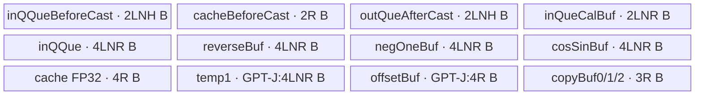
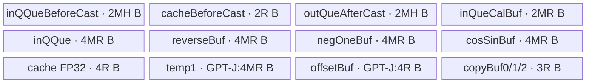
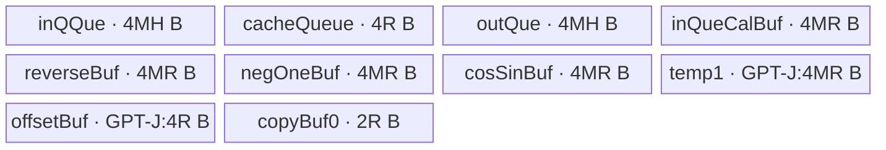

# RopeWithSinCosCache A2/A3 ACLNN 算子知识

## 算子速览

| 项目 | 内容 |
|---|---|
| 实际入口 | CANN 9.1.0 最新公开两段式接口 `aclnnRopeWithSinCosCacheV2GetWorkspaceSize` / `aclnnRopeWithSinCosCacheV2`；V2 相比 V1 新增 `cacheMode` |
| 计算语义 | 由 `positions` 从拼接的 cos/sin cache 取值，对 query/key 每个 head 的前 `rotaryDim` 执行 GPT-NeoX half 或 GPT-J interleaved RoPE，未旋转后缀原样透传 |
| 输入输出 | `positions` 为 INT64；query/key/cache 为 ND 二维、同 dtype 的 FP16/BF16/FP32；输出 shape/dtype 分别同 query/key |
| 执行类型 | `AIV_VECTOR` |
| Kernel 路线 | R-001 FP16/BF16 token 分批；R-002 FP16/BF16 单 token 分 head；R-003 FP32 token 分批；R-004 FP32 单 token 分 head |
| 核心资源 | GM；深度 1 的 VECIN/VECOUT TQue；VECCALC TBuf；FP32 计算中间；MTE2↔Vector、Vector↔MTE3 硬事件；无算子 user workspace |
| 来源闭包 | `source_closed`：V2 声明/实现、Contiguous/ViewCopy、L0 launcher、OpDef、31 字段 POD、TilingKey 20/21/22、四个可达 body 分支、同步 helper 与构建接线均闭合 |
| 验证状态 | 已完成源码闭包检查；本次知识提取未执行编译、真机、数值或性能测试。 |

## 接口与语义

### 计算语义

令 `T=numTokens`、`Hq=numQHeads`、`Hk=numKHeads`、`H=headSize`、`R=rotaryDim=cosSinCache.shape[1]`。对 query 与 key 的每个 head 独立取前缀 `x[0:R]`，后缀 `x[R:H]` 不参与旋转。`positions[t]` 选择 cache 行；mrope 模式中 `positions` 为 `[3,T]` 或 `[4,T]`，按 `mropeSection` 从多条位置行组合长度 `R/2` 的 cos 与 sin。

当 `isNeoxStyle=true` 时，`x1=x[0:R/2]`、`x2=x[R/2:R]`；当其为 false 时，先用 `GatherMask` 把偶、奇位拆成两半。两种模式随后都计算 `o1=x1*cos-x2*sin`、`o2=x2*cos+x1*sin`，false 分支再用 `Gather` 恢复偶奇交错。`cacheMode=0` 按 mrope 分段拼接；`cacheMode=1` 先取第 0 条位置行，再用第 1/2 行分别替换索引 `3i+1`、`3i+2`。最终 query/key 的旋转前缀与原输入后缀拼接到连续中间输出。

### 输入、输出与属性

| 参数 | shape/layout | dtype | 约束、默认值与语义 |
|---|---|---|---|
| positions | rope `[T]`；mrope `[3,T]` 或 `[4,T]`；ND | INT64 | 必选、非空；ACLNN 先 Contiguous；值必须小于 cache 第 0 维，但固定 API 实现不扫描 Device 值 |
| queryIn | `[T,Hq*H]`，ND，可非连续 | FP16/BF16/FP32 | 必选、非空；dtype 决定 key 21/20/22；第 0 维需与 key 相同 |
| keyIn | `[T,Hk*H]`，ND，可非连续 | 同 query | 必选、非空；dtype 必须与 query/cache/输出一致 |
| cosSinCache | `[maxSeqLen,R]`，ND，可非连续 | 同 query | 必选、非空；ACLNN 先 Contiguous；前 `R/2` 为 cos、后 `R/2` 为 sin |
| mropeSection | 空指针，或长度 3/4 的 Host `aclIntArray` | INT64 | 空指针为 rope；非空元素非负；第 0 项大于 0 时总和乘 2 必须等于 R，且只接受 `[16,24,24]`、`[8,12,12]`、`[24,20,20]`、`[16,16,16,16]` |
| headSize | 标量 | INT64 | 必须非 0；Tiling 要求 `H>=R`，FP16/BF16 为 32 的倍数，FP32 为 16 的倍数 |
| isNeoxStyle | 标量 | bool | true 为 half，false 为 interleaved；false 额外分配 offset/temp TBuf |
| cacheMode | 标量 | INT64 | V2 仅 0/1；长度 4 的 mrope 仅允许 0 |
| queryOut | `[T,Hq*H]`，ND，连续 | 同 query | 必选；API 校验 view shape 同 query；L0 先生成连续中间，再 ViewCopy |
| keyOut | `[T,Hk*H]`，ND，连续 | 同 key | 必选；shape 同 key |
| workspaceSize/executor/stream | ACLNN 句柄 | uint64/指针 | 第一段返回 executor 聚合的 workspace；第二段在指定 stream 调 `CommonOpExecutorRun` |

### 入口与版本

公开版本族含 `aclnnRopeWithSinCosCache` 与 `aclnnRopeWithSinCosCacheV2`；A2/A3 选择实际最新 V2。V1 把 `cacheMode` 固定为 0，V2 在公共 `GetWorkspaceSizeCommon` 前检查 0/1，并沿 L0 attr、Tiling POD 传到 Device。V2 文档明确支持 A2/A3。不能把 950 的 `rope_with_sin_cos_cache_apt` 视为 V2 等价实现：同一固定仓的 V2 产品表把 950 标为不支持，且 arch35 基类/body 未读取 `cacheMode` 与 `mrope_section3`。

## Host/Launcher 执行流程

### 参数校验与前处理

`aclnnRopeWithSinCosCacheV2GetWorkspaceSize` 先检查 `cacheMode∈{0,1}`，再进入公共实现。`CheckParams` 依次校验六个必选 tensor 非空、当前 SoC 是 ASCEND910B/ASCEND910_93 或 RegBase、positions=INT64、其余五个 tensor 与 query 同 dtype、query/key/cache 均为二维且所有输入非空、query/key 的 T 相同、输出 shape 分别等于输入。mrope 非空时读取 3/4 个 Host 值、检查非负、受控组合及 `2*sum=R`。

随后创建 executor，把 positions 与 cosSinCache 变连续；query/key 保持原 view，并把 `GetViewStrides()[0]` 作为 q/k leading dimension。`Hq=query.shape[1]/H`、`Hk=key.shape[1]/H` 使用整数除法；API 只检查 `H!=0`，整除性由接口契约而非该函数显式验证。L0 分配连续 query/key 中间输出，加入 AICore launcher，最后分别用 `ViewCopy` 写用户输出。

### 参数、Workspace 与生命周期

L0 launcher attrs 顺序固定为 `numQHeads,numKHeads,headSize,mropeSection,qStride,kStride,isNeoxStyle,cacheMode`。Tiling 把 31 个 uint64 字段序列化，算子 user workspace 明确为 0 B；`workspaces[0]=GetLibApiWorkSpaceSize()` 只保留系统库 workspace。Kernel 调 `GetUserWorkspace(workspace)`，但变量 `usrWorkspace` 不再参与任何地址或计算。第一段返回的总 workspace 还可包含 Contiguous/ViewCopy 的 executor 临时区，owner 为 executor，必须存活到第二段同一 stream 执行完成。

### 启动图与失败传播

调用链为 `V2GetWorkspaceSize → GetWorkspaceSizeCommon → l0op::RopeWithSinCosCache → RoepWithSinCosCacheAICore → ADD_TO_LAUNCHER_LIST_AICORE → TilingRopeWithSinCosCache → rope_with_sin_cos_cache`，第二段由 `CommonOpExecutorRun` 提交。OpDef 将 A2/A3 分别接到 `ascend910b`、`ascend910_93` 的 membase `rope_with_sin_cos_cache` entry；CMake 用 `add_modules_sources(... ACLNNTYPE aclnn_exclude)` 接入模块。

| 节点 | Host 添加函数 | Kernel entry / 执行族 | blockDim 与 POD | 输入→输出 | workspace / owner / ordering |
|---|---|---|---|---|---|
| K0 | `RoepWithSinCosCacheAICore::ADD_TO_LAUNCHER_LIST_AICORE` | `rope_with_sin_cos_cache` / `AIV_VECTOR` | `front_core+tail_core`；`RopeWithSinCosCacheTilingData` | positions、query、key、cache → 连续 query/key 中间输出 | user 0 B；系统 workspace 由平台库给出；executor 拥有中间输出，单 stream 在 K0 后顺序执行两个 ViewCopy |

这是单 Kernel 图，没有 Kernel 间 workspace/GM 交接边。框架 Contiguous 结果与 K0 的连续中间输出由 executor 持有；第二段完成 K0 后，query/key ViewCopy 才能消费对应中间输出，任一 producer 失败都阻断后续消费。

API 校验、executor 创建、Contiguous、launcher 入图和 ViewCopy 任一步失败都会返回 ACLNN 状态。Tiling 对 null attr、长度 4 且 `cacheMode!=0` 显式失败；但固定源码调用 `TilingKeyChose` 与 `TilingCompute` 后没有检查其返回值，仍继续保存 POD 并返回成功，这是不能在复用实现中继承的失败传播缺口。

## Route 与参数设计

### 分核与资源计算

Tiling 令 `C=PlatformAscendC::GetCoreNum()`、`U=平台 UB 字节`、`D=4 B`（所有 route 都按 FP32 中间预算）、`N=max(Hq,Hk)`。`front=T%C`，若整除则 `front=C`；`tail=(T<=C?0:C-front)`，`blockDim=front+tail`。前核 token 数 `ceil(T/C)`，尾核为 `floor(T/C)`；两组分别计算 loop 数与最后 loop token 数。

每 token 全 head 预算为 `A=N*(isNeoxStyle ? (5R+2H)*D : (6R+2H)*D)`，保留 cache 临时预算 `10R*D`，故 `maxTokenPerLoop=(U-10R*D)/A`。若能容纳全 head，则按 token 分批；否则 `numHeadsForUb=(U-10R*D)/((isNeoxStyle?(5R+2H):(6R+2H))*D)`，置 `loop_for_one_token=1` 并对 Hq/Hk 分 head。所有容量计算为 uint64；若 `U<10R*D` 会无符号下溢，固定 Host 没有额外防护。

### Route 选择

| 顺序 | Route | Key/模板 | 精确选择条件与优先级 | 不适用去向 |
|---:|---|---|---|---|
| 1 | R-001 FP16/BF16 token 分批 | key 20 `RopeWithSinCosCacheFP16<bfloat16_t>`；key 21 `<half>` | dtype 为 BF16/FP16，且 `N<=numHeadsForUb`，即 `loop_for_one_token=0` | 容量不足进入 R-002；dtype FP32 进入 R-003/R-004 |
| 2 | R-002 FP16/BF16 单 token 分 head | key 20/21，同模板的 `ComputeAlongHeads` | dtype 为 BF16/FP16，且 `N>numHeadsForUb`，即 `loop_for_one_token=1` | `numHeadsForUb==0` 会令 head loop 字段为 0，固定源码无有效 fallback |
| 3 | R-003 FP32 token 分批 | key 22 `RopeWithSinCosCacheF32<float>` | dtype 为 FP32，且 `N<=numHeadsForUb` | 容量不足进入 R-004 |
| 4 | R-004 FP32 单 token 分 head | key 22，同模板的 `ComputeAlongHeads` | dtype 为 FP32，且 `N>numHeadsForUb` | `numHeadsForUb==0` 无有效计算路线 |

```text
TilingKeyChose(query dtype)
├─ BF16 -> key20 ─┬─ N<=numHeadsForUb -> R-001 / Compute
│                 └─ N> numHeadsForUb -> R-002 / ComputeAlongHeads
├─ FP16 -> key21 ─┬─ N<=numHeadsForUb -> R-001 / Compute
│                 └─ N> numHeadsForUb -> R-002 / ComputeAlongHeads
└─ FP32 -> key22 ─┬─ N<=numHeadsForUb -> R-003 / Compute
                  └─ N> numHeadsForUb -> R-004 / ComputeAlongHeads
```

### 模板/实现执行矩阵

| Route | key/selector | dtype/shape/platform 完整命中条件 | 执行拓扑与 Kernel 节点 | 实际模板/body | 内存与同步特征 | tail/fallback |
|---|---|---|---|---|---|---|
| R-001 FP16/BF16 token 分批 | 20/21 + `loop_for_one_token=0` | A2/A3；BF16/FP16；H、R 分别 64 B 对齐；`R<=H`；`N<=numHeadsForUb` | 单 K0 `AIV_VECTOR` | `RopeWithSinCosCacheFP16<bfloat16_t/half>::Process→Compute→GetCosSinCache` | TQue depth=1；FP32 计算 TBuf；MTE2↔V、V↔MTE3 硬事件 | front/tail core + last token loop；容量不足进 R-002 |
| R-002 FP16/BF16 单 token 分 head | 20/21 + `loop_for_one_token=1` | 同上 dtype/对齐；`N>numHeadsForUb>0` | 单 K0 `AIV_VECTOR` | 同模板的 `Process→ComputeAlongHeads→GetCosSinCache` | UB 以 `M=numHeadsForUb` 个 head 定容；Q/K head tail 独立 | 每 token×head tile；`numHeadsForUb==0` 无有效 fallback |
| R-003 FP32 token 分批 | 22 + `loop_for_one_token=0` | A2/A3；FP32；H、R 分别 64 B 对齐；`R<=H`；`N<=numHeadsForUb` | 单 K0 `AIV_VECTOR` | `RopeWithSinCosCacheF32<float>::Process→Compute→GetCosSinCache` | FP32 TQue/TBuf；同类硬事件；无 cast | front/tail core + last token loop；容量不足进 R-004 |
| R-004 FP32 单 token 分 head | 22 + `loop_for_one_token=1` | 同上 dtype/对齐；`N>numHeadsForUb>0` | 单 K0 `AIV_VECTOR` | 同模板的 `Process→ComputeAlongHeads→GetCosSinCache` | UB 以 `M=numHeadsForUb` 个 head 定容；Q/K 顺序复用 | 每 token×head tile；`numHeadsForUb==0` 无有效 fallback |

### 隐藏性能 Guard

| Guard | Host/Tiling 条件 | Device/资源原因 | 影响 Route | 不满足时去向 | 源码符号 |
|---|---|---|---|---|---|
| dtype key | BF16→20，FP16→21，FP32→22 | entry 在编译期 dtype guard 内只实例化对应模板 | 全部 | 其它 dtype 应失败；但顶层未检查 `TilingKeyChose` 返回值 | `rope_with_sin_cos_cache_tiling.cpp:TilingKeyChose`；`op_kernel/rope_with_sin_cos_cache.cpp:rope_with_sin_cos_cache` |
| 64 B 行对齐 | `H%(64/sizeof(dtype))==0 && R%(64/sizeof(dtype))==0` | `headBlockLen/rotaryBlockLen` 最终作为 32 B `DataCopy` blockLen，低精度代码再除 2 | 全部 | `TilingCompute` 返回失败；顶层遗漏传播 | `rope_with_sin_cos_cache_tiling.cpp:TilingCompute` |
| 旋转域 | `H>=R` | body 抽取前 R 并从 `[R,H)` 搬未旋转后缀 | 全部 | Tiling 失败；无 Device fallback | 同上 |
| token/head 路线 | `N<=numHeadsForUb` vs. `N>numHeadsForUb` | 全 head×token tile 是否能放入保守 UB 预算 | R-001↔R-002；R-003↔R-004 | 切到单 token 分 head | `TilingCompute:loop_for_one_token` |
| UB 保留量 | `U-10R*4` 后再做除法 | 为 cache、padding、offset 等固定项留 `40R B` | 全部 | `U<40R` 时 uint64 下溢，源码无失败终点 | `TilingCompute:maxNPerLoopForUb/numHeadsForUb` |
| 至少一 head/tile | `numHeadsForUb>0` | `num_heads_each_loop` 决定所有 Queue/TBuf 容量和循环次数 | R-002/R-004 | 为 0 时 head loop 为 0，Device 无输出 | `TilingCompute:loop_along_qheads/loop_along_kheads` |
| interleaved 条件区 | `isNeoxStyle==0` | 只有 GPT-J 路线需要 `offsetBuf/temp1` 和 GatherMask/Gather | 全部 | true 路线分配 0 B 条件区并走连续 half | `RopeWithSinCosCacheFP16::Init`；`RopeWithSinCosCacheF32::Init` |
| mrope 4 段 | `mropeSection.size()==4 => cacheMode==0` | Device 的四段实现只在分段 cache 路线闭合 | 全部 | Tiling 明确返回失败 | `TilingRopeWithSinCosCache` |
| block/repeat 窄化 | 多个 token/head/blockLen/count 转为 `uint16_t` | `DataCopy` 与 Cast 实参位宽有限 | 全部 | 固定 Host 无完整上界检查或 fallback | 两个 body 的 `Compute/ComputeAlongHeads` |

### POD/ABI

`RopeWithSinCosCacheTilingData` 全部字段由 `TILING_DATA_FIELD_DEF(uint64_t,...)` 声明。宏展开实现不在固定仓，因此精确 `sizeof/alignof/offsetof` 不可见；下表保留声明序号、producer、consumer 与单位，不根据常规 C++ 布局猜测 ABI offset。

| 结构 | 字段 | 类型/位宽 | ABI 布局 | 单位 | Host/launcher producer | Device consumer | 边界 |
|---|---|---|---|---|---|---|---|
| RopeWithSinCosCacheTilingData | core_num_use | uint64/64 | sizeof/alignof/offsetof 固定仓不可见；序号 0 | 核 | `TilingCompute:numBlocks` | `InitData` 保存；launch blockDim 同值 | `1..C`，T>0 |
| 同上 | num_tokens | uint64/64 | 固定仓不可见；序号 1 | token | queryOut storage dim0 | positions mrope 平面跨度、core offset | 非空 |
| 同上 | num_q_heads | uint64/64 | 固定仓不可见；序号 2 | head | L0 `query.shape[1]/H` attr | Q 地址、UB extent、Vector count | 整除性未显式校验 |
| 同上 | num_kv_heads | uint64/64 | 固定仓不可见；序号 3 | head | L0 `key.shape[1]/H` attr | K 地址、UB extent、Vector count | 同上 |
| 同上 | head_size | uint64/64 | 固定仓不可见；序号 4 | 元素/head | attr 2 | blockLen、GM stride、后缀复制 | FP16/BF16 32 对齐；FP32 16 对齐 |
| 同上 | rotary_dim | uint64/64 | 固定仓不可见；序号 5 | 元素 | cache storage 最后一维 | cache offset、Vector count、UB extent | `R<=H` 且 64 B 对齐 |
| 同上 | mrope_section0 | uint64/64 | 固定仓不可见；序号 6 | 元素 | attr list[0] 或默认 0 | `GetCosSinCache` 模式开关/第一段 | 非负 |
| 同上 | mrope_section1 | uint64/64 | 固定仓不可见；序号 7 | 元素 | attr list[1] 或默认 0 | 第二段或 cacheMode1 替换范围 | 受控组合 |
| 同上 | mrope_section2 | uint64/64 | 固定仓不可见；序号 8 | 元素 | attr list[2] 或默认 0 | 第三段或 cacheMode1 替换范围 | 受控组合 |
| 同上 | mrope_section3 | uint64/64 | 固定仓不可见；序号 9 | 元素 | list 长度 4 时 list[3]，否则 0 | cacheMode0 第四段分支 | 长度 4 时 cacheMode=0 |
| 同上 | q_leading_dimension | uint64/64 | 固定仓不可见；序号 10 | 元素/row | `queryIn.GetViewStrides()[0]` | FP16/BF16 GM 基址与批次 DataCopy stride；FP32 批次 stride | uint64 窄化 |
| 同上 | k_leading_dimension | uint64/64 | 固定仓不可见；序号 11 | 元素/row | `keyIn.GetViewStrides()[0]` | K 同类地址/stride | uint64 窄化 |
| 同上 | isNeoxStyle | uint64/64 | 固定仓不可见；序号 12 | bool 编码 | attr 6 bool 转 uint64 | UB 条件分配、Gather 分支、预算 | 0/1 |
| 同上 | cacheMode | uint64/64 | 固定仓不可见；序号 13 | enum | V2 attr 7 | cache 拼接分支 | 0/1 |
| 同上 | front_core | uint64/64 | 固定仓不可见；序号 14 | 核 | `T%C`，整除时 C | `blockIdx<front` 分支 | `1..C` |
| 同上 | tail_core | uint64/64 | 固定仓不可见；序号 15 | 核 | `T<=C?0:C-front` | tail core 参数选择 | `0..C-1` |
| 同上 | num_tokens_each_front_core | uint64/64 | 固定仓不可见；序号 16 | token/核 | `ceil(T/C)` | `blockOffset`、本核 token 数 | 正数 |
| 同上 | num_tokens_each_tail_core | uint64/64 | 固定仓不可见；序号 17 | token/核 | `floor(T/C)` | tail `blockOffset`/本核 token | tail=0 时可为 0 |
| 同上 | num_tokens_front_core_each_loop | uint64/64 | 固定仓不可见；序号 18 | token/loop | 单 loop 则前核 token，否则 maxTokenPerLoop | `Compute` offset/extent | loop_for_one_token=0 时正数 |
| 同上 | num_tokens_tail_core_each_loop | uint64/64 | 固定仓不可见；序号 19 | token/loop | tail loop 容量 | tail `Compute` offset/extent | tail=0 可为 0 |
| 同上 | loop_time_each_front_core | uint64/64 | 固定仓不可见；序号 20 | 次 | `ceil(frontTokens/maxTokenPerLoop)` | `Process` 主循环 | maxTokenPerLoop=0 时 0 |
| 同上 | loop_time_each_tail_core | uint64/64 | 固定仓不可见；序号 21 | 次 | `ceil(tailTokens/maxTokenPerLoop)` | tail `Process` | maxTokenPerLoop=0 时 0 |
| 同上 | num_tokens_front_core_last_loop | uint64/64 | 固定仓不可见；序号 22 | token | 单 loop 写 0，否则余数 | 最后一次 `Compute` loopN | 0 表示用常规 loop extent |
| 同上 | num_tokens_tail_core_last_loop | uint64/64 | 固定仓不可见；序号 23 | token | tail 余数；源码条件误用 front loop 次数 | tail 最后 loop | 存在 producer 条件不一致 |
| 同上 | loop_for_one_token | uint64/64 | 固定仓不可见；序号 24 | bool 编码 | `N>numHeadsForUb` | `Process` 选择 Compute/ComputeAlongHeads | 0/1 |
| 同上 | loop_along_qheads | uint64/64 | 固定仓不可见；序号 25 | 次 | `ceil(Hq/numHeadsForUb)` | head-split Q 循环边界 | numHeadsForUb=0 时置 0 |
| 同上 | loop_along_kheads | uint64/64 | 固定仓不可见；序号 26 | 次 | `ceil(Hk/numHeadsForUb)` | head-split K 循环边界 | 同上 |
| 同上 | num_qheads_each_loop | uint64/64 | 固定仓不可见；序号 27 | head/loop | 单 loop 为 Hq，否则 numHeadsForUb | Q head offset/UB extent | 非零才可执行 |
| 同上 | num_qheads_last_loop | uint64/64 | 固定仓不可见；序号 28 | head | 单 loop 0，否则 Hq 余数 | Q 最后 head tile | 0 表示常规 extent |
| 同上 | num_kheads_each_loop | uint64/64 | 固定仓不可见；序号 29 | head/loop | 单 loop为 Hk，否则 numHeadsForUb | K head offset/UB extent | 非零才可执行 |
| 同上 | num_kheads_last_loop | uint64/64 | 固定仓不可见；序号 30 | head | 单 loop 0，否则 Hk 余数 | K 最后 head tile | 0 表示常规 extent |

### Route 源码闭包

| Route | Key/selector | Host/Tiling producer | POD/参数 | Kernel entry/router | Kernel body/直接依赖 | 构建接线 |
|---|---|---|---|---|---|---|
| R-001 FP16/BF16 token 分批 | 20/21 + `loop_for_one_token=0` | `rope_with_sin_cos_cache_tiling.cpp:TilingKeyChose/TilingCompute` | 公共 POD 的 dtype key、token loop、stride、mode 字段 | `op_kernel/rope_with_sin_cos_cache.cpp:rope_with_sin_cos_cache` | `rope_with_sin_cos_cache_f_bf16.h:RopeWithSinCosCacheFP16::{Init,Process,Compute,GetCosSinCache}`；base 同步 helper | Host CMake + ascend910b/910_93 binary.json 三 dtype 签名 |
| R-002 FP16/BF16 单 token 分 head | 20/21 + `loop_for_one_token=1` | 同文件 `numHeadsForUb` 与 head loop producer | 公共 POD 的 head loop/tail 字段 | 同 entry 的 key20/21 router | 同 body 的 `Process→ComputeAlongHeads→GetCosSinCache`；base 同步 helper | 同 R-001 |
| R-003 FP32 token 分批 | 22 + `loop_for_one_token=0` | 同文件 dtype/UB/token producer | 公共 POD | 同 entry 的 key22 router | `rope_with_sin_cos_cache_fp32.h:RopeWithSinCosCacheF32::{Init,Process,Compute,GetCosSinCache}`；base helper | 同 R-001 |
| R-004 FP32 单 token 分 head | 22 + `loop_for_one_token=1` | 同文件 head loop producer | 公共 POD | 同 entry 的 key22 router | 同 FP32 body 的 `Process→ComputeAlongHeads→GetCosSinCache`；base helper | 同 R-001 |

## Kernel 实现

### 公共执行流程

entry 反序列化 POD，创建 `TPipe`，按 dtype key 实例化 FP16/BF16 或 FP32 类；每个实例先用 front/tail core 公式确定 GM 基址和本核覆盖域。两类 body 都先处理 query，再在显式 MTE3→Vector、Vector→MTE2 边之后处理 key。每个 head 的计算顺序固定为取旋转前缀、可选偶奇拆分、构造 `[x2,x1]` 与 `[-1,+1]`、分别广播 cos/sin、两次 Mul 后 Add、可选恢复交错、拼回未旋转后缀并写 GM。FP16/BF16 用 FP32 中间，FP32 保持 FP32。

### Route R-001：FP16/BF16 token 分批

#### 适用条件

##### 选择证据

| 层级 | 文件 | 符号 | 源码谓词/参数 | 结果/下一跳 |
|---|---|---|---|---|
| API | posembedding/rope_with_sin_cos_cache/op_host/op_api/aclnn_rope_with_sin_cos_cache.cpp | `GetSupportDtypeList/CheckDtypeValid` | A2/A3 接受 BF16/FP16，且 key/cache/output 全部同 query dtype | 进入 L0；不匹配返回参数错误 |
| Tiling | posembedding/rope_with_sin_cos_cache/op_host/rope_with_sin_cos_cache_tiling.cpp | `TilingKeyChose/TilingCompute` | BF16→20、FP16→21；`N<=numHeadsForUb` 令 `loop_for_one_token=0` | token 分批字段写入 POD |
| Router | posembedding/rope_with_sin_cos_cache/op_kernel/rope_with_sin_cos_cache.cpp | `rope_with_sin_cos_cache` | `TILING_KEY_IS(20/21)` | `RopeWithSinCosCacheFP16<bfloat16_t/half>::Process` |

#### Device 数据流

##### 函数级调用链

```text
rope_with_sin_cos_cache(args,tiling)
  -> RopeWithSinCosCacheFP16<T>::Init -> RopeWithSinCosCacheBase<T>::InitData
  -> RopeWithSinCosCacheFP16<T>::Process
    -> RopeWithSinCosCacheFP16<T>::Compute(index,loopN)
      -> GetCosSinCache -> Cast/Broadcast -> Mul/Mul/Add -> DataCopy(query/key GM)
      -> RopeWithSinCosCacheBase<T>::{MTE2ToVSync,VToMTE2Sync,VToMTE3Sync,MTE3ToVSync}
```

##### 源码等价伪码

```text
伪码：blockIdx=GetBlockIdx()
blockOffset = blockIdx<front ? frontTokens*blockIdx
                              : frontTokens*front+(blockIdx-front)*tailTokens
QinBase=blockOffset*qLeading；KinBase=blockOffset*kLeading
QoutBase=blockOffset*Hq*H；KoutBase=blockOffset*Hk*H
for index in [0,loop_time_current_core):
  loopN = 最后一轮且 lastTokens!=0 ? lastTokens : tokensEachLoop
  qInOff=index*tokensEachLoop*qLeading；qOutOff=index*tokensEachLoop*Hq*H
  DataCopy loopN 行 Q（blockLen=Hq*H/16 个 32B 块，srcStride=qLeading/16-Hq*H/16）
  MTE2ToV；抽取每 head 前 R；若 interleaved 则 GatherMask 偶/奇；Cast(T->FP32)
  reverse=[x2,x1]；sign=[-1,+1] 并 Broadcast 到 loopN*Hq 行
  for token i: GetCosSinCache(position[index*tokensEachLoop+i],cosOffset=0) 并 Broadcast 到 Hq
  x*=cos；reverse*=sign
  for token i: GetCosSinCache(...,cosOffset=R/2) 并 Broadcast 到 Hq
  reverse*=sin；x+=reverse；若 interleaved 则 Gather 恢复偶奇；Cast(FP32->T,CAST_RINT)
  拼回每 head [R:H]；VToMTE3；DataCopy 有效 loopN 行到 Qout
  MTE3ToV；VToMTE2；以 Hk 重复同一流程写 Kout
```

#### 内存与数据搬运

##### 资源与搬运表

| 层级/缓冲区 | offset/地址公式 | extent/容量公式 | dtype/layout | producer | consumer | owner/lifetime | 对齐/复用 |
|---|---|---|---|---|---|---|---|
| GM positions | `blockOffset + localToken`；mrope 平面再加 `j*T` | rope T 项；mrope 3T/4T 项 | uint64 视图 | caller/Contiguous | `GetCosSinCache:GetValue` | executor/整次 launch | 标量读；positions 负值会转 uint64 |
| GM queryIn | `blockOffset*qLeading + index*tokensEachLoop*qLeading` | `loopN` 行，每行读取 `Hq*H` 元素 | T/ND stride | caller | `DataCopy` | caller/launch | blockLen=`Hq*H/16`，64B 对齐 |
| GM keyIn | `blockOffset*kLeading + index*tokensEachLoop*kLeading` | `loopN*Hk*H` 有效元素 | T/ND stride | caller | `DataCopy` | caller/launch | srcStride=`kLeading/16-Hk*H/16` |
| GM cosSinCache | `position*R+cosSinOffset+sectionOffset` | 每次半 cache 为 `R/2` 元素 | T/ND contiguous | caller/Contiguous | `DataCopy/DataCopyPad/GetValue` | executor/launch | section 用 32B padding 修正起址 |
| GM queryOut | `blockOffset*Hq*H + index*tokensEachLoop*Hq*H` | `loopN*Hq*H` 元素 | T/连续中间 | `DataCopy` | ViewCopy | executor/launch | 只提交 loopN 有效行 |
| GM keyOut | `blockOffset*Hk*H + index*tokensEachLoop*Hk*H` | `loopN*Hk*H` 元素 | T/连续中间 | `DataCopy` | ViewCopy | executor/launch | 与 query 输出不别名 |
| TBuf inQQue | TPipe 分配 | `tokensEachLoop*N*R*4 B` | FP32/VECCALC | Cast/GatherMask | Mul/Add | Kernel；跨 Q/K 复用 | depth N/A；Q 完成并同步后给 K |
| TBuf inQueueCosSinCache | TPipe 分配 | `R*4 B` | FP32/VECCALC | Cast cache | DataCopy/Broadcast | Kernel | 每次 cos/sin 调用覆盖前先 MTE2→V |
| TBuf reverseBuf | TPipe 分配 | `tokensEachLoop*N*R*4 B` | FP32/VECCALC | 两次半区 DataCopy | Mul/Add | Kernel | Q/K 顺序复用；不与 inQQue 别名 |
| TBuf negOneBuf | TPipe 分配 | `tokensEachLoop*N*R*4 B` | FP32/VECCALC | Duplicate/Broadcast | reverse Mul | Kernel | 每次 Compute 重建 `[-1,+1]` |
| TBuf cosSinBuf | TPipe 分配 | `tokensEachLoop*N*R*4 B` | FP32/VECCALC | cache Broadcast | x/reverse Mul | Kernel | Q/K 和 cos/sin 阶段复用 |
| TBuf inQueCalBuf | TPipe 分配 | `tokensEachLoop*N*R*sizeof(T)` | T/VECCALC | 前缀 DataCopy或末端 Cast | Cast/输出拼接 | Kernel | T=2 B；跨 Q/K 复用 |
| TBuf offsetBuf | TPipe 分配 | `isNeoxStyle?0:R*4 B` | uint32/VECCALC | SetValue `i*4` 索引 | Gather | Kernel | interleaved 专用；Neox 为 0 B |
| TBuf temp1 | TPipe 分配 | `isNeoxStyle?0:tokensEachLoop*N*R*4 B` | FP32/VECCALC | Cast/Gather | GatherMask/末端 Cast | Kernel | interleaved 专用 |
| TBuf copyBuf0 | TPipe 分配 | `(R/2)*sizeof(T)=R B` | T/VECCALC | DataCopyPad | Copy | Kernel | mrope 未对齐 section 临时区 |
| TBuf copyBuf1 | TPipe 分配 | `1*R B` | T/VECCALC | 固定 body 未写 | 固定 body 未读 | Kernel | 已分配但当前源码无消费 |
| TBuf copyBuf2 | TPipe 分配 | `1*R B` | T/VECCALC | 固定 body 未写 | 固定 body 未读 | Kernel | 已分配但当前源码无消费 |
| TQue inQQueBeforeCast | TPipe 分配 | depth=1；`tokensEachLoop*N*H*sizeof(T)` | T/VECIN | GM DataCopy | 前缀抽取、后缀透传 | 单次 Compute Alloc→Free | 不调用 EnQue/DeQue；依赖硬事件 |
| TQue inQueueCosSinCacheBeforeCast | TPipe 分配 | depth=1；`R*sizeof(T)` | T/VECIN | cache DataCopy | Cast | 单次 Compute Alloc→Free | 每个 token/cos-sin 半区复用 |
| TQue outQueAfterCast | TPipe 分配 | depth=1；`tokensEachLoop*N*H*sizeof(T)` | T/VECOUT | Cast与后缀 DataCopy | GM DataCopy | 单次 Compute Alloc→Free | Q 写完后同步并复用于 K |
| workspace | `GetUserWorkspace(workspace)` | user=0 B；system=`GetLibApiWorkSpaceSize()` | byte | Host runtime | Kernel 数值路径不消费 | executor/launch | N/A：仅保留系统 workspace |

##### 分层内存布局

令 `L=tokensEachLoop`、`N=max(Hq,Hk)`、`sizeof(T)=2`。所有 Queue 的 depth 均为 1；图中节点互不别名。



##### 字节账与复用顺序

```text
UB_actual(NeoX) = 18LNR + 4LNH + 9R
UB_actual(GPT-J) = 22LNR + 4LNH + 13R
UB_budget(NeoX) = L*N*(5R+2H)*4 + 40R = 20LNR + 8LNH + 40R
UB_budget(GPT-J) = L*N*(6R+2H)*4 + 40R = 24LNR + 8LNH + 40R
UB_actual <= UB_budget <= U  （仅在 U>=40R 且 Host 除法未下溢时）
```

| 复用子区 | 写入者 | 读取者/消费点 | 下一次覆盖 | 同步或释放依据 | 安全条件 |
|---|---|---|---|---|---|
| 三个 TQue 与共享计算 TBuf | query 流程 | query `DataCopy` 写 GM | key 流程 | query 写后 `MTE3ToVSync`，key 搬入前 `VToMTE2Sync`；函数末 `FreeTensor` | Q 输出提交后才允许 K 覆盖 |
| cache before-cast/FP32/cache broadcast 区 | `GetCosSinCache` 的 cos 搬入、Cast、Broadcast | 第一次 Mul | 同 token 的 sin 搬入 | 覆盖前 `VToMTE2Sync`，搬入后 `MTE2ToVSync` | 当前 Mul 完成后覆盖 |
| `inQQue` 与 `reverseBuf` | 前缀 Cast/GatherMask 与 half swap | Mul/Mul/Add | 下一 Q/K 或下一 loop | Vector 指令序与 Q→K 硬事件 | 两区不别名，只做原地 `Mul/Add` |
| `temp1/offsetBuf` | GPT-J 的索引与临时排列 | GatherMask/Gather | 下一 Q/K | 同 Vector pipe 指令序 | 仅 `isNeoxStyle==0` 分配；NeoX 不得访问 |
| `copyBuf0/1/2` | `copyBuf0` 由未对齐 section 搬入；1/2 无 producer | `copyBuf0→Copy`；1/2 无 consumer | 下一 section | MTE2→V 后 Copy；1/2 无复用收益 | 不得把空耗的 1/2 误扣为 alias |

#### 同步、精度与尾块

##### 同步与数值边界表

| 阶段 | primitive/机制 | producer | consumer/等待点 | 保护对象 | 精度/尾块 |
|---|---|---|---|---|---|
| Q GM→V | `SetFlag/WaitFlag<HardEvent::MTE2_V>` | query DataCopy | Cast/GatherMask | inQQueBeforeCast/inQueCal | blockLen/stride 均以 32B 块计，loopN 限定有效行 |
| cache V→MTE2 | `HardEvent::V_MTE2` | 前一 Vector 对 cache UB 的使用 | 下一 DataCopy/DataCopyPad | cache/copyBuf0 复用 | section padding 以 `sum*sizeof(T)%32` 计算 |
| cache MTE2→V | `HardEvent::MTE2_V` | cache 搬入 | Copy/Cast/Broadcast | 当前 `R/2` cache | T→FP32 `CAST_NONE`；Broadcast shape=`[head,R]` |
| Q V→GM | `HardEvent::V_MTE3` | Cast/后缀拼接 | queryOut DataCopy | outQueAfterCast | FP32→FP16/BF16 `CAST_RINT`；写完整 H，后缀原样 |
| Q→K 复用 | `HardEvent::MTE3_V` 后 `HardEvent::V_MTE2` | query GM 写出/Vector 完成 | key GM 搬入 | 三个 TQue 与共享 TBuf | 保证覆盖 Q 局部区前 Q 输出已提交 |
| Vector 顺序 | CMake `--cce-auto-sync=on` + 同 pipe 指令序 | GatherMask/Cast/Mul/Add | 后继 Vector 指令 | VECCALC TBuf | 计算元素数=`loopN*heads*R`；源码无额外 mask tail |
| core/loop tail | front/tail POD + `lastTokens` | Host Tiling | `Process` 最后 `Compute` | GM 有效 token 域 | 前核 ceil、尾核 floor；last=0 表示整轮 |
| 空域/窄化 | API 拒绝空输入；Vector/DataCopy 参数多次转 uint16 | Host/API | Device intrinsic | repeat/blockCount | 极大 T/H/R 可能窄化；固定源码无显式上界校验 |

#### 关键实现

##### 符号证据表

| 阶段 | 文件 | 符号/模板实例 | 实现事实 |
|---|---|---|---|
| Host/Tiling producer | posembedding/rope_with_sin_cos_cache/op_host/rope_with_sin_cos_cache_tiling.cpp | `TilingKeyChose/TilingCompute/SetTiling` | 产生 key20/21、token/core/loop/head 容量与全部 POD |
| Kernel entry/router | posembedding/rope_with_sin_cos_cache/op_kernel/rope_with_sin_cos_cache.cpp | `rope_with_sin_cos_cache` | key20/21 映射 BF16/FP16 template 实例 |
| Device body/helper | posembedding/rope_with_sin_cos_cache/op_kernel/rope_with_sin_cos_cache_f_bf16.h | `RopeWithSinCosCacheFP16<T>::Init/Process/Compute` | GM 基址、逐 token loop、Q/K 两段数据流、UB 资源 |
| Device body/helper | posembedding/rope_with_sin_cos_cache/op_kernel/rope_with_sin_cos_cache_f_bf16.h | `RopeWithSinCosCacheFP16<T>::GetCosSinCache` | rope/mrope、cacheMode0/1、section padding、Cast/Broadcast |
| Device body/helper | posembedding/rope_with_sin_cos_cache/op_kernel/rope_with_sin_cos_cache_base.h | `InitData/MTE2ToVSync/VToMTE2Sync/VToMTE3Sync/MTE3ToVSync` | POD consumer、front/tail 选择与硬事件边 |

### Route R-002：FP16/BF16 单 token 分 head

#### 适用条件

##### 选择证据

| 层级 | 文件 | 符号 | 源码谓词/参数 | 结果/下一跳 |
|---|---|---|---|---|
| API | posembedding/rope_with_sin_cos_cache/op_host/op_api/aclnn_rope_with_sin_cos_cache.cpp | `CheckDtypeValid` | BF16/FP16 且其余 tensor 同 dtype | 进入相应 dtype key |
| Tiling | posembedding/rope_with_sin_cos_cache/op_host/rope_with_sin_cos_cache_tiling.cpp | `TilingCompute` | `N>numHeadsForUb` 置 `loop_for_one_token=1`，分别计算 Q/K head loop 与 last head | R-002 |
| Router | posembedding/rope_with_sin_cos_cache/op_kernel/rope_with_sin_cos_cache.cpp | `rope_with_sin_cos_cache` | key20/21；POD loop flag=1 | FP16/BF16 `Process→ComputeAlongHeads` |

#### Device 数据流

##### 函数级调用链

```text
rope_with_sin_cos_cache
  -> RopeWithSinCosCacheFP16<T>::Init -> RopeWithSinCosCacheBase<T>::InitData
  -> RopeWithSinCosCacheFP16<T>::Process
    -> for token -> for headTile -> ComputeAlongHeads(indexToken,indexHeads)
      -> GetCosSinCache -> Cast/Broadcast -> GatherMask/Mul/Add/Gather -> Cast/DataCopy
```

##### 源码等价伪码

```text
伪码：按 front/tail 核取得 numTokensCurrentCore 与 blockOffset
for token in [0,numTokensCurrentCore):
  loopHeads=max(loopAlongQHeads,loopAlongKHeads)
  for htile in [0,loopHeads):
    qHeadOff=htile*qHeadsEachLoop*H；kHeadOff=htile*kHeadsEachLoop*H
    if htile<loopAlongQHeads:
      hq = 最后 tile 且 qLast!=0 ? qLast : qHeadsEachLoop
      qInAddr=token*qLeading+qHeadOff；qOutAddr=token*Hq*H+qHeadOff
      搬 hq*H；对 hq 行执行与 R-001 相同的 cache/cos/sin/旋转/后缀拼接；写 qOutAddr
    MTE3ToV；VToMTE2
    if htile<loopAlongKHeads:
      hk = 最后 tile 且 kLast!=0 ? kLast : kHeadsEachLoop
      kInAddr=token*kLeading+kHeadOff；kOutAddr=token*Hk*H+kHeadOff
      搬 hk*H；执行同样旋转并写 kOutAddr
```

#### 内存与数据搬运

##### 资源与搬运表

| 层级/缓冲区 | offset/地址公式 | extent/容量公式 | dtype/layout | producer | consumer | owner/lifetime | 对齐/复用 |
|---|---|---|---|---|---|---|---|
| GM query tile | `blockOffset*qLeading + token*qLeading + htile*qHeadsEachLoop*H` | `hq*H` 元素 | T/ND | caller | DataCopy | caller/launch | 单行连续；head tail 用 hq |
| GM key tile | `blockOffset*kLeading + token*kLeading + htile*kHeadsEachLoop*H` | `hk*H` 元素 | T/ND | caller | DataCopy | caller/launch | K 独立 last head |
| GM output tile | Q=`blockOffset*Hq*H+token*Hq*H+qHeadOff`；K 同式 | `hq*H` / `hk*H` | T/连续 | DataCopy | ViewCopy | executor/launch | 只写当前 head tile |
| GM cache/positions | `position[token+j*T]*R+cosSinOffset+sectionOffset` | 每调用 `R/2` cache 元素 | T+uint64 | caller | GetCosSinCache | launch | 同一 token 的 head tiles 重复读取 cache |
| TBuf inQQue | TPipe 分配 | `headsEachLoop*R*4 B` | FP32 | Cast/GatherMask | Mul/Add | Kernel | `headsEachLoop=max(qEach,kEach)` |
| TBuf inQueueCosSinCache | TPipe 分配 | `R*4 B` | FP32 | cache Cast | Broadcast | Kernel | 每个 head tile 重用 |
| TBuf reverseBuf | TPipe 分配 | `headsEachLoop*R*4 B` | FP32 | 半区交换 | Mul/Add | Kernel | Q/K 复用 |
| TBuf negOneBuf | TPipe 分配 | `headsEachLoop*R*4 B` | FP32 | Duplicate/Broadcast | reverse Mul | Kernel | last head 仅消费 `hq/hk*R` |
| TBuf cosSinBuf | TPipe 分配 | `headsEachLoop*R*4 B` | FP32 | Broadcast | Mul | Kernel | 当前 cache half 生命周期 |
| TBuf inQueCalBuf | TPipe 分配 | `headsEachLoop*R*sizeof(T)` | T | prefix copy/Cast | Cast/拼接 | Kernel | T=2 B |
| TBuf offsetBuf | TPipe 分配 | `isNeoxStyle?0:R*4 B` | uint32 | SetValue | Gather | Kernel | interleaved only |
| TBuf temp1 | TPipe 分配 | `isNeoxStyle?0:headsEachLoop*R*4 B` | FP32 | Cast/Add | GatherMask/Gather | Kernel | interleaved only |
| TBuf copyBuf0 | TPipe 分配 | `1*R B` | T | DataCopyPad | Copy | Kernel | mrope padding |
| TBuf copyBuf1 | TPipe 分配 | `1*R B` | T | 未写 | 未读 | Kernel | 固定源码空耗 |
| TBuf copyBuf2 | TPipe 分配 | `1*R B` | T | 未写 | 未读 | Kernel | 固定源码空耗 |
| TQue inQQueBeforeCast | TPipe 分配 | depth=1；`headsEachLoop*H*sizeof(T)` | T/VECIN | GM DataCopy | prefix/后缀处理 | 每次 helper Alloc→Free | Q/K 每 tile 重用 |
| TQue inQueueCosSinCacheBeforeCast | TPipe 分配 | depth=1；`R*sizeof(T)` | T/VECIN | cache DataCopy | Cast | helper | 无 EnQue/DeQue |
| TQue outQueAfterCast | TPipe 分配 | depth=1；`headsEachLoop*H*sizeof(T)` | T/VECOUT | Cast/后缀拼接 | GM DataCopy | helper | last head 只提交有效 hq/hk |
| workspace | user offset N/A | 0 B user + system workspace | byte | Host | 数值 body 不读 | executor | N/A |

##### 分层内存布局

令 `M=num_heads_each_loop=numHeadsForUb`、`sizeof(T)=2`。结构与 R-001 相同，只把 token×head 容量 `L*N` 收缩为单 token 的 `M`。



##### 字节账与复用顺序

```text
UB_actual(NeoX) = 18MR + 4MH + 9R
UB_actual(GPT-J) = 22MR + 4MH + 13R
UB_budget(NeoX) = M*(5R+2H)*4 + 40R = 20MR + 8MH + 40R
UB_budget(GPT-J) = M*(6R+2H)*4 + 40R = 24MR + 8MH + 40R
UB_actual <= UB_budget <= U  （要求 M>0 且 U>=40R）
```

| 复用子区 | 写入者 | 读取者/消费点 | 下一次覆盖 | 同步或释放依据 | 安全条件 |
|---|---|---|---|---|---|
| Q/K head tile 共用 TQue/TBuf | 当前 Q tile | Q GM 写出 | 同索引 K tile或下一 head tile | `VToMTE3Sync`、`MTE3ToVSync`、`VToMTE2Sync`；末尾 FreeTensor | 只提交 `hq/hk` 有效 head，容量按 M |
| cache 三层局部区 | 当前 head tile 的 cos/sin | Mul | 下一 cos/sin 或下一 tile | `V_MTE2`/`MTE2_V` | cache 广播只消费有效 `hq/hk*R` 前缀 |
| GPT-J 条件区 | SetValue/Cast/Add | GatherMask/Gather | 下一 Q/K/tile | Vector 指令序 | NeoX 路线分配 0 B且不得读取 |
| `copyBuf1/2` | 无 | 无 | 无 | N/A | 真实分配必须计入 UB，不能作为复用区扣除 |

#### 同步、精度与尾块

##### 同步与数值边界表

| 阶段 | primitive/机制 | producer | consumer/等待点 | 保护对象 | 精度/尾块 |
|---|---|---|---|---|---|
| head tile 搬入 | `HardEvent::MTE2_V` | Q/K GM DataCopy | Cast/GatherMask | input TQue | extent=`hq*H` 或 `hk*H` |
| cache 覆盖 | `HardEvent::V_MTE2` | 前次 Cast/Broadcast | 下一 cache DataCopy | cache TQue/TBuf | 每 tile两次：cosOffset 0、sinOffset R/2 |
| cache 可用 | `HardEvent::MTE2_V` | DataCopyPad/Copy | Cast/Broadcast | R/2 有效 cache | FP16/BF16→FP32 `CAST_NONE` |
| 输出提交 | `HardEvent::V_MTE3` | FP32→T `CAST_RINT` 与后缀拼接 | GM DataCopy | output TQue | 只写 hq/hk 个 head |
| Q/K 交接 | `MTE3_V` + `V_MTE2` | Q 写出 | K 搬入 | 共用 UB | 即使当前 Q tile 不适用也按源码执行交接 helper |
| head tail | `qLast/kLast` 条件 | Host Tiling | ComputeAlongHeads | 最后 head tile | 余数为 0 时用 eachLoop；不同 Q/K loop 独立保护 |
| token/core tail | `numTokensCurrentCore` | front/tail POD | Process 外层 token loop | 本核 token 域 | 不再有 token 内层 tail；每次只处理 1 token |
| 容量失败 | numHeadsForUb=0 时 loop 字段为 0 | Host uint64 除法 | Process | 空 head 迭代 | 无 fallback，不能声称可处理超 UB 参数 |

#### 关键实现

##### 符号证据表

| 阶段 | 文件 | 符号/模板实例 | 实现事实 |
|---|---|---|---|
| Host/Tiling producer | posembedding/rope_with_sin_cos_cache/op_host/rope_with_sin_cos_cache_tiling.cpp | `TilingCompute` | `numHeadsForUb`、Q/K head loop、last head 与 loop flag |
| Kernel entry/router | posembedding/rope_with_sin_cos_cache/op_kernel/rope_with_sin_cos_cache.cpp | `rope_with_sin_cos_cache` key20/21 | 保持 dtype template，POD 决定 body 内分支 |
| Device body/helper | posembedding/rope_with_sin_cos_cache/op_kernel/rope_with_sin_cos_cache_f_bf16.h | `Process/ComputeAlongHeads` | token×head 双循环、Q/K 独立 tail、GM head offset |
| Device body/helper | posembedding/rope_with_sin_cos_cache/op_kernel/rope_with_sin_cos_cache_f_bf16.h | `GetCosSinCache` | 每 head tile 的 cache 组合、cast 与 broadcast |
| Device body/helper | posembedding/rope_with_sin_cos_cache/op_kernel/rope_with_sin_cos_cache_base.h | `InitData` 与硬事件 helper | current core token、head loop 字段及 UB 复用同步 |

### Route R-003：FP32 token 分批

#### 适用条件

##### 选择证据

| 层级 | 文件 | 符号 | 源码谓词/参数 | 结果/下一跳 |
|---|---|---|---|---|
| API | posembedding/rope_with_sin_cos_cache/op_host/op_api/aclnn_rope_with_sin_cos_cache.cpp | `CheckDtypeValid` | query/key/cache/output 全为 FP32 | 进入 L0 |
| Tiling | posembedding/rope_with_sin_cos_cache/op_host/rope_with_sin_cos_cache_tiling.cpp | `TilingKeyChose/TilingCompute` | FP32→key22；`N<=numHeadsForUb` 令 loop flag=0 | R-003 |
| Router | posembedding/rope_with_sin_cos_cache/op_kernel/rope_with_sin_cos_cache.cpp | `rope_with_sin_cos_cache` | `TILING_KEY_IS(22)` | `RopeWithSinCosCacheF32<float>::Process→Compute` |

#### Device 数据流

##### 函数级调用链

```text
rope_with_sin_cos_cache
  -> RopeWithSinCosCacheF32<float>::Init -> RopeWithSinCosCacheBase<float>::InitData
  -> RopeWithSinCosCacheF32<float>::Process
    -> RopeWithSinCosCacheF32<float>::Compute(index,loopN)
      -> GetCosSinCache -> GatherMask/DataCopy -> Mul/Mul/Add/Gather -> DataCopy(query/key GM)
```

##### 源码等价伪码

```text
伪码：blockOffset 按 front/tail token 分核
QinBase=blockOffset*Hq*H；KinBase=blockOffset*Hk*H（注意：这里未使用 q/k leading dimension）
for index in [0,loop_time_current_core):
  loopN=最后 loop 的有效 token 数
  qOff=index*tokensEachLoop*Hq*H
  DataCopy Q：blockCount=loopN，blockLen=Hq*H/8，srcStride=qLeading/8-Hq*H/8
  if interleaved: 每 head 抽前 R 后 GatherMask 偶/奇；else 连续抽前 R
  reverse=[x2,x1]；sign=[-1,+1]；Broadcast 到 loopN*Hq 行
  for token i: GetCosSinCache(...,0)；x*=cos；reverse*=sign
  for token i: GetCosSinCache(...,R/2)；reverse*=sin
  if interleaved: temp=x+reverse 后 Gather 回偶奇；else x+=reverse
  拼回每 head [R:H]；VToMTE3；写 Q GM
  MTE3ToV；VToMTE2；以 Hk 重复并写 K GM
```

#### 内存与数据搬运

##### 资源与搬运表

| 层级/缓冲区 | offset/地址公式 | extent/容量公式 | dtype/layout | producer | consumer | owner/lifetime | 对齐/复用 |
|---|---|---|---|---|---|---|---|
| GM positions | `blockOffset+localToken+j*T` | T/3T/4T 项 | uint64 | caller/Contiguous | GetValue | executor/launch | scalar read |
| GM queryIn | `blockOffset*Hq*H + index*tokensEachLoop*Hq*H` | `loopN*Hq*H` 元素 | FP32/ND | caller | inQQue DataCopy | caller/launch | base 假定 packed；row 内用 qLeading stride |
| GM keyIn | `blockOffset*Hk*H + index*tokensEachLoop*Hk*H` | `loopN*Hk*H` 元素 | FP32/ND | caller | inQQue DataCopy | caller/launch | base 假定 packed；row 内用 kLeading stride |
| GM cosSinCache | `position*R+cosSinOffset+sectionOffset` | 每次 `R/2` 元素 | FP32/ND contiguous | caller/Contiguous | DataCopy/Pad/GetValue | executor/launch | 32B=8 FP32 元素 |
| GM queryOut | `blockOffset*Hq*H+index*tokensEachLoop*Hq*H` | `loopN*Hq*H` | FP32/连续 | DataCopy | ViewCopy | executor/launch | 写完整 H |
| GM keyOut | `blockOffset*Hk*H+index*tokensEachLoop*Hk*H` | `loopN*Hk*H` | FP32/连续 | DataCopy | ViewCopy | executor/launch | 与 Q 分离 |
| TQue inQQue | TPipe 分配 | depth=1；`tokensEachLoop*N*H*4 B` | FP32/VECIN | GM DataCopy | prefix extract/GatherMask | 单次 Compute Alloc→Free | Q/K 复用，硬事件保护 |
| TQue inQueueCosSinCache | TPipe 分配 | depth=1；`tokensEachLoop*R*4 B` | FP32/VECIN | cache DataCopy | Broadcast | 单次 Compute | body 每次只用当前 cache 区 |
| TQue outQue | TPipe 分配 | depth=1；`tokensEachLoop*N*H*4 B` | FP32/VECOUT | Add/后缀拼接 | GM DataCopy | 单次 Compute | Q/K 顺序复用 |
| TBuf reverseBuf | TPipe 分配 | `tokensEachLoop*N*R*4 B` | FP32 | 半区交换 | Mul/Add | Kernel | 不别名 inQueCalBuf |
| TBuf negOneBuf | TPipe 分配 | `tokensEachLoop*N*R*4 B` | FP32 | Duplicate/Broadcast | reverse Mul | Kernel | 每 Compute 重建 |
| TBuf cosSinBuf | TPipe 分配 | `tokensEachLoop*N*R*4 B` | FP32 | cache Broadcast | Mul | Kernel | cos/sin 两阶段覆盖 |
| TBuf inQueCalBuf | TPipe 分配 | `tokensEachLoop*N*R*4 B` | FP32 | prefix extract/GatherMask | Mul/Add | Kernel | 计算主缓冲 |
| TBuf temp1 | TPipe 分配 | `isNeoxStyle?0:tokensEachLoop*N*R*4 B` | FP32 | prefix copy/Add | GatherMask/Gather | Kernel | interleaved only |
| TBuf offsetBuf | TPipe 分配 | `isNeoxStyle?0:R*4 B` | uint32 | SetValue | Gather | Kernel | 偶奇恢复索引 |
| TBuf copyBuf0 | TPipe 分配 | `(R/2)*4=2R B` | FP32 | DataCopyPad | Copy | Kernel | mrope 非 8 元素对齐 section |
| workspace | user offset N/A | user=0 B；system workspace 为平台库值 | byte | Host | body 不消费 | executor | N/A |

##### 分层内存布局

令 `L=tokensEachLoop`、`N=max(Hq,Hk)`；所有元素均为 FP32，Queue depth=1。


##### 字节账与复用顺序

```text
UB_actual(NeoX) = 8LNH + 16LNR + 4LR + 2R
UB_actual(GPT-J) = 8LNH + 20LNR + 4LR + 6R
UB_budget(NeoX) = 20LNR + 8LNH + 40R
UB_budget(GPT-J) = 24LNR + 8LNH + 40R
当 N>=1、U>=40R 时，4LR 可由预算相对实际多留的 4LNR 覆盖，故 UB_actual<=UB_budget<=U。
```

| 复用子区 | 写入者 | 读取者/消费点 | 下一次覆盖 | 同步或释放依据 | 安全条件 |
|---|---|---|---|---|---|
| input/output Queue 与四个计算 TBuf | Q 流程 | Q Mul/Add/Gather 与 GM 写回 | K 流程 | Q 后 `MTE3ToVSync`、K 前 `VToMTE2Sync`；末尾 FreeTensor | Queue/TBuf 不别名；只在阶段间复用 |
| `inQueCalBuf` | 前缀 DataCopy/GatherMask | Mul/Add/Gather | K 或下一 loop | Vector 指令序 | NeoX 中 Add 原地写回；GPT-J 经 temp1 再 Gather 回写 |
| cache Queue/cosSinBuf/copyBuf0 | cache 搬入或 section Copy | Broadcast/Mul | cos→sin→下一 token | `V_MTE2`、`MTE2_V` | section 非 8 FP32 对齐时才经 copyBuf0 |
| `temp1/offsetBuf` | GPT-J | GatherMask/Gather | 下一 Q/K | Vector 指令序 | NeoX 正式构建为 0 B；KT_TEST 的 1 元素分配不属于发布构建 |

#### 同步、精度与尾块

##### 同步与数值边界表

| 阶段 | primitive/机制 | producer | consumer/等待点 | 保护对象 | 精度/尾块 |
|---|---|---|---|---|---|
| Q/K 搬入 | `HardEvent::MTE2_V` | GM DataCopy | GatherMask/DataCopy/Mul | inQQue/inQueCal | FP32 无 cast；blockLen 以 8 元素/32B |
| cache 覆盖 | `HardEvent::V_MTE2` | 前一 cache Vector 使用 | 下一 MTE2 | inQueueCosSinCache/copyBuf0 | section padding 按 8 FP32 元素 |
| cache 可见 | `HardEvent::MTE2_V` | DataCopy/Pad | Broadcast/Mul | 当前 cache half | FP32 原精度；无累加扩宽 |
| 输出写回 | `HardEvent::V_MTE3` | Add/Gather/后缀拼接 | GM DataCopy | outQue | FP32 直接写；完整 H 有效 |
| Q→K | `MTE3_V` + `V_MTE2` | Q output | K input | 共享 TQue/TBuf | 禁止删除两条顺序边 |
| Vector 自动同步 | `--cce-auto-sync=on` | Duplicate/Broadcast/Mul/Add | 后继 Vector | VECCALC/TQue local | Vector count=`loopN*heads*R`，无独立尾 mask |
| token/core tail | front/tail + last loop | Tiling | Process | GM 域 | last=0 代表完整常规 loop |
| 非连续边界 | q/k leading 仅用于批次 srcStride，core base 仍按 `H*heads` | API/L0 stride attr | FP32 Init/Compute | GM input | 非 packed view 跨核基址可能不一致，未做真机验证 |

#### 关键实现

##### 符号证据表

| 阶段 | 文件 | 符号/模板实例 | 实现事实 |
|---|---|---|---|
| Host/Tiling producer | posembedding/rope_with_sin_cos_cache/op_host/rope_with_sin_cos_cache_tiling.cpp | `TilingKeyChose/TilingCompute` | key22、token/core/loop 与 FP32 对齐检查 |
| Kernel entry/router | posembedding/rope_with_sin_cos_cache/op_kernel/rope_with_sin_cos_cache.cpp | `rope_with_sin_cos_cache` key22 | 映射 `RopeWithSinCosCacheF32<float>` |
| Device body/helper | posembedding/rope_with_sin_cos_cache/op_kernel/rope_with_sin_cos_cache_fp32.h | `Init/Process/Compute` | packed core base、strided row copy、FP32 Rotate 与 Q/K 输出 |
| Device body/helper | posembedding/rope_with_sin_cos_cache/op_kernel/rope_with_sin_cos_cache_fp32.h | `GetCosSinCache` | cacheMode、3/4 section、DataCopyPad 与 Broadcast |
| Device body/helper | posembedding/rope_with_sin_cos_cache/op_kernel/rope_with_sin_cos_cache_base.h | `InitData` 与 sync helpers | current-core loop/tail 和显式 MTE/Vector 边 |

### Route R-004：FP32 单 token 分 head

#### 适用条件

##### 选择证据

| 层级 | 文件 | 符号 | 源码谓词/参数 | 结果/下一跳 |
|---|---|---|---|---|
| API | posembedding/rope_with_sin_cos_cache/op_host/op_api/aclnn_rope_with_sin_cos_cache.cpp | `CheckDtypeValid` | FP32 同 dtype 组合 | 进入 key22 |
| Tiling | posembedding/rope_with_sin_cos_cache/op_host/rope_with_sin_cos_cache_tiling.cpp | `TilingCompute` | `N>numHeadsForUb`，loop flag=1，生产 Q/K head loops | R-004 |
| Router | posembedding/rope_with_sin_cos_cache/op_kernel/rope_with_sin_cos_cache.cpp | `rope_with_sin_cos_cache` | key22 + POD loop flag 1 | `F32::Process→ComputeAlongHeads` |

#### Device 数据流

##### 函数级调用链

```text
rope_with_sin_cos_cache
  -> RopeWithSinCosCacheF32<float>::Init -> RopeWithSinCosCacheBase<float>::InitData
  -> RopeWithSinCosCacheF32<float>::Process
    -> for token/headTile -> RopeWithSinCosCacheF32<float>::ComputeAlongHeads
      -> GetCosSinCache -> GatherMask/Mul/Add/Gather -> DataCopy Q/K
```

##### 源码等价伪码

```text
伪码：blockOffset 按 front/tail token 计算；input/output 基址都按 packed H*heads
for token in [0,numTokensCurrentCore):
  for htile in [0,max(qHeadLoops,kHeadLoops)):
    qHeadOff=htile*qEach*H；kHeadOff=htile*kEach*H
    if htile<qHeadLoops:
      hq=last? qLast:qEach；qAddr=token*Hq*H+qHeadOff
      DataCopy hq*H；按 isNeoxStyle 抽取连续两半或偶奇
      GetCosSinCache(token,0)；Mul(x,cos)；Mul(reverse,[-1,+1])
      GetCosSinCache(token,R/2)；Mul(reverse,sin)；Add；可选 Gather 回交错
      拼回后缀并 VToMTE3；写 qAddr
    MTE3ToV；VToMTE2
    if htile<kHeadLoops: 以 hk/kAddr 重复并写 key
```

#### 内存与数据搬运

##### 资源与搬运表

| 层级/缓冲区 | offset/地址公式 | extent/容量公式 | dtype/layout | producer | consumer | owner/lifetime | 对齐/复用 |
|---|---|---|---|---|---|---|---|
| GM query tile | `blockOffset*Hq*H + token*Hq*H + htile*qEach*H` | `hq*H` FP32 | FP32/packed ND | caller | DataCopy | caller | 固定 body 完全不使用 qLeading |
| GM key tile | `blockOffset*Hk*H + token*Hk*H + htile*kEach*H` | `hk*H` FP32 | FP32/packed ND | caller | DataCopy | caller | 完全不使用 kLeading |
| GM output tile | 与输入 packed offset 同构 | `hq*H` / `hk*H` | FP32/连续 | DataCopy | ViewCopy | executor | last head extent |
| GM cache/positions | `position[token+j*T]*R+cosSinOffset+sectionOffset` | `R/2` 元素/调用 | FP32+uint64 | caller | GetCosSinCache | launch | 每个 head tile 重复读取 |
| TQue inQQue | TPipe 分配 | depth=1；`headsEachLoop*H*4 B` | FP32/VECIN | GM copy | prefix extract | helper Alloc→Free | Q/K 复用 |
| TQue inQueueCosSinCache | TPipe 分配 | depth=1；`R*4 B` | FP32/VECIN | cache copy | Broadcast | helper | 当前 cos/sin half |
| TQue outQue | TPipe 分配 | depth=1；`headsEachLoop*H*4 B` | FP32/VECOUT | Add/拼接 | GM copy | helper | 只提交 hq/hk |
| TBuf reverseBuf | TPipe 分配 | `headsEachLoop*R*4 B` | FP32 | half swap | Mul/Add | Kernel | Q/K 复用 |
| TBuf negOneBuf | TPipe 分配 | `headsEachLoop*R*4 B` | FP32 | Duplicate/Broadcast | Mul | Kernel | last head 消费有效前缀 |
| TBuf cosSinBuf | TPipe 分配 | `headsEachLoop*R*4 B` | FP32 | cache Broadcast | Mul | Kernel | cache half 覆盖复用 |
| TBuf inQueCalBuf | TPipe 分配 | `headsEachLoop*R*4 B` | FP32 | prefix/GatherMask | Mul/Add | Kernel | 主计算缓冲 |
| TBuf temp1 | TPipe 分配 | `isNeoxStyle?0:headsEachLoop*R*4 B` | FP32 | copy/Add | GatherMask/Gather | Kernel | interleaved only |
| TBuf offsetBuf | TPipe 分配 | `isNeoxStyle?0:R*4 B` | uint32 | SetValue | Gather | Kernel | 恢复偶奇顺序 |
| TBuf copyBuf0 | TPipe 分配 | `2R B` | FP32 | DataCopyPad | Copy | Kernel | mrope padding |
| workspace | user N/A | 0 B user + system workspace | byte | Host | body 不读 | executor | N/A |

##### 分层内存布局

令 `M=num_heads_each_loop=numHeadsForUb`；每次只处理一个 token，所有元素为 FP32。



##### 字节账与复用顺序

```text
UB_actual(NeoX) = 8MH + 16MR + 6R
UB_actual(GPT-J) = 8MH + 20MR + 10R
UB_budget(NeoX) = 20MR + 8MH + 40R
UB_budget(GPT-J) = 24MR + 8MH + 40R
UB_actual <= UB_budget <= U  （要求 M>0 且 U>=40R）
```

| 复用子区 | 写入者 | 读取者/消费点 | 下一次覆盖 | 同步或释放依据 | 安全条件 |
|---|---|---|---|---|---|
| Q/K head tile Queue/TBuf | 当前 Q tile | Q 输出 | K tile或下一 tile | Q 后 `MTE3_V`、下一搬入前 `V_MTE2`；末尾 FreeTensor | last tile 仅操作 `hq/hk` 有效前缀 |
| `inQueCalBuf` | 前缀抽取 | 两次 Mul、Add、可选 Gather | 下一 Q/K | Vector 指令序 | NeoX Add 原地；GPT-J 先写 temp1 |
| cache Queue/cosSinBuf/copyBuf0 | `GetCosSinCache` | Broadcast/Mul | cos→sin→下一 head tile | `V_MTE2`/`MTE2_V` | 每个 head tile重复取 cache，是容量换路线的代价 |
| GPT-J 条件区 | offset/temp producer | GatherMask/Gather | 下一 tile | Vector pipe 顺序 | 仅 `isNeoxStyle==0` 有容量 |

#### 同步、精度与尾块

##### 同步与数值边界表

| 阶段 | primitive/机制 | producer | consumer/等待点 | 保护对象 | 精度/尾块 |
|---|---|---|---|---|---|
| Q/K 搬入 | `HardEvent::MTE2_V` | GM copy | prefix/GatherMask | inQQue | hq/hk*H 为 64B 对齐整数块 |
| cache 重填 | `V_MTE2` | 前一 Vector cache 消费 | DataCopy/Pad | cache/copy TBuf | cos/sin 各一次；mrope多 section |
| cache 可见 | `MTE2_V` | cache MTE2 | Broadcast/Mul | cosSinBuf | FP32 无 cast |
| 输出提交 | `V_MTE3` | Add/Gather/后缀 copy | GM DataCopy | outQue | 仅当前有效 head tile |
| Q→K | `MTE3_V`、`V_MTE2` | Q 输出 | K 输入 | 共享 UB | 顺序复用，不并发 |
| head tail | `qLast/kLast` | Host | helper | Vector count/GM extent | Q/K last 独立，0 表示完整 eachLoop |
| token/core tail | front/tail core token count | Host | Process 外循环 | GM token 域 | 每 token 单独处理，无 token tile padding |
| stride 限制 | packed offset | Device body | GM read | 非连续输入 | FP32 head route 忽略 leading dimension，非 packed 输入不能据源码证明正确 |

#### 关键实现

##### 符号证据表

| 阶段 | 文件 | 符号/模板实例 | 实现事实 |
|---|---|---|---|
| Host/Tiling producer | posembedding/rope_with_sin_cos_cache/op_host/rope_with_sin_cos_cache_tiling.cpp | `TilingCompute` | head 容量、Q/K loop 与 last head producer |
| Kernel entry/router | posembedding/rope_with_sin_cos_cache/op_kernel/rope_with_sin_cos_cache.cpp | `rope_with_sin_cos_cache` key22 | 映射 FP32 template |
| Device body/helper | posembedding/rope_with_sin_cos_cache/op_kernel/rope_with_sin_cos_cache_fp32.h | `Process/ComputeAlongHeads` | token/head 双循环、packed offset、Q/K tail |
| Device body/helper | posembedding/rope_with_sin_cos_cache/op_kernel/rope_with_sin_cos_cache_fp32.h | `GetCosSinCache` | cacheMode/mrope 搬运与广播 |
| Device body/helper | posembedding/rope_with_sin_cos_cache/op_kernel/rope_with_sin_cos_cache_base.h | `InitData` 与 sync helpers | head loop consumer 与硬事件边 |

## 算子特定优化

### Trick T-001：由 UB 容量自动切换 token 批处理与 head 分块

#### 触发与源码依据

- 适用 Route：R-001、R-002、R-003、R-004。
- 触发条件：`N=max(Hq,Hk)`；当 `N<=numHeadsForUb` 时 `loop_for_one_token=0` 并尽量批量处理 token，否则 `loop_for_one_token=1`，每 token 按 `numHeadsForUb` 分 Q/K head。
- Golden 来源：[`posembedding/rope_with_sin_cos_cache/op_host/rope_with_sin_cos_cache_tiling.cpp:276-289`](../../../../../../../cann-ops-raw/ascendc/ops-transformer/be33d95bb755cedec3108f70805c1874d1792540/posembedding/rope_with_sin_cos_cache/op_host/rope_with_sin_cos_cache_tiling.cpp#L276-L289)

**官方源码（固定 Commit 连续逐字摘录）**：

```cpp
uint64_t numHeadsForUb =
    params.isNeoxStyle == 1UL ?
        (maxUbSize - rotaryDim * 10UL * dataTypeSize) / ((rotaryDim * 5UL + headSize * 2UL) * dataTypeSize) :
        (maxUbSize - rotaryDim * 10UL * dataTypeSize) / ((rotaryDim * 6UL + headSize * 2UL) * dataTypeSize);

uint64_t loop_for_one_token = numHeadsMax > numHeadsForUb ? 1UL : 0UL; // 取1时，对numheads循环，maxNPerLoopForUb == 0
uint64_t loop_along_qheads = numHeadsForUb == 0 ? 0 : (numQheads + numHeadsForUb - 1UL) / numHeadsForUb;
uint64_t loop_along_kheads = numHeadsForUb == 0 ? 0 : (numKheads + numHeadsForUb - 1UL) / numHeadsForUb;
```

#### 机制与设计原因

Tiling 统一按 FP32 中间和 GPT-J/NeoX 不同 scratch 数量估算每个 head 的字节代价。能容纳全部 head 时，R-001/R-003 把一个 core 的多个 token 合并到同一批，cache 对每个 token只取两次并广播给所有 head；不能容纳时，R-002/R-004 固定为一个 token，把 Q/K head 分成独立 tail，避免为 `N*H` 与 `N*R` 一次性申请 UB。`loop_for_one_token`、`loop_along_*`、`num_*heads_each_loop/last_loop` 全部进入 POD，由同一个 dtype 模板在 `Process` 内选择真实 body。

#### 迁移边界

- 适用：同一 token 内 head 彼此独立、cache 能按 head 广播、全 head 工作集可能超过 UB 的纯 Vector 算子。
- 前提：平台 UB `U>=40R`，且 `numHeadsForUb>0`；head tile 地址、Q/K 独立 last tail 与 Queue 容量必须共同参数化。
- 失效：`numHeadsForUb==0` 时固定实现把 head loop 置 0，并没有更小粒度的 rotary/head 内分块；必须新增 fallback，不能继续使用 R-002/R-004。
- 未验证：本次知识提取未执行编译、真机、数值或性能测试。

#### 错误做法

把 `N>numHeadsForUb` 仅解释为性能分支、却不处理 `numHeadsForUb==0`，会让 Device 进入 head 路线但零次迭代，输出未生成；固定源码没有可用 fallback。

### Trick T-002：GPT-NeoX 条件 UB 区消除与低精度 FP32 计算

#### 触发与源码依据

- 适用 Route：R-001、R-002；R-003/R-004 具有同构的 `temp1/offsetBuf` 条件分配但不需要 cast。
- 触发条件：`isNeoxStyle==1` 使用连续 half；`isNeoxStyle==0` 才需要偶奇 GatherMask/Gather。
- Golden 来源：[`posembedding/rope_with_sin_cos_cache/op_kernel/rope_with_sin_cos_cache_f_bf16.h:122-129`](../../../../../../../cann-ops-raw/ascendc/ops-transformer/be33d95bb755cedec3108f70805c1874d1792540/posembedding/rope_with_sin_cos_cache/op_kernel/rope_with_sin_cos_cache_f_bf16.h#L122-L129)

**官方源码（固定 Commit 连续逐字摘录）**：

```cpp
if (this->is_neox_style == 0) {
    pipe->InitBuffer(offsetBuf, this->rotary_dim * sizeof(uint32_t));
    pipe->InitBuffer(temp1, this->num_tokens_each_loop_current_core * num_heads_max * this->rotary_dim *
                                sizeof(float));
} else {
    pipe->InitBuffer(offsetBuf, 0 * sizeof(uint32_t));
    pipe->InitBuffer(temp1, 0 * sizeof(float));
}
```

#### 机制与设计原因

NeoX 的 `[前半,后半]` 已是计算所需的 two-half 布局，body 直接 `Cast(T→FP32)` 后交换两半；GPT-J 的偶奇布局必须额外生成 byte offset、以 `GatherMask` 拆分，并在结果端 `Gather` 恢复，因此只为 GPT-J 分配 `R*4 B` 的 offset 和 `L*N*R*4 B` 或 `M*R*4 B` 的 temp。低精度路线的 Mul/Add 全在 FP32 TBuf 上完成，最后以 `CAST_RINT` 回到 FP16/BF16；条件分配既保留这条精度顺序，又避免 NeoX 空耗一整块 interleaved scratch。

#### 迁移边界

- 适用：不同布局分支共享数学主体、仅一条分支需要重排 scratch 的 Vector kernel。
- 前提：Host UB 公式必须与条件分配一致；0 B buffer 在对应分支绝不能被取 tensor 或访问；低精度结果必须保留 `CAST_RINT` 时点。
- 失效：GPT-J 分支不能删除 `offsetBuf/temp1`，否则偶奇拆分/恢复没有存储与索引；FP32 路线无需升精度但仍需同构条件区。
- 未验证：本次知识提取未执行编译、真机、数值或性能测试。

#### 错误做法

固定仓未提供可验证反例；源码只证明 NeoX 分支不读取这两个 0 B 条件区，而 GPT-J 分支必须分配并访问它们。

## 模板与实现对比

| 对比维度 | R-001 FP16/BF16 token | R-002 FP16/BF16 head | R-003 FP32 token | R-004 FP32 head | 设计选择依据 |
|---|---|---|---|---|---|
| 命中条件/优先级 | key20/21；`N<=M` | key20/21；`N>M>0` | key22；`N<=M` | key22；`N>M>0` | dtype 先定模板，UB 容量再定 body |
| 模板与 dtype | `FP16<bf16/half>`；FP32 中间 | 同模板 | `F32<float>` | 同模板 | BF16/FP16 合并为同一个低精度实现族，FP32 独立 |
| 循环与分核 | core→token loop | core→token→head tile | core→token loop | core→token→head tile | token 批处理复用全 head；head 路线压缩峰值 UB |
| Queue/TBuf/寄存器 | 3 个 dtype Queue + FP32 TBuf | 同构，容量以 M | 3 个 FP32 Queue/TBuf | 同构，容量以 M | Queue depth 均 1；源码无独立 RegTensor |
| UB 总占用与复用 | NeoX `18LNR+4LNH+9R` | NeoX `18MR+4MH+9R` | NeoX `8LNH+16LNR+4LR+2R` | NeoX `8MH+16MR+6R` | GPT-J 分别再加 temp/offset；Q/K 顺序复用但不别名 |
| 搬运/Vector API | strided token `DataCopy`；Cast/GatherMask/Mul/Add/Gather | 单行 head tile DataCopy；同 Vector 流 | strided token DataCopy；无 cast | packed head tile DataCopy；无 cast | R-004 及 FP32 core base 忽略 leading dimension是边界，不是优化 |
| 同步、精度与 tail | 硬事件；FP32→T RINT；token tail | 硬事件；FP32→T RINT；Q/K head tail | 硬事件；FP32；token tail | 硬事件；FP32；Q/K head tail | 相同 UB 在 Q/K 阶段复用；有效 extent 来自独立 tail 字段 |
| fallback/失败边界 | 容量不足转 R-002 | M=0 无 fallback | 容量不足转 R-004 | M=0 无 fallback | Tiling 返回值未上传、uint16 窄化均为公共缺口 |

## 平台差异

| 项目 | A2 | A3 | 950 |
|---|---|---|---|
| 支持状态 | 支持公开 V2；OpDef `ascend910b` | 支持公开 V2；OpDef `ascend910_93` | V2 文档明确不支持；950 实际最新公开版本为 V1，由独立 950 卡覆盖 |
| Host/Launcher | 共用 `GetSupportDtypeList`、L0、membase Tiling/POD | 与 A2 共用 | V1 复用公共 ACLNN/L0，但在入口把 `cacheMode` 固定为 0；不属于本卡 V2 闭包 |
| Kernel/资源 | `rope_with_sin_cos_cache.cpp`，显式 event 同步，支持 cacheMode0/1 与 mrope 3/4 段 | 与 A2 共用 | `rope_with_sin_cos_cache_apt.cpp` 使用 arch35 body；不消费 `cacheMode/mrope_section3`，不能作为 V2 body，V1 边界由独立 950 卡记录 |

## 限制与失败边界

- API 不扫描 Device `positions`，调用方必须保证所有索引非负且小于 `maxSeqLen`；Kernel 把 positions 视为 uint64，负 INT64 会形成巨大地址。
- `Hq/Hk` 由第二维除以 headSize 得到，但 API 不显式检查整除；必须由调用方保证 query/key 第二维是 H 的整数倍。
- Tiling 要求 H/R 为 64 B 对齐且 `R<=H`。`TilingRopeWithSinCosCache` 忽略 `TilingKeyChose` 和 `TilingCompute` 的返回状态；非法 dtype、对齐或 UB 条件不能依赖 Host 正确终止。
- `num_tokens_tail_core_last_loop` 的 producer 用 `loop_time_each_front_core==1` 决定是否写 0，而不是 tail loop 次数；前尾 loop 次数不同时存在尾参数风险。
- UB 公式用 uint64 计算 `U-10R*4`；当保留量超过平台 UB 时会下溢。`numHeadsForUb==0` 时 head loop 字段为 0，没有有效 fallback。
- DataCopy blockCount、blockLen、Vector count 多处窄化为 uint16；固定 API/tiling 未给 T、head 数、H、R 的完整溢出上界。
- FP16/BF16 从非连续 query/key 的 leading dimension 计算 core/loop 地址；FP32 `Init` 的 core 基址和 `ComputeAlongHeads` 地址按 packed `heads*H`，只有 token-batch 内部 DataCopy 还使用 leading stride，故 FP32 非 packed 输入的正确性不能由固定源码闭合。
- FP16/BF16 全部旋转算术在 FP32，末端 `CAST_RINT`；FP32 保持 FP32。源码没有性能收益保证，也未做本任务真机数值验证。
- A2/A3 两份 binary config 完全相同，均列出 BF16/FP16/FP32 三个 binary，但 attrs 只列到 `isNeoxStyle`；V2 的 `cacheMode` 由 OpDef/L0/Tiling 第八 attr 传入。固定仓未展示 binary config 到最终 Kernel/Tiling attr ABI 的生成展开，不能据 config 缺项推测补齐。
- 950 不纳入本卡：其实际最新公开版本是 V1；公开 V2 产品表为不支持，且 arch35 Device consumer 缺 `cacheMode/mrope_section3`，不能声称 950 支持 V2 cacheMode1 或四段 mrope 语义。

## 源码索引

### 链路索引

| 链路阶段 | 文件 | 关键符号 | 支撑内容 |
|---|---|---|---|
| 公开约束 | posembedding/rope_with_sin_cos_cache/docs/aclnnRopeWithSinCosCacheV2.md | 产品支持表、V2 原型与约束说明 | A2/A3 公开支持、950 不支持、V2 新增 cacheMode、shape/dtype/alignment 契约 |
| 公开总览 | posembedding/rope_with_sin_cos_cache/README.md | 产品规格与 ACLNN 调用说明 | 逻辑算子语义、输入输出规格与公开入口导航 |
| 入口声明/约束 | posembedding/rope_with_sin_cos_cache/op_host/op_api/aclnn_rope_with_sin_cos_cache_v2.h | `aclnnRopeWithSinCosCacheV2GetWorkspaceSize/aclnnRopeWithSinCosCacheV2` | V2 两段式签名、cacheMode 与输入输出语义 |
| 入口实现 | posembedding/rope_with_sin_cos_cache/op_host/op_api/aclnn_rope_with_sin_cos_cache.cpp | `CheckParams/GetWorkspaceSizeCommon/V2GetWorkspaceSize` | 校验、Contiguous、stride/head producer、ViewCopy、executor |
| L0 Launcher | posembedding/rope_with_sin_cos_cache/op_host/op_api/rope_with_sin_cos_cache.cpp | `RopeWithSinCosCache/RoepWithSinCosCacheAICore` | 连续中间输出与 AICore launcher attrs |
| 平台注册 | posembedding/rope_with_sin_cos_cache/op_host/rope_with_sin_cos_cache_def.cpp | `RopeWithSinCosCache::RopeWithSinCosCache` | dtype/attr、A2/A3 membase 与 950 apt 接线 |
| Host/Tiling | posembedding/rope_with_sin_cos_cache/op_host/rope_with_sin_cos_cache_tiling.cpp | `TilingRopeWithSinCosCache/TilingCompute/TilingKeyChose` | key、分核、UB、POD、workspace |
| POD 声明 | posembedding/rope_with_sin_cos_cache/op_host/rope_with_sin_cos_cache_tiling.h | `RopeWithSinCosCacheTilingData` | 31 字段声明顺序与注册 |
| Kernel entry/body | posembedding/rope_with_sin_cos_cache/op_kernel/rope_with_sin_cos_cache.cpp | `rope_with_sin_cos_cache` | key20/21/22 到 dtype template |
| Kernel base | posembedding/rope_with_sin_cos_cache/op_kernel/rope_with_sin_cos_cache_base.h | `InitData`、九个 sync helper | POD 消费、front/tail 与硬事件实现 |
| Kernel FP16/BF16 body | posembedding/rope_with_sin_cos_cache/op_kernel/rope_with_sin_cos_cache_f_bf16.h | `Init/Process/Compute/ComputeAlongHeads/GetCosSinCache` | 四条低精度 body 分支中的两类控制流、资源、精度与 tail |
| Kernel FP32 body | posembedding/rope_with_sin_cos_cache/op_kernel/rope_with_sin_cos_cache_fp32.h | `Init/Process/Compute/ComputeAlongHeads/GetCosSinCache` | FP32 两类控制流、地址、资源与 tail |
| A2 binary config | posembedding/rope_with_sin_cos_cache/op_host/config/ascend910b/rope_with_sin_cos_cache_binary.json | `op_list` | A2 三个 dtype binary 与七项 attr metadata |
| A3 binary config | posembedding/rope_with_sin_cos_cache/op_host/config/ascend910_93/rope_with_sin_cos_cache_binary.json | `op_list` | 与 A2 完全相同的三 dtype/七 attr metadata |
| 950 V2 缺口证据 | posembedding/rope_with_sin_cos_cache/op_kernel/arch35/rope_with_sin_cos_cache_base.h | `RopeWithSinCosCacheBase/InitData` | 缺少 cacheMode/mrope_section3 consumer，证明 apt 不是 V2 body |
| 950 V2 FP16/BF16 缺口 | posembedding/rope_with_sin_cos_cache/op_kernel/arch35/rope_with_sin_cos_cache_f_bf16.h | `GetCosSinCache` | 仅三段分段组合，无 cacheMode1/四段分支 |
| 950 V2 FP32 缺口 | posembedding/rope_with_sin_cos_cache/op_kernel/arch35/rope_with_sin_cos_cache_fp32.h | `GetCosSinCache` | 同样缺 V2 新增 cacheMode consumer |
| 构建接线 | posembedding/rope_with_sin_cos_cache/op_host/CMakeLists.txt | `add_modules_sources/add_ops_compile_options` | Host/module、auto-sync 与 ascend950 编译选项 |

### 实现复用检查

| 检查项 | 可复用事实 | 不得改变的约束 | 源码符号 |
|---|---|---|---|
| ABI/POD | 31 字段声明、producer/consumer 和序号可复用 | 不得猜测宏展开后的 offset/总大小；字段顺序、uint64 位宽、元素/字节/次数单位不能变化 | `RopeWithSinCosCacheTilingData/SetTiling/InitData` |
| 调用顺序 | V2 公共校验→两个 Contiguous→L0→两个 ViewCopy→第二段 stream 执行 | cacheMode 必须在公共入口前校验；executor 与 workspace 必须来自同一次第一段调用 | `V2GetWorkspaceSize/GetWorkspaceSizeCommon/CommonOpExecutorRun` |
| workspace/内存 | 算子 user workspace=0，系统 workspace 由平台库给出；各 route 的 TQue/TBuf 独立容量可按公式复用 | 不得把未用 usrWorkspace 当算子 scratch；不得合并 inQ/reverse/neg/cosSin/inQueCal，条件 temp/offset 也必须保留 | `TilingRopeWithSinCosCache/FP16::Init/F32::Init` |
| 同步 | MTE2→V、V→MTE2、V→MTE3、MTE3→V 的 producer/consumer 边可直接复用 | Q/K 顺序复用和 cache 覆盖前硬事件不得删除；TQue 未使用 EnQue/DeQue，不能替换描述 | `RopeWithSinCosCacheBase::*Sync` 与各 Compute |
| 精度与尾块 | 低精度 FP32 中间+RINT、FP32 原精度；front/tail core、token last、head last 公式可复用 | 不得前移低精度 cast；必须保留 interleaved GatherMask/Gather、未旋转后缀与 Q/K 独立 tail | `FP16::Compute/ComputeAlongHeads`、`F32::Compute/ComputeAlongHeads` |
| 失败边界 | API null/dtype/shape/mrope/cacheMode 错误与 Tiling 对齐检查可复用 | 必须补上 Tiling 返回值传播、UB 下溢/zero-head 与 uint16 上界；不能把固定源码缺口写成 fallback | `CheckParams/TilingRopeWithSinCosCache/TilingCompute` |