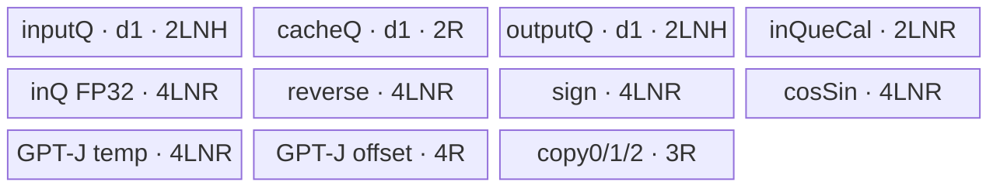
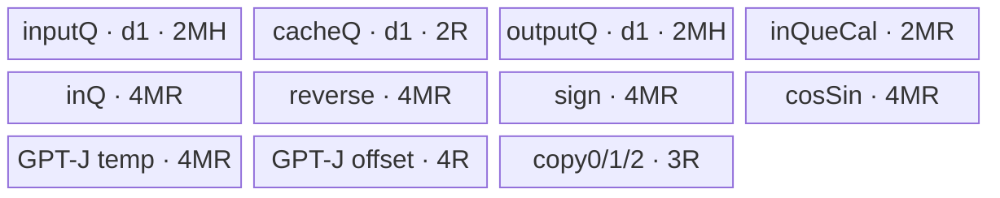
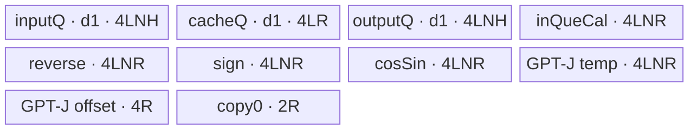
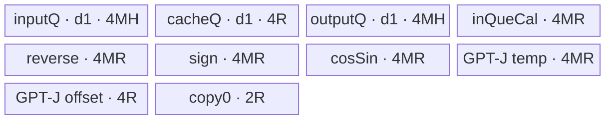

# RopeWithSinCosCache 950 ACLNN 算子知识

## 算子速览

| 项目 | 内容 |
|---|---|
| 实际入口 | 950 实际最新公开两段式 V1：`aclnnRopeWithSinCosCacheGetWorkspaceSize` / `aclnnRopeWithSinCosCache`；V2 的公开产品表明确不支持 950 |
| 计算语义 | 由 `positions` 从拼接的 cos/sin cache 取值，对 query/key 每个 head 的前 `rotaryDim` 执行 GPT-NeoX half 或 GPT-J interleaved RoPE，后缀透传 |
| 输入输出 | `positions` 为 INT64；query/key/cache 为二维 ND、同 dtype 的 FP16/BF16/FP32；输出 shape/dtype 分别同 query/key |
| 执行类型 | 单 Device 节点 `AIV_VECTOR`；arch35 body 只使用 Scalar、MTE、Vector、UB/Queue/TBuf，不含 Cube/AIC/MIX_CV |
| Kernel 路线 | R-001 FP16/BF16 token 分批；R-002 FP16/BF16 单 token 分 head；R-003 FP32 token 分批；R-004 FP32 单 token 分 head |
| 核心资源 | GM；depth=1 的 VECIN/VECOUT TQue；VECCALC TBuf；`PipeBarrier<PIPE_ALL>` 与少量 `MTE2_V` 硬事件；无算子 user workspace |
| 来源闭包 | `source_closed`：V1 声明/实现、Contiguous/ViewCopy、L0 launcher、950 注册、31 字段 POD、key 20/21/22、arch35 entry/body、构建与 binary config 均闭合；公开四段 mrope 与 Device consumer 冲突已显式标注 |
| 验证状态 | 已完成源码闭包检查；本次知识提取未执行编译、真机、数值或性能测试。 |

## 接口与语义

### 计算语义

令 `T=numTokens`、`Hq=numQHeads`、`Hk=numKHeads`、`H=headSize`、`R=rotaryDim=cosSinCache.shape[1]`。每个 query/key head 的前 `R` 个元素参与旋转，`[R,H)` 原样透传。rope 模式用 `positions[t]` 选择一行 cache；三段 mrope 用 `positions[j*T+t]` 选择第 `j=0,1,2` 行，再按 `mropeSection` 拼成长度 `R/2` 的 cos 或 sin。

`isNeoxStyle=true` 时取连续半区 `x1=x[0:R/2]`、`x2=x[R/2:R]`；为 false 时用 `GatherMask` 拆偶数位和奇数位。两者均计算 `o1=x1*cos-x2*sin`、`o2=x2*cos+x1*sin`；GPT-J 路线再用 `Gather` 恢复偶奇交错。V1 在 API 层把内部 `cacheMode` 固定为 0。

公开 V1 文档还声明四段 `[16,16,16,16]` mrope；但 950 `arch35::RopeWithSinCosCacheBase::InitData` 不读取 `mrope_section3`，两种 arch35 `GetCosSinCache` 也只读取三条 positions 平面。固定源码因此不能证明四段结果符合公开公式，不能把该输入写成已闭合的正确实现。

### 输入、输出与属性

| 参数 | shape/layout | dtype | 约束、默认值与语义 |
|---|---|---|---|
| positions | rope `[T]`；mrope `[3,T]` 或公开契约的 `[4,T]`；ND | INT64 | 必选、非空，ACLNN 先 Contiguous；Device 以 uint64 读取，API 不扫描值，调用方须保证值小于 cache 第 0 维 |
| queryIn | `[T,Hq*H]`，ND，可非连续 | FP16/BF16/FP32 | 必选、非空；dtype 决定 key 21/20/22；950 FP32 body 对非 packed view 的 stride 消费不闭合 |
| keyIn | `[T,Hk*H]`，ND，可非连续 | 同 query | 必选、非空；第 0 维与 query 相同 |
| cosSinCache | `[maxSeqLen,R]`，ND，可非连续 | 同 query | 必选、非空；ACLNN 先 Contiguous；前 `R/2` 为 cos，后 `R/2` 为 sin |
| mropeSection | `nullptr`，或 Host `aclIntArray` 长度 3/4 | INT64 | 空指针为 rope；非空值非负；`mropeSection[0]>0` 时须在受控集合中且 `2*sum=R`；950 四段 Device 语义冲突见限制 |
| headSize | 标量 | INT64 | API 仅检查非 0；Tiling 要求 `H>=R`，FP16/BF16 为 32 的倍数，FP32 为 16 的倍数 |
| isNeoxStyle | 标量 | bool | true 为 GPT-NeoX half，false 为 GPT-J interleaved；false 额外分配 `offsetBuf/temp1` |
| queryOut | `[T,Hq*H]`，ND | 同 query | 必选；API 检查 view shape 同 query；L0 先分配连续中间输出，再 ViewCopy |
| keyOut | `[T,Hk*H]`，ND | 同 key | 必选；shape 同 key |
| workspaceSize/executor/stream | ACLNN 句柄 | uint64/指针 | 第一段返回 executor 聚合 workspace，第二段在给定 stream 调 `CommonOpExecutorRun` |

### 入口与版本

固定仓公开版本族有 V1 与 V2。950 选择 V1：`docs/aclnnRopeWithSinCosCache.md` 的产品表明确支持 Ascend 950PR/950DT，而 V2 产品表明确标记不支持。V1 复用公共 `GetWorkspaceSizeCommon`，在进入公共实现前把 `cacheMode=0`；950 OpDef 将 `ascend950` 接到 `rope_with_sin_cos_cache_apt`。因此不能将 V2 的 cacheMode=1 语义外推到本卡。

## Host/Launcher 执行流程

### 参数校验与前处理

`aclnnRopeWithSinCosCacheGetWorkspaceSize` 进入公共 `CheckParams`：依次检查六个 tensor 非空、当前 SoC 是 910B/910_93 或 `IsRegbase()`、positions=INT64、其余 tensor 全部与 query 同 dtype、query/key/cache 为二维且输入非空、query/key 的 T 相等、输出 shape 分别等于输入。mrope 非空时读取 3/4 个 Host 值，检查非负、受控组合和 `2*sum=R`。随后只检查 `headSize!=0`；没有显式检查 `Hq*H/query.shape[1]` 与 `Hk*H/key.shape[1]` 的整除性，也不检查 positions 的 rank/value。

executor 创建后，positions 与 cosSinCache 经 `l0op::Contiguous`；query/key 保持 view，`GetViewStrides()[0]` 作为 q/k leading dimension。L0 以 `query.shape[1]/H` 和 `key.shape[1]/H` 计算 head 数，分配连续中间 query/key，加入一个 AICore launcher，最后各做一次 ViewCopy。

### 参数、Workspace 与生命周期

launcher 属性顺序是 `numQHeads,numKHeads,headSize,mropeSection,qStride,kStride,isNeoxStyle,cacheMode`，其中 V1 的末项恒为 0。Tiling 将 31 个 uint64 字段写入 POD；`workspaces[0]=GetLibApiWorkSpaceSize()+0`，算子 user workspace 为 0 B。entry 虽调用 `GetUserWorkspace(workspace)`，所得 `usrWorkspace` 不再被使用。ACLNN 第一段返回的 workspace 还可含两个 Contiguous 与两个 ViewCopy 的 executor 临时区；executor 与这些对象须存活到第二段同 stream 执行完成。

### 启动图与失败传播

```text
aclnnRopeWithSinCosCacheGetWorkspaceSize
  -> CheckParams -> Contiguous(positions/cache)
  -> l0op::RopeWithSinCosCache
    -> RoepWithSinCosCacheAICore
      -> ADD_TO_LAUNCHER_LIST_AICORE(RopeWithSinCosCache, attrs...cacheMode=0)
        -> TilingRopeWithSinCosCache
          -> single node K0: rope_with_sin_cos_cache_apt/entry rope_with_sin_cos_cache
  -> ViewCopy(query intermediate -> queryOut)
  -> ViewCopy(key intermediate -> keyOut)
aclnnRopeWithSinCosCache -> CommonOpExecutorRun(workspace,stream)
```

K0 的 `blockDim=front_core+tail_core`，输入四个 GM tensor 与 POD，输出两个连续 GM 中间 tensor；没有节点间 workspace 边。executor 拥有中间输出和框架 workspace，stream 保证 launcher 与后续 ViewCopy 的顺序。API、Contiguous、launcher 或 ViewCopy 失败均短路；但 `TilingRopeWithSinCosCache` 调用 `TilingKeyChose/TilingCompute` 后不检查返回值，即使 dtype、对齐、`H<R` 或平台取值失败也继续保存 POD 并返回成功，这是固定源码的失败传播缺口。

## Route 与参数设计

### 分核与资源计算

令 `C=PlatformAscendC::GetCoreNum()`、`U=GetCoreMemSize(UB)`、`D=4 B`、`N=max(Hq,Hk)`。`front=T%C`，整除时取 `C`；`tail=(T<=C?0:C-front)`，`blockDim=front+tail`。前核处理 `ceil(T/C)` token，尾核处理 `floor(T/C)` token。

每 token 全 head 的保守预算为 `A=N*(isNeoxStyle ? (5R+2H) : (6R+2H))*D`，固定保留 `10R*D=40R B`。`maxTokenPerLoop=(U-40R)/A`；若 `N<=numHeadsForUb` 则按 token 分批，否则 `numHeadsForUb=(U-40R)/((isNeoxStyle?(5R+2H):(6R+2H))*D)`，每 token 再按 head 分块。所有运算是 uint64；`U<40R` 会下溢，`numHeadsForUb==0` 会产生零 head loop，源码均无 fallback。

### Route 选择

| 顺序 | Route | Key/模板 | 精确选择条件与优先级 | 不适用去向 |
|---:|---|---|---|---|
| 1 | R-001 FP16/BF16 token 分批 | 20 `RopeWithSinCosCacheFP16<bfloat16_t>`；21 `<half>` | 950，dtype BF16/FP16，且 `N<=numHeadsForUb`，即 `loop_for_one_token=0` | 容量不足到 R-002；FP32 到 R-003/R-004 |
| 2 | R-002 FP16/BF16 单 token 分 head | key 20/21 同模板 | 950，dtype BF16/FP16，且 `N>numHeadsForUb`，即 flag=1 | `numHeadsForUb==0` 无有效 fallback |
| 3 | R-003 FP32 token 分批 | 22 `RopeWithSinCosCacheF32<float>` | 950，dtype FP32，且 `N<=numHeadsForUb` | 容量不足到 R-004 |
| 4 | R-004 FP32 单 token 分 head | key 22 同模板 | 950，dtype FP32，且 `N>numHeadsForUb` | `numHeadsForUb==0` 无有效 fallback |

```text
TilingKeyChose(dtype)
├─ BF16 -> key20 ─┬─ N<=numHeadsForUb -> R-001 / Compute
│                 └─ N> numHeadsForUb -> R-002 / ComputeAlongHeads
├─ FP16 -> key21 ─┬─ N<=numHeadsForUb -> R-001 / Compute
│                 └─ N> numHeadsForUb -> R-002 / ComputeAlongHeads
└─ FP32 -> key22 ─┬─ N<=numHeadsForUb -> R-003 / Compute
                  └─ N> numHeadsForUb -> R-004 / ComputeAlongHeads
```

### 模板/实现执行矩阵

| Route | key/selector | dtype/shape/platform 完整命中条件 | 执行拓扑与 Kernel 节点 | 实际模板/body | 内存与同步特征 | tail/fallback |
|---|---|---|---|---|---|---|
| R-001 | 20/21 + flag=0 | 950；BF16/FP16；H/R 64 B 对齐；R<=H；N 可整体入 UB | 单 K0 | arch35 `FP16<T>::Process→Compute→GetCosSinCache` | lowp→FP32→lowp；TQue/TBuf；PipeBarrier | front/tail core + last token loop；容量不足到 R-002 |
| R-002 | 20/21 + flag=1 | 同 dtype/对齐；`N>numHeadsForUb>0` | 单 K0 | arch35 `FP16<T>::Process→ComputeAlongHeads` | UB 以 M 个 head 定容，Q/K 顺序复用 | 每 token×head tile；M=0 无输出 |
| R-003 | 22 + flag=0 | 950；FP32；H/R 64 B 对齐；R<=H；N 可整体入 UB | 单 K0 | arch35 `F32<float>::Process→Compute` | FP32 TQue/TBuf；PipeBarrier | token/core tail；容量不足到 R-004 |
| R-004 | 22 + flag=1 | 同 FP32/对齐；`N>numHeadsForUb>0` | 单 K0 | arch35 `F32<float>::Process→ComputeAlongHeads` | UB 以 M 个 head 定容 | 独立 Q/K head tail；M=0 无输出 |

### 隐藏性能 Guard

| Guard | Host/Tiling 条件 | Device/资源原因 | 影响 Route | 不满足时去向 | 源码符号 |
|---|---|---|---|---|---|
| dtype key | BF16→20，FP16→21，FP32→22 | apt entry 仅在对应 `ORIG_DTYPE_QUERYIN` guard 内实例化模板 | 全部 | 其它 dtype 本应失败；顶层遗漏传播 | `TilingKeyChose`；apt `rope_with_sin_cos_cache` |
| 64 B 对齐 | `H%(64/sizeof(dtype))==0 && R%(64/sizeof(dtype))==0` | `headBlockLen/rotaryBlockLen` 最终转成 32 B DataCopy block 数 | 全部 | `TilingCompute` 失败，但顶层不传播 | `TilingCompute` |
| 旋转域 | `H>=R` | body 从 `[R,H)` 透传后缀 | 全部 | Tiling 失败，无 Device fallback | `TilingCompute` |
| UB 保留量 | 先计算 `U-40R` | cache/padding/offset 固定保留 | 全部 | uint64 下溢时无失败终点 | `maxNPerLoopForUb/numHeadsForUb` |
| 至少一 head | `numHeadsForUb>0` | head loop、Queue/TBuf 容量均依赖它 | R-002/R-004 | 为 0 时 loop 为 0 | `loop_along_qheads/kheads` |
| GPT-J 条件区 | `isNeoxStyle==0` | 偶奇拆分/恢复需要 `offsetBuf/temp1` | 全部 | NeoX 分配 0 B 并走连续 half | 两个 arch35 `Init` |
| 三段 950 consumer | `mrope_section0>0` | arch35 helper 只读取 plane 0/1/2 | 全部 | 四段公开输入无正确 fallback | arch35 `GetCosSinCache` |
| uint16 窄化 | token/head/blockLen/vector count 多次 cast `uint16_t` | DataCopy/Cast API 参数位宽 | 全部 | 固定 Host 无完整上界检查 | arch35 `Compute/ComputeAlongHeads` |
| FP32 packed 基址 | Device core/loop/head offset 以 `heads*H` 递增 | arch35 FP32 只部分使用 q/k leading stride | R-003/R-004 | 非 packed 输入无 fallback | arch35 F32 `Init/Compute/ComputeAlongHeads` |

### POD/ABI

`RopeWithSinCosCacheTilingData` 的 31 个字段均由 `TILING_DATA_FIELD_DEF(uint64_t,...)` 声明。宏展开不在固定仓，精确 `sizeof/alignof/offsetof` 不可见；ABI 布局列只给声明序号，不猜测 offset。

| 结构 | 字段 | 类型/位宽 | ABI 布局 | 单位 | Host/launcher producer | Device consumer | 边界 |
|---|---|---|---|---|---|---|---|
| RopeWithSinCosCacheTilingData | core_num_use | uint64/64 | 序号0；精确布局不可见 | 核 | `TilingCompute:numBlocks` | base `InitData` 保存；launch blockDim 同值 | `1..C`，T>0 |
| 同上 | num_tokens | uint64/64 | 序号1 | token | output storage dim0 | positions 平面跨度、offset | 非空 |
| 同上 | num_q_heads | uint64/64 | 序号2 | head | L0 `query.shape[1]/H` | Q 地址、extent、Broadcast | 整除性未显式检查 |
| 同上 | num_kv_heads | uint64/64 | 序号3 | head | L0 `key.shape[1]/H` | K 地址、extent、Broadcast | 同上 |
| 同上 | head_size | uint64/64 | 序号4 | 元素/head | attr2 | blockLen、GM stride、后缀 | lowp 32 对齐；FP32 16 对齐 |
| 同上 | rotary_dim | uint64/64 | 序号5 | 元素 | cache storage 最后一维 | cache/Vector/UB extent | `R<=H` 且 64 B 对齐 |
| 同上 | mrope_section0 | uint64/64 | 序号6 | 元素 | attr list[0] 或 0 | arch35 模式开关/第一段 | 非负 |
| 同上 | mrope_section1 | uint64/64 | 序号7 | 元素 | attr list[1] 或 0 | arch35 第二段 | 受控组合 |
| 同上 | mrope_section2 | uint64/64 | 序号8 | 元素 | attr list[2] 或 0 | arch35 第三段 | 受控组合 |
| 同上 | mrope_section3 | uint64/64 | 序号9 | 元素 | 四段时 attr list[3] | 950 arch35 不读取 | 公开四段冲突 |
| 同上 | q_leading_dimension | uint64/64 | 序号10 | 元素/row | query view stride0 | lowp 全路径；FP32 仅 token-batch DataCopy srcStride | FP32 消费不完整 |
| 同上 | k_leading_dimension | uint64/64 | 序号11 | 元素/row | key view stride0 | 同上 K 路径 | 同上 |
| 同上 | isNeoxStyle | uint64/64 | 序号12 | bool 编码 | attr6 | 条件分配、Gather 分支 | 0/1 |
| 同上 | cacheMode | uint64/64 | 序号13 | enum | V1 固定 0 | 950 arch35 不读取 | 只能声明 V1 分段式 |
| 同上 | front_core | uint64/64 | 序号14 | 核 | `T%C`，整除时 C | `blockIdx<front` | `1..C` |
| 同上 | tail_core | uint64/64 | 序号15 | 核 | `T<=C?0:C-front` | base 保存 | `0..C-1` |
| 同上 | num_tokens_each_front_core | uint64/64 | 序号16 | token/核 | `ceil(T/C)` | blockOffset/current-core count | 正数 |
| 同上 | num_tokens_each_tail_core | uint64/64 | 序号17 | token/核 | `floor(T/C)` | tail offset/count | tail=0 时可为0 |
| 同上 | num_tokens_front_core_each_loop | uint64/64 | 序号18 | token/loop | token 容量 | `Compute` 地址/extent | flag0 时正数 |
| 同上 | num_tokens_tail_core_each_loop | uint64/64 | 序号19 | token/loop | tail token 容量 | tail `Compute` | 同上 |
| 同上 | loop_time_each_front_core | uint64/64 | 序号20 | 次 | `ceil(frontTokens/maxToken)` | `Process` | maxToken=0 时0 |
| 同上 | loop_time_each_tail_core | uint64/64 | 序号21 | 次 | `ceil(tailTokens/maxToken)` | `Process` | tail 可0 |
| 同上 | num_tokens_front_core_last_loop | uint64/64 | 序号22 | token | front 余数 | 最后 `Compute` | 0 表示常规 extent |
| 同上 | num_tokens_tail_core_last_loop | uint64/64 | 序号23 | token | tail 余数；producer 条件误用 front loop 次数 | tail 最后 `Compute` | producer 条件不一致 |
| 同上 | loop_for_one_token | uint64/64 | 序号24 | bool 编码 | `N>numHeadsForUb` | `Process` 分支 | 0/1 |
| 同上 | loop_along_qheads | uint64/64 | 序号25 | 次 | `ceil(Hq/numHeadsForUb)` | head 双循环 | M=0 时0 |
| 同上 | loop_along_kheads | uint64/64 | 序号26 | 次 | `ceil(Hk/numHeadsForUb)` | head 双循环 | 同上 |
| 同上 | num_qheads_each_loop | uint64/64 | 序号27 | head/loop | Hq 或 M | Q head offset/UB extent | 非零才执行 |
| 同上 | num_qheads_last_loop | uint64/64 | 序号28 | head | Hq 余数 | Q last head | 0 表示常规 extent |
| 同上 | num_kheads_each_loop | uint64/64 | 序号29 | head/loop | Hk 或 M | K head offset/UB extent | 非零才执行 |
| 同上 | num_kheads_last_loop | uint64/64 | 序号30 | head | Hk 余数 | K last head | 0 表示常规 extent |

### Route 源码闭包

| Route | Key/selector | Host/Tiling producer | POD/参数 | Kernel entry/router 节点 | Kernel body/直接依赖 | 构建接线 |
|---|---|---|---|---|---|---|
| R-001 | 20/21 + flag0 | tiling `TilingKeyChose/TilingCompute` | 公共 POD 的 dtype/token/stride/style | apt `rope_with_sin_cos_cache` key20/21 | arch35 lowp `Init/Process/Compute/GetCosSinCache` + base | OpDef ascend950 + binary config + Host CMake |
| R-002 | 20/21 + flag1 | tiling head producer | 公共 POD 的 head loop/tail | 同 apt entry | arch35 lowp `ComputeAlongHeads/GetCosSinCache` + base | 同 R-001 |
| R-003 | 22 + flag0 | tiling dtype/token producer | 公共 POD | apt key22 | arch35 F32 `Init/Process/Compute/GetCosSinCache` + base | 同 R-001 |
| R-004 | 22 + flag1 | tiling head producer | 公共 POD | apt key22 | arch35 F32 `ComputeAlongHeads/GetCosSinCache` + base | 同 R-001 |

## Kernel 实现

### 公共执行流程

单一 apt entry 反序列化 POD、创建 `TPipe`，按编译期 dtype 与 key 实例化 lowp 或 FP32 类。base 用 `GetBlockIdx` 和 front/tail 字段确定每核 token 域。四条 Route 都先处理 query，再在同一 Kernel 内顺序处理 key；每个 head 的前 R 经连续 half 或偶奇 Gather，构造 `[x2,x1]` 与 `[-1,+1]`，先乘 cos，再乘 sin 并相加，最后拼回后缀。950 arch35 主要用 `PipeBarrier<PIPE_ALL>` 保护局部区复用，token-batch 的 GM 输入后另有 `MTE2_V` 硬事件；单 Kernel 无跨节点 workspace 或事件。

### Route R-001：FP16/BF16 token 分批

#### 适用条件

##### 选择证据

| 层级 | 文件 | 符号 | 源码谓词/参数 | 结果/下一跳 |
|---|---|---|---|---|
| API | op_host/op_api/aclnn_rope_with_sin_cos_cache.cpp | `GetSupportDtypeList/CheckDtypeValid` | `IsRegbase()` 且 BF16/FP16，同 dtype | 进入 L0 |
| Tiling | op_host/rope_with_sin_cos_cache_tiling.cpp | `TilingKeyChose/TilingCompute` | BF16→20、FP16→21；`N<=numHeadsForUb` | flag0/token fields |
| Router | op_kernel/rope_with_sin_cos_cache_apt.cpp | `rope_with_sin_cos_cache` | dtype guard + key20/21 | arch35 `FP16<T>::Process` |

#### Device 数据流

##### 函数级调用链

```text
rope_with_sin_cos_cache -> FP16<T>::Init -> Base<T>::InitData
  -> FP16<T>::Process -> loop Compute(index,loopN)
    -> GetCosSinCache -> Cast/Broadcast -> Mul/Mul/Add -> Cast -> DataCopy Q
    -> 同一局部区顺序复用 -> 对 K 重复
```

##### 源码等价伪码

```text
伪码：blockOffset=front/tail token 前缀；lowp input base 使用 blockOffset*q/kLeading
for tokenTile index:
  loopN=最后一轮有余数 ? last : tokensEachLoop
  DataCopy loopN 行 Q，srcStride=qLeading/16-qSize/16；MTE2ToV
  抽每 head 前 R；GPT-J: Cast 后 GatherMask 偶/奇；NeoX: 直接 Cast FP32
  reverse=[x2,x1]；sign=[-1,+1] 并 Broadcast 到 loopN*Hq 行
  for token: GetCosSinCache(position,0) 并 Broadcast；x*=cos；reverse*=sign
  for token: GetCosSinCache(position,R/2) 并 Broadcast；reverse*=sin；x+=reverse
  GPT-J Gather 恢复；Cast(FP32->T,CAST_RINT)；拼后缀；写 Q GM
  以 Hk/kLeading 重复，写 K GM
```

#### 内存与数据搬运

##### 资源与搬运表

| 层级/缓冲区 | offset/地址公式 | extent/容量公式 | dtype/layout | producer | consumer | owner/lifetime | 对齐/复用 |
|---|---|---|---|---|---|---|---|
| GM Q/K input | `blockOffset*leading + index*L*leading` | loopN 行，Q/K 各 heads*H | T/strided ND | caller | DataCopy | caller/launch | 32 B block；Q/K 分阶段 |
| GM cache/positions | `position[t+jT]*R+half+section` | 每次 R/2 cache | T + uint64 | caller/Contiguous | GetCosSinCache | executor/launch | section 用 DataCopyPad |
| GM Q/K intermediate | `blockOffset*heads*H+index*L*heads*H` | loopN*heads*H | T/packed | K0 | ViewCopy | executor | 有效行 |
| TBuf FP32 主区 | TPipe | `inQ/reverse/neg/cosSin` 各 `4LNR` | FP32/VECCALC | Cast/Copy/Broadcast | Mul/Add | Kernel；Q/K 复用 | 四区不别名 |
| TBuf lowp/条件区 | TPipe | `inQueCal=2LNR`；GPT-J `temp=4LNR,offset=4R` | T/FP32/u32 | Copy/SetValue | Cast/Gather | Kernel | NeoX 条件区0 B |
| TQue | TPipe | depth1：input/output 各 `2LNH`；cache `2R` | T/VECIN/VECOUT | GM/Vector | Vector/GM | Compute Alloc→Free | Q/K 顺序复用 |
| copyBuf0/1/2 | TPipe | 各 `R B` | T/VECCALC | 仅 copy0 被 section 搬运写入 | Copy；copy1/2 无 consumer | Kernel | 三者物理独立 |
| workspace | N/A | user 0 B；system=LibApi | byte | Host | body 不读 | executor | `usrWorkspace` 未使用 |

##### 分层内存布局



##### 字节账与复用顺序

```text
UB_actual(NeoX)=18LNR+4LNH+9R
UB_actual(GPT-J)=22LNR+4LNH+13R
UB_budget(NeoX)=20LNR+8LNH+40R
UB_budget(GPT-J)=24LNR+8LNH+40R
=> 在 U>=40R 且无 uint64 下溢时，Host 预算覆盖真实分配。
```

| 复用子区 | 写入者 | 读取者/消费点 | 下一次覆盖 | 同步或释放依据 | 安全条件 |
|---|---|---|---|---|---|
| input/output Queue 与主 TBuf | Q 流程 | Q GM 写回 | K 流程/下一 tile | `PipeBarrier<PIPE_ALL>`；末尾 FreeTensor | Q 完成后才覆盖 |
| cache/cosSin/copy0 | cos 搬入/Broadcast | cos Mul | sin/下一 token | GetCosSinCache 内 PipeBarrier | 当前 half 已消费 |
| inLocal/reverse | Cast/half swap | Mul/Add | K/下一 tile | Vector 顺序+PipeBarrier | 原地 Mul/Add 不提前覆盖 |
| GPT-J temp/offset | SetValue/Cast | GatherMask/Gather | 下一 Q/K | PipeBarrier | 仅 style=false 分配 |

#### 同步、精度与尾块

##### 同步与数值边界表

| 阶段 | primitive/机制 | producer | consumer/等待点 | 保护对象 | 精度/尾块 |
|---|---|---|---|---|---|
| GM→Vector | `MTE2_V` | Q/K DataCopy | prefix/Cast | input Queue | loopN 限定有效行 |
| cache/局部复用 | `PipeBarrier<PIPE_ALL>` | DataCopyPad/Copy/Broadcast/Mul | 下一阶段 | cache/TBuf | padding 按32 B |
| 计算 | Vector 顺序 | Cast/GatherMask/Mul/Add | Cast/Gather | FP32 主区 | lowp 升 FP32，降精度 `CAST_RINT` |
| 输出 | PipeBarrier | 拼接 | GM DataCopy | output Queue | 完整 H；后缀透传 |
| core/token tail | front/tail + last loop | Tiling | Process | GM 域 | last=0 表示完整 tile |

#### 关键实现

##### 符号证据表

| 阶段 | 文件 | 符号/模板实例 | 实现事实 |
|---|---|---|---|
| Host/Tiling producer | op_host/rope_with_sin_cos_cache_tiling.cpp | `TilingKeyChose/TilingCompute` | key20/21、token/core/UB/POD |
| Kernel entry/router | op_kernel/rope_with_sin_cos_cache_apt.cpp | `rope_with_sin_cos_cache` | 950 key20/21 到 lowp 实例 |
| Device body/helper | op_kernel/arch35/rope_with_sin_cos_cache_f_bf16.h | `Init/Process/Compute/GetCosSinCache` | stride 地址、FP32 计算、三段 cache、UB/Barrier |
| Device body/helper | op_kernel/arch35/rope_with_sin_cos_cache_base.h | `InitData/MTE2ToVSync` | front/tail、loop consumer 与硬事件 |

### Route R-002：FP16/BF16 单 token 分 head

#### 适用条件

##### 选择证据

| 层级 | 文件 | 符号 | 源码谓词/参数 | 结果/下一跳 |
|---|---|---|---|---|
| API | op_host/op_api/aclnn_rope_with_sin_cos_cache.cpp | `CheckDtypeValid` | 950 lowp 同 dtype | L0 |
| Tiling | op_host/rope_with_sin_cos_cache_tiling.cpp | `TilingCompute` | `N>numHeadsForUb`，分别产生 Q/K head loop/last | flag1 |
| Router | op_kernel/rope_with_sin_cos_cache_apt.cpp | key20/21 | flag 由 body `Process` 读取 | `ComputeAlongHeads` |

#### Device 数据流

##### 函数级调用链

```text
apt entry -> FP16<T>::Init -> Process
  -> for token in current core
    -> for headTile in max(qLoops,kLoops)
      -> ComputeAlongHeads -> GetCosSinCache -> lowp/FP32 RoPE -> Q/K DataCopy
```

##### 源码等价伪码

```text
伪码：for token; for htile:
  qHeadOff=htile*qEach*H；kHeadOff=htile*kEach*H
  if htile<qLoops: hq=last?qLast:qEach；从 token*qLeading+qHeadOff 搬入
    执行与 R-001 相同的 cache、FP32 RoPE、cast、后缀拼接并写 Q packed output
  if htile<kLoops: 以 hk/kLeading 重复并写 K
```

#### 内存与数据搬运

##### 资源与搬运表

| 层级/缓冲区 | offset/地址公式 | extent/容量公式 | dtype/layout | producer | consumer | owner/lifetime | 对齐/复用 |
|---|---|---|---|---|---|---|---|
| GM Q/K tile | `token*leading+htile*each*H` | hq/hk*H | T/ND | caller | DataCopy | caller | last head 独立 |
| GM output tile | `token*heads*H+htile*each*H` | hq/hk*H | T/packed | K0 | ViewCopy | executor | 只写有效 head |
| TQue | TPipe | depth1：input/output 各 `2MH`；cache `2R` | T | GM/Vector | Vector/GM | helper | Q/K 每 tile复用 |
| 主 TBuf | TPipe | `18MR` NeoX 主项；GPT-J 加 `4MR+4R` | mixed | Vector | Vector | Kernel | M=numHeadsForUb |
| copyBuf | TPipe | 3R | T | cache padding | Copy | Kernel | copy1/2 无消费 |
| workspace | N/A | user0 B | byte | Host | 不读 | executor | N/A |

##### 分层内存布局



##### 字节账与复用顺序

```text
UB_actual(NeoX)=18MR+4MH+9R
UB_actual(GPT-J)=22MR+4MH+13R
UB_budget(NeoX)=20MR+8MH+40R
UB_budget(GPT-J)=24MR+8MH+40R
```

| 复用子区 | 写入者 | 读取者/消费点 | 下一次覆盖 | 同步或释放依据 | 安全条件 |
|---|---|---|---|---|---|
| Q/K tile local | 当前 Q | Q 输出 | K/下一 head tile | PipeBarrier + FreeTensor | hq/hk 有效长度 |
| cache local | 当前 cos | Mul | sin/下一 tile | PipeBarrier | 每个 head tile重复取 cache |
| GPT-J 条件区 | offset/temp producer | GatherMask/Gather | 下一 tile | PipeBarrier | style=false |

#### 同步、精度与尾块

##### 同步与数值边界表

| 阶段 | primitive/机制 | producer | consumer/等待点 | 保护对象 | 精度/尾块 |
|---|---|---|---|---|---|
| 搬入/抽取 | PipeBarrier | DataCopy | Cast/Gather | input local | hq/hk*H 有效 |
| cache/计算 | PipeBarrier | cache/Vector op | 下一 op | FP32 local | lowp→FP32→RINT |
| Q→K/下一 tile | PipeBarrier+FreeTensor | Q/K write | reuse | 全部 local | Q/K last 独立 |
| token/head tail | current-core count + qLast/kLast | Tiling | 双循环 | GM 域 | M=0 时循环不执行 |

#### 关键实现

##### 符号证据表

| 阶段 | 文件 | 符号/模板实例 | 实现事实 |
|---|---|---|---|
| Host/Tiling producer | op_host/rope_with_sin_cos_cache_tiling.cpp | `TilingCompute` | M、Q/K loop 与 last head |
| Kernel entry/router | op_kernel/rope_with_sin_cos_cache_apt.cpp | key20/21 | lowp body |
| Device body/helper | op_kernel/arch35/rope_with_sin_cos_cache_f_bf16.h | `Process/ComputeAlongHeads/GetCosSinCache` | token/head 双循环、stride、tail、三段 cache |

### Route R-003：FP32 token 分批

#### 适用条件

##### 选择证据

| 层级 | 文件 | 符号 | 源码谓词/参数 | 结果/下一跳 |
|---|---|---|---|---|
| API | op_host/op_api/aclnn_rope_with_sin_cos_cache.cpp | `CheckDtypeValid` | 950 FP32 同 dtype | L0 |
| Tiling | op_host/rope_with_sin_cos_cache_tiling.cpp | `TilingKeyChose/TilingCompute` | FP32→22；`N<=numHeadsForUb` | flag0 |
| Router | op_kernel/rope_with_sin_cos_cache_apt.cpp | key22 | dtype guard DT_FLOAT | `F32<float>::Process` |

#### Device 数据流

##### 函数级调用链

```text
apt entry -> F32<float>::Init -> Base::InitData -> Process
  -> Compute(index,loopN) -> GetCosSinCache -> GatherMask/Mul/Add/Gather -> DataCopy Q/K
```

##### 源码等价伪码

```text
伪码：FP32 input core base=blockOffset*heads*H（不是 blockOffset*leading）
for token tile:
  DataCopy Q，首地址=index*L*Hq*H；blockCount=loopN，srcStride 使用 qLeading-qSize
  抽 R；GPT-J 偶奇 GatherMask；构造 reverse/sign
  逐 token 取 cos/sin，Mul/Mul/Add；GPT-J Gather 恢复
  拼回后缀并写 Q；以 K 重复
```

#### 内存与数据搬运

##### 资源与搬运表

| 层级/缓冲区 | offset/地址公式 | extent/容量公式 | dtype/layout | producer | consumer | owner/lifetime | 对齐/复用 |
|---|---|---|---|---|---|---|---|
| GM Q/K input | base `blockOffset*heads*H`，tile `index*L*heads*H` | loopN 行 | FP32/ND | caller | DataCopy | caller | 行 stride 参数使用 leading，但 base/tile offset packed |
| GM cache/positions | 同 R-001 | R/2/call | FP32+u64 | caller | GetCosSinCache | launch | 8 FP32/32 B |
| Q/K output | packed block/tile offset | loopN*heads*H | FP32 | K0 | ViewCopy | executor | packed |
| TQue | depth1 | input/output 各 `4LNH`；cache `4LR` | FP32 | GM/Vector | Vector/GM | Compute | Q/K复用 |
| TBuf main | TPipe | reverse/neg/cosSin/inQueCal 各 `4LNR` | FP32 | Vector | Vector | Kernel | 不别名 |
| GPT-J/copy | TPipe | temp `4LNR`、offset `4R`、copy0 `2R` | FP32/u32 | Vector/MTE | Gather/Copy | Kernel | NeoX temp/offset 0 B |
| workspace | N/A | user0 B | byte | Host | 不读 | executor | N/A |

##### 分层内存布局



##### 字节账与复用顺序

```text
UB_actual(NeoX)=8LNH+16LNR+4LR+2R
UB_actual(GPT-J)=8LNH+20LNR+4LR+6R
UB_budget(NeoX)=20LNR+8LNH+40R
UB_budget(GPT-J)=24LNR+8LNH+40R
```

| 复用子区 | 写入者 | 读取者/消费点 | 下一次覆盖 | 同步或释放依据 | 安全条件 |
|---|---|---|---|---|---|
| input/output Queue + main TBuf | Q | Q output | K/next tile | MTE2_V + PipeBarrier + FreeTensor | packed/stride 边界成立 |
| inQueCal | prefix/GatherMask | Mul/Add/Gather | K | Vector order | NeoX Add 原地；GPT-J 经 temp |
| cache/copy/cosSin | GetCosSinCache | Mul | cos→sin→next token | PipeBarrier | mrope仅三段闭合 |

#### 同步、精度与尾块

##### 同步与数值边界表

| 阶段 | primitive/机制 | producer | consumer/等待点 | 保护对象 | 精度/尾块 |
|---|---|---|---|---|---|
| GM→V | MTE2_V | Q/K copy | prefix/compute | input Queue | loopN 行 |
| Vector/输出 | PipeBarrier | 每个局部操作 | 后继 | TQue/TBuf | 全程 FP32，无 cast |
| token/core tail | front/tail/last | Host | Process | GM 域 | last=0 取常规 L |
| stride | packed base + strided block copy | Device | input read | GM input | 非 packed view 不能证明正确 |

#### 关键实现

##### 符号证据表

| 阶段 | 文件 | 符号/模板实例 | 实现事实 |
|---|---|---|---|
| Host/Tiling producer | op_host/rope_with_sin_cos_cache_tiling.cpp | `TilingKeyChose/TilingCompute` | key22、token/UB |
| Kernel entry/router | op_kernel/rope_with_sin_cos_cache_apt.cpp | key22 | FP32 body |
| Device body/helper | op_kernel/arch35/rope_with_sin_cos_cache_fp32.h | `Init/Process/Compute/GetCosSinCache` | packed base、row stride、FP32 RoPE、三段 cache |

### Route R-004：FP32 单 token 分 head

#### 适用条件

##### 选择证据

| 层级 | 文件 | 符号 | 源码谓词/参数 | 结果/下一跳 |
|---|---|---|---|---|
| API | op_host/op_api/aclnn_rope_with_sin_cos_cache.cpp | `CheckDtypeValid` | 950 FP32 | L0 |
| Tiling | op_host/rope_with_sin_cos_cache_tiling.cpp | `TilingCompute` | `N>numHeadsForUb` | flag1/head fields |
| Router | op_kernel/rope_with_sin_cos_cache_apt.cpp | key22 | body reads flag1 | `ComputeAlongHeads` |

#### Device 数据流

##### 函数级调用链

```text
apt entry -> F32<float>::Init -> Process
  -> for token/headTile -> ComputeAlongHeads
    -> GetCosSinCache -> GatherMask/Mul/Add/Gather -> DataCopy Q/K
```

##### 源码等价伪码

```text
伪码：for token; for htile:
  Q addr=token*Hq*H+htile*qEach*H（完全不使用 qLeading）
  搬 hq*H；FP32 half/interleaved RoPE；拼后缀；写 packed Q
  K addr 同构，使用 Hk/kEach（完全不使用 kLeading）
```

#### 内存与数据搬运

##### 资源与搬运表

| 层级/缓冲区 | offset/地址公式 | extent/容量公式 | dtype/layout | producer | consumer | owner/lifetime | 对齐/复用 |
|---|---|---|---|---|---|---|---|
| GM Q/K tile | `blockOffset*heads*H+token*heads*H+htile*each*H` | hq/hk*H | FP32/packed assumption | caller | DataCopy | caller | leading 完全未使用 |
| output tile | 同构 packed offset | hq/hk*H | FP32 | K0 | ViewCopy | executor | last head extent |
| TQue | depth1 | input/output 各 `4MH`；cache `4R` | FP32 | GM/Vector | Vector/GM | helper | Q/K复用 |
| main TBuf | TPipe | 四区各 `4MR` | FP32 | Vector | Vector | Kernel | 不别名 |
| GPT-J/copy | TPipe | `4MR+4R+2R` | FP32/u32 | Vector/MTE | Gather/Copy | Kernel | 条件区 |
| workspace | N/A | user0 B | byte | Host | 不读 | executor | N/A |

##### 分层内存布局



##### 字节账与复用顺序

```text
UB_actual(NeoX)=8MH+16MR+6R
UB_actual(GPT-J)=8MH+20MR+10R
UB_budget(NeoX)=20MR+8MH+40R
UB_budget(GPT-J)=24MR+8MH+40R
```

| 复用子区 | 写入者 | 读取者/消费点 | 下一次覆盖 | 同步或释放依据 | 安全条件 |
|---|---|---|---|---|---|
| Q/K head local | Q tile | Q output | K/next tile | PipeBarrier + FreeTensor | hq/hk valid |
| cache local | cos/sin helper | Mul | next half/tile | PipeBarrier | 只三段闭合 |
| GPT-J local | Gather producers | Gather consumer | next tile | PipeBarrier | style=false |

#### 同步、精度与尾块

##### 同步与数值边界表

| 阶段 | primitive/机制 | producer | consumer/等待点 | 保护对象 | 精度/尾块 |
|---|---|---|---|---|---|
| 搬运/计算/写回 | PipeBarrier | 每阶段 | 后继阶段 | Queue/TBuf | FP32；hq/hk tail |
| token/head tail | current-core + qLast/kLast | Tiling | Process | GM 域 | M=0 时无输出 |
| stride | packed address | body | GM read | input view | 非 packed 不闭合 |

#### 关键实现

##### 符号证据表

| 阶段 | 文件 | 符号/模板实例 | 实现事实 |
|---|---|---|---|
| Host/Tiling producer | op_host/rope_with_sin_cos_cache_tiling.cpp | `TilingCompute` | M、head loop/tail |
| Kernel entry/router | op_kernel/rope_with_sin_cos_cache_apt.cpp | key22 | FP32 body |
| Device body/helper | op_kernel/arch35/rope_with_sin_cos_cache_fp32.h | `Process/ComputeAlongHeads/GetCosSinCache` | packed head地址、tail、三段 cache |

## 算子特定优化

### Trick T-001：UB 容量驱动的 token 批处理/head 分块双路线

#### 触发与源码依据

- 适用 Route：R-001、R-002、R-003、R-004。
- 触发条件：`N=max(Hq,Hk)` 与 `numHeadsForUb` 比较；容得下全 head 时批量 token，否则单 token 按 head 分块。
- Golden 来源：[`posembedding/rope_with_sin_cos_cache/op_host/rope_with_sin_cos_cache_tiling.cpp:276-289`](../../../../../../../cann-ops-raw/ascendc/ops-transformer/be33d95bb755cedec3108f70805c1874d1792540/posembedding/rope_with_sin_cos_cache/op_host/rope_with_sin_cos_cache_tiling.cpp#L276-L289)

**官方源码（固定 Commit 连续逐字摘录）**：

```cpp
uint64_t numHeadsForUb =
    params.isNeoxStyle == 1UL ?
        (maxUbSize - rotaryDim * 10UL * dataTypeSize) / ((rotaryDim * 5UL + headSize * 2UL) * dataTypeSize) :
        (maxUbSize - rotaryDim * 10UL * dataTypeSize) / ((rotaryDim * 6UL + headSize * 2UL) * dataTypeSize);

uint64_t loop_for_one_token = numHeadsMax > numHeadsForUb ? 1UL : 0UL; // 取1时，对numheads循环，maxNPerLoopForUb == 0
uint64_t loop_along_qheads = numHeadsForUb == 0 ? 0 : (numQheads + numHeadsForUb - 1UL) / numHeadsForUb;
uint64_t loop_along_kheads = numHeadsForUb == 0 ? 0 : (numKheads + numHeadsForUb - 1UL) / numHeadsForUb;
```

#### 机制与设计原因

同一 dtype key 内由 POD flag 切换 body：全 head 可驻留时提高单次 GM 搬运与 Broadcast 的 token 覆盖；容量不足时把单 token 的 head 切成 M 个一组，避免直接超过 UB。`isNeoxStyle` 参与分母，因为 GPT-J 多一份 `temp1`，所以 Host 对其使用更保守的 `6R+2H` 预算。

#### 迁移边界

- 适用：同一 token 内多个等长 head、可在 token 与 head 两轴交换分块的 Vector 算子。
- 前提：950；H/R 64 B 对齐；`U>=40R`；`numHeadsForUb>0`；POD 与两种 body 同步修改。
- 失效：M=0 时固定实现无 fallback；应显式报错或设计更细的 rotary/head 内分块。
- 未验证：本次知识提取未执行编译、真机、数值或性能测试。

#### 错误做法

不能只切 `loop_for_one_token` 而保留 token-route 的 UB 容量；两种 `InitBuffer` 公式和 `Process` 循环必须同时切换。固定仓未提供性能反例。

### Trick T-002：lowp 输入升 FP32 完成旋转后一次性 RINT 回写

#### 触发与源码依据

- 适用 Route：R-001、R-002。
- 触发条件：key20/21；旋转前缀为 FP16/BF16。
- Golden 来源：[`posembedding/rope_with_sin_cos_cache/op_kernel/arch35/rope_with_sin_cos_cache_f_bf16.h:304-319`](../../../../../../../cann-ops-raw/ascendc/ops-transformer/be33d95bb755cedec3108f70805c1874d1792540/posembedding/rope_with_sin_cos_cache/op_kernel/arch35/rope_with_sin_cos_cache_f_bf16.h#L304-L319)

**官方源码（固定 Commit 连续逐字摘录）**：

```cpp
if (this->is_neox_style == 0) {
    for (uint32_t i = 0; i < loopN * this->num_q_heads; i++) {
        Gather(
            temp1Local[i * this->rotary_dim], inLocal[i * this->rotary_dim], offsetLocal, (uint32_t)0,
            this->rotary_dim);
        PipeBarrier<PIPE_ALL>();
    }

    Cast(
        inQueCalLocal, temp1Local, AscendC::RoundMode::CAST_RINT,
        static_cast<uint16_t>(loopN * this->num_q_heads * this->rotary_dim));
} else {
    Cast(
        inQueCalLocal, inLocal, AscendC::RoundMode::CAST_RINT,
        static_cast<uint16_t>(loopN * this->num_q_heads * this->rotary_dim));
}
```

#### 机制与设计原因

输入前缀与 cache 都先 cast 为 FP32，cos/sin 两次乘法和加法在 FP32 完成，仅最终回写 lowp 前执行一次 `CAST_RINT`。这避免在乘法之间重复降精度；GPT-J 先 Gather 恢复布局再统一 cast，NeoX 直接 cast 主计算区。

#### 迁移边界

- 适用：lowp 输入、UB 能容纳 FP32 中间的逐元素旋转/仿射计算。
- 前提：Host UB 预算按 4 B 中间计算；下游接受 RINT 语义。
- 失效：若 UB 不足，应缩小 token/head tile，不能把中间直接改为 lowp 并声称等价。
- 未验证：本次知识提取未执行编译、真机、数值或性能测试。

#### 错误做法

错误做法是每次 Mul 后立即 cast 回 lowp；固定源码没有这样的路线，也未提供可验证数值反例。

### Trick T-003：mrope 非 32 B 对齐 section 的 DataCopyPad+Copy 修正

#### 触发与源码依据

- 适用 Route：全部；三段 mrope，尤其 section 起点不是 32 B 对齐时。
- 触发条件：`mrope_section0>0`，padding 由 section 前缀字节数模 32 计算。
- Golden 来源：[`posembedding/rope_with_sin_cos_cache/op_kernel/arch35/rope_with_sin_cos_cache_f_bf16.h:169-189`](../../../../../../../cann-ops-raw/ascendc/ops-transformer/be33d95bb755cedec3108f70805c1874d1792540/posembedding/rope_with_sin_cos_cache/op_kernel/arch35/rope_with_sin_cos_cache_f_bf16.h#L169-L189)

**官方源码（固定 Commit 连续逐字摘录）**：

```cpp
uint8_t padding1 = (this->mrope_section0 * sizeof(T) % BLOCK_SIZE) / sizeof(T);
DataCopyPad(
    copyBuf0Local,
    cos_sin_cache_GM[pos1 * this->rotary_dim + static_cast<uint16_t>(this->mrope_section0) + cosSinOffset],
    {1, static_cast<uint16_t>(this->mrope_section1 * sizeof(T)), 0, 0}, {true, padding1, 0, 0});
PipeBarrier<PIPE_ALL>();
Copy(inQueueCosSinCacheBeforeCastLocal[this->mrope_section0 - padding1], copyBuf0Local,
     this->mrope_section1 + padding1, 1, {1, 1, 0, 0});
PipeBarrier<PIPE_ALL>();
DataCopyPad(copyBuf0Local, cos_sin_cache_GM[pos0 * this->rotary_dim + cosSinOffset],
            {1, static_cast<uint16_t>(this->mrope_section0 * sizeof(T)), 0, 0}, {false, 0, 0, 0});
PipeBarrier<PIPE_ALL>();
Copy(inQueueCosSinCacheBeforeCastLocal, copyBuf0Local, this->mrope_section0, 1, {1, 1, 0, 0});
```

#### 机制与设计原因

DMA 的 padding 会把有效数据相对目标起点平移；helper 用 `padding1` 回退目标地址，再经 copyBuf0 做 Vector Copy，最终把 section 放回逻辑拼接位置。第三段同样用前两段总长计算 `padding2`。这保留一次 section 搬运并修正非对齐起址。

#### 迁移边界

- 适用：多个短 section 从不同 GM 行拼入连续 UB 的场景。
- 前提：padding 按 dtype 元素换算，copyBuf0 容量覆盖 `R/2`，阶段之间保留 PipeBarrier。
- 失效：950 四段没有第四段 consumer，不能把本机制外推为四段支持。
- 未验证：本次知识提取未执行编译、真机、数值或性能测试。

#### 错误做法

直接把 padded DMA 目标写到逻辑 section 起点会保留前置 padding，导致后续 Broadcast 读取错位；源码用目标回退与 Copy 显式避免该错误。

## 模板与实现对比

| 对比维度 | R-001 lowp token | R-002 lowp head | R-003 FP32 token | R-004 FP32 head | 设计选择依据 |
|---|---|---|---|---|---|
| 命中条件/优先级 | key20/21，N<=M | key20/21，N>M | key22，N<=M | key22，N>M | dtype key 后按 UB 容量分支 |
| 模板与 dtype | FP16<T>，FP32 中间 | 同左 | F32<float> | 同左 | lowp 需 cast；FP32 原精度 |
| 循环与分核 | core→token tile | core→token→head tile | core→token tile | core→token→head tile | 全 head 是否可入 UB |
| Queue/TBuf/寄存器/dynamic UB/通信 window | lowp Queue+FP32 TBuf | 容量 M | 全 FP32 Queue/TBuf | 容量 M | 无 dynamic UB/通信 |
| 内存总占用与复用 | 以 L*N | 以 M | 以 L*N | 以 M | Q/K 顺序复用 |
| 搬运/Vector/SIMT/NDDMA/通信 API | DataCopy/Pad,Cast,Gather,Mul/Add | 同左 | 无 Cast | 无 Cast | 全部 AIV_VECTOR |
| 同步、精度与 tail | PipeBarrier；RINT；token tail | head tail | PipeBarrier；FP32；token tail | FP32；head tail | style 与 tile 双轴决定 |
| fallback/失败边界 | UB不足到 R-002 | M=0失败 | UB不足到 R-004 | M=0失败 | 无更细 fallback |

## 平台差异

| 项目 | A2 | A3 | 950 |
|---|---|---|---|
| 支持状态 | V2 公开支持；非本卡范围 | V2 公开支持；非本卡范围 | V1 公开支持；V2 明确不支持 |
| Host/Launcher | membase entry | membase entry | 共用 ACLNN/Tiling/POD，OpDef 指向 `rope_with_sin_cos_cache_apt` |
| Kernel/资源 | 非 arch35 body，支持 cacheMode/mrope_section3 | 同 A2 | arch35 body；大量 PipeBarrier；不消费 cacheMode/mrope_section3；FP32 stride 不完整 |

## 限制与失败边界

- 950 正式入口只能写 V1。V2 产品表明确不支持，不能外推 `cacheMode=1`。
- V1 文档/API 校验接受四段 `[16,16,16,16]`，但 950 arch35 只读前三段和前三个 positions 平面；固定源码不能证明四段结果正确。
- FP16/BF16 使用 q/k leading dimension 计算 core、token 与 head 地址；FP32 的 core/tile/head 基址按 packed `heads*H`，仅 token-batch DataCopy 的行间 stride 使用 leading，故非 packed FP32 input 不闭合。
- API 只检查 `headSize!=0`，未检查正数、query/key 第 1 维能被 H 整除、positions rank/value；这些仍是调用方契约。
- Tiling 不传播 `TilingKeyChose/TilingCompute` 失败；H/R 对齐、R<=H、dtype、平台失败可能落入未初始化/零 POD。
- UB 公式的 `U-40R` 为 uint64，存在下溢；M=0 时无有效 head loop。多个 intrinsic 参数窄化到 uint16，Host 无完整上界。
- `num_tokens_tail_core_last_loop` 的是否置零条件误用 front loop 次数，front/tail loop 次数不一致时存在 tail 参数风险。
- 950 binary config 列出三组 dtype 与 V1 的七个公开 attr，OpDef/L0/Tiling 内部还传递第八项 `cacheMode=0`；固定仓未提供生成后的最终二进制 ABI 展开。
- 本次知识提取未执行编译、真机、数值或性能测试。

## 源码索引

### 链路索引

| 链路阶段 | 文件 | 关键符号 | 支撑内容 |
|---|---|---|---|
| 公开约束 | posembedding/rope_with_sin_cos_cache/docs/aclnnRopeWithSinCosCache.md | 产品支持表/原型/约束 | 950 V1 支持、接口与四段契约 |
| 入口声明 | posembedding/rope_with_sin_cos_cache/op_host/op_api/aclnn_rope_with_sin_cos_cache.h | 两段式 API | V1 参数与句柄 |
| 入口实现 | posembedding/rope_with_sin_cos_cache/op_host/op_api/aclnn_rope_with_sin_cos_cache.cpp | `CheckParams/GetWorkspaceSizeCommon/V1 entry` | 校验、Contiguous、stride、V1 cacheMode0、ViewCopy |
| L0 launcher | posembedding/rope_with_sin_cos_cache/op_host/op_api/rope_with_sin_cos_cache.cpp | `RopeWithSinCosCache/RoepWithSinCosCacheAICore` | 中间输出、attrs、单节点 launch |
| 平台注册 | posembedding/rope_with_sin_cos_cache/op_host/rope_with_sin_cos_cache_def.cpp | `RopeWithSinCosCache` | 950 apt entry 与 dtype/attr |
| POD | posembedding/rope_with_sin_cos_cache/op_host/rope_with_sin_cos_cache_tiling.h | `RopeWithSinCosCacheTilingData` | 31字段 ABI 声明 |
| Tiling | posembedding/rope_with_sin_cos_cache/op_host/rope_with_sin_cos_cache_tiling.cpp | `TilingRopeWithSinCosCache/TilingCompute` | key、core、UB、loop、workspace |
| Kernel entry | posembedding/rope_with_sin_cos_cache/op_kernel/rope_with_sin_cos_cache_apt.cpp | `rope_with_sin_cos_cache` | 950 key20/21/22 router |
| 公共 body | posembedding/rope_with_sin_cos_cache/op_kernel/arch35/rope_with_sin_cos_cache_base.h | `InitData` | POD consumer、front/tail、事件 helper |
| lowp body | posembedding/rope_with_sin_cos_cache/op_kernel/arch35/rope_with_sin_cos_cache_f_bf16.h | `FP16::Init/Process/Compute/ComputeAlongHeads/GetCosSinCache` | lowp四路线节点中的两条与 UB/精度/三段 cache |
| FP32 body | posembedding/rope_with_sin_cos_cache/op_kernel/arch35/rope_with_sin_cos_cache_fp32.h | `F32::Init/Process/Compute/ComputeAlongHeads/GetCosSinCache` | FP32两路线、packed边界、三段 cache |
| binary config | posembedding/rope_with_sin_cos_cache/op_host/config/ascend950/rope_with_sin_cos_cache_binary.json | `op_list` | 950 三个 dtype binary 与 attr metadata |
| 构建接线 | posembedding/rope_with_sin_cos_cache/op_host/CMakeLists.txt | `add_modules_sources/add_ops_compile_options` | Host/module、auto-sync 与 ascend950 编译选项 |

### 实现复用检查

| 检查项 | 可复用事实 | 不得改变的约束 | 源码符号 |
|---|---|---|---|
| ABI/POD | 31 个 uint64 字段与 key20/21/22 | 字段顺序、单位、inactive字段；950不消费 section3/cacheMode | TilingData/SetTiling/InitData |
| 调用顺序 | 校验→两个 Contiguous→单 K0→两个 ViewCopy | executor/workspace/stream 属于同次调用 | `GetWorkspaceSizeCommon/CommonOpExecutorRun` |
| workspace/内存 | user0 B；四种真实 UB 公式 | depth、条件区、copyBuf 空耗、U-40R 安全条件 | `TilingCompute` 与两个 `Init` |
| 同步 | arch35 PipeBarrier + token-route MTE2_V | 复用前不得删除 Barrier；auto-sync 构建选项 | arch35 body/CMake |
| 精度与尾块 | lowp FP32 中间+RINT；FP32原精度；front/tail+head tail | uint16 上界、packed FP32边界、last=0语义 | `Compute/ComputeAlongHeads/Process` |
| 失败边界 | API 参数错误与 Tiling guard 可复用 | 必须补齐 Tiling 返回传播、UB下溢、M=0、四段950和FP32 stride | `CheckParams/TilingRopeWithSinCosCache/arch35 body` |