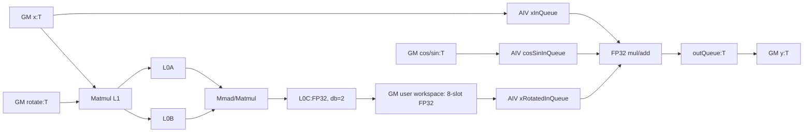
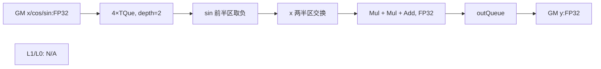
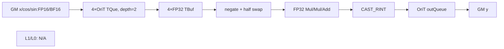
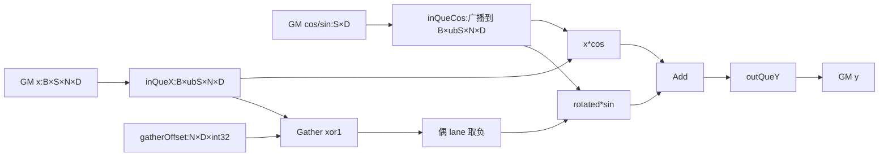
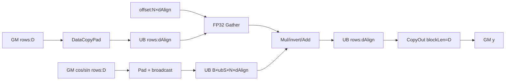
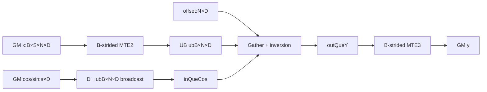
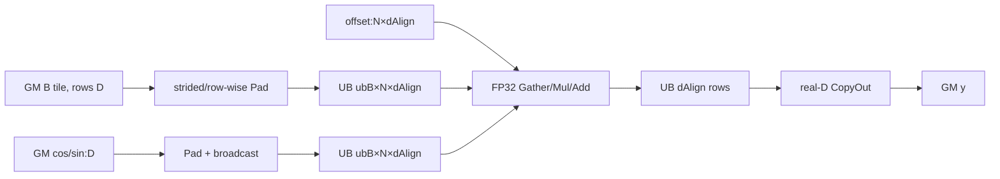
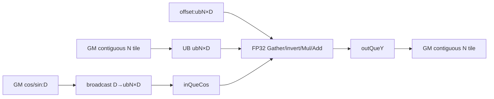
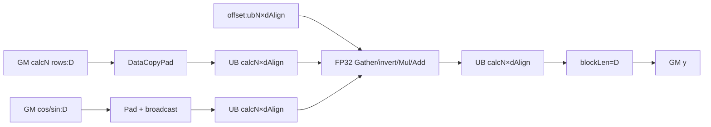

# RotaryPositionEmbedding A2/A3 ACLNN 算子知识

## 算子速览

| 项目 | 内容 |
|---|---|
| 实际入口 | 最新公开 V2：`aclnnRotaryPositionEmbeddingV2GetWorkspaceSize` / `aclnnRotaryPositionEmbeddingV2`；V1 是同一 L0 的无 `rotate` 旧入口 |
| 计算语义 | `y = x * cos + rotate(x) * sin`；`rotate` 非空时先做 `x @ rotate`，为空时按 `mode` 做半区或相邻元素置换 |
| 输入输出 | `x/cos/sin/y` 为 ND、3D/4D、FP16/BF16/FP32；矩阵路线另有同 dtype 的二维方阵 `rotate[D,D]` |
| 执行类型 | R-001 为 MIX_CV；R-002～R-009 为 AIV 向量流水 |
| Kernel 路线 | R-001 矩阵旋转；R-002 半区 FP32；R-003 半区升精度；R-004～R-009 相邻旋转的 S/BS/BSN 分块及各自 Pad body |
| 核心资源 | GM、矩阵 workspace、Matmul 管理的 L1/L0A/L0B/L0C、多个独立 TQue/TBuf、向量寄存器和跨核 flag |
| 来源闭包 | source_closed（已声明可达子域）：V2 API→Contiguous/L0→共享 priority registry→三套 Membase Tiling→key router→九条真实 Device body；A3 的 null-rotate 接线缺口与 950 独立卡边界均已定位 |
| 验证状态 | 已完成源码闭包检查；本次知识提取未执行编译、真机、数值或性能测试。 |

## 接口与语义

### 计算语义

令最后一维为偶数 `D`。V2 的通式是 `y=x*cos+r*sin`。`rotate` 非空时 `r=x@rotate`，MIX 路线的 Cube 以 FP32 产出 `r` 到 workspace，Vector 再融合两次乘法与加法。`rotate` 为空时，`mode=0` 的 membase half body 令 `r=[-x[D/2:D],x[0:D/2]]`；`mode=1` 的 interleaved body 先用 gather offset `(i xor 1)*sizeof(float)` 交换相邻元素，再令交换结果的偶数位置取负。运算次序固定为 `x*cos`、`r*sin`、相加；FP16/BF16 向量 body 先转 FP32，输出再转换。

### 输入、输出与属性

| 参数 | shape/layout | dtype | 约束、默认值与语义 |
|---|---|---|---|
| `x` | ND，3D 或 4D；最后维 D | FP16/BF16/FP32 | 必选；公开 A2/A3 契约为 D<896 且 D 为偶数；Host 源码只拒绝 D>896 |
| `cos` | 与 `sin` 同 shape；按 B/S/N 广播或与 x 同 shape | 与 x 相同 | 必选；最后维等于 D |
| `sin` | 同 `cos` | 与 x 相同 | 必选；矩阵与 half Host 要求三者 dtype 一致 |
| `rotate` | 可选 ND `[D,D]` | 与 x 相同 | V2 新增；非空仅 API 允许 DAV_2201，且选择优先级最高的矩阵模板 |
| `mode` | 标量属性 | int64 | V1/V2 显式传入；A2 null-rotate 实际闭包为 0=half、1=interleaved |
| `y` | 与 x shape/dtype/layout 相同 | 与 x 相同 | L0 分配，再由 executor `ViewCopy` 到用户输出 |

### 入口与版本

V2 是该架构公开的最新入口，不能与 V1 合并为同一个 ABI：V2 多一个可选 `rotate` 参数，并在 `rotate!=nullptr` 时执行 `GetCurrentPlatformInfo().GetCurNpuArch()==DAV_2201` 门禁。V1 通过同一 `RotaryPositionEmbeddingCommonProcess` 传入隐式空 `rotate`，故仅复用 null-rotate L0 实现，不具备矩阵 ABI。

## Host/Launcher 执行流程

### 参数校验与前处理

V2 先在非空 `rotate` 分支校验 DAV_2201；失败立即返回 `ACLNN_ERR_PARAM_INVALID`。随后创建 `aclOpExecutor`，若输出为空则把 workspace 置零并返回；非空时 common process 对每个非空输入依次调用 `l0op::Contiguous`，调用 L0 `RotaryPositionEmbedding(x,cos,sin,rotate,mode,executor)`，再对 L0 输出做 `Contiguous` 和 `ViewCopy`。L0 通过 `INFER_SHAPE` 及 `ADD_TO_LAUNCHER_LIST_AICORE` 将图节点加入 executor。

### 参数、Workspace 与生命周期

API producer 是 executor：连续化临时 tensor、L0 输出和 ViewCopy 临时量的生命周期都隶属 executor，phase-2 在调用者 stream 上执行 `CommonOpExecutorRun`。矩阵 route 的 user workspace producer 是 `DoRotateMatrixTiling`：`coreNum*128*128*8*sizeof(float)` 字节，按 `slot=cubeCount%8` 和 AIC `coreIdx` 切片；其 lifetime 从 AIC 写入到配对 AIV 完成并发回 flag。half/interleaved 只设置 16 MiB system workspace，不在 body 中显式消费。

### 启动图与失败传播

```text
V2GetWorkspaceSize -> RotaryPositionEmbeddingCommonProcess -> l0op::RotaryPositionEmbedding
  -> RotaryPosEmbeddingMembaseTilingClass -> Matrix/Half/Interleaved template
  -> tilingKey + blockDim -> rotary_position_embedding<<<blockDim, stream>>>
  -> key router -> concrete body -> y -> ViewCopy
```

API、Contiguous、L0、ViewCopy 和 phase-2 状态逐级返回。共享 `TilingRegistry::DoTilingImpl` 按 priority 升序尝试，但只有 `IsCapable()==false` 产生的 `GRAPH_PARAM_INVALID` 才继续下一模板；`GetShapeAttrsInfo/GetPlatformInfo/DoOpTiling` 的其它失败会立即返回，不是 fallback。所有模板均拒绝时 Host 返回 `GRAPH_FAILED` 并记录没有有效模板。矩阵模板还有一个独立失败传播缺口：`MatmulTilingProcess()` 的 `GRAPH_FAILED` 在 `DoRotateMatrixTiling()` 中未检查，随后仍生成 3011/3012/3013 与 workspace。

## Route 与参数设计

### 分核与资源计算

矩阵模板将 M 视 layout 对应的行数，`baseM=min(M,128)`、`baseN=align16(min(D,128))`、`baseK=min(D,128)`，以 AIC 核数为 `blockDim`，同核滚动 8 个 FP32 workspace slot。当前 Matmul 实例的 A/B 都是 GM/ND/T、无 transpose，C 是 GM/ND/FP32，`SetBias(false)`、`SetDim(1)`、shape=`(M,D,D)`、`SetFixSplit(baseM,baseN,baseK)`；Tiling 后强制 `dbL0C=2`、`stepKa=stepKb=4`、`depthA1=depthB1=2`、`stepM=stepN=1`。half 模板把全部 S-line 均分给 AIV，UB 预算扣 2 KiB 后按 `2*UB_NUM*dPad*sizeof(T)` 求可驻留行数；FP32 `UB_NUM=4`，FP16/BF16 源码取 12。interleaved 先把布局规约为 B/S/N/D，优先整段 split-S，放不下再 split-B，仍放不下再 split-BSN；D 的 block 对齐为 FP32 8 元素、FP16/BF16 16 元素，是否补齐直接改变 key 与 body。

### Route 选择

| 顺序 | Route | Key/模板 | 精确选择条件与优先级 | 不适用去向 |
|---:|---|---|---|---|
| 1 | R-001 RotateMatrixAll | 3011/3012/3013；priority 49999 | DAV_2201 API 门禁通过，910B/910_93 且 `rotate` desc 非空；矩阵 shape/dtype/mode 检查成功；dtype 分别 FP32/FP16/BF16 | `rotate` 空时以 `GRAPH_PARAM_INVALID` 继续；`DoOpTiling` 其它失败立即终止；Matmul helper 失败被吞掉仍留在本 Route |
| 2 | R-002 RotateHalf FP32 | 1011～1061；priority 50000 | ASCEND910B、`rotate` 空、`mode!=1`、FP32，layout code 1～6 | 非 FP32 在同模板生成 R-003；Half `DoOpTiling` 失败立即终止 |
| 3 | R-003 RotateHalfBf16 升精度 | 1012～1062/1013～1063 | 与 R-002 同平台/`rotate`/shape 条件，dtype FP16/BF16 | `mode=1` 时 Half `IsCapable=false`，继续到 R-004～R-009 |
| 4 | R-004 Interleaved split-S | 2000/2010/2020；priority 60000 | ASCEND910B、`rotate` 空、mode=1、D 已 block 对齐，整段 S tile 可驻留 UB | D 未对齐转 R-005；UB 不足在同一 `DoOpTiling` 内转 R-006 |
| 5 | R-005 Interleaved split-S Pad | 2001/2011/2021 | 与 R-004 相同但 D 未 block 对齐 | S tile 放不下转 R-007 |
| 6 | R-006 Interleaved split-B | 2100/2110/2120 | D 已对齐；S tile 放不下但 B tile 可驻留 | D 未对齐转 R-007；B tile 放不下转 R-008 |
| 7 | R-007 Interleaved split-B Pad | 2101/2111/2121 | 与 R-006 相同但 D 未对齐 | B tile 放不下转 R-009 |
| 8 | R-008 Interleaved split-BSN | 2200/2210/2220 | D 已对齐；按 N tile 才能满足 UB | D 未对齐转 R-009 |
| 9 | R-009 Interleaved split-BSN Pad | 2201/2211/2221 | D 未对齐；按 N tile | 无可行 UB/shape 时 Tiling 失败 |

```text
RegBase priorities 10000/20000/25000/40000:
  A2/A3 are not DAV_3510/DAV_5102 -> IsCapable=false -> continue
if rotate != null and API arch != DAV_2201: ACLNN_ERR_PARAM_INVALID
if soc in {ASCEND910B, ASCEND910_93} and rotate_desc != null:
  try Matrix(priority 49999)
  if Matrix shape/dtype/mode check fails: terminate GRAPH_FAILED
  MatmulTilingProcess failure is not propagated; key is still emitted
  otherwise: R-001
if ASCEND910B && mode != 1: FP32 ? R-002 : R-003
else if ASCEND910B && mode == 1:
  if fit_split_S: aligned_D ? R-004 : R-005
  else if fit_split_B: aligned_D ? R-006 : R-007
  else: aligned_D ? R-008 : R-009
else: no valid tiling template
```

### 模板/实现执行矩阵

| Route | key/selector | dtype/shape/platform 完整命中条件 | 执行族与 kernel 节点 | 实际模板/body | 内存与同步特征 | tail/fallback |
|---|---|---|---|---|---|---|
| R-001 RotateMatrixAll | 3011/3012/3013 | A2/A3、`rotate` 非空、4D、`rotate=[D,D]`、同 dtype、Host guard `D<=896` 且偶数；公开契约取 `D<896`、mode∈{0,1} 与受支持 broadcast；矩阵前置检查成功 | 单 Kernel MIX_CV：AIC Matmul→GM user workspace→两 AIV | `MatmulImpl<GM,ND,T;GM,ND,T;GM,ND,float>` + `RotateMatrixAll<T,T,MT>` | 8 个 FP32 slot；flag 2 AIC→AIV，flag 1 AIV→AIC | M/N/K 库内尾块；前置失败立即终止；Matmul helper 失败却仍发 key |
| R-002 RotateHalf FP32 | 1011～1061 | A2、`rotate` 空、公开 `mode=0`（selector 实际为 `mode!=1`）、FP32、3D/4D、layout 1～6 | AIV | `RotateHalf<float>` | 4 个 depth-2 队列；无 user workspace | former/tail core、UB last、D/2 Pad；`DoOpTiling` 失败立即终止 |
| R-003 RotateHalf 升精度 | 1012～1062、1013～1063 | 同 R-002，dtype FP16/BF16 | AIV | `RotateHalfBf16<half,float>` / `<bfloat16_t,float>` | 4 个 depth-2 OriT 队列 + 4 个 FP32 TBuf | 与 R-002 同；输出 `CAST_RINT` |
| R-004 split-S | 2000/2010/2020 | A2、`rotate` 空、mode=1、支持的 SD broadcast、D 已按 32B 对齐，整段 S 预算可行 | AIV | `InterleavedSplitS<T>` | S 分核；cos 队列先 cos 后 sin；gather offset 常驻 | former/tail S 核与 S tile tail |
| R-005 split-S Pad | 2001/2011/2021 | 同 R-004，但 D 未按 32B 对齐 | AIV | `InterleavedSplitSPad<T>` | UB 行宽 `dAlign`，GM 仍为 D | S tail + 行内 Pad；仅写真实 D |
| R-006 split-B | 2100/2110/2120 | split-S 单行预算不足、split-B 预算可行、D 对齐 | AIV | `InterleavedSplitBS<T>` | 外层 S、内层 B tile；B 向 GM stride | B tile tail；预算不足转 split-BSN |
| R-007 split-B Pad | 2101/2111/2121 | 同 R-006，但 D 未对齐 | AIV | `InterleavedSplitBSPad<T>` | B×N×dAlign 物理 UB；N=1/N>1 搬运分支 | B/D tail；仅写真实 D |
| R-008 split-BSN | 2200/2210/2220 | split-S/B 都不可驻留、至少一个 N tile 可驻留、D 对齐 | AIV | `InterleavedSplitBSN<T>` | B/S/N 三重循环；N tile 连续 | N tile tail；最小 tile 仍超 UB 则 Tiling 失败 |
| R-009 split-BSN Pad | 2201/2211/2221 | 同 R-008，但 D 未对齐 | AIV | `InterleavedSplitBSNPad<T>` | 每 N tile 使用 `dAlign` 行与真实 D GM | N/D tail；无更小 fallback |

### 隐藏性能 Guard

| Guard | Host/Tiling 条件 | Device/资源原因 | 影响 Route | 不满足时去向 | 源码符号 |
|---|---|---|---|---|---|
| Matrix API 架构门禁 | `rotate!=nullptr -> GetCurNpuArch()==DAV_2201` | 矩阵 body 仅在 `__CCE_AICORE__==220` 编译，且使用 MIX_CV/Matmul | R-001 | 第一段返回 `ACLNN_ERR_PARAM_INVALID` | `aclnnRotaryPositionEmbeddingV2GetWorkspaceSize` |
| Registry 继续条件 | 仅 `DoTiling()==GRAPH_PARAM_INVALID`，即当前类 `IsCapable()==false` | 防止把已匹配模板内部的参数/资源错误误当作另一语义实现的 fallback | 全部 | `DoOpTiling` 的 `GRAPH_FAILED` 立即返回；不会落到低优先级模板 | `TilingBaseClass::DoTiling`、`TilingRegistry::DoTilingImpl` |
| RegBase 前置模板 | A2/A3 的 arch 不在 `{DAV_3510,DAV_5102}` | priorities 10000/20000/25000/40000 只服务 RegBase/950 | R-001～R-009 之前 | 各 RegBase `IsCapable` 返回 false，registry 继续到 49999 | `IsRegbaseSocVersion`、四个 RegBase `IsCapable` |
| Matrix 模板 SoC | `(soc==ASCEND910B \|\| soc==ASCEND910_93) && rotateDesc!=nullptr` | Host 必须生成 Cube tiling 与 MIX key | R-001 | `rotate` 空才因 `IsCapable=false` 继续；非空后任一前置检查失败均立即终止 | `RopeRotateMatrixTilingClass::IsCapable`、`TilingRegistry::DoTilingImpl` |
| 公开 D 上界 | 文档 `D<896`；Host 实现仅检查 `D>896` | 固定文档与实现边界相差一个值 | R-001～R-003 | 正式接口按更严格的 `D<896`；不把 D=896 宣称为公开支持 | `CheckShapeSupport`、V2 文档约束 |
| Matrix tile | `baseM=min(M,128)`，`baseN=(D<128?align16(D):128)`，`baseK=min(D,128)` | Matmul specialization 固定 128 上界，N 需 16 元素对齐 | R-001 | `GetTiling==-1` 由 helper 返回失败，但 `DoRotateMatrixTiling` 未检查该返回值，仍继续生成 key，不触发 fallback | `MatmulTilingProcess`、`DoRotateMatrixTiling` |
| Matrix 环形深度 | `cvParallNum=8` | 每 AIC core 只有 8 个 `128*128*float` slot | R-001 | 第 8 个及以后 tile 写下一 slot 前 wait flag 1 | `CV_PARALL_NUM`、`MMCompute` |
| Half 模板平台 | `soc==ASCEND910B && mode!=1`（目标平台范围） | Half body 的 A2 selector 未列 `ASCEND910_93`；公开 A2 只发布 mode0 | R-002/R-003 | A3 null-rotate 继续到 Interleaved 后仍无模板；A2 Half 内部失败立即终止 | `RopeRotateHalfTilingClass::IsCapable` |
| Half BNSD 经验拒绝 | 对齐时 `B*N>S*8`；非对齐时 `2*B*N>ceil(S/coreNum) && D<80` | 源码主动拒绝融合 body | R-002/R-003 | Tiling 失败；当前公开入口未接小算子 fallback | `CheckBnsdBlockSkip` |
| Half UB | FP32 `storeS=floor((UB-2048)/(8*4*dPad))`；FP16/BF16 `floor((UB-2048)/(24*2*dPad))` | 预留 2 KiB，并为 depth/升精度缓冲留容量 | R-002/R-003 | `storeS<=0` 时失败 | `GetStoreLines` |
| Interleaved 平台/模式 | `soc==ASCEND910B && mode==1`（目标平台范围） | 六个 classic AIV body 不对 910_93 注册 selector | R-004～R-009 | A3 null-rotate 无有效模板；A2 `DoOpTiling` 失败立即终止 | `RopeInterLeavedTilingClass::IsCapable` |
| Interleaved D 对齐 | FP32 `D%8`；FP16/BF16 `D%16` | 32B DataCopy 与 gather 行宽 | R-004/R-006/R-008 或 Pad 对偶 | 同一 split 族改用 Pad key | `TilingSplitS` |
| S→B→N UB 降级 | `bufferSize` 先容纳 `B*coreS*N*dAlign`，再 `B*N*dAlign`，最后至少 `Ntile*dAlign` | 逐级缩小驻留域 | R-004～R-009 | S 不足转 B；B 不足转 N；N=1 仍不足则失败 | `TilingSplitS/TilingSplitB/TilingSplitN` |
| Interleaved 形状规约 | 仅 SBND/S11D、BSND/1S1D、BNSD/11SD（TND 映射为 1×T×N×D） | body 把输入规约为 canonical B/S/N/D | R-004～R-009 | `TilingSplit` 返回失败 | `TilingSplit` |

### POD/ABI

宏生成结构的 `sizeof/alignof/offsetof` 在固定仓不可见；下表按声明顺序逐字段记录固定 64 位成员，禁止凭自然对齐反推。`RotaryPositionEmbeddingTilingData` 依次内嵌三套子结构，key 只消费其对应成员。

| 结构 | 字段 | 类型/位宽 | ABI 布局 | 单位 | Host/launcher producer | Device consumer | 边界 |
|---|---|---|---|---|---|---|---|
| RotateMatrixParams | `matmulTiling` | `TCubeTiling`/固定仓定义不可见 | 第1字段；sizeof/alignof/offsetof 固定仓不可见 | 参数 | `MatmulTilingProcess` | `MatmulImpl::Init` | Matmul 库 ABI |
| RotateMatrixParams | `blockNum` | uint64/64 | 第2字段；offsetof 固定仓不可见 | tile | `DoRotateMatrixTiling` | `MMCompute` | M×N tile 数 |
| RotateMatrixParams | `blockNumM` | uint64/64 | 第3字段；offsetof 固定仓不可见 | tile | Host ceil-div M | AIC 索引 | 正数 |
| RotateMatrixParams | `blockNumN` | uint64/64 | 第4字段；offsetof 固定仓不可见 | tile | Host ceil-div N | AIC 索引 | 正数 |
| RotateMatrixParams | `cvParallNum` | uint64/64 | 第5字段；offsetof 固定仓不可见 | slot | Host 固定 8 | AIC/AIV slot | 固定8 |
| RotateMatrixParams | `tilingMode` | uint64/64 | 第6字段；offsetof 固定仓不可见 | 枚举 | `ChooseTilingMode` | 地址分支 | 1～7 |
| RotateMatrixParams | `gmLength` | uint64/64 | 第7字段；offsetof 固定仓不可见 | 元素 | shape 乘积 | 边界 | 非负 |
| RotateMatrixParams | `broadcastFirstDim` | uint64/64 | 第8字段；offsetof 固定仓不可见 | bool | shape compare | GM offset | 0/1 |
| RotateMatrixParams | `broadcastSecondDim` | uint64/64 | 第9字段；offsetof 固定仓不可见 | bool | shape compare | GM offset | 0/1 |
| RotateMatrixParams | `broadcastThirdDim` | uint64/64 | 第10字段；offsetof 固定仓不可见 | bool | shape compare | GM offset | 0/1 |
| RotateMatrixParams | `dLength` | uint64/64 | 第11字段；offsetof 固定仓不可见 | element | x.D | AIC/AIV stride | 公开<896、偶数；Host guard≤896 |
| RotateMatrixParams | `baseM` | uint64/64 | 第12字段；offsetof 固定仓不可见 | row | min(M,128) | Matmul/AIV | ≤128 |
| RotateMatrixParams | `baseN` | uint64/64 | 第13字段；offsetof 固定仓不可见 | col | aligned min(D,128) | Matmul/AIV | ≤128 |
| RotateMatrixParams | `baseK` | uint64/64 | 第14字段；offsetof 固定仓不可见 | reduce | min(D,128) | Matmul | ≤128 |
| RotateMatrixParams | `coreNum` | uint64/64 | 第15字段；offsetof 固定仓不可见 | core | AIC count | workspace offset | >0 |
| RotateMatrixParams | `m` | uint64/64 | 第16字段；offsetof 固定仓不可见 | row | layout 展平 | AIC loop | >0 |
| RotateMatrixParams | `xFirstDim` | uint64/64 | 第17字段；offsetof 固定仓不可见 | element | x shape | AIV address | >0 |
| RotateMatrixParams | `xSecondDim` | uint64/64 | 第18字段；offsetof 固定仓不可见 | element | x shape | AIV address | >0 |
| RotateMatrixParams | `xThirdDim` | uint64/64 | 第19字段；offsetof 固定仓不可见 | element | x shape | AIV address | >0 |
| RotateMatrixParams | `cosSinFirstDim` | uint64/64 | 第20字段；offsetof 固定仓不可见 | element | cos shape | broadcast address | >0 |
| RotateMatrixParams | `cosSinSecondDim` | uint64/64 | 第21字段；offsetof 固定仓不可见 | element | cos shape | broadcast address | >0 |
| RotateMatrixParams | `cosSinThirdDim` | uint64/64 | 第22字段；offsetof 固定仓不可见 | element | cos shape | broadcast address | >0 |
| RotateHalfParams | `tilingMode` | uint64/64 | 第1字段；sizeof/alignof/offsetof 固定仓不可见 | 枚举 | `ChooseTilingMode` | CopyIn offset | 1～6 |
| RotateHalfParams | `gmLength` | uint64/64 | 第2字段；offsetof 固定仓不可见 | element | x shape product | Init | >0 |
| RotateHalfParams | `broadcastFirstDim` | uint64/64 | 第3字段；offsetof 固定仓不可见 | bool | shape | cos/sin offset | 0/1 |
| RotateHalfParams | `broadcastSecondDim` | uint64/64 | 第4字段；offsetof 固定仓不可见 | bool | shape | cos/sin offset | 0/1 |
| RotateHalfParams | `dLength` | uint64/64 | 第5字段；offsetof 固定仓不可见 | element | x.D | body | 公开<896、偶数；Host guard≤896 |
| RotateHalfParams | `halfDLength` | uint64/64 | 第6字段；offsetof 固定仓不可见 | element | D/2 | rotate | >0 |
| RotateHalfParams | `halfDPadLength` | uint64/64 | 第7字段；offsetof 固定仓不可见 | element | align(D/2) | UB half | block 对齐 |
| RotateHalfParams | `dPadLength` | uint64/64 | 第8字段；offsetof 固定仓不可见 | element | 2*halfDPad | UB row | block 对齐 |
| RotateHalfParams | `isAligned` | uint64/64 | 第9字段；offsetof 固定仓不可见 | bool | D/2 modulo block | Pad 分支 | 0/1 |
| RotateHalfParams | `totalSLines` | uint64/64 | 第10字段；offsetof 固定仓不可见 | line | 展平非D维 | 分核 | >0 |
| RotateHalfParams | `storeSLines` | uint64/64 | 第11字段；offsetof 固定仓不可见 | line | UB公式 | UB循环 | ≥1 |
| RotateHalfParams | `storeDataLength` | uint64/64 | 第12字段；offsetof 固定仓不可见 | element | storeS*D | copy | UB范围 |
| RotateHalfParams | `storePadDataLength` | uint64/64 | 第13字段；offsetof 固定仓不可见 | element | storeS*dPad | queue | UB范围 |
| RotateHalfParams | `formerCoreNum` | uint64/64 | 第14字段；offsetof 固定仓不可见 | core | 均分 | block branch | ≤blockDim |
| RotateHalfParams | `formerSLines` | uint64/64 | 第15字段；offsetof 固定仓不可见 | line/core | ceil-div | former loop | >0 |
| RotateHalfParams | `formerUbLoop` | uint64/64 | 第16字段；offsetof 固定仓不可见 | loop | S/storeS | former loop | ≥0 |
| RotateHalfParams | `formerUbLast` | uint64/64 | 第17字段；offsetof 固定仓不可见 | line | S modulo storeS | tail | <storeS |
| RotateHalfParams | `formerXDataLength` | uint64/64 | 第18字段；offsetof 固定仓不可见 | element | formerS*D | x offset | >0 |
| RotateHalfParams | `formerRDataLength` | uint64/64 | 第19字段；offsetof 固定仓不可见 | element | layout广播 | cos offset | >0 |
| RotateHalfParams | `formerXCoreOffset` | uint64/64 | 第20字段；offsetof 固定仓不可见 | element | former核总长 | tail core base | 非负 |
| RotateHalfParams | `formerRCoreOffset` | uint64/64 | 第21字段；offsetof 固定仓不可见 | element | former参数总长 | tail cos base | 非负 |
| RotateHalfParams | `formerUbLastDataLength` | uint64/64 | 第22字段；offsetof 固定仓不可见 | element | lastS*D | tail copy | 非负 |
| RotateHalfParams | `formerUbLastPadDataLength` | uint64/64 | 第23字段；offsetof 固定仓不可见 | element | lastS*dPad | tail UB | 非负 |
| RotateHalfParams | `tailCoreNum` | uint64/64 | 第24字段；offsetof 固定仓不可见 | core | 均分余组 | block branch | ≤blockDim |
| RotateHalfParams | `tailSLines` | uint64/64 | 第25字段；offsetof 固定仓不可见 | line/core | floor-div | tail-core loop | ≥0 |
| RotateHalfParams | `tailUbLoop` | uint64/64 | 第26字段；offsetof 固定仓不可见 | loop | S/storeS | loop | ≥0 |
| RotateHalfParams | `tailUbLast` | uint64/64 | 第27字段；offsetof 固定仓不可见 | line | S modulo storeS | tail | <storeS |
| RotateHalfParams | `tailXDataLength` | uint64/64 | 第28字段；offsetof 固定仓不可见 | element | tailS*D | x base | 非负 |
| RotateHalfParams | `tailRDataLength` | uint64/64 | 第29字段；offsetof 固定仓不可见 | element | layout广播 | cos base | 非负 |
| RotateHalfParams | `tailUbLastDataLength` | uint64/64 | 第30字段；offsetof 固定仓不可见 | element | lastS*D | tail copy | 非负 |
| RotateHalfParams | `tailUbLastPadDataLength` | uint64/64 | 第31字段；offsetof 固定仓不可见 | element | lastS*dPad | tail UB | 非负 |
| RopeInterleavedParams | `batchSize` | uint64/64 | 第1字段；sizeof/alignof/offsetof 固定仓不可见 | element | shape规约 | address | >0 |
| RopeInterleavedParams | `seqLen` | uint64/64 | 第2字段；offsetof 固定仓不可见 | element | shape规约 | loops | >0 |
| RopeInterleavedParams | `numHeads` | uint64/64 | 第3字段；offsetof 固定仓不可见 | element | shape规约 | address | >0 |
| RopeInterleavedParams | `headDim` | uint64/64 | 第4字段；offsetof 固定仓不可见 | element | x.D | gather/copy | 偶数 |
| RopeInterleavedParams | `frontCoreNum` | uint64/64 | 第5字段；offsetof 固定仓不可见 | core | S均分 | block branch | ≤blockDim |
| RopeInterleavedParams | `tailCoreNum` | uint64/64 | 第6字段；offsetof 固定仓不可见 | core | S均分 | block branch | ≤blockDim |
| RopeInterleavedParams | `coreCalcNum` | uint64/64 | 第7字段；offsetof 固定仓不可见 | S/core | ceil-div | front core | >0 |
| RopeInterleavedParams | `coreCalcTail` | uint64/64 | 第8字段；offsetof 固定仓不可见 | S/core | floor-div | tail core | ≥0 |
| RopeInterleavedParams | `ubCalcNum` | uint64/64 | 第9字段；offsetof 固定仓不可见 | S/tile | UB预算 | split-S | >0 |
| RopeInterleavedParams | `ubCalcLoop` | uint64/64 | 第10字段；offsetof 固定仓不可见 | loop | coreS/ubS | split-S | ≥0 |
| RopeInterleavedParams | `ubCalcTail` | uint64/64 | 第11字段；offsetof 固定仓不可见 | S | modulo | split-S tail | ≥0 |
| RopeInterleavedParams | `ubCalcTailNum` | uint64/64 | 第12字段；offsetof 固定仓不可见 | S/tile | tail-core预算 | split-S | ≥0 |
| RopeInterleavedParams | `ubCalcTailLoop` | uint64/64 | 第13字段；offsetof 固定仓不可见 | loop | tail core | split-S | ≥0 |
| RopeInterleavedParams | `ubCalcTailTail` | uint64/64 | 第14字段；offsetof 固定仓不可见 | S | modulo | split-S final | ≥0 |
| RopeInterleavedParams | `ubCalcBNum` | uint64/64 | 第15字段；offsetof 固定仓不可见 | B/tile | UB预算 | split-B | >0 |
| RopeInterleavedParams | `ubCalcBLoop` | uint64/64 | 第16字段；offsetof 固定仓不可见 | loop | B/ubB | split-B | ≥0 |
| RopeInterleavedParams | `ubCalcBTail` | uint64/64 | 第17字段；offsetof 固定仓不可见 | B | modulo | split-B tail | ≥0 |
| RopeInterleavedParams | `ubCalcNNum` | uint64/64 | 第18字段；offsetof 固定仓不可见 | N/tile | UB预算 | split-BSN | >0 |
| RopeInterleavedParams | `ubCalcNLoop` | uint64/64 | 第19字段；offsetof 固定仓不可见 | loop | N/ubN | split-BSN | ≥0 |
| RopeInterleavedParams | `ubCalcNTail` | uint64/64 | 第20字段；offsetof 固定仓不可见 | N | modulo | split-BSN tail | ≥0 |

### Route 源码闭包

| Route | Key/selector | Host/Tiling producer | POD/参数 | Kernel entry/router | Kernel body/直接依赖 | 构建接线 |
|---|---|---|---|---|---|---|
| R-001 RotateMatrixAll | 3011/3012/3013 | `rope_rotate_matrix_tiling.cpp::DoRotateMatrixTiling` | `RotateMatrixParams` | `rotary_position_embedding.cpp::rotary_position_embedding` | `rotate_matrix.h::RotateMatrixAll`、`MatmulImpl` | `op_host/CMakeLists.txt`、910B/910_93 config |
| R-002 RotateHalf FP32 | 1011～1061 | `rope_rotate_half_tiling.cpp::DoOpTiling` | `RotateHalfParams` | 同 entry 的 FP32 key branches | `rotate_half.h::RotateHalf<float>` | 同上 |
| R-003 RotateHalfBf16 | 1012～1063 | 同上 | `RotateHalfParams` | 同 entry 的 half/bf16 branches | `rotate_half_bf16.h::RotateHalfBf16` | 同上 |
| R-004 split-S | 2000/2010/2020 | `rope_interleaved_tiling.cpp::DoOpTiling` | `RopeInterleavedParams` | split-S key branches | `rotate_interleaved_split_s.h` | 同上 |
| R-005 split-S Pad | 2001/2011/2021 | 同上 | 同上 | split-S-pad branches | `rotate_interleaved_split_s_pad.h` | 同上 |
| R-006 split-B | 2100/2110/2120 | 同上 | 同上 | split-B branches | `rotate_interleaved_split_bs.h` | 同上 |
| R-007 split-B Pad | 2101/2111/2121 | 同上 | 同上 | split-B-pad branches | `rotate_interleaved_split_bs_pad.h` | 同上 |
| R-008 split-BSN | 2200/2210/2220 | 同上 | 同上 | split-BSN branches | `rotate_interleaved_split_bsn.h` | 同上 |
| R-009 split-BSN Pad | 2201/2211/2221 | 同上 | 同上 | split-BSN-pad branches | `rotate_interleaved_split_bsn_pad.h` | 同上 |

## Kernel 实现

### 公共执行流程

统一 entry 读取 GM x/cos/sin/rotate/workspace/y、tiling blob，并按 key 实例化唯一 body。R-001 是 `MIX_AIC_1_2`：AIC 生产 FP32 rotated tile，AIV 消费后回传 slot 可复用信号；其 workspace offset、producer、consumer、lifetime 都由 route 明确。其余 route 是 AIV TPipe，独立队列完成 MTE2→V→MTE3。所有 body 都只提交真实 D 或真实 tail，Pad 只存在 UB。

### Route R-001：RotateMatrixAll MIX_CV

#### 适用条件

##### 选择证据

| 层级 | 文件 | 符号 | 源码谓词/参数 | 结果/下一跳 |
|---|---|---|---|---|
| API | `op_host/op_api/aclnn_rotary_position_embedding.cpp` | `aclnnRotaryPositionEmbeddingV2GetWorkspaceSize` | `rotate!=nullptr && arch!=DAV_2201` | 参数错误；DAV_2201 才进 L0 |
| Registry | `common/include/op_host/tiling_templates_registry.h` | `TilingRegistry::DoTilingImpl` | priority 升序；仅 `GRAPH_PARAM_INVALID` 继续 | RegBase-only 模板拒绝 A2/A3 后到 49999；其它失败立即返回 |
| Tiling | `op_host/rope_rotate_matrix_tiling.h` | `RopeRotateMatrixTilingClass::IsCapable` | 910B/910_93 且 optional rotate desc 非空 | priority 49999 首选矩阵模板 |
| Tiling | `op_host/rope_rotate_matrix_tiling.cpp` | `DoRotateMatrixTiling` | 4D x/cos/sin、rotate 为 `[D,D]`、Host guard D≤896 且偶数、dtype 同为三种支持类型、mode1 broadcast guard | FP32/FP16/BF16 分别 key 3011/3012/3013；公开契约仍取 D<896、mode0/1；前置失败终止 |
| Router | `op_kernel/rotary_position_embedding.cpp` | `rotary_position_embedding` | `TILING_KEY_IS(3011/3012/3013)` | MIX AIC:Vector=1:2，实例化 `RotateMatrixAll` |

#### Device 数据流

##### 函数级调用链

```text
rotary_position_embedding(x, cos, sin, rotate, y, workspace, tiling)
  -> RotateMatrixAll::Init
    -> AIC: Process -> MMCompute -> MatmulImpl::Iterate/GetTensorC
    -> AIV: Process -> CopyIn -> Compute -> CopyOut
    -> CrossCoreSetFlag/WaitFlag slot protocol
```

##### 源码等价伪码

```text
for each layout loop i:
  preCount carries previous logical-block modulo coreNum
  for curBlock = (coreIdx>=preCount ? coreIdx : coreIdx+coreNum); curBlock < preCount+blockNum; curBlock += coreNum:
    logicalBlock=curBlock-preCount
    mIdx=logicalBlock/blockNumN; nIdx=logicalBlock%blockNumN
    if AIC:
      Aoff=(baseOffsetM+mIdx*singleM)*D; Boff=nIdx*singleN
      workspaceOffset=singleM*singleN*(coreIdx+(cubeCount%8)*coreNum)
      matmul(A=Aoff, B=Boff) -> workspace[workspaceOffset]
      set flag SYNC_AIC_TO_AIV(2)
      cubeCount++
      if cubeCount>=8: wait flag SYNC_AIV_TO_AIC(1); only then may the next tile reuse the oldest slot
    if AIV:
      coreIdx=GetBlockIdx()/GetTaskRation(); split current M tile by subBlockIdx
      for rowTile in 64-row pieces:
        copy x and cos; xCos=x*cos
        if first piece: wait flag 2 for this logical tile
        read rotated FP32 workspace; copy sin
        out=xCos+rotated*sin
        if output T is not FP32: cast(out, RINT)
        copy real rows and real N to y
      set flag 1 so producer may reuse the slot
  preCount=(preCount+blockNum)%coreNum; advance baseOffsetM for BNSD 11SD/B1SD outer loop
```

#### 内存与数据搬运

##### 资源与搬运表

| 层级/缓冲区 | offset/地址公式 | extent/容量公式 | dtype/layout | producer | consumer | owner/lifetime | 对齐/复用 |
|---|---|---|---|---|---|---|---|
| GM x | `(baseOffsetM+mIdx*singleM)*D + row*D` | M×D | T/ND | API input | AIC A、AIV xCos | caller/launch | layout mode 修正 baseOffsetM |
| GM rotate | `nIdx*singleN` | D×D | T/ND | API input | AIC B | caller/launch | N tile contiguous |
| GM cos | layout broadcast offset + row×D+nIdx×singleN | 广播 shape | T/ND | API input | AIV | caller/launch | 三维 broadcast flag |
| GM sin | 与 cos 同布局 offset | 广播 shape | T/ND | API input | AIV | caller/launch | 同上 |
| GM user workspace | slot base=`baseM*baseN*(coreIdx+(tileCount%8)*coreNum)` FP32 元素；AIV 行偏移=`offsetM*curSingleN` | 总容量 `coreNum*128*128*8*4` bytes；每 slot 容量 `baseM*baseN*4`，有效区 `curSingleM*curSingleN*4` | FP32 ND tile | AIC `GetTensorC` | 配对两 AIV | executor/user workspace；两 AIV 的 flag1 被消费后结束 slot lifetime | 8-slot 环形；位于 system workspace 之后，由 `GetUserWorkspace` 取得 |
| GM y | x 对应的 real row/N offset | 与 x 相同 | T/ND | AIV CopyOut | caller | caller/launch后 | 不写 tile padding |
| L1 | Matmul 库内部 | `TCubeTiling` 决定；固定仓只给 `l1Size` 上界 | Matmul internal | GM搬运 | L0A/L0B | `Iterate` 调用期 | 物理 offset 固定仓不可见 |
| L0A | Matmul 库内部 | 逻辑 payload `baseM*baseK*sizeof(T)` | T/内部 Cube format | Matmul copy | Cube | `Iterate` 期 | 物理 padding 由库管理 |
| L0B | Matmul 库内部 | 逻辑 payload `baseK*baseN*sizeof(T)` | T/内部 Cube format | Matmul copy | Cube | `Iterate` 期 | 物理 padding 由库管理 |
| L0C | Matmul 库内部 | 逻辑 payload `2*baseM*baseN*4` bytes，`dbL0C=2` | FP32 | Cube | Fixpipe/GM workspace | `GetTensorC` 期 | double buffer |
| UB `xRotatedInQueue_` | queue slot | `64*baseN*4` bytes，depth1 | FP32 | workspace CopyIn | Vector Mul | tile 期 | 独立 TQue |
| UB `xInQueue_` | queue slot | `64*baseN*sizeof(T)`，depth1 | T | x CopyIn | Mul/cast | tile 期 | 独立 TQue |
| UB `cosSinInQueue_` | queue slot | `64*baseN*sizeof(T)`，depth1 | T | cos 后 sin CopyIn | 两次 Mul | tile 期 | 单一 TQue 分时复用 |
| UB `outQueue_` | queue slot | `64*baseN*sizeof(T)`，depth1 | T | cast/Vector Add | y CopyOut | tile 期 | 独立 TQue |
| UB `tmpBuff` | offset 0 | FP32 输入时 `64*baseN*4`；非 FP32 时 `64*baseN*(2*4+sizeof(T))` bytes | FP32 + T | x/cos/sin cast与广播暂存 | FP32 compute/DataCopySinCos | tile 期 | `xUbFloat`、`sinCosUbFloat`、`cosSinTmpUb` 按 offset 切片 |
| 寄存器 | Vector 指令内部 | 64-row 分片 | FP32 | load/cast | mul/add/cast | 指令期 | 输出 RINT |

##### 分层内存布局



##### 字节账、交接边与复用顺序

```text
user_workspace = coreNum * 8 * 128 * 128 * sizeof(float)
workspace_total = system_workspace + user_workspace
E = 64 * baseN
UB_total(FP32) = E*(4+4+4+4+4) = 20E bytes
UB_total(FP16/BF16) = E*(4+2+2+2+(8+2)) = 20E bytes
L0C_logical = dbL0C * baseM * baseN * sizeof(float) = 2*baseM*baseN*4
```

| 边/复用子区 | producer | offset/extent | dtype/layout | consumer | ordering/sync | owner/lifetime | 安全条件 |
|---|---|---|---|---|---|---|---|
| AIC→AIV workspace slot | `MMCompute/GetTensorC` | slot base=`4*baseM*baseN*(coreIdx+slot*coreNum)` bytes；容量 `4*baseM*baseN`，有效 `4*curSingleM*curSingleN` | FP32/ND，行 stride=`curSingleN` | `DataCopyxRotated` 从 `offsetM*curSingleN` 读取 | AIC set flag 2；两 AIV 首片 wait flag 2 | user workspace；直到两 AIV 完成当前 tile | slot 复用前 AIC 消费对应 flag 1 |
| `cosSinInQueue_` cos→sin | `DataCopySinCos(cos)` | 同一 `E*sizeof(T)` slot | T/aligned row tile | `DataCopySinCos(sin)` | cos Mul 与 `PipeBarrier<PIPE_V>` 后才覆盖 | AIV tile | 前一值不再被读取 |
| `tmpBuff` 切片 | `InitLocalBuffers` | 非 FP32：`xUbFloat[0,E)`、`sinCosUbFloat[E,2E)`、`cosSinTmpUb[2E,2E+E*T/4)` | FP32/FP32/T | Vector 与 broadcast | 同一 AIV 指令序 | kernel 内 TBuf | offset 不重叠；每 tile 顺序复用 |

#### 同步、精度与尾块

##### 同步与数值边界表

| 阶段 | primitive/机制 | producer | consumer/等待点 | 保护对象 | 精度/尾块 |
|---|---|---|---|---|---|
| AIC→AIV | `CrossCoreSetFlag<0x2,PIPE_FIX>(2)` | `GetTensorC(..., true)` 后的 Fixpipe 完成 | 两个 subBlock 的 AIV 首个 row tile `CrossCoreWaitFlag(2)` | 当前 workspace slot | C 接口类型为 FP32；Matmul 库内部累加模式固定仓不可见 |
| AIV→AIC | `CrossCoreSetFlag<0x2,PIPE_MTE3>(1)` | AIV 最后输出；空 half 也发信号 | 同 AIC 在第8个后复用前 wait flag1 | 8-slot lifetime | 防覆盖未消费 tile |
| MTE2→V | TQue `EnQue/DeQue` | x/cos/sin/workspace CopyIn | Compute | 四个队列（cos 与 sin 分时共用一个） | real `curSingleM/curSingleN`；K=D 的库内尾块由 `TCubeTiling` 管理 |
| V内部 | `PipeBarrier<PIPE_V>` | cast/mul | 后续 mul/add | FP32 临时量 | FP16/BF16 升至 FP32 |
| V→MTE3 | `SetFlag/WaitFlag V_MTE3 EVENT_ID1` | Vector 输出 | CopyOut | outQueue | 非FP32用 CAST_RINT；仅写有效范围 |

#### 关键实现

##### 符号证据表

| 阶段 | 文件 | 符号/模板实例 | 实现事实 |
|---|---|---|---|
| Host/Tiling producer | `op_host/rope_rotate_matrix_tiling.cpp` | `DoRotateMatrixTiling` | 生成 tile、TCubeTiling、8-slot workspace 和 key |
| Kernel entry/router | `op_kernel/rotary_position_embedding.cpp` | `RotateMatrixAll<float,float,MT>`、`<half,half,MT>`、`<bfloat16_t,bfloat16_t,MT>` | 三 key 映射到 MIX 实例 |
| Device body/helper | `op_kernel/rotate_matrix.h` | `MMCompute` | A/B GM offset、workspace offset、Matmul 与 flag2 |
| Device body/helper | `op_kernel/rotate_matrix.h` | `VectorCompute/VectorComputeProcess` | Vector 融合、RINT、flag1 与空 half 协议 |

### Route R-002：RotateHalf FP32

#### 适用条件

##### 选择证据

| 层级 | 文件 | 符号 | 源码谓词/参数 | 结果/下一跳 |
|---|---|---|---|---|
| API | `op_host/op_api/aclnn_rotary_position_embedding.cpp` | common process | V1 隐式 null，或 V2 `rotate==nullptr` | 进入同一 L0；Matrix `IsCapable=false` 后才尝试 Half |
| Tiling | `op_host/rope_rotate_half_tiling.h` | `RopeRotateHalfTilingClass::IsCapable` | soc=ASCEND910B 且 `mode!=1`；不读取 optional rotate desc | priority50000 |
| Tiling | `op_host/rope_rotate_half_tiling.cpp` | `GetAlignedInfo/GetCoreDataTiling` | Host guard D≤896、偶数、3D/4D、dtype FP32 | layout 1～6，key 1011～1061；公开契约仍取 D<896 |
| Router | `op_kernel/rotary_position_embedding.cpp` | FP32 half branches | suffix1 | `RotateHalf<float>` |

#### Device 数据流

##### 函数级调用链

```text
rotary_position_embedding -> RotateHalf<float>::Init -> RotateHalf::Process
  -> RotateHalf::CopyInR/CopyInX -> RotateHalfBase::SinCompute/XNewCopy
  -> Mul(x,cos) -> Mul(xNew,sin) -> Add -> CopyOut
```

##### 源码等价伪码

```text
select former/tail core; xBase=coreOffset; rBase=layoutBroadcastOffset
for ubLoop and optional ubTail:
  for each S line: copy x, cos, sin; if D/2 unaligned use DataCopyPad into dPad
  sin[0:D/2] = -sin[0:D/2] with repeats capped at 255
  xNew[0:D/2]=x[D/2:D]; xNew[D/2:D]=x[0:D/2]
  out = x*cos + xNew*sin
  copy only D real elements per line to y
```

#### 内存与数据搬运

##### 资源与搬运表

| 层级/缓冲区 | offset/地址公式 | extent/容量公式 | dtype/layout | producer | consumer | owner/lifetime | 对齐/复用 |
|---|---|---|---|---|---|---|---|
| GM x/y | `coreBase + ubIndex*storeSLines*D` | `lineCount*D` | FP32/ND | caller / CopyOut | CopyIn / caller | launch | BSND/SBND 可用 stride copy |
| GM cos | `rBase + layoutLine*D` | 广播 shape | FP32/ND | caller | CopyIn | launch | broadcastFirst/Second |
| GM sin | 与 cos 独立同布局 | 广播 shape | FP32/ND | caller | CopyIn | launch | 不与 cos 合并 |
| UB `inQueueX` | per tile | `storePadDataLength*sizeof(float)`，depth2 | FP32 | CopyIn | XNew/Mul | tile | 独立 TQue |
| UB `inQueueCos` | per tile | 同上，depth2 | FP32 | CopyIn | Mul | tile | 独立 TQue |
| UB `inQueueSin` | per tile | 同上，depth2 | FP32 | CopyIn/negate | Mul | tile | 独立 TQue |
| UB `outQueueY` | per tile | 同上，depth2 | FP32 | Add | CopyOut | tile | 独立 TQue |
| 寄存器/Vector temp | UB tensor slices | `dPad` per line | FP32 | swap/mul | add | instruction | repeat≤255 |
| L1/L0A/L0B/L0C | N/A | N/A | N/A | N/A | N/A | 未使用 | 纯AIV |

##### 分层内存布局



##### 字节账、交接边与复用顺序

```text
E = storePadDataLength = storeSLines * dPadLength
UB_total = 4 queues * depth2 * E * sizeof(float) = 32E bytes
Host storeSLines = floor(((UB-2048)/8) / (4*dPadLength))
user_workspace = 0; workspace_total = 16 MiB system workspace
```

| 边/复用子区 | producer | offset/extent | dtype/layout | consumer | ordering/sync | owner/lifetime | 安全条件 |
|---|---|---|---|---|---|---|---|
| depth-2 input slot | `CopyInX/CopyInR` | queue slot，`E*4` bytes | FP32/padded rows | `Compute` | `EnQue/DeQue` | 当前 UB loop | slot `FreeTensor` 后才复用 |
| `outQueueY` slot | `ComputeInner` | `E*4` bytes | FP32/padded rows | `CopyOut` | `EnQue/DeQue` | 当前 UB loop | GM 仅接收每行真实 D |
| D/2 Pad 子区 | `DataCopyPad` | 每行两个 `halfDPadLength` 半区 | FP32 | `XNewCopy` | 同一 V pipeline 顺序 | tile | Pad 不写回 GM |

#### 同步、精度与尾块

##### 同步与数值边界表

| 阶段 | primitive/机制 | producer | consumer/等待点 | 保护对象 | 精度/尾块 |
|---|---|---|---|---|---|
| MTE2→V | 四个独立 TQue 的 EnQue/DeQue | x/cos/sin CopyIn | Compute | 对应 depth2 slot | D/2 非对齐由 DataCopyPad 补零 |
| V次序 | queue ownership 与 Vector 指令顺序 | SinCompute/XNewCopy | 三次算术 | x/sin/xNew | 全程 FP32，无 cast |
| V→MTE3 | yQueue EnQue/DeQue | Add | CopyOut | y tile | former/tail core 与最后 UB loop 只写 real D |

#### 关键实现

##### 符号证据表

| 阶段 | 文件 | 符号/模板实例 | 实现事实 |
|---|---|---|---|
| Host/Tiling producer | `op_host/rope_rotate_half_tiling.cpp` | `GetCoreDataTiling/GetUbLoopTiling` | former/tail 核、UB loops、offset |
| Kernel entry/router | `op_kernel/rotary_position_embedding.cpp` | `RotateHalf<float>` | 6 个 FP32 layout key |
| Device body/helper | `op_kernel/rotate_half_base.h` | `SinCompute/XNewCopy` | 半区符号与交换 |
| Device body/helper | `op_kernel/rotate_half.h` | `RotateHalf::Compute` | FP32 mul-add 与 real-tail CopyOut |

### Route R-003：RotateHalfBf16 升精度

#### 适用条件

##### 选择证据

| 层级 | 文件 | 符号 | 源码谓词/参数 | 结果/下一跳 |
|---|---|---|---|---|
| API | `op_host/op_api/aclnn_rotary_position_embedding.cpp` | common process | V1 隐式 null，或 V2 `rotate==nullptr` | Matrix 以 `GRAPH_PARAM_INVALID` 退出后继续模板 registry |
| Tiling | `op_host/rope_rotate_half_tiling.h` | `IsCapable` | 910B 且 mode!=1；不检查 rotate | half template |
| Tiling | `op_host/rope_rotate_half_tiling.cpp` | `GetUbLoopTiling` | dtype FP16/BF16，源码 UB_NUM=12 | suffix2/suffix3 |
| Router | `op_kernel/rotary_position_embedding.cpp` | half/bf16 branches | 1012～1062 或 1013～1063 | `RotateHalfBf16<half,float>` 或 `<bfloat16_t,float>` |

#### Device 数据流

##### 函数级调用链

```text
rotary_position_embedding -> RotateHalfBf16<OriT,float>::Init -> Process
  -> CopyInR/CopyInX -> SingleStepProcess/Compute 中 Cast(x/cos/sin) -> SinCompute -> XNewCopy
  -> FP32 Mul/Mul/Add -> CastFromFloat -> CopyOut
```

##### 源码等价伪码

```text
for assigned S lines by former/tail core:
  copy OriT x/cos/sin to three queues, padding D/2 when required
  cast each tensor to its own FP32 TBuf
  negate sinFloat first half; swap xFloat halves into xNewFloat
  outFloat=xFloat*cosFloat+xNewFloat*sinFloat
  cast(outFloat, RINT) to FP16/BF16 on the target A2 body
  enqueue OriT output and copy only real D
```

#### 内存与数据搬运

##### 资源与搬运表

| 层级/缓冲区 | offset/地址公式 | extent/容量公式 | dtype/layout | producer | consumer | owner/lifetime | 对齐/复用 |
|---|---|---|---|---|---|---|---|
| GM x/y | core/UB line offset | real `lineCount*D` | OriT/ND | caller/body | body/caller | launch | Pad不落GM |
| GM cos | layout R offset | 广播 real extent | OriT/ND | caller | CopyIn | launch | 独立输入 |
| GM sin | layout R offset | 广播 real extent | OriT/ND | caller | CopyIn | launch | 独立输入 |
| UB `inQueueX` | tile | `storePadDataLength*sizeof(OriT)`，depth2 | OriT | CopyIn | cast | tile | 独立 TQue |
| UB `inQueueCos` | tile | 同上，depth2 | OriT | CopyIn | cast | tile | 独立 TQue |
| UB `inQueueSin` | tile | 同上，depth2 | OriT | CopyIn | cast | tile | 独立 TQue |
| UB `outQueueY` | tile | 同上，depth2 | OriT | cast | CopyOut | tile | 独立 TQue |
| UB `xBuf` | local | `storePadDataLength*sizeof(float)` | FP32 | x cast | xNew/Mul | tile | 独立 TBuf |
| UB `cosBuf` | local | 同上 | FP32 | cos cast | Mul | tile | 独立 TBuf |
| UB `sinBuf` | local | 同上 | FP32 | sin cast/negate | Mul | tile | 独立 TBuf |
| UB `xNewBuf` | local | 同上 | FP32 | half swap | Mul | tile | 独立 TBuf |
| L1/L0A/L0B/L0C | N/A | N/A | N/A | N/A | N/A | 未使用 | 纯AIV |

##### 分层内存布局



##### 字节账、交接边与复用顺序

```text
E = storePadDataLength
device_queues = 4 * depth2 * E * 2 = 16E bytes
device_fp32_tbuf = 4 * E * 4 = 16E bytes
UB_total(actual allocations) = 32E bytes
Host capacity guard = 24 * E * 2 = 48E bytes, plus 2 KiB reserve
user_workspace = 0; workspace_total = 16 MiB system workspace
```

| 边/复用子区 | producer | offset/extent | dtype/layout | consumer | ordering/sync | owner/lifetime | 安全条件 |
|---|---|---|---|---|---|---|---|
| OriT→FP32 | x/cos/sin queues | 每个 `E*2` bytes | FP16/BF16 padded rows | `xBuf/cosBuf/sinBuf` | queue DeQue 后 `Cast` | tile | 原队列可在 cast 后释放 |
| `xBuf`→`xNewBuf` | `XNewCopy` | 两个 `halfDPadLength` 子区 | FP32 | `ComputeInner` | Vector 指令顺序 | tile | 两 TBuf 不别名 |
| FP32→OriT | `ComputeInner` | `E*4` source → `E*2` output | FP32→FP16/BF16 | `outQueueY` | `CAST_RINT` 后 EnQue | tile | 只 CopyOut 真实 D |

#### 同步、精度与尾块

##### 同步与数值边界表

| 阶段 | primitive/机制 | producer | consumer/等待点 | 保护对象 | 精度/尾块 |
|---|---|---|---|---|---|
| MTE2→V | x/cos/sin TQue | DataCopyPad | casts | 三个 OriT slot | D/2 对齐 padding |
| V内部 | `PipeBarrier<PIPE_V>`/指令顺序 | casts/negate/swap/mul | 后续 add/cast | 四个独立 FP32 TBuf | FP32 compute |
| V→MTE3 | yQueue | output cast | CopyOut | OriT y | A2 FP16/BF16 使用 `CAST_RINT`；real D tail |

#### 关键实现

##### 符号证据表

| 阶段 | 文件 | 符号/模板实例 | 实现事实 |
|---|---|---|---|
| Host/Tiling producer | `op_host/rope_rotate_half_tiling.cpp` | `GetUbLoopTiling` | non-FP32 使用12份UB预算 |
| Kernel entry/router | `op_kernel/rotary_position_embedding.cpp` | `RotateHalfBf16<half/bfloat16_t,float>` | dtype suffix 映射 |
| Device body/helper | `op_kernel/rotate_half_bf16.h` | `SingleStepProcess/Compute` | 三输入独立升精度和四TBuf |
| Device body/helper | `op_kernel/rotate_half_base.h` | `SinCompute/XNewCopy` | FP32 half rotation |

### Route R-004：InterleavedSplitS

#### 适用条件

##### 选择证据

| 层级 | 文件 | 符号 | 源码谓词/参数 | 结果/下一跳 |
|---|---|---|---|---|
| Tiling | `op_host/rope_interleaved_tiling.h` | `IsCapable` | ASCEND910B、mode=1；V2 正式可达条件还要求 `rotate` 空，因为非空时 Matrix 已匹配且失败不会继续 | 进入 priority60000 |
| Tiling | `op_host/rope_interleaved_tiling.cpp` | `DoOpTiling` | SD 参数可扩展到整段 `B*ubS*N*D`，D block 对齐 | key 2000/2010/2020 |
| Host | `op_host/rope_interleaved_tiling.cpp` | layout mapping | SBND/S11D、BSND/1S1D、BNSD/11SD 规约为 B/S/N/D | 生成 coreCalc/ubCalc |
| Router | `op_kernel/rotary_position_embedding.cpp` | split-S branches | dtype suffix 00/10/20 | `InterleavedSplitS<T>` |

#### Device 数据流

##### 函数级调用链

```text
rotary_position_embedding -> InterleavedSplitS::Init -> InitData -> Process
  -> CopyInX/CopyInCos -> Compute or ComputeCastFp32
  -> CopyInSin -> InterleavedInversion -> CopyOut
```

##### 源码等价伪码

```text
coreS = blockIdx<frontCoreNum ? coreCalcNum : coreCalcTail
for sTile in coreS by ubCalcNum:
  xOffset=coreSBase*N*D+sTile*N*D
  copy B blocks, each calcS*N*D, stride (S-calcS)*N*D
  copy cos[calcS,D]; broadcast SD -> SND -> BSND
  out=x*cos
  gather x with offset[(i)]=(i xor 1)*sizeof(float)
  copy sin[calcS,D] into reused cos queue; broadcast; gathered*=sin
  negate gathered even lanes with 0x55555555 mask; out+=gathered
  copy B blocks of real calcS*N*D to y
```

#### 内存与数据搬运

##### 资源与搬运表

| 层级/缓冲区 | offset/地址公式 | extent/容量公式 | dtype/layout | producer | consumer | owner/lifetime | 对齐/复用 |
|---|---|---|---|---|---|---|---|
| GM x/y | `b*S*N*D+(coreBase+sTile)*N*D` | B×calcS×N×D | T/BSND canonical | caller/body | body/caller | launch | B block stride |
| GM cos | `(coreBase+sTile)*D` | calcS×D | T/SD | caller | broadcast | launch | expanded to BSND |
| GM sin | 同 cos offset | calcS×D | T/SD | caller | reused input queue | launch | cos消费后覆盖其UB slot |
| UB `inQueX` | local | B×ubS×N×D，depth1 | T | CopyIn | gather/mul | tile | 独立TQue |
| UB `inQueCos` | local | B×ubS×N×D，depth1 | T | cos后sin CopyIn | 两次Mul | tile | input queue按同步复用 |
| UB `outQueY` | local | B×ubS×N×D，depth1 | T | FP32/直接compute | CopyOut | tile | 独立TQue |
| UB `gatherOffsetBuf` | local | `N*D*4` bytes | int32 | `SetGatherSrcOffset` | Gather | kernel | 一次生成，整个 kernel 复用 |
| UB `tmpFp32Buf1` | local | B×ubS×N×D×4 | FP32 | cast/gather | Mul | non-FP32 tile | 独立TBuf |
| UB `tmpFp32Buf2` | local | 同FP32 tile | FP32 | cos/sin cast | Mul | non-FP32 tile | 独立TBuf |
| UB `tmpFp32Buf3` | local | 同FP32 tile | FP32 | x*cos | Add/cast | non-FP32 tile | 独立TBuf |
| L1/L0A/L0B/L0C | N/A | N/A | N/A | N/A | N/A | 未使用 | AIV |

##### 分层内存布局



##### 字节账、交接边与复用顺序

```text
P = D; E = B * ubCalcSeq * N * P; G = N * P
UB_total(FP32) = 3*E*4 + G*4 = 12E + 4G bytes
UB_total(FP16/BF16) = 3*E*2 + 3*E*4 + G*4 = 18E + 4G bytes
user_workspace = 0; workspace_total = 16 MiB system workspace
```

| 边/复用子区 | producer | offset/extent | dtype/layout | consumer | ordering/sync | owner/lifetime | 安全条件 |
|---|---|---|---|---|---|---|---|
| cos→sin queue slot | `CopyInCos` | `E*sizeof(T)` | T/canonical BSND tile | first Mul | MTE2_V；其后 V_MTE2 | `inQueCos` tile slot | sin CopyIn 只能在 cos 已消费后覆盖 |
| sin reused slot | `CopyInSin` | 同一 `E*sizeof(T)` | T/canonical BSND tile | second Mul | MTE2_V | 同一 slot | second Mul 后 FreeTensor |
| gather offset | `SetGatherSrcOffset` | `G*4` bytes，值 `(i xor 1)*4` | int32 byte offsets into FP32 view | `Gather` | 初始化后只读 | kernel lifetime | `G` 按 N×D 覆盖每行 |

#### 同步、精度与尾块

##### 同步与数值边界表

| 阶段 | primitive/机制 | producer | consumer/等待点 | 保护对象 | 精度/尾块 |
|---|---|---|---|---|---|
| x/cos MTE2→V | `SetFlag/WaitFlag MTE2_V` | CopyInX/CopyInCos | first Mul/Gather | x/cos queue | calcS tail |
| cos→sin复用 | `SetFlag/WaitFlag V_MTE2` | cos Mul 完成 | CopyInSin 覆盖前 | cosQueue slot | 防止读写竞争 |
| sin MTE2→V | `SetFlag/WaitFlag MTE2_V` | CopyInSin | second Mul | reused slot | FP16/BF16转FP32 |
| V→MTE3 | yQueue ownership | Add/cast | CopyOut | output tile | BF16/FP16 RINT；FP32直接；S尾块 |

#### 关键实现

##### 符号证据表

| 阶段 | 文件 | 符号/模板实例 | 实现事实 |
|---|---|---|---|
| Host/Tiling producer | `op_host/rope_interleaved_tiling.cpp` | `DoOpTiling` | split-S 优先、core/UB S参数 |
| Kernel entry/router | `op_kernel/rotary_position_embedding.cpp` | `InterleavedSplitS<T>` | 三dtype无Pad key |
| Device body/helper | `op_kernel/rotate_interleaved_split_s.h` | `Process/ComputeCastFp32` | B-strided S tile 与队列同步 |
| Device body/helper | `op_kernel/rotate_interleaved_common.h` | `SetGatherSrcOffset/InterleavedInversion` | 相邻交换和偶lane取负 |

### Route R-005：InterleavedSplitSPad

#### 适用条件

##### 选择证据

| 层级 | 文件 | 符号 | 源码谓词/参数 | 结果/下一跳 |
|---|---|---|---|---|
| Tiling | `op_host/rope_interleaved_tiling.h` | `IsCapable` | 910B、mode1 | interleaved |
| Tiling | `op_host/rope_interleaved_tiling.cpp` | `DoOpTiling` | split-S 可驻留且 `D%blockElements!=0` | pad bit +1 |
| Tiling | 同文件 | dtype key | blockElements=8(FP32)或16(FP16/BF16) | 2001/2011/2021 |
| Router | `op_kernel/rotary_position_embedding.cpp` | split-S-pad branches | key suffix1 | `InterleavedSplitSPad<T>` |

#### Device 数据流

##### 函数级调用链

```text
rotary_position_embedding -> InterleavedSplitSPad::Init -> Process
  -> CopyInX/CopyInCos -> ComputeCastFp32 or Compute
  -> CopyInSin -> common gather/inversion -> CopyOut(real D)
```

##### 源码等价伪码

```text
dAlign=align_up(D, blockElements)
for assigned S tile:
  for B block: copy calcS*N rows, each blockLen=D, into physical stride dAlign
  copy cos/sin calcS rows with real D and zero pad to dAlign; broadcast
  if dtype != FP32: cast valid+pad storage to FP32
  compute adjacent gather and alternating sign over real D semantics
  for B block: copy calcS*N rows from dAlign stride, blockLen=D, to GM y
```

#### 内存与数据搬运

##### 资源与搬运表

| 层级/缓冲区 | offset/地址公式 | extent/容量公式 | dtype/layout | producer | consumer | owner/lifetime | 对齐/复用 |
|---|---|---|---|---|---|---|---|
| GM x/y | real D row stride | B×calcS×N×D | T | caller/body | body/caller | launch | row-wise Pad copy |
| GM cos | S×D | calcS×D | T | caller | broadcast | launch | UB dAlign |
| GM sin | S×D | calcS×D | T | caller | broadcast | launch | 独立GM |
| UB `inQueX` | physical row dAlign | B×ubS×N×dAlign，depth1 | T | padded CopyIn | compute | tile | 独立TQue |
| UB `inQueCos` | physical row dAlign | B×ubS×N×dAlign，depth1 | T | cos后sin | compute | tile | 同队列分时复用 |
| UB `outQueY` | physical row dAlign | B×ubS×N×dAlign，depth1 | T | compute | real-D CopyOut | tile | 独立TQue |
| UB `gatherOffsetBuf` | local | `N*dAlign*4` bytes | int32 | common init | gather | kernel | 独立TBuf |
| UB `tmpFp32Buf1` | local | B×ubS×N×dAlign×4 | FP32 | cast | gather/mul | non-FP32 tile | 独立TBuf |
| UB `tmpFp32Buf2` | local | 同上 | FP32 | cast | mul | non-FP32 tile | 独立TBuf |
| UB `tmpFp32Buf3` | local | 同上 | FP32 | mul/add | cast | non-FP32 tile | 独立TBuf |
| L1/L0A/L0B/L0C | N/A | N/A | N/A | N/A | N/A | 未使用 | AIV |

##### 分层内存布局



##### 字节账、交接边与复用顺序

```text
P = dAlign; E = B * ubCalcSeq * N * P; G = N * P
UB_total(FP32) = 12E + 4G bytes
UB_total(FP16/BF16) = 18E + 4G bytes
Pad bytes per physical row = (P-D)*sizeof(T); Pad lifetime is UB-only
user_workspace = 0; workspace_total = 16 MiB system workspace
```

| 边/复用子区 | producer | offset/extent | dtype/layout | consumer | ordering/sync | owner/lifetime | 安全条件 |
|---|---|---|---|---|---|---|---|
| GM→padded UB | `CopyInX/CopyInCos` | each row D elements into stride P | T/row-major padded | cast/Vector | MTE2_V | current tile | padding initialized by `DataCopyPad` |
| cos→sin slot | `CopyInCos` then `CopyInSin` | `E*sizeof(T)` same slot | T/padded BSND | two Mul stages | V_MTE2 between stages | tile | cos no longer live before overwrite |
| padded UB→GM | `outQueY` | source stride P, destination blockLen D | T | `CopyOut` | queue/MTE3 | tile | never exposes padding |

#### 同步、精度与尾块

##### 同步与数值边界表

| 阶段 | primitive/机制 | producer | consumer/等待点 | 保护对象 | 精度/尾块 |
|---|---|---|---|---|---|
| MTE2→V | MTE2_V flag/wait | padded x/cos copy | first compute | physical dAlign rows | pad清零 |
| buffer复用 | V_MTE2 flag/wait | cos消费 | sin覆盖 cosQueue | 同一UB块 | 严禁提前覆盖 |
| MTE2→V | MTE2_V flag/wait | sin copy | second mul | sin data | mask只覆盖有效/对齐范围 |
| V→MTE3 | queue | cast/add | row-wise CopyOut | yQueue | 非FP32 RINT；GM仅D元素 |

#### 关键实现

##### 符号证据表

| 阶段 | 文件 | 符号/模板实例 | 实现事实 |
|---|---|---|---|
| Host/Tiling producer | `op_host/rope_interleaved_tiling.cpp` | D alignment branch | pad key +1 |
| Kernel entry/router | `op_kernel/rotary_position_embedding.cpp` | `InterleavedSplitSPad<T>` | 三pad key |
| Device body/helper | `op_kernel/rotate_interleaved_split_s_pad.h` | `CopyInX/CopyOut` | real D↔physical dAlign |
| Device body/helper | `op_kernel/rotate_interleaved_common.h` | `InterleavedInversion` | gather与mask尾部 |

### Route R-006：InterleavedSplitBS

#### 适用条件

##### 选择证据

| 层级 | 文件 | 符号 | 源码谓词/参数 | 结果/下一跳 |
|---|---|---|---|---|
| Tiling | `op_host/rope_interleaved_tiling.cpp` | UB route decision | 完整 S tile 不可驻留 | 尝试B tile |
| Tiling | 同文件 | split-B params | `ubCalcBNum>0` 且D对齐 | base key +100 |
| Tiling | 同文件 | dtype selector | FP16/BF16/FP32 | 2100/2110/2120 |
| Router | `op_kernel/rotary_position_embedding.cpp` | split-B branches | 对应 key | `InterleavedSplitBS<T>` |

#### Device 数据流

##### 函数级调用链

```text
rotary_position_embedding -> InterleavedSplitBS::Init -> Process
  -> for seqIdx -> for batchTile -> CopyInX/CopyInCos
  -> Compute or ComputeCastFp32 -> CopyInSin -> CopyOut
```

##### 源码等价伪码

```text
for seqIdx in assigned S:
  for batchIdx in [0,B) by ubCalcBNum:
    xOffset=batchIdx*S*N*D+seqIdx*N*D
    copy calcB blocks of N*D with srcStride=(S-1)*N*D
    copy cos[seqIdx,D] and broadcast D -> calcB*N*D
    compute x*cos, gather adjacent x
    wait cos consumed; copy sin[seqIdx,D] into reused queue and broadcast
    negate even gathered values; add; strided copy calcB blocks to y
```

#### 内存与数据搬运

##### 资源与搬运表

| 层级/缓冲区 | offset/地址公式 | extent/容量公式 | dtype/layout | producer | consumer | owner/lifetime | 对齐/复用 |
|---|---|---|---|---|---|---|---|
| GM x/y | `b*S*N*D+s*N*D` | calcB×N×D | T | caller/body | body/caller | launch | block stride `(S-1)ND` |
| GM cos | `s*D` | D | T | caller | B,N broadcast | launch | sequence constant |
| GM sin | `s*D` | D | T | caller | B,N broadcast | launch | separate GM |
| UB `inQueX` | local | ubB×N×D，depth1 | T | strided CopyIn | compute | B tile | 独立TQue |
| UB `inQueCos` | local | ubB×N×D，depth1 | T | cos/sin broadcast | compute | B tile | 同队列分时复用 |
| UB `outQueY` | local | ubB×N×D，depth1 | T | add/cast | strided CopyOut | B tile | 独立TQue |
| UB `gatherOffsetBuf` | local | `N*D*4` bytes | int32 | common init | gather | kernel | 独立TBuf |
| UB `tmpFp32Buf1` | local | ubB×N×D×4 | FP32 | cast | gather/mul | non-FP32 tile | 独立TBuf |
| UB `tmpFp32Buf2` | local | 同上 | FP32 | cast/broadcast | mul | non-FP32 tile | 独立TBuf |
| UB `tmpFp32Buf3` | local | 同上 | FP32 | mul/add | cast | non-FP32 tile | 独立TBuf |
| L1/L0A/L0B/L0C | N/A | N/A | N/A | N/A | N/A | 未使用 | AIV |

##### 分层内存布局



##### 字节账、交接边与复用顺序

```text
P = D; E = ubCalcBNum * N * P; G = N * P
UB_total(FP32) = 12E + 4G bytes
UB_total(FP16/BF16) = 18E + 4G bytes
user_workspace = 0; workspace_total = 16 MiB system workspace
```

| 边/复用子区 | producer | offset/extent | dtype/layout | consumer | ordering/sync | owner/lifetime | 安全条件 |
|---|---|---|---|---|---|---|---|
| GM B-stride→UB | `CopyInX` | blockCount=`calcB`，blockLen=`N*D*sizeof(T)`，srcStride=`(S-1)*N*D*sizeof(T)` | T/B tile | Vector | MTE2_V | tile | `calcB` 为尾 tile 实值 |
| cos→sin slot | cos broadcast / sin broadcast | same `E*sizeof(T)` | T/BND | first/second Mul | V_MTE2 + MTE2_V | tile | overwrite after first Mul |
| UB→GM B-stride | `CopyOut` | mirror of input stride | T | GM y | MTE3 queue ordering | tile | final `ubCalcBTail` uses its own extent |

#### 同步、精度与尾块

##### 同步与数值边界表

| 阶段 | primitive/机制 | producer | consumer/等待点 | 保护对象 | 精度/尾块 |
|---|---|---|---|---|---|
| x/cos ready | MTE2_V flag/wait | two CopyIn paths | compute | strided B tile | final B tile calcB |
| cos→sin | V_MTE2 flag/wait | cos Mul | sin CopyIn | reused cosQueue | sequence-local lifetime |
| sin ready | MTE2_V flag/wait | CopyInSin | Mul | broadcast sin | FP32 working precision |
| output | queue/MTE3 | add/cast | strided CopyOut | y tile | non-FP32 RINT；real calcB |

#### 关键实现

##### 符号证据表

| 阶段 | 文件 | 符号/模板实例 | 实现事实 |
|---|---|---|---|
| Host/Tiling producer | `op_host/rope_interleaved_tiling.cpp` | split-B calculation | S不适配后的B tile参数 |
| Kernel entry/router | `op_kernel/rotary_position_embedding.cpp` | `InterleavedSplitBS<T>` | base+100 key |
| Device body/helper | `op_kernel/rotate_interleaved_split_bs.h` | `CopyInX/Process` | S外层、B内层、GM stride |
| Device body/helper | `op_kernel/rotate_interleaved_common.h` | broadcast helpers | D扩展至BND |

### Route R-007：InterleavedSplitBSPad

#### 适用条件

##### 选择证据

| 层级 | 文件 | 符号 | 源码谓词/参数 | 结果/下一跳 |
|---|---|---|---|---|
| Tiling | `op_host/rope_interleaved_tiling.cpp` | UB route decision | split-S 不可驻留、split-B 可驻留 | B body |
| Tiling | 同文件 | alignment branch | D 不满足 8/16元素 block 对齐 | pad bit |
| Tiling | 同文件 | dtype selector | FP16/BF16/FP32 | 2101/2111/2121 |
| Router | `op_kernel/rotary_position_embedding.cpp` | split-B-pad branches | 对应 key | `InterleavedSplitBSPad<T>` |

#### Device 数据流

##### 函数级调用链

```text
rotary_position_embedding -> InterleavedSplitBSPad::Init -> Process
  -> seq loop -> batch tile loop -> padded CopyInX/CopyInCos
  -> ComputeCastFp32/Compute -> CopyInSin -> real-D CopyOut
```

##### 源码等价伪码

```text
dAlign=align_up(D, blockElements)
for s in assigned S:
  for bTile in B:
    if N==1: copy calcB GM rows with S stride into UB dAlign rows
    else: for b in tile copy N blocks, each real D, into dAlign rows
    copy one real-D cos row, pad and broadcast over calcB*N
    compute x*cos and adjacent gather
    synchronize, overwrite cos storage with padded sin, multiply and invert
    if N==1 use strided output; else per batch copy N real-D rows
```

#### 内存与数据搬运

##### 资源与搬运表

| 层级/缓冲区 | offset/地址公式 | extent/容量公式 | dtype/layout | producer | consumer | owner/lifetime | 对齐/复用 |
|---|---|---|---|---|---|---|---|
| GM x/y | `(b*S+s)*N*D+n*D` | calcB×N×D | T | caller/body | body/caller | launch | N==1与N>1两种搬运体 |
| GM cos | `s*D` | D | T | caller | padded broadcast | launch | real D |
| GM sin | `s*D` | D | T | caller | padded broadcast | launch | real D |
| UB `inQueX` | row dAlign | ubB×N×dAlign，depth1 | T | row-wise CopyIn | compute | B tile | 独立TQue |
| UB `inQueCos` | row dAlign | ubB×N×dAlign，depth1 | T | cos后sin | compute | B tile | 同队列同步复用 |
| UB `outQueY` | row dAlign | ubB×N×dAlign，depth1 | T | compute | real-D CopyOut | B tile | 独立TQue |
| UB `gatherOffsetBuf` | local | `N*dAlign*4` bytes | int32 | init | gather | kernel | 独立TBuf |
| UB `tmpFp32Buf1` | local | ubB×N×dAlign×4 | FP32 | cast | gather/mul | non-FP32 tile | 独立TBuf |
| UB `tmpFp32Buf2` | local | 同上 | FP32 | cast | mul | non-FP32 tile | 独立TBuf |
| UB `tmpFp32Buf3` | local | 同上 | FP32 | mul/add | cast | non-FP32 tile | 独立TBuf |
| L1/L0A/L0B/L0C | N/A | N/A | N/A | N/A | N/A | 未使用 | AIV |

##### 分层内存布局



##### 字节账、交接边与复用顺序

```text
P = dAlign; E = ubCalcBNum * N * P; G = N * P
UB_total(FP32) = 12E + 4G bytes
UB_total(FP16/BF16) = 18E + 4G bytes
user_workspace = 0; workspace_total = 16 MiB system workspace
```

| 边/复用子区 | producer | offset/extent | dtype/layout | consumer | ordering/sync | owner/lifetime | 安全条件 |
|---|---|---|---|---|---|---|---|
| GM→UB padded B tile | `CopyInX` | calcB×N rows，D→P | T/padded | Vector | MTE2_V | tile | N=1 与 N>1 搬运分支保持同一物理布局 |
| cos→sin slot | `CopyInCos/CopyInSin` | same `E*sizeof(T)` | T/padded BND | two Mul stages | V_MTE2 then MTE2_V | tile | previous broadcast dead before overwrite |
| UB→GM | `CopyOut` | calcB×N rows，P→D | T | output | queue/MTE3 | tile | B tail与D tail均用真实计数 |

#### 同步、精度与尾块

##### 同步与数值边界表

| 阶段 | primitive/机制 | producer | consumer/等待点 | 保护对象 | 精度/尾块 |
|---|---|---|---|---|---|
| x/cos ready | MTE2_V flag/wait | padded copies | Vector | dAlign rows | padding 清零 |
| cos storage release | V_MTE2 flag/wait | first Mul | sin CopyIn | cosQueue | 不跨 tile 误复用 |
| sin ready | MTE2_V flag/wait | padded sin | second Mul | reused queue | valid mask |
| output | yQueue | RINT或FP32 Add | N==1/多N CopyOut bodies | y | final B与D tail只写GM有效值 |

#### 关键实现

##### 符号证据表

| 阶段 | 文件 | 符号/模板实例 | 实现事实 |
|---|---|---|---|
| Host/Tiling producer | `op_host/rope_interleaved_tiling.cpp` | split-B pad key | UB与D对齐共同选择 |
| Kernel entry/router | `op_kernel/rotary_position_embedding.cpp` | `InterleavedSplitBSPad<T>` | 2101/2111/2121 |
| Device body/helper | `op_kernel/rotate_interleaved_split_bs_pad.h` | `CopyInX/CopyOut` | N==1和N>1不同搬运体 |
| Device body/helper | `op_kernel/rotate_interleaved_split_bs_pad.h` | `ComputeCastFp32` | FP32临时与RINT |

### Route R-008：InterleavedSplitBSN

#### 适用条件

##### 选择证据

| 层级 | 文件 | 符号 | 源码谓词/参数 | 结果/下一跳 |
|---|---|---|---|---|
| Tiling | `op_host/rope_interleaved_tiling.cpp` | UB route decision | S和B tile 都不能满足预算 | 按N切分 |
| Tiling | 同文件 | split-N params | `ubCalcNNum>0`、D对齐 | base key+200 |
| Tiling | 同文件 | dtype selector | FP16/BF16/FP32 | 2200/2210/2220 |
| Router | `op_kernel/rotary_position_embedding.cpp` | split-BSN branches | 对应key | `InterleavedSplitBSN<T>` |

#### Device 数据流

##### 函数级调用链

```text
rotary_position_embedding -> InterleavedSplitBSN::Init -> Process
  -> B loop -> assigned S loop -> N tile loop
  -> CopyInX/CopyInCos -> Compute -> CopyInSin -> CopyOut
```

##### 源码等价伪码

```text
for b in B:
  for s in core-owned S:
    for nTile in [0,N) by ubCalcNNum:
      off=((b*S+s)*N+nTile)*D
      copy contiguous calcN*D x
      copy cos[s,D] and broadcast D -> calcN*D
      out=x*cos; gathered=gather(x, xor1 offsets)
      wait first mul; copy/broadcast sin[s,D]
      gathered*=sin; negate even lanes; out+=gathered
      copy contiguous calcN*D y
```

#### 内存与数据搬运

##### 资源与搬运表

| 层级/缓冲区 | offset/地址公式 | extent/容量公式 | dtype/layout | producer | consumer | owner/lifetime | 对齐/复用 |
|---|---|---|---|---|---|---|---|
| GM x/y | `((b*S+s)*N+nTile)*D` | calcN×D | T | caller/body | body/caller | launch | contiguous |
| GM cos | `s*D` | D | T | caller | N broadcast | launch | one row/tile |
| GM sin | `s*D` | D | T | caller | N broadcast | launch | separate input |
| UB `inQueX` | local | ubN×D，depth1 | T | CopyIn | compute | N tile | 独立TQue |
| UB `inQueCos` | local | ubN×D，depth1 | T | cos/sin broadcast | compute | N tile | 分时复用 |
| UB `outQueY` | local | ubN×D，depth1 | T | add/cast | CopyOut | N tile | 独立TQue |
| UB `gatherOffsetBuf` | local | `ubN*D*4` bytes | int32 | init | gather | kernel | 与 N tile 同 extent |
| UB `tmpFp32Buf1` | local | ubN×D×4 | FP32 | cast | gather/mul | non-FP32 tile | 独立TBuf |
| UB `tmpFp32Buf2` | local | 同上 | FP32 | cast/broadcast | mul | non-FP32 tile | 独立TBuf |
| UB `tmpFp32Buf3` | local | 同上 | FP32 | mul/add | cast | non-FP32 tile | 独立TBuf |
| L1/L0A/L0B/L0C | N/A | N/A | N/A | N/A | N/A | 未使用 | AIV |

##### 分层内存布局



##### 字节账、交接边与复用顺序

```text
E = ubCalcNNum * D; G = E
UB_total(FP32) = 3*E*4 + E*4 = 16E bytes
UB_total(FP16/BF16) = 3*E*2 + 3*E*4 + E*4 = 22E bytes
Tiling requires UB >= one-head total = 16D (FP32) or 22D (FP16/BF16) bytes
user_workspace = 0; workspace_total = 16 MiB system workspace
```

| 边/复用子区 | producer | offset/extent | dtype/layout | consumer | ordering/sync | owner/lifetime | 安全条件 |
|---|---|---|---|---|---|---|---|
| GM→UB N tile | `CopyInX` | `calcN*D*sizeof(T)` contiguous | T/ND | Vector | MTE2_V | tile | final `ubCalcNTail` replaces calcN |
| cos→sin slot | broadcast cos/sin | same `E*sizeof(T)` | T/N×D | two Mul stages | V_MTE2 + MTE2_V | tile | first Mul complete before overwrite |
| gather table | `SetGatherSrcOffset` | `E*4` | int32 byte offsets | one Gather over whole N tile | init then read-only | kernel | count matches current maximum `ubCalcNNum*D` |

#### 同步、精度与尾块

##### 同步与数值边界表

| 阶段 | primitive/机制 | producer | consumer/等待点 | 保护对象 | 精度/尾块 |
|---|---|---|---|---|---|
| x/cos ready | MTE2_V flag/wait | contiguous x、broadcast cos | Vector | N tile | final calcN |
| cos→sin | V_MTE2 flag/wait | x*cos | sin overwrite | cosQueue | tile局部 |
| sin ready | MTE2_V flag/wait | sin broadcast | gathered*sin | reused queue | FP32 work |
| output | yQueue/MTE3 | Add/RINT | contiguous CopyOut | calcN×D | N tail不越界 |

#### 关键实现

##### 符号证据表

| 阶段 | 文件 | 符号/模板实例 | 实现事实 |
|---|---|---|---|
| Host/Tiling producer | `op_host/rope_interleaved_tiling.cpp` | `ubCalcNNum/Loop/Tail` | 第三级UB fallback |
| Kernel entry/router | `op_kernel/rotary_position_embedding.cpp` | `InterleavedSplitBSN<T>` | base+200 keys |
| Device body/helper | `op_kernel/rotate_interleaved_split_bsn.h` | `Process/CopyInX` | B/S/N三重循环、连续N tile |
| Device body/helper | `op_kernel/rotate_interleaved_common.h` | gather/broadcast helpers | 相邻旋转 |

### Route R-009：InterleavedSplitBSNPad

#### 适用条件

##### 选择证据

| 层级 | 文件 | 符号 | 源码谓词/参数 | 结果/下一跳 |
|---|---|---|---|---|
| Tiling | `op_host/rope_interleaved_tiling.cpp` | UB route decision | 仅N tile满足UB | split-BSN |
| Tiling | 同文件 | D alignment | D未按blockElements对齐 | pad body |
| Tiling | 同文件 | key generation | base+200+pad+dtype | 2201/2211/2221 |
| Router | `op_kernel/rotary_position_embedding.cpp` | split-BSN-pad branches | 对应key | `InterleavedSplitBSNPad<T>` |

#### Device 数据流

##### 函数级调用链

```text
rotary_position_embedding -> InterleavedSplitBSNPad::Init -> Process
  -> B/S/N loops -> row-wise CopyInX/CopyInCos
  -> ComputeCastFp32/Compute -> CopyInSin -> row-wise CopyOut
```

##### 源码等价伪码

```text
dAlign=align_up(D, blockElements)
for b, core-owned s, nTile:
  copy calcN rows: each GM blockLen=D -> UB row stride dAlign
  copy cos[s,D], pad and broadcast over calcN rows
  compute x*cos and xor1 gather in aligned storage
  synchronize queue reuse; copy/pad/broadcast sin
  multiply, alternating negate, add, cast if needed
  copy calcN rows: UB stride dAlign -> GM blockLen=D
```

#### 内存与数据搬运

##### 资源与搬运表

| 层级/缓冲区 | offset/地址公式 | extent/容量公式 | dtype/layout | producer | consumer | owner/lifetime | 对齐/复用 |
|---|---|---|---|---|---|---|---|
| GM x/y | `((b*S+s)*N+nTile)*D` | calcN×D real | T | caller/body | body/caller | launch | row blockLen D |
| GM cos | `s*D` | D real | T | caller | pad/broadcast | launch | UB dAlign |
| GM sin | `s*D` | D real | T | caller | pad/broadcast | launch | UB dAlign |
| UB `inQueX` | physical dAlign rows | ubN×dAlign，depth1 | T | padded CopyIn | compute | N tile | 独立TQue |
| UB `inQueCos` | physical dAlign rows | ubN×dAlign，depth1 | T | cos后sin | compute | N tile | 同步分时复用 |
| UB `outQueY` | physical dAlign rows | ubN×dAlign，depth1 | T | compute | real-D CopyOut | N tile | 独立TQue |
| UB `gatherOffsetBuf` | local | `ubN*dAlign*4` bytes | int32 | init | gather | kernel | 与 padded N tile 同 extent |
| UB `tmpFp32Buf1` | local | ubN×dAlign×4 | FP32 | cast | gather/mul | non-FP32 tile | 独立TBuf |
| UB `tmpFp32Buf2` | local | 同上 | FP32 | cast | mul | non-FP32 tile | 独立TBuf |
| UB `tmpFp32Buf3` | local | 同上 | FP32 | mul/add | cast | non-FP32 tile | 独立TBuf |
| L1/L0A/L0B/L0C | N/A | N/A | N/A | N/A | N/A | 未使用 | AIV |

##### 分层内存布局



##### 字节账、交接边与复用顺序

```text
P = dAlign; E = ubCalcNNum * P; G = E
UB_total(FP32) = 16E bytes
UB_total(FP16/BF16) = 22E bytes
Pad bytes per N row = (P-D)*sizeof(T), UB-only
user_workspace = 0; workspace_total = 16 MiB system workspace
```

| 边/复用子区 | producer | offset/extent | dtype/layout | consumer | ordering/sync | owner/lifetime | 安全条件 |
|---|---|---|---|---|---|---|---|
| GM→UB padded N tile | `CopyInX` | calcN rows，D→P | T/padded | Vector | MTE2_V | tile | padding initialized；tail calcN bounded |
| cos→sin slot | padded/broadcast cos then sin | same `E*sizeof(T)` | T/N×P | two Mul stages | V_MTE2 + MTE2_V | tile | no overlap of live cos and sin |
| UB→GM real output | `CopyOut` | calcN rows，P→D | T | GM y | queue/MTE3 | tile | padding never committed |

#### 同步、精度与尾块

##### 同步与数值边界表

| 阶段 | primitive/机制 | producer | consumer/等待点 | 保护对象 | 精度/尾块 |
|---|---|---|---|---|---|
| padded x/cos | MTE2_V flag/wait | row copies | compute | calcN×dAlign | pad清零 |
| queue reuse | V_MTE2 flag/wait | first Mul | sin overwrite | cosQueue | exact lifetime edge |
| padded sin | MTE2_V flag/wait | sin CopyIn | second Mul | reused slot | gather/mask按aligned storage |
| output | yQueue/MTE3 | add/cast | row copies | y tile | 非FP32 RINT；最后N及D只写有效值 |

#### 关键实现

##### 符号证据表

| 阶段 | 文件 | 符号/模板实例 | 实现事实 |
|---|---|---|---|
| Host/Tiling producer | `op_host/rope_interleaved_tiling.cpp` | split-BSN pad branch | 最小UB route和pad key |
| Kernel entry/router | `op_kernel/rotary_position_embedding.cpp` | `InterleavedSplitBSNPad<T>` | 2201/2211/2221 |
| Device body/helper | `op_kernel/rotate_interleaved_split_bsn_pad.h` | `CopyInX/CopyOut` | real D与dAlign逐行转换 |
| Device body/helper | `op_kernel/rotate_interleaved_split_bsn_pad.h` | `ComputeCastFp32` | FP32工作精度和尾块 |

## 算子特定优化

### Trick T-001：八槽 MIX_CV 环形交接

#### 触发与源码依据

- 适用 Route：R-001
- 触发条件：A2/A3、V2 `rotate` 非空、key 3011/3012/3013，`cvParallNum=8`
- Golden 来源：[`op_kernel/rotate_matrix.h:323-341`](../../../../../../../cann-ops-raw/ascendc/ops-transformer/be33d95bb755cedec3108f70805c1874d1792540/posembedding/rotary_position_embedding/op_kernel/rotate_matrix.h#L323-L341)

**官方源码（固定 Commit 连续逐字摘录）**：

```cpp
__aicore__ inline void RotateMatrixAll<inType, outType, MT>::MMCompute(uint32_t curBlock)
{
    uint64_t xOffset = (mmConfig_.baseOffsetM_ + mmConfig_.mIdx_ * mmConfig_.singleM_) * mmConfig_.k_;
    uint64_t roMatOffset = mmConfig_.nIdx_ * mmConfig_.singleN_;
    mmConfig_.workspaceOffset_ =
        mmConfig_.singleM_ * mmConfig_.singleN_ * (coreIdx + (cubeCount % parallNum) * coreNum);

    mm.SetOrgShape(mmConfig_.m_, mmConfig_.n_, mmConfig_.k_);
    mm.SetSingleShape(mmConfig_.curSingleM_, mmConfig_.curSingleN_, mmConfig_.k_);
    mm.SetTensorA(xGM_[xOffset]);
    mm.SetTensorB(roMatGM_[roMatOffset]);
    while (mm.Iterate()) {
        mm.GetTensorC(workspaceGM_[mmConfig_.workspaceOffset_], 0, true);
    }
    AscendC::CrossCoreSetFlag<0x2, PIPE_FIX>(SYNC_AIC_TO_AIV);
    cubeCount++;
    if (cubeCount >= parallNum) {
        AscendC::CrossCoreWaitFlag(SYNC_AIV_TO_AIC);
    }
}
```

#### 机制与设计原因

每个 AIC core 的输出按 `coreIdx + slot*coreNum` 放入八个 FP32 tile slot。`PIPE_FIX` 完成后发 flag 2，两个配对 AIV 各处理 M tile 的一半并在 MTE3 完成后回 flag 1；AIC 从第八次生产起在每轮末等待，因此下一轮覆写旧 slot 前，前一消费者已经释放该 slot。该机制把 `x@rotate` 的 FP32 结果直接作为 Vector epilogue 输入，避免为每个 tile 单独申请 workspace。

#### 迁移边界

- 适用：同一 launch 内 AIC 生产、两 AIV 消费的固定 1:2 MIX 拓扑。
- 前提：`KERNEL_TYPE_MIX_AIC_1_2`、FP32 workspace、相同 `coreNum` 与 `parallNum=8` 地址公式。
- 失效：纯 AIV Half/Interleaved 路线，或改变 task ratio、slot 数、tile physical extent。
- 未验证：本次知识提取未执行编译、真机、数值或性能测试。

#### 错误做法

提前复用 `cubeCount%8` slot、删除任一方向 flag，都会破坏 producer/consumer lifetime；固定源码以双向 flag 给出了可验证反例。

### Trick T-002：Half 路线按真实缓冲族保守切 UB

#### 触发与源码依据

- 适用 Route：R-002、R-003
- 触发条件：A2、`rotate` 空、`mode!=1`，以 FP32 或 FP16/BF16 执行 Half body
- Golden 来源：[`op_host/rope_rotate_half_tiling.cpp:272-282`](../../../../../../../cann-ops-raw/ascendc/ops-transformer/be33d95bb755cedec3108f70805c1874d1792540/posembedding/rotary_position_embedding/op_host/rope_rotate_half_tiling.cpp#L272-L282)

**官方源码（固定 Commit 连续逐字摘录）**：

```cpp
/* Cut UB size to ubNum, compute how many Lines of D_pad(split S) can store in each split UB */
inline void RotateHalfTiling::GetStoreLines(const uint64_t ubSize, const uint64_t bytePerData,
                                            const ge::DataType &dtype)
{
    uint64_t ubNum = dtype == ge::DT_FLOAT ? DOUBLE_BUFFER * UB_NUM : DOUBLE_BUFFER * UB_NUM_BF16;
    uint64_t splitUbSize = GetDiv(ubSize - UB_RESERVE_SIZE, ubNum);
    uint64_t storeSLines = GetDiv(splitUbSize, bytePerData * tilingData_.get_dPadLength());
    tilingData_.set_storeSLines(storeSLines);
    tilingData_.set_storeDataLength(storeSLines * tilingData_.get_dLength());
    tilingData_.set_storePadDataLength(storeSLines * tilingData_.get_dPadLength());
}
```

#### 机制与设计原因

Host 先扣 2 KiB，再把 FP32 UB 视为 8 份，把 FP16/BF16 UB 视为 24 份。FP32 对应四个 depth-2 队列；低精度 body 除四个 depth-2 OriT 队列外还有四个 FP32 TBuf，Host 的 48 bytes/物理元素预算比 Device 可见的 32 bytes/元素分配更保守。`storeSLines` 因而同时约束完整 tile 与 former/tail UB loop。

#### 迁移边界

- 适用：四输入/输出队列与四个升精度 TBuf 均保持当前深度的 Half 实现。
- 前提：`dPadLength` 按两个 half-D block 对齐，UB reserve 保持 2 KiB。
- 失效：改变 queue depth、TBuf 数、工作 dtype 或在同 UB 中加入额外 scratch 时必须重算。
- 未验证：本次知识提取未执行编译、真机、数值或性能测试。

#### 错误做法

只按逻辑 `D` 或只按四个输入输出 tensor 估算 UB 会漏掉 double buffer、Pad 与 FP32 TBuf；源码的 `UB_NUM_BF16=12` 再乘 `DOUBLE_BUFFER` 是直接反例。

### Trick T-003：Interleaved 按 S→B→N 逐级缩小驻留域

#### 触发与源码依据

- 适用 Route：R-004～R-009
- 触发条件：A2、`rotate` 空、mode=1；根据 UB 与 D 对齐选择 split 级别和 Pad bit
- Golden 来源：[`op_host/rope_interleaved_tiling.cpp:223-250`](../../../../../../../cann-ops-raw/ascendc/ops-transformer/be33d95bb755cedec3108f70805c1874d1792540/posembedding/rotary_position_embedding/op_host/rope_interleaved_tiling.cpp#L223-L250)

**官方源码（固定 Commit 连续逐字摘录）**：

```cpp
uint64_t alignFactor = (dataDtype == ge::DT_FLOAT) ? ALIGN_32 : ALIGN_16;
uint64_t headDimAlign;
if (GetDivRem(headDim, alignFactor) == 0) {
    headDimAlign = headDim;
} else {
    headDimAlign = GetCeilInt(headDim, alignFactor) * alignFactor;
    tilingKey += TILING_KEY_PAD;
}
// ub split
uint64_t tBufferSize = numHeads * headDimAlign * INT32_DTYPE_SIZE + TBUF_SIZE;
uint64_t bufferSize = ubSize - tBufferSize;
uint64_t ioUbSize = batchSize * coreCalcNum * numHeads * headDimAlign * IO_NUM * dtypeSize;
uint64_t totalSeq1Size = batchSize * numHeads * headDimAlign * IO_NUM * dtypeSize;
if (dataDtype == ge::DT_BF16 || dataDtype == ge::DT_FLOAT16) {
    ioUbSize += batchSize * coreCalcNum * numHeads * headDimAlign * FP32_DTYPE_SIZE * BF16_TBUF_NUM;
    totalSeq1Size += batchSize * numHeads * headDimAlign * FP32_DTYPE_SIZE * BF16_TBUF_NUM;
}
if (tBufferSize >= ubSize) {
    OP_CHECK_IF(TilingSplitN(context, numHeads, headDimAlign, ubSize, dataDtype, tilingKey) != ge::GRAPH_SUCCESS,
                OP_LOGE(context, "TilingSplitN fail."), return ge::GRAPH_FAILED);
    return ge::GRAPH_SUCCESS;
}
if (ubSize < tBufferSize || bufferSize < totalSeq1Size) {
    OP_CHECK_IF(TilingSplitB(context, batchSize, numHeads, headDimAlign, ubSize, dataDtype, tilingKey) !=
                    ge::GRAPH_SUCCESS,
                OP_LOGE(context, "TilingSplitB fail."), return ge::GRAPH_FAILED);
    return ge::GRAPH_SUCCESS;
}
```

#### 机制与设计原因

Tiling 先从 UB 扣除 gather-offset 表，再按三个 I/O 队列和低精度的三个 FP32 TBuf做字节账。能容纳 core-owned S 域时保持 split-S；一行 S 的 B×N 域仍放不下时降为 split-B；单个 B tile 仍放不下时降为 split-BSN。Pad bit 与 split 百位、dtype 十位正交编码，使 router 选择物理行宽完全匹配的 body。

#### 迁移边界

- 适用：cos/sin 为支持的 SD 广播，且 canonical B/S/N/D 规约不变。
- 前提：gather 表用 FP32 byte offset，低精度先升到 FP32；Pad 行宽分别按 8/16 元素对齐。
- 失效：full-shape cos/sin、不同广播布局、改变 gather dtype 或为 A3 补新 body 时需新增 selector/key，不能复用当前谓词。
- 未验证：本次知识提取未执行编译、真机、数值或性能测试。

#### 错误做法

把六个 body 合成“一个带 tail 的 Vector kernel”会丢失 S/B/N 的 GM stride、gather 表 extent 与 Pad 行宽差异；固定 router 的九组 key 分支是反例。

### Trick T-004：XOR gather 与交替符号掩码复用同一 FP32 tile

#### 触发与源码依据

- 适用 Route：R-004～R-009
- 触发条件：mode=1，物理 tile 元素数满足 body 传入的对齐计数
- Golden 来源：[`op_kernel/rotate_interleaved_common.h:100-114`](../../../../../../../cann-ops-raw/ascendc/ops-transformer/be33d95bb755cedec3108f70805c1874d1792540/posembedding/rotary_position_embedding/op_kernel/rotate_interleaved_common.h#L100-L114)

**官方源码（固定 Commit 连续逐字摘录）**：

```cpp
for (int32_t i = 0; i < NUM_8; ++i) {
    gatherOffset.SetValue(i, i ^ 1); // XOR with 1 to swap even and odd indices
}

int32_t scalarValue = 8;
while (scalarValue < count) {
    int32_t nextValue = scalarValue * 2;
    if (nextValue < count) {
        Adds(gatherOffset[scalarValue], gatherOffset, scalarValue, scalarValue);
    } else {
        Adds(gatherOffset[scalarValue], gatherOffset, scalarValue, count - scalarValue);
        break;
    }
    scalarValue = nextValue;
}
Muls(gatherOffset, gatherOffset, srcSizeof, count);
```

#### 机制与设计原因

offset 表用 `(i xor 1)*sizeof(float)` 把相邻 FP32 元素互换，随后 `InterleavedInversion` 以 `0x5555...` mask 对交换结果的偶 lane 乘 -1，正好得到 `[-x1,x0,-x3,x2,...]`。表通过倍增复制生成一次并在所有 tile 复用；低精度路线先 cast 到 FP32，因此相同 byte offset 适用于 FP16/BF16。

#### 迁移边界

- 适用：相邻二元旋转，且 gather 的物理 tile 以 FP32 解释。
- 前提：D 为偶数，Pad route 初始化对齐尾部，`count` 遵守 helper 注释的上界和 8 元素倍数。
- 失效：Half/Quarter 等非相邻置换，或直接对 OriT byte 地址 gather。
- 未验证：本次知识提取未执行编译、真机、数值或性能测试。

#### 错误做法

固定源码未提供可验证反例；但把 offset 乘数改为 `sizeof(T)` 会破坏低精度先升 FP32 后的地址语义。

## 模板与实现对比

| 对比维度 | R-001 Matrix | R-002/R-003 Half | R-004/R-005 split-S | R-006/R-007 split-B | R-008/R-009 split-BSN | 设计选择依据 |
|---|---|---|---|---|---|---|
| 命中条件/优先级 | priority 49999，rotate 非空 | priority 50000，A2 mode!=1 | priority 60000，A2 mode=1，S 域可行 | S 域不足、B 域可行 | S/B 都不足、N tile 可行 | optional rotate 先决定数学实现；无矩阵再按 mode/UB 细分 |
| 执行族/节点图 | 单 Kernel MIX，AIC→workspace→AIV | 单 AIV | 单 AIV | 单 AIV | 单 AIV | 只有显式矩阵乘需要 Cube |
| M/N/K、tile 与 scheduler | M×D×D，base≤128，AIC core round-robin | S line 分核，UB line tile | S 分核，UB 再切 S | S 分核，UB 切 B | S 分核，UB 切 N | 从最大连续驻留域逐级降级 |
| workspace/L1/L0/UB | system + `core*8*128*128*4`；Matmul L1/L0 + 20E UB | 16 MiB system；32E 实际 UB | 16 MiB system；`12E+4G` 或 `18E+4G` | 同式，E 改为 B tile | `16E` 或 `22E` | user workspace 仅 Matrix 消费 |
| AIC/AIV 或 kernel 交接 | 双向 CrossCore flag，8-slot | N/A | N/A | N/A | N/A | 纯 AIV 只用本核 queue/event |
| 同步、精度与 tail | FP32 Matmul C；AIV FP32 epilogue；M/N tail | FP32 或升 FP32；former/tail core、D/2 Pad | cos/sin 同 slot；S/D tail | 同 slot；B/D tail | 同 slot；N/D tail | 低精度均以 FP32 工作并 RINT 输出 |
| fallback/失败边界 | shape/dtype/mode 的 `GRAPH_FAILED` 立即终止；仅 Matmul helper 失败被错误吞掉 | BNSD guard、UB 失败立即终止；A3 selector 拒绝 | 容量不足在同一 Interleaved tiling 内降 B | 容量不足在同一 tiling 内降 N | 单 head 不可驻留则失败 | registry 只对 `GRAPH_PARAM_INVALID` 继续，不能把内部失败写成 fallback |

## 平台差异

| 项目 | A2 | A3 | 950 |
|---|---|---|---|
| 支持状态 | 最新公开 V2：非空 rotate 矩阵路线和空 rotate mode0/1 均有闭包 | 最新公开 V2：仅非空 rotate 的矩阵子域闭合；文档声明的 null-rotate mode0/1 在固定 Host 无模板 | 最新公开 V2；文档明确不支持辅助矩阵，发布 mode2/3；本任务未授权 `_950` 目标，未写 950 卡 |
| Host/Launcher | ASCEND910B；Matrix（非空 rotate）或 Half/Interleaved（null rotate） | ASCEND910_93；Matrix 可达，但 Half/Interleaved 的 `IsCapable` 都拒绝 | `rotary_position_embedding_apt` 与 RegBase selector；V2 非空 rotate 在 API 层被拒绝 |
| Kernel/资源 | MIX 矩阵或纯 AIV；配置列出 mode0/1 三 dtype | 非空 rotate 走同一 MIX；配置虽列 mode0/1，源码却没有 null-rotate 模板 | 公开源码为 AIV RegBase/MicroAPI，不属于本卡平台与 CV route；应使用 `_950` 卡单独提取 |

## 限制与失败边界

- A3 的公开文档与 binary config 列出 null-rotate mode0/1，但固定源码中 Matrix 要求 rotate 非空，Half/Interleaved 又只接受 ASCEND910B；因此 V1 或 V2-null-rotate 在 ASCEND910_93 的确定终点是“no valid template”。这是公开支持与实现接线的精确缺口，本卡只把 A3 非空 rotate 子域标为闭合。
- Tiling registry 只在 `IsCapable` 返回 false 时继续；Matrix 已因非空 rotate 命中后，shape/dtype/mode 的 `GRAPH_FAILED` 会立即终止，绝不会落到忽略 rotate 的 Half/Interleaved。相反，`MatmulTilingProcess()` 的失败返回在 `DoRotateMatrixTiling()` 中未检查，可能带着未成功生成的 `TCubeTiling` 继续发出矩阵 key；固定仓没有安全 fallback。
- V2 文档把产品和 dtype 写成宽泛集合，但实际 API 对非空 rotate 强制 DAV_2201；本文以运行时代码为准。
- Matrix 当前实例明确为 GM/ND A、B（均不转置）到 GM/ND FP32 C，`SetBias(false)`、`SetDim(1)`、`SetFixSplit(baseM,baseN,baseK)`，并覆盖 `dbL0C=2/stepKa=stepKb=4/depthA1=depthB1=2/stepM=stepN=1`；但默认 `MatmulImpl` 的 scheduler/prologue/epilogue、内部 L1/L0 物理 offset 与累加模式来自仓外 `lib/matmul_intf.h`，固定仓不可见。
- A2/A3 公开 mode 仅 0/1；Half selector 的源码条件实际是 `mode!=1`，Matrix 也没有统一拒绝 2/3。本文不把这些超出公开契约的可达值发布为支持路线。
- 公开 A2/A3 契约要求 D<896 且偶数，Matrix/Half Host 实现却只检查 D>896；本文不把 D=896 扩张为公开支持。Half 还可能由 `CheckBnsdBlockSkip` 的经验条件拒绝；interleaved 仅接受源码列出的三类 broadcast 规约。
- `RotaryPosEmbeddingMembaseTilingClass::Reset` 的固定定义自调用；Matrix/Half override 直接调用 `TilingBaseClass::Reset`，Interleaved override 则调用该自递归基类实现。固定仓没有证明生产 runtime 是否触发此 Reset 路径，本次未执行运行验证。
- 未验证编译、真机数值和性能；所有整数乘法的极大 shape 溢出行为未由固定源码额外防护。

## 源码索引

### 链路索引

| 链路阶段 | 文件 | 关键符号 | 支撑内容 |
|---|---|---|---|
| 入口声明/约束 | `posembedding/rotary_position_embedding/README.md` | 产品支持与公式 | A2/A3 支持、mode0/1 语义和公开 shape 约束 |
| 入口声明/约束 | `posembedding/rotary_position_embedding/docs/aclnnRotaryPositionEmbeddingV2.md` | V2 产品表/原型/约束 | 最新 V2 ABI、optional rotate 与 D<896 |
| 入口声明/约束 | `posembedding/rotary_position_embedding/op_host/op_api/aclnn_rotary_position_embedding_v2.h` | V2 declarations | 最新公开 ABI |
| 入口实现 | `posembedding/rotary_position_embedding/op_host/op_api/aclnn_rotary_position_embedding.cpp` | V1/V2/common process | arch门禁、executor、入口复用 |
| 入口实现 | `posembedding/rotary_position_embedding/op_host/op_api/rotary_position_embedding.cpp` | L0 function | infer/launcher list |
| Host/Tiling/Launcher | `posembedding/rotary_position_embedding/op_host/rotary_position_embedding_def.cpp` | op def | dtype、format、optional rotate、soc impl |
| Host/Tiling/Launcher | `posembedding/rotary_position_embedding/op_host/rotary_position_embedding_tiling.h` | POD macros | 三套POD字段顺序 |
| Host/Tiling/Launcher | `posembedding/rotary_position_embedding/op_host/rotary_position_embedding_tiling.cpp` | tiling registry | priority和platform info |
| Host/Tiling/Launcher | `common/include/op_host/tiling_base.h` | `TilingBaseClass::DoTiling` | `IsCapable=false` 到 `GRAPH_PARAM_INVALID`，其它阶段失败原样传播 |
| Host/Tiling/Launcher | `common/include/op_host/tiling_templates_registry.h` | `TilingRegistry::DoTilingImpl` | priority 升序与“仅 PARAM_INVALID 继续”的真实控制流 |
| Host/Tiling/Launcher | `common/src/op_host/tiling_util.cpp` | `IsRegbaseSocVersion` | RegBase 仅 DAV_3510/DAV_5102，A2/A3 继续到 Membase 模板 |
| Host/Tiling/Launcher | `posembedding/rotary_position_embedding/op_host/rope_rotate_matrix_tiling.cpp` | matrix tiling | shape、tile、workspace、key |
| Host/Tiling/Launcher | `posembedding/rotary_position_embedding/op_host/rope_rotate_matrix_tiling.h` | `IsCapable` | 910B/910_93与rotate谓词 |
| Host/Tiling/Launcher | `posembedding/rotary_position_embedding/op_host/rope_rotate_half_tiling.cpp` | half tiling | layout、UB、核切分 |
| Host/Tiling/Launcher | `posembedding/rotary_position_embedding/op_host/rope_rotate_half_tiling.h` | `IsCapable` | 910B与mode谓词 |
| Host/Tiling/Launcher | `posembedding/rotary_position_embedding/op_host/rope_interleaved_tiling.cpp` | interleaved tiling | 三分块和pad keys |
| Host/Tiling/Launcher | `posembedding/rotary_position_embedding/op_host/rope_interleaved_tiling.h` | `IsCapable` | 910B mode1 |
| Kernel entry/body | `posembedding/rotary_position_embedding/op_kernel/rotary_position_embedding.cpp` | global entry | 所有key到实例 |
| Kernel entry/body | `posembedding/rotary_position_embedding/op_kernel/rotate_matrix.h` | `RotateMatrixAll` | MIX producer/consumer/sync |
| Kernel entry/body | `posembedding/rotary_position_embedding/op_kernel/rotate_half_base.h` | half helpers | layout、negate、swap |
| Kernel entry/body | `posembedding/rotary_position_embedding/op_kernel/rotate_half.h` | `RotateHalf` | FP32 body |
| Kernel entry/body | `posembedding/rotary_position_embedding/op_kernel/rotate_half_bf16.h` | `RotateHalfBf16` | 升精度body |
| Kernel entry/body | `posembedding/rotary_position_embedding/op_kernel/rotate_interleaved_common.h` | gather helpers | 相邻交换/符号 |
| Kernel entry/body | `posembedding/rotary_position_embedding/op_kernel/rotate_interleaved_split_s.h` | `InterleavedSplitS` | S body |
| Kernel entry/body | `posembedding/rotary_position_embedding/op_kernel/rotate_interleaved_split_s_pad.h` | `InterleavedSplitSPad` | S pad body |
| Kernel entry/body | `posembedding/rotary_position_embedding/op_kernel/rotate_interleaved_split_bs.h` | `InterleavedSplitBS` | BS body |
| Kernel entry/body | `posembedding/rotary_position_embedding/op_kernel/rotate_interleaved_split_bs_pad.h` | `InterleavedSplitBSPad` | BS pad body |
| Kernel entry/body | `posembedding/rotary_position_embedding/op_kernel/rotate_interleaved_split_bsn.h` | `InterleavedSplitBSN` | BSN body |
| Kernel entry/body | `posembedding/rotary_position_embedding/op_kernel/rotate_interleaved_split_bsn_pad.h` | `InterleavedSplitBSNPad` | BSN pad body |
| 构建接线 | `posembedding/rotary_position_embedding/op_host/CMakeLists.txt` | op_host target | membase构建接线 |
| 构建接线 | `posembedding/rotary_position_embedding/op_host/config/ascend910b/rotary_position_embedding_binary.json` | `RotaryPositionEmbedding` op_list | A2 mode0/1 三 dtype 配置 |
| 构建接线 | `posembedding/rotary_position_embedding/op_host/config/ascend910_93/rotary_position_embedding_binary.json` | `RotaryPositionEmbedding` op_list | A3 mode0/1 三 dtype 配置 |

每行只写一个文件，并确保该文件存在于 Frontmatter `sources`。

### 实现复用检查

| 检查项 | 可复用事实 | 不得改变的约束 | 源码符号 |
|---|---|---|---|
| ABI/POD | V1/V2共用同一L0与Tiling blob | V2的rotate参数和DAV_2201门禁不能并入V1；字段顺序固定 | `RotaryPositionEmbeddingCommonProcess`、POD macros |
| 调用顺序 | 九条route共用entry router | API→Contiguous→L0→ViewCopy→phase2及key顺序不变 | `aclnnRotaryPositionEmbeddingV2GetWorkspaceSize` |
| workspace/内存 | Matrix 8-slot可复用 | offset=`singleM*singleN*(coreIdx+slot*coreNum)`，flag1前lifetime未结束 | `RotateMatrixAll::MMCompute` |
| 同步 | interleaved bodies可复用队列协议 | MTE2_V、V_MTE2、再次MTE2_V三条边不可合并 | 六个 `Compute` bodies |
| 精度与尾块 | interleaved通用gather公式可复用 | Pad/非Pad、split S/B/N body以及RINT/FP32路径不能误合并 | `InterleavedInversion` |
| 失败边界 | DAV_2201矩阵实现共用于A2/A3；registry 的 PARAM_INVALID 规则可复用 | A3 null-rotate 无模板；非空 rotate 的 Matrix 内部失败不得伪装成低优先级 fallback；Matmul helper 返回未传播；D=896 不得越过公开 D<896 契约 | `TilingBaseClass::DoTiling`、`TilingRegistry::DoTilingImpl`、三个 `IsCapable`、两份公开文档 |
