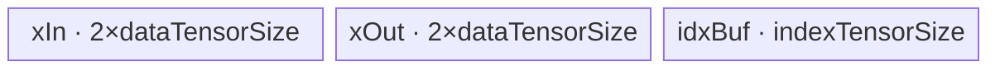
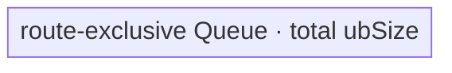
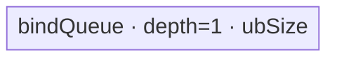

# Transpose 950 Direct Invoke 算子知识

## 算子速览

| 项目 | 内容 |
|---|---|
| 实际入口 | Python `cann_bench.transpose` → `torch.ops.cann_bench.transpose` → C++ `cann_bench::transpose_npu` → `launch_transpose_kernel`；Direct Invoke |
| 计算语义 | 对连续输入 `x` 按 `perm` 重排轴，`y[o_0,...,o_{r-1}] = x[i_0,...,i_{r-1}]`，其中 `i_{perm[k]}=o_k` |
| 输入输出 | rank 1..8；输入、输出均为连续 dense layout；输出 shape 为 `x.shape[perm[k]]`；支持 1/2/4/8 字节元素 |
| 执行类型 | 单 Device Kernel；R-001 为 AIV_VECTOR vconv，R-002 为 AIV_VECTOR MicroAPI gather，R-007/R-003 为 AIV 搬运，R-004 为 SIMT，R-005/R-006/R-008 为 NDDMA + AIV 搬运；无可达 Cube/AIC 或 MIX_CV 节点。 |
| Kernel 路线 | P0：R-001 VCONV、R-002 gather、R-007 N-last；P1：R-003 tensor move、R-004 small-shape SIMT、R-005 CUT_ONCE、R-006 CUT_TWICE、R-008 BIG_DIM |
| 核心资源 | GM 与 UB；vconv 路线双缓冲输入/输出 Queue；gather 路线双缓冲输入/输出 Queue 与索引 TBuf；N-last/tensor-move 使用 depth-2 bind Queue；CUT/BIG_DIM 使用单个 bind Queue；SIMT 直接 GM→GM；无 L1/L0/Cube 数据边；声明 workspace 为 16 MiB、Device 不消费 |
| 实现闭包 | `direct_implementation_closed`：直调注册、参数校验、Tiling、POD、key router、八条 active Route 的 body、单节点 launch 与构建接线均已闭合；平台 manager 空对象和异步输入 owner 属明确的源码外/未受控边界；官方固定路径是算法家族依据，不表示直调符号是公开 API |
| 边界 | 实现依赖 Host 侧 shape 乘积与 Device 窄化值可表示；源码未对这些乘法做统一 checked arithmetic，复用时必须保留该限制或补齐溢出拒绝 |

## 接口与语义

### 计算语义

设输入 rank 为 `r`，`perm` 是 `[0,r)` 的排列，负轴先加 `r`。输出维度 `Y_k=X_{perm[k]}`。输出线性下标先按输出 shape 解码为 `o_k`，再令输入坐标 `i_{perm[k]}=o_k`，最后按输入连续 stride 取 `x[i]`。算法只搬运元素比特，不进行数值计算；FP16、BF16、FP32 与整数在 launcher 中按元素字节数实例化为 `int8_t/int16_t/int32_t/int64_t`，因此同字节宽 dtype 共用位拷贝实现。

### 输入、输出与属性

| 参数 | shape/layout | dtype | 约束、默认值与语义 |
|---|---|---|---|
| `x` | rank 1..8，contiguous dense | Float16、Float32、BFloat16、Int8、Int16、Int32、Int64 | 每个维度必须大于 0；直调入口拒绝非连续输入 |
| `perm` | 长度等于 rank 的一维 Host 数组 | `int64_t`（Torch 属性）；Tiling 兼容 int32/int64 | 每个轴可为负；归一化后必须唯一且位于 `[0,r)` |
| `y` | `shape[k]=x.shape[perm[k]]`，contiguous dense | 与 `x` 相同 | 由入口分配；没有 workspace alias 或原地更新 |

### 入口与版本

直调层注册 schema `transpose(Tensor x, int[] perm) -> Tensor`，Meta 实现校验 rank/排列并创建 output shape；PrivateUse1 实现 `transpose_npu` 完成连续性、dtype、shape、平台信息和 Tiling 校验，再经当前 NPU stream 调用 `launch_transpose_kernel`。`launch_transpose_kernel` 不是 ACLNN，也不是公开 Host/Tiling API。目标版本为 CANN 9.1.0、950（`950`）。

## Host/Launcher 执行流程

### 参数校验与前处理

调用顺序为：`validate_and_get_output_shape` 检查 rank、perm 长度、归一化与去重；`transpose_npu` 检查 contiguous 和 dtype；创建输出；将 shape 与归一化 perm 拷入 `std::vector<int64_t>`；`get_transpose_platform_info` 读取 AIV 核数与 UB 字节；`calc_transpose_tiling` 再检查指针、rank、数组长度、core/UB 正值，构造本地 TilingContext，执行 `TransposeNddmaTiling::Init/RunTranposelTiling`，最后把 blockDim、key、workspaceSize 和 POD 字节复制到 2048 字节 launch 参数。显式校验失败、core/UB 非正或 Tiling 失败都会在 Kernel 启动前终止；但平台 manager 指针在解引用前没有判空，这一异常不属于可返回 `false` 的受控失败，详见“限制与失败边界”。

#### Shape 约简与语义不变式

Tiling 的 Route 判定对约简 shape 进行，Device 也只消费约简后的 `inputShape/outputShape/perm`：

```text
1. 删除 input shape 中 size=1 的轴，同步重编 perm；若全为 1，折叠为 [1], perm=[0]。
2. 按 output 顺序扫描 reducedPerm；相邻项若是连续 input 轴 a,a+1，合并为一轴，长度相乘。
3. reducedOut[k] = reducedIn[reducedPerm[k]]，且 ∏ reducedIn = ∏ originalIn。
```

这一不变式使 identity、只移动 size-1 轴或可整段合并的排列落到 reduced rank=1 的 tensor-move，而不需要独立 identity Kernel。合并条件必须是 input 轴号连续，不能只根据两轴长度或 output 位置相邻判定。

#### Checked arithmetic 契约

当前 Host 路径用 `int64_t` 直接计算 `vol *= dim`、轴合并乘积、stride、`totalBytes=vol*elementSize` 与分核工作量，没有逐项溢出检查；`calc_transpose_tiling` 也只验证指针、数组长度和 core/UB 正值。因此，对该路线做新的 Host 落地时，应在进入 Tiling 前将下列条件作为同一个拒绝门：

```text
checked_product(dims, int64_max) -> numel
checked_mul(numel, elementSize, int64_max) -> totalBytes
checked strides/products used by reduced shape, block count and GM offsets
require every value narrowed by a route to fit that route's Device type
```

SIMT 的 `coreFactor/coreOffset/outputShape/dstStride/xIdx`、gather 的部分 UB size/offset、vconv 的 `BaseProcess` R/C 参数会窄化到 32 位；gather 对 1/2 B 元素使用 16 位 index lane。现有路径依赖可表示前置，不得把 `int64_t` Host 字段视为 Device 端同宽保证。

### 参数、Workspace 与生命周期

`TransposeLaunchParams` 由 `transpose_npu` 栈上创建；lambda 以 `[=]` 捕获它并在调用 `launch_transpose_kernel` 时只读，POD 随 Kernel 参数按值提交。`data` 8 字节对齐、最大 2048 B。Host 根据平台产生 `coreNum` 与 `ubSize`。所有成功 Route 都把 workspace 声明为 `16*1024*1024` B，但直调 launcher 不分配、不传递 workspace，三个 Kernel entry 也没有 workspace 参数，因此该字段仅保留 Tiling ABI 信息，不构成 Device 边。

GM owner 必须分开陈述：返回的 `y` Tensor 持有输出 storage；lambda 因调用 `x.element_size()` 而按值捕获输入 Tensor `x`。源码只显示 `RunOpApi` 在当前 NPU stream 上提交后返回，没有显式 `recordStream`、completion event、Host callback 或同步等待。因此，输入 capture 是否覆盖 Device 完成期，以及输入/输出 storage 的延迟回收，依赖 `RunOpApi` 与 NPU allocator 的同流生命周期契约；这不能由该 Direct 源码单独证明。同一 stream 只证明提交与设备执行的顺序，不等同于 owner 生命周期证明。

### 启动图与失败传播

```text
cann_bench::transpose_npu
  -> get_transpose_platform_info
  -> calc_transpose_tiling
  -> OpCommand::RunOpApi("Transpose", lambda)
     -> launch_transpose_kernel(elementSize, params, stream)
        -> [exactly one]
           transpose_vconv_kernel / transpose_gather_kernel<T> / transpose_nddma_kernel<T>
```

| 节点 | Host 启动 | entry/grid/POD | 输入→输出 | ordering / lifetime / 失败 |
|---|---|---|---|---|
| K-001 | `launch_by_type<T>` | `<<<params.blockDim,nullptr,stream>>>`；按 key 解释三种 POD | `x GM → y GM`；无中间边 | 同 stream 保证提交顺序；返回 `y` 持有输出，输入 capture/完成期回收依赖 `RunOpApi`/allocator 契约；受控 Host 校验或 Tiling 失败阻断 launch，平台 manager 空对象除外；Device 无返回值 |

单 Route 仅有 K-001，没有 Kernel 间 workspace/GM edge。`elementSize` 仅接受 1/2/4/8；其它值不启动任何 Kernel，但入口 dtype 白名单保证正常路径不会命中该终点。未知 key 仍会进入普通 `transpose_nddma_kernel<T>` entry，但 Device router 不构造任何 body；这是静默空操作，不是 fallback。

#### Key/POD 互锁

| key | Host 必须产生的 raw POD | launcher 解释 | Device entry |
|---:|---|---|---|
| 10007 | `TransposeVCONVTilingData`，完整 struct | VCONV POD | `transpose_vconv_kernel` |
| 10006 | `GatherTransposeTilingData`，完整 struct | gather POD | `transpose_gather_kernel<T>` |
| 10000..10005 | `TransposeTilingData{TransposeOpTilingData}`，完整 struct | 普通 POD | `transpose_nddma_kernel<T>` |

Host/Device 只用 `static_assert(sizeof(host)==sizeof(device))` 锁定三对 struct 总大小，launcher 没有按 key 复核 `dataSize==sizeof(expected)`。因此 key、POD 类型、`blockDim` 和 raw data 必须由同一次成功 Tiling 原子产生；不能缓存旧 POD 只替换 key，也不能把 `dataSize<=2048` 误当成结构匹配证明。

## Route 与参数设计

### 生产可达性分类与穷尽证明

Direct adapter 固定构造 `TransposeNddmaTiling(&context)`，成员 `isReleatedTranspsoe_` 保持默认 `false`，再调用 `Init(coreNum, ubSize)` 与 `RunTranposelTiling()`。因此生产 selector 的可达分类如下；“capability 可失败”只表示该 active Route 有 fallback 出边，不会把它降为 conditional。

| Route | 类别 | 生产可达证据 | 终止 key/body 与 fallback 出边 |
|---|---|---|---|
| R-001 VCONV | `active` | H1 在 950 2-D swap、2 B、`R>5` 上直接调用 VCONV tiler，存在 guard 全部成功的合法输入 | 10007/`KernelTransDataTo5HD<int16_t>`；capability 失败到 H2 |
| R-002 gather | `active` | H1 未返回且 last-axis transpose 时调用 gather tiler，MTE/bank/用核 guard 可满足 | 10006/`TransposeWithGather<T>`；失败到 H3 |
| R-007 N-last | `active` | H1/H2 未返回、rank>1、大 shape、末轴固定且长度至少 32 | 10004/`TransposeNLast<T>`；终点，无 Device fallback |
| R-003 tensor move | `active` | H1/H2 未返回且约简 rank=1 | 10000/`TransposeTensorMove<T>`；终点 |
| R-004 small-shape | `active` | H1/H2 未返回、rank>1 且总字节小于阈值 | 10001/`TransposeSmallShape<T>`；普通 selector 最终兜底 |
| R-005 CUT_ONCE | `active` | 大 shape、非 N-last、rank≤5，`DoSplitUB` 得到 `outCutIndex<=FindOutIndex(inCutIndex)` | 10002/`TransposeCutOneAxis<T>`；终点 |
| R-006 CUT_TWICE | `active` | 与 R-005 同一 NDDMA_BASE 入口，且上述 cut-index 关系取反 | 10003/`TransposeCutTwoAxis<T>`；终点 |
| R-008 BIG_DIM | `active` | 大 shape、非 N-last且约简 rank>5 | 10005/`TransposeBigDim<T>`；终点 |

本直调合法域没有独立的 `conditional` terminal Route：VCONV/gather 的 tiler 成败、各 body 的 main/tail phase 都是 active Route 内部的条件边，不产生额外 key/body。源码中的 `TilingForReleatedTranspose`（将 `isReleatedTranspsoe_=true`）以及静态 `TransposeTilingForAscendC`/`TilingPrepareTransposeForAscendC` 属 `dormant` Host 模式：`transpose_npu → calc_transpose_tiling` 不调用或注册这些入口，related 模式还依赖外部传入的 `ShapeInfo`、已有 POD 与 compiler info。重新启用必须另接 framework tiling registration/call site，并补齐这些输入和平台编译信息；它们复用现有普通 key/body，不构成本直调链的第九条 Route。

对任一通过入口校验且 Tiling 成功的输入，下列分割是穷尽且互斥的：H1 成功/失败覆盖 VCONV 候选，失败后 H2 成功/失败覆盖 gather 候选；再按 `dim==1`/`dim>1`、`totalBytes<threshold`/`>=threshold`、N-last 谓词真/假、`dim<=5`/`dim>5`，最后以 cut-index 的 `<=`/`>` 二分。因而合法成功链恰好产生八个 key 之一：

```text
if TryVCONVTiling()==SUCCESS:                         key=10007
else if lastAxisTransposed && GatherTiling()==SUCCESS:key=10006
else if dim==1:                                      key=10000
else if totalBytes<threshold:                        key=10001
else if !lastAxisTransposed && inShape[dim-1]>=32:   key=10004
else if dim>5:                                       key=10005
else:
    DoSplitUB()
    key = outCutIndex>FindOutIndex(inCutIndex) ? 10003 : 10002

launch:
  10006 -> transpose_gather_kernel<T>(Gather POD)
  10007 -> transpose_vconv_kernel(VCONV POD)
  10000..10005 -> transpose_nddma_kernel<T>(Transpose POD, key)
                   -> exact one of move/SIMT/CUT_ONCE/CUT_TWICE/N-last/BIG_DIM
```

`calc_transpose_tiling` 返回失败会阻断 launch，不是 scalar/CPU conditional fallback；未知 key 的 no-body 和非法 elementSize 的 no-launch 也不是合法 Route。

### Route 特征与重要性

下表的 P0/P1 只表示本卡的阅读与复用重要性，不改变 Host 的真实选择顺序。后续 Route 矩阵、逐 Route 章节及 Route 专属展开均按表中行序排列；运行时控制流以后续“Route 选择”的 `Host 顺序`、短路和 fallback 字段为准。

| 重要性 | Route | Route 特征 | 适用域 | 实现前提 |
|---|---|---|---|---|
| P0 | R-001 VCONV | 二维 16-bit swap 的 16×16 `TransDataTo5HD` 专用路线；按 R/C 与 UB 容量形成 full、单轴切分或双轴切分 | 950；约简后 2-D `[1,0]`；元素 2 B；首轴大于 5 | `TryVCONVTiling` 与全部 R/C/core/UB guard 成功；固定 `int16_t` body，保持比特搬运 |
| P0 | R-002 gather | last-axis transpose 的 MTE 搬入 + MicroAPI register gather；覆盖 1/2/4/8 B 元素 | 非 related；约简后最后输出轴来自非最后输入轴 | UB/MTE、bank-conflict 与用核率 guard 全部成立；按实际 tail 组合生成 1..4 组 index 相位 |
| P0 | R-007 N-last | 大 shape 且输入末轴保持连续的 MoveAlign 路线；双缓冲搬入后以 loop-mode scatter 写回 | 约简后 rank>1；总字节达到阈值；末轴固定且长度至少 32 | `inCutIndex/inUbFactor/inTailFactor` 与 loop-mode shape 一致；bind Queue 深度 2 |
| P1 | R-003 tensor move | 约简后一维的连续位拷贝；按核连续分段并在核内按 UB 循环 | 约简后 rank=1 | 双缓冲容量按 `ubSize/(2*sizeof(T))` 计算；尾核与尾 UB loop 只搬有效字节 |
| P1 | R-004 small-shape SIMT | 前置专用路线均未接受时的通用小 shape 兜底；线程独占输出元素并直接 GM→GM | 约简后 rank 2..8；总字节低于 950 阈值 | 2048-thread VF、magic-division 地址解码和 `blkTailFactor` 覆盖完整输出域 |
| P1 | R-005 CUT_ONCE | 大 shape、至多 5-D 的单切轴 NDDMA；main/tail 两套 shape 共用单个 UB tile | 非 N-last；总字节达到阈值；`outCutIndex<=FindOutIndex(inCutIndex)` | 5-D 左补 identity、NDDMA dst 对齐、输入/输出 factor 与尾块参数一致 |
| P1 | R-006 CUT_TWICE | 大 shape、至多 5-D 的双切轴 NDDMA；main/input-tail/output-tail/both-tail 四阶段串行复用 UB | 非 N-last；总字节达到阈值；`outCutIndex>FindOutIndex(inCutIndex)` | 四组 shape、四段区间和 base offset 同源；单 bind Queue 深度 1 |
| P1 | R-008 BIG_DIM | 高秩大 shape 的外层 mixed-radix + 内层最多 5-D NDDMA | 非 N-last；总字节达到阈值；约简后 rank>5 | `nddmaIdx/baseNddmaShape/totalNddmaNum` 与输出切轴 main/tail 参数一致 |

### 分核与资源计算

Host 先移除 size-1 轴，再合并输出排列中连续的输入轴。`totalVolumeActual=∏reducedInShape[i]`。普通 NDDMA 可用元素数为 `ubSize/sizeof(T)`；tensor-move 与 N-last 因 bind queue 深度 2 使用 `ubSize/(2*sizeof(T))`。SMALL_SHAPE 每核元素按 128 B 对齐并由 `realCoreNum/blkFactor/blkTailFactor` 划分。CUT 路线以 `sqrt(ubElement)` 起始，分别求输入与输出切轴，利用 90% 核使用率目标调整 factor；BIG_DIM 最多把 5 个维度放入 NDDMA。Gather 的 UB 账由 dtype 分支给出；vconv 先取 `AvailableUbSize=ubSize/4`，再以 16 元素块拆 R/C 与 main/tail core。

#### Block/core 映射不变式

不同 body 对 `blkTailFactor` 的语义不完全相同，落地时必须与对应 Host producer 成对复用：

| Route | 核 `c` 的工作量 | 起始位置 | tail 语义 |
|---|---|---|---|
| R-003/R-005/R-006/R-007/R-008 | `n_c=blkFactor+(c<blkTailFactor)` | `start_c=c*blkFactor+min(c,blkTailFactor)` | 前 `blkTailFactor` 个核各多 1 个 tile/element span |
| R-004 SIMT | 非末核为 `blkFactor`；末核在 `blkTailFactor!=0` 时改为该值 | `start_c=c*blkFactor` | 只表示最后一核有效元素数，不做前核余数分散 |
| R-002 gather | 非末核为 `blkFactor`，末核为 `blkTailFactor` | `blkBeg=c*blkFactor` | `blkTailFactor=totalTiles-(usedCoreCnt-1)*blkFactor` |
| R-001 VCONV | R-split 或 C-split 下的 main core loop；`UsedCoreNum-1` 号核使用 tail-core 参数 | 由 `BlockFactor` 与 R/C GM stride 共同给出 | core tail 内部还可有 UB-loop tail，两层 tail 不得合并 |

普通 NDDMA 类 Route 的 `realCoreNum` 是唯一 Device block guard；gather 使用 `usedCoreCnt`，vconv 使用 `UsedCoreNum`。Host 可以启动大于有效核数的 grid 的一般写法在这些 body 中是安全的，但本实现实际将 `blockDim` 设为该 Route 的有效核数。

### Route 选择

下表按重要性排列，不代表 Host 判断顺序。Host 先完成 shape 校验、size-1 轴删除与连续轴合并；H1/H2 是可失败并继续的专用 tiler，H3～H7 是 `EntryTilingTemplate` 的互斥终点，R-005/R-006 再由同一个 NDDMA_BASE 分支内部确定最终 key。

| 重要性 | Route | Host 顺序 | Key/模板 | 精确选择条件 | 短路/fallback |
|---|---|---:|---|---|---|
| P0 | R-001 VCONV | H1 | 10007 / `KernelTransDataTo5HD<int16_t>` | 950 arch；非 related；reduced dim=2；perm=[1,0]；元素 2 B；`reducedInShape[0]>5`；且 vconv tiling 成功 | 成功立即返回；谓词或 capability 失败继续 H2，不直接跳到普通路线 |
| P0 | R-002 gather | H2 | 10006 / `TransposeWithGather<T>` | H1 未返回；非 related；最后输出轴来自非最后输入轴；UB gather/MTE guard 与至少半核 guard 均成功 | 成功立即返回；谓词或 tiling 失败继续 H3 |
| P0 | R-007 N-last | H4 | 10004 / `TransposeNLast<T>` | H1/H2 未返回、H3 的 rank=1 为假；bytes≥1,000,000；最后轴固定；reduced 输入末轴≥32 | 命中后 `EntryTilingTemplate` 返回，随后只生成本 Route 的 split/POD；大 shape 下不命中按 rank 进入 H5/H6，低于阈值则进入 H7 |
| P1 | R-003 tensor move | H3 | 10000 / `TransposeTensorMove<T>` | H1/H2 未返回；reduced dim=1 | 命中后 `EntryTilingTemplate` 返回；不命中才检查大 shape 分支 H4～H6 或小 shape H7 |
| P1 | R-004 small-shape | H7 | 10001 / `TransposeSmallShape<T>` | H1/H2 未返回、reduced dim>1，且 bytes<1,000,000 | `EntryTilingTemplate` 的最终兜底；终止 Host Route 选择，无 Device fallback |
| P1 | R-005 CUT_ONCE | H5a | 10002 / `TransposeCutOneAxis<T>` | H4 未命中；bytes≥1,000,000；dim≤5；UB 双切计算后 `outCutIndex<=FindOutIndex(inCutIndex)` | NDDMA_BASE 先短路 H6/H7，再在 `CalcUBSplitInfo` 内定为 10002；无后续 Route fallback |
| P1 | R-006 CUT_TWICE | H5b | 10003 / `TransposeCutTwoAxis<T>` | 与 H5a 共享前置条件，且 `outCutIndex>FindOutIndex(inCutIndex)` | 与 R-005 互斥；定为 10003 后无后续 Route fallback |
| P1 | R-008 BIG_DIM | H6 | 10005 / `TransposeBigDim<T>` | H4 未命中；bytes≥1,000,000；dim>5 | 命中后 `EntryTilingTemplate` 返回并终止选择；小 shape 不会到达本分支 |

```text
normalize shape/perm
-> if 950 && dim=2 && perm=[1,0] && bytesPerElem=2 && R>5 && vconv capable: 10007
-> else if last-axis-transposed && gather capable: 10006
-> else if dim==1: 10000
-> else if totalBytes>=1,000,000:
     if last-axis-fixed && lastInputAxis>=32: 10004
     else if dim<=5: NDDMA split -> 10002 or 10003
     else: 10005
-> else: 10001
```

### 模板/实现执行矩阵

| 重要性 | Route | key/selector | dtype/shape/platform 完整命中条件 | 执行拓扑与 Kernel 节点 | 实际模板/body | 内存与同步特征 | tail/fallback |
|---|---|---|---|---|---|---|---|
| P0 | R-001 VCONV | 10007 | 950、2-D swap、2 B、R>5、tiling capable | K-001 | `transpose_vconv_kernel` → `KernelTransDataTo5HD<int16_t>` | 双输入/输出 Queue，各 depth=2 | R/C/core/UB main-tail；capability 失败转后续 |
| P0 | R-002 gather | 10006 | last-axis transpose；MTE≥32768 B；bank guard false；used cores≥core/2 | K-001 | `transpose_gather_kernel<T>` → `TransposeWithGather<T>` | xIn/xOut depth=2 + index TBuf；Queue 同步 | 按实际 tail 组合预生成 1..4 组 index phase |
| P0 | R-007 N-last | 10004 | 大 shape、末轴固定且末轴至少 32 元素 | K-001 | `TransposeNLast<T>` | bind Queue depth2 | 输入切轴 main/tail |
| P1 | R-003 move | 10000 | reduced dim=1 | K-001 | `TransposeTensorMove<T>` | bind Queue depth=2 | 每核与 UB loop tail |
| P1 | R-004 SIMT | 10001 | totalBytes<1,000,000，且未被前置路线接收 | K-001 | `TransposeSmallShape<T>` → `SimtComputeDim{2..8}` | 无显式 UB；GM 直读直写 | 最后一核 `blkTailFactor`；rank=1 已由 move 接收 |
| P1 | R-005 cut once | 10002 | 大 shape、dim≤5，单切关系 | K-001 | `TransposeCutOneAxis<T>` | 单 bind Queue，1×ubSize；NDDMA→MTE3 | main/tail 两种 shape |
| P1 | R-006 cut twice | 10003 | 大 shape、dim≤5，双切关系 | K-001 | `TransposeCutTwoAxis<T>` | 单 bind Queue，1×ubSize；四阶段区间 | main/input-tail/output-tail/both-tail |
| P1 | R-008 BIG_DIM | 10005 | 大 shape、非 N-last、reduced dim>5 | K-001 | `TransposeBigDim<T>` | 单 bind Queue；外层 mixed-radix + 内层 5-D NDDMA | 输出切轴 main/tail |

### Route 间共同契约

| 契约 | 所有 Route 必须保持的事实 | Route 特例 |
|---|---|---|
| 语义 | 每个 output 线性位置只由一个 block/thread 写，对应唯一 input 位置 | R-003 在约简后是 identity bit-copy；其它 Route 执行等价的轴重排 |
| dtype/精度 | launcher 按 1/2/4/8 B 实例化整数 `T`，全路径不做数值 cast | R-001 固定 `int16_t`；R-002 的 int8 在寄存器内以 B16 gather，再 `DIST_PACK_B16` 写回原字节 |
| 内存层级 | 输入/输出边只是 GM；需要 tile 的 Route 只在 UB Queue/TBuf 停留 | 无 L1/L0 配置、无 Cube 进入口；R-004 连 UB 也不分配 |
| tail | padding 只能存在 UB；GM 读写 extent 由 tail factor/shape/blockLen 裁成有效区 | VCONV 用 16 元素对齐 shape；CUT 用独立 tail shape；SIMT 用 loop bound；gather 用 phase + vector mask |
| 同步 | 单 stream 只提交一个 Kernel；Kernel 内 Queue 以 `Alloc→EnQue→DeQue→Free` 建立 MTE/V 顺序 | R-004 无 Queue，依靠输出下标独占；CUT_TWICE 四 phase 串行复用同一 slot |
| fallback | Device body 不再选 Route | 仅 R-001/R-002 的 Host tiler 可失败并继续；普通 selector 定 key 后不退化 |

Gather 的 mask 有一个必须原样保留的 dtype 差异：逻辑输出长度为 `outLen`，非 int8 路线以 `UpdateMask<T>(outLen)` 限定有效 lane；int8 的 gather 寄存器元素是 16 位，因此 mask 计数先变为 `2*outLen`，store 时再 pack 为原字节。不能将 int8 分支简化为与其它 dtype 相同的 mask/store。

### 性能与能力 Guard

| Guard | Host/Tiling 条件 | Device/资源原因 | 影响 Route | 不满足时去向 | 源码符号 |
|---|---|---|---|---|---|
| 950 vconv | `arch==DAV_5102 && dim==2 && perm=[1,0] && eleLen==2 && R>5` | `TransDataTo5HD` 固定 16×16、int16 body | R-001 | gather/NDDMA | `TransposeNddmaTiling::TryVCONVTiling` |
| vconv UB | `BlockFactor*16*sizeof(T) <= AvailableUbSize` | 至少容纳一个 16 宽转置块 | R-001 | vconv tiling 失败，继续 selector | `CalcRCNotFullLoadUbSplitInfo` |
| gather MTE | `totalSizeInUb>=0x8000 && !CheckBC(indexStep)` | 保证搬运规模并避开偶数 sub-bank 步长冲突 | R-002 | NDDMA selector | `CalcUbAxesInfo` |
| gather core | `usedCoreCnt>=coreNum/2` | 避免过少核的 gather route | R-002 | NDDMA selector | `CalcBlockSplitInfo` |
| N-last | `!isLastAxisTranspose && lastInputAxis>=32` | 连续末轴满足 MoveAlign 规模 | R-007 | NDDMA/BIG_DIM | `EntryTilingTemplate` |
| small threshold | `totalBytes<1,000,000` | 950 selector 的 SIMT 兜底阈值 | R-004 | 大 shape 路线 | `EntryTilingTemplate` |
| NDDMA rank | `reduced dim<=5` | `MultiCopyLoopInfo<5>` 上限 | R-005/R-006 | BIG_DIM | `EntryTilingTemplate` |
| ABI size | raw data `0<size<=2048`，三对 Host/Device struct `sizeof` 相等 | launcher 固定 POD 缓冲并按 key reinterpret | 全部 | tiling 失败 | `calc_transpose_tiling` |

### POD/ABI

所有 offset 均以结构起点为 0、单位 B；布局按 Host/Device C++ 定义推导，三对 POD 由 `static_assert(sizeof)` 锁定总大小。公共 launch envelope 先列；Route 专属 POD 按 R-001→R-002 排列，随后列出 R-007 与 P1 普通路线共享的 `TransposeOpTilingData`。

| 结构 | 字段 | 类型/位宽 | ABI 布局 | 单位 | Host/launcher producer | Device consumer | 边界 |
|---|---|---|---|---|---|---|---|
| `TransposeLaunchParams` | `blockDim` | int64/64 | off 0 | core | context blockDim | launch grid | >0 |
| 同上 | `tilingKey` | uint64/64 | off 8 | key | context key | `launch_by_type`/router | 10000..10007 |
| 同上 | `workspaceSize` | size_t/64 | off 16 | B | context workspace | Device 不读 | 16 MiB 声明 |
| 同上 | `dataSize` | size_t/64 | off 24 | B | raw POD size | copy 边界 | 1..2048 |
| 同上 | `data` | byte[2048] | off 32，align 8；sizeof=2080 | B | `memcpy(raw)` | 按 key reinterpret | 未用区为 0 |
| `TransposeVCONVTilingData` | `AvailableUbSize` | int64/64 | off 0 | B/slot | `ubSize/4` | Queue InitBuffer | positive |
| 同上 | `UsedCoreNum` | int64/64 | off 8 | core | core split | block guard | positive |
| 同上 | `MainCoreLoopCount` | int64/64 | off 16 | loop | UB split | main core Process | positive |
| 同上 | `TailCoreLoopCount` | int64/64 | off 24 | loop | UB split | tail core Process | positive |
| 同上 | `RLen` | int64/64 | off 32 | element | reduced shape[0] | address/compute | positive |
| 同上 | `CLen` | int64/64 | off 40 | element | reduced shape[1] | address/compute | positive |
| 同上 | `RAlignBlock` | int64/64 | off 48 | 16-element block | ceil(R/16) | split | positive |
| 同上 | `CAlignBlock` | int64/64 | off 56 | 16-element block | ceil(C/16) | split | positive |
| 同上 | `RAlignBlockElem` | int64/64 | off 64 | element | `RAlignBlock*16` | compute | 16 aligned |
| 同上 | `CAlignBlockElem` | int64/64 | off 72 | element | `CAlignBlock*16` | compute | 16 aligned |
| 同上 | `IsRSplit` | bool/8 | off 80 | flag | split selector | GM offset branch | false/true |
| 同上 | `IsRCSplit` | bool/8 | off 81 | flag | split selector | GM offset branch | only meaningful with R split |
| 同上 | `rSplitPara.AlignBlockFactor` | int64/64 | off 88 | 16-element block | R core split | R core factor | positive |
| 同上 | `rSplitPara.BlockFactor` | int64/64 | off 96 | element | R core split | R GM offset | 16 aligned |
| 同上 | `rSplitPara.BlockCount` | int64/64 | off 104 | core | R core split | UsedCoreNum relation | positive |
| 同上 | `rSplitPara.AlignBlockTailFactor` | int64/64 | off 112 | 16-element block | R core split | tail core | positive |
| 同上 | `rSplitPara.BlockTailFactor` | int64/64 | off 120 | element | R core split | tail GM extent | 16 aligned allocation |
| 同上 | `cSplitPara.AlignBlockFactor` | int64/64 | off 128 | 16-element block | C core split | C core factor | positive |
| 同上 | `cSplitPara.BlockFactor` | int64/64 | off 136 | element | C core split | C GM offset | 16 aligned |
| 同上 | `cSplitPara.BlockCount` | int64/64 | off 144 | core | C core split | UsedCoreNum relation | positive |
| 同上 | `cSplitPara.AlignBlockTailFactor` | int64/64 | off 152 | 16-element block | C core split | tail core | positive |
| 同上 | `cSplitPara.BlockTailFactor` | int64/64 | off 160 | element | C core split | tail GM extent | 16 aligned allocation |
| 同上 | `rUbSplitPara.MainCoreUbAlignFactor` | int64/64 | off 168 | 16-element block | R UB split | main loop compute | positive |
| 同上 | `rUbSplitPara.MainCoreUbFactor` | int64/64 | off 176 | element | R UB split | main loop copy | positive |
| 同上 | `rUbSplitPara.MainCoreUbCount` | int64/64 | off 184 | loop | R UB split | main core loop | positive |
| 同上 | `rUbSplitPara.MainCoreTailUbAlignFactor` | int64/64 | off 192 | 16-element block | R UB split | last main loop | positive |
| 同上 | `rUbSplitPara.MainCoreTailUbFactor` | int64/64 | off 200 | element | R UB split | last main copy | positive |
| 同上 | `rUbSplitPara.TailCoreUbAlignFactor` | int64/64 | off 208 | 16-element block | R UB split | tail core loop | positive |
| 同上 | `rUbSplitPara.TailCoreUbFactor` | int64/64 | off 216 | element | R UB split | tail core copy | positive |
| 同上 | `rUbSplitPara.TailCoreUbCount` | int64/64 | off 224 | loop | R UB split | tail core loop | positive |
| 同上 | `rUbSplitPara.TailCoreTailUbAlignFactor` | int64/64 | off 232 | 16-element block | R UB split | final tail loop | positive |
| 同上 | `rUbSplitPara.TailCoreTailUbFactor` | int64/64 | off 240 | element | R UB split | final tail copy | positive |
| 同上 | `cUbSplitPara.MainCoreUbAlignFactor` | int64/64 | off 248 | 16-element block | C UB split | main loop compute | positive |
| 同上 | `cUbSplitPara.MainCoreUbFactor` | int64/64 | off 256 | element | C UB split | main loop copy | positive |
| 同上 | `cUbSplitPara.MainCoreUbCount` | int64/64 | off 264 | loop | C UB split | main core loop | positive |
| 同上 | `cUbSplitPara.MainCoreTailUbAlignFactor` | int64/64 | off 272 | 16-element block | C UB split | last main loop | positive |
| 同上 | `cUbSplitPara.MainCoreTailUbFactor` | int64/64 | off 280 | element | C UB split | last main copy | positive |
| 同上 | `cUbSplitPara.TailCoreUbAlignFactor` | int64/64 | off 288 | 16-element block | C UB split | tail core loop | positive |
| 同上 | `cUbSplitPara.TailCoreUbFactor` | int64/64 | off 296 | element | C UB split | tail core copy | positive |
| 同上 | `cUbSplitPara.TailCoreUbCount` | int64/64 | off 304 | loop | C UB split | tail core loop | positive |
| 同上 | `cUbSplitPara.TailCoreTailUbAlignFactor` | int64/64 | off 312 | 16-element block | C UB split | final tail loop | positive |
| 同上 | `cUbSplitPara.TailCoreTailUbFactor` | int64/64 | off 320；sizeof=328 | element | C UB split | final tail copy | positive |
| `GatherTransposeTilingData` | `tilingKey` | uint64/64 | off 0 | key | constant 10006 | informational | fixed |
| 同上 | `dataTensorSize` | uint32/32 | off 8 | B/slot | `CalcTensorSize` | xIn/xOut InitBuffer | 32 B aligned |
| 同上 | `indexTensorSize` | uint32/32 | off 12 | B | `CalcTensorSize` | idxBuf InitBuffer | dtype-dependent |
| 同上 | `usedCoreCnt` | uint32/32 | off 16 | core | block split | block guard/range | at least half cores |
| 同上 | `blkAxesCnt` | int8/8 | off 20 | count | block split | block decode | 0..8 |
| 同上 | `blkInUbCutPos` | int8/8 | off 21 | index | block split | input-tail switch | -1 inactive |
| 同上 | `blkOutUbCutPos` | int8/8 | off 22 | index | block split | output-tail switch | -1 inactive |
| 同上 | `ubAxesCnt` | int8/8 | off 23 | count | UB split | UB loops/index | ≤6 |
| 同上 | `inUbInCutPos` | int8/8 | off 24 | index | UB split | input axis update/MTE | valid when cut |
| 同上 | `inUbOutCutPos` | int8/8 | off 25 | index | UB split | input axis update/MTE | valid when cut |
| 同上 | `outUbInCutPos` | int8/8 | off 26 | index | UB split | output axis update | valid when cut |
| 同上 | `outUbOutCutPos` | int8/8 | off 27 | index | UB split | gather/output loops | valid when cut |
| 同上 | `blkFactor` | int64/64 | off 32 | loop/core | block split | non-last core range | >0 |
| 同上 | `blkTailFactor` | int64/64 | off 40 | loop | block split | last core range | >0 |
| 同上 | `inUbCutAxisSize` | int64/64 | off 48 | element | UB split | tail remainder | positive |
| 同上 | `outUbCutAxisSize` | int64/64 | off 56 | element | UB split | tail remainder | positive |
| 同上 | `inUbCutAxisFactor` | int32/32 | off 64 | element | UB split | main tile axes | positive |
| 同上 | `outUbCutAxisFactor` | int32/32 | off 68 | element | UB split | main tile axes | positive |
| 同上 | `axis0InSrcStride` | int64/64 | off 72 | element | MTE split | CopyIn axis0 | 0 when loop size 1 |
| 同上 | `axis1InSrcStride` | int64/64 | off 80 | element | MTE split | CopyIn loop1 | 0 when inactive |
| 同上 | `axis2InSrcStride` | int64/64 | off 88 | element | MTE split | CopyIn loop2 | 0 when inactive |
| 同上 | `axis0OutDstStride` | int64/64 | off 96 | element | MTE split | CopyOut axis0 | 0 when loop size 1 |
| 同上 | `axis1OutDstStride` | int64/64 | off 104 | element | MTE split | CopyOut loop1 | 0 when inactive |
| 同上 | `axis2OutDstStride` | int64/64 | off 112 | element | MTE split | CopyOut loop2 | 0 when inactive |
| 同上 | `blkAxes` | int64[8] | off 120 | loop radix | block split | `CalcBlkAddr` | 前 count 有效 |
| 同上 | `blkAxesInAOffset` | int64[8] | off 184 | element | block split | input GM base | 前 count 有效 |
| 同上 | `blkAxesOutAOffset` | int64[8] | off 248 | element | block split | output GM base | 前 count 有效 |
| 同上 | `inUbAxes` | int32[6] | off 312 | element | UB split | CopyIn/index | 前 count 有效 |
| 同上 | `outUbAxes` | int32[6] | off 336 | element | UB split | gather/CopyOut | 前 count 有效 |
| 同上 | `ubPerm` | int8[6] | off 360；sizeof=368 | axis | UB split | gather index | 前 count 有效 |
| `TransposeOpTilingData` | `permSize` | int64/64 | off 0 | axis count | `shapeInfo_.dim` | rank/loop bounds | 1..8 |
| 同上 | `inCutIndex` | int64/64 | off 8 | axis | `splitInfo_.inCutIndex` | CUT/N-last address | route dependent |
| 同上 | `outCutIndex` | int64/64 | off 16 | axis | `splitInfo_.outCutIndex` | CUT/BIG_DIM address | route dependent |
| 同上 | `inUbFactor` | int64/64 | off 24 | element | input UB split | core/tile loops | >0 when consumed |
| 同上 | `outUbFactor` | int64/64 | off 32 | element | output UB split | NDDMA/tail | >0 when consumed |
| 同上 | `inTailFactor` | int64/64 | off 40 | element | input remainder | tail shape | 0 means no input tail |
| 同上 | `outTailFactor` | int64/64 | off 48 | element | output remainder | tail shape | 0 means no output tail |
| 同上 | `realCoreNum` | int64/64 | off 56 | core | block split | block guard | 1..platform cores |
| 同上 | `blkFactor` | int64/64 | off 64 | loop/core | block split | per-core loop count | main factor |
| 同上 | `blkTailFactor` | int64/64 | off 72 | loop/core | block split | former/tail distribution | 0 allowed |
| 同上 | `ubSize` | int64/64 | off 80 | B | platform UB query | InitBuffer | positive |
| 同上 | `totalNddmaNum` | int64/64 | off 88 | element | BIG_DIM fold | BIG_DIM blockLen | BIG_DIM active |
| 同上 | `rangeMainEnd` | int64/64 | off 96 | flattened loop | CUT_TWICE interval builder | `ProcessBlock` | CUT_TWICE active |
| 同上 | `rangeInputTailStart` | int64/64 | off 104 | flattened loop | interval builder | input-tail phase | CUT_TWICE active |
| 同上 | `rangeInputTailEnd` | int64/64 | off 112 | flattened loop | interval builder | input-tail phase | CUT_TWICE active |
| 同上 | `rangeOutputTailStart` | int64/64 | off 120 | flattened loop | interval builder | output-tail phase | CUT_TWICE active |
| 同上 | `rangeOutputTailEnd` | int64/64 | off 128 | flattened loop | interval builder | output-tail phase | CUT_TWICE active |
| 同上 | `rangeTailStart` | int64/64 | off 136 | flattened loop | interval builder | both-tail phase | CUT_TWICE active |
| 同上 | `rangeTailEnd` | int64/64 | off 144 | flattened loop | interval builder | both-tail phase | CUT_TWICE active |
| 同上 | `inputShape` | int64[8] | off 152 | 元素 | reduced input | 全部普通 body | 前 `permSize` 有效 |
| 同上 | `outputShape` | int64[8] | off 216 | 元素 | reduced output | 全部普通 body | 前 `permSize` 有效 |
| 同上 | `perm` | int64[8] | off 280 | axis | reduced perm | 地址映射 | 前 `permSize` 有效 |
| 同上 | `baseInShape` | int64[8] | off 344 | 元素 stride | BIG_DIM flush | BIG_DIM | 其它 route inactive |
| 同上 | `baseNddmaShape` | int64[5] | off 408 | 元素 stride | BIG_DIM flush | BIG_DIM | 其它 route inactive |
| 同上 | `nddmaIdx` | int64[5] | off 448 | axis | BIG_DIM flush | BIG_DIM | 可含 -1 inactive |
| 同上 | `expandedPerm` | int64[5] | off 488 | axis | `NDDMADimExpand` | CUT route | 左侧 identity 补齐 |
| 同上 | `expandedInputShape` | int64[5] | off 528 | element | `NDDMADimExpand` | CUT route | 左侧补 1 |
| 同上 | `expandedOutputShape` | int64[5] | off 568 | element | `NDDMADimExpand` | CUT route | 左侧补 1 |
| 同上 | `inUbMainSrcShape` | int64[5] | off 608 | element | main shape builder | CUT NDDMA | main phase |
| 同上 | `inUbMainDstShape` | int64[5] | off 648 | element | main shape builder | CUT MTE3 | main phase |
| 同上 | `inUbInputTailSrcShape` | int64[5] | off 688 | element | double-cut builder | CUT_TWICE NDDMA | input-tail phase |
| 同上 | `inUbInputTailDstShape` | int64[5] | off 728 | element | double-cut builder | CUT_TWICE MTE3 | input-tail phase |
| 同上 | `inUbOutputTailSrcShape` | int64[5] | off 768 | element | double-cut builder | CUT_TWICE NDDMA | output-tail phase |
| 同上 | `inUbOutputTailDstShape` | int64[5] | off 808 | element | double-cut builder | CUT_TWICE MTE3 | output-tail phase |
| 同上 | `inUbTailSrcShape` | int64[5] | off 848 | element | tail builder | CUT NDDMA | single/both tail |
| 同上 | `inUbTailDstShape` | int64[5] | off 888；sizeof=928 | element | tail builder | CUT MTE3 | single/both tail |

### Route 源码闭包

| 重要性 | Route/类别 | Key/selector | Host/Tiling producer | POD/参数 | Kernel entry/router 节点 | Kernel body/直接依赖 | 关键伪码与构建接线 |
|---|---|---|---|---|---|---|---|
| P0 | R-001 / active | 10007 | `TryVCONVTiling` + `TransposeVCONVTiling` | VCONV POD | `transpose_vconv_kernel` | `KernelTransDataTo5HD` | R-001“源码等价伪码”；direct registration + ascend950→dav-3510 |
| P0 | R-002 / active | 10006 | `TransposeGatherTiling::DoTiling` | Gather POD | `transpose_gather_kernel<T>` | `TransposeWithGather<T>` | R-002“源码等价伪码”；同上 |
| P0 | R-007 / active | 10004 | `EntryTilingTemplate` + N-last split builders | Transpose POD | `transpose_nddma_kernel<T>` | `TransposeNLast<T>` | R-007“源码等价伪码”；同上 |
| P1 | R-003 / active | 10000 | `EntryTilingTemplate` + move split builders | Transpose POD | `transpose_nddma_kernel<T>` | `TransposeTensorMove<T>` | R-003“源码等价伪码”；同上 |
| P1 | R-004 / active | 10001 | `EntryTilingTemplate` + small split builders | Transpose POD | `transpose_nddma_kernel<T>` | `TransposeSmallShape<T>` | R-004“源码等价伪码”；同上 |
| P1 | R-005 / active | 10002 | `EntryTilingTemplate` + single-cut builders | Transpose POD | `transpose_nddma_kernel<T>` | `TransposeCutOneAxis<T>` | R-005“源码等价伪码”；同上 |
| P1 | R-006 / active | 10003 | `EntryTilingTemplate` + double-cut/interval builders | Transpose POD | `transpose_nddma_kernel<T>` | `TransposeCutTwoAxis<T>` | R-006“源码等价伪码”；同上 |
| P1 | R-008 / active | 10005 | `EntryTilingTemplate` + BigDim builders | Transpose POD | `transpose_nddma_kernel<T>` | `TransposeBigDim<T>` | R-008“源码等价伪码”；同上 |

## Kernel 实现

### 公共执行流程

下列逐 Route 章节按 P0→P1 及“Route 特征与重要性”的行序展开，R-ID 保持不变；这不是 Host 或 Device router 顺序。所有 Route 都是单节点 K-001。`launch_transpose_kernel` 按元素宽度选择 `T`，`launch_by_type` 按 key 选择 POD 和 entry；三个 entry 都设置 `KERNEL_TYPE_AIV_ONLY`。普通 Device router 的真实 `if/else if` 顺序仍是 10000→10001→10002→10003→10004→10005，并按 key 构造具体类执行 `Init/Process`，未知 key 不执行 body。所有 Route 的 block guard 都先排除 `blockIdx>=realCoreNum/usedCoreCnt`。Queue 的 `Alloc→DataCopy→EnQue→DeQue→DataCopy→Free` 提供节点内 producer/consumer 与复用顺序；SIMT 无 Queue；没有跨 Kernel 同步。

### Route P0 · R-001：VCONV 优先选择

#### 适用条件

##### 选择证据

| 层级 | 文件 | 符号 | 源码谓词/参数 | 结果/下一跳 |
|---|---|---|---|---|
| Host | `op_host/transpose_tiling_arch35.cpp` | `TryVCONVTiling` | 950、2-D `[1,0]`、2 B、R>5、非 related | 调 `TransposeVCONVTiling::DoTiling` |
| Tiling | `op_host/transpose_tiling_with_nchwconv_arch35.cpp` | `CalcBlockAndUbSplitInfo` | C full / R full / RC split 依次判断 UB | key 10007 或失败 |

##### Host 字段关系

```text
RB=ceil(R/16), CB=ceil(C/16), Rp=16*RB, Cp=16*CB
slot=AvailableUbSize=ubSize/4
if 16*Cp*2 <= slot:       split R across cores; C full; optionally tile R again in UB
else if 16*Rp*2 <= slot:  split C across cores; R full; optionally tile C again in UB
else:                     split R across cores and C in UB;
                          require rBlockFactor*16*2 <= slot
```

`IsRSplit` 只在第一/第三分支为 true，`IsRCSplit` 只在第三分支为 true。`UsedCoreNum` 来自 R 或 C 的 16-element block split；每核再由 `MainCoreLoopCount/TailCoreLoopCount` 和对应 `UbSplitPara` 分成 UB loop。三组 flag/参数必须整体产生，不能只切换 `IsRCSplit`。

#### Device 数据流

##### 函数级调用链

```text
launch_by_type<T> -> transpose_vconv_kernel
  -> KernelTransDataTo5HD<int16_t>::Init
  -> Process -> SetBasePocessData -> BaseCopyIn -> BaseCompute -> BaseCopyOut
```

##### 源码等价伪码

```text
for process in main_or_tail_core_loop:
  derive R/C GM and UB offsets from split flags
  copy rectangular R×C tile GM->inQueue
  if r>=c: for each aligned C block, TransDataTo5HD over R/16 repeats
  else:    for each aligned R block, TransDataTo5HD over C/16 repeats
  copy transposed tile outQueue->GM with route-specific strides
```

#### 内存与数据搬运

##### 资源与搬运表

| 层级/缓冲区 | offset/地址公式 | extent/容量公式 | dtype/layout | producer | consumer | owner/lifetime | 对齐/复用 |
|---|---|---|---|---|---|---|---|
| inQueue | Queue slot | `2*AvailableUbSize` | int16 tile | DataCopyPad | TransDataTo5HD | TPipe/迭代 | depth2 |
| outQueue | Queue slot | `2*AvailableUbSize` | transposed tile | TransDataTo5HD | DataCopyPad | TPipe/迭代 | depth2 |
| GM | split-dependent offsets | R×C valid tile | dense | Host/input | Kernel/output | Tensor | 16 元素 padding 只在 UB |

##### 分层内存布局


##### 字节账与复用顺序

```text
AvailableUbSize = ubSize / 4
UB_total = 2*AvailableUbSize + 2*AvailableUbSize = ubSize
dynamic_ub = N/A
workspace_total = 0（声明 16 MiB 未传 Device）
```

| 复用子区 | 写入者 | 读取者/消费点 | 下一次覆盖 | 同步或释放依据 | 安全条件 |
|---|---|---|---|---|---|
| inQueue slot | `BaseCopyIn` | `ComputeR/CConv` | 下一 process | DeQue/FreeTensor | compute 完成后释放 |
| outQueue slot | compute | `BaseCopyOut` | 下一 process | EnQue/DeQue/FreeTensor | copyout 完成后释放 |

#### 同步、精度与尾块

##### 同步与数值边界表

| 阶段 | primitive/机制 | producer | consumer/等待点 | 保护对象 | 精度/尾块 |
|---|---|---|---|---|---|
| Copy/compute | Queue | MTE2/TransData | DeQue | tile slot | int16 位搬运，无 cast；R/C 都按 16 对齐，GM 只写有效 tail |

#### 关键实现

##### 符号证据表

| 阶段 | 文件 | 符号/模板实例 | 实现事实 |
|---|---|---|---|
| Host/Tiling producer | `op_host/transpose_tiling_with_nchwconv_arch35.cpp` | `CalcBasicInfo/CalcBlockAndUbSplitInfo` | UB 四分、16 元素拆分 |
| Kernel entry/router | `op_kernel/transpose_kernel.cpp` | `transpose_vconv_kernel` | 固定 int16 body |
| Device body/helper | `op_kernel/arch35/transpose_transdata_5hd.h` | `KernelTransDataTo5HD<int16_t>` | R/C/RC split、main/tail、TransDataTo5HD |

### Route P0 · R-002：Gather + MicroAPI

#### 适用条件

##### 选择证据

| 层级 | 文件 | 符号 | 源码谓词/参数 | 结果/下一跳 |
|---|---|---|---|---|
| Host | `op_host/transpose_tiling_arch35.cpp` | `RunTranposelTiling` | VCONV 未成功且最后轴发生转置 | 尝试 gather |
| Tiling | `op_host/transpose_tiling_with_gather_arch35.cpp` | `DoTiling` | MTE/bank/core guard 成功 | 10006，否则普通 selector |

##### Host 字段关系

Gather 从 input 末尾和 output 末尾各取最多 3 个轴，去重后 `ubAxesCnt<=6`；两组最外轴可分别成为 input/output UB cut axis。Host 先按 dtype 分配 data/index 容量，再同时闭合 MTE compact shape、gather `ubPerm` 和 MTE3 output shape。

```text
totalTiles = product(blkAxes[0:blkAxesCnt])
usedCoreCnt = ceil(totalTiles / ceil(totalTiles/coreNum))
require usedCoreCnt >= floor(coreNum/2)
blkFactor = ceil(totalTiles/usedCoreCnt)
blkTailFactor = totalTiles - (usedCoreCnt-1)*blkFactor
```

`blkAxesInAOffset/blkAxesOutAOffset` 是同一 mixed-radix tile 在输入/输出 GM 的基址增量；`blkInUbCutPos/blkOutUbCutPos=-1` 表示该 cut 轴整除或未切，Device 不生成对应 tail phase。

#### Device 数据流

##### 函数级调用链

```text
transpose_gather_kernel<T> -> TransposeWithGather<T>::Init/Process
  -> GenGatherIndex4AllPhase
  -> [per block tile] CopyDataIn -> GatherData -> CopyDataOut
```

##### 源码等价伪码

```text
precompute 1..3-D gather indices for main and up to three tail combinations
for blkLpIdx in this core range:
  decode block input/output addresses; select main/tail UB axes
  MTE2 strided tile into xInQueue
  for output vector chunks and outer 0..3 axes:
    idx = precomputed_idx + outer_offset
    DataCopyGather(xReg, xIn, idx, mask); store packed int8 or native width
  MTE3 strided xOutQueue to output GM
```

#### 内存与数据搬运

##### 资源与搬运表

| 层级/缓冲区 | offset/地址公式 | extent/容量公式 | dtype/layout | producer | consumer | owner/lifetime | 对齐/复用 |
|---|---|---|---|---|---|---|---|
| xInQueue | slot | `2*dataTensorSize` | T, input tile | Compact DataCopyPad | gather | TPipe | depth2 |
| xOutQueue | slot | `2*dataTensorSize` | T, output tile | gather | DataCopyPad | TPipe | depth2 |
| idxBuf | `gIndexId*gIdxOffset` | `indexTensorSize` | int16 if T≤2 B else int32 | index generator | gather | TPipe/all loops | 32 B aligned phases |

##### 分层内存布局



##### 字节账与复用顺序

```text
T=1B:  data=S=align32(ub/6), index=2S, total=2S+2S+2S=6S<=ub
T=8B:  data=S=align32((ub/36)*8), index=S/2, total=4S+S/2<=ub
T=2/4B:data=S=align32(ub/5), index=S, total=5S<=ub
workspace_total = 0 on Device
```

| 复用子区 | 写入者 | 读取者/消费点 | 下一次覆盖 | 同步或释放依据 | 安全条件 |
|---|---|---|---|---|---|
| Queue slots | CopyIn/gather | gather/CopyOut | next tile | Queue lifecycle | tile fully consumed |
| idx phases | `GenGatherIndex4AllPhase` | all tile loops | never during Process | immutable TBuf | `gIndexId` selects valid phase |

#### 同步、精度与尾块

##### 同步与数值边界表

| 阶段 | primitive/机制 | producer | consumer/等待点 | 保护对象 | 精度/尾块 |
|---|---|---|---|---|---|
| MTE2→V→MTE3 | Queues | CopyIn/gather | DeQue | input/output slot | 非 int8 的 mask=`outLen`；int8 用 mask=`2*outLen` 的 B16 gather 与 packed store，保持原始字节 |
| tail | phase index | Host factors | `UpdateUbAxes` | cut axes | 按实际存在的 tail 启用 `gIndexId=0..3`，至多覆盖 main/input/output/both tail |

#### 关键实现

##### 符号证据表

| 阶段 | 文件 | 符号/模板实例 | 实现事实 |
|---|---|---|---|
| Host/Tiling producer | `op_host/transpose_tiling_with_gather_arch35.cpp` | `CalcTensorSize/CalcUbAxesInfo` | dtype UB 账、MTE/bank guard |
| Kernel entry/router | `op_kernel/transpose_kernel.cpp` | `transpose_gather_kernel<T>` | key 10006 |
| Device body/helper | `op_kernel/arch35/transpose_with_gather.h` | `TransposeWithGather<T>` | index 预生成、MicroAPI gather、四相 tail |

### Route P0 · R-007：N-last MoveAlign

#### 适用条件

##### 选择证据

| 层级 | 文件 | 符号 | 源码谓词/参数 | 结果/下一跳 |
|---|---|---|---|---|
| Tiling | `op_host/transpose_tiling_arch35.cpp` | `EntryTilingTemplate` | totalBytes≥1,000,000、末轴固定、末轴≥32 | key 10004 |

##### Host 字段关系

Host 从 input 最内层向外扫描，以 `ubSize/(2*sizeof(T))` 为单 slot 元素上限，定位 `inCutIndex`。`inUbFactor` 是该轴每 tile 长度，`inTailFactor=inputShape[inCutIndex] % inUbFactor`；分核单位是该 cut 轴 tile 与所有外层坐标的组合，并以 90% 用核率目标回调 `inUbFactor`。该 Route 不消费 `outUbFactor/outTailFactor`。

#### Device 数据流

##### 函数级调用链

```text
transpose_nddma_kernel<T> -> TransposeNLast<T>::ProcessPerCore
  -> CopyIn(DataCopyPad) -> CopyOut(loop-mode DataCopyPad)
```

##### 源码等价伪码

```text
slice contiguous input around inCutIndex into UB
if innermost contiguous bytes are 32-B aligned: one compact CopyIn block
else: split CopyIn into rows so each row copies only valid innermost bytes
scatter UB tile to output with loop7..loop4 software loops + two hardware loop-mode levels
select main/tail UB shape when the cut-axis tile is the final tile of that axis
```

#### 内存与数据搬运

##### 资源与搬运表

| 层级/缓冲区 | offset/地址公式 | extent/容量公式 | dtype/layout | producer | consumer | owner/lifetime | 对齐/复用 |
|---|---|---|---|---|---|---|---|
| bind Queue | input cut tile | `2*(ubSize/2)=ubSize` | T | DataCopyPad | loop MTE3 | TPipe | depth2 |

##### 分层内存布局



##### 字节账与复用顺序

```text
UB_total=2*(ubSize/2)=ubSize
workspace_total=0 on Device
```

| 复用子区 | 写入者 | 读取者/消费点 | 下一次覆盖 | 同步或释放依据 | 安全条件 |
|---|---|---|---|---|---|
| Queue slot | MTE2/NDDMA | MTE3 | next loop | Queue lifecycle | tail params select exact valid extent |

#### 同步、精度与尾块

##### 同步与数值边界表

| 阶段 | primitive/机制 | producer | consumer/等待点 | 保护对象 | 精度/尾块 |
|---|---|---|---|---|---|
| N-last | bind Queue | input copy | output copy | tile | no cast；`inTailFactor` 控制最后输入切 tile |

#### 关键实现

##### 符号证据表

| 阶段 | 文件 | 符号/模板实例 | 实现事实 |
|---|---|---|---|
| Host/Tiling producer | `op_host/transpose_tiling_arch35.cpp` | `CalcBlockSplitInfoForNLastTranspose` | factor/core/input tail |
| Kernel entry/router | `op_kernel/transpose_kernel.cpp` | key 10004 branch | N-last body |
| Device body/helper | `op_kernel/arch35/transpose_n_last.h` | `ProcessPerCore` | compact CopyIn + loop-mode scatter |

### Route P1 · R-003：Tensor move

#### 适用条件

##### 选择证据

| 层级 | 文件 | 符号 | 源码谓词/参数 | 结果/下一跳 |
|---|---|---|---|---|
| Tiling | `op_host/transpose_tiling_arch35.cpp` | `EntryTilingTemplate` | reduced dim==1 | 10000 |

#### Device 数据流

##### 函数级调用链

```text
transpose_nddma_kernel<T> -> TransposeTensorMove<T>::Init/Process -> ProcessPerCore
```

##### 源码等价伪码

```text
assign contiguous per-core span; for each UB tile: DataCopyPad GM->bindQueue->GM; last tile uses remainder
```

#### 内存与数据搬运

##### 资源与搬运表

| 层级/缓冲区 | offset/地址公式 | extent/容量公式 | dtype/layout | producer | consumer | owner/lifetime | 对齐/复用 |
|---|---|---|---|---|---|---|---|
| bind Queue | core span tile | `2*(ubSize/2)=ubSize` | T dense | MTE2 | MTE3 | TPipe/loop | depth2 |

##### 分层内存布局


##### 字节账与复用顺序

```text
UB_total=2*(ubSize/2)=ubSize; workspace_total=0 on Device
```

| 复用子区 | 写入者 | 读取者/消费点 | 下一次覆盖 | 同步或释放依据 | 安全条件 |
|---|---|---|---|---|---|
| Queue slot | DataCopyPad in | DataCopyPad out | next tile | EnQue/DeQue/Free | copyout 完成 |

#### 同步、精度与尾块

##### 同步与数值边界表

| 阶段 | primitive/机制 | producer | consumer/等待点 | 保护对象 | 精度/尾块 |
|---|---|---|---|---|---|
| move | bind Queue | MTE2 | MTE3 | tile | bitwise；core remainder 与 UB remainder |

#### 关键实现

##### 符号证据表

| 阶段 | 文件 | 符号/模板实例 | 实现事实 |
|---|---|---|---|
| Host/Tiling producer | `op_host/transpose_tiling_arch35.cpp` | `CalcBlockSplitInfoForTensorMove` | core span/factor |
| Kernel entry/router | `op_kernel/transpose_kernel.cpp` | key 10000 branch | body mapping |
| Device body/helper | `op_kernel/arch35/transpose_tensor_move.h` | `ProcessPerCore` | contiguous tiled copy |

### Route P1 · R-004：Small-shape SIMT

#### 适用条件

##### 选择证据

| 层级 | 文件 | 符号 | 源码谓词/参数 | 结果/下一跳 |
|---|---|---|---|---|
| Tiling | `op_host/transpose_tiling_arch35.cpp` | `EntryTilingTemplate` | totalBytes<1,000,000 fallback | 10001 |

#### Device 数据流

##### 函数级调用链

```text
transpose_nddma_kernel<T> -> TransposeSmallShape<T>::Process
  -> asc_vf_call<SimtComputeDimTwo..Eight<T>>(THREAD_DIM=2048)
```

##### 源码等价伪码

```text
for idx=threadIdx.x; idx<coreFactor; idx+=blockDim.x:
  y=coreOffset+idx; decode reversed output coordinates using magic divide
  xIdx=sum(coord[k]*inputStrideMappedByPerm[k]); output[y]=input[xIdx]
```

#### 内存与数据搬运

##### 资源与搬运表

| 层级/缓冲区 | offset/地址公式 | extent/容量公式 | dtype/layout | producer | consumer | owner/lifetime | 对齐/复用 |
|---|---|---|---|---|---|---|---|
| GM | `coreOffset+idx` / mapped `xIdx` | one element/thread iteration | T dense | input | output | Tensor | direct, no UB allocation |

##### 分层内存布局

N/A：该路线没有 AIV Queue/TBuf；`asc_vf_call` 内线程直接执行 GM load/store。

##### 字节账与复用顺序

```text
UB_total=N/A; dynamic_ub=N/A; workspace_total=0 on Device
```

| 复用子区 | 写入者 | 读取者/消费点 | 下一次覆盖 | 同步或释放依据 | 安全条件 |
|---|---|---|---|---|---|
| N/A | N/A | N/A | N/A | 每线程独占输出下标 | core ranges 不重叠 |

#### 同步、精度与尾块

##### 同步与数值边界表

| 阶段 | primitive/机制 | producer | consumer/等待点 | 保护对象 | 精度/尾块 |
|---|---|---|---|---|---|
| SIMT | thread-stride loop | each thread | none | unique y index | bitwise；last core uses blkTailFactor；uint32 地址域是实现边界 |

#### 关键实现

##### 符号证据表

| 阶段 | 文件 | 符号/模板实例 | 实现事实 |
|---|---|---|---|
| Host/Tiling producer | `op_host/transpose_tiling_arch35.cpp` | `CalcBlockSplitInfoForSmallShape` | 128 B core alignment |
| Kernel entry/router | `op_kernel/transpose_kernel.cpp` | key 10001 branch | SIMT body |
| Device body/helper | `op_kernel/arch35/transpose_small_shape.h` | `SimtComputeDimTwo..Eight` | 2048 threads、magic division、tail guard |

### Route P1 · R-005：CUT_ONCE NDDMA

#### 适用条件

##### 选择证据

| 层级 | 文件 | 符号 | 源码谓词/参数 | 结果/下一跳 |
|---|---|---|---|---|
| Tiling | `op_host/transpose_tiling_arch35.cpp` | `DoSplitUB` | `outCutIndex<=FindOutIndex(inCutIndex)` | 10002 |

#### Device 数据流

##### 函数级调用链

```text
transpose_nddma_kernel<T> -> TransposeCutOneAxis<T>::ProcessPerCore
  -> SetupLoopInfo -> CopyIn(DataCopy<5>) -> CopyOut(DataCopyPad + LoopMode)
```

##### 源码等价伪码

```text
expand reduced rank to 5; build main NDDMA loop/stride and aligned UB destination stride
for core loop: choose main/tail shape; decode loop to GM offsets; NDDMA GM->UB; MTE3 1..3 loop levels UB->GM
```

#### 内存与数据搬运

##### 资源与搬运表

| 层级/缓冲区 | offset/地址公式 | extent/容量公式 | dtype/layout | producer | consumer | owner/lifetime | 对齐/复用 |
|---|---|---|---|---|---|---|---|
| bind Queue | NDDMA tile | `ubSize` | T / expanded 5-D | `DataCopy<T,5>` | loop-mode MTE3 | TPipe/loop | depth1；dst cut stride 32 B align |

##### 分层内存布局



##### 字节账与复用顺序

```text
UB_total=ubSize; workspace_total=0 on Device
```

| 复用子区 | 写入者 | 读取者/消费点 | 下一次覆盖 | 同步或释放依据 | 安全条件 |
|---|---|---|---|---|---|
| Queue slot | NDDMA | MTE3 | next tile | Queue lifecycle | main/tail 参数在写入前冻结 |

#### 同步、精度与尾块

##### 同步与数值边界表

| 阶段 | primitive/机制 | producer | consumer/等待点 | 保护对象 | 精度/尾块 |
|---|---|---|---|---|---|
| NDDMA→MTE3 | bind Queue + loop mode | MultiCopy | DataCopyPad | tile | no cast；outTailFactor 选择独立 shape/stride |

#### 关键实现

##### 符号证据表

| 阶段 | 文件 | 符号/模板实例 | 实现事实 |
|---|---|---|---|
| Host/Tiling producer | `op_host/transpose_tiling_arch35.cpp` | `CalcInUbShapeInfoForCutOnce` | 5-D main/tail shape |
| Kernel entry/router | `op_kernel/transpose_kernel.cpp` | key 10002 branch | body mapping |
| Device body/helper | `op_kernel/arch35/transpose_cut_one_axis.h` | `SetupLoopInfo/ProcessPerCore` | NDDMA+loop-mode copyout |

### Route P1 · R-006：CUT_TWICE 四阶段 NDDMA

#### 适用条件

##### 选择证据

| 层级 | 文件 | 符号 | 源码谓词/参数 | 结果/下一跳 |
|---|---|---|---|---|
| Tiling | `op_host/transpose_tiling_arch35.cpp` | `DoSplitUB/GetIntervalInfoForCutTwice` | `outCutIndex>FindOutIndex(inCutIndex)` | 10003 + 四区间 |

#### Device 数据流

##### 函数级调用链

```text
transpose_nddma_kernel<T> -> TransposeCutTwoAxis<T>::ProcessPerCore -> ProcessBlock
  -> ProcessMain / ProcessInputTail / ProcessOutputTail / ProcessTail
     -> DataCopy<T,5> -> loop-mode DataCopyPad
```

##### 源码等价伪码

```text
partition flattened tile work into main, input-tail, output-tail, both-tail intervals
intersect this core span with each interval in fixed order
for each nonempty interval: select matching src/dst 5-D shape, compute tail base offsets,
decode loop index, NDDMA GM->UB, then loop-mode UB->GM
```

#### 内存与数据搬运

##### 资源与搬运表

| 层级/缓冲区 | offset/地址公式 | extent/容量公式 | dtype/layout | producer | consumer | owner/lifetime | 对齐/复用 |
|---|---|---|---|---|---|---|---|
| bind Queue | phase-dependent GM bases | `ubSize` | T / expanded 5-D | phase NDDMA | phase MTE3 | TPipe/all phases | depth1；same slot serialized |

##### 分层内存布局


##### 字节账与复用顺序

```text
UB_total=ubSize; workspace_total=0 on Device
```

| 复用子区 | 写入者 | 读取者/消费点 | 下一次覆盖 | 同步或释放依据 | 安全条件 |
|---|---|---|---|---|---|
| whole Queue slot | current phase NDDMA | current phase MTE3 | next phase/tile | EnQue/DeQue/Free | ProcessBlock fixed order and non-overlap intervals |

#### 同步、精度与尾块

##### 同步与数值边界表

| 阶段 | primitive/机制 | producer | consumer/等待点 | 保护对象 | 精度/尾块 |
|---|---|---|---|---|---|
| four phases | Queue + sequential calls | each NDDMA | corresponding MTE3 | one UB slot | four POD shape pairs prevent padded lanes reaching GM |

#### 关键实现

##### 符号证据表

| 阶段 | 文件 | 符号/模板实例 | 实现事实 |
|---|---|---|---|
| Host/Tiling producer | `op_host/transpose_tiling_arch35.cpp` | `CalcInUbShapeInfoForCutTwice/GetIntervalInfoForCutTwice` | 四 shape/区间 |
| Kernel entry/router | `op_kernel/transpose_kernel.cpp` | key 10003 branch | body mapping |
| Device body/helper | `op_kernel/arch35/transpose_cut_two_axis.h` | `ProcessBlock` | main/input/output/both tail 阶段图 |

### Route P1 · R-008：BIG_DIM 外层折叠 + 5-D NDDMA

#### 适用条件

##### 选择证据

| 层级 | 文件 | 符号 | 源码谓词/参数 | 结果/下一跳 |
|---|---|---|---|---|
| Tiling | `op_host/transpose_tiling_arch35.cpp` | `EntryTilingTemplate` | totalBytes≥1,000,000、非 N-last、reduced dim>5 | key 10005 |

#### Device 数据流

##### 函数级调用链

```text
transpose_nddma_kernel<T> -> TransposeBigDim<T>::Process
  -> SetLoopInfo -> ProcessPerCore -> CopyIn(DataCopy<T,5>) -> CopyOut(DataCopyPad)
```

##### 源码等价伪码

```text
build a five-axis NDDMA subproblem from nddmaIdx/baseNddmaShape
for each per-core outer loop:
  decode loop index in mixed radix across original output dimensions
  map decoded output coordinates back to input GM offset
  choose main or output-tail MultiCopy parameters
  DataCopy<5> GM->single Queue; DataCopyPad Queue->contiguous output slice
```

#### 内存与数据搬运

##### 资源与搬运表

| 层级/缓冲区 | offset/地址公式 | extent/容量公式 | dtype/layout | producer | consumer | owner/lifetime | 对齐/复用 |
|---|---|---|---|---|---|---|---|
| bind Queue | mixed-radix outer tile | `ubSize` | T / selected 5-D transform | `DataCopy<T,5>` | DataCopyPad | TPipe/loop | depth1 |
| GM offsets | `sum(decoded[i]*srcLoopStride[mappedPerm[i]])` | `totalNddmaNum` main elements | dense T | input | output | Tensor | outTailFactor changes final extent |

##### 分层内存布局


##### 字节账与复用顺序

```text
UB_total=1*ubSize
workspace_total=0 on Device
```

| 复用子区 | 写入者 | 读取者/消费点 | 下一次覆盖 | 同步或释放依据 | 安全条件 |
|---|---|---|---|---|---|
| whole Queue slot | 5-D NDDMA | contiguous CopyOut | next outer loop | EnQue/DeQue/Free | main/tail params match current cut position |

#### 同步、精度与尾块

##### 同步与数值边界表

| 阶段 | primitive/机制 | producer | consumer/等待点 | 保护对象 | 精度/尾块 |
|---|---|---|---|---|---|
| BIG_DIM | bind Queue | MultiCopy | DataCopyPad | one tile | bitwise；`outTailFactor` selects shorter final blockLen |

#### 关键实现

##### 符号证据表

| 阶段 | 文件 | 符号/模板实例 | 实现事实 |
|---|---|---|---|
| Host/Tiling producer | `op_host/transpose_tiling_arch35.cpp` | `DoSplitUBBigDim/FlushBaseNumForBigDim` | output cut、5 axes、base strides |
| Kernel entry/router | `op_kernel/transpose_kernel.cpp` | key 10005 branch | `TransposeBigDim<T>` |
| Device body/helper | `op_kernel/arch35/transpose_big_dim.h` | `SetLoopInfo/ProcessPerCore` | outer mixed radix + 5-D NDDMA |

## 算子特定优化

### Trick T-001：优先使用二维 16×16 vconv 转置

#### 触发与源码依据

- 适用 Route：R-001
- 触发条件：950、reduced 2-D swap、2 B 元素、R>5，且 UB 能容纳至少一个 16 宽 block。
- 源码锚点：[`transpose_tiling_arch35.cpp:112-130`](../../../../../../../cann-ops-raw/ascendc/ops-math/165d41f02a43a62324b434cb6bda7c533b14da3e/conversion/transpose/op_host/arch35/transpose_tiling_arch35.cpp)

**选择器最小骨架**：

```cpp
if (!isReleatedTranspsoe_ && shapeInfo_.reducedPerm[0] == 1 && shapeInfo_.reducedPerm[1] == 0 &&
    shapeInfo_.dim == VCONV_DIM_NUM && shapeInfo_.eleLenInBytes == VCONV_DSIZE &&
    shapeInfo_.reducedInShape[0] > DIM_FIVE) {
    TransposeWithVCONV::TransposeVCONVTiling vconvTiling(tilingContext_, platInfo, shapeInfo_);
```

#### 机制与设计原因

selector 在通用 gather/NDDMA 前选择专用 vconv。Device 把矩阵补齐为 16 元素块，`TransDataTo5HD` 一次消费 16 个 LocalTensor view；RConv/CConv 根据较长方向设置 repeat 与 stride，避免逐元素地址解码，也不增加第三块 UB。

#### 迁移边界

- 适用：2-D 16-bit 矩阵转置。
- 前提：950、`perm=[1,0]`、R>5、UB guard 成功。
- 失效：回到 gather，再回到普通 NDDMA/SIMT selector。

#### 错误做法

不能把其它字节宽、非二维或非交换排列强行送入该 body；Kernel 固定实例化 `int16_t`，不会在 Device 端自行纠正 dtype。

### Trick T-002：Gather 索引四相预生成并跨 tile 复用

#### 触发与源码依据

- 适用 Route：R-002
- 触发条件：gather Host guard 成功；输入/输出切轴分别可能有 tail。
- 源码锚点：[`transpose_with_gather.h:546-579`](../../../../../../../cann-ops-raw/ascendc/ops-math/165d41f02a43a62324b434cb6bda7c533b14da3e/conversion/transpose/op_kernel/arch35/transpose_with_gather.h)

**索引相位最小骨架**：

```cpp
GenGatherIndex(0);
gIdxOffset_ = Ops::Base::CeilAlign(CalcUbAxesOutOffset(td_->outUbOutCutPos - 1), gElemPerBlock_);
inUbTailFactor_ = td_->inUbCutAxisSize % td_->inUbCutAxisFactor;
outUbTailFactor_ = td_->outUbCutAxisSize % td_->outUbCutAxisFactor;
```

#### 机制与设计原因

索引只在 Process 开头生成一次，main/input-tail/output-tail/both-tail 通过 `gIndexId_` 选择 TBuf 相位，所有 block tile 复用；这减少重复的 Arange/Div/Mul/Add 索引计算。int8 路线以 B16 gather 后 pack，索引类型仍保持可表示范围。

#### 迁移边界

- 适用：tile 形状只有两条切轴形成至多四种稳定相位的 gather 转置。
- 前提：TBuf 足够容纳索引相位；MTE 与 bank guard 成功。
- 失效：gather tiling 失败时使用普通 NDDMA。

#### 错误做法

相位 offset 未按 index 元素块对齐会破坏后续相位地址；无 tail 的组合不应伪造空 phase，`gIndexId_` 必须与 `UpdateUbAxes` 的两个 switch 同源。

### Trick T-003：双切四区间只物化一个 UB tile

#### 触发与源码依据

- 适用 Route：R-006
- 触发条件：输入切轴和输出切轴不同，且 `outCutIndex>FindOutIndex(inCutIndex)`。
- 源码锚点：[`transpose_cut_two_axis.h:752-824`](../../../../../../../cann-ops-raw/ascendc/ops-math/165d41f02a43a62324b434cb6bda7c533b14da3e/conversion/transpose/op_kernel/arch35/transpose_cut_two_axis.h)

**四区间调度最小骨架**：

```cpp
if (offsetRangeMainRes.end != 0 || blockIdx_ == 0) ProcessMain(offsetRangeMainRes.start, offsetRangeMainRes.end);
if (offsetRangeInputTailRes.end != 0) ProcessInputTail(offsetRangeInputTailRes.start, offsetRangeInputTailRes.end);
if (offsetRangeOutputTailRes.end != 0) ProcessOutputTail(offsetRangeOutputTailRes.start, offsetRangeOutputTailRes.end);
if (offsetRangeTailRes.end != 0) ProcessTail(offsetRangeTailRes.start, offsetRangeTailRes.end);
```

#### 机制与设计原因

Host 先把扁平工作域分成四个不重叠区间，Device 与本核 span 求交后仅执行命中的 phase。四种 NDDMA shape 共用一个 depth-1 bind Queue，phase 间通过 Queue 生命周期串行覆盖，不需要四份 tail buffer，也不会让 padding lane 写入 GM。

#### 迁移边界

- 适用：两个独立 cut axis、main/tail 组合可静态枚举的 layout transform。
- 前提：Host/Device 使用相同区间边界、shape 与 base offset。
- 失效：单切必须使用 CUT_ONCE；大于 5 维使用 BIG_DIM。

#### 错误做法

若把四区间合并后仍复用 main shape，输入尾、输出尾或双尾会读写越界/错误 stride；四个区间是闭包区间，Device 与本核 span 求交时必须保持这一约定。

## 模板与实现对比

| 对比维度 | P0 R-001 VCONV | P0 R-002 gather | P0 R-007 N-last | P1 R-003/005/006/008 | P1 R-004 SIMT | 设计选择依据 |
|---|---|---|---|---|---|---|
| 命中条件/重要性 | 950 2-D 16-bit 专用 | last-axis transpose 专用 | 大 shape、末轴连续专用 | 连续搬运/大 shape 结构路线 | 小 shape 兜底 | 专用到通用 |
| 模板与 dtype | fixed int16 | T=1/2/4/8 | T=1/2/4/8 | T=1/2/4/8 | T=1/2/4/8 | 元素字节宽实例化 |
| 循环与分核 | 16-block R/C split | block axes + UB axes | input cut + loop-mode scatter | core tile + 1/2 cut 或外层折叠 | 2048 threads | 对应地址规则 |
| Queue/TBuf | 两个 depth2 Queue | 两个 depth2 Queue + idx TBuf | bind Queue depth2 | 单 bind Queue（move 为 depth2） | 无 | 真实 body 资源 |
| 内存总占用与复用 | ubSize | dtype 公式≤ubSize | ubSize | ubSize | N/A | Host factor 保守上界 |
| 搬运/计算 API | DataCopyPad + TransDataTo5HD | DataCopyPad + MicroAPI gather | DataCopyPad + LoopMode | MultiCopy/DataCopyPad/LoopMode | GM scalar load/store | transform 结构 |
| 同步、精度与 tail | Queue；bitwise；R/C tail | Queue；mask/四相 | Queue；输入切轴 tail | Queue；shape phase | thread unique output | 不做数值转换 |
| fallback/失败边界 | 失败继续 gather | 失败继续普通 selector | selector 终点 | selector 终点 | selector 最终兜底 | Host 选择顺序固定 |

## 平台差异

| 项目 | A2 | A3 | 950 |
|---|---|---|---|
| 支持状态 | 本卡不覆盖 | 本卡不覆盖 | Direct Invoke 构建目标 `ascend950` |
| Host/Launcher | 本卡不给出迁移结论 | 本卡不给出迁移结论 | `GetInstance()` 后查询 AIV core/UB；manager 未判空，只有空输出参数或非正资源值是受控 `false`；950 threshold=1,000,000 B；vconv selector 可达 |
| Kernel/资源 | 本卡不给出迁移结论 | 本卡不给出迁移结论 | `--npu-arch=dav-3510`；AIV-only，含 SIMT/NDDMA/gather/vconv |

## 限制与失败边界

- 仅支持 rank 1..8、正维、合法排列、连续输入和列出的 dtype；不执行隐式 Contiguous。
- `get_transpose_platform_info` 只对空输出参数、查询后 `coreNum<=0` 或 `ubSize<=0` 返回受控 `false`；`PlatformAscendCManager::GetInstance()` 的结果在源码中未判空即解引用。manager 为空不是受控 fallback，可能在进入 `TORCH_CHECK` 前直接失效。
- shape 乘积、stride 与 total-bytes 的 Host 算术没有统一溢出 guard；SIMT 参数和若干 vconv/gather 局部量还会窄化到 32 位。大 shape 复用必须先完成 checked arithmetic 与可表示性审计。
- `workspaceSize=16 MiB` 是继承的 Tiling 声明，直调 entry 无 workspace 参数；不得把它当作可读写中间边。
- launcher 无 Device 返回码；未知 key 会启动普通 entry 但不执行 body，非 1/2/4/8 字节 elementSize 则不启动 Kernel。两者都是静默终点，正常入口依赖前置检查避免。
- `dataSize` 只检查 `1..2048`，没有按 key 校验精确 POD 大小；key/POD 失配不在 Device 端报错。
- A2/A3 不在本卡的 Host selector、UB 容量或 Kernel 构建结论范围内，不能从 950 的 `DAV_5102` 分支直接外推。

## 源码索引

### 链路索引

| 链路阶段 | 文件 | 关键符号 | 支撑内容 |
|---|---|---|---|
| 入口声明/约束 | `conversion/transpose/README.md` | Transpose family docs | 相关算子语义映射；非直调入口证明 |
| 入口实现 | `conversion/transpose/op_host/transpose_def.cpp` | Transpose OpDef | 相关平台/注册映射；非直调转换事实 |
| Host/Tiling/Launcher | `conversion/transpose/op_host/arch35/transpose_tiling_arch35.cpp` | `TransposeNddmaTiling` | selector 与普通路线 |
| Host/Tiling/Launcher | `conversion/transpose/op_host/arch35/transpose_tiling_with_gather_arch35.cpp` | `TransposeGatherTiling` | gather factor/guard/POD |
| Host/Tiling/Launcher | `conversion/transpose/op_host/arch35/transpose_tiling_with_nchwconv_arch35.cpp` | `TransposeVCONVTiling` | vconv factor/POD |
| Kernel entry/body | `conversion/transpose/op_kernel/transpose_apt.cpp` | kernel router | key/entry 相关映射 |
| Kernel entry/body | `conversion/transpose/op_kernel/arch35/transpose_cut_two_axis.h` | `TransposeCutTwoAxis` | 四阶段 NDDMA |
| Kernel entry/body | `conversion/transpose/op_kernel/arch35/transpose_with_gather.h` | `TransposeWithGather` | gather/index/UB |
| Kernel entry/body | `conversion/transpose/op_kernel/arch35/transpose_transdata_5hd.h` | `KernelTransDataTo5HD` | vconv body |
| 构建接线 | `conversion/transpose/CMakeLists.txt` | transpose target | 相关算法构建映射 |

### 实现复用检查

| 检查项 | 可复用事实 | 不得改变的约束 | 源码符号 |
|---|---|---|---|
| ABI/POD | 三种 POD 按 key 复用 | 字段顺序、位宽、array 长度、8 B 对齐、2048 B 上限 | `calc_transpose_tiling` static_assert |
| 调用顺序 | validate→platform→tiling→single launch | VCONV/gather/普通 selector 优先级 | `transpose_npu`, `RunTranposelTiling` |
| workspace/内存 | 单节点无需 workspace edge | 声明 16 MiB 不得被 Device 假读；UB depth 必须计入 | `SetTilingKeyAndCore`, InitBuffer |
| 同步/owner | Queue 生命周期与单 stream launch；返回 `y` 持有输出 | phase/loop 未消费前不得覆盖 Queue slot；同 stream 不等于输入 capture/allocator 完成期 owner 证明 | 各 `Process`, `transpose_npu` |
| 精度与尾块 | bitwise transpose；main/tail shape | int8 gather pack、vconv 16 对齐、CUT 四相不可混用 | gather/vconv/cut bodies |
| 失败边界 | Host validation 和 route fallback | 未知 key/宽度无 body；平台 manager 空对象未受控；不能伪造 fallback | platform helper/launcher/router |
