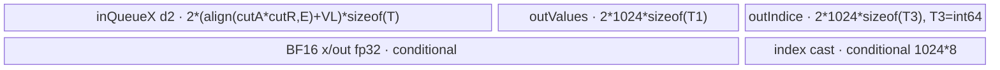
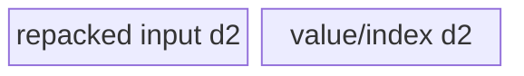
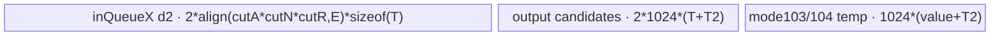
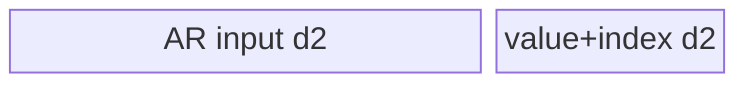

# ArgMax 950 Direct Invoke 算子知识

## 算子速览

| 项目 | 内容 |
|---|---|
| 实际入口 | 交付件 `cann_bench::arg_max_npu` → `calc_arg_max_tiling` → `launch_arg_max_{float16,float32,bfloat16,int32,int64}`；入口类型为 Direct Invoke。 |
| 计算语义 | 将连续 ND 输入折叠为 `[A,R,nextA]`，输出 `y[a,nextA]=argmax_r x[a,r,nextA]`；相等最大值取最小索引，浮点 NaN 按官方 MicroAPI 路线的 first-NaN 规则传播。 |
| 输入输出 | 输入 ND、连续，调用前硬前置为 rank 0..8，dtype 为 fp16/fp32/bf16/int32/int64；输出 int64，shape 为删除 `dim` 或在 `keepdim=true` 时把该维置 1。 |
| 执行类型 | 所有可达节点均为 `AIV_VECTOR`；ARA/ARA_GATHER 的部分 CopyIn 使用 NDDMA primitive，但没有独立 NDDMA Kernel；无 Cube/AIC、无 MIX_CV。 |
| Kernel 路线 | 重要性顺序：P0 R-002/R-003 AR；P1 R-005/R-006 RA；P2 R-013/R-014 ARA_CUT；P3 R-015/R-016 GROUP_REDUCE；P4 R-011/R-012 ARA_GATHER；P5 R-007..R-010 ARA；P6 R-004 AR_GATHER；P7 R-001 COPY。Route ID 保持 launcher 映射，不随阅读顺序改号。 |
| 核心资源 | GM 输入/输出、AIV UB `TQue/TBuf`、MicroAPI 寄存器；仅 GROUP_REDUCE 使用 GM workspace 和全核 `SyncAll`。 |
| 来源闭包 | `direct_implementation_closed`：官方 `ArgMaxV2` arch35 selector/POD/八类 body 与构建支持已闭合；交付件 Direct Host、显式 launcher、POD 展开和 stream workspace 生命周期已从最终源码闭合。 |

## 接口与语义

### 计算语义

令归约维前各维乘积为 `A`，归约维长度为 `R`，归约维后各维乘积为 `nextA`。连续 ND 地址为 `((a*R+r)*nextA+n)`，输出扁平地址为 `a*nextA+n`。所有模板实例均为 `isMin=false`、`withValue=false`，所以官方 `ArgMaxWithValue` body 只把索引写入 `y`，同一地址传入的 values 参数不产生输出写。

非 int64 路线内部索引 `T2=int32_t`，CopyOut 前转为 int64；int64 输入使用 `T2=int64_t`。比较选择保留旧值的 `GE`、严格更新尾块的 `GT` 与最终 `ReduceMin(index)` 共同保证相等最大值选择较小 `r`。fp16/fp32/bf16 路线还显式检测已有值 NaN，从而保留先出现的 NaN。

### 输入、输出与属性

| 参数 | shape/layout | dtype | 约束、默认值与语义 |
|---|---|---|---|
| `input` | 连续 ND，调用前须满足 rank 0..8 | fp16/fp32/bf16/int32/int64 | Direct 转换要求 `is_contiguous()`；各维及 `R` 必须为正，标量按 `[1]` 处理。当前包装层未在写定长 shape 数组前检查 `rank<=8`，故该条件不是可依赖的错误返回。 |
| `dim` | 标量属性 | int64 Host 值 | rank>0 时范围 `[-rank,rank)` 并归一化；标量仅允许 0/-1。 |
| `keepdim` | 标量属性 | bool | 只决定输出 shape；不进入 Device POD。 |
| `y` | `input.shape` 删除 `dim`，或该维保留为 1 | int64 | 元素数恒为 `A*nextA`。 |
| `workspace` | 一维字节数组 | uint8 backing storage | Host 分配 `max(workspaceBytes,1)`；GROUP_REDUCE 使用前部切片，其余路线不读；额外 16 MiB 为官方 runtime 预留。 |

### 入口与版本

官方固定提交公开的是 `aclnnArgMax`/`ArgMaxV2`，README 明确支持 Ascend 950PR/950DT，`ArgMaxV2` 构建接线包含 `SUPPORT_COMPUTE_UNIT "ascend950"`，arch35 entry 为 `arg_max_v2`。本卡入口不是该 ACLNN：交付件把同一提交的八类 arch35 Device body 转换成 `cann_bench::arg_max_npu` 与显式 `launch_arg_max_*`。因此接口校验、POD 传输、workspace owner 和错误返回属于交付件转换事实；Route 算法、MicroAPI、UB 结构及官方 selector 基础属于官方相关事实。

## Host/Launcher 执行流程

### 参数校验与前处理

交付件依次设置输入 device guard、检查连续 ND、归一化 `dim`、检查五种 dtype、构造 int64 输出，再把 shape 写入容量为 8 的定长数组。调用方必须先保证 `rank<=8`：当前包装层的逐维写入发生在 tiler 的 rank 检查之前，`rank>8` 可能先越界写，不能把 tiler 的负错误码当作可靠保护。满足该硬前置后，`calc_arg_max_tiling` 从 950 平台对象读取 AIV 核数与 UB 字节，构造 `[A,R,nextA]`；null、未知 dtype/非法 shape、selector 无法得到正切块分别返回负错误码，`arg_max_npu` 以 `TORCH_CHECK` 阻断 launch。

### 参数、Workspace 与生命周期

`blockDim = max(realCoreNum,1)`；有效 workspace 为 `workSpaceSize`，总申请为 `workSpaceSize + 16 MiB`。Host 用当前 NPU stream 启动单个 Kernel，并将 workspace storage 记录到同一 stream，确保异步 Kernel 结束前不回收。POD 窄字段跨 `<<<>>>` ABI 先按 uint64 传递，entry 内恢复 uint16/uint8；这只是运输层变化，Device 看到的字段宽度、顺序和含义保持官方结构。

### 启动图与失败传播

```text
cann_bench::arg_max_npu
  -> calc_arg_max_tiling(shape, rank, normalizedDim, dtype)
  -> allocate y + workspace; record workspace on current stream
  -> launch_arg_max_{float16|float32|bfloat16|int32|int64}(x, y, workspace, info, stream)
       -> switch(info.tiling.tilingKey)
       -> exactly one dtype-specialized arg_max_{route}<<<blockDim, stream>>>
            -> KERNEL_TASK_TYPE_DEFAULT(KERNEL_TYPE_MIX_AIV_1_0)
            -> RouteClass::Init(x, y, y, workspace, tiling, pipe)
            -> RouteClass::Process()
```

单 Kernel 无跨 Kernel 边。GROUP_REDUCE 的 Kernel 内边为“每核 partial value/index → workspace → `SyncAll` → core0 或各核 chunk 汇总 → y”；workspace owner 为调用方，生命周期覆盖当前 stream。Direct tiler失败时不启动；dtype switch default 返回失败；launcher 的未知 key 分支不发射 Kernel，因此实现复用时必须保证 tiler与 launcher key 集合一致。

## Route 与参数设计

### 分核与资源计算

`dataBytes=A*R*nextA*effectiveBytes`，动态核数为 `min(originAivCores,ceil(dataBytes/4096))` 且至少 1；GROUP_REDUCE 强制使用 `min(originAivCores,R)`。普通一维分核使用 `blkFactor=domain/core`、`blkTailFactor=domain%core`，前 `blkTailFactor` 核各多处理 1 个单元。`PROCESS_SIZE=1024`、vector register 字节数 256、DMA block 32 B；所有 cut 字段必须非零且受 uint16 上限 65535 约束。

### Route 特征与重要性

P0 为最高重要性，后续等级依次降低。该顺序只组织实现知识；`Host 顺序、短路与 fallback`字段独立保留最终 Direct selector 的真实生成、覆盖和改道控制流。

| 重要性 | Route | 可达性 | Route 特征 | 适用域与实现前提 | Host 顺序、短路与 fallback |
|---:|---|---|---|---|---|
| P0 | R-002/R-003 AR full-R/cut-R | active（shape-conditional） | 连续 `[A,R]` 行归约；full-R 整轴驻 UB，cut-R 以双半区累积候选 | 末轴或 `nextA==1`，且 selector 最终保留 key 10001；full/cut 取决于 `cutRSize==R` | H0 生成 AR；H2b 可覆盖为 AR_GATHER，H3 可覆盖为 GROUP，H5 又可将稠密 A 的末轴 GROUP 恢复为 AR；H6 中 full-R 命中 R-002，否则 R-003；切分失败即 Host 失败 |
| P1 | R-005/R-006 RA full-R/cut-R | active（shape-conditional） | 以 nextA 列域分核，跨 R 行做 strided DMA；UB 不足时沿 R 合并 | `A==1` 且宽 nextA 或小 R 谓词成立；full/cut 取决于 `cutRSize==R` | H2a 只在 `A==1`分支覆盖为 RA；H3 GROUP 可再覆盖；H6 中 full-R 命中 R-005，否则 R-006；H2a 失配保留 H0 的 ARA，切分失败即 Host 失败 |
| P2 | R-013/R-014 ARA_CUT flat/normal | active（shape-conditional） | A 与 nextA 二维分核；flat 整个 R×nextA 驻 UB，normal 再沿 R/nextA 切片 | H4 的 ARA 并行域/宽度 guard 成立，或 H8 的 mode104 二次改道；flat guard 决定子 Route | H4 只改写 H2/H3 后仍为 ARA 的 key；H8 仅从 mode104 改道并直接进入目标 split；`useFlatPath` 分 R-013/R-014；任一切分公式不成立即 Host 失败 |
| P3 | R-015/R-016 GROUP_REDUCE AR/RA | active（shape-conditional） | 沿 R 分核产生 partial，workspace 交接后 `SyncAll` 归并；RA 子路线分布汇总 nextA | 大 R、小输出域，或 mode104 的移动门槛成立；AR/RA 由 128B/256B 资源谓词决定 | H3 在 H2 之后检查并可覆盖当前 key；H5 可将稠密 A 末轴 GROUP 恢复为 AR；H8 也可从 mode104 改道 GROUP 并直接 split；`isRaSplit=0` 得 R-015，初始 AR UB 不足时改为 R-016，RA 仍不可行则 Host 失败 |
| P4 | R-011/R-012 ARA_GATHER cut-A/cut-nextA | active（shape-conditional） | 小 R 或 AR span 较大时把 ARA 重排成 RA 友好布局；分 cut-A NDDMA 与 cut-nextA strided DMA | `A>1 && nextA>1`，输出并行域充足，且 gather 的 R/span guard 成立 | H2c 命中后 H3 仍可覆盖为 GROUP；H6 调用 `CalcSplitInfoForGatherArA`，Device 再以最终 POD `cutASize!=1` 选 R-011、`cutASize==1` 选 R-012；因此外层 Host 的 cut-A 分支也可在 factor 或 UB 只容纳 1 时落到 R-012 |
| P5 | R-007..R-010 ARA modes 101..104 | active（shape-conditional） | 通用非末轴主体；按 A 并行度、R×nextA UB 可驻留性和 nextA 宽度选 Gather/NDDMA 四 mode | `A>1 && nextA>1`，且高性能覆盖、GROUP 与 ARA_CUT 均未最终生效 | H0 初始生成 ARA；H2c/H3/H4 依次可覆盖；H7 按 101→102→103→104 的互斥条件选模式；H8 只对 mode104 尝试 ARA_CUT、再尝试 GROUP，均不成立才保留 R-010 |
| P6 | R-004 AR_GATHER | active（shape-conditional） | 连续 AR 载入后以寄存器 Gather 逻辑转置，专门避开 32B 整步长 bank conflict | `A>1 && nextA==1`，R 字节跨度小于 256，A 域充足，且 R 跨度非 32B 整倍 | H2b 在 `nextA==1`分支命中后覆盖初始 AR；H3 可覆盖为 GROUP，H5 又可将稠密 A 的该 GROUP 恢复为 AR；未命中 H2b 则保留 AR |
| P7 | R-001 COPY | active（shape-conditional） | 归约轴长为 1，Device 不读 input，直接生成全 0 索引 | `R==1`；输出域按 `A*nextA` 分核 | H0 直接生成 COPY；H1 使 high-perf selector 立即返回，跳过 H2～H4；H6 只调用 copy split，不存在 Device fallback，切分失败即 Host 失败 |

上表八个 key 均由 `ArgMaxTilingBuilder` 生产、由五组 dtype launcher 显式分发，所以是生产链 active Route；full/cut、flat/normal、mode 与 GROUP AR/RA 是由 POD 再细分的 conditional 子 Route。

### Host selector 顺序

下表以 `N=nextA`、`e=effectiveBytes`、`I=selector 使用的 indexBytes`、`C=动态 coreNum`、`C0=originCores`、`U=UB bytes` 表示源码整数运算；`isInt64` 指 int64 输入。H2c 的 `maxSize=(U/2-1024*(e+I))/256` 与 H8 的除法均保持无符号整数截断语义。

| Host 顺序 | 判断/动作 | 短路与 fallback |
|---:|---|---|
| H0 | 初始 key：`R==1` 得 COPY；否则末轴或 `nextA==1` 得 AR；其余得 ARA | 只生成初值，除 COPY 外均可被后续覆盖 |
| H1 | `SetShapeInfoHighPerf` 首先再检查 `R==1` | true 立即返回，COPY 跳过 H2～H4；false 进入 H2 |
| H2a | `A==1` 时检查 `nextA>=core*256 \|\| (nextA>1 && R<256)` | true 覆盖为 RA；false 保留 H0 初值。该 `if` 命中布局分支后不再检查 H2b/H2c |
| H2b | 否则 `nextA==1`时检查 AR_GATHER 的 R/A/32B 三项 guard | true 覆盖为 AR_GATHER；false 保留 AR。该分支后不检查 H2c |
| H2c | `A>1 && N>1 && A*N*e>=C*256 && (R*e<256 \|\| (R*N*e>=U/2 && R<maxSize))` | true 覆盖为 ARA_GATHER；false 保留 ARA |
| H3 | `R*e>=C0*256 && R<INT32_MAX && ((N==1 && A<C0) \|\| (N>1 && A*N<C0*2))` | 两种输出域任一成立即覆盖 H2 结果为 GROUP；false 保留当前 key |
| H4 | `key==ARA && A*N*e>=C*128 && N*e>=((A>C && !isInt64) ? 64 : 128)` | true 覆盖为 ARA_CUT；门槛按非 int64 且 `A>C` 取 64B，否则取 128B；false 保留 ARA |
| H5 | 返回 `GetShapeInfo` 后，对末轴/`nextA==1` 且当前为 GROUP 的 key 检查 `A>0.85*originCores` | true 覆盖回 AR；false 保留 GROUP |
| H6 | `CalcSplitInfo` 按最终 key 分发 COPY/AR/ARA/ARA_CUT/RA/AR_GATHER/ARA_GATHER/GROUP split | 子路线由 full/cut、mode、flat、AR/RA 资源谓词决定；未知 key 或切分失败立即返回失败，不启动 Kernel |
| H7 | ARA split 按 `A>=core`、`R*nextA<=ubElement`、nextA 字节宽度依次选 mode101、102、103，其余 mode104 | 前三个分支命中即固定 R-007/R-008/R-009；只有 mode104 继续 H8 |
| H8 | 先计算 `cutN=CalcCutNextA(N)`；仅在外层三重 guard `cutN!=N && N*e>=32 && R>=C*4` 全真时，依次检查 `cutN*e>=64` 与 `(R/C0)*N*e>=4096` | 第一项 true 改道 ARA_CUT 并直接执行其 split；否则第二项 true 改道 GROUP 并直接执行其 split；外层 guard 或两项均 false 时保留 R-010 |

```text
H0 initial COPY / AR / ARA
  -> H1 COPY short-circuit
  -> H2a RA | H2b AR_GATHER | H2c ARA_GATHER
  -> H3 GROUP override
  -> H4 remaining ARA -> ARA_CUT
  -> H5 dense-A last-axis GROUP -> AR reset
  -> H6 split dispatch
       -> H7 ARA mode101/102/103/104
       -> H8 mode104 -> ARA_CUT, else GROUP, else keep mode104
```

### 模板/实现执行矩阵

| 重要性 | Route | Host 顺序 | key/selector | dtype/shape/platform 完整命中条件 | 执行拓扑与 Kernel 节点 | 实际模板/body | 内存与同步特征 | tail/fallback |
|---:|---|---|---|---|---|---|---|---|
| P0 | R-002 AR-full | H0→H2b/H3→H5→H6 | 10001 | AR 且 `cutRSize==R` | 单 AIV | `ArgMaxWithValueAr::ProcessWithoutCutR` | 连续 `[cutA,R]` DMA + `ArgMaxV1` | A 与 1024 双重尾块 |
| P0 | R-003 AR-cutR | H0→H2b/H3→H5→H6 | 10001 | AR 且 `cutRSize<R` | 单 AIV | `ProcessWithCutR` + `UpdateResult` | 双输出半区保存 chunk 与累计值 | `tailR` 合并 |
| P1 | R-005 RA-full | H2a→H3→H6 | 20003 | RA 且 `cutRSize==R` | 单 AIV | `ArgMaxWithValueRa::ProcessWithCutA` | strided DMA 行→UB RA | nextA tail |
| P1 | R-006 RA-cutR | H2a→H3→H6 | 20003 | RA 且 `cutRSize<R` | 单 AIV | `ProcessWithCutR` + `UpdateResult` | 输出 queue 两半保存累计/候选 | nextA、R 双 tail |
| P2 | R-013 ARA_CUT-flat | H4→H6，或 H6→H7→H8 直达 | 10012 | 最终 key 10012 且 `useFlatPath=1`；即 `ubNeededFlat<=UB-17*32` | 单 AIV | `ProcessFlat` | 全 R/nextA 连续装入，直接 unaligned VF | A tail |
| P2 | R-014 ARA_CUT-normal | H4→H6，或 H6→H7→H8 直达 | 10012 | 最终 key 10012 且 `useFlatPath=0` | 单 AIV | `ProcessInANextALoop` | loop-mode 2D DMA + R chunk合并 | A/N/R tail |
| P3 | R-015 GROUP-AR | H3→H5→H6，或 H6→H7→H8 直达 | 30001 | GROUP，初始 `nextA*bytes<128 && blkFactor*bytes>=256`，且 AR UB 核账通过后 `isRaSplit=0` | 单 AIV | `cutNextASize==1 ? ProcessTemplate<false> : ProcessTemplate<true>` | workspace two planes、`SyncAll`、core0 汇总 | R tail；AR UB 失配转 R-016 |
| P3 | R-016 GROUP-RA | H3→H5→H6，或 H6→H7→H8 直达 | 30001 | GROUP 且初始 `isRaSplit=1`，或 R-015 的 AR UB 核账失配 | 单 AIV | `ProcessRaSplit` | 每 A×core 128B-aligned workspace、可参与核按 chunk 汇总 | R/nextA tail；RA UB 失配则 Host 失败 |
| P4 | R-011 ARA_GATHER-A | H2c→H3→H6 | 20002 | 最终 key 20002 且 POD `cutASize>1` | 单 AIV | `ProcessCutAWithNDDMA` | NDDMA 转置后 `ArgMaxRa` | A tail |
| P4 | R-012 ARA_GATHER-N | H2c→H3→H6 | 20002 | 最终 key 20002 且 POD `cutASize==1` | 单 AIV | `ProcessWithCutNextA` | strided `DataCopyPad` | nextA tail |
| P5 | R-007 ARA-mode101 | H0→H2c/H3/H4→H6→H7 | 10002/101 | `A>=core && R*nextA<=ubElement && nextA*effectiveBytes<64` | 单 AIV | `ProcessGatherARAWithCutA` | 连续载入 + GatherV1 | A/1024 tail |
| P5 | R-008 ARA-mode102 | H0→H2c/H3/H4→H6→H7 | 10002/102 | 同上但 `nextA*effectiveBytes>=64` | 单 AIV | `ProcessWithCutA` | 3D NDDMA 转 `[A,R,N]→[A*N,R]` | A/1024 tail |
| P5 | R-009 ARA-mode103 | H0→H2c/H3/H4→H6→H7 | 10002/103 | `A>=core && R*nextA>ubElement && nextA*effectiveBytes<32` | 单 AIV | `ProcessGatherARAWithCutAR` | tempValue/tempIndice 合并 R chunk | A/R 双 tail |
| P5 | R-010 ARA-mode104 | H0→H2c/H3/H4→H6→H7→H8 | 10002/104 | 其余 ARA 且未触发二次改道 | 单 AIV | `ProcessWithCutRA` | 3D NDDMA + cutR/cutNextA | A/R/nextA tail |
| P6 | R-004 AR_GATHER | H2b→H3→H5→H6 | 20001 | gather 谓词且未被 GROUP/AR reset 覆盖 | 单 AIV | `ArgMaxWithValueArGather` | 连续载入 AR；寄存器 Gather 转置 | A tail |
| P7 | R-001 COPY | H0→H1→H6 | 10003 | `R=1` | 单 AIV | `ArgMaxWithValueCopy<T,T3,false,false>` | bind queue 搬值路径为静态关闭；Duplicate 0 index | 尾输出精确字节 |

### 关键性能与安全 Guard

| Guard | Host/Tiling 条件 | Device/资源原因 | 影响 Route | 不满足时去向 | 源码符号 |
|---|---|---|---|---|---|
| AR bank conflict | `(R*effectiveBytes)%32!=0` | Gather 步长为 32B 倍数时避免 UB bank conflict | R-004 | R-002/003 | `SetShapeInfoHighPerf` |
| uint16 cut | 每个 `cut*<=65535` 且 >0 | Device ABI 与循环计数为 uint16 | 全部 | tiling失败或缩小 tile | 各 `CalcSplitInfo*` |
| flat UB | `2*R*alignN*sizeof(T1)+2*alignN*(sizeof(T1)+sizeof(T3))+alignN*(sizeof(T1)+sizeof(T2)) <= UB-544`，再乘 `cutA` | flat 路线一次驻留完整 R×nextA | R-013 | R-014 | `CalcSplitInfoForArACutAAndNextA` |
| compact VF | `R>=16 && 2*dimA1Src<=VL` | 两条 R chain 同寄存器并行后再合并 | R-014及调用该 helper 的路线 | 普通 unaligned loop | `ArgMaxAraUnAlign` |
| GROUP schedule | key 30001 | Kernel 内 `SyncAll` 需要全核一致参与 | R-015/016 | 禁止普通 schedule | official `SetScheduleMode(1)`；Direct entry `__schedmode__(1)` |
| GROUP workspace | 256B 对齐，且 AR/RA 各自 fixedNeed/queue 公式小于 UB | partial values/indices 跨核可见 | R-015/016 | AR branch回退 RA；仍不足则 tiling失败 | `CalcGroupReduce*` |
| BF16 升精度 | selector 中 `effectiveBytes=4`，各 body 预留 `xBuf32/outBuf32` | 先 cast FP32 再比较；GROUP partial workspace 也为 FP32 | R-002..R-012 的 BF16 路线、R-015/016 | 无更低精度 fallback | `AddExtraBufferNeed`、AR/RA/ARA/GATHER/GROUP `Init` |
| ARA_CUT BF16 | split 按 `valueDtypeSize=2` 核算，body 无 FP32 cast buffer | `ArgMaxAraUnAlign<bfloat16_t,uint16_t>` 直接以 BF16 比较，仍保留 tie/NaN 选择顺序 | R-013/014 | flat 失配转 normal；不自动改到 FP32 body | `ArgMaxWithValueArACutAAndNextA::ComputeVF` |

### POD/ABI

`ArgMaxWithValueTilingData` 在交付件按自然 8 字节对齐时 `sizeof=136, alignof=8`；`ArgMaxLaunchInfo` 为 152 字节。以下 offset 由字段声明顺序与 C++ 自然对齐闭合，Direct entry 的 uint64 形参仅是 launch transport。

| 结构 | 字段 | 类型/位宽 | ABI 布局 | 单位 | Host/launcher producer | Device consumer | 边界 |
|---|---|---|---|---|---|---|---|
| tiling | `aSize` | u64 | off 0 | 元素域 | 前轴乘积 | 分核/地址 | >0 |
| tiling | `cutASize` | u16 | off 8 | A 元素 | route split | tile 循环/UB | 1..65535 |
| tiling | `rSize` | u64 | off 16 | R 元素 | reduction dim | 所有 reduce | >0，GROUP<INT32_MAX |
| tiling | `cutRSize` | u16 | off 24 | R 元素 | route split | R loop | 1..min(R,65535) |
| tiling | `nextASize` | u64 | off 32 | 元素 | 后轴乘积 | stride/layout | >0 |
| tiling | `cutNextASize` | u16 | off 40 | 元素 | route split | nextA tile | 1..65535 |
| tiling | `realCoreNum` | u64 | off 48 | AIV core | split | block guard/SyncAll | 1..origin；空域不支持 |
| tiling | `blkFactor` | u64 | off 56 | route单元/core | split | blockOffset | 与 tail 配对 |
| tiling | `blkTailFactor` | u64 | off 64 | core数 | split | former core | `<realCoreNum` |
| tiling | `blkFactor2nd` | u64 | off 72 | nextA/core | ARA_CUT | 二维 block map | 仅 10012 active |
| tiling | `blkTailFactor2nd` | u64 | off 80 | 元素 | ARA_CUT | nextA tail core | 仅 10012 active |
| tiling | `blkNum2nd` | u64 | off 88 | 分片数 | ARA_CUT | 保留兼容 | 默认 1 |
| tiling | `tilingKey` | u64 | off 96 | enum | selector | launcher router | 八个已知 key |
| tiling | `aRaMode` | u64 | off 104 | enum | ARA split | ARA Process switch | 101..104 active |
| tiling | `loopANum` | u16 | off 112 | loop | Host 的 GROUP AR/RA split 生成并由 launcher ABI 搬运 | 当前 Device body 未读取 | 保留 ABI 字段；非 GROUP 为默认值 |
| tiling | `cutAPerLoop` | u16 | off 114 | A 元素 | Host 的 GROUP AR/RA split 生成并由 launcher ABI 搬运 | 当前 Device body 未读取 | 保留 ABI 字段；非 GROUP 为默认值 |
| tiling | `isRaSplit` | u8 | off 116 | bool | GROUP split | GROUP Process | 0/1 |
| tiling | `gatherBlockSize` | u16 | off 118 | nextA元素 | GROUP RA split | 汇总 chunk | >=1 |
| tiling | `useFlatPath` | u8 | off 120 | bool | ARA_CUT split | ARA_CUT Process | 0/1 |
| tiling | `workSpaceSize` | u64 | off 128 | 字节 | GROUP split | workspace binding | 256B 对齐 |
| launch | `blockDim` | u32 | off 136 | core | `realCoreNum` | `<<<>>>` | 至少1 |
| launch | `reserved` | u32 | off 140 | N/A | 置0 | 未读 | inactive |
| launch | `workspaceBytes` | u64 | off 144 | 字节 | `workSpaceSize+16MiB` | Host allocation | 至少分配1 |

`loopANum/cutAPerLoop` 在 GROUP-AR 分支由 Host 写为 `1/A`，在 GROUP-RA 分支写为 `A/1`，随后进入 POD 并完整穿过 launcher ABI；当前八类 Device body 均未以这两个字段驱动循环，迁移时应保留其布局而不能虚构消费边。

### Route 源码闭包

| 重要性 | Route | Host 顺序 | Key/selector | Host/Tiling producer | POD/参数 | Kernel entry/router 节点 | Kernel body/直接依赖 | 构建接线 |
|---:|---|---|---|---|---|---|---|---|
| P0 | R-002/003 | H0→H2b/H3→H5→H6 | 10001 | `CalcSplitInfoForAr` | common POD | `arg_max_ar_*` | `ArgMaxWithValueAr` + base | `arg_max_v2/CMakeLists.txt`；Direct 两 TU |
| P1 | R-005/006 | H2a→H3→H6 | 20003 | `CalcSplitInfoForRa` | common POD | `arg_max_ra_*` | `ArgMaxWithValueRa` + base | 同上 |
| P2 | R-013/014 | H4→H6，或 H6→H7→H8 直达 | 10012 | `CalcSplitInfoForArACutAAndNextA` | `blkFactor2nd/useFlatPath` | `arg_max_ara_cut_*` | `ArgMaxWithValueArACutAAndNextA` + base | 同上 |
| P3 | R-015/016 | H3→H5→H6，或 H6→H7→H8 直达 | 30001 | `CalcSplitInfoForGroupReduce` | `isRaSplit/gatherBlockSize/workSpaceSize` | `arg_max_group_*` + schedmode1 | `ArgMaxWithValueGroupReduce` + base | 同上 |
| P4 | R-011/012 | H2c→H3→H6 | 20002 | `CalcSplitInfoForGatherArA` | common POD | `arg_max_ara_gather_*` | `ArgMaxWithValueAraGather` + base | 同上 |
| P5 | R-007..010 | H0→H2c/H3/H4→H6→H7/H8 | 10002 | `CalcSplitInfoForArAAndTryMode4` | `aRaMode` | `arg_max_ara_*` | `ArgMaxWithValueArA` + base | 同上 |
| P6 | R-004 | H2b→H3→H5→H6 | 20001 | `CalcSplitInfoForGatherRa` | common POD | `arg_max_ar_gather_*` | `ArgMaxWithValueArGather` + base | 同上 |
| P7 | R-001 | H0→H1→H6 | 10003 | `ArgCommonBaseTiling::SetShapeInfo/CalcSplitInfoForCopyOnly`；Direct `ArgMaxTilingBuilder` 等价转换 | common POD | official `arg_max_v2`; Direct `arg_max_copy_*` | `ArgMaxWithValueCopy` + base | 同上 |

## Kernel 实现

### 公共执行流程

所有 Route 均单次 launch：entry 在 Device 构造 POD、声明 `KERNEL_TYPE_MIX_AIV_1_0`、创建 `TPipe`，然后 `Init→Process`。`GetBlockIdx` 映射到不重叠输出域；Queue 的 `Alloc→EnQue→DeQue→Free` 提供 MTE2/V/MTE3 阶段顺序。基础 helper 以 256B vector register、mask 和 `startR` 实现 argmax；多数 BF16 body 先 cast FP32，但 R-013/014 按 BF16 原位宽直接比较；内部 int32 index 在 CopyOut 前 cast int64。除 GROUP 外 workspace 未读。

下列逐 Route 章节按 P0→P7 及“Route 特征与重要性”的行序展开；Route ID 与 key 保持不变，该展示顺序不是 Host 判断顺序。

### Route R-002/R-003（P0）：AR full-R / cut-R

#### 适用条件

##### 选择证据

| 层级 | 文件 | 符号 | 源码谓词/参数 | 结果/下一跳 |
|---|---|---|---|---|
| Tiling | `arg_common_base_tiling_arch35.cpp` | `CalcSplitInfoForAr` | `R<ubElement && R<65535` 取 full-R，否则 VL 整倍 cutR | R-002/R-003 |

#### Device 数据流

##### 函数级调用链

```text
arg_max_ar_* -> ArgMaxWithValueAr::Process
  -> full: CopyInX -> ArgMaxV1/ArgMaxV1Int64 -> CopyOut
  -> cut: CopyInXCutR -> ArgMaxV1 -> UpdateResult -> CopyOut
```

##### 源码等价伪码

```text
for owned a in tiles of <=1024:
  for each R chunk: DMA contiguous x[a,r0:r1]; reduce in registers
  merge chunk candidate with accumulated (value,index), adding startR
  cast internal index if needed; write exactly valid output indices
```

#### 内存与数据搬运

##### 资源与搬运表

| 层级/缓冲区 | offset/地址公式 | extent/容量公式 | dtype/layout | producer | consumer | owner/lifetime | 对齐/复用 |
|---|---|---|---|---|---|---|---|
| inQueueX | `(a*R+r0)` | `2*(align(cutA*cutR,E)+VL)*sizeof(T)` | T/[A,R] | MTE2 | ArgMaxV1 | pipe/tile | depth2 |
| out values/index | halves 0/1024 in cutR | values `2*1024*sizeof(T1)`；indices `2*1024*sizeof(T3)`，且 `T3=int64` | candidates | reduce | UpdateResult/MTE3 | tile | queue depth2；half reuse |
| BF16 buffers | 0 | `alignNum*4 + 2*1024*4` | fp32 | Cast | reduce/merge | pipe | BF16 only |

##### 分层内存布局



##### 字节账与复用顺序

```text
UB_total = inQ + 2*1024*sizeof(T1) + 2*1024*sizeof(T3) + BF16?(alignNum+2048)*4:0 + (T2!=T3?1024*sizeof(T3):0)
UB_total <= platform UB by CalcSplitInfoForAr
workspace_total = 0 effective + 16MiB reserve
```

| 复用子区 | 写入者 | 读取者/消费点 | 下一次覆盖 | 同步或释放依据 | 安全条件 |
|---|---|---|---|---|---|
| output second half | chunk reduce | `UpdateResult` | next R chunk | same Vector sequence | `cutR<R` |

#### 同步、精度与尾块

##### 同步与数值边界表

| 阶段 | primitive/机制 | producer | consumer/等待点 | 保护对象 | 精度/尾块 |
|---|---|---|---|---|---|
| chunk merge | `UpdateResult` | chunk reduce | next merge | value/index pair | NaN与tie同步选择；tail mask |
| output | Queue / V_MTE3 cast event | Vector | MTE3 | int64 y | exact `copyNum` |

#### 关键实现

##### 符号证据表

| 阶段 | 文件 | 符号/模板实例 | 实现事实 |
|---|---|---|---|
| Host/Tiling producer | `arg_common_base_tiling_arch35.cpp` | `CalcSplitInfoForAr` | full/cutR及UB公式 |
| Kernel entry/router | `arg_max_v2_apt.cpp` | key 10001 | `ArgMaxWithValueAr` |
| Device body/helper | `arg_max_with_value_ar.h` | `ProcessWithoutCutR/ProcessWithCutR` | 连续AR归约 |

### Route R-005/R-006（P1）：RA full-R / cut-R

#### 适用条件

##### 选择证据

| 层级 | 文件 | 符号 | 源码谓词/参数 | 结果/下一跳 |
|---|---|---|---|---|
| Tiling | `arg_common_base_tiling_arch35.cpp` | `CalcSplitInfoForRa` | RA key；`cutR==R` 或 UB不足时切R | R-005/006 |

#### Device 数据流

##### 函数级调用链

```text
arg_max_ra_* -> DataCopyPad(blockCount=R, blockLen=cutNextA*sizeof(T), srcStride=(nextA-cutNextA)*sizeof(T))
  -> ArgMaxRa/ArgMaxAraUnAlignInt64 -> optional UpdateResult -> CopyOut
```

##### 源码等价伪码

```text
each core owns nextA columns; gather each R row's contiguous column slice into aligned UB rows;
reduce R vertically for all owned columns; merge R chunks using absolute startR
```

#### 内存与数据搬运

##### 资源与搬运表

| 层级/缓冲区 | offset/地址公式 | extent/容量公式 | dtype/layout | producer | consumer | owner/lifetime | 对齐/复用 |
|---|---|---|---|---|---|---|---|
| inQueueX | `blockOffset+loopOffset+r0*nextA` | `2*align(cutNextA,E)*cutR*sizeof(T)` | RA | strided MTE2 | ArgMaxRa | tile | depth2 |
| output | halves if cutR | 令 `B=align(cutNextA,E)`；full-R 为 `2*B*(sizeof(T1)+sizeof(T2))`，cut-R 为 `4*B*(sizeof(T1)+sizeof(T2))` | nextA | VF | merge/MTE3 | tile | cut-R 每个 queue slot 含累计/候选两半，queue depth2 |

##### 分层内存布局


##### 字节账与复用顺序

```text
UB_total = 2*B*cutR*sizeof(T1) + (cutR==R ? 2*B : 4*B)*(sizeof(T1)+sizeof(T2)) + dtype buffers
```

| 复用子区 | 写入者 | 读取者/消费点 | 下一次覆盖 | 同步或释放依据 | 安全条件 |
|---|---|---|---|---|---|
| output second half | later R chunk | UpdateResult | next chunk | sequential VF | `outAAlign` separates halves |

#### 同步、精度与尾块

##### 同步与数值边界表

| 阶段 | primitive/机制 | producer | consumer/等待点 | 保护对象 | 精度/尾块 |
|---|---|---|---|---|---|
| strided copy | DataCopyPad | GM | queue | RA tile | blockLen exact，dst alignment padding masked |

#### 关键实现

##### 符号证据表

| 阶段 | 文件 | 符号/模板实例 | 实现事实 |
|---|---|---|---|
| Host/Tiling producer | `arg_common_base_tiling_arch35.cpp` | `CalcSplitInfoForRa` | cutNextA/cutR |
| Kernel entry/router | `arg_max_v2_apt.cpp` | key20003 | RA class |
| Device body/helper | `arg_max_with_value_ra.h` | `ProcessWithCutA/ProcessWithCutR` | RA搬运与归约 |

### Route R-013/R-014（P2）：ARA_CUT flat / normal

#### 适用条件

##### 选择证据

| 层级 | 文件 | 符号 | 源码谓词/参数 | 结果/下一跳 |
|---|---|---|---|---|
| Tiling | `arg_common_base_tiling_arch35.cpp` | `CalcSplitInfoForArACutAAndNextA` | `ubNeededFlat<=UB-544` | flat，否则 normal |

#### Device 数据流

##### 函数级调用链

```text
arg_max_ara_cut_* -> two-dimensional block map(A block,nextA block)
  flat: CopyInXFlat -> ComputeVF(full R) -> CopyOutValueAndIndices
  normal: loop A,nextA,R -> loop-mode DataCopyPad -> ComputeVF -> UpdateResult -> CopyOut
```

##### 源码等价伪码

```text
map blockIdx=(nextABlockIdx,aBlockIdx)
for A tile and nextA tile:
  flat if full R*nextA fits; else loop R chunks
  copy [aUbLength,rUbLength,nextAUbLength] with padded nextA stride
  ArgMaxAraUnAlign; merge candidates; 2D copy valid nextA columns to y
```

#### 内存与数据搬运

##### 资源与搬运表

| 层级/缓冲区 | offset/地址公式 | extent/容量公式 | dtype/layout | producer | consumer | owner/lifetime | 对齐/复用 |
|---|---|---|---|---|---|---|---|
| inQueueX | `a*R*N+r*N+n` | `2*cutA*cutR*alignN*sizeof(T)` | padded A,R,N | loop-mode MTE2 | ComputeVF | tile | depth2 |
| out queues | 0 | `2*cutA*alignN*(sizeof(T)+sizeof(T3))` | A,N | VF | 2D MTE3 | tile | depth2 |
| temp/cast | 0 | `cutA*alignN*(sizeof(T)+sizeof(T2)+conditional sizeof(T2))` | candidate | VF | merge/cast | tile | reused each R chunk |

##### 分层内存布局


##### 字节账与复用顺序

```text
UB_total = 2*cutA*cutR*alignN*sizeof(T)
         + 2*cutA*alignN*(sizeof(T)+sizeof(T3))
         + cutA*alignN*(sizeof(T)+sizeof(T2)+(T2!=T3?sizeof(T2):0))
```

| 复用子区 | 写入者 | 读取者/消费点 | 下一次覆盖 | 同步或释放依据 | 安全条件 |
|---|---|---|---|---|---|
| tempValue/tempIndice | later R chunk | UpdateResult | next chunk | sequential VF | nextAAlign一致 |

#### 同步、精度与尾块

##### 同步与数值边界表

| 阶段 | primitive/机制 | producer | consumer/等待点 | 保护对象 | 精度/尾块 |
|---|---|---|---|---|---|
| 2D copy | loop mode + DataCopyPad | GM | queue | A/R/N tile | nextA padding不写回 |
| compact | two-chain MicroAPI | UB | result | narrow nextA | tie/NaN按较小index合并 |
| BF16 compare | `ArgMaxAraUnAlign<bfloat16_t,uint16_t>` | BF16 UB | candidate value/index | R chain | 不经 FP32 cast；flat/normal 共用同一比较顺序 |

#### 关键实现

##### 符号证据表

| 阶段 | 文件 | 符号/模板实例 | 实现事实 |
|---|---|---|---|
| Host/Tiling producer | `arg_common_base_tiling_arch35.cpp` | `CalcSplitInfoForArACutAAndNextA*` | 2D核映射、flat guard |
| Kernel entry/router | `arg_max_v2_apt.cpp` | key10012 | ARA_CUT class |
| Device body/helper | `arg_max_with_value_ara_cut_a_and_next_a.h` | `ProcessFlat/ProcessInANextALoop` | flat/normal内存网络 |

### Route R-015/R-016（P3）：GROUP_REDUCE AR / RA

#### 适用条件

##### 选择证据

| 层级 | 文件 | 符号 | 源码谓词/参数 | 结果/下一跳 |
|---|---|---|---|---|
| Selector | `arg_common_base_tiling_arch35.cpp` | `CalcSplitInfoForGroupReduce` | `isRaSplit=(nextA*bytes>=128)\|\|(blkFactor*bytes<256)`；AR UB不足也fallback RA | R-015/016 |

#### Device 数据流

##### 函数级调用链

```text
arg_max_group_* (__schedmode__(1)) -> per-core R partial reduce
  -> CopyOutWorkSpace / CopyOutWorkSpaceRow
  -> SyncAll
  -> AR: core0 CopyInMultiCoreResult -> ComputeResult -> CopyOut
  -> RA: active cores each gather one (A,nextA chunk) across cores -> ComputeResultAllCore -> CopyOut
```

##### 源码等价伪码

```text
split R among all participating cores; produce (bestValue,absoluteIndex) for each output
store 128B/256B-aligned partial planes in workspace
SyncAll
reduce the core dimension, preserving old/equal/NaN candidate; emit y
```

#### 内存与数据搬运

##### 资源与搬运表

| 层级/缓冲区 | offset/地址公式 | extent/容量公式 | dtype/layout | producer | consumer | owner/lifetime | 对齐/复用 |
|---|---|---|---|---|---|---|---|
| AR value workspace | byte offset `core*outAAlign*sizeof(V)`，其中 BF16 的 `V=float`，否则 `V=T1` | `realCores*outAAlign*sizeof(V)` | core,A*N | per-core reduce | core0 | caller/through SyncAll | Device 实际 live value plane |
| AR index workspace | 同一 workspace 的 `T2` 基址上取元素偏移 `realCores*outAAlign + core*outAAlign`，故 index plane 字节基址为 `realCores*outAAlign*sizeof(T2)` | `realCores*outAAlign*sizeof(T2)` | core,A*N | per-core reduce | core0 | caller | 不是按 value extent 顺延；仅当 `sizeof(V)==sizeof(T2)` 时两者相接 |
| RA workspace | `[A,core,align128(nextA)]` | `A*cores*(align128(value)+align128(index))` | A,core,N | each core | distributed gather | caller | each row 128B |
| UB queues | route-dependent | formulas from `Init` using max(partial tile,core gather tile) | partials | MTE/V | workspace/y | pipe | depth1/2 |

##### 分层内存布局


##### 字节账与复用顺序

```text
R-015 Host conservative allocation = align256(2*outAAlign*sizeof(int32)*originCores * (dtype==int64?2:1))
R-015 Device live layout = value [0, realCores*outAAlign*sizeof(V)); index byte base realCores*outAAlign*sizeof(T2), extent realCores*outAAlign*sizeof(T2)
R-016 workspace = align256(A*realCores*(align128(nextA*sizeof(value_or_fp32))+align128(nextA*sizeof(T2))))
UB_total <= UB by CalcGroupReduceArBranch/RaBranch fixedNeed + queueNeed checks
```

| 复用子区 | 写入者 | 读取者/消费点 | 下一次覆盖 | 同步或释放依据 | 安全条件 |
|---|---|---|---|---|---|
| workspace planes | all cores partial | core0/all-core final reduce | Kernel结束 | `SyncAll` | schedmode1且所有 real cores参与；R-015 的 Host 分配按 `originCores` 保守计，Device 地址按 `realCores` 与 `T2` 基址计 |

#### 同步、精度与尾块

##### 同步与数值边界表

| 阶段 | primitive/机制 | producer | consumer/等待点 | 保护对象 | 精度/尾块 |
|---|---|---|---|---|---|
| cross-core | `SyncAll` | all partial writes | final readers | workspace | hard ordering |
| BF16 partial | fp32 workspace | Cast/reduce | final VF | values | 不降回bf16，因为只输出index |
| final | masked core reduction | workspace | y | core dimension | last nextA chunk exact |

#### 关键实现

##### 符号证据表

| 阶段 | 文件 | 符号/模板实例 | 实现事实 |
|---|---|---|---|
| Host/Tiling producer | `arg_common_base_tiling_arch35.cpp` | `CalcSplitInfoForGroupReduce` | 全物理核、AR/RA分支、workspace |
| Kernel entry/router | `arg_max_v2_apt.cpp` | key30001 | Group class；官方Host设schedule1 |
| Device body/helper | `arg_max_with_value_group_reduce.h` | `ProcessTemplate/ProcessRaSplit` | partial→SyncAll→final |

### Route R-011/R-012（P4）：ARA_GATHER cut-A / cut-nextA

#### 适用条件

##### 选择证据

| 层级 | 文件 | 符号 | 源码谓词/参数 | 结果/下一跳 |
|---|---|---|---|---|
| Tiling | `arg_common_base_tiling_arch35.cpp` | `CalcSplitInfoForGatherArA` | `cutA>1` 或 `cutA==1` | R-011/R-012 |

#### Device 数据流

##### 函数级调用链

```text
arg_max_ara_gather_* -> cutA? CopyInWithNDDMA:CopyInCutNextA
  -> ArgMaxRa/ArgMaxAraUnAlignInt64 -> CopyOut
```

##### 源码等价伪码

```text
cutA branch transposes [cutA,R,nextA] to [R,cutA*nextA];
cutNextA branch strided-copies one A row's nextA tile across all R;
reduce the aligned flattened output lane set
```

#### 内存与数据搬运

##### 资源与搬运表

| 层级/缓冲区 | offset/地址公式 | extent/容量公式 | dtype/layout | producer | consumer | owner/lifetime | 对齐/复用 |
|---|---|---|---|---|---|---|---|
| inQueueX | route-specific | `2*align(cutA*cutN,E)*R*sizeof(T)` | `[R,A*N]` | NDDMA/strided DMA | ArgMaxRa | tile | depth2 |
| outputs | 0 | `2*align(cutA*cutN,E)*(sizeof(T)+sizeof(T2))` | A*N | VF | MTE3 | tile | depth2 |

##### 分层内存布局



##### 字节账与复用顺序

```text
UB_total = 2*align(cutA*cutN,E)*R*sizeof(T) + 2*align(cutA*cutN,E)*(sizeof(T)+sizeof(T2)) + dtype buffers
```

| 复用子区 | 写入者 | 读取者/消费点 | 下一次覆盖 | 同步或释放依据 | 安全条件 |
|---|---|---|---|---|---|
| inQueueX slot | DMA | VF | next tile | DeQue/Free | cutA/cutN producer matches body branch |

#### 同步、精度与尾块

##### 同步与数值边界表

| 阶段 | primitive/机制 | producer | consumer/等待点 | 保护对象 | 精度/尾块 |
|---|---|---|---|---|---|
| output tail | mask + exact DMA | VF | MTE3 | final A*N | aTail决定实际copyNum |

#### 关键实现

##### 符号证据表

| 阶段 | 文件 | 符号/模板实例 | 实现事实 |
|---|---|---|---|
| Host/Tiling producer | `arg_common_base_tiling_arch35.cpp` | `CalcSplitInfoForGatherArA` | A或nextA切分 |
| Kernel entry/router | `arg_max_v2_apt.cpp` | key20002 | ARA gather class |
| Device body/helper | `arg_max_with_value_ara_gather.h` | `Process` | 分支与搬运布局 |

### Route R-007..R-010（P5）：ARA modes 101..104

#### 适用条件

##### 选择证据

| 层级 | 文件 | 符号 | 源码谓词/参数 | 结果/下一跳 |
|---|---|---|---|---|
| Tiling | `arg_common_base_tiling_arch35.cpp` | `CalcSplitInfoForArA` | mode101/102/103/104谓词见矩阵 | key10002 + mode |

#### Device 数据流

##### 函数级调用链

```text
arg_max_ara_* -> Process switch(aRaMode)
  101: contiguous CopyIn -> ArgMaxGatherV1
  102: 3D NDDMA [A,R,N] to [A*N,R] -> ArgMaxV1
  103: R-chunk CopyIn -> GatherV1 -> UpdateResult
  104: 3D NDDMA cutNextA/cutR -> ArgMaxV1 -> UpdateResult
```

##### 源码等价伪码

```text
for owned A or flattened A*ceil(nextA/cutNextA) tile:
  materialize a reduction-friendly UB layout using contiguous DMA or 3D NDDMA
  reduce each (a,n) over one/full R chunk
  merge chunk candidates; mode103 covers both the owned-A tail and final-R-chunk tail
  write only valid flattened A*nextA range
```

#### 内存与数据搬运

##### 资源与搬运表

| 层级/缓冲区 | offset/地址公式 | extent/容量公式 | dtype/layout | producer | consumer | owner/lifetime | 对齐/复用 |
|---|---|---|---|---|---|---|---|
| inQueueX | mode-specific `[a,r,n]` | `2*align(cutA*cutN*cutR,E)*sizeof(T)` | transposed/repacked | DMA/NDDMA | VF | tile | depth2 |
| tempValue/tempIndice | 0 | `1024*sizeof(fp32 or T)+1024*sizeof(T2)` | chunk candidate | later R chunk | UpdateResult | modes103/104 | overwrite per chunk |
| output queues | halves | `2*1024*(sizeof(T)+sizeof(T2))` | flat A*N | reduce | MTE3 | tile | one queue depth1 |

##### 分层内存布局



##### 字节账与复用顺序

```text
UB_total = inQ + output queues + mode103/104 temp + BF16 fp32 buffers + optional index cast
UB_total <= UB by CalcSplitInfoForArA
```

| 复用子区 | 写入者 | 读取者/消费点 | 下一次覆盖 | 同步或释放依据 | 安全条件 |
|---|---|---|---|---|---|
| tempValue/tempIndice | each non-first R chunk | UpdateResult | next R chunk | sequential VF | merge complete before overwrite |

#### 同步、精度与尾块

##### 同步与数值边界表

| 阶段 | primitive/机制 | producer | consumer/等待点 | 保护对象 | 精度/尾块 |
|---|---|---|---|---|---|
| NDDMA | queue | 3D DataCopy | VF DeQue | transformed tile | loopSize exact；invalid aligned lanes masked |
| merge | UpdateResult | chunk candidate | accumulator | value/index | BF16 fp32 merge，startR absolute |

#### 关键实现

##### 符号证据表

| 阶段 | 文件 | 符号/模板实例 | 实现事实 |
|---|---|---|---|
| Host/Tiling producer | `arg_common_base_tiling_arch35.cpp` | `CalcSplitInfoForArA/ TryRouteAraMode4` | mode与二次改道 |
| Kernel entry/router | `arg_max_v2_apt.cpp` | key10002 | ARA class |
| Device body/helper | `arg_max_with_value_ara.h` | 四个 Process 分支 | contiguous/Gather/NDDMA/R merge |

### Route R-004（P6）：AR_GATHER

#### 适用条件

##### 选择证据

| 层级 | 文件 | 符号 | 源码谓词/参数 | 结果/下一跳 |
|---|---|---|---|---|
| Selector | `arg_common_base_tiling_arch35.cpp` | `SetShapeInfoHighPerf` | 表中三项 gather guard且非 GROUP | key20001 |

#### Device 数据流

##### 函数级调用链

```text
arg_max_ar_gather_* -> CopyIn(contiguous A*R) -> ArgMaxGatherRa -> CopyOut
```

##### 源码等价伪码

```text
load cutA contiguous rows; Arange lane ids; multiply ids by R;
DataCopyGather one r column at a time; compare/select values and indices; store A results
```

#### 内存与数据搬运

##### 资源与搬运表

| 层级/缓冲区 | offset/地址公式 | extent/容量公式 | dtype/layout | producer | consumer | owner/lifetime | 对齐/复用 |
|---|---|---|---|---|---|---|---|
| inQueueX | `(blockOffset+loopOffset)*R` | `2*align(cutA,E)*R*sizeof(T)` | AR | MTE2 | Gather | tile | depth2 |
| output queues | 0 | `2*align(cutA,E)*(sizeof(T)+sizeof(T2))` | A | VF | MTE3 | tile | depth2 |

##### 分层内存布局



##### 字节账与复用顺序

```text
UB_total = 2*align(cutA,E)*R*sizeof(T) + 2*align(cutA,E)*(sizeof(T)+sizeof(T2)) + dtype-conditional buffers
```

| 复用子区 | 写入者 | 读取者/消费点 | 下一次覆盖 | 同步或释放依据 | 安全条件 |
|---|---|---|---|---|---|
| inQueueX slot | MTE2 | Gather | next A tile | DeQue/Free | stride guard避开32B bank conflict |

#### 同步、精度与尾块

##### 同步与数值边界表

| 阶段 | primitive/机制 | producer | consumer/等待点 | 保护对象 | 精度/尾块 |
|---|---|---|---|---|---|
| gather | register mask | UB | VF | R lanes | first max/NaN，A tail mask |

#### 关键实现

##### 符号证据表

| 阶段 | 文件 | 符号/模板实例 | 实现事实 |
|---|---|---|---|
| Host/Tiling producer | `arg_common_base_tiling_arch35.cpp` | `CalcSplitInfoForGatherRa` | cutA按单位UB空间 |
| Kernel entry/router | `arg_max_v2_apt.cpp` | key20001 | gather class |
| Device body/helper | `arg_max_with_value_ar_gather.h` | `Compute` | `ArgMaxGatherRa` |

### Route R-001（P7）：COPY

#### 适用条件

##### 选择证据

| 层级 | 文件 | 符号 | 源码谓词/参数 | 结果/下一跳 |
|---|---|---|---|---|
| Tiling | `arg_common_base_tiling_arch35.cpp` | `SetShapeInfo` | `R==1` | key 10003 |

#### Device 数据流

##### 函数级调用链

```text
arg_max_copy_* -> ArgMaxWithValueCopy::Init -> Process
  -> Duplicate<int64>(0,1024) -> DataCopyPad(y)
```

##### 源码等价伪码

```text
domain=A*nextA; each core owns former/tail contiguous output segment
fill one 1024-element UB index tile with zero; reuse it for every full output tile
copy exact tail bytes to y
```

#### 内存与数据搬运

##### 资源与搬运表

| 层级/缓冲区 | offset/地址公式 | extent/容量公式 | dtype/layout | producer | consumer | owner/lifetime | 对齐/复用 |
|---|---|---|---|---|---|---|---|
| outQueueIndice | 0 | `1024*8` | int64 | Duplicate | MTE3 | pipe/Process | 单次生成，多次读 |
| inQueueX | N/A | `2*align(cutA,32/sizeof(T))*sizeof(T)` | T | withValue路径 | 未执行 | 编译期存在 | `withValue=false` 不搬 input |

##### 分层内存布局


##### 字节账与复用顺序

```text
UB_total = 2*align(cutA,32/sizeof(T))*sizeof(T) + 1024*8
dynamic_ub = N/A
workspace_total = 0 effective + 16MiB runtime reserve
```

| 复用子区 | 写入者 | 读取者/消费点 | 下一次覆盖 | 同步或释放依据 | 安全条件 |
|---|---|---|---|---|---|
| outQueueIndice | `Duplicate` | 每个 `DataCopyPad` | Process结束 | EnQue/DeQue | 内容恒0 |

#### 同步、精度与尾块

##### 同步与数值边界表

| 阶段 | primitive/机制 | producer | consumer/等待点 | 保护对象 | 精度/尾块 |
|---|---|---|---|---|---|
| index output | queue | Vector Duplicate | MTE3 | index UB | full 1024 + exact tail |

#### 关键实现

##### 符号证据表

| 阶段 | 文件 | 符号/模板实例 | 实现事实 |
|---|---|---|---|
| Host/Tiling producer | `arg_common_base_tiling_arch35.cpp` | `CalcSplitInfoForCopyOnly` | 分 `A*nextA`，计算 cutA |
| Kernel entry/router | `arg_max_v2_apt.cpp` | key 10003 | int64/non-int64模板 |
| Device body/helper | `arg_max_with_value_copy.h` | `Process` | 输出全0索引 |

## 算子特定优化

### Trick T-001：以布局和步长选择 RA/Gather/ARA 专用归约

#### 触发与源码依据

- 适用 Route：P1 R-005/R-006、P4 R-011/R-012、P6 R-004。
- 触发条件：小 R、大输出并行域；AR Gather 额外排除 32B 整倍步长。
- Golden 来源：[`arg_common_base_tiling_arch35.cpp:289-307`](../../../../../../../cann-ops-raw/ascendc/ops-math/165d41f02a43a62324b434cb6bda7c533b14da3e/math/arg_max_with_value/op_host/arch35/arg_common_base_tiling_arch35.cpp)

**官方源码（固定 Commit 连续逐字摘录）**：

```cpp
if (tilingData_.get_aSize() == 1) {
    if (tilingData_.get_nextASize() >= coreNum_ * VL_SIZE ||
        (tilingData_.get_nextASize() > 1 && tilingData_.get_rSize() < VL_SIZE)) {
        tilingKey_ = static_cast<uint64_t>(ArgMaxWithValueTilingMode::RA_CUT_A);
    }
}
```

#### 机制与设计原因

当输出列足够多时，RA body 让一个 vector register 同时覆盖多个 nextA 输出，避免逐输出做横向归约；AR_GATHER 则用 `Arange*Muls` 生成跨行地址并在 UB 内完成逻辑转置。Host 的 32B 步长 guard 直接对应 gather bank-conflict 风险，不是通用 shape 特判。

#### 迁移边界

- 适用：归约轴短、非归约轴能填满 AIV 的 ArgReduce。
- 前提：950 MicroAPI、连续 ND、对应 dtype 和 UB 预算。
- 失效：并行域不足或 gather stride 为 32B 整倍时回到 AR/ARA；大 R 小输出转 GROUP。

#### 错误做法

固定仓给出的可验证反例是强行让 AR_GATHER 处理 `(R*effectiveBytes)%32==0`，会命中源码明确规避的 UB bank-conflict 场景。

### Trick T-002：窄 nextA 的双链 compact MicroAPI

#### 触发与源码依据

- 适用 Route：P2 R-014 及调用 `ArgMaxAraUnAlign` 的相同布局。
- 触发条件：`R>=16 && 2*dimA1Src<=VL`。
- Golden 来源：[`arg_max_with_value_base.h:1099-1106`](../../../../../../../cann-ops-raw/ascendc/ops-math/165d41f02a43a62324b434cb6bda7c533b14da3e/math/arg_max_with_value/op_kernel/arch35/arg_max_with_value_base.h)

**官方源码（固定 Commit 连续逐字摘录）**：

```cpp
uint16_t VL = Ops::Base::GetVRegSize() / sizeof(T4);
if (dimR >= 16 && dimA1Src * 2 <= VL) {
    ArgMaxAraUnAlignCompact<T4, T5>(valueDst, indexDst, src, dimA0, dimR, dimA1, dimA1Src, dimA1Dst, startR);
    return;
}
```

#### 机制与设计原因

compact body 把相邻两条 R chain 拼进同一寄存器，分别归约后以 strict value、较小 index 与 NaN 规则合并；源码把 `compactR=R/2`，因此减少窄行场景重复载入/循环控制，同时仍保留奇数 `tailR`。

#### 迁移边界

- 适用：A-R-A 布局、nextA 对齐跨度不超过半个 VL。
- 前提：两条 chain 完整装入一个 vector register，且 index unpack 与 dtype 位宽匹配。
- 失效：`R<16` 或两行超 VL 时调用普通 `ArgMaxAraUnAlign`。

#### 错误做法

固定仓未提供可验证反例；但迁移时不能删除 odd-R tail 和 tie/NaN 合并顺序。

### Trick T-003：单 Kernel workspace 两阶段跨核归约

#### 触发与源码依据

- 适用 Route：P3 R-015/R-016。
- 触发条件：大 R、小 `A*nextA` 的 GROUP 谓词；AR/RA 再由 128B/256B 条件选择。
- Golden 来源：[`arg_max_with_value_group_reduce.h:251-278`](../../../../../../../cann-ops-raw/ascendc/ops-math/165d41f02a43a62324b434cb6bda7c533b14da3e/math/arg_max_with_value/op_kernel/arch35/arg_max_with_value_group_reduce.h)

**官方源码（固定 Commit 连续逐字摘录）**：

```cpp
CopyOutWorkSpace(blockIdx_ * outAAlign_, outASize_);
SyncAll();
ProcessMultiCoreResult();
```

#### 机制与设计原因

第一阶段按 R 分核，把每核候选写 GM workspace；同一个 schedmode1 Kernel 内全核同步后，AR 分支由 core0、RA 分支由多个核按 nextA chunk 并行归约 core 维。它用一次 launch 获得跨核并行，并避免第二个 Kernel/POD/stream 边。

#### 迁移边界

- 适用：归约轴可分给多核但输出域不足以直接按输出分核的 ArgReduce。
- 前提：所有参与核执行相同 `SyncAll`、workspace offset/对齐一致、entry 保留 schedule mode 1。
- 失效：输出域较大时用 AR/RA/ARA；UB不足的 GROUP-AR 必须改 GROUP-RA，不能跳过 workspace审计。

#### 错误做法

固定仓可验证的错误是以普通 schedule 启动含 `SyncAll` 的 GROUP body，或只启动动态少核但仍按物理核 workspace/同步口径计算；会破坏跨核协议。

## 模板与实现对比

| 对比维度 | COPY/AR | RA/ARA_GATHER | ARA/ARA_CUT | GROUP | 设计选择依据 |
|---|---|---|---|---|---|
| 命中条件/优先级 | R=1或末轴 | 小R、大输出域 | 一般非末轴 | 大R、小输出域 | selector按数据布局与并行域覆盖 |
| 模板与 dtype | V1；int64专版 | Ra/UnAlign | GatherV1/V1/UnAlign | per-core + core-reduce | T2为int32或int64，T3=int64 |
| 循环与分核 | A | nextA | A、A×nextA | R | 让可并行轴填核 |
| Queue/TBuf/寄存器/dynamic UB/通信 window | 连续输入queue | strided/repacked queue | NDDMA/loop-mode、temp | queue + GM workspace | 均无dynamic UB/通信 window |
| 内存总占用与复用 | 最小 | 输出双半区 | R chunk temp复用 | partial planes | Host以UB公式约束cut |
| 搬运/Vector/SIMT/NDDMA/通信 API | DataCopyPad/V1 | DataCopyPad/Ra | NDDMA/Gather/V1 | DMA/SyncAll/VF | 无SIMT/通信 |
| 同步、精度与 tail | queue；mask | queue；A/R tail | queue；A/R/N tail | SyncAll；workspace | 多数 BF16 升 FP32，ARA_CUT 保持 BF16；tie取先 |
| fallback/失败边界 | split失败 | 回一般路线 | mode4可改道 | AR→RA或失败 | 未知key不launch |

## 平台差异

| 项目 | A2 | A3 | 950 |
|---|---|---|---|
| 支持状态 | 官方 README 支持，但非本卡闭包 | 官方 README 支持，但非本卡闭包 | 官方 README、`SUPPORT_COMPUTE_UNIT ascend950`、arch35 config一致支持 |
| Host/Launcher | 固定仓其它平台实现未摄取 | 固定仓其它平台实现未摄取 | Direct `PlatformAscendCManager` 读取 AIV core/UB；显式 launcher |
| Kernel/资源 | 不外推 arch35 body | 不外推 arch35 body | arch35 AIV/MicroAPI/NDDMA primitive；256B VReg口径 |

## 限制与失败边界

- Direct 转换只接受连续 ND、rank≤8、五种输入 dtype、int64 输出；`rank≤8` 是调用前硬前置，当前包装层对 `rank>8` 可能在 tiler 返回前写越界，不构成可靠拒绝路径；其余约束也不等同于官方 ACLNN 更宽的 dtype/非连续输入支持域。
- 不接受任一零维长度或空归约域；乘积使用 uint64，交付件没有独立乘法溢出检查；超大 shape 不可直接迁移。
- 所有 cut 字段窄化为 uint16；必须先证明选定 tile 在 1..65535 且 ABI field/transport 顺序不变。
- GROUP 必须保留 `__schedmode__(1)`、全核 `SyncAll`、workspace plane offset 与 current-stream lifetime。
- Direct launcher unknown key 静默不发射 Kernel；上层只检查 tiler返回值，因此新增 key 必须同时更新 tiler、POD与launcher。

### Dormant 实现边界

| 源码符号 | 可达性 | 生产链不可达证据 | 重新启用条件 |
|---|---|---|---|
| `arg_max_supplemental<T,VALUE_MODE>` | dormant | 只有 Device 函数模板定义；`ArgMaxTilingBuilder` 的八个 key 不生产它，五个 `launch_arg_max_*` 的 switch 也没有调用边 | 必须同时增加可审计的 Host 谓词/key、必要 POD、dtype 实例化、launcher 分支、资源与精度边界，并定义不命中出边；否则不得当作 fallback |

除上述模板外，其余全局 entry 都一一对应八个 active key。没有 Host key 也没有全局 entry 的未调用 private helper 不单独构成 Route。

## 源码索引

### 链路索引

| 链路阶段 | 文件 | 关键符号 | 支撑内容 |
|---|---|---|---|
| 入口声明/约束 | `math/arg_max_v2/README.md` | 产品支持/参数表 | 950公开支持与官方语义边界 |
| 构建接线 | `math/arg_max_v2/CMakeLists.txt` | `SUPPORT_COMPUTE_UNIT` | ascend950与arch35 tiling |
| POD注册 | `math/arg_max_v2/op_host/arch35/arg_max_v2_tiling_arch35.h` | `REGISTER_TILING_DATA_CLASS` | ArgMaxV2复用common POD |
| Host/Tiling | `math/arg_max_with_value/op_host/arch35/arg_common_base_tiling_arch35.h` | POD/enum/class | 字段顺序与八key |
| Host/Tiling | `math/arg_max_with_value/op_host/arch35/arg_common_base_tiling_arch35.cpp` | `RunArgMaxTiling/SetShapeInfoHighPerf/CalcSplitInfo*` | selector、UB、workspace、schedule |
| Kernel entry | `math/arg_max_v2/op_kernel/arg_max_v2_apt.cpp` | `arg_max_v2` | key→模板、MIX_AIV元数据 |
| Device helper | `math/arg_max_with_value/op_kernel/arch35/arg_max_with_value_base.h` | `ArgMax* / UpdateResult` | MicroAPI、精度、tie/NaN/tail |
| Device body | `math/arg_max_with_value/op_kernel/arch35/arg_max_with_value_copy.h` | `ArgMaxWithValueCopy` | R=1 |
| Device body | `math/arg_max_with_value/op_kernel/arch35/arg_max_with_value_ar.h` | `ArgMaxWithValueAr` | AR full/cutR |
| Device body | `math/arg_max_with_value/op_kernel/arch35/arg_max_with_value_ar_gather.h` | `ArgMaxWithValueArGather` | AR Gather |
| Device body | `math/arg_max_with_value/op_kernel/arch35/arg_max_with_value_ra.h` | `ArgMaxWithValueRa` | RA full/cutR |
| Device body | `math/arg_max_with_value/op_kernel/arch35/arg_max_with_value_ara.h` | `ArgMaxWithValueArA` | ARA四mode/NDDMA |
| Device body | `math/arg_max_with_value/op_kernel/arch35/arg_max_with_value_ara_gather.h` | `ArgMaxWithValueAraGather` | ARA gather两切分 |
| Device body | `math/arg_max_with_value/op_kernel/arch35/arg_max_with_value_ara_cut_a_and_next_a.h` | `ArgMaxWithValueArACutAAndNextA` | flat/normal二维切核 |
| Device body | `math/arg_max_with_value/op_kernel/arch35/arg_max_with_value_group_reduce.h` | `ArgMaxWithValueGroupReduce` | workspace/SyncAll两阶段 |

每行均对应 Frontmatter `sources` 中同一固定提交的官方文件。交付件转换符号只用于解释 Direct Invoke 差异，不伪装成官方公开源码链接。

### 实现复用检查

| 检查项 | 可复用事实 | 不得改变的约束 | 源码符号 |
|---|---|---|---|
| ABI/POD | 20字段与八key | 顺序、位宽、uint64运输后恢复窄字段 | `ArgMaxWithValueTilingData` |
| 调用顺序 | 单 Kernel `Init→Process` | key与模板、dtype T2/T3 | `arg_max_v2` / Direct launcher |
| workspace/内存 | 仅GROUP有效 | plane offset、128/256B对齐、owner/lifetime | `CalcGroupReduce*`, `CopyOutWorkSpace*` |
| 同步 | queue与GROUP SyncAll | GROUP schedmode1、所有核到达barrier | `ProcessTemplate/ProcessRaSplit` |
| 精度与尾块 | 多数 BF16 以 FP32 比较；ARA_CUT 以 BF16 比较；first tie/NaN；mask | Compare/Select顺序、startR、有效copyNum，以及 R-013/014 不得擅自插入 cast | base helpers / `ArgMaxWithValueArACutAAndNextA::ComputeVF` |
| 失败边界 | tiler失败阻断launch | unknown key不得默认为某body；空维不支持 | `Run/CalcSplitInfo/launch_arg_max_*` |

- [PlatformAscendCManager](../../../../apis/utils_api/platform_info/platform_ascend_c_manager.md)
