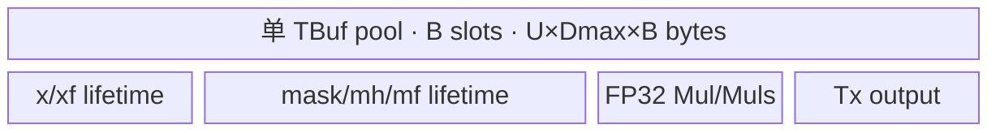

# MaskedScale 950 Direct Invoke 算子知识

> 来源边界：固定提交仅能核对公开的 MaskedScale DAG、Tiling 和平台声明；原卡归因于官方 experimental `ComputeFp16` 的文件在该提交中不存在。R-001 的 FP16 补充路线保留为交付设计记录，尚不能作为已核验的官方实现或完整 Direct 源码闭包使用。本卡保持草稿，不进入默认稳定知识检索。

## 算子速览

| 项目 | 内容 |
|---|---|
| 实际入口 | `cann_bench::masked_scale(Tensor x, Tensor mask, float scale=1.0)`；`PrivateUse1` 实现 `masked_scale_npu`；最终按 dtype 调用 15 个无模板全局 Kernel 符号之一 |
| 计算语义 | 对连续展平后的每个元素执行 `y[i] = cast_x(x[i] * mask[i] * scale)`，输出 dtype 与 `x` 相同 |
| 输入输出 | `x/mask/y` shape 相同、连续 ND；`x/y∈{float16,bfloat16,float32}`；`mask∈{uint8,int8,float16,bfloat16,float32}`；`scale` 在 Direct ABI 中为 `float` |
| 执行类型 | R-003/R-002/R-001 均为单节点 `AIV_VECTOR`；entry 显式标注 `KERNEL_TYPE_AIV_ONLY`，无可达 Cube/AIC 或 MIX_CV 节点 |
| Kernel 路线 | 三条均为 production `active`：P0 为 R-003 通用 FP32 中间，P1 为 R-002 整数 mask 双级 cast，P2 为 R-001 FP16 原生；没有 `conditional` 或 `dormant` Route，Route ID 与 Host dtype key 保持不变 |
| 核心资源 | 输入/输出 GM、一个 `TBuf<VECCALC>` tensor pool、DAG 编译期 buffer slot、`TPipe`/位置同步协议；L1/L0/workspace 均无分配或数据边 |
| 来源闭包 | 未闭合：官方固定 Commit 提供 950、DAG 和 Tiling 基线，但不能支持 R-001 原生 FP16 路线的原有来源归因；Direct ABI 和扩展路线仅保留为交付设计记录。 |
| 证据边界 | 来源核对确认 R-001 的原有官方文件不存在，撤回完整源码闭包结论；下文 active Route、POD、数据流与同步描述均为待复核的交付设计记录，不表示在固定官方版本完成 Direct 编译、真机、数值或性能验证。 |

## 接口与语义

### 计算语义

令 `N=x.numel()`，连续 ND 地址按一维 `i∈[0,N)` 解释。数学目标是：

```text
y[i] = cast<x.dtype>(x[i] * cast(mask[i]) * cast(scale))
```

实际中间精度由 Route 决定。P0/R-003 与 P1/R-002 把参与计算的张量提升到 FP32，依次执行 `Mul<float>`、`Muls<float>`，最后以 DAG 的 cast mode `1` 转回 `x.dtype`；P2/R-001 的乘法和缩放均为 FP16，`scale` 先降为 `half`。输出只写 `N` 个有效元素，UB 对齐区不提交到 GM。

### 输入、输出与属性

| 参数 | shape/layout | dtype | 约束、默认值与语义 |
|---|---|---|---|
| `x` | 任意 shape、连续 ND | `float16/bfloat16/float32` | Direct Meta 显式校验 dtype、device 与 contiguous；用于决定输出 dtype |
| `mask` | 与 `x` 完全同 shape、连续 ND | `uint8/int8/float16/bfloat16/float32` | 必须与 `x` 同 device；BF16 mask 是转换交付件扩展，官方 `math/masked_scale` 基线未公开该组合 |
| `scale` | Host 标量 | schema 为 float，调用侧进入 C++ 为 double，POD 为 float | 默认 `1.0`；launcher 以 `static_cast<float>` 固化到 POD |
| `y` | 与 `x` 相同、连续 ND | 与 `x` 相同 | 由 `empty_like(x)` 分配；空输入直接返回且不启动 Kernel |

### 入口与版本

本文入口是转换交付件中的 Direct Invoke，而不是官方 ACLNN 两段式接口。`TORCH_LIBRARY_FRAGMENT(cann_bench)` 声明 schema，Meta 实现完成校验与输出分配，`TORCH_LIBRARY_IMPL(..., PrivateUse1)` 绑定 `masked_scale_npu`。官方固定源码的 `README.md` 明确 950/Ascend 950 支持，`masked_scale_def.cpp` 和 `CMakeLists.txt` 把 `ascend950` 接到 `arch35`；交付件据此保留官方 DAG/Tiling 主体，并把框架 tiling/workspace entry 转为一份按值传递 POD、15 个具体全局符号和一次 current-stream direct launch。

官方基线支持 12 个 `x×mask` 组合（mask 不含 BF16）。本卡记录的交付设计新增 `51/52/53` 三个 BF16-mask key，并把 `11/21/31` 改为 FP16 原生 DAG；该 FP16 补充路线缺少可核验的固定源码，不能归因于官方 experimental 实现，也不能反向归因于官方公开 ACLNN 契约。

### 来源与转换关系

| 层级 | 固定来源直接支持的事实 | 本 Direct 实现中的转换边界 |
|---|---|---|
| 官方 950 主线 | `README`/definition/CMake 的 Ascend 950 范围，arch35 Host tiling，`MaskedScaleTilingData` 形状，`MaskCastOne/Two` DAG 与 AIV-only router | Direct 不复用框架 tiling/workspace 指针；Host 重新生成普通按值 POD、具体符号和 current-stream launcher |
| FP16 补充设计 | 固定提交不存在原先引用的 experimental 文件，不能据此核验 `ComputeFp16` 或官方映射 | key 11/21/31 的三个 `ScalarT=half` atvoss DAG 仅保留为待复核交付设计，不归因于官方主线或 experimental 实现 |
| 官方通用指导 | elementwise 的 4 KiB/core、512 元素分块公式；950 一次性流式输入的 L2 bypass 模式 | 本地 `CalcTiling<OpDag>` 以 Direct DAG 元数据重算 `U/F/T`；本地 scheduler 只对 x/mask 输入设置 cache hint |
| Direct 派生补充 | 无官方公开主线依据覆盖 BF16 mask 的三组组合 | key 51/52/53 复用 `MaskCastOne<Tx,bfloat16_t>`；其接口域与等价性只属于转换实现，不扩大官方契约 |

固定 `sources` 用于回到官方源码核验原生算法、平台和模板关系；本文对 Direct Host/POD/C ABI/launcher、本地 scheduler 与派生 dtype 路线的描述保留自交付设计记录，不能由这些官方来源单独推出完整 Direct 源码闭包。

## Host/Launcher 执行流程

### 参数校验与前处理

调用顺序如下：schema/Meta 检查 `x.shape==mask.shape`、同 device、支持 dtype、两输入均 contiguous→`empty_like(x)` 分配 `y`→空张量直接返回→`GetRoute(x.dtype,mask.dtype)` 生成十位 mask key 与个位 x key→`calc_masked_scale_tiling_params(N,route,float(scale))`→取得当前 NPU stream 和三个 GM 指针→`OpCommand::RunOpApi("MaskedScale", aclCall)` 内执行 direct launcher。实现不做 `Contiguous/ViewCopy` 修复；非连续输入直接失败。

Meta 已在路由前封闭非法 dtype，因此 `GetRoute` 的零 key 不会从公开 Direct 入口到达。独立调用 tiling helper 时，未知 route 抛 `invalid_argument`；独立调用 launcher 时，unknown route 的 `default` 直接返回。

### 参数、Workspace 与生命周期

设某 route 的 DAG 编译期量为 `Dmax=OpDag::MaxDtypeBytes`、`Dmin=OpDag::MinDtypeBytes`、`B=OpDag::BufferNum`，平台查询到 AIV 核数 `C_hw` 与 UB 字节 `UB_hw`：

```text
A = 256 / Dmin                                      # 元素，对齐粒度
U = align_down(UB_hw / (Dmax * B), A)              # ubFormer，元素
C = clamp(ceil(N * Dmin / 4096), 1, C_hw)          # 候选核数
F = align_up(ceil(N / C), 512)                     # blockFormer，元素
blockNum = ceil(N / F)                             # 实际 launch blockDim
T = N - (blockNum - 1) * F                         # 尾核元素
LF/LT = ceil(F/U), ceil(T/U)                       # former/tail 核循环数
UF/UT = F-(LF-1)U, T-(LT-1)U                       # 两类核末 tile 元素
```

仅当 `GetCoreNumAiv()` 返回 `<=0` 时，转换件把 AIV 核数替换为 `64`；仅当 `GetCoreMemSize(...,UB,ubSize)` 调用后 `ubSize==0` 时，才把 UB 替换为 `192 KiB`。这是返回值无效兜底：源码没有检查 platform manager 空指针，也没有捕获平台 API 异常或错误状态，这些失败不在当前闭包。`U` 还会下限钳制为 `A`。交付转换保留官方 opbase 的 4 KiB/core、512 元素 block 对齐、256 B vector 对齐和 former/tail 公式；这里 `512` 是元素粒度，与官方常量名中的 cache-line byte wording不可混用。

Direct 实现没有用户 workspace：15 个 entry 的形参只有 `x/mask/y` 与按值 POD，没有 workspace GM 参数；`x/mask/y` 分别由调用方和 `empty_like` Tensor 持有，POD 被 lambda 按值捕获，当前 stream 传给唯一 Kernel launch。启动配置 `<<<blockDim,nullptr,stream>>>` 中的 `nullptr` 是 `l2ctrl`，不是 workspace 证据。`aclCall` 在调用 launcher 后固定返回 0，源码没有逐 launch 返回码检查或 cleanup 分支。

### 启动图与失败传播

```text
cann_bench::masked_scale / PrivateUse1
  -> masked_scale_npu
    -> masked_scale_meta
    -> GetRoute
    -> calc_masked_scale_tiling_params<selected OpDag>
    -> launch_masked_scale_kernel(route, tiling, current_stream)
      -> exactly one masked_scale_<x>_<mask><<<tiling.blockNum,nullptr(l2ctrl),stream>>>
        -> RunMaskedScaleDag<OpDag,ScalarT>
          -> ElementwiseSch::Init -> ElementwiseSch::Process
```

三条 Route 都只有一个 Device 节点。节点输入边为 caller-owned `x/mask` GM，输出边为 `y` GM；无 workspace slice、跨 Kernel edge、event 或中间 GM。空输入在 Host 终止。Meta/tiling 异常会阻止 launch；launcher 的未知 key 静默返回，而已支持 key 进入对应具体符号。正常入口依赖同一 current stream 的框架提交顺序保证返回后的 Tensor 使用顺序。

## Route 与参数设计

### 分核与资源计算

每个 block 绑定区间起点 `base=b*F`；非末 block 处理 `F` 元素，末 block 处理 `T`。`ElementwiseSch::Process` 读取对应的 `LF/UF` 或 `LT/UT`，前 `loopNum-1` 次各处理 `U` 元素，末次只处理 `tailNum`。每次 tile 的本核元素 offset 从 0 累加，因此任一输入/输出的实际字节地址为：

```text
GM_byte = tensor_base + (b * F + tileOffset) * sizeof(tensor_dtype)
```

UB 只有一个 `TBuf<VECCALC>`：总容量 `U*Dmax*B` 字节，划分为 `B` 个等长 slot，每 slot `blockLen=U*Dmax` 字节。DAG 的 `GetBufferIds<true,false>()` 决定 ping/pong 与中间结果映射；循环以 `i&1` 选择阶段。Host 用同一 `Dmax/Dmin/B` 反推 `U`，所以正常平台查询下总分配不超过 `UB_hw`。

三条 active Route 共用下列存储层闭包；差异只在 UB slot 中的 dtype 与 DAG 生命周期：

| 存储层 | active 数据与地址 | 容量/生命周期 | 不存在或失效边界 |
|---|---|---|---|
| GM | `x/mask/y + (b*F+tileOffset)*sizeof(dtype)` | caller 持有输入，输出 Tensor 持有 y；每 tile 只读/写 `valid` | 不为对齐 padding 读写越界 |
| UB | 单个 `TBuf<VECCALC>`，`B` 个 DAG slot | `U*Dmax*B<=UB_hw`；按 buffer ID、最后消费点与 `i&1` 复用 | DAG 节点或 dtype 改变时必须由同一模板重算 `B/Dmax/Dmin/U` |
| L1/L0A/L0B/L0C | 无数据边、无 allocation、无 Cube 节点 | 0B | 不能把 AIV-only elementwise 图推导成 L1/L0 staging |
| workspace GM | Host 不分配 workspace，15 个 entry 也没有 workspace GM 形参；POD 按值传入 | 0B；launch 配置第二参数 `nullptr` 是 l2ctrl | 新增跨 Kernel 中间或归约时必须重新建立 workspace owner/offset/lifetime |

### Route 特征与选择

下表按合法输入域覆盖、特殊精度价值与安全边界综合排序；`P0/P1/P2` 是知识重要性，不是运行时优先级。真实 Host selector 先按 dtype 各自短路编码，再以数值 key 的 `switch` 分发。共同前序是 Meta 校验与输出分配→空输入短路返回→dtype 编码→按 key 选择 DAG tiling；DAG 选定后才查询 AIV 核数与 UB，仅对 `core<=0` 或 `ubSize==0` 的无效返回值采用既定兜底，再进入 launcher。

| 重要性 | 可达性 | Route | Key/模板 | 精确选择条件 | Host 顺序、短路与 fallback |
|---:|---|---|---|---|---|
| P0 | `active` | R-003 通用 FP32 中间 | `32/33/41/42/43/51/52/53`；`MaskedScaleMaskCastOne<Tx,Tmask>`；`ScalarT=float` | mask∈{float16,float32,bfloat16} 的已支持组合，但 `x=float16,mask=float16` 使用 R-001 | dtype 编码先对 x 按 f16→bf16→f32 短路，再对 mask 按 u8→i8→f16→f32→bf16 短路；DAG `switch` 在 31 后处理 32/33，再处理 41/42/43、51/52/53；命中立即 `return`，不存在 Route 间 fallback，default 为 tiling 抛错、launcher 静默返回 |
| P1 | `active` | R-002 整数 mask 双级 cast | `12/13/22/23`；`MaskedScaleMaskCastTwo<Tx,Tmask>`；`ScalarT=float` | `x∈{bfloat16,float32} && mask∈{uint8,int8}` | 同一 dtype 编码短路顺序；DAG `switch` 中 12/13 紧随 11，22/23 紧随 21；命中立即 `return`，不存在到 R-003 的 fallback，default 同上 |
| P2 | `active` | R-001 FP16 原生 | `11/21/31`；`MaskedScaleFp16MaskCast<uint8_t/int8_t>` 或 `MaskedScaleFp16Fp16`；`ScalarT=half` | `x=float16 && mask∈{uint8,int8,float16}` | 同一 dtype 编码短路顺序；DAG `switch` 中 11、21、31 分别是 uint8、int8、float16 mask 分组首项；命中立即 `return`，不存在到 R-002/R-003 的 fallback，default 同上 |

```text
if x=f16: xKey=1
else if x=bf16: xKey=2
else if x=f32: xKey=3
else: xKey=0
if mask=u8: maskKey=10
else if mask=i8: maskKey=20
else if mask=f16: maskKey=30
else if mask=f32: maskKey=40
else if mask=bf16: maskKey=50
else: maskKey=0
key = xKey + maskKey
switch key in Host source order:
  11:R-001; 12:R-002; 13:R-002
  21:R-001; 22:R-002; 23:R-002
  31:R-001; 32:R-003; 33:R-003
  41:R-003; 42:R-003; 43:R-003
  51:R-003; 52:R-003; 53:R-003
  default: tiling throws; launcher returns without launch
```

三条 Route 都由 `masked_scale_npu` 在合法 dtype 域直接生产，因而全部是 `active`；它们互斥覆盖 15 个 dtype key。当前交付件没有需要外部 caller 才能组图的 `conditional` Route，也没有“有 entry/body 但 production Host 永远不选”的 `dormant` Route。`core<=0`/`ubSize==0` 兜底只替换无效资源返回值，不改变 Route；manager 空指针或 API 异常没有 fallback。unknown-key 分支是越过 Meta/GetRoute 契约后的失败边，不是计算 fallback。

#### Production 链不可达的控制臂

| 控制臂 | 不可达原因 | 若要启用必须闭合的条件 |
|---|---|---|
| `CalcTiling(totalLength<=0)` | `masked_scale_npu` 在 `N==0` 时先返回，production 链不会调用 tiling helper | 若修改 Host 让空输入进入 tiling，仍应保持 no-launch，并重新核对当前未填 tail 字段不会被 Device 消费 |
| launcher `default:return` | Meta 封闭 dtype，`GetRoute` 对合法 dtype 总生成 15 个已知 key，tiling 的 unknown key 还会先抛错 | 若新增 route code，必须同时增加 schema/Meta 域、GetRoute、per-DAG tiling、具体 entry 和 launcher 分支；不能把静默返回当作输出兜底 |

这两个是 dormant 控制臂而非 Route；重新启用条件未满足前，不把它们计入实现覆盖或 fallback 路线。

### 模板/实现执行矩阵

| Route | key/selector | dtype/shape/platform 完整命中条件 | 执行拓扑与 Kernel 节点 | 实际模板/body | 存储、同步与任务映射 | tail/fallback |
|---|---|---|---|---|---|---|
| R-003 通用 FP32 中间 | 32/33/41/42/43/51/52/53 | 950，连续同 shape；上表剩余 dtype 组合 | 单 AIV Kernel | `RunMaskedScaleDag<MaskedScaleMaskCastOne<Tx,Tmask>,float>` | block `b`→`[bF,min((b+1)F,N))`；GM↔单 UB pool；L1/L0/workspace=0；位置协议同步 | former/tail 核、末 tile 精确 `valid`；BF16 mask 无官方 ACLNN fallback |
| R-002 整数 mask 双级 cast | 12/13/22/23 | 950，连续同 shape；x 为 bf16/f32，mask 为 u8/i8 | 单 AIV Kernel | `RunMaskedScaleDag<MaskedScaleMaskCastTwo<Tx,Tmask>,float>` | 同一 block 映射；GM↔UB，mask 的 half/float slot 按最后消费复用；L1/L0/workspace=0 | 同一 former/tail 公式；exact key，无 Route fallback |
| R-001 FP16 原生 | 11/21/31 | 950，连续同 shape；`x=f16` 且 mask 为 u8/i8/f16 | 单 AIV Kernel | `RunMaskedScaleDag<MaskedScaleFp16*,half>`→`ElementwiseSch` | 同一 block 映射；GM↔LEVEL_2 UB pool；Mul/Muls FP16；L1/L0/workspace=0 | former/tail 核与末 tile；非法 key 在 launch 前失败 |

### 选择与资源 Guard

| Guard | Host/Tiling 条件 | Device/资源原因 | 影响 Route | 不满足时去向 | 源码符号 |
|---|---|---|---|---|---|
| Direct contiguous | `x.is_contiguous() && mask.is_contiguous()` | Device 地址公式只按连续一维元素计算 | 全部 | `TORCH_CHECK` 失败 | 转换件 `masked_scale_meta` |
| dtype key 封闭 | `x∈{f16,bf16,f32}` 且 `mask∈{u8,i8,f16,bf16,f32}` | 只生成 15 个实体 entry | 全部 | Meta 失败；helper 未知 key 抛错 | `IsSupported*Type/GetRoute` |
| 每核最小数据量 | `C=ceil(N*Dmin/4096)` 并钳到平台核数 | 避免把不足 4 KiB 的最小 dtype 数据继续拆核 | 全部 | 使用更少 block | `CalcTiling` |
| 512 元素 block 对齐 | `F=align_up(ceil(N/C),512)` | 保留官方 elementwise 分块公式并使连续核边界规则 | 全部 | `blockNum` 可能小于候选 `C` | `CalcTiling` |
| UB slot 上界 | `U=align_down(UB/(Dmax*B),256/Dmin)` | pool 有 B 个、每个 `U*Dmax` 字节的 DAG slot | 全部 | 降低 tile；仅 `ubSize==0` 使用 192 KiB 无效返回值兜底 | `CalcTiling`、`ElementwiseSch::Init` |
| 空域 | `N==0` | 避免 `Process` 的 `loopNum-1` 无符号边界和无意义 launch | 全部 | Host 直接返回空 y | `masked_scale_npu` |
| L2 bypass | 两个输入每 tile 各只 CopyIn 一次 | 单次流式输入不占用 L2；输出不设置 bypass | 全部 | 无运行时 fallback | `ElementwiseSch::CopyIn` |
| unknown launch key | launcher `switch default` | 无对应具体符号 | 全部 | 静默返回、不写 y | `launch_masked_scale_kernel` |

### POD/ABI

`MaskedScaleTilingData` 是标准布局、自然 8B 对齐的按值 POD：按 LP64 字段布局推导 `sizeof=88`、`alignof=8`。前 80B 恰好是 11 个 `EleBaseTilingData` 字段，`float scale` 位于 offset 80，末尾有 4B 对齐 padding。转换源码未写 `#pragma pack` 或显式 `static_assert`；迁移时应在 Host/device 共用头中补 `sizeof/alignof/offsetof(scale)` 断言，不能沿用旧的 80B 结论。

| 结构 | 字段 | 类型/位宽 | ABI 布局 | 单位 | Host/launcher producer | Device consumer | 边界 |
|---|---|---|---|---|---|---|---|
| `MaskedScaleTilingData` | `dim0` | int64/64 | off 0 | 元素 | `N` | 复制进 `EleBaseTilingData`；本地 scheduler 不直接读 | 实际 launch 时 `N>0` |
| 同上 | `coreNum` | int32/32 | off 8 | 核 | 候选 `C` 窄化 | 复制进 base POD；本地 scheduler 不直接读 | 平台核数需可表示为 int32 |
| 同上 | `ubFormer` | int32/32 | off 12 | 元素/tile | `U` 窄化 | pool 分配、完整 tile 长度 | `U>0` 且需可表示为 int32 |
| 同上 | `blockFormer` | int64/64 | off 16 | 元素/非尾核 | `F` | `CalcBlockOffset` | 512 元素对齐，可能超过 N |
| 同上 | `blockNum` | int64/64 | off 24 | block | `ceil(N/F)` | Host `blockDim`、Device 末核判断 | 正常入口 `>=1` |
| 同上 | `ubLoopOfFormerBlock` | int64/64 | off 32 | loop | `ceil(F/U)` | 非末核 `Process` | `>=1` |
| 同上 | `ubLoopOfTailBlock` | int64/64 | off 40 | loop | `ceil(T/U)` | 末核 `Process` | `>=1` |
| 同上 | `ubTailOfFormerBlock` | int64/64 | off 48 | 元素 | `F-(LF-1)U` | 非末核末 tile | `1..U` |
| 同上 | `ubTailOfTailBlock` | int64/64 | off 56 | 元素 | `T-(LT-1)U` | 末核末 tile | `1..U` |
| 同上 | `elemNum` | int64/64 | off 64 | 元素 | `U` | 复制进 base POD；本地 scheduler 不直接读 | 与 `ubFormer` 同值 |
| 同上 | `scheMode` | uint64/64 | off 72 | enum/key | 常量 `1` | 复制进 base POD；本地 `ElementwiseSch<0UL,...>` 不读取 | inactive 字段仍须保持 ABI |
| 同上 | `scale` | float/32 | off 80；尾部 padding 4B | 标量 | `static_cast<float>(scale)` | `SetVar<half/float,0>` | R-001 再降为 half；结构总长 88B |

### Route 源码闭包

| Route | Key/selector | Host/Tiling producer | POD/参数 | Kernel entry/router 节点 | Kernel body/直接依赖 | 构建接线 |
|---|---|---|---|---|---|---|
| R-003 通用 FP32 中间 | 32/33/41/42/43/51/52/53 | `GetRoute`、`CalcTiling<MaskedScaleMaskCastOne>` | 同一 POD，`ScalarT=float` | 八个对应具体 entry | `MaskedScaleMaskCastOne` + `ElementwiseSch` | 同上 |
| R-002 整数 mask 双级 cast | 12/13/22/23 | `GetRoute`、`CalcTiling<MaskedScaleMaskCastTwo>` | 同一 POD，`ScalarT=float` | 四个 `masked_scale_{bf16/fp32}_{uint8,int8}` | `MaskedScaleMaskCastTwo` + `ElementwiseSch` | 同上 |
| R-001 FP16 原生 | 11/21/31 | 转换件 `GetRoute`、`CalcTiling<MaskedScaleFp16*>` | `MaskedScaleTilingData`，`ScalarT=half` | `masked_scale_fp16_{uint8,int8,fp16}` | `MaskedScaleFp16MaskCast/MaskedScaleFp16Fp16` + 本地化 `ElementwiseSch` | 转换件 `register_direct_launch_op` |

## Kernel 实现

### 公共执行流程

15 个 entry 均接收 `(x,mask,y,MaskedScaleTilingData)`，设置 `KERNEL_TYPE_AIV_ONLY` 后实例化对应 DAG。`RunMaskedScaleDag` 重建官方 `EleBaseTilingData`，创建栈上 `TPipe` 和 `ElementwiseSch<0UL,OpDag>`，设置标量，再按 `Init→Process` 执行。`Init` 将三个 GM base 绑定到当前 block 的 `b*F` 起点，并分配一个 `U*Dmax*B` 字节 pool。

每个 tile 按 DAG `FunList` 顺序递归运行。CopyIn 根据模板 dtype 绑定本 tile GM 地址，设置 `CACHE_MODE_DISABLE`，取得 `VECIN` slot 后调用 `Vec::CopyIn(...,tileLength)` 并释放；普通节点取得其输入 slot、执行 `Vec::Cast/Mul/Muls(...,tileLength)`、按最后消费点释放；CopyOut 取得最终 slot，只把 `tileLength` 个有效元素写回 GM。这里没有显式 `TQue`，同步由 tensor pool 的 `GetTensor/ReleaseTensor<TPosition::...>` 位置协议建立。

### Route R-003：通用 FP32 中间

#### 适用条件

##### 选择证据

| 层级 | 文件 | 符号 | 源码谓词/参数 | 结果/下一跳 |
|---|---|---|---|---|
| Direct Host | 转换件 plugin | `GetRoute` | key∈{32,33,41,42,43,51,52,53} | R-003 |
| Tiling | 转换件 kernel | `CalcTiling<MaskedScaleMaskCastOne<Tx,Tmask>>` | route switch 保留 8 个精确实例 | route-specific POD |
| Router | 转换件 entry | 八个 `DEFINE_MASKED_SCALE_ENTRY` | 默认 `ScalarT=float` | 通用 body |

#### Device 数据流

##### 函数级调用链

```text
masked_scale_<x>_<mask>
  -> RunMaskedScaleDag<MaskedScaleMaskCastOne<Tx,Tmask>,float>
    -> CopyIn<Tx> + CopyIn<Tmask>
    -> Cast<float,Tx,0> + Cast<float,Tmask,0>
    -> Mul<float> -> Muls<float>
    -> Cast<Tx,float,1> -> CopyOut<Tx>
```

##### 源码等价伪码

```text
for each block and valid tile:
  xf = Cast<float,Tx,0>(CopyIn<Tx>(x), valid)
  mf = Cast<float,Tmask,0>(CopyIn<Tmask>(mask), valid)
  zf = Muls<float>(Mul<float>(xf,mf,valid), scale_float, valid)
  yx = Cast<Tx,float,1>(zf, valid)
  CopyOut<Tx>(y, yx, valid)
```

#### 内存与数据搬运

##### 资源与搬运表

| 层级/缓冲区 | offset/地址公式 | extent/容量公式 | dtype/layout | producer | consumer | owner/lifetime | 对齐/复用 |
|---|---|---|---|---|---|---|---|
| GM x/mask | `b*F+off` | 两路各 `valid` | Tx/Tmask ND | caller | CopyIn | caller | 两路输入 L2 bypass |
| pool slot | `bufId*U*Dmax` | `U*Dmax`/slot | source、FP32 与 Tx views | DAG nodes | DAG downstream | TPipe | LEVEL_2 alias/ping-pong |
| GM y | `b*F+off` | `valid` | Tx ND | CopyOut | caller | y Tensor | 不写 padding |

##### 分层内存布局


##### 字节账与复用顺序

```text
UB_total = U * Dmax * B <= UB_hw
dynamic_ub = N/A
workspace_total = 0
```

| 复用子区 | 写入者 | 读取者/消费点 | 下一次覆盖 | 同步或释放依据 | 安全条件 |
|---|---|---|---|---|---|
| x/mask cast slots | input Cast | Mul | Mul 取走最后引用后 | `TryReleaseArgs` 去重并 Release | 两路输入均存活到 Mul |
| Mul output slot | Mul→原地 Muls | output Cast | cast 完成后 | VECCALC Release | 不得在 Muls 前复用 |

#### 同步、精度与尾块

##### 同步与数值边界表

| 阶段 | primitive/机制 | producer | consumer/等待点 | 保护对象 | 精度/尾块 |
|---|---|---|---|---|---|
| 搬入 | VECIN Get/Release | GM CopyIn | input Cast | source slot | `tileLength=valid` |
| 计算 | VECCALC Get/Release | 两个 FP32 Cast | Mul/Muls | FP32 intermediates | 乘与 scale 均 float；输出 mode 1 cast |
| 搬出 | VECOUT Get/Release | Tx cast | CopyOut | output slot | 末 tile 精确写 `valid` |

#### 关键实现

##### 符号证据表

| 阶段 | 文件 | 符号/模板实例 | 实现事实 |
|---|---|---|---|
| Host/Tiling producer | 转换件 kernel | 各 `CalcTiling<MaskedScaleMaskCastOne<...>>` 实例 | per-DAG UB 与同一 former/tail 公式 |
| Kernel entry/router | 转换件 entry | keys 32/33/41/42/43/51/52/53 对应 symbol | 8 个 concrete entry |
| Device body/helper | 转换件 `masked_scale_dag.h`、scheduler | `MaskedScaleMaskCastOne`、`RunNormalOp` | 两输入 FP32 cast、FP32 计算、Tx 输出 cast |

### Route R-002：整数 mask 双级 cast

#### 适用条件

##### 选择证据

| 层级 | 文件 | 符号 | 源码谓词/参数 | 结果/下一跳 |
|---|---|---|---|---|
| Direct Host | 转换件 plugin | `GetRoute` | `xKey∈{2,3}` 且 `maskKey∈{10,20}` | 12/13/22/23 |
| Tiling | 转换件 kernel | `CalcTiling<MaskedScaleMaskCastTwo<Tx,Tmask>>` | route switch 精确实例化四个 dtype 对 | route-specific U/F/loop |
| Router | 转换件 entry | `DEFINE_MASKED_SCALE_ENTRY` | 对应具体 symbol，默认 `ScalarT=float` | R-002 body |

#### Device 数据流

##### 函数级调用链

```text
masked_scale_{bf16,fp32}_{uint8,int8}
  -> RunMaskedScaleDag<MaskedScaleMaskCastTwo<Tx,Tmask>,float>
    -> ElementwiseSch::Process
      -> CopyIn<Tx> + CopyIn<Tmask>
      -> Cast<float,Tx,0>
      -> Cast<half,Tmask,0> -> Cast<float,half,0>
      -> Mul<float> -> Muls<float>
      -> Cast<Tx,float,1> -> CopyOut<Tx>
```

##### 源码等价伪码

```text
for each valid tile:
  xf = Cast<float,Tx,0>(CopyIn<Tx>(x), valid)
  mh = Cast<half,Tmask,0>(CopyIn<Tmask>(mask), valid)
  mf = Cast<float,half,0>(mh, valid)
  zf = Mul<float>(xf, mf, valid)
  zf = Muls<float>(zf, scale_float, valid)
  yx = Cast<Tx,float,1>(zf, valid)
  CopyOut<Tx>(y, yx, valid)
```

#### 内存与数据搬运

##### 资源与搬运表

| 层级/缓冲区 | offset/地址公式 | extent/容量公式 | dtype/layout | producer | consumer | owner/lifetime | 对齐/复用 |
|---|---|---|---|---|---|---|---|
| GM x/mask | `b*F+off` | 各 `valid` 元素 | Tx 与 u8/i8 ND | caller | 两个 CopyIn | caller | 两路均 L2 bypass |
| pool 输入/中间 | DAG buffer ID×`U*Dmax` | 每 slot `U*Dmax` | Tx/Tmask/half/float reinterpret | CopyIn/Cast/Mul | 下游 DAG | TPipe | LEVEL_2 最后消费复用 |
| GM y | `b*F+off` | `valid` 元素 | Tx/ND | CopyOut | caller | output Tensor | tail 精确写出 |

##### 分层内存布局



##### 字节账与复用顺序

```text
UB_total = U * Dmax * B
U = align_down(UB_hw/(Dmax*B), 256/Dmin)
workspace_total = 0
```

| 复用子区 | 写入者 | 读取者/消费点 | 下一次覆盖 | 同步或释放依据 | 安全条件 |
|---|---|---|---|---|---|
| mask 链 slot | CopyIn/Cast-half/Cast-float | 下一 cast 或 Mul | 最后消费后 | DAG `TryReleaseArgs` | 两级 cast 顺序不得折叠为整数直接 FP32 cast |
| FP32 结果 slot | Mul/Muls | Muls/输出 Cast | 输出 Cast 后 | VECCALC Release | scale 必须保持 float |

#### 同步、精度与尾块

##### 同步与数值边界表

| 阶段 | primitive/机制 | producer | consumer/等待点 | 保护对象 | 精度/尾块 |
|---|---|---|---|---|---|
| 输入 | VECIN→VECCALC 位置协议 | CopyIn | Cast | 两个 input slot | mask u8/i8 先 cast half，再 cast float |
| 计算 | VECCALC Get/Release | Cast 链 | Mul/Muls/输出 Cast | FP32 intermediates | FP32 乘与缩放；输出 mode 1 cast |
| 输出 | VECOUT 协议 | output Cast | CopyOut | Tx slot | 只处理 `valid`；无效对齐 lane 不写 GM |

#### 关键实现

##### 符号证据表

| 阶段 | 文件 | 符号/模板实例 | 实现事实 |
|---|---|---|---|
| Host/Tiling producer | 转换件 kernel | `CalcTiling<MaskedScaleMaskCastTwo<...>>` | 四 key 使用各自 DAG 元数据 |
| Kernel entry/router | 转换件 entry | 四个 `masked_scale_*_{uint8,int8}` | 具体 symbol 到模板实例一一对应 |
| Device body/helper | 转换件 `masked_scale_dag.h` | `MaskedScaleMaskCastTwo` | mask 双 cast、FP32 Mul/Muls、Tx 输出 cast |

### Route R-001：FP16 原生

#### 适用条件

##### 选择证据

| 层级 | 文件 | 符号 | 源码谓词/参数 | 结果/下一跳 |
|---|---|---|---|---|
| Direct Host | 转换件 `csrc/ops/masked_scale/op_plugin/masked_scale_plugin.cpp` | `GetRoute` | `xKey=1` 且 `maskKey∈{10,20,30}` | key 11/21/31 |
| Tiling | 转换件 `op_kernel/masked_scale_kernel.cpp` | `calc_masked_scale_tiling_params` | 11/21 使用 `MaskedScaleFp16MaskCast<Tmask>`；31 使用 `MaskedScaleFp16Fp16` | 生成同一 POD 布局 |
| Router | 转换件 `op_kernel/masked_scale_entry.h` | 三个 `DEFINE_MASKED_SCALE_FP16_ENTRY` | key 对应具体 symbol，`ScalarT=half` | R-001 body |

#### Device 数据流

##### 函数级调用链

```text
masked_scale_fp16_{uint8,int8,fp16}
  -> RunMaskedScaleDag<MaskedScaleFp16*, half>
    -> ElementwiseSch::Init(x,mask,y)
    -> ElementwiseSch::Process
      -> CopyIn<half>(x)
      -> CopyIn<Tmask>(mask)
      -> [u8/i8 only] Cast<half,Tmask,0>
      -> Mul<half>
      -> Muls<half>(scale_as_half)
      -> CopyOut<half>(y)
```

##### 源码等价伪码

```text
for tile in block b's [0, blockLength) with U-element full tiles and one tail:
  xh    = CopyIn<half>(x + b*F + tileOffset, valid)
  mh0   = CopyIn<Tmask>(mask + b*F + tileOffset, valid)
  mh    = (Tmask == half) ? mh0 : Cast<half,Tmask,mode=0>(mh0, valid)
  out_h = Mul<half>(xh, mh, valid)
  out_h = Muls<half>(out_h, half(scale), valid)
  CopyOut<half>(y + b*F + tileOffset, out_h, valid)
```

#### 内存与数据搬运

##### 资源与搬运表

| 层级/缓冲区 | offset/地址公式 | extent/容量公式 | dtype/layout | producer | consumer | owner/lifetime | 对齐/复用 |
|---|---|---|---|---|---|---|---|
| GM x | `(b*F+off)*2` bytes | `valid` elements | half/ND | caller | CopyIn | caller | input read L2 bypass |
| GM mask | `(b*F+off)*sizeof(Tmask)` | `valid` elements | u8/i8/half ND | caller | CopyIn/cast | caller | input read L2 bypass |
| tensor pool slot | `bufId*U*Dmax` | `U*Dmax` bytes/slot | 按节点 reinterpret | CopyIn/Vector op | 下游 op/CopyOut | `TPipe`，单 tile DAG 生命周期 | LEVEL_2 alias；`i&1` ping/pong |
| GM y | `(b*F+off)*2` bytes | `valid` elements | half/ND | CopyOut | caller | output Tensor | 只写有效 tail |

##### 分层内存布局


图中逻辑节点可按 `DAGSch<...,MemLevel::LEVEL_2>` 的 buffer ID 在同一物理 slot 上复用，不表示四块必然同时独占；真实总分配始终是一个 `U*Dmax*B` 字节 TBuf。

##### 字节账与复用顺序

```text
UB_total = U * Dmax * B
UB_total <= UB_hw
dynamic_ub = N/A
workspace_total = 0
```

| 复用子区 | 写入者 | 读取者/消费点 | 下一次覆盖 | 同步或释放依据 | 安全条件 |
|---|---|---|---|---|---|
| `tensorPool[bufId*blockLen]` | CopyIn 或当前 Vector op | DAG 下游节点 | 该值最后消费后，或下一 ping/pong tile | `GetTensor/ReleaseTensor` + DAG buffer ID 生命周期 | 不得在最后 consumer 之前覆盖 |
| Mul/Muls 输出 slot | `Mul`，随后 `Muls` | `Muls`/CopyOut | CopyOut 释放后 | VECCALC/VECOUT 位置协议 | 原地 Muls 的输入输出必须是同一合法 LocalTensor |

#### 同步、精度与尾块

##### 同步与数值边界表

| 阶段 | primitive/机制 | producer | consumer/等待点 | 保护对象 | 精度/尾块 |
|---|---|---|---|---|---|
| GM→UB | `GetTensor<VECIN>`/`ReleaseTensor<VECIN>` | CopyIn | Cast/Mul 的 `GetTensor<VECCALC>` | 输入 slot | API 长度为 `valid`，末 tile 不读越界 |
| Vector 链 | VECCALC Get/Release | Cast/Mul/Muls | 下一 DAG 节点 | 中间 slot | u8/i8→half；Mul/Muls 均 half；scale 降 half |
| UB→GM | `GetTensor<VECOUT>`/`ReleaseTensor<VECOUT>` | 最终 Muls | CopyOut | 输出 slot | 仅 `valid` 个 half 写出 |

#### 关键实现

##### 符号证据表

| 阶段 | 文件 | 符号/模板实例 | 实现事实 |
|---|---|---|---|
| Host/Tiling producer | 转换件 `op_kernel/masked_scale_kernel.cpp` | `CalcTiling<MaskedScaleFp16*>` | 用该 DAG 的 `Dmax/Dmin/B` 生成 tile |
| Kernel entry/router | 转换件 `op_kernel/masked_scale_entry.h` | `DEFINE_MASKED_SCALE_FP16_ENTRY` | 三个实体 entry，scalar 模板为 half |
| Device body/helper | 转换件 `masked_scale_fp16_dag.h`、`masked_scale_elewise_sch.h` | `MaskedScaleFp16MaskCast/MaskedScaleFp16Fp16`、`ElementwiseSch` | FP16 Mul/Muls、按有效 tail 搬运与 pool 复用 |

## 算子特定优化

### Trick T-002：DAG LEVEL_2 生命周期复用压缩 UB

#### 触发与源码依据

- 适用 Route：R-003/R-002；R-001 的转换 DAG 沿用相同 `MemOptCfg<LEVEL_2>` 机制。
- 触发条件：DAG 拓扑固定，buffer ID 由最后消费关系安全生成；Host 必须用同一 `OpDag::BufferNum/MaxDtypeBytes` 计算 `U`。
- Golden 来源：[`math/masked_scale/op_kernel/arch35/masked_scale_dag.h:25-38`](../../../../../../../cann-ops-raw/ascendc/ops-math/165d41f02a43a62324b434cb6bda7c533b14da3e/math/masked_scale/op_kernel/arch35/masked_scale_dag.h)

**官方源码（固定 Commit 连续逐字摘录）**：

```cpp
template <typename Tx, typename Tmask>
struct MaskedScaleMaskCastOne {
  using OpCopyIn0 = Bind<Vec::CopyIn<Tx>, Placeholder::In0<Tx>>;
  using OpCopyIn1 = Bind<Vec::CopyIn<Tmask>, Placeholder::In1<Tmask>>;
  using Cast0 = Bind<Vec::Cast<float, Tx, 0>, OpCopyIn0>;
  using Cast1 = Bind<Vec::Cast<float, Tmask, 0>, OpCopyIn1>;
  using OpMul = Bind<Vec::Mul<float>, Cast0, Cast1>;
  using OpMuls = Bind<Vec::Muls<float>, OpMul, Placeholder::Var<float, 0>>;
  using Cast3 = Bind<Vec::Cast<Tx, float, 1>, OpMuls>;
  using OpCopyOut = Bind<Vec::CopyOut<Tx>, Placeholder::Out0<Tx>, Cast3>;

  using Outputs = Elems<OpCopyOut>;
  using MemCfg = MemOptCfg<MemLevel::LEVEL_2>;
  using OpDag = DAGSch<Outputs, void, MemCfg>;
};
```

#### 机制与设计原因

`LEVEL_2` 让 DAG 编译期根据节点最后消费点分配 slot，而不是为每个 CopyIn/Cast/Mul/Muls/CopyOut 节点永久保留独立 UB。交付 scheduler 将所有 slot 放进一个 `TBuf`，每个 slot 统一取 `U*Dmax` 字节；Host 则用 `UB/(Dmax*B)` 反推 tile，形成“拓扑决定 B→B 决定 U→U 决定循环”的闭环。迁移时不能只复制 DAG 而继续使用旧 tile 上界。

#### 迁移边界

- 适用：静态逐元素 DAG，节点的输入最后消费点可在编译期确定。
- 前提：Host 与 Device 使用字节一致的 DAG 实例、`Dmax/Dmin/B` 和 buffer-ID算法。
- 失效：新增分支、多引用或持久中间会改变 `B`；必须重新计算 tiling，不能沿用原 `U`。
- 证据边界：固定 DAG 能证明 buffer-ID 与 Host tile 上界的结构关系，但不单独证明跨 SDK 版本的模板布局保持不变。

#### 错误做法

若给 DAG 增加节点却继续硬编码旧 `BufferNum`，Device 的 `InitBuffer` 可能超过 Host 预算；固定 DAG/tiling 源码已经提供了这一约束关系。

### Trick T-003：单次流式输入 CopyIn 绕过 L2

#### 触发与源码依据

- 适用 Route：R-003/R-002/R-001。
- 触发条件：`x` 与 `mask` 在每 tile 各读一次、无后续 Kernel 或同 Kernel 重读；只对输入 `GlobalTensor` 设置 bypass。
- Golden 来源：[`examples/01_simd_cpp_api/05_best_practices/00_vector_compute/add_high_performance/add.asc:245-249`](https://gitcode.com/cann/asc-devkit/blob/7a7156352f594b5ca79b533f72c5a99f19b87983/examples/01_simd_cpp_api/05_best_practices/00_vector_compute/add_high_performance/add.asc)

**官方源码（固定 Commit 连续逐字摘录）**：

```cpp
__aicore__ inline void ProcessDoubleBufferL2Bypass()
{
    xGm.SetL2CacheHint(AscendC::CacheMode::CACHE_MODE_DISABLE);
    yGm.SetL2CacheHint(AscendC::CacheMode::CACHE_MODE_DISABLE);
    ProcessDoubleBuffer();
}
```

#### 机制与设计原因

交付 scheduler 在每次输入 CopyIn 前，对构造出的输入 `GlobalTensor<T>` 设置 `CACHE_MODE_DISABLE`，随后仍用相同 `Vec::CopyIn` 和有效 `tileLength`。这一转换只改变 GM 读流量的缓存提示，不改变地址、DAG、精度或 tail；其意图是让一次性长流不占据 L2。交付件没有给输出设置 bypass，也没有 shape/value 条件分发。

#### 迁移边界

- 适用：单 Kernel、单遍流式输入、同一数据没有可验证重用的 elementwise 算子。
- 前提：950/CANN 9.1 支持该 `GlobalTensor` cache hint，输入 owner 在 launch 期间有效。
- 失效：输入会被后续节点或当前 Kernel 重读时应重新评估，不能机械绕过 L2；本实现无动态 fallback。
- 证据边界：固定源码只证明 cache hint 的落点与一次性输入前提，不给出跨 shape 或跨版本的收益幅度。

#### 错误做法

把 cache bypass 无条件迁移到存在跨 Kernel/跨 tile 重用的输入，会破坏该机制的源码前提；固定仓未提供此类 MaskedScale 反例。

## 模板与实现对比

| 对比维度 | R-003 通用 FP32 中间 | R-002 整数 mask 双级 cast | R-001 FP16 原生 | 设计选择依据 |
|---|---|---|---|---|
| 命中条件/重要性 | mask=f16/f32/bf16 的已支持 key，且 31 除外 | x=bf16/f32，mask=u8/i8 | x=f16，mask=u8/i8/f16 | dtype promotion 语义 |
| 模板与 dtype | `MaskCastOne<Tx,Tmask>`，scalar float | `MaskCastTwo<Tx,Tmask>`，scalar float | FP16 DAG，scalar half | mask 转换链和计算精度不同 |
| 循环与分核 | 同一公式，DAG 元数据决定 U | 同左 | 同左 | Dmax/Dmin/B 随模板变化 |
| Queue/TBuf/寄存器/dynamic UB/通信 window | 单 TBuf pool，无显式 TQue | 同左 | 同左 | 全部是 AIV_VECTOR 单 Kernel |
| 内存总占用与复用 | `U*Dmax*B`，LEVEL_2 | 同公式，双 cast DAG B 可能不同 | 同公式 | Host/Device 共享 DAG 元数据 |
| 搬运/Vector/SIMT/NDDMA/通信 API | CopyIn/两路 Cast/Mul/Muls/输出 Cast | CopyIn/两级 mask Cast/Mul/Muls/输出 Cast | CopyIn/Cast 可选/Mul/Muls/CopyOut | 无 SIMT/NDDMA/通信 |
| 同步、精度与 tail | 位置协议；FP32；有效长度 tail | 位置协议；FP32；有效长度 tail | 位置协议；FP16；有效长度 tail | scheduler 完全共用 |
| fallback/失败边界 | exact key 命中，无 Route fallback | exact key 命中，无 Route fallback | exact key 命中，无 Route fallback | tiling unknown key 抛错；launcher unknown key 静默返回 |

## 平台差异

| 项目 | A2 | A3 | 950 |
|---|---|---|---|
| 支持状态 | 官方 README 明确不支持 | 官方 README 明确不支持 | 官方 README 支持 Ascend 950PR/950DT；本文只发布 950 |
| Host/Launcher | 不适用 | 不适用 | 转换件查询 AIV core/UB；仅 `core<=0`/`ubSize==0` 时使用 64 core/192 KiB 无效返回值兜底，并 direct launch |
| Kernel/资源 | 不适用 | 不适用 | arch35 AIV-only atvoss DAG；单 TBuf pool；无 workspace |

## 限制与失败边界

- Direct 入口只接受两输入同 shape、同 device、连续 ND；不同于官方 ACLNN 对部分非连续 Tensor 的框架处理能力。
- BF16 mask 的 51/52/53 key 是交付转换扩展，不属于固定官方 `math/masked_scale` 公开 dtype 契约。
- `N*Dmin`、`N+C-1`、`N+F-1` 等 Host `int64` 算术没有显式溢出检查；极端元素数不能仅凭公式宣称安全。
- `ubFormer` 窄化为 int32，`blockDim` 窄化为 uint32；源码未显式检查窄化。平台 UB 极小时 `max(U,A)` 也会越过按 UB 商得到的初值；正常 950 资源返回值或 `core<=0`/`ubSize==0` 兜底是其隐含前提，manager 空指针/API 异常不在闭包。
- launcher 的 unknown route 静默返回，`aclCall` 又固定返回 0；只有遵循 Meta→GetRoute→tiling 的公开 Direct 顺序才能避免未写输出。
- `B=OpDag::BufferNum` 和 buffer ID 是 CANN 9.1 atvoss 模板在编译期解析的常量；交付源码闭合了其 producer/consumer 和总字节公式，但不把 SDK 模板内部实现伪造成算子自有代码。
- 固定源码不足以推出跨版本的性能或兼容性结论；本文仅声明 950/CANN 9.1 范围内的实现关系。

## 源码索引

### 链路索引

| 链路阶段 | 文件 | 关键符号 | 支撑内容 |
|---|---|---|---|
| 入口声明/约束 | `math/masked_scale/README.md` | 产品支持、公式、dtype 表 | 950 支持、官方语义与公开基线边界 |
| 入口实现 | `math/masked_scale/op_host/masked_scale_def.cpp` | `MaskedScale::MaskedScale` | 950 config、ND/dtype 注册与 AutoContiguous 基线 |
| Host/Tiling/Launcher | `math/masked_scale/op_host/arch35/masked_scale_tiling_arch35.cpp` | `Tiling4MaskedScale/Tiling4DoTilingDag` | 官方 key、DAG、blockDim、scale producer |
| POD | `math/masked_scale/op_kernel/arch35/masked_scale_tiling_struct.h` | `MaskedScaleTilingData` | base tiling 后追加 scale 的转换依据 |
| Kernel DAG | `math/masked_scale/op_kernel/arch35/masked_scale_dag.h` | `MaskedScaleMaskCastOne/Two` | FP32 中间 DAG与 LEVEL_2 memory config |
| Kernel entry/router | `math/masked_scale/op_kernel/masked_scale_apt.cpp` | `masked_scale` | AIV-only、key→DAG、Init/Process 基线 |
| 构建接线 | `math/masked_scale/CMakeLists.txt` | `SUPPORT_COMPUTE_UNIT/SUPPORT_TILING_DIR` | ascend950→arch35 |
| Tiling 公式来源 | `src/op_common/atvoss/elewise/elewise_tiling.cpp` | `ElewiseBaseTiling::DoTiling` | 4 KiB/core、512 元素 block、former/tail 公式 |
| L2 提示来源 | `examples/01_simd_cpp_api/05_best_practices/00_vector_compute/add_high_performance/add.asc` | `ProcessDoubleBufferL2Bypass` | 950 流式输入 cache bypass 模式 |

### 实现复用检查

| 检查项 | 可复用事实 | 不得改变的约束 | 源码符号 |
|---|---|---|---|
| ABI/POD | 平铺 80B base tiling 后追加 float scale；Direct POD 88B | 字段顺序、位宽、`scale@80`、尾部 padding 与 double→float 转换 | 转换件 `MaskedScaleTilingData/RunMaskedScaleDag` |
| 调用顺序 | Meta→route→per-DAG tiling→current-stream single launch | 空输入必须在 tiling/launch 前返回；一个 key 只启动一个 entry | `masked_scale_npu/launch_masked_scale_kernel` |
| workspace/内存 | workspace=0；UB=`U*Dmax*B` | Host 与 Device 必须使用同一 DAG 的 Dmax/Dmin/B；slot 最后消费前不得覆盖 | `CalcTiling/ElementwiseSch::Init/GetBufferIds` |
| 同步 | tensor-position Get/Release 管理 MTE2/V/MTE3 顺序 | 不能删除消费前的 Get/Release 或破坏 ping/pong 映射 | `CopyIn/ConvertArgs/TryReleaseArgs/CopyOut` |
| 精度与尾块 | R-003/R-002 使用 FP32，R-001 使用 FP16；末 tile 传有效长度 | 不得合并 mask 双 cast；不得把 FP16 scale 顺序扩到其它 key；只写 valid | 三个 DAG、`Process` |
| 失败边界 | Meta 封闭 dtype/shape/device/contiguous；tiling unknown key 抛错 | 不得直接依赖 launcher default，因为它静默返回 | `masked_scale_meta/GetRoute/calc_masked_scale_tiling_params` |
