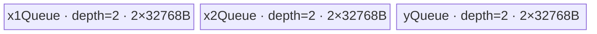

# Maximum 950 Direct Invoke 算子知识

## 算子速览

| 项目 | 内容 |
|---|---|
| 实际入口 | `cann_bench::maximum(Tensor x1, Tensor x2)`；`PrivateUse1` 实现 `MaximumNpu`；按 dtype 和 Route 调用 `launch_maximum_{equal,axis,repeat,generic}_<dtype>` |
| 计算语义 | 对右对齐广播后的每个输出坐标逐元素计算 `y=max(x1,x2)` |
| 输入输出 | 连续 ND；输入 dtype 相同；转换交付支持 `float16/bfloat16/float32/int8/int32/int64`，对齐后输出 rank 1–8；输出为广播 shape、同 dtype |
| 执行类型 | P0/R-001：AIV_VECTOR；P1/R-003：AIV_VECTOR + NDDMA；P2/R-002：AIV_VECTOR，窄后缀分支含 NDDMA；P3/R-004：AIV 上逐元素 GM 标量访问；无 Cube/AIC 或 MIX_CV 节点 |
| Kernel 路线 | 四条 terminal Route 均为 `active`：P0 R-001 等形平铺；P1 R-003 单轴值扩展；P2 R-002 连续后缀广播；P3 R-004 通用 stride 广播。没有独立 `conditional`/`dormant` terminal Route；Route ID 保持 enum 身份，不随阅读顺序改号 |
| 核心资源 | P0/R-001、P1/R-003、P2/R-002 使用 GM、三个 depth-2 `TQue`、192 KiB UB 和寄存器；P3/R-004 使用 GM 与编译器管理的局部标量，物理寄存器账不可见；workspace 为 0 |
| 来源闭包 | `direct_implementation_closed`：转换交付源码闭合 `cann_bench::maximum`→shape/dtype selector→四种 config producer→六 dtype launcher→四种 entry/body；官方固定 Commit 只支撑 Maximum/950、广播 tiling 与 `CopyInBrc→Max→CopyOut` 基线，Direct ABI、显式 NDDMA 参数和 R-004 均是转换/派生事实 |

### 来源与转换关系

| 事实层 | 固定来源直接支撑的边界 | 本卡采用方式 |
|---|---|---|
| 官方原生事实 | Maximum 的逐元素语义、950/ascend950 注册与 dtype 范围；arch35 tiling 选择 `BroadcastBaseTiling`；DAG 为两路 `CopyInBrc→Vec::Max→CopyOut`；官方 entry 签名接收 workspace/tiling，body 仅消费 tiling，并使用 scheduler mode | 只作为算子语义、平台、算法阶段与官方模板边界，不把官方 POD/router 冒充 Direct ABI |
| `direct-invoke` 适配 | 官方固定源码不包含 `cann_bench` schema、`PrivateUse1`、`OpCommand::RunOpApi`、current-stream、四个 `Maximum*Config`、六 dtype launcher 宏或四条 named entry | 这些 Host/POD/C ABI/launcher/current-stream 事实全部归于转换源码；闭包必须沿 `MaximumNpu→calc_*→launch_*→maximum_*→Run*` 核对 |
| Device 派生补充 | 官方没有 R-001/R-002/R-003 的显式 32 KiB Queue/NDDMA 参数，也没有 R-004 的 GM 标量 stride indexer | 三条规则 Route 是对官方 DAG 的显式专化；R-004 是补齐其余合法广播的派生兜底。固定官方来源不自动证明这些 predicate、资源账、等价性或逐位精度 |

因此，正文提到“官方”时只指 `sources` 中固定 Commit 的接口、tiling、DAG、entry 和构建事实；提到 selector、config、NDDMA stride、Direct entry 或 fallback 时均指转换实现。二者共享数学目标，不是逐字移植关系。

## 接口与语义

### 计算语义

设输出 rank 为 `r=max(rank(x1),rank(x2))`，两个输入 shape 在左侧补 1。对维度 `d`，要求 `x1Dim[d]==x2Dim[d] || x1Dim[d]==1 || x2Dim[d]==1`，并令 `outDim[d]=max(x1Dim[d],x2Dim[d])`。转换交付把广播维的输入 stride 置 0；对输出坐标 `c[d]`：

```text
x1Offset = Σ c[d] * x1Stride[d]
x2Offset = Σ c[d] * x2Stride[d]
y[linear(c)] = maximum(x1[x1Offset], x2[x2Offset])
```

官方相关实现把语义写成 `CopyInBrc(x1)→CopyInBrc(x2)→Vec::Max→CopyOut`。转换交付的 R-001/003/002 保持此阶段顺序，但以显式 Direct config、Queue、NDDMA 和寄存器指令替换官方 `BroadcastSch`；R-004 是为其余合法广播补充的 Direct 设备兜底，不是官方新增 Route。

### 输入、输出与属性

| 参数 | shape/layout | dtype | 约束、默认值与语义 |
|---|---|---|---|
| `x1` | 连续 ND；`max(rank(x1),rank(x2))` 为 1–8 | `float16/bfloat16/float32/int8/int32/int64` | 与 `x2` 同设备、同 dtype，shape 可右对齐广播；实现允许其中一个输入为 rank-0 标量 |
| `x2` | 连续 ND；`max(rank(x1),rank(x2))` 为 1–8 | 同 `x1` | 与 `x1` 的每一对齐维必须相等或至少一个为 1；两个输入同时 rank 0 会失败 |
| `y` | 广播 shape，连续 ND | 同输入 | 由 `torch::empty(outputShape,x1.options())` 分配并由单个 Kernel 完整写出 |

官方 README 与 950 OpDef 还声明 `uint8`，但本 Direct 转换没有 `uint8` launcher；README 中的 `double` 也不在该 950 OpDef/Direct dtype 集内，不能外推为本入口能力。

### 入口与版本

官方固定 Commit 公开的是 Maximum 算子、950 注册、通用广播 Tiling 和 `maximum<schMode>(x1,x2,y,workspace,tiling)` Kernel。该 entry 的签名接收 workspace 与 tiling，body 仅消费 tiling；实现还依赖 `DTYPE_X1` 与模板 `schMode`。转换交付以 `TORCH_LIBRARY_FRAGMENT(cann_bench)` 声明 `maximum`，Meta 入口做元数据检查，`PrivateUse1` 绑定 `MaximumNpu`；后者把自包含 Direct launcher lambda 交给 `OpCommand::RunOpApi("MaximumDirect", aclCall)`。本文不把该入口描述成 ACLNN。

## Host/Launcher 执行流程

### 参数校验与前处理

`MaximumNpu` 依次安装 `x1.device()` guard，检查同设备、两个输入均 contiguous、dtype 相同；`BuildBroadcastInfo` 检查 rank 1–8、逐维广播合法性，计算 output shape、总元素数以及广播 stride；`DtypeBytes` 把六种 dtype 映射为 1/2/4/8 字节，其他 dtype 失败。输出分配后取得当前 NPU stream。没有隐式 `Contiguous` 或 `ViewCopy`，非连续输入直接失败。

若仅 `x2` 为 full shape，Host 利用 Maximum 的交换律交换两个 GM 指针，使 R-003/R-002 的第一个输入始终是 full tensor；R-004 会恢复原始指针和原始 stride。

### 参数、Workspace 与生命周期

`MaximumNpu` 从 Tensor 取得三个裸 GM 地址；调用点向 `RunOpApi` 传入按值捕获的 `aclCall` lambda，closure 内保存地址、dtype、Route、四种 config 与 stream，但不保存 `x1/x2/y` Tensor owner。返回的 `y` Tensor 持有输出 storage，输入对象只由调用方持有。转换源码不能证明 `RunOpApi` 是立即调用、延迟调用还是保存 closure，也没有 `recordStream`、完成 event、Host callback 或显式 device synchronize。因此，lambda/config 的实际调用与保存时序、输入 storage 延迟回收、输出可见性和 allocator 安全均属于 `RunOpApi`、NPU allocator 与 current-stream 的外部契约。

四条 Route 都启动一个 Kernel，不分配独立 workspace：

```text
workspace_total = 0
stream = current NPU stream
Host config capture = lambda closure 按值保存；实际调用/保存时序由 RunOpApi 外部契约决定
GM owner proof = y 由返回 Tensor 持有；x1/x2 完成期依赖外部 stream-aware allocator 契约
```

前三条规则 Route 的 config 仅是 Host 聚合：launcher 通过 `const &` 读取后，把字段拆成标量 Kernel 参数；`MaximumFlatConfig.blockNum`、`MaximumRowsConfig.blockNum` 与 `MaximumAxisConfig.blockNum` 只用于 grid，`MaximumAxisConfig.outerCount` 只用于 Host 生成 `rowCount`。只有 R-004 把完整 `MaximumGenericConfig` 按值传入 entry。不能把前三个 C++ struct 误认为 Device 端读取的 opaque tiling buffer。

R-001/003/002 的 `tileElements=32768/dtypeBytes`，每个 Queue 单 slot 为 32768B、depth=2。R-004 不分配 UB Queue，其 shape/stride 数组随 `MaximumGenericConfig` 按值传入 Kernel。

### 启动图与失败传播

```text
cann_bench::maximum / PrivateUse1
  -> MaximumNpu
    -> BuildBroadcastInfo + shape selector
    -> calc_maximum_{flat,axis,rows,generic}_config
    -> launch_maximum_<route>_<dtype>(x1,x2,y,cfg,stream)
      -> one maximum_<route>_<dtype><<<cfg.blockNum,nullptr,stream>>>
        -> RunEqual / RunAxisScalar / RunRepeatSuffix / RunGeneric
```

每条 Route 都只有一个 Device 节点，无 Kernel 间 edge；输入 GM 是只读 producer，Kernel 写 `y` GM，workspace slice 为 N/A。同一 current stream 提供该次提交相对同流前后工作的顺序，但源码没有跨流 event 或 Host 完成等待。launcher 返回 `void`，`aclCall` 在调用后无条件返回 0；转换源码没有逐 launch 返回码检查、fallback relaunch 或 cleanup 分支。

## Route 与参数设计

### 分核与资源计算

令 `C=max(GetCoreNumAiv(),1)`，平台 manager 不可用时也回退为 1 核，`d=dtypeBytes`：

```text
R-001:
  B0 = min(C, max(1, ceil(totalLength/4096)))
  alignElements = max(1, 512/d)
  blockLength = align_up(ceil(totalLength/B0), alignElements)
  blockNum = ceil(totalLength/blockLength)
  tileElements = 32768/d

R-003:
  rowCount = outerCount*axisLength
  B0 = min(C, max(1,rowCount))
  rowsPerBlock = ceil(rowCount/B0)
  blockNum = ceil(rowCount/rowsPerBlock)
  tileElements = 32768/d

R-002:
  B0 = min(C, max(1,rowCount))
  rowsPerBlock = ceil(rowCount/B0)
  blockNum = ceil(rowCount/rowsPerBlock)
  tileElements = 32768/d

R-004:
  B0 = min(C, max(1,ceil(totalLength/4096)))
  blockLength = ceil(totalLength/B0)
  blockNum = ceil(totalLength/blockLength)
```

这些长度单位均为元素；Queue 容量在 Device 乘 `sizeof(T)`。R-001 额外把每核段按 512B 元素数对齐以改善核间 GM 起点；最后重算 `blockNum`，避免启动完全空闲的尾核。

### 生产可达性分类与穷尽证明

`MaximumRoute` 的数值身份固定为 `EQUAL=0`、`REPEAT_SUFFIX=1`、`AXIS_SCALAR=2`、`GENERIC=3`。四个值都有 `MaximumNpu` producer、dtype dispatch、launcher、同名 entry 和 Device body，所以均是 `active` terminal Route；“依赖 shape 谓词”只是 active Route 的选择条件，不把它降为 `conditional`。

| Route | 类别 | 生产可达证据 | 安全闭合与出边 |
|---|---|---|---|
| R-001 / `EQUAL=0` | `active` | `x1Full && x2Full` 直接生产 flat config，并有六 dtype `launch_maximum_equal_*` | selector 终止；核尾/tile 尾闭合；零元素域未闭合 |
| R-002 / `REPEAT_SUFFIX=1` | `active` | 恰一 full 且 `IsRepeatSuffix` 为真，先于 axis 检查并生产 rows config | selector 终止；Device 内窄 suffix 走 NDDMA，宽 suffix 走逐行 tile，不回到 Host |
| R-003 / `AXIS_SCALAR=2` | `active` | 恰一 full、suffix 为假而 `IsAxisScalar` 为真，生产 axis config | selector 终止；`innerLength<=tileElements` 时资源闭合，超宽 inner 子域没有 Host guard 或 Device fallback |
| R-004 / `GENERIC=3` | `active` | enum 初值；前三个谓词未终止时必保留，并生产完整 generic config | terminal safety Route；合法非空、可表示的其余广播均由 Device stride indexer处理，无 relaunch 出边 |

本实现没有独立 `conditional` terminal Route，也没有“有 launcher/body 但生产 selector 永不可达”的 `dormant` Route。源码中的 `MaximumLocalScalar<T>` 与 `kTileBytes` 没有调用者/consumer，是 dormant helper/constant，不得据此虚构 scalar-fast Route；当前纯标量或全 1 小输入落到 R-004。若要重新启用 scalar-fast family，必须同时增加互斥 Host 谓词、config producer、launcher/entry 调用边、UB/GM 数据流与 fallback，而不是只调用该 helper。

令 `A=x1Full&&x2Full`，`B=x1Full xor x2Full`，`S=IsRepeatSuffix(small)`，`X=IsAxisScalar(small)`。selector 的 terminal 分割是：

```text
A                         -> R-001
!A && B && S              -> R-002
!A && B && !S && X        -> R-003
!A && (!B || (!S && !X))  -> R-004
```

四项互斥且穷尽。R-002 与 R-003 还具有结构互斥性：R-003 要求 axis 后 `innerLength>1`，但 small 在这些 trailing 维均为 1；这会破坏 R-002 要求“从首个非 1 维到末维都等于 output”的 suffix 谓词。若第二个输入才是 full，Host 仅为 R-002/R-003 交换 GM 参数；R-004 在生成 config 前恢复原始 operand 地址和 stride。

### Route 特征与选择

下表按实现知识的重要性 P0→P3 排列，不代表 Host 的判断次序：等形路径覆盖最直接的密集主干；单轴与 suffix 路线保存两种不可互换的 NDDMA 广播模板；Generic 虽是性能兜底，却对其余合法广播提供唯一 Device 安全出口。`Host 顺序、短路与 fallback` 字段保留 `MaximumNpu` 的真实 shape/broadcast selector 顺序。

| 重要性 | Route | Key/模板 | Route 特征与完整适用域 | Host 顺序、短路与 fallback |
|---:|---|---|---|---|
| P0 | R-001 等形平铺 | `MaximumRoute::EQUAL=0`；`RunEqual<T>` | 六 dtype、950；两输入都与广播输出同形；连续扁平读写、512B 对齐分核、寄存器 Max | H1：`x1Full && x2Full` 直接命中并结束 shape selector；false 才进入 H2 |
| P1 | R-003 单轴值扩展 | `AXIS_SCALAR=2`；`RunAxisScalar<T>` | 六 dtype、950；恰一输入 full，small 恰有一个非 1 维且等于输出对应维，该维后的 `innerLength>1`；NDDMA 把轴值扩成 packed 行 | H3：仅 H2 的 `IsRepeatSuffix` 为 false 后检查；true 命中，false 保持 `GENERIC`；源码没有 Device fallback |
| P2 | R-002 连续后缀广播 | `REPEAT_SUFFIX=1`；`RunRepeatSuffix<T>` | 六 dtype、950；恰一输入 full，small 从首个非 1 维至末维都等于输出，且 `rowLength==small.numel()>1`、整除、`rowCount>1` | H2：仅恰一 full 时先规范化 full/small 指针，再优先检查 `IsRepeatSuffix`；true 立即短路 H3，false 才检查 R-003 |
| P3 | R-004 通用 stride 广播 | `GENERIC=3`；`RunGeneric<T>` | 六 dtype、950；其余合法 rank 1–8 右对齐广播；逐输出元素按零 stride 恢复两输入地址 | H0：Route 初值；H1 未命中且 H2/H3 不适用或均为 false 时保留；H4 恢复原始 operand 指针并生成 generic stride config；selector 结束 |

```text
route = GENERIC
if x1Full && x2Full: EQUAL
else if x1Full != x2Full:
  normalize(full,small) by optional pointer swap
  if IsRepeatSuffix(...): REPEAT_SUFFIX
  else if IsAxisScalar(...): AXIS_SCALAR
if route == GENERIC: restore original pointers and generic strides
dispatch exact dtype-specific launcher
```

### 模板/实现执行矩阵

| 重要性 | Route | Host 顺序 | key/selector | dtype/shape/platform 完整命中条件 | 执行拓扑与 Kernel 节点 | 实际模板/body | 内存与同步特征 | tail/fallback |
|---:|---|---|---|---|---|---|---|---|
| P0 | R-001 | H1 | `EQUAL` | 六 dtype、950、两输入均为输出 shape | 单 AIV_VECTOR Kernel | `maximum_equal_<dtype>`→`RunEqual<T>`→`MaximumLocal<T>` | 三个 depth-2 Queue；Queue producer/consumer 同步 | 核尾与 tile 尾均按 `min`，越界核返回 |
| P1 | R-003 | H3（H2 false 后） | `AXIS_SCALAR=2` | 六 dtype、950、small 仅一个非 1 轴且 `innerLength>1`；资源安全子域还需 `innerLength<=32768/d` | 单 AIV_VECTOR + NDDMA Kernel | `maximum_axis_<dtype>`→`RunAxisScalar<T>`→`CopyInBroadcast2D`→`MaximumLocal<T>` | 192 KiB UB；NDDMA 内 stride=0；tile 不跨 axis wrap | batch 取 core 尾、axis wrap、tile 容量三者最小；超宽 inner 没有 fallback |
| P2 | R-002 | H2 | `REPEAT_SUFFIX` | 六 dtype、950、恰一 full、small 为完整连续后缀 | 单 AIV_VECTOR Kernel；窄分支含 NDDMA | `RunRepeatSuffix<T>`；`CopyInBroadcast2D` 或逐行 `CopyIn` | 同样 192 KiB UB；窄分支以 NDDMA 零 outer stride 广播 | `rowLength*d<16384 && rowLength<=tile` 走 NDDMA，否则逐行 tile；Host 命中后不再检查 H3 |
| P3 | R-004 | H0→H4 | `GENERIC` | 六 dtype、950、其余合法 rank 1–8 广播 | 单 AIV 标量 Kernel | `RunGeneric<T>`→`ScalarMaximum<T>` | 无 Queue/workspace；逐输出元素做 GM Get/Set | 每核 `[begin,end)`；BF16/float/half 显式 NaN 分支；最终 fallback |

### 隐式性能与安全 Guard

| Guard | Host/Tiling 条件 | Device/资源原因 | 影响 Route | 不满足时去向 | 源码符号 |
|---|---|---|---|---|---|
| Direct dtype 集 | `DtypeBytes` 六分支 | 必须存在同名模板 entry/launcher | 全部 | `TORCH_CHECK` 失败 | 转换件 `DtypeBytes`、`DEFINE_MAXIMUM_KERNELS` |
| rank 上限 | `1<=rank<=8` | Generic config 固定 8 维数组 | R-004，也约束公共入口 | `TORCH_CHECK` 失败 | `BuildBroadcastInfo`、`MAXIMUM_MAX_RANK` |
| contiguous | `x1.is_contiguous() && x2.is_contiguous()` | Host stride 只按紧密 ND 推导 | 全部 | 直接失败 | `MaximumNpu` |
| 等形 512B 核段 | `alignElements=max(1,512/d)` | 分核段起点保持 cache-line 粒度 | R-001 | 不改变 Route | `calc_maximum_flat_config` |
| Queue 固定预算 | `tileElements=32768/d` | `3 queues*depth2*32768B=192KiB` | R-001/003/002 | 无动态降级 | `k*TileBytes`、`InitBuffer` |
| axis wrap | `batchRows<=axisLength-(row%axisLength)` | 保证 NDDMA source axis 值在本 batch 内连续 | R-003 | 缩短当前 batch | `RunAxisScalar` |
| axis inner 宽度 | 源码缺少 `innerLength<=tileElements` guard | 当 `innerLength>tileElements` 时 `batchCapacity` 被钳为 1，但 `count=innerLength` 仍超过 Queue slot；这是 active Route 的未闭合子域 | R-003 | 源码没有转入 R-004 | `IsAxisScalar/RunAxisScalar` |
| 窄后缀 NDDMA | `rowLength<=tileElements && rowLength*d<16384` | 多行一次 materialize，outer source stride 为 0 | R-002 Device 子分支 | 逐行直接复制 | `RunRepeatSuffix` |
| 零维度/空输出 | 无 `dim>=1` 或 `totalLength>0` guard | `(0,0)` 对齐维产生 `totalLength=0`，config 中会出现以 0 为除数；`(0,1)` 又因 `outputDim=max(d1,d2)` 被错误推成 1，而不是空维 | 全部 | 源码未提供空域返回或拒绝 | `BuildBroadcastInfo` 与四个 config producer |

### POD/ABI

这些结构是转换交付的 Host C++ 值 ABI，不是官方 `BroadcastSch` tiling POD。下表按对应 Route 的 P0→P3 展示；结构字段本身仍保持源码声明次序。按自然 8B 对齐，前三个结构仅由 `int64_t` 组成；Generic 在三个 `int64_t` 后排列两个 `int32_t`，再排列三个 8 元素 `int64_t` 数组。

| 结构 | 字段 | 类型/位宽 | ABI 布局 | 单位 | Host/launcher producer | Device consumer | 边界 |
|---|---|---|---|---|---|---|---|
| `MaximumFlatConfig` | `totalLength` | int64/64 | sizeof 32, align 8, off 0 | 元素 | `info.totalLength` | `RunEqual` 边界 | 必须大于 0 才能安全算 config |
| 同上 | `blockLength` | int64/64 | off 8 | 元素/核 | 512B 对齐的 `ceil(total/B0)` | `blockStart/currentLength` | 末核可短 |
| 同上 | `tileElements` | int64/64 | off 16 | 元素/tile | `32768/d` | Queue 容量和 tile loop | 乘 `sizeof(T)` 后为 32768B |
| 同上 | `blockNum` | int64/64 | off 24 | AIV 核 | `ceil(total/blockLength)` | launcher grid | Device body不读取 |
| `MaximumAxisConfig` | `outerCount` | int64/64 | sizeof 56, align 8, off 0 | 外组 | 目标 axis 前维乘积 | 仅 producer 计算 `rowCount` | entry 不传该字段 |
| 同上 | `axisLength` | int64/64 | off 8 | axis 元素 | 输出目标轴长 | axis wrap 与 source offset | 必须 >0 |
| 同上 | `innerLength` | int64/64 | off 16 | 元素/axis 值 | axis 后维乘积 | NDDMA innerCount/行地址 | Route 保证 >1 |
| 同上 | `rowCount` | int64/64 | off 24 | axis 行 | `outerCount*axisLength` | 行分核 | 乘法溢出未检查 |
| 同上 | `rowsPerBlock` | int64/64 | off 32 | 行/核 | `ceil(rowCount/B0)` | `rowBegin/rowEnd` | 末核可短 |
| 同上 | `tileElements` | int64/64 | off 40 | 元素/tile | `32768/d` | batchCapacity 与 Queue | 物理 slot 32768B |
| 同上 | `blockNum` | int64/64 | off 48 | AIV 核 | `ceil(rowCount/rowsPerBlock)` | launcher grid | Device body不读取 |
| `MaximumRowsConfig` | `rowCount` | int64/64 | sizeof 40, align 8, off 0 | 行 | `total/rowLength` | `RunRepeatSuffix` 行尾 | Route 成立时 >1 |
| 同上 | `rowLength` | int64/64 | off 8 | 元素/行 | suffix 维乘积 | batch/offset/分支 | >1；乘法溢出未检查 |
| 同上 | `rowsPerBlock` | int64/64 | off 16 | 行/核 | `ceil(rowCount/B0)` | `rowBegin/rowEnd` | 末核可短 |
| 同上 | `tileElements` | int64/64 | off 24 | 元素/tile | `32768/d` | Queue、batch/offset loop | 物理 slot 32768B |
| 同上 | `blockNum` | int64/64 | off 32 | AIV 核 | `ceil(rowCount/rowsPerBlock)` | launcher grid | Device body不读取 |
| `MaximumGenericConfig` | `totalLength` | int64/64 | sizeof 224, align 8, off 0 | 元素 | `info.totalLength` | `RunGeneric` end | 必须大于 0才可安全算 config |
| 同上 | `blockLength` | int64/64 | off 8 | 元素/核 | `ceil(total/B0)` | `begin/end` | 无 512B 对齐 |
| 同上 | `blockNum` | int64/64 | off 16 | AIV 核 | `ceil(total/blockLength)` | launcher grid | Device body不读取 |
| 同上 | `rank` | int32/32 | off 24 | 维 | `info.rank` | 逆序坐标循环 | 1–8 |
| 同上 | `reserved` | int32/32 | off 28 | N/A | value-init 为 0 | 不读取 | 保留位 |
| 同上 | `outputDims` | int64[8]/512 | off 32 | 元素/维 | active 维复制，inactive 置 1 | `%` 和 `/` 解 linear 坐标 | 仅 `[0,rank)` 读取 |
| 同上 | `x1Strides` | int64[8]/512 | off 96 | 元素/维 | 连续 stride；广播维置 0 | `x1Offset` | inactive 置 0 |
| 同上 | `x2Strides` | int64[8]/512 | off 160 | 元素/维 | 连续 stride；广播维置 0 | `x2Offset` | inactive 置 0 |

#### Host config 到 Kernel 参数的精确交接

| Route | Host config producer | launcher 读取/不下传字段 | entry 的实际值参数 | Device consumer |
|---|---|---|---|---|
| R-001 | `calc_maximum_flat_config` | `blockNum` 只用于 `<<<grid>>>` | `totalLength,blockLength,tileElements` | `RunEqual<T>` |
| R-002 | `calc_maximum_rows_config` | `blockNum` 只用于 grid | `rowCount,rowLength,rowsPerBlock,tileElements` | `RunRepeatSuffix<T>` |
| R-003 | `calc_maximum_axis_config` | `blockNum` 只用于 grid；`outerCount` 不下传 | `axisLength,innerLength,rowCount,rowsPerBlock,tileElements` | `RunAxisScalar<T>` |
| R-004 | `calc_maximum_generic_config` | `blockNum` 同时用于 grid，且仍保留在按值 struct 中但 body 不读 | 完整 `MaximumGenericConfig cfg`，224 B | `RunGeneric<T>` 读取 total/block/rank/dims/strides |

前三条链没有 Device tiling pointer，也没有把 `Maximum*Config` 整体序列化到 GM/workspace；字段在 C++ launcher 边被显式展开。R-004 的数组与 inactive slot 由 producer 一次性 value-init/填充，必须与 `rank` 原子交接，不能只替换 stride 数组或复用旧 rank。

### Route 源码闭包

| 重要性 | Route | Host 顺序 | Key/selector | Host/Tiling producer | POD/参数 | Kernel entry/router 节点 | Kernel body/直接依赖 | 构建接线 |
|---:|---|---|---|---|---|---|---|---|
| P0 | R-001 | H1 | `EQUAL` | 转换件 `MaximumNpu/calc_maximum_flat_config` | `MaximumFlatConfig` | `maximum_equal_<dtype>` | `RunEqual/CopyIn/MaximumLocal/CopyOut` | 转换件 `CMakeLists.txt`→`register_direct_launch_op` |
| P1 | R-003 | H3（H2 false 后） | `AXIS_SCALAR` | 转换件 `IsAxisScalar/calc_maximum_axis_config` | `MaximumAxisConfig` | `maximum_axis_<dtype>` | `RunAxisScalar/CopyInBroadcast2D/MaximumLocal` | 同上 |
| P2 | R-002 | H2 | `REPEAT_SUFFIX` | 转换件 `IsRepeatSuffix/calc_maximum_rows_config` | `MaximumRowsConfig` | `maximum_repeat_<dtype>` | `RunRepeatSuffix/CopyInBroadcast2D/MaximumLocal` | 同上 |
| P3 | R-004 | H0→H4 | `GENERIC` | 转换件 `BuildBroadcastInfo/calc_maximum_generic_config` | `MaximumGenericConfig` | `maximum_generic_<dtype>` | `RunGeneric/ScalarMaximum` | 同上 |

官方映射闭包为：`MaximumTiling::DoOpTiling`→`BroadcastBaseTiling<MaximumCompute<T>::OpDag>`→`maximum<schMode>`→`BroadcastSch<schMode,OpDag>::Process`，其 DAG 是 `CopyInBrc/Max/CopyOut`。转换件没有复用该 opaque POD/router，而是保持数学 DAG并重建上表 Direct 闭包；不得把转换 selector、config 或 Generic body归因于官方源码。

## Kernel 实现

### 公共执行流程

下列逐 Route 章节按重要性 P0→P3 排列；Route ID 不变，真实 Host 顺序见“Route 特征与选择”。六种 dtype 经宏各生成四个 `__vector__` entry 和四个 launcher。R-001/003/002 公共路径为：GM 输入→depth-2 VECIN Queue→寄存器 `Reg::Max`→depth-2 VECOUT Queue→GM 输出。`int64` 使用 `VECTOR_REG_WIDTH_2XVL` 与 `RegTraitNumTwo`，其他 dtype 使用标准 `VECTOR_REG_WIDTH`；`UpdateMask(remain)` 控制最后一个 vReg tail，store 复用同一 mask。R-004 不进入 Queue 公共路径。

| 存储层级 | R-001/R-002/R-003 | R-004 | 生命周期与同步 |
|---|---|---|---|
| GM | 两个只读输入、一个 disjoint-core 输出 | 按 broadcast stride 标量读、按 linear 标量写 | Tensor storage；同一 output 元素只由一个核写 |
| UB | 三个 Queue，各 2×32768 B，总 196608 B | 源码无 `InitBuffer`，显式 UB 为 0 | `AllocTensor→DMA→EnQue→DeQue→VEC→EnQue→DeQue→DMA→FreeTensor`；slot 释放后复用 |
| register / local scalar | 两个输入 vReg 与一个输出 vReg；int64 使用 two-register trait | 编译器管理的局部标量保存 offset/operand/result，BF16 比较临时转 FP32；物理寄存器账不可见 | 当前 vector chunk/linear iteration；下一轮覆盖 |
| L1/L0A/L0B/L0C | 0 | 0 | 没有 Cube、Matmul、L1 staging 或 L0 accumulator |
| workspace | 0 | 0 | 没有 Kernel 间 GM 临时边或 workspace slice |

Queue 的 EnQue/DeQue 负责同一 Kernel 内 MTE2→VEC→MTE3 的 producer/consumer 次序；源码没有 `SyncAll`、跨核 barrier 或 event。核间只靠不重叠的 GM 输出区间消除依赖。双 slot 允许相邻 tile 在流水阶段重叠，但源码仍按每轮 `Alloc/EnQue/DeQue/Free` 生命周期消费，不能在 `FreeTensor` 后保留 LocalTensor 地址。

数值上三条规则 Route 直接对原 dtype 执行 `Reg::Max`，没有显式 cast；R-004 只有 BF16 的比较提升到 FP32，返回的仍是原 BF16 operand。转换源码本身没有展开 `Reg::Max` 对 NaN payload、两个 NaN 的优先级和 `+0/-0` tie 的指令级规定，因此只能把“原 dtype Max 指令”作为规则 Route 的精度事实；R-004 则可由 `ScalarMaximum` 直接证明先检查 `a` 的 NaN、再检查 `b`，非 NaN 相等时返回 `b`。需要逐位兼容时必须额外核验目标 SDK 指令语义，不能从函数名推定。

### P0 / Route R-001：等形平铺

#### 适用条件

##### 选择证据

| 层级 | 文件 | 符号 | 源码谓词/参数 | 结果/下一跳 |
|---|---|---|---|---|
| Host | `op_plugin/maximum_plugin.cpp` | `MaximumNpu` | `x1Full && x2Full` | `EQUAL` |
| Launcher | `op_kernel/maximum_kernel.cpp` | `calc_maximum_flat_config` | 4096 元素/核目标、512B 对齐、32768B tile | `MaximumFlatConfig` |
| Entry/router | 同上 | `launch_maximum_equal_<dtype>` | 精确 dtype 分发 | `maximum_equal_<dtype>`→`RunEqual<T>` |

#### Device 数据流

##### 函数级调用链

```text
launch_maximum_equal_<dtype>(x1,x2,y,cfg,stream)
  -> maximum_equal_<dtype><<<cfg.blockNum>>>
    -> RunEqual<T>
      -> CopyIn(x1 tile), CopyIn(x2 tile)
      -> MaximumLocal<T>(count)
      -> CopyOut(y tile)
```

##### 源码等价伪码

```text
blockStart = blockIdx * blockLength
if blockStart >= totalLength: return
currentLength = min(blockLength, totalLength-blockStart)
for off in [0,currentLength) step tileElements:
  count = min(tileElements,currentLength-off)
  DataCopyPad x1[blockStart+off : +count] -> x1Local
  DataCopyPad x2[blockStart+off : +count] -> x2Local
  for each vReg chunk masked by count: yReg = max(x1Reg,x2Reg)
  DataCopyPad yLocal[0:count] -> y[blockStart+off : +count]
```

#### 内存与数据搬运

##### 资源与搬运表

| 层级/缓冲区 | offset/地址公式 | extent/容量公式 | dtype/layout | producer | consumer | owner/lifetime | 对齐/复用 |
|---|---|---|---|---|---|---|---|
| `x1/x2` GM | `blockStart+off` | `count` 元素 | T/ND | input Tensor | `CopyIn` | Tensor | ragged byte-count copy |
| `x1Queue/x2Queue` | slot local 0 | `2*tileElements*d` each | T/packed | `CopyIn+EnQue` | `DeQue+MaximumLocal` | `TPipe`/Kernel | depth 2；Free 后复用 |
| `yQueue` | slot local 0 | `2*tileElements*d` | T/packed | `MaximumLocal+EnQue` | `DeQue+CopyOut` | `TPipe`/Kernel | depth 2；Free 后复用 |
| vReg | `i*vl` | `vl` lanes | T | Reg DataCopy | Reg Max/store | VEC scope | tail mask |
| `y` GM | `blockStart+off` | `count` 元素 | T/ND | `CopyOut` | caller | output Tensor | 只写有效 count |

##### 分层内存布局



##### 字节账与复用顺序

```text
UB_total = 2*32768 + 2*32768 + 2*32768 = 196608B = 192KiB
dynamic_ub = N/A
workspace_total = 0
=> 依赖 950 每 AIV 至少 192KiB 可用 UB；Host 未动态查询 UB
```

| 复用子区 | 写入者 | 读取者/消费点 | 下一次覆盖 | 同步或释放依据 | 安全条件 |
|---|---|---|---|---|---|
| 每个 input Queue slot | `CopyIn` | `MaximumLocal` | 后续 tile `AllocTensor` | `EnQue→DeQue→FreeTensor` | Compute 后才 Free |
| 每个 output Queue slot | `MaximumLocal` | `CopyOut` | 后续 tile `AllocTensor` | `EnQue→DeQue→FreeTensor` | CopyOut 后才 Free |

#### 同步、精度与尾块

##### 同步与数值边界表

| 阶段 | primitive/机制 | producer | consumer/等待点 | 保护对象 | 精度/尾块 |
|---|---|---|---|---|---|
| GM→UB | Queue enqueue/dequeue | MTE2 `DataCopyPad` | VEC dequeue | input slot | `blockLen=count*sizeof(T)` 字节，支持 ragged |
| VEC | `Reg::Max<ZEROING>` | 两 input vReg | output vReg store | mask lanes | 不升/降精度；int64 用 2XVL trait |
| UB→GM | output Queue | VEC enqueue | MTE3 dequeue | output slot | 只写 `count` 元素 |

#### 关键实现

##### 符号证据表

| 阶段 | 文件 | 符号/模板实例 | 实现事实 |
|---|---|---|---|
| Host producer | `op_plugin/maximum_plugin.cpp` | `MaximumNpu` | 等形优先级最高 |
| Launcher | `op_kernel/maximum_kernel.cpp` | `calc_maximum_flat_config/launch_maximum_equal_*` | 生产 grid/段/tile 并单 Kernel 启动 |
| Device body | 同上 | `RunEqual<T>/MaximumLocal<T>` | 双输入 DMA、寄存器 Max、有效 tail 写回 |

### P1 / Route R-003：单轴值扩展

#### 适用条件

##### 选择证据

| 层级 | 文件 | 符号 | 源码谓词/参数 | 结果/下一跳 |
|---|---|---|---|---|
| Host | `op_plugin/maximum_plugin.cpp` | `IsAxisScalar` | small 恰一个非 1 轴且等于输出轴，`innerLength>1` | `AXIS_SCALAR` |
| Launcher | `op_kernel/maximum_kernel.cpp` | `calc_maximum_axis_config` | `rowCount=outerCount*axisLength` | `MaximumAxisConfig` |
| Entry | 同上 | `maximum_axis_<dtype>` | 精确 dtype | `RunAxisScalar<T>` |

#### Device 数据流

##### 函数级调用链

```text
launch_maximum_axis_<dtype>
  -> maximum_axis_<dtype>
    -> RunAxisScalar<T>
      -> CopyIn(full packed rows)
      -> CopyInBroadcast2D(axis values, innerSrcStride=0, outerSrcStride=1)
      -> MaximumLocal<T> -> CopyOut
```

##### 源码等价伪码

```text
rows = per-block [rowBegin,rowEnd)
while row<rowEnd:
  untilAxisWrap = axisLength-(row%axisLength)
  batchRows = min(rowEnd-row, untilAxisWrap, max(tileElements/innerLength,1))
  count = batchRows*innerLength
  copy full[row*innerLength : +count]
  NDDMA from small[row%axisLength]:
    loopSize=[innerLength,batchRows], srcStride=[0,1], dstStride=[1,innerLength]
  register max; copy y; row += batchRows
```

##### 修复所需前置条件

`innerLength<=tileElements` 是从 Queue 容量反推的修复前置，不是当前生产源码已有的 selector 或 Device 分支。当前 Host 只检查 `innerLength>1`；若该前置不成立仍会 launch R-003，且不会事务式保留 R-004。因此该 Route 的 reachability 仍是 active，但超宽 inner 是明确的未闭合边界。

#### 内存与数据搬运

##### 资源与搬运表

| 层级/缓冲区 | offset/地址公式 | extent/容量公式 | dtype/layout | producer | consumer | owner/lifetime | 对齐/复用 |
|---|---|---|---|---|---|---|---|
| full GM | `row*innerLength` | `count` | T/packed rows | Tensor | CopyIn | Tensor | batch 不跨 axis wrap |
| axis GM | `row%axisLength` | `batchRows` source values | T/axis | Tensor | NDDMA | Tensor | inner src stride 0 |
| `xQueue/scalarQueue/yQueue` | local 0 | 各 `2*32768B` | T/packed | DMA/VEC | VEC/CopyOut | TPipe | depth 2 |
| y GM | `row*innerLength` | count | T/packed rows | CopyOut | caller | Tensor | 只写 batch |

##### 分层内存布局


##### 字节账与复用顺序

```text
UB_total = 3*2*32768B = 196608B
NDDMA destination = batchRows*innerLength*d <= 32768B，仅在 innerLength<=tileElements 时成立
workspace_total = 0
```

| 复用子区 | 写入者 | 读取者/消费点 | 下一次覆盖 | 同步或释放依据 | 安全条件 |
|---|---|---|---|---|---|
| scalar Queue slot | NDDMA | MaximumLocal | 下一 batch | EnQue/DeQue/FreeTensor | batch 不跨 axis wrap |
| output Queue slot | MaximumLocal | CopyOut | 下一 batch | Queue lifecycle | CopyOut 后 Free |

#### 同步、精度与尾块

##### 同步与数值边界表

| 阶段 | primitive/机制 | producer | consumer/等待点 | 保护对象 | 精度/尾块 |
|---|---|---|---|---|---|
| axis expand | 2-D NDDMA + input Queue | MTE2/NDDMA | VEC dequeue | expanded scalar tile | zero inner stride 真广播；batch wrap guard |
| max | `Reg::Max<ZEROING>` | x/scalar vReg | y vReg | mask lanes | 最后 vReg mask |
| output | output Queue | VEC | MTE3 | y tile | 只写 count |

#### 关键实现

##### 符号证据表

| 阶段 | 文件 | 符号/模板实例 | 实现事实 |
|---|---|---|---|
| Host producer | `op_plugin/maximum_plugin.cpp` | `IsAxisScalar/MaximumNpu` | 单非 1 轴识别，位于 suffix Route 后 |
| Launcher | `op_kernel/maximum_kernel.cpp` | `calc_maximum_axis_config` | axis 行分核 |
| Device body | 同上 | `RunAxisScalar<T>/CopyInBroadcast2D` | wrap-bounded NDDMA 扩展与寄存器 Max |

### P2 / Route R-002：连续后缀广播

#### 适用条件

##### 选择证据

| 层级 | 文件 | 符号 | 源码谓词/参数 | 结果/下一跳 |
|---|---|---|---|---|
| Host | `op_plugin/maximum_plugin.cpp` | `MaximumNpu/IsRepeatSuffix` | 恰一 full，small 是完整连续 suffix，`rowLength==numel>1,rowCount>1` | `REPEAT_SUFFIX` |
| Launcher | `op_kernel/maximum_kernel.cpp` | `calc_maximum_rows_config` | 按 rowCount 分核 | `MaximumRowsConfig` |
| Entry | 同上 | `maximum_repeat_<dtype>` | 精确 dtype | `RunRepeatSuffix<T>` |

#### Device 数据流

##### 函数级调用链

```text
launch_maximum_repeat_<dtype>
  -> maximum_repeat_<dtype>
    -> RunRepeatSuffix<T>
      -> narrow: CopyIn(full batch) + CopyInBroadcast2D(suffix, outerStride=0)
      -> wide:   CopyIn(full row tile) + CopyIn(suffix tile)
      -> MaximumLocal<T> -> CopyOut
```

##### 源码等价伪码

```text
rows = [blockIdx*rowsPerBlock, min(rowCount,...))
for row until rows.end:
  batchRows = min(rows.end-row, max(tileElements/rowLength,1))
  if rowLength<=tileElements && rowLength*d<16384:
    packedFull = xFull[row*rowLength : +(batchRows*rowLength)]
    packedSmall = NDDMA(small[0:rowLength], outerCount=batchRows, outerSrcStride=0)
    max+write one packed batch; row += batchRows
  else:
    for off across one row step tileElements:
      copy full[row,off] and small[off], max, write y[row,off]
    row += 1
```

#### 内存与数据搬运

##### 资源与搬运表

| 层级/缓冲区 | offset/地址公式 | extent/容量公式 | dtype/layout | producer | consumer | owner/lifetime | 对齐/复用 |
|---|---|---|---|---|---|---|---|
| full GM | `row*rowLength(+off)` | batch `count` 或 tile `count` | T/rows | Tensor | CopyIn | Tensor | 有效字节 copy |
| small GM | 0 或 `off` | suffix | T/row | Tensor | NDDMA/CopyIn | Tensor | NDDMA outer stride=0 |
| two input Queues | local 0 | 各 `2*32768B` | T/packed | DMA | MaximumLocal | TPipe | depth 2 |
| output Queue | local 0 | `2*32768B` | T/packed | MaximumLocal | CopyOut | TPipe | depth 2 |
| y GM | `row*rowLength(+off)` | count | T/rows | CopyOut | caller | Tensor | 每行/批不重叠 |

##### 分层内存布局


##### 字节账与复用顺序

```text
UB_total = 3*2*32768B = 196608B
NDDMA destination extent = batchRows*rowLength*d <= 32768B
workspace_total = 0
```

| 复用子区 | 写入者 | 读取者/消费点 | 下一次覆盖 | 同步或释放依据 | 安全条件 |
|---|---|---|---|---|---|
| broadcast Queue slot | NDDMA 或 direct CopyIn | MaximumLocal | 下一 batch/row tile | Queue EnQue/DeQue/FreeTensor | `count<=tileElements` |
| output slot | MaximumLocal | CopyOut | 下一 batch/row tile | Queue lifecycle | 写 GM 后 Free |

#### 同步、精度与尾块

##### 同步与数值边界表

| 阶段 | primitive/机制 | producer | consumer/等待点 | 保护对象 | 精度/尾块 |
|---|---|---|---|---|---|
| broadcast | `DataCopy<T,2>` | NDDMA | input Queue dequeue | packed suffix batch | loopSize 为元素；dst strides `[1,rowLength]` |
| direct fallback | `DataCopyPad` | MTE2 | Queue dequeue | one row tile | rowLength 可大于 tile，最后 tile ragged |
| max/output | Reg mask + output Queue | VEC | MTE3 | valid count | 同 R-001 dtype 精度 |

#### 关键实现

##### 符号证据表

| 阶段 | 文件 | 符号/模板实例 | 实现事实 |
|---|---|---|---|
| Host producer | `op_plugin/maximum_plugin.cpp` | `IsRepeatSuffix/MaximumNpu` | 保持 predicate 优先级并交换 full/small 指针 |
| Launcher | `op_kernel/maximum_kernel.cpp` | `calc_maximum_rows_config` | 行分核与 32768B tile |
| Device body | 同上 | `RunRepeatSuffix<T>/CopyInBroadcast2D` | 窄 suffix NDDMA，多行 packed；宽 suffix 逐行 tile |

### P3 / Route R-004：通用 stride 广播

#### 适用条件

##### 选择证据

| 层级 | 文件 | 符号 | 源码谓词/参数 | 结果/下一跳 |
|---|---|---|---|---|
| Host | `op_plugin/maximum_plugin.cpp` | `MaximumNpu` | 初值 `GENERIC` 且 R-001/002/003 未命中 | `GENERIC` |
| Producer | 同上/Kernel Host pass | `BuildBroadcastInfo/calc_maximum_generic_config` | 复制 rank、output dims、两输入广播 strides | `MaximumGenericConfig` |
| Entry | `op_kernel/maximum_kernel.cpp` | `maximum_generic_<dtype>` | 精确 dtype | `RunGeneric<T>` |

#### Device 数据流

##### 函数级调用链

```text
launch_maximum_generic_<dtype>
  -> maximum_generic_<dtype>
    -> RunGeneric<T>
      -> linear-to-coordinate stride indexer
      -> GM GetValue(x1), GM GetValue(x2)
      -> ScalarMaximum<T>
      -> GM SetValue(y)
```

##### 源码等价伪码

```text
begin = blockIdx*blockLength; end=min(begin+blockLength,totalLength)
for linear in [begin,end):
  remainder=linear; x1Offset=x2Offset=0
  for d=rank-1 downto 0:
    coordinate=remainder%outputDims[d]; remainder/=outputDims[d]
    x1Offset += coordinate*x1Strides[d]
    x2Offset += coordinate*x2Strides[d]
  a=GM[x1Offset]; b=GM[x2Offset]
  if floating and a is NaN: y=a
  else if floating and b is NaN: y=b
  else y=(a>b ? a : b)
```

#### 内存与数据搬运

##### 资源与搬运表

| 层级/缓冲区 | offset/地址公式 | extent/容量公式 | dtype/layout | producer | consumer | owner/lifetime | 对齐/复用 |
|---|---|---|---|---|---|---|---|
| config value | Kernel parameter | 224B | POD | launcher | RunGeneric | launch value | 无 Device workspace |
| x1/x2 GM | `Σcoord*stride` | 1 scalar/access | T/broadcast ND | Tensor | `GetValue` | Tensor | stride 0 aliases broadcast value |
| compiler-managed local scalars | 当前迭代局部状态 | 物理寄存器账不可见 | T/float temp for BF16 | GetValue/Cast | compare | 单迭代 | 下一迭代覆盖 |
| y GM | `linear` | 1 scalar/write | T/contiguous | `SetValue` | caller | Tensor | 核区间不重叠 |

##### 分层内存布局

N/A：R-004 不调用 `InitBuffer`，不使用 AIV Queue 或 dynamic UB；实际替代路径是 GM 标量 `GetValue/SetValue` 与编译器管理的局部标量，物理寄存器账不可见。

##### 字节账与复用顺序

```text
UB_total = 0（源码无显式 UB 分配）
dynamic_ub = N/A
workspace_total = 0
physical_register_bytes = 固定源码不可见；仅能证明局部标量的单迭代生命周期
```

| 复用子区 | 写入者 | 读取者/消费点 | 下一次覆盖 | 同步或释放依据 | 安全条件 |
|---|---|---|---|---|---|
| 编译器管理的局部标量 | current linear iteration | ScalarMaximum/SetValue | next linear iteration | 顺序程序语义；物理寄存器账不可见 | SetValue 完成后覆盖 |

#### 同步、精度与尾块

##### 同步与数值边界表

| 阶段 | primitive/机制 | producer | consumer/等待点 | 保护对象 | 精度/尾块 |
|---|---|---|---|---|---|
| GM scalar | 顺序 load/compute/store | GetValue | ScalarMaximum | current element | 每核 end guard |
| BF16 compare | `Cast` BF16→float | two BF16 scalars | compare | 数值判断 | 返回原 BF16 operand，不二次量化；显式传播 NaN |
| FP16/FP32 compare | 自反不等 NaN 检查 | scalar load | ternary max | NaN | 任一 NaN 返回该 operand |
| integer compare | `a>b?a:b` | scalar load | SetValue | exact integer | 相等时返回 b |

#### 关键实现

##### 符号证据表

| 阶段 | 文件 | 符号/模板实例 | 实现事实 |
|---|---|---|---|
| Host producer | `op_plugin/maximum_plugin.cpp` | `BuildBroadcastInfo/MaximumNpu` | 0 stride 编码广播；fallback 恢复原始 operand 顺序 |
| Launcher | `op_kernel/maximum_kernel.cpp` | `calc_maximum_generic_config` | 生产 8 维值 config 和分核段 |
| Device body | 同上 | `RunGeneric<T>/ScalarMaximum<T>` | 逐元素 offset 恢复与显式浮点 NaN 处理 |

## 算子特定优化

### Trick T-001：把官方 CopyInBrc DAG 专化为零 stride NDDMA 广播

#### 触发与源码依据

- 适用 Route：P1/R-003、P2/R-002 窄后缀分支。
- 触发条件：官方相关算法需要 `CopyInBrc`；转换件进一步要求 R-003 的单轴谓词与 wrap-bounded batch，或 R-002 的 `rowLength<=tileElements && rowLength*d<16384`。
- 官方固定来源：[`math/maximum/op_kernel/arch35/maximum_dag.h:28-36`](../../../../../../../cann-ops-raw/ascendc/ops-math/165d41f02a43a62324b434cb6bda7c533b14da3e/math/maximum/op_kernel/arch35/maximum_dag.h)

**官方源码（固定 Commit 连续逐字摘录）**：

```cpp
using InputX1 = Bind<Vec::CopyInBrc<T>, Placeholder::In0<T>>;
using InputX2 = Bind<Vec::CopyInBrc<T>, Placeholder::In1<T>>;
using MaximumRes = Bind<Vec::Max<T>, InputX1, InputX2>;
```

#### 机制与设计原因

官方事实只规定两路 `CopyInBrc` 后执行 `Vec::Max`。Direct 转换把其中的规则广播显式化为二维 NDDMA：R-003 使用 `loopSize=[innerLength,batchRows]`、source stride `[0,1]`，把连续 axis 值各扩展 `innerLength` 次；R-002 使用 `loopSize=[rowLength,batchRows]`、source stride `[1,0]`，把一个 suffix 复制成 packed 多行。destination stride 固定 `[1,innerCount]`，所以 Vector 阶段可把结果当作一个 flat tile；这减少了逐广播元素的 GM 标量寻址，并保持官方 `CopyInBrc→Max→CopyOut` 顺序。上述 NDDMA 参数和 Direct predicate 是转换交付事实，不是官方源码声明。

#### 迁移边界

- 适用：可用二维元素 stride 描述、且一次 materialize 不超过 32768B Queue slot 的规则广播。
- 前提：950 Direct entry、连续输入、六种转换 dtype、NDDMA destination packed；R-003 batch 不跨 axis wrap。
- 失效：R-002 后缀达到 16384B 或超过 tile 时改用逐行 Direct Copy；不能被两种规则描述的广播进入 R-004 stride indexer。

#### 错误做法

不要让 R-003 的 batch 跨过 `axisLength` wrap，否则 `outerSrcStride=1` 会继续读取错误的下一 source 值序列。固定仓未提供独立错误实现；该边界由转换件的 `untilAxisWrap` guard 与 NDDMA source 地址公式共同证明。

## 模板与实现对比

| 对比维度 | P0 R-001 等形 | P1 R-003 单轴 | P2 R-002 后缀 | P3 R-004 通用 | 设计选择依据 |
|---|---|---|---|---|---|
| 命中条件/Host 顺序 | 两输入 full；H1 直接短路 | 恰一 full、单非 1 轴、inner>1；H3 在 H2 false 后检查 | 恰一 full 且完整 suffix；H2 优先于 H3 | 其余合法广播；H0 默认、H4 恢复原顺序 | 重要性顺序不改变 Host selector |
| 模板与 dtype | `RunEqual<T>`，六 dtype | `RunAxisScalar<T>`，六 dtype | `RunRepeatSuffix<T>`，六 dtype | `RunGeneric<T>`，六 dtype | dtype 只改变 T/entry |
| 循环与分核 | 元素段/tile | axis 行段、wrap batch | 行段；batch 或 row tile | linear 元素段 | 匹配广播连续性 |
| Queue/TBuf/寄存器 | 3×depth2 Queue+vReg | 同左 | 同左 | 无 Queue；编译器管理的局部标量，物理寄存器账不可见 | 规则路线用 packed UB |
| 内存总占用与复用 | 192KiB | 192KiB | 192KiB | 显式 UB 0 | 固定 tile 与 Queue lifecycle |
| 搬运/Vector/NDDMA API | 2×DataCopyPad+Reg Max | NDDMA+DataCopyPad+Reg Max | NDDMA 或 2×DataCopyPad+Reg Max | GM Get/Set+标量 compare | 广播是否可 packed |
| 同步、精度与 tail | Queue/mask | Queue/mask/wrap tail | Queue/mask/row tail | 顺序标量/元素 end | 不写无效元素 |
| fallback/失败边界 | H1 不命中进入广播 selector | H3 不命中保留 Generic；无 Device fallback | H2 不命中检查 R-003；wide 只切 Device 子分支 | 最终兜底 | 非连续/非法 rank/dtype/shape 失败 |

## 平台差异

| 项目 | A2 | A3 | 950 |
|---|---|---|---|
| 支持状态 | 官方 README 支持；本卡不提取 Direct 实现 | 官方 README 支持；本卡不提取 Direct 实现 | 官方 README、OpDef、CMake 和 ascend950 binary config 均支持；本卡目标平台 |
| Host/Launcher | 固定仓为 arch32 方向，未追踪本 Direct ABI | 固定仓为 arch32 方向，未追踪本 Direct ABI | 官方用 arch35 BroadcastBaseTiling；转换件用四种显式 config |
| Kernel/资源 | 本卡不闭合 | 本卡不闭合 | 官方为 `BroadcastSch<schMode,OpDag>`；转换件为四个单 Kernel Route、规则路线固定 192KiB UB |

## 限制与失败边界

- Direct 入口只接受连续输入、相同 dtype、同设备、rank 1–8 与合法右对齐广播；不做隐式 contiguous 修复。
- 转换 dtype 不含官方 950 声明的 `uint8`，也不含 README 中的 `double`；不得用官方支持表补齐 Direct launcher。
- 零维度未被安全闭合：对齐维 `(0,1)` 虽通过 broadcast check，却被 `std::max` 推成输出 1；`(0,0)` 会产生 `totalLength=0`，后续 config 可能以 0 作为 `CeilDivHost` 除数。复用时应在 shape 乘积前显式拒绝零维，或按目标框架语义实现空输出早返；仅增加 Kernel 的 `begin>=total` guard 不足以修复 Host 除零与错误 output shape。
- R-003 未检查 `innerLength<=tileElements`；当 trailing span 超过 `32768/dtypeBytes` 元素时，单行 batch 仍超过 32768B Queue slot。安全复用该 Route 必须补 guard 并转 R-004，或增加 inner tiling。
- shape 乘积、`rowCount=outerCount*axisLength` 和 byte-count 窄化到 `uint32_t` 均无显式溢出检查；rank 上限不能代替元素数上限。
- R-001/003/002 硬编码 192KiB UB，总量未与运行时 `GetCoreMemSize` 比较；迁移到不同 UB 配置必须重算三组 depth-2 Queue。
- launcher 返回 `void` 且 `aclCall` 固定返回 0，源码未提供单次 launch 的错误传播或重试。
- lambda 只捕获裸地址，不建立输入 Tensor owner 覆盖 Device 完成期的源码内证明；异步回收安全性依赖外部 current-stream allocator/`RunOpApi` 契约。
- 规则 Route 的 `Reg::Max` 未在交付源码中定义 NaN payload、双 NaN 优先级或 signed-zero tie 的逐位行为；R-004 的 `ScalarMaximum` 顺序可见，但不同 Route 的逐位一致性仍需目标 SDK 语义证明。
- 官方 `BroadcastSch` 的具体公共 POD、调度 mode 内部资源账是框架边界；本文不把它们伪造成 Direct config。

## 源码索引

### 链路索引

以下只索引允许进入 `sources` 的官方固定 Commit 文件；Direct 转换事实已在正文以转换件逻辑文件和符号单独标明。

| 链路阶段 | 文件 | 关键符号 | 支撑内容 |
|---|---|---|---|
| 入口声明/约束 | `math/maximum/README.md` | 产品支持/功能/参数 | 950 支持、逐元素 maximum、官方 dtype/layout |
| 平台注册 | `math/maximum/op_host/maximum_def.cpp` | `Maximum::Maximum` | ascend950、dynamic shape/rank、950 dtype 集 |
| Host/Tiling | `math/maximum/op_host/arch35/maximum_tiling_arch35.cpp` | `MaximumTiling::DoOpTiling` | 同 dtype 校验、BroadcastBaseTiling 与 schMode key |
| 算法 DAG | `math/maximum/op_kernel/arch35/maximum_dag.h` | `MaximumCompute<T>::OpDag` | `CopyInBrc→Vec::Max→CopyOut` |
| Kernel entry/body | `math/maximum/op_kernel/maximum_apt.cpp` | `maximum<schMode>` | 官方 `BroadcastSch` entry 与 opaque tiling |
| binary config | `math/maximum/op_host/config/ascend950/maximum_binary.json` | `op_type=Maximum` | 950 dtype binary 接线 |
| 构建接线 | `math/maximum/CMakeLists.txt` | `SUPPORT_COMPUTE_UNIT/SUPPORT_TILING_DIR` | ascend950→arch35 |

### 实现复用检查

| 检查项 | 可复用事实 | 不得改变的约束 | 源码符号 |
|---|---|---|---|
| ABI/POD | 四种 Direct config 可按值复用 | 字段顺序/位宽/数组长度 8；Generic inactive slot 值 | 转换件 `maximum_launch.h` |
| 调用顺序 | selector→config→dtype launcher→单 Kernel | R-002 优先于 R-003；Generic 必须恢复原 operand 顺序 | 转换件 `MaximumNpu` |
| workspace/内存 | 所有 Route workspace=0；规则 Route 三 Queue | depth 2、每 slot 32768B、总 192KiB | 转换件 `RunEqual/RunAxisScalar/RunRepeatSuffix` |
| 同步 | Queue 生命周期可复用 | `EnQue→DeQue→FreeTensor`，输出必须 CopyOut 后释放 | 转换件三个规则 body |
| 精度与尾块 | int64 2XVL、其余标准 VL；Generic 显式浮点 NaN | mask/count、axis wrap、BF16 先 cast float 判断但返回原 operand | `MaximumLocal/ScalarMaximum` |
| 失败边界 | rank/dtype/contiguous/broadcast checks | 不得静默接受空输出、unsupported dtype 或非连续 stride | `BuildBroadcastInfo/DtypeBytes/MaximumNpu` |
