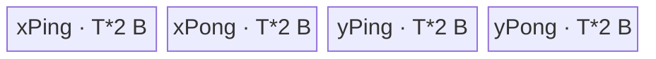

# Sigmoid 950 Direct Invoke 算子知识

## 算子速览

| 项目 | 内容 |
|---|---|
| 实际入口 | Python 动态 wrapper `cann_bench.sigmoid`，PyTorch custom op `cann_bench::sigmoid`，PrivateUse1 实现 `sigmoid_npu`，C ABI launcher `launch_sigmoid_kernel_half`、`launch_sigmoid_kernel_bfloat16`、`launch_sigmoid_kernel_float`；入口类型为 `Direct Invoke`。 |
| 计算语义 | 逐元素计算 `y = 1 / (1 + exp(-x))`。 |
| 输入输出 | 输入、输出同 shape；Direct Invoke 支持 FP16、BF16、FP32，并按线性 `numel` 访问 GM。 |
| 执行类型 | P0 R-002、P1 R-001 均为 `active` 单节点 `AIV_VECTOR`；三个 entry 都声明 `KERNEL_TYPE_AIV_ONLY`，无可达 Cube/AIC 或 `MIX_CV` 节点。 |
| Kernel 路线 | 重要性降序为 P0 R-002 FP16/BF16 升 FP32 RegBase、P1 R-001 FP32 RegBase；无 `conditional` Route。三份 Queue body 头文件是不可达的 D-001 `dormant` 源码族，不占用 R-ID。 |
| 核心资源 | 输入/输出 GM、四段显式 `VECCALC` UB ping/pong、MicroAPI RegTensor、两组 hard-event ID；不经 L1/L0，无 workspace、NDDMA buffer 或通信 window。 |
| 来源闭包 | `direct_implementation_closed`：转换快照闭合 dispatcher、tiling POD、dtype launcher、三个 entry、`KernelSigmoidManual<T>` body、同步/tail 与构建接线；固定官方源码闭合 950 平台、POD 与官方数值基线。 |
| 证据边界 | 本卡只把固定 HTTP 源归因为官方事实；Direct Host/POD/C ABI/current-stream、显式 UB 地址和 hard-event 流水均是转换快照事实。 |

## 接口与语义

### 计算语义

对线性元素索引 `i in [0, numel)`：

```text
e_i = exp(0 - x_i)
y_i = 1 / (1 + e_i)
```

FP32 路线直接在 FP32 寄存器中完成指数、加法和除法。FP16/BF16 路线先把 16-bit 输入 unpack 并转为 FP32，再执行同一公式，最后以 `NO_SAT + CAST_RINT` 降回输入 dtype。固定官方实现以 `Muls(-1)` 后接 `Exp` 表达 `exp(-x)`；交付件在 dav-3510 上把这两步改写为等价的 `FusedExpSub(zero, input)`。后者是交付适配，不是该固定 Commit 的官方原生 Sigmoid body。

### 输入、输出与属性

| 参数 | shape/layout | dtype | 约束、默认值与语义 |
|---|---|---|---|
| `x` | 任意非空 shape；kernel 按连续线性 ND 解释 | FP16、BF16、FP32 | dispatcher 只校验 dtype，没有 `is_contiguous()` 校验；可复用契约必须保证线性存储与逻辑元素顺序一致。 |
| `y` | `empty_like(x)`，同 shape/options | 与 `x` 相同 | kernel 按线性地址写 `numel` 个元素；不处理任意 stride 映射。 |
| `stream` | 当前 NPU stream | `void*` | `getCurrentNPUStream().stream(false)` 产生并传入 launcher。 |
| 属性 | N/A | N/A | Sigmoid 无额外属性。 |

### 入口与版本

Python 包加载 `_C.abi3.so`，并在 `torch.ops.cann_bench.sigmoid` 确实存在时动态安装 `cann_bench.sigmoid(*args,**kwargs)` wrapper。`TORCH_LIBRARY_FRAGMENT` 声明 `cann_bench::sigmoid(Tensor x) -> Tensor`；Meta 实现完成三种 dtype 校验并返回 `empty_like`；PrivateUse1 绑定到 `sigmoid_npu`。`sigmoid_npu` 安装输入 device guard，计算 `numel` 和元素字节数，生成 `SigmoidLaunchParams`，再通过 `OpCommand::RunOpApi("SigmoidDirect", aclCall)` 在当前 stream 调用 dtype 对应 launcher。

固定官方 Commit 的 README 明确支持 Ascend 950PR/950DT，`sigmoid_def.cpp` 注册 `ascend950`，binary config 列出 BF16/FP16/FP32 ND，构建接线包含 `ascend950 -> arch35`。交付构建把 `NPU_ARCH=ascend950` 映射为 Bisheng `--npu-arch=dav-3510 -xasc`，分别编译 Kernel 与 Torch plugin object，再与 Python 扩展壳链接为 `_C.abi3.so`。这些官方文件用于确认 950、POD、dtype 和生产数值基线；本文的 Python/Torch dispatcher、按值 POD launcher、显式四段 UB、hard-event ping/pong 和 `FusedExpSub` 是交付件为 CANN 9.1.0 Direct Invoke 增加的适配/补充，并非官方仓原生入口或原生调度实现。

## Host/Launcher 执行流程

### 参数校验与前处理

1. `sigmoid_meta` 仅接受 FP16、FP32、BF16，并以 `empty_like(x)` 创建输出。
2. `sigmoid_npu` 设置 `OptionalDeviceGuard`，读取 `x.numel()` 与 `x.element_size()`；没有 contiguous、stride、空 tensor 或 device 类型的显式检查。
3. `calc_sigmoid_tiling_params(totalLength, elementBytes)` 查询 AIV 核数和 UB 字节数；AIV 核数非正时回退为 1。
4. Host 计算 block、tile 和八字段 POD；随后按 dtype 选择三个不同 launcher/entry。
5. `totalLength==0` 会令 `blockDim==0`，之后 `CeilDiv(totalLength, blockDim)` 除零，因此空 tensor 不在该 Direct Invoke 的有效域内。

### 参数、Workspace 与生命周期

令 `N=numel`、`s=elementBytes`、`C=max(GetCoreNumAiv(),1)`、`U=ubSize`（由 `GetCoreMemSize(UB, ubSize)` 写入）：

```text
blockDim_initial = min(C, N)
alignment_elems = max(1, 32 / s)
blockFormer = align_up(ceil_div(N, blockDim), alignment_elems)
while blockDim > 1 and blockFormer * (blockDim - 1) >= N:
    blockDim -= 1
    blockFormer = align_up(ceil_div(N, blockDim), alignment_elems)
blockTail = N - blockFormer * (blockDim - 1)
```

`SigmoidLaunchParams` 与 `SigmoidTilingData` 都在 Host 栈上构造；lambda 按值捕获，launch 再把 tiling POD 按值传给 Device entry。输入和输出 GM 由 tensor 持有，当前 stream 提供提交顺序。`<<<blockDim, nullptr, stream>>>` 的第二配置槽是 `l2ctrl`，`nullptr` 不是 workspace 实参。`workspace_total=0` 由另一条链证明：三个 entry 签名只接收 `x,y,tilingData`，`KernelSigmoidManual<T>` 也不绑定或读取 workspace。这与固定官方 Host 为框架预留 32B workspace 不同；Direct 路线不携带该预留。

### 启动图与失败传播

```text
cann_bench.sigmoid
  -> torch.ops.cann_bench.sigmoid
    -> sigmoid_npu
      -> sigmoid_meta + output allocation
      -> calc_sigmoid_tiling_params
      -> dtype dispatch
        -> launch_sigmoid_kernel_{half|bfloat16|float}
          -> exactly one sigmoid_{f16|bf16|f32}_entry<<<blockDim,nullptr,stream>>>
            -> KernelSigmoidManual<T>::Init
            -> KernelSigmoidManual<T>::Process
          -> y
```

| 节点 | Host 启动函数 | Kernel entry | blockDim/POD | 输入→输出 | workspace/ordering |
|---|---|---|---|---|---|
| K1 | `launch_sigmoid_kernel_*` | `sigmoid_f16_entry` / `sigmoid_bf16_entry` / `sigmoid_f32_entry` | `blockDim`；`l2ctrl=nullptr`；`SigmoidTilingData` 按值 | `x GM -> x UB -> Reg -> y UB -> y GM`；旁路 L1/L0 | entry 无 workspace 参数，`workspace_total=0`；supplied stream + kernel 内 hard events |

这是单节点启动图，没有 Kernel 间 workspace 边。Host dtype 失败在 output 分配前由 `TORCH_CHECK` 终止；空 tensor 则会在 tiling 算术中失败。`PlatformAscendCManager::GetInstance()` 结果没有 null guard；`GetCoreMemSize` 返回 `void`，不存在可检查的返回状态；Host 在调用后没有检查 `ubSize>=4*64*s`。launch wrapper 返回 `void`，`aclCall` 固定返回 0，因而源码也没有把异步 Kernel 提交错误转换成非零 lambda 返回值。

## Route 与参数设计

### 分核与资源计算

Host tile 策略使用四个等长 UB 区，记 `VL32=64` 元素、`T=elemNum`：

```text
ubCapacity = U / (4*s)
maxElemNum = (blockFormer*s >= 1MiB)
             ? ubCapacity
             : min(ubCapacity, 32KiB/s)
maxElemNum = max(64, align_down(maxElemNum, 64))
pipelineElemNum = align_up(ceil_div(blockFormer, 4), 64)
T = max(64, min(maxElemNum, pipelineElemNum))

formerLoops = ceil_div(blockFormer, T)
tailLoops   = ceil_div(blockTail, T)
formerTail  = blockFormer - (formerLoops-1)*T
tailTail    = blockTail - (tailLoops-1)*T
```

非末核覆盖 `[blockIdx*blockFormer, blockIdx*blockFormer+blockFormer)`；末核覆盖同一起点后的 `blockTail`。每个 tile 的 GM 起点为 `blockFormer*blockIdx + loopIdx*T`。`blockFormer` 先按 32B 元素数对齐，while 循环减少核数直到最后一核元素数为正。`T` 按 64 个 FP32 lane 对齐，并由 `U/(4s)` 约束四段 UB；但源码把 `T` 强制至少 64，未显式拒绝 `U < 4*64*s` 的异常平台查询结果。

### Route 分类、合法域与重要性

P0→P1 只规定本卡的阅读与复用顺序，不改变 Host 的 dtype 判断。令公开调用契约内的实现域为：

```text
D = 950 && PrivateUse1 && N>0 && linear_dense(x,y)
    && dtype in {FP16,BF16,FP32}
    && core_query_usable && U >= 4*64*sizeof(dtype)
D_R002 = D && dtype in {FP16,BF16}
D_R001 = D && dtype == FP32
D_R002 union D_R001 = D; D_R002 intersect D_R001 = empty
```

`linear_dense(x,y)` 要求 kernel 的线性物理顺序与输入/输出逻辑顺序一致。`core_query_usable` 包含可用的 UB 容量；AIV 核数非正时 Host 有回退 1 核，但 UB 查询状态没有对等的失败出边。

| 重要性 | 分类 | Route/源码族 | 特征与适用域 | 实现前提或不可达原因 |
|---|---|---|---|---|
| P0 | `active` | R-002 FP16/BF16 升 FP32 RegBase | 以同一 T16 body 覆盖 `D_R002`；GM/UB 保持 16-bit，寄存器中完成 unpack、FP32 非线性与 RINT pack | `sizeof(T)==2`；平台支持 B16 unpack/pack、双向 cast 与 FP32 `FusedExpSub/Adds/Div`；四段 UB 和 hard-event 前提成立 |
| P1 | `active` | R-001 FP32 RegBase | 覆盖 `D_R001`；FP32 norm load/store 与全 FP32 非线性，省去窄类型转换 | `T=float`；FP32 RegBase primitive、四段 UB 和 hard-event 前提成立 |
| P2 | `dormant` | D-001 `SigmoidF16/SigmoidBf16/SigmoidF32` Queue body 族 | 头文件保留 Queue 多 buffer body；canonical dormant 声明输入 `TQue<...,2>`、输出 `TQue<...,1>`，两个 Queue 都用 `InitBuffer(...,2,T*s)` 注册缓冲；它不是生产 Route，不占 R-ID | `sigmoid_entry.h` 只 include/construct `KernelSigmoidManual<T>`；无 Queue entry、C launcher 或 Host selector producer，构建链也不单独编译这三个头文件 |

P0 先于 P1，因为它同时覆盖两种合法 dtype，且携带窄类型→FP32→窄类型的精度边界；P1 闭合剩余 FP32 域。D-001 排在最后，只保留不可达性与重启条件，不与 active Route 竞争 selector 优先级。

没有 `conditional` Route。`DataCopy`/`DataCopyPad`、单 tile/多 tile 以及 former/tail core 是两条 active Route 内部的条件边，不会改变 launcher、entry 或 Device body 身份。D-001 有两种不同的重启方式：

- **直接替换 manual body**：可复用现有 dtype branch、三个 C launcher 和三个 entry 签名。在 entry 中 include 对应 Queue 头文件，构造 `TPipe`，再以 `Init(x,y,nullptr,&tilingData,&pipe) -> Process()` 替代 `KernelSigmoidManual<T>` 调用即可建立可达边；Queue body 不读 workspace，这里的第三实参可为 null。
- **与 manual body 并存为新 Route**：必须新建可证明的判别边，例如 Host/POD key 加 entry router，或独立 entry。新 launcher 只是实现选项，不是必要条件；两个 body 仍可通过同一 launcher 进入带 key 的 entry router。

两种方式都要重新闭合 `TQue` 模板深度与 `InitBuffer` 注册数的关系、`4*T*s` UB、current-stream、tail、dtype 精度顺序与 workspace 契约。仅 include 头文件或修改 POD 不能自动使 D-001 成为可达 Route。

```text
# 当前唯一可达关系
dtype branch -> launch_sigmoid_kernel_* -> sigmoid_*_entry
             -> KernelSigmoidManual<T>::Init/Process

# D-001 当前没有入边；直接替换时复用现有链
existing dtype branch/launcher/entry -> TPipe
                                     -> Sigmoid{F16|Bf16|F32}::Init/Process

# 仅并存为新 Route 时才要求新判别边
new selector/key -> existing or new launcher -> routed entry + TPipe
                 -> Sigmoid{F16|Bf16|F32}::Init/Process
```

### Route 选择

下表按重要性排列；`Host 顺序、短路与 fallback` 字段单独保留 `sigmoid_npu` 的真实控制流，因此 P0 不代表新的 runtime priority。

| 重要性 | Route | Key/模板 | 精确选择条件 | Host 顺序、短路与 fallback |
|---|---|---|---|---|
| P0 | R-002 FP16/BF16 升 FP32 RegBase | 无 TilingKey；`KernelSigmoidManual<half>` / `<bfloat16_t>` | FP16 或 BF16；两者 `sizeof(T)==2`，进入 `ComputeB16` | H1：FP16 首个 `if` 命中即启动 half entry；H2：仅 H1 未命中时检查 BF16，命中即启动 bfloat16 entry；两者均无 Device fallback。H1/H2 都未命中才进入 H3 |
| P1 | R-001 FP32 RegBase | 无 TilingKey；`sigmoid_f32_entry -> KernelSigmoidManual<float>` | `x.scalar_type()==torch::kFloat32`；Meta 已把合法域限制为三种 dtype | H3：H1/H2 均未命中后的最终 `else`；在已校验域内只可能是 FP32。其它 dtype 在 Meta 短路失败，不到 launcher；无 Device fallback |

```text
sigmoid_meta: dtype in {FP16, BF16, FP32} else fail
sigmoid_npu dtype dispatch:
  FP16 -> half entry -> R-002
  BF16 -> bfloat16 entry -> R-002
  else (validated FP32) -> float entry -> R-001
```

### 模板/实现执行矩阵

| 重要性 | Route | key/selector | dtype/shape/platform 完整命中条件 | 执行拓扑与 Kernel 节点 | 实际模板/body | 内存与同步特征 | tail/fallback |
|---|---|---|---|---|---|---|---|
| P0 | R-002 FP16/BF16 升 FP32 | half/bfloat16 launcher/entry | FP16 或 BF16；`N>0`；线性 dense；950 | 单 K1 `AIV_VECTOR` | `KernelSigmoidManual<T16>::Process -> ComputeB16` | 四段 16-bit UB；寄存器升 FP32；同一 hard-event 图 | extent 字节 32B 对齐走 `DataCopy`，否则 `DataCopyPad`；VF 用 `UpdateMask`；尾结果 `CAST_RINT` 后 pack B32 |
| P1 | R-001 FP32 RegBase | float launcher/entry | FP32；`N>0`；线性 dense；950 | 单 K1 `AIV_VECTOR` | `KernelSigmoidManual<float>::Process -> ComputeFloat` | 四段 `float` UB；两 event IDs 管理 MTE2/V/MTE3；全 FP32 | extent 字节 32B 对齐走 `DataCopy`，否则 `DataCopyPad`；VF 用 `UpdateMask` |

### 性能 Guard

| Guard | Host/Tiling 条件 | Device/资源原因 | 影响 Route | 不满足时去向 | 源码符号 |
|---|---|---|---|---|---|
| 非空域 | `totalLength>0` | `blockDim` 是 `CeilDiv` 除数，且至少启动一个 AIV block | 全部 | 无 fallback；调用前必须拒绝空 tensor | `calc_sigmoid_tiling_params` |
| core 尾块为正 | `while blockDim>1 && blockFormer*(blockDim-1)>=N` | 防止前 `blockDim-1` 个对齐块吃完数据导致末核空/负 | 全部 | 减少 `blockDim` 并重算 | `calc_sigmoid_tiling_params` |
| 四段 UB | `T<=U/(4s)`，正常查询下由 `ubCapacity` 保证 | `xPing/xPong/yPing/yPong` 各占 `T*s` | 全部 | 无显式失败；`T>=64` 是额外前提 | `calc_sigmoid_tiling_params`、`KernelSigmoidManual::Process` |
| 64-lane 对齐 | `T` 与 `pipelineElemNum` 向 64 元素对齐 | VF 按 `VECTOR_REG_WIDTH/sizeof(float)=64` 扫描 | 全部 | 最后一轮 mask tail | `calc_sigmoid_tiling_params`、`ComputeFloat/ComputeB16` |
| DMA 快路 | `(extent*s)%32==0` | 对齐 tile 可用元素计数版 `DataCopy` | 全部 | `DataCopyPad`，`blockCount=1`、`blockLen=extent*s` 字节 | `CopyIn`、`CopyOut` |
| 大工作集 | `blockFormer*s>=1MiB` | 允许 tile 使用全部 `U/(4s)`，减少长流的循环/event 次数 | 全部 | 小工作集限制到 32KiB 或四个 pipeline tile | `calc_sigmoid_tiling_params` |
| dtype 编译分支 | `sizeof(T)==sizeof(float)` | FP32 不需 unpack/cast；16-bit 必须升精度和 pack | P0 R-002、P1 R-001 | 选择另一 Route | `KernelSigmoidManual::Process` |

### POD/ABI

`SigmoidTilingData` 是八个连续 `int64_t` 的 plain POD；按自然布局 `sizeof=64`、`alignof=8`。交付件字段名、类型和顺序与固定官方 `BEGIN_TILING_DATA_DEF` 一致，但 registry 序列化被替换为 Direct Invoke 的按值传参。

| 结构 | 字段 | 类型/位宽 | ABI 布局 | 单位 | Host/launcher producer | Device consumer | 边界 |
|---|---|---|---|---|---|---|---|
| `SigmoidTilingData` | `dim0` | `int64_t`/64 | offset 0；结构 size 64 | 元素 | `totalLength` | 当前 body 不读取 | 保留官方 ABI 字段 |
| 同上 | `blockFormer` | `int64_t`/64 | offset 8 | 元素/core | 对齐后的非尾核长度 | `GmOffset` | 必须使末核 `blockTail>0` |
| 同上 | `ubFormer` | `int64_t`/64 | offset 16 | 元素/tile | `elemNum` | `GmOffset` 的 tile stride | 与 `elemNum` 相同 |
| 同上 | `ubLoopOfFormerBlock` | `int64_t`/64 | offset 24 | loop/core | `ceil_div(blockFormer,elemNum)` | 非末核 `loopNum` | `N>0` 时正数 |
| 同上 | `ubLoopOfTailBlock` | `int64_t`/64 | offset 32 | loop/core | `ceil_div(blockTail,elemNum)` | 末核 `loopNum` | `N>0` 时正数 |
| 同上 | `ubTailOfFormerBlock` | `int64_t`/64 | offset 40 | 元素 | `blockFormer-(formerLoops-1)*elemNum` | 非末核最后 tile extent | `1..elemNum` |
| 同上 | `ubTailOfTailBlock` | `int64_t`/64 | offset 48 | 元素 | `blockTail-(tailLoops-1)*elemNum` | 末核最后 tile extent | `1..elemNum` |
| 同上 | `elemNum` | `int64_t`/64 | offset 56 | 元素/UB 子区 | `T` | 四段 LocalTensor 容量、循环步长 | 64 倍数，至少 64 |
| `SigmoidLaunchParams` | `blockDim` | `int64_t`/64 | offset 0；结构 size 72、align 8 | AIV block | `calc_sigmoid_tiling_params` 返回值 | launcher 配置，不进 Device POD | `1..C`，要求 `N>0` |
| 同上 | `tilingData` | `SigmoidTilingData`/512 | offset 8 | POD | 同上 | entry 按值接收 | 生命周期到 launch 参数封送结束 |

### Route 源码闭包

| 重要性 | 分类 | Route/源码族 | Key/selector | Host/Tiling producer | POD/参数 | Kernel entry/router 节点 | Kernel body/直接依赖 | 构建接线 |
|---|---|---|---|---|---|---|---|---|
| P0 | `active` | R-002 FP16/BF16 | Host dtype branch | 转换件 `sigmoid_plugin.cpp::sigmoid_npu`、`sigmoid_kernel.cpp::calc_sigmoid_tiling_params`；官方基线 `SigmoidTiling::{GetOpKey,DoOpTiling}` | `SigmoidTilingData`、`SigmoidLaunchParams` | `sigmoid_f16_entry` / `sigmoid_bf16_entry`；官方 keys `100000000000100` / `200000000000100` | `KernelSigmoidManual<T16>::{Process,ComputeB16}`；官方 `SigmoidF16/SigmoidBf16` | 转换件算子/顶层 CMake + `register_direct_launch_op`；官方 `activation/sigmoid/CMakeLists.txt` |
| P1 | `active` | R-001 FP32 | Host dtype branch | 同上 | 同上 | `sigmoid_f32_entry`；官方映射 `sigmoid` key `300000000000100` | `KernelSigmoidManual<float>::{Process,ComputeFloat}`；官方 `SigmoidF32` | 同上 |
| P2 | `dormant` | D-001 Queue body 族 | 无 producer | 仅共用 POD 定义 | 可读取同一 `SigmoidTilingData`，但无按值 launch 消费者 | 无 entry/router 节点 | `SigmoidF16/SigmoidBf16/SigmoidF32`；`TQue/TPipe` | 头文件未被可达 entry include；无单独 translation unit |

## Kernel 实现

### 公共执行流程

三个 entry 都设置 `KERNEL_TYPE_AIV_ONLY`，构造对应 `KernelSigmoidManual<T>`，调用 `Init(x,y,&tilingData)` 和 `Process()`。`Init` 初始化 SoC 状态并绑定输入/输出 GM。每核根据是否末核选择 loop 数与 tail extent，随后在 `VECCALC` 地址 0 起划出 `xPing/xPong/yPing/yPong` 四个互不重叠子区。

`Process` 先初始化两组 `V_MTE2` 与 `MTE3_V` free-event，预取前两个输入 tile；主循环按奇偶选择 ping/pong，在 `MTE2_V` 后计算、在 `V_MTE3` 后输出，并把已消费输入子区预取到 `loopIdx+2`。因此 MTE2、Vector 与 MTE3 可以在不同 buffer 上推进。该显式 hard-event 调度是交付件对官方 Queue 双缓冲的补充，不是固定官方源码的原生 body。

下列逐 Route 章节按重要性 P0→P1 排列；Route ID 保持不变，真实 Host dtype 短路仍以前述 `Host 顺序、短路与 fallback` 字段为准。

### P0 / Route R-002：FP16/BF16 升 FP32 RegBase

#### 适用条件

##### 选择证据

| 层级 | 文件 | 符号 | 源码谓词/参数 | 结果/下一跳 |
|---|---|---|---|---|
| Direct Host | `op_plugin/sigmoid_plugin.cpp` | `sigmoid_npu` | FP16 分支优先；BF16 分支其次 | 对应 16-bit launcher |
| Direct launcher | `op_kernel/sigmoid_kernel.cpp` | `launch_sigmoid_kernel_half/bfloat16` | `blockDim`、POD、stream | 对应 entry |
| Direct entry | `op_kernel/sigmoid_entry.h` | `sigmoid_f16_entry/sigmoid_bf16_entry` | `T=half/bfloat16_t` | `KernelSigmoidManual<T16>` |
| 官方映射 | `activation/sigmoid/op_kernel/sigmoid_apt.cpp` | `sigmoid` | keys `100000000000100` / `200000000000100` | 官方 16-bit 数值基线 |

#### Device 数据流

##### 函数级调用链

```text
launch_sigmoid_kernel_{half|bfloat16}(x,y,blockDim,pod,stream)
  -> sigmoid_{f16|bf16}_entry<<<blockDim,nullptr,stream>>>
    -> KernelSigmoidManual<T16>::Init
    -> KernelSigmoidManual<T16>::Process
      -> CopyIn(xPing/xPong)
      -> ComputeB16
      -> CopyOut(yPing/yPong)
```

##### 源码等价伪码

```text
# 伪码；core/tile/event 外层采用公共执行流程，s=2
for each tile j on this core:
    wait input-ready and output-free events for parity(j)
    for r in [0, ceil(extent/64)):
        mask = UpdateMask<float>(remaining)
        b16 = load DIST_UNPACK_B16(xLocal + 64*r)
        x32 = Cast<float,T16>(b16, UNKNOWN, ZEROING)
        ex = FusedExpSub<float,float>(0.0f, x32, mask)
        den = Adds(ex, 1.0f, mask)
        y32 = Div(1.0f, den, mask)
        y16 = Cast<T16,float>(y32, NO_SAT, CAST_RINT, ZEROING)
        store DIST_PACK_B32(yLocal + 64*r, y16, mask)
    signal, prefetch j+2, and copy valid extent to GM
```

#### 内存与数据搬运

##### 资源与搬运表

| 层级/缓冲区 | offset/地址公式 | extent/容量公式 | dtype/layout | producer | consumer | owner/lifetime | 对齐/复用 |
|---|---|---|---|---|---|---|---|
| input GM | `blockFormer*blockIdx+j*T` | `extent` 元素 | FP16/BF16 linear ND | caller | `CopyIn` | input tensor | 16 元素为 32B 对齐单位 |
| `xPing` | UB 0 | `T*2` B | T16 | MTE2 | Vector | 偶数 tile | 两迭代后 refill |
| `xPong` | UB `T*2` | `T*2` B | T16 | MTE2 | Vector | 奇数 tile | 两迭代后 refill |
| `yPing` | UB `2*T*2` | `T*2` B | T16 | Vector | MTE3 | 偶数 tile | MTE3 free 后覆盖 |
| `yPong` | UB `3*T*2` | `T*2` B | T16 | Vector | MTE3 | 奇数 tile | MTE3 free 后覆盖 |
| RegTensor | 寄存器 | 2 个 T16 + 6 个 FP32 数据寄存器 + mask；确切字节固定源码不可见 | unpacked T16/FP32 | `ComputeB16` | 同一 VF iteration | 单 VF iteration | 中间 exp/den/result 不进 UB |
| L1/L0/workspace | N/A | 0 B | N/A | 无 | 无 | 未分配 | GM↔UB↔Reg 直连，不能借用官方 32B 框架预留 |
| output GM | 同 input offset | `extent` 元素 | FP16/BF16 linear ND | `CopyOut` | caller | output tensor | 只写有效 tail |

##### 分层内存布局



##### 字节账与复用顺序

```text
UB_total = 4 * T * 2 = 8T bytes
UB_total <= U                         # 当 ubCapacity>=64 且平台查询有效
dynamic_ub = N/A
workspace_total = 0
=> T <= floor(U/8)，且 T 为 64 元素倍数
```

| 复用子区 | 写入者 | 读取者/消费点 | 下一次覆盖 | 同步或释放依据 | 安全条件 |
|---|---|---|---|---|---|
| `xPing/xPong` | `CopyIn` MTE2 | `ComputeB16` | `j+2` refill | `MTE2_V` / `V_MTE2` | parity 与 event ID 一致 |
| `yPing/yPong` | `ComputeB16` | `CopyOut` MTE3 | 同 parity 下一 tile | `V_MTE3` / `MTE3_V` | output-free 后才写 |

#### 同步、精度与尾块

##### 同步与数值边界表

| 阶段 | primitive/机制 | producer | consumer/等待点 | 保护对象 | 精度/尾块 |
|---|---|---|---|---|---|
| GM→UB→V | `MTE2_V/V_MTE2` | MTE2 / Vector | compute / refill | x ping/pong | `DIST_UNPACK_B16`；最后 VF mask |
| Vector | FP32 cast + `FusedExpSub/Adds/Div` | T16 load | T16 cast | RegTensor | 核心非线性全 FP32 |
| V→UB→GM | `V_MTE3/MTE3_V` | Vector / MTE3 | CopyOut / next compute | y ping/pong | `NO_SAT + CAST_RINT`，`DIST_PACK_B32` |
| DMA tail | 32B predicate | Host 产生 extent | CopyIn/CopyOut | GM 有效域 | 非整 32B 走 `DataCopyPad`，blockLen 为有效字节数 |

#### 关键实现

##### 符号证据表

| 阶段 | 文件 | 符号/模板实例 | 实现事实 |
|---|---|---|---|
| Host/Tiling producer | `op_plugin/sigmoid_plugin.cpp`、`op_kernel/sigmoid_kernel.cpp` | `sigmoid_npu`、`calc_sigmoid_tiling_params` | dtype 分支、元素字节数、block/tile/POD |
| Kernel entry/router | `op_kernel/sigmoid_entry.h` | `sigmoid_f16_entry/sigmoid_bf16_entry` | AIV-only，实例化两个 T16 模板 |
| Device body/helper | `op_kernel/arch35/sigmoid_manual.h` | `Process/ComputeB16` | unpack、FP32 中间、RINT pack、hard-event tail |

### P1 / Route R-001：FP32 RegBase

#### 适用条件

##### 选择证据

| 层级 | 文件 | 符号 | 源码谓词/参数 | 结果/下一跳 |
|---|---|---|---|---|
| Direct Host | `op_plugin/sigmoid_plugin.cpp` | `sigmoid_npu` | FP16、BF16 分支均不命中后的已校验 FP32 | `launch_sigmoid_kernel_float` |
| Direct launcher | `op_kernel/sigmoid_kernel.cpp` | `launch_sigmoid_kernel_float` | `blockDim`、POD、stream | `sigmoid_f32_entry` |
| Direct entry | `op_kernel/sigmoid_entry.h` | `sigmoid_f32_entry` | 编译期 `T=float` | `KernelSigmoidManual<float>` |
| 官方映射 | `activation/sigmoid/op_kernel/sigmoid_apt.cpp` | `sigmoid` | key `300000000000100` | 官方 `SigmoidF32` 数值基线 |

#### Device 数据流

##### 函数级调用链

```text
launch_sigmoid_kernel_float(x,y,blockDim,pod,stream)
  -> sigmoid_f32_entry<<<blockDim,nullptr,stream>>>
    -> KernelSigmoidManual<float>::Init
    -> KernelSigmoidManual<float>::Process
      -> CopyIn(xPing/xPong)
      -> ComputeFloat
      -> CopyOut(yPing/yPong)
```

##### 源码等价伪码

```text
# 伪码
isTail = (blockIdx == blockNum-1)
loops, tail = isTail ? tail_fields : former_fields
allocate xPing@0, xPong@T*4, yPing@2*T*4, yPong@3*T*4
prime tile 0 and tile 1 with MTE2_V events
for j in [0, loops):
    e = j mod 2; extent = (j==loops-1 ? tail : T)
    wait MTE2_V[e] and MTE3_V[e]
    for r in [0, ceil(extent/64)):
        mask = UpdateMask<float>(remaining)
        x = load_norm(xLocal + 64*r)
        ex = FusedExpSub(0.0f, x, mask)
        den = Adds(ex, 1.0f, mask)
        y = Div(1.0f, den, mask)
        store_norm_b32(yLocal + 64*r, y, mask)
    signal V_MTE2[e] and V_MTE3[e]
    if j+2 < loops: refill xLocal from GM offset blockFormer*blockIdx+(j+2)*T
    wait V_MTE3[e]; copy valid extent from yLocal to GM; signal MTE3_V[e]
drain V_MTE2 and MTE3_V for both event IDs
```

#### 内存与数据搬运

##### 资源与搬运表

| 层级/缓冲区 | offset/地址公式 | extent/容量公式 | dtype/layout | producer | consumer | owner/lifetime | 对齐/复用 |
|---|---|---|---|---|---|---|---|
| input GM | `blockFormer*blockIdx+j*T` | `extent` 元素 | FP32 linear ND | caller | `CopyIn` | input tensor；整个 launch | 对齐 extent 走 `DataCopy`，tail 走 pad |
| `xPing` | UB 0 | `T*4` B | FP32 | MTE2 | Vector | kernel block；偶数 tile | 两迭代后 refill |
| `xPong` | UB `T*4` | `T*4` B | FP32 | MTE2 | Vector | kernel block；奇数 tile | 两迭代后 refill |
| `yPing` | UB `2*T*4` | `T*4` B | FP32 | Vector | MTE3 | kernel block；偶数 tile | 上次 MTE3 完成后覆盖 |
| `yPong` | UB `3*T*4` | `T*4` B | FP32 | Vector | MTE3 | kernel block；奇数 tile | 上次 MTE3 完成后覆盖 |
| RegTensor | 寄存器 | 6 个 FP32 数据寄存器 + mask；确切字节固定源码不可见 | FP32 | `ComputeFloat` | 同一 VF iteration | 单 VF iteration | 不跨 tile 物化 |
| L1/L0/workspace | N/A | 0 B | N/A | 无 | 无 | 未分配 | GM↔UB↔Reg 直连，不能借用官方 32B 框架预留 |
| output GM | 同 input offset | `extent` 元素 | FP32 linear ND | `CopyOut` | caller | output tensor | 仅写有效 tail |

##### 分层内存布局


##### 字节账与复用顺序

```text
UB_total = 4 * T * 4 = 16T bytes
UB_total <= U                         # 当 ubCapacity>=64 且平台查询有效
dynamic_ub = N/A
workspace_total = 0
=> T <= floor(U/16)，且 T 为 64 元素倍数
```

| 复用子区 | 写入者 | 读取者/消费点 | 下一次覆盖 | 同步或释放依据 | 安全条件 |
|---|---|---|---|---|---|
| `xPing/xPong` | `CopyIn` MTE2 | `ComputeFloat` Vector | 当前 tile 消费后，`j+2` refill | `MTE2_V` 保证数据就绪；`V_MTE2` 保证 Vector 已读完 | event ID 与 tile 奇偶一致 |
| `yPing/yPong` | `ComputeFloat` Vector | `CopyOut` MTE3 | 同奇偶下一 tile compute | `V_MTE3` 保证结果就绪；`MTE3_V` 保证上次输出完成 | compute 前等待 `MTE3_V` |

#### 同步、精度与尾块

##### 同步与数值边界表

| 阶段 | primitive/机制 | producer | consumer/等待点 | 保护对象 | 精度/尾块 |
|---|---|---|---|---|---|
| GM→UB | `V_MTE2/MTE2_V` | Vector free / MTE2 data | refill / compute | x ping/pong | DMA 仅传 `extent` 有效元素 |
| UB compute | `MTE3_V` | 前次 MTE3 free | Vector compute 前 | y ping/pong | 全 FP32；`UpdateMask<float>` 屏蔽尾 lane |
| UB→GM | `V_MTE3/MTE3_V` | Vector result / MTE3 free | CopyOut / 下次 compute | y ping/pong | 对齐走 `DataCopy`，否则 byte-length `DataCopyPad` |
| 数值 | `FusedExpSub -> Adds -> Div` | FP32 input | FP32 output store | RegTensor | `ZEROING` mask，公式为 `1/(1+exp(-x))` |

#### 关键实现

##### 符号证据表

| 阶段 | 文件 | 符号/模板实例 | 实现事实 |
|---|---|---|---|
| Host/Tiling producer | `op_kernel/sigmoid_kernel.cpp` | `calc_sigmoid_tiling_params` | core、32B block 对齐、四段 UB tile、former/tail POD |
| Kernel entry/router | `op_kernel/sigmoid_entry.h` | `sigmoid_f32_entry` | AIV-only，实例化 `KernelSigmoidManual<float>` |
| Device body/helper | `op_kernel/arch35/sigmoid_manual.h` | `Process/CopyIn/ComputeFloat/CopyOut` | ping/pong、hard events、FP32 VF 与 tail |

## 算子特定优化

### Trick T-001：16-bit 路线只在 GM/UB 边界保持窄类型，非线性主体升到 FP32

#### 触发与源码依据

- 适用 Route：P0 R-002。
- 触发条件：FP16 或 BF16；VF 每轮以 `UpdateMask<float>` 处理最多 64 个有效 lane。
- 固定官方源码依据：[`activation/sigmoid/op_kernel/arch35/sigmoid_f16.h:94-99`](../../../../../../../cann-ops-raw/ascendc/ops-nn/955f8b33985b6d72989ebff341bb9c2c564a51bc/activation/sigmoid/op_kernel/arch35/sigmoid_f16.h)

**官方源码（固定 Commit 连续逐字摘录）**：

```cpp
AscendC::MicroAPI::Cast<float, half, castTrait0>(vreg2, vreg1, preg0);
AscendC::MicroAPI::Muls<float, float, AscendC::MicroAPI::MaskMergeMode::ZEROING>(vreg3, vreg2, static_cast<float>(-1), preg0);
AscendC::MicroAPI::Exp<float, AscendC::MicroAPI::MaskMergeMode::ZEROING>(vreg4, vreg3, preg0);
AscendC::MicroAPI::Adds<float, float, AscendC::MicroAPI::MaskMergeMode::ZEROING>(vreg5, vreg4, static_cast<float>(1), preg0);
AscendC::MicroAPI::Div<float, AscendC::MicroAPI::MaskMergeMode::ZEROING>(vreg6, vreg0, vreg5, preg0);
AscendC::MicroAPI::Cast<half, float, castTrait1>(vreg7, vreg6, preg0);
```

#### 机制与设计原因

16-bit 数据只以 `DIST_UNPACK_B16` 从 UB 进入寄存器，随后立即 cast 为 FP32；负号、指数、`+1` 与除法均在 FP32 完成，最后才以 `NO_SAT + CAST_RINT` 降回 T16 并 pack。这样避免在 16-bit 中间值上连续累积指数、加法和除法舍入，同时 UB 仍只保存 16-bit 输入/输出。交付件保留这一精度边界，但把官方连续的 `Muls(-1)+Exp` 合为 `FusedExpSub(zero,input)`；这是等价指令改写，不改变“中间全 FP32”的迁移约束。

#### 迁移边界

- 适用：逐元素含指数/除法、输入输出为 FP16/BF16、可在寄存器中保留 FP32 中间值的 AIV kernel。
- 前提：平台支持对应 unpack/cast/pack 与 FP32 `FusedExpSub/Adds/Div`；tail mask 以 FP32 lane 数推进。
- 失效：若目标平台不支持该 fused primitive，恢复固定官方 `Muls(-1)` 后接 `Exp`；若输出必须保留 FP32，则使用 P1 R-001 的 norm load/store。

#### 错误做法

不要把 `Exp`、`Adds` 或 `Div` 提前降到 FP16/BF16，也不要删除 `DIST_UNPACK_B16`/`DIST_PACK_B32` 配对；这会改变固定官方源码明确规定的 FP32 中间精度和 lane 布局。固定仓未提供该错误改写的可验证数值反例。

### Trick T-002：把官方 Queue 双缓冲改写为四段显式 UB 与双 event-ID 三阶段流水

#### 触发与源码依据

- 适用 Route：P0 R-002、P1 R-001；`loopNum>=2` 时能够交叠不同 tile，`loopNum==1` 时仍按同一同步协议正确退化。
- 触发条件：Host 保证 `4*T*s<=U`，Device 以 tile parity 绑定 `EVENT_ID0/1`。
- 固定官方源码依据：[`activation/sigmoid/op_kernel/arch35/sigmoid_f16.h:39-42`](../../../../../../../cann-ops-raw/ascendc/ops-nn/955f8b33985b6d72989ebff341bb9c2c564a51bc/activation/sigmoid/op_kernel/arch35/sigmoid_f16.h)

**官方源码（固定 Commit 连续逐字摘录）**：

```cpp
constexpr int64_t DOUBLE_BUFFER = 2;
int64_t BUFFER_SIZE_0 = tilingDataPtr_->elemNum * sizeof(half);
pipePtr_->InitBuffer(queIn0_, DOUBLE_BUFFER, BUFFER_SIZE_0);
pipePtr_->InitBuffer(queOut0_, DOUBLE_BUFFER, BUFFER_SIZE_0);
```

#### 机制与设计原因

固定官方 body 的输入、输出成员都声明为 `TQue<...,1>`，但两次 `InitBuffer` 都以 `DOUBLE_BUFFER=2`、`BUFFER_SIZE_0=T*s` 为每个 Queue 注册两个缓冲，因此总量仍是 `2*T*s + 2*T*s = 4*T*s`。canonical dormant 头文件的模板声明不同：输入为 `TQue<...,2>`，输出为 `TQue<...,1>`，但其两个 `InitBuffer` 同样各注册两个 `T*s` 缓冲。交付件保持 `4*T*s` 字节账，将物理区域固定为 x/y 各 ping/pong 两段，并显式建立 `MTE2_V/V_MTE2` 与 `V_MTE3/MTE3_V` 依赖；先预取两个输入，消费后把同一 x 子区填入 `j+2`，再提交当前 y。这样源码直接显露 MTE2、Vector、MTE3 的 owner、覆盖点和同步关系。显式地址、两组 event ID 及 refill 顺序是交付件补充，不应归因于上面的官方原生 Queue 实现。

#### 迁移边界

- 适用：单输入单输出、每个 tile 独立、能以 parity 复用两份输入和两份输出的逐元素 AIV kernel。
- 前提：四段 UB 不重叠，event ID 在核内专用，MTE2/V/MTE3 的 set/wait 方向保持一致，最后 drain 两组 free-event。
- 失效：只有一份输入或输出 buffer、跨 tile 有数据依赖、或 event ID 与其它代码冲突时，应回到 Queue 管理或重新证明同步图。

#### 错误做法

不能在等待 `V_MTE2` 前 refill x 子区，也不能在等待 `MTE3_V` 前覆盖 y 子区；否则 MTE2 会覆盖仍被 Vector 读取的数据，或 Vector 会覆盖仍被 MTE3 输出的数据。固定官方仓只提供 Queue 双缓冲基线，未提供交付件显式 hard-event 错序的可验证反例。

## 模板与实现对比

| 对比维度 | P0 R-002 FP16/BF16 升 FP32 | P1 R-001 FP32 RegBase | 设计选择依据 |
|---|---|---|---|
| 命中条件/优先级 | FP16 第一分支、BF16 第二分支 | 已校验 FP32，Host 最终 else | 重要性与 Host 顺序分离；dtype 在 Host 选择独立 entry |
| 模板与 dtype | `KernelSigmoidManual<half/bfloat16_t>` | `KernelSigmoidManual<float>` | `sizeof(T)` 编译期选择 compute body |
| 循环与分核 | former/tail core；64 FP32 lane/VF | 完全相同 | 统一八字段 elementwise POD |
| Queue/TBuf/寄存器/dynamic UB/通信 window | 四段 T16 LocalTensor；T16+FP32 registers；dynamic UB N/A | 四段 FP32 LocalTensor；FP32 registers；dynamic UB N/A | UB 保存输入输出 dtype，中间只在寄存器 |
| 内存总占用与复用 | `8T` B，ping/pong | `16T` B，ping/pong | `ubCapacity=U/(4s)` |
| 搬运/Vector/SIMT/NDDMA/通信 API | unpack/cast，FP32 compute，RINT/pack | norm load/store，`FusedExpSub/Adds/Div` | 无 SIMT/NDDMA/通信 |
| 同步、精度与 tail | 双 event-ID；中间 FP32；mask + pad | 同步相同；全 FP32；mask + pad | parity 控制 buffer owner |
| fallback/失败边界 | 无 Device fallback | 无 Device fallback | 非法 dtype/空域在 Host 失败；异步错误未回传 |

## 平台差异

| 项目 | A2 | A3 | 950 |
|---|---|---|---|
| 支持状态 | 固定官方 README 标记支持，但本 Direct Invoke 交付未覆盖 | 固定官方 README 标记不支持，本卡不发布 A3 | 固定官方 README、OpDef、binary config 和构建接线共同确认支持；本卡目标平台 |
| Host/Launcher | Direct launcher 固定源码不可见 | 不适用 | `PlatformAscendCManager` 查询 AIV/UB，三个 dtype launcher 按值提交 POD |
| Kernel/资源 | Direct body 固定源码不可见 | 不适用 | `dav-3510` AIV RegBase；四段显式 UB + hard events；无 workspace |

## 限制与失败边界

- Direct Invoke 有效域要求 `numel>0` 且输入/输出按线性 ND 存储；dispatcher 没有 empty 或 contiguous guard，调用方必须补齐。
- `numel`、block/tile/POD 均为 `int64_t`，但 `tileElems/tileBytes` 在 Device 窄化为 `uint32_t`，VF loop 数窄化为 `uint16_t`；Host 的正常 UB 上界使实际 tile 很小，但源码没有独立窄化断言。
- `PlatformAscendCManager::GetInstance()` 结果无 null guard；`GetCoreMemSize` 返回 `void`，没有返回状态可供检查。Host 只使用被写入的 `ubSize`，没有检查 `ubSize>=4*64*s`；当 `ubSize` 过小或为零时，`elemNum>=64` 可能破坏 `4*T*s<=U`。复用时应对 manager 指针和最小 UB 容量增加显式 Host guard。
- `DataCopyExtParams` 只显式赋值 `blockCount` 与 `blockLen`；其余字段依赖 SDK 类型的默认语义，本算子源码没有额外设置 stride。
- `launch_sigmoid_kernel_*` 返回 `void`，外层 lambda 固定返回 0，异步 launch/Device 错误不在本闭包中转换为 Host 返回码。
- 固定官方 Sigmoid 使用 Queue 双缓冲、`Muls+Exp` 和框架 32B workspace；交付件的 direct entry、POD 按值 ABI、显式 hard-event、`FusedExpSub` 与 workspace 删除均是适配/补充，不得描述成官方原生实现。

## 源码索引

### 链路索引

| 链路阶段 | 文件 | 关键符号 | 支撑内容 |
|---|---|---|---|
| 入口声明/约束 | `activation/sigmoid/README.md` | Sigmoid 公式、产品支持表、dtype/ND 表 | 950、语义、输入输出基线 |
| 入口声明/约束 | `activation/sigmoid/op_host/sigmoid_def.cpp` | `ops::Sigmoid` | dtype/ND 与 `ascend950` 注册 |
| 平台 binary | `activation/sigmoid/op_host/config/ascend950/sigmoid_binary.json` | `op_list` | 950 三种 dtype binary 事实 |
| Host/Tiling/POD | `activation/sigmoid/op_host/arch35/sigmoid_tiling_arch35.h` | `SigmoidTilingData`、`SigmoidCompileInfo` | 八字段 POD、AIV/UB compile info |
| Host/Tiling/POD | `activation/sigmoid/op_host/arch35/sigmoid_tiling_arch35.cpp` | `SigmoidTiling::{GetOpKey,DoOpTiling,PostTiling}` | dtype keys、官方 elementwise 参数生产与 32B workspace 基线 |
| Kernel entry/router | `activation/sigmoid/op_kernel/sigmoid_apt.cpp` | `sigmoid` | 三个 key、AIV-only router、官方 body 映射 |
| Kernel body | `activation/sigmoid/op_kernel/arch35/sigmoid_f16.h` | `SigmoidF16` | FP16 Queue、FP32 中间、tail、cast/round |
| Kernel body | `activation/sigmoid/op_kernel/arch35/sigmoid_bf16.h` | `SigmoidBf16` | BF16 Queue、FP32 中间、tail、cast/round |
| Kernel body | `activation/sigmoid/op_kernel/arch35/sigmoid_f32.h` | `SigmoidF32` | FP32 Queue、VF 与 tail |
| 构建接线 | `activation/sigmoid/CMakeLists.txt` | `SUPPORT_COMPUTE_UNIT/SUPPORT_TILING_DIR` | `ascend950 -> arch35` |

每行官方文件都存在于 Frontmatter `sources`。交付件相对文件名只用于说明转换闭包；Frontmatter 不把交付产物伪装为官方来源。

### 实现复用检查

| 检查项 | 可复用事实 | 不得改变的约束 | 源码符号 |
|---|---|---|---|
| ABI/POD | 八个 `int64_t` elementwise 字段可机械转为 plain POD | 字段顺序、位宽、元素单位；`dim0` 虽 inactive 仍保留 | 官方 `SigmoidTilingData`；交付件同名 POD |
| 调用顺序 | dtype Host 分发后只启动一个 AIV entry | tiling 必须在 launch 前完成，entry 的 T 必须与 tensor dtype 一致 | `sigmoid_npu`、`launch_sigmoid_kernel_*`、`sigmoid_*_entry` |
| workspace/内存 | 固定官方输入/输出成员均为 `TQue<...,1>`，每个 Queue 的 `InitBuffer(...,2,T*s)` 各注册两个缓冲，总量可映射为四段 `T*s` UB；canonical dormant 则为输入 depth 2、输出 depth 1，注册数仍均为 2 | `4*T*s<=U`、子区不得重叠；Direct workspace 为 0，不照搬官方 32B 框架预留 | `SigmoidF16::Init`、`KernelSigmoidManual::Process` |
| 同步 | Queue producer/consumer 可改写为显式 MTE2/V/MTE3 event 图 | 每次覆盖前必须等待对应 free-event，末尾必须 drain | `KernelSigmoidManual::Process` |
| 精度与尾块 | T16 unpack→FP32 compute→RINT pack；FP32 norm；mask tail | 不能提前窄化，`UpdateMask<float>` 与 64-lane 地址步长必须一致 | 官方 `SigmoidF16/Bf16/F32::Compute1`；交付 `ComputeFloat/ComputeB16` |
| 失败边界 | dtype 和非空/线性 dense 条件应在 Direct Host 收口 | 不得把未校验的空域、stride 或平台查询失败交给当前 tiling/body | `sigmoid_meta`、`calc_sigmoid_tiling_params` |

- [GetCoreMemSize](../../../../apis/utils_api/platform_info/platform_ascend_c/get_core_mem_size.md)
- [PlatformAscendCManager](../../../../apis/utils_api/platform_info/platform_ascend_c_manager.md)
