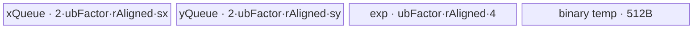
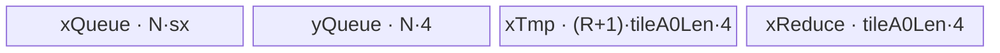
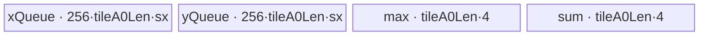
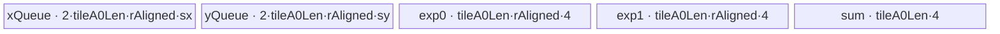
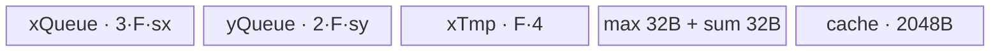
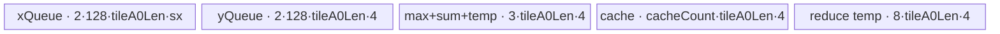

# Softmax 950 Direct Invoke 算子知识

## 算子速览

| 项目 | 内容 |
|---|---|
| 实际入口 | PyTorch custom op `cann_bench::softmax`，PrivateUse1 实现 `cann_bench::softmax_npu`，C ABI launcher `launch_softmax`；入口类型为 `Direct Invoke`。 |
| 计算语义 | 对指定维 `dim` 做稳定 softmax：`y = exp(x - max(x, dim)) / sum(exp(x - max(x, dim)), dim)`。 |
| 输入输出 | 连续、同 shape 的 `[A1, R, A0]` 逻辑布局；`R=shape[dim]`，`A1=prod(shape[:dim])`，`A0=prod(shape[dim+1:])`；FP16/FP32/BF16。 |
| 执行类型 | R-001～R-007 为单节点 `AIV_VECTOR`；R-008、R-009 为 AIV kernel 内 `asc_vf_call` 的单节点 SIMT。所有 entry 都声明 `KERNEL_TYPE_AIV_ONLY` 或显式排除 AIC，无 Cube/AIC、MIX_CV 节点。 |
| Kernel 路线 | 1000 AR full-load、10000 ARA full-load、31000 ARA one-load、30000 ARA stream、500 AR-small-R、2000 AR recompute、20000 ARA recompute、32000 ARA SIMT、33000 FP16-R2 SIMT；此处按 Route 重要性排列，非 Host selector 顺序。 |
| 核心资源 | GM、AIV UB `TQue/TBuf`、MicroAPI 寄存器；SIMT 仅用线程私有标量和 GM。无 workspace、NDDMA 或通信 window。 |
| 来源闭包 | `direct_implementation_closed`：交付件闭合 op 注册、`softmax_npu`、tiling、launcher、全部 entry/body/helper 与构建接线；32000/33000 的参数由直调调用方提供。 |
| 验证状态 | 已完成源码闭包检查；本次知识提取未执行编译、真机、数值或性能测试。 |

## 接口与语义

### 计算语义

将连续输入按 `[A1,R,A0]` 展平。对每一列 `(a1,a0)`，先求 `m=max_r x[a1,r,a0]`，再以 FP32 计算 `s=sum_r exp(x-m)`，最后输出 `exp(x-m)/s`。减最大值抑制有限输入的指数上溢；所有 AIV 路线及两条 SIMT 路线均遵守该顺序。`r==1` 时 Host 将 `(A1,A0)` 合并为新的 `A0`，有限输入的数学输出为 1；NaN、`+inf` 或 `-inf` 仍经过同一套减最大值算术，不能套用“恒为 1”的有限值结论。

### 输入、输出与属性

| 参数 | shape/layout | dtype | 约束、默认值与语义 |
|---|---|---|---|
| `x` | rank 1～8，连续，逻辑 `[A1,R,A0]` | FP16、FP32、BF16 | 所有维必须为正；`softmax_npu` 拒绝非连续输入。 |
| `dim` | 标量 | `int64_t` | 默认 `-1`；范围 `[-rank, rank)`，负值加 rank 归一化。 |
| `y` | 与 `x` 同 shape/layout | 与 `x` 相同 | `empty_like(x)` 分配，kernel 只写有效元素。 |
| `dtype` | launcher 枚举 | `int32_t` | `0/1/2` 分别为 FP16/FP32/BF16；33000 只存在 FP16 entry。 |
| `params` | `SoftmaxLaunchParams` | C++ POD | `calc_softmax_tiling` 生产 500～31000 AIV 路线；直调 32000/33000 时由调用方完整生产。 |
| `stream` | 当前 NPU stream | `void*` | `softmax_npu` 从 `getCurrentNPUStream().stream(false)` 获取。 |

### 入口与版本

`TORCH_LIBRARY_FRAGMENT` 声明 `cann_bench::softmax(Tensor x, int dim=-1)`；Meta 实现完成 rank、dim、dtype 校验并返回同形空张量；PrivateUse1 绑定到 `softmax_npu`。后者再次要求连续布局，调用 `calc_softmax_tiling`，再通过 `OpCommand::RunOpApi("SoftmaxDirect", aclCall)` 在当前 stream 调用 `launch_softmax`。卡片目标版本是 CANN 9.1.0；交付件 CMake 明确接受 `ascend950` 并映射为 `dav-3510`，这是直调构建声明。

限定官方映射仓的指定 40 位 Commit `955f8b33985b6d72989ebff341bb9c2c564a51bc` 不在本地对象库中，因此没有把另一 Commit 的 `activation/softmax_v2` 内容写成该版本官方事实。本文的算法、Route 和 ABI 均标为交付件转换事实；这一官方相关映射缺口不反向否定交付件的 950 直调构建声明。

## Host/Launcher 执行流程

### 参数校验与前处理

1. `softmax_meta` 检查 rank 1～8、`dim` 合法以及 FP16/FP32/BF16，并创建 `empty_like` 输出。
2. `softmax_npu` 设置 device guard，拒绝非连续输入，将 torch dtype 映射为 `0/1/2`。
3. `calc_softmax_tiling` 检查指针、rank、dim、dtype 和每个 shape 维；归一化负 dim，计算 `A1/R/A0`。乘积使用 `int64_t`，源码没有显式溢出检查。
4. 从 `PlatformAscendCManager` 读取 UB 字节数与 AIV 核数；任一为零/非正则失败。
5. 按固定 Host顺序寻找首个 capable AIV Route；成功即短路，找不到时返回 `-1`，`TORCH_CHECK` 抛错。直调 `launch_softmax` 不执行这些检查。

### Host 形状折叠与 checked arithmetic 契约

Host 与 Device 共享的唯一逻辑地址式是

```text
linear(a1,r,a0) = (a1 * R + r) * A0 + a0
A1 = product(shape[0:dim])
R  = shape[dim]
A0 = product(shape[dim+1:rank])
```

`A0==1` 表示归约维物理连续，即末轴 AR；`A0!=1` 表示同一 softmax 列的相邻元素相隔 `A0`，即非末轴 ARA。不能用原 rank 或 `dim==rank-1` 在 Device 侧重新判断路线：负 dim 归一化、折叠以及 `R==1` 重写都只发生在 Host。`R==1` 时源码改写为 `A1=1, A0=oldA1*oldA0`，所以除单元素 tensor 外通常进入 ARA 路线；这只改变并行域，不改变输出 shape。

源码使用有符号 `int64_t` 直接相乘，并用 `(a+b-1)/b` 做 ceil-div，没有 checked arithmetic。因而“rank、dim、每维为正”只是语义校验，不足以证明地址与 POD 安全。复用该契约时必须在 route 选择前闭合以下量；当前实现没有补做这些拒绝，因此它们是明确边界，不是已实现校验。

| 需闭合的量 | 消费位置 | 必须成立的不变量 | 当前源码状态 |
|---|---|---|---|
| `A1`、`A0`、`oldA1*oldA0` | shape 折叠、`R==1` 重写 | 每次乘法可表示为正 `int64_t` | 直接乘，无溢出拒绝 |
| `A1*R*A0`、`r*tileA0Len`、`a1*a0Outer` | GM offset、UB extent、`totalTiles` | 元素数、字节数及最终指针偏移均可表示 | 直接乘；不能只检查最终结果为正 |
| `a+b-1` | 所有 `CeilDiv` | 加法不溢出，且除数正 | helper 未保护加法；各 route 依赖正 divisor |
| `extent*sizeof(T)`、stride 字节数 | `InitBuffer`、`DataCopyExtParams` | 不超过目标 API 字段与 UB/GM 范围 | route 公式限制容量，但未统一审计字段窄化 |
| ARA full-load loop/offset | `uint16_t` loop 字段、`uint32_t` offset 字段 | 生产值在对应位宽内 | 赋值时直接窄化 |
| `blockDim`、SIMT `blockDim*1024` | launch grid、global-thread stride | `blockDim>0` 且乘积可表示，覆盖域非零 | 内置 tiling 产生正值；裸 launch 不检查 |

安全的 Host producer 还应保持“先验证/checked multiply，后写 union，最后一次性提交”的事务性：失败时不允许留下可被 launcher 误用的半成品 key/member。当前 `calc_softmax_tiling` 先将 `*p={}` 清零并在成功分支写入，满足失败不携带旧参数，但不补足上表的溢出证明。

### 参数、Workspace 与生命周期

`SoftmaxLaunchParams` 在 `softmax_npu` 栈上零初始化并按值捕获进 lambda；kernel launch 将所选 union member 按值传给 Device entry。输入和输出由 torch tensor 持有，stream 上的 op 调度保持其生命周期。所有路线都把 kernel launch 的第二配置参数写为 `nullptr`，没有 workspace 或 dynamic UB；`workspace_total=0`。`launch_softmax` 返回 `void`，lambda 固定返回 0，源码没有把异步 kernel launch 错误转换为该 lambda 的返回值。

这里的 one-load“原地”只指 **UB 中的 xQueue 物理槽被改写为输出**；PyTorch 入口仍用 `empty_like` 创建独立 `y`。裸 ABI 没有声明 GM alias 能力，且 stream/recompute/SIMT 路线会在较晚阶段再次读取 `x`，所以跨路线契约必须取保守交集：`x` 与 `y` 不重叠，不得从 R-005 的 UB 复用推导出 GM in-place 支持。

### 启动图与失败传播

```text
cann_bench::softmax
  -> softmax_npu
    -> calc_softmax_tiling  # 只生成 500/1000/2000/30000/31000/10000/20000
    -> launch_softmax(x, y, dtype, &params, stream)
      -> exactly one AIV kernel entry <<<blockDim, nullptr, stream>>>
        -> AIV_VECTOR body 或 asc_vf_call<SIMT body>
      -> y

direct C caller
  -> launch_softmax(...)    # 可显式提供 32000/33000
    -> exactly one kernel entry on supplied stream
```

每条 Route 都是单 Kernel、无节点间 workspace 边。stream 是唯一跨 Host/Device ordering 介质。`calc_softmax_tiling` 失败会阻止 `softmax_npu` launch；未知 key 在 `launch_softmax` 中静默不启动，非法 dtype 会被宏的最终 `else` 当作 BF16（33000 忽略 dtype），空指针也没有 launcher 内保护。

### `calc` 与裸 `launch` 的边界

| 契约层 | 已做的事 | 没有做的事 | 调用方必须保证 |
|---|---|---|---|
| `softmax_npu` | device guard、连续性/dtype/rank/dim 检查、输出分配、当前 stream、`calc` 成功后 launch | 非有限值过滤、shape 乘积溢出审计、同步等待 | tensor 生命周期交给框架；结果在同 stream 顺序下消费 |
| `calc_softmax_tiling` | 清零 POD、折叠 shape、读取 `U/C`、按固定顺序产生 500～31000 中一个 key/member | 不产生 32000/33000；不验证 x/y/stream；不做完整 checked arithmetic | 返回 0 才可 launch；参数字节保持不变直到 launch 读取完成 |
| `launch_softmax` | 以 key 选择 union member，以 dtype 选择 entry，按 `blockDim` 异步发射一个 kernel | 不校验任何指针、dtype、key/member 对应、shape、grid、alias；无错误返回 | key/member/dtype 必须原子匹配，`x/y` 不重叠，stream 有效 |
| 32000 direct key | router 有三 dtype entry | 包内无 tiling producer | 完整给出 `araSimt.{totalA1Len,totalRLen,totalA0Len}` 与正 grid |
| 33000 direct key | 固定发射 FP16 R2 body | dtype 被忽略，`p.r/p.a0` 也不参与校验 | 实际缓冲为 FP16、`R=2,A0=1`，`p.a1=rows`，正 grid |

31000 也体现了 selector 与 router 的差异：kernel/router 存在 FP16、FP32、BF16 三个 entry，`TilingAraOneLoad` 的内部边界是 `R<=2048`；但内置 selector 只在 `dtype==FP16 && A1<=4 && R<=512` 时调用它。知识迁移时应把后者当作闭合的可达域，不能因为 entry 存在就把 FP32/BF16 或更大 R 宣称为内置可用路线。

## Route 与参数设计

### 分核与资源计算

记 `U=平台 UB 字节数`、`C=AIV core 数`、`sx=sy=4(FP32) 或 2(FP16/BF16)`、`VL32=256/4=64`、UB block=32B。AR 路线以行分核，ARA 路线先将 A0 按对齐基数切成 tile，再将 `A1*a0Outer` 个 tile 以 `ceil(totalTiles/C)` 分给核。尾核/尾 tile 分别由 `blockA/currentRowBlock` 与 `tileA0Tail` 限定。SIMT 每个 AIV block 固定 1024 线程，全局线程步长为 `blockDim*1024`。

### Route 特征与重要性

P0～P8 表示维护与迁移时的关注优先级，不改变 Route ID、tiling key 或 Host selector 的短路语义。`active` 表示 `calc_softmax_tiling` 可达，`conditional-direct` 表示内置 selector 不生产该 key/叶变体、但公开 `launch_softmax` 分发与 Device body 已接线且满足完整 caller 契约时可达。九个 Route ID 中没有只有孤立源码、连 launcher 都不可达的 `dormant` route；31000 的非 selector 叶变体单独列为 conditional，不能混入 active 域。

| 重要性 | Route | 可达性 | 特征 | 适用域 | 实现前提 |
|---|---|---|---|---|---|
| P0 | R-002 AR full-load | active | 末轴整行驻留，双缓冲搬运并保留 FP32 exp | `A0==1` 的三种 dtype；覆盖常见中长 R | `R<=16384`，且 UB 计算得到 `ubFactor>0` |
| P1 | R-006 ARA full-load | active | 非末轴全 R 驻留，FP32 tree/binary reduction | `A0!=1` 的三种 dtype；覆盖常见中等 R 与不规则 A0 | `factorMax>0`；`R>8` 时 `BinaryAddTiling` 成功 |
| P2 | R-005 ARA one-load | active + conditional-direct 叶变体 | 输入只搬入一次，复用 xQueue 原位形成输出 | active 为小 A1、小 R 的 FP16；router 另有三 dtype entry | active：FP16、`A1<=4,R<=512`；conditional：精确复现 producer 且 `A0!=1,R<=2048,maxInner>=1` |
| P3 | R-004 ARA stream | active | 以 256 行分块在线合并 `(max,sum)`，二遍输出 | `A0!=1` 的大 R 跨步归约，三种 dtype | `R>=4096`，且 UB 至少容纳一个 A0 基础 tile |
| P4 | R-001 AR small-R | active | 末轴小 R 转置并按列向量化，预取下一 tile | `A0==1 && R<=16`，适合极小或很大行并行域 | 避开 `5C<=A1<=160C`，且 UB 容纳一个 64-column tile |
| P5 | R-003 AR recompute | active | 三遍读取 GM，以重算换取更低的整行驻留需求 | R-001/R-002 不可用后的末轴通用兜底 | 固定开销和每元素缓冲可装入 UB；对齐后 `ubFactor` 应为正 |
| P6 | R-007 ARA recompute | active | 以 128 行块重算并用 cache tree 合并 | R-004/R-005/R-006 不可用后的非末轴兜底 | UB 计算得到 `factorMax>0` |
| P7 | R-008 ARA SIMT | conditional-direct | 每线程独占一列，三遍标量 GM R 循环 | 内置 selector 不可达的 direct-key 通用路线 | 调用方完整生产 key、正 `blockDim` 与 `araSimt` 三字段 |
| P8 | R-009 FP16 R2 SIMT | conditional-direct | 每线程读取一行的两个 half 并直接归一化 | 内置 selector 不可达的 FP16、R2、末轴特化 | 调用方保证 `R=2,A0=1`，并以 `p.a1` 传 rows |

### Host selector 顺序

`Host顺序` 是 `calc_softmax_tiling` 的真实调用顺序：每一步成功即返回，后续 Route 不再尝试；它与上面的重要性排序相互独立。

| Host顺序 | Route | Key/模板 | 精确选择条件与短路语义 | fallback |
|---:|---|---|---|---|
| 1 | R-001 AR small-R | 500 / `SoftmaxV2ArSmallR<T,T>` | `A0==1 && R<=16 && !(A1>=5C && A1<=160C)`，且 UB 可容纳至少一个 64-column tile | R-002 |
| 2 | R-002 AR full-load | 1000 / `SoftmaxV2AR<T,T>` | R-001 失败，`A0==1 && R<=16384 && ubFactor>0` | R-003 |
| 3 | R-003 AR recompute | 2000 / `SoftmaxV2ArRecompute<T,T>` | 前两条失败，`A0==1` 且固定开销及每元素缓冲能放入 UB | R-004 |
| 4 | R-004 ARA stream | 30000 / `SoftmaxV2ARAStream<T>` | 前三条失败，`A0!=1 && R>=4096 && maxInner>=1` | R-005 |
| 5 | R-005 ARA one-load | 31000 / `SoftmaxV2ARAOneLoad<half>` | 前四条失败，`dtype==FP16 && A1<=4 && R<=512 && A0!=1 && maxInner>=1` | R-006 |
| 6 | R-006 ARA full-load | 10000 / `SoftmaxV2ARA<T,T>` | 前五条失败，`A0!=1 && factorMax>0`；`R>8` 时 `BinaryAddTiling` 还必须成功 | R-007 |
| 7 | R-007 ARA recompute | 20000 / `SoftmaxV2ARARecompute<T,T>` | 前六条失败，`A0!=1 && factorMax>0` | tiling 失败 |
| — | R-008 ARA SIMT | 32000 / `SoftmaxV2ARASimt<T>` | 不由 `calc_softmax_tiling` 生成；直调者设置 key、`blockDim` 与 `araSimt` 三字段 | 未知 key 静默不启动 |
| — | R-009 FP16 R2 SIMT | 33000 / `SoftmaxV2Fp16R2Simt` | 不由 `calc_softmax_tiling` 生成；直调者保证 FP16、`R=2,A0=1`，并以 `p.a1` 表示 rows | 未知 key 静默不启动 |

```text
validate/flatten -> 500? -> 1000? -> 2000? -> 30000? ->
  (FP16 && A1<=4 && R<=512 ? 31000?) -> 10000? -> 20000? -> fail

launch_softmax direct key dispatch:
  500|1000|2000|10000|20000|30000|31000|32000|33000 -> one entry
  other -> no launch
```

### 末轴/非末轴决策闭包

统一 selector 虽然写成一条线，实际由 `A0` 分成两个互斥子图。这个互斥性比任一性能阈值更强，也是 route 间必须保持的首要不变量。

```text
                         A0 == 1 (AR，连续 R)
flatten ─────────────────┬─ 500 small-R ─fail─> 1000 full-load ─fail─> 2000 recompute ─fail─> error
                         │
                         └─ A0 != 1 (ARA，stride=A0)
                            30000 stream ─fail─> 31000 one-load [FP16 outer guard]
                                           └──fail─> 10000 full-load ─fail─> 20000 recompute ─fail─> error
```

| 不变量 | AR 末轴 | ARA 非末轴 | 违反后的典型后果 |
|---|---|---|---|
| GM 地址 | 每行连续 `[row*R,(row+1)*R)` | 每列 `base+r*A0`，tile 内按 A0 连续 | 把 ARA 当 AR 会沿错误维归一化 |
| 并行域 | `A1` 行；每核连续行块 | `A1*a0Outer` tile；tile 解码为 `(a1Idx,a0Idx)` | block 间重写或漏写列 |
| UB 布局 | R 连续，必要时对齐/转置 | `[R,tileA0Len]`，DMA 按行 stride | mask 正确也无法修复错误 stride |
| 尾部 | 尾核/尾行、R chunk 或 R mask | 尾 tile `width=tileA0Tail`，另有 R chunk tail | padded lane 被写回或最后 chunk 漏算 |
| fallback | 500→1000→2000，只在 AR 内退化 | 30000→31000→10000→20000，只在 ARA 内退化 | 用另一路 POD 解释 union，形成 ABI 错配 |

同一数学列在所有 route 中必须满足：单一 block/thread 拥有该列的完整归约；没有跨 block 的 partial sum、atomic 或二次 kernel。`blockDim` 只改变列/行如何分配，不得把一个 R 归约拆到多核，否则现有单 Kernel launch 图没有合并节点。

### 模板/实现执行矩阵

所有 AIV_VECTOR Route 的层级均为 `GM -> UB(TQue/TBuf) -> MicroAPI register -> UB -> GM`；两个 SIMT Route 为 `GM -> thread-private register -> GM`。源码没有 L1、L0A/L0B/L0C、Cube、workspace 或跨核中间结果，因此表中省略这些不存在的层级不能解释为“待补实现”。

| Route/叶变体 | 可达性 | key/selector | dtype/shape/platform 完整命中条件 | POD→entry→body | 核/内存/同步与 tail | fallback |
|---|---|---|---|---|---|---|
| R-002 | active | 1000，第 2 | 3 dtype；`A0==1,R<=16384,ubFactor>0` | `ar`→`softmax_1000_*`→`SoftmaxV2AR<T,T>::Process` | 行/core；x/y 双缓冲、FP32 exp 全载；尾核、`lastUbFactor`、R mask | 失败→2000 |
| R-006 | active | 10000，第 6 | 3 dtype；`A0!=1,factorMax>0`；`R>8` 还需 binary tiling 成功 | `ara`→`softmax_10000_*`→`SoftmaxV2ARA<T,T>::Process` | A1×A0 tile/core；全 R exp、tree/barrier；`tileA0Tail` 与 zero-padding offsets | 失败→20000 |
| R-005-A | active | 31000，第 5 | FP16；`A0!=1,A1<=4,R<=512,maxInner>=1` | `araOneLoad`→`softmax_31000_f16`→`SoftmaxV2ARAOneLoad<half>::Process` | tile/core；一次 GM load，FP32 exp，xQueue 输入槽改输出；`PIPE_V`、V→MTE3、A0 mask | 失败→10000 |
| R-005-C | conditional-direct | 31000，caller-provided | router 有 f16/f32/bf16；调用方复现 `TilingAraOneLoad`：`A0!=1,R<=2048,maxInner>=1`，并按 dtype 算 `base/maxInner/tileA0Len` | `araOneLoad`→`softmax_31000_{f16,f32,bf16}`→`SoftmaxV2ARAOneLoad<T>::Process` | 与 R-005-A 相同；`totalRLen` 在 body 窄化为 `uint16_t`；caller 保证 POD/UB/offset 合法 | 无自动 fallback；契约失败不得 launch |
| R-004 | active | 30000，第 4 | 3 dtype；`A0!=1,R>=4096,maxInner>=1` | `araStream`→`softmax_30000_*`→`SoftmaxV2ARAStream<T>::Process` | tile/core；256-row chunk、在线 `(max,sum)`、二遍 GM；`rTail/tileA0Tail` | 失败→31000 外 guard/10000 |
| R-001 | active | 500，第 1 | 3 dtype；`A0==1,R<=16,!(5C<=A1<=160C)`，且 UB tile 可建 | `arSmallR`→`softmax_500_*`→`SoftmaxV2ArSmallR<T,T>::Process` | 行重解释为 A0 tile/core；双 x/y queue、双 FP32 exp、预取；`tileA0Tail` | 失败→1000 |
| R-003 | active | 2000，第 3 | 3 dtype；`A0==1` 且固定/每元素 UB 公式可建；aligned `ubFactor` 仍应正 | `arRecompute`→`softmax_2000_*`→`SoftmaxV2ArRecompute<T,T>::Process` | 行/core；x 三缓冲、y 双缓冲、三遍 GM、2048B cache；`ubFactorTail` | 失败→整体 tiling 失败；ARA producer 因 `A0==1` 均拒绝 |
| R-007 | active | 20000，第 7 | 3 dtype；`A0!=1,factorMax>0` | `araRecompute`→`softmax_20000_*`→`SoftmaxV2ARARecompute<T,T>::Process` | tile/core；128-row 重算、double x/y、cache tree；`binAddRTail/tileA0Tail` | 失败→整体 tiling 失败 |
| R-008 | conditional-direct | 32000，caller-provided | 3 dtype；正 A1/R/A0、正 grid，全部乘积/offset 可表示 | `araSimt`→`softmax_32000_*`→`asc_vf_call<SoftmaxV2ARASimt<T>>(1024)` | thread/column；无 UB，三遍 GM；`column<A1*A0,r<R` | 无自动 fallback |
| R-009 | conditional-direct | 33000，caller-provided | 实际 buffer FP16；`R=2,A0=1,p.a1=rows`、正 grid | `p.a1`→`softmax_33000_f16`→`asc_vf_call<SoftmaxV2Fp16R2Simt>(1024)` | thread/row；无 UB，一次读取两个 half；`row<rows` | 无自动 fallback；契约外会错址 |

### 性能与安全 Guard

| Guard | Host/Tiling 条件 | Device/资源原因 | 影响 Route | 不满足时去向 | 源码符号 |
|---|---|---|---|---|---|
| 32B/256B 常量 | `GetUbBlockSize()==32`、`GetVRegSize()==256` | DMA stride、tile base、MicroAPI mask 均由此推导 | 所有 AIV | 交付实现无动态替代 | `platform_util.h::{GetUbBlockSize,GetVRegSize}` |
| AR full-load R 上限 | `R<=16384` | `rLoopCount`、整行 FP32 exp UB 与折叠 reduce 上界 | R-002 | R-003 |
| ARA binary offsets | `R>8` 时 `BinaryAddTiling` 成功；若失败返回 false | Device 以 8 行压缩及 4 叉折叠读取预计算 offset | R-006 | R-007 |
| 16-bit loop fields | ARA full-load 的多个 loop/count 写入 `uint16_t` | Device 循环变量同为 `uint16_t` | R-006 | 源码无显式窄化拒绝 |
| one-load 范围 | FP16、`A1<=4`、`R<=512` | 全 R 输入和 FP32 exp 同驻 UB | R-005 | R-006 |
| stream 阈值 | `A0!=1 && R>=4096`，`rChunk=256` | 固定 chunk 控制 UB，在线缩放统计 | R-004 | R-005/R-006 |
| AR-small 并行窗 | 排除 `5C<=A1<=160C` | 中等行数交给普通 AR 分核；small-R 处理过小/过大 A1 | R-001 | R-002 |
| AR-recompute 对齐 | `ubFactor=floor(ubFactorTmp/lcm)*lcm`，`lcm=lcm(32,32/sx,32/sy)` | 保证 GM/UB block 对齐 | R-003 | 代码未检查 `ubFactor==0`，极小 UB 存在除零边界 |
| direct SIMT producer | `blockDim>0` 且 tiling 字段合法 | 线程总步长依赖 grid；无包内 selector 填充 | R-008/R-009 | 调用方契约；无 fallback |
| R2 特化 | FP16、`R=2,A0=1,rows=A1` | body 固定读 `row*2` 和相邻元素 | R-009 | 契约外不会自动转 Route |

### POD/ABI

结构均无显式 packing，以下按源码声明顺序和常规 8-byte 最大对齐给出；交付件没有 `static_assert(sizeof/offsetof)`，跨编译器复用时应补 ABI 断言。

| 结构 | 字段 | 类型/位宽 | ABI 布局 | 单位 | Host/launcher producer | Device consumer | 边界 |
|---|---|---|---|---|---|---|---|
| `SoftmaxLaunchParams` | `a1` | `int64_t/64` | offset 0；struct size 200, align 8 | 元素域乘积 | `calc_softmax_tiling` | 33000 作为 rows；其余用于诊断/直调 | 乘积无溢出检查 |
| 同上 | `r` | `int64_t/64` | offset 8 | 元素 | 同上 | 直调元数据 | `>0` |
| 同上 | `a0` | `int64_t/64` | offset 16 | 元素域乘积 | 同上 | 直调元数据 | `>0` |
| 同上 | `tilingKey` | `int64_t/64` | offset 24 | 枚举 | 各 `Tiling*` 或直调调用方 | `launch_softmax` router | 未知值静默 |
| 同上 | `blockDim` | `int64_t/64` | offset 32 | AIV block | 各 `Tiling*` 或直调调用方 | launch grid、SIMT stride | 必须正且可表示 launch grid |
| 同上 | `tiling` | union/160B | offset 40 | POD | 路线 producer | 对应 entry 按值取 member | member 必须与 key 匹配 |
| `SoftmaxV2TilingData` | `arSmallR` | struct/64B | offset 0；union size 160, align 8 | POD | `TilingArSmallR` | key 500 entry | 与其它 member 重叠 |
| 同上 | `ar` | struct/48B | offset 0 | POD | `TilingAr` | key 1000 entry | 与其它 member 重叠 |
| 同上 | `arRecompute` | struct/64B | offset 0 | POD | `TilingArRecompute` | key 2000 entry | 与其它 member 重叠 |
| 同上 | `ara` | struct/160B | offset 0 | POD | `TilingAra` | key 10000 entry | 最大 member |
| 同上 | `araRecompute` | struct/128B | offset 0 | POD | `TilingAraRecompute` | key 20000 entry | 与其它 member 重叠 |
| 同上 | `araStream` | struct/88B | offset 0 | POD | `TilingAraStream` | key 30000 entry | 与其它 member 重叠 |
| 同上 | `araOneLoad` | struct/56B | offset 0 | POD | `TilingAraOneLoad` | key 31000 entry | 与其它 member 重叠 |
| 同上 | `araSimt` | struct/24B | offset 0 | POD | 直调调用方 | key 32000 entry | 与其它 member 重叠 |
| `SoftmaxV2ArSmallRTilingData` | `totalA0Len` | `int64_t/64` | offset 0；size 64 | 元素 | `TilingArSmallR:a0New` | `Process` tile 域 | `a1` 重解释 |
| 同上 | `totalRLen` | `int64_t/64` | offset 8 | 元素 | `r` | loop、DMA | `<=16` |
| 同上 | `totalTiles` | `int64_t/64` | offset 16 | tile | `a0Outer` | block range | 正数 |
| 同上 | `tilesPerCore` | `int64_t/64` | offset 24 | tile/core | `ceil(a0Outer/C)` | begin/end | 正数 |
| 同上 | `tileA0Len` | `int64_t/64` | offset 32 | 元素 | `a0TileNum*64` | UB、offset、mask | 64 倍数 |
| 同上 | `tileA0Tail` | `int64_t/64` | offset 40 | 元素 | 尾式 | 最后 tile | `1..tileA0Len` |
| 同上 | `rTileBase` | `int64_t/64` | offset 48 | 元素 | FP32=8，否则16 | transpose | dtype 相关 |
| 同上 | `rAligned` | `int64_t/64` | offset 56 | 元素 | ceil-align R | UB/transpose | `>=R` |
| `SoftmaxV2ARTilingData` | `a` | `int64_t/64` | offset 0；size 48 | 行 | `a1` | 分核尾行 | 正数 |
| 同上 | `r` | `int64_t/64` | offset 8 | 元素/行 | `r` | GM、mask | `<=16384` |
| 同上 | `rAligned` | `int64_t/64` | offset 16 | 元素/行 | 32B 对齐 | UB stride | `>=r` |
| 同上 | `ubFactor` | `int64_t/64` | offset 24 | 行/tile | UB 公式并截到 `aBlockFactor` | UB loop | `>0` |
| 同上 | `aBlockFactor` | `int64_t/64` | offset 32 | 行/core | `ceil(a1/C)` | GM base、尾核 | 正数 |
| 同上 | `rLoopCount` | `int64_t/64` | offset 40 | VL loop | `ceil(rAligned/64)` | MicroAPI R loop | 正数 |
| `SoftmaxV2ArRecomputeTilingData` | `a` | `int64_t/64` | offset 0；size 64 | 行 | `a1` | 尾核 | 正数 |
| 同上 | `r` | `int64_t/64` | offset 8 | 元素/行 | `r` | 三遍循环 | 正数 |
| 同上 | `ubFactor` | `int64_t/64` | offset 16 | 元素/chunk | 对齐 UB 公式 | queue、offset | 应大于 0 |
| 同上 | `ubFactorTail` | `int64_t/64` | offset 24 | 元素 | `r-ubFactor*floor` | 尾 copy/mask | 0 表示整除 |
| 同上 | `aBlockFactor` | `int64_t/64` | offset 32 | 行/core | `ceil(a1/C)` | 行分核 | 正数 |
| 同上 | `aLoopCountCeil` | `int64_t/64` | offset 40 | chunk | `ceil(r/ubFactor)` | 三阶段循环 | 正数 |
| 同上 | `basicBlockLoop` | `int64_t/64` | offset 48 | chunk | `FindNearestPower2(loopCeil)` | fold/cache | 0 或 2 的幂 |
| 同上 | `mainFoldCount` | `int64_t/64` | offset 56 | chunk | `loopFloor-basicBlockLoop` | fold 条件 | 可为 0 |
| `SoftmaxV2ARAStreamTilingData` | `totalRLen` | `int64_t/64` | offset 0；size 88 | 行 | `r` | 两遍 R | `>=4096` |
| 同上 | `totalA0Len` | `int64_t/64` | offset 8 | 元素 | `a0` | GM stride | `>1` |
| 同上 | `totalTiles` | `int64_t/64` | offset 16 | tile | `a1*a0Outer` | block range | 正数 |
| 同上 | `tilesPerCore` | `int64_t/64` | offset 24 | tile/core | ceil-div | begin/end | 正数 |
| 同上 | `usedCoreNums` | `int64_t/64` | offset 32 | core | ceil-div | `blockDim` 对照 | 正数 |
| 同上 | `tileA0Outer` | `int64_t/64` | offset 40 | tile/A1 | ceil-div | tile 解码 | 正数 |
| 同上 | `tileA0Len` | `int64_t/64` | offset 48 | 元素 | `inner*64` | UB stride | 64 倍数 |
| 同上 | `tileA0Tail` | `int64_t/64` | offset 56 | 元素 | 尾式 | A0 mask | 正数 |
| 同上 | `rChunk` | `int64_t/64` | offset 64 | 行 | 常量 256 | UB/copy | 256 |
| 同上 | `rLoops` | `int64_t/64` | offset 72 | chunk | `ceil(r/256)` | 两遍循环 | 正数 |
| 同上 | `rTail` | `int64_t/64` | offset 80 | 行 | 尾式 | 尾 copy | `1..256` |
| `SoftmaxV2ARAOneLoadTilingData` | `totalRLen` | `int64_t/64` | offset 0；size 56 | 行 | `r` | full-load loop | `<=512` at selector |
| 同上 | `totalA0Len` | `int64_t/64` | offset 8 | 元素 | `a0` | GM stride | `>1` |
| 同上 | `totalTiles` | `int64_t/64` | offset 16 | tile | `a1*a0Outer` | block range | 正数 |
| 同上 | `tilesPerCore` | `int64_t/64` | offset 24 | tile/core | ceil-div | begin/end | 正数 |
| 同上 | `tileA0Outer` | `int64_t/64` | offset 32 | tile/A1 | ceil-div | tile 解码 | 正数 |
| 同上 | `tileA0Len` | `int64_t/64` | offset 40 | 元素 | `inner*(32/sx)` | UB stride | FP16 下 16 倍数 |
| 同上 | `tileA0Tail` | `int64_t/64` | offset 48 | 元素 | 尾式 | A0 mask | 正数 |
| `SoftmaxV2ARATilingData` | `totalA1Len` | `int64_t/64` | offset 0；size 160 | 元素域 | `a1` | tile 解码边界 | 正数 |
| 同上 | `totalRLen` | `int64_t/64` | offset 8 | 行 | `r` | compute/reduce | 正数 |
| 同上 | `totalA0Len` | `int64_t/64` | offset 16 | 元素 | `a0` | GM stride | `>1` |
| 同上 | `totalTiles` | `int64_t/64` | offset 24 | tile | `a1*a0Outer` | block range | 正数 |
| 同上 | `tilesPerCore` | `int64_t/64` | offset 32 | tile/core | ceil-div | begin/end | 正数 |
| 同上 | `usedCoreNums` | `int64_t/64` | offset 40 | core | ceil-div | `blockDim` 对照 | 正数 |
| 同上 | `a1Outer` | `int64_t/64` | offset 48 | 分区 | `a1` | 保留字段 | body 不读取 |
| 同上 | `tileA1Len` | `int64_t/64` | offset 56 | 元素 | 1 | 保留字段 | body 不读取 |
| 同上 | `tileA1Tail` | `int64_t/64` | offset 64 | 元素 | `a1` | 保留字段 | body 不读取 |
| 同上 | `a0Outer` | `int64_t/64` | offset 72 | tile/A1 | ceil-div | tile 解码 | 正数 |
| 同上 | `tileA0Len` | `int64_t/64` | offset 80 | 元素 | tile 公式 | UB/stride | dtype 基数倍数 |
| 同上 | `tileA0Tail` | `int64_t/64` | offset 88 | 元素 | 尾式 | A0 mask | 正数 |
| 同上 | `binaryAddK` | `uint16_t/16` | offset 96 | stage | `BinaryAddTiling` | `BinaryAddVF` | `R<=8` 时零且不读 |
| 同上 | `binaryAddLast` | `uint16_t/16` | offset 98 | stage | 同上 | 最后两路 fold | inactive 为零 |
| 同上 | `binaryAddInnerLoop` | `uint16_t/16` | offset 100 | group | `quotient/8` | tree loop | 存在窄化边界 |
| 同上 | `remainderLoopCount` | `uint16_t/16` | offset 102 | group | ceil-div | 大 R reduction | 存在窄化边界 |
| 同上 | `quotientLoopCount` | `uint16_t/16` | offset 104 | group | quotient 分解 | 大 R reduction | 存在窄化边界 |
| 同上 | `remainderTailCount` | `uint16_t/16` | offset 106 | 行 | 尾式 | tail offsets | 0..8 |
| 同上 | `remainderOffset` | `uint32_t/32` | offset 108 | 元素 | `quotient*tileA0Len` | UB address | 存在窄化边界 |
| 同上 | `baseLineOffset` | `uint32_t/32` | offset 112 | 元素 | `8*tileA0Len` | UB address | 同上 |
| 同上 | `validNumInXUb` | `uint32_t/32` | offset 116 | 元素 | `r*tileA0Len` | 零 padding 行 | 同上 |
| 同上 | `quotientTailOffset` | `uint32_t/32` | offset 120 | 元素 | producer 公式 | tail read | 同上 |
| 同上 | `remainderTailOffset` | `uint32_t/32` | offset 124 | 元素 | producer 公式 | 中间派生/记录 | body 不直接读取 |
| 同上 | `remainderTailOffset0` | `uint32_t/32` | offset 128 | 元素 | `offsets[0]` | tail row 0 read | 超尾指向零 padding 行 |
| 同上 | `remainderTailOffset1` | `uint32_t/32` | offset 132 | 元素 | `offsets[1]` | tail row 1 read | 同上 |
| 同上 | `remainderTailOffset2` | `uint32_t/32` | offset 136 | 元素 | `offsets[2]` | tail row 2 read | 同上 |
| 同上 | `remainderTailOffset3` | `uint32_t/32` | offset 140 | 元素 | `offsets[3]` | tail row 3 read | 同上 |
| 同上 | `remainderTailOffset4` | `uint32_t/32` | offset 144 | 元素 | `offsets[4]` | tail row 4 read | 同上 |
| 同上 | `remainderTailOffset5` | `uint32_t/32` | offset 148 | 元素 | `offsets[5]` | tail row 5 read | 同上 |
| 同上 | `remainderTailOffset6` | `uint32_t/32` | offset 152 | 元素 | `offsets[6]` | tail row 6 read | 同上 |
| 同上 | `remainderTailOffset7` | `uint32_t/32` | offset 156 | 元素 | `offsets[7]` | tail row 7 read | 同上 |
| `SoftmaxV2ARARecomputeTilingData` | `totalRLen` | `int64_t/64` | offset 0；size 128 | 行 | `r` | R blocks | 正数 |
| 同上 | `totalA0Len` | `int64_t/64` | offset 8 | 元素 | `a0` | GM stride | `>1` |
| 同上 | `totalTiles` | `int64_t/64` | offset 16 | tile | 公式 | block range | 正数 |
| 同上 | `tilesPerCore` | `int64_t/64` | offset 24 | tile/core | ceil-div | begin/end | 正数 |
| 同上 | `usedCoreNums` | `int64_t/64` | offset 32 | core | ceil-div | `blockDim` 对照 | 正数 |
| 同上 | `tileA0Outer` | `int64_t/64` | offset 40 | tile/A1 | ceil-div | tile 解码 | 正数 |
| 同上 | `tileA0Len` | `int64_t/64` | offset 48 | 元素 | factor*8/16 | UB stride | dtype 对齐 |
| 同上 | `tileA0Tail` | `int64_t/64` | offset 56 | 元素 | 尾式 | A0 mask | 正数 |
| 同上 | `binAddRFactor` | `int64_t/64` | offset 64 | 行/chunk | 常量 128 | queue、R loop | 128 |
| 同上 | `binAddRLoop` | `int64_t/64` | offset 72 | 整 chunk | `r/128` | fold 派生 | 可为 0 |
| 同上 | `binAddRTotalLoop` | `int64_t/64` | offset 80 | chunk | `ceil(r/128)` | max/sum/out | 正数 |
| 同上 | `binAddRTail` | `int64_t/64` | offset 88 | 行 | 尾式 | tail copy | `1..128` |
| 同上 | `binAddBasicBlockLoop` | `int64_t/64` | offset 96 | chunk | power-of-two floor | cache tree | 0 或 2 的幂 |
| 同上 | `binAddMainFoldCount` | `int64_t/64` | offset 104 | chunk | `RLoop-basic` | fold 条件 | 可为 0 |
| 同上 | `binAddCacheBufferCount` | `int64_t/64` | offset 112 | slot | bit-length | cache UB | 至少 1 |
| 同上 | `binAddResultCacheID` | `int64_t/64` | offset 120 | slot | `GetCacheID` | 最终 sum | 小于 cache count |
| `SoftmaxV2ARASimtTilingData` | `totalA1Len` | `int64_t/64` | offset 0；size 24 | 元素域 | 直调调用方 | columns | 正数 |
| 同上 | `totalRLen` | `int64_t/64` | offset 8 | 行 | 直调调用方 | 三遍 R loop | 正数 |
| 同上 | `totalA0Len` | `int64_t/64` | offset 16 | 元素 | 直调调用方 | columns/base/stride | 正数 |

### Route 源码闭包

| Route | Key/selector | Host/Tiling producer | POD/参数 | Kernel entry/router 节点 | Kernel body/直接依赖 | 构建接线 |
|---|---|---|---|---|---|---|
| R-002 | 1000 | `TilingAr` | `SoftmaxV2ARTilingData` | `softmax_1000_*` | `SoftmaxV2AR` + base helpers | softmax op CMake→`all_kernels_obj` |
| R-006 | 10000 | `TilingAra/BinaryAddTiling` | `SoftmaxV2ARATilingData` | `softmax_10000_*` | `SoftmaxV2ARA` + binary helpers | 同上 |
| R-005 | 31000 | `TilingAraOneLoad` | `SoftmaxV2ARAOneLoadTilingData` | `softmax_31000_*`（selector 仅 FP16） | `SoftmaxV2ARAOneLoad` | 同上 |
| R-004 | 30000 | `TilingAraStream` | `SoftmaxV2ARAStreamTilingData` | `softmax_30000_*` | `SoftmaxV2ARAStream` + cast traits | 同上 |
| R-001 | 500 | `softmax_kernel.cpp::TilingArSmallR` | `SoftmaxV2ArSmallRTilingData` | `softmax_500_{f16,f32,bf16}` | `SoftmaxV2ArSmallR` + base/MicroAPI | 同上 |
| R-003 | 2000 | `TilingArRecompute` | `SoftmaxV2ArRecomputeTilingData` | `softmax_2000_*` | `SoftmaxV2ArRecompute` + base helpers | 同上 |
| R-007 | 20000 | `TilingAraRecompute` | `SoftmaxV2ARARecomputeTilingData` | `softmax_20000_*` | `SoftmaxV2ARARecompute` + base reduction/cache | 同上 |
| R-008 | 32000 | 直调调用方；包内无 producer | `SoftmaxV2ARASimtTilingData` | `softmax_32000_*` | `SoftmaxV2ARASimt<T>` | 同上，`simt_api/asc_simt.h` |
| R-009 | 33000 | 直调调用方；包内无 producer | `p.a1`→`uint64_t rows` | `softmax_33000_f16` | `SoftmaxV2Fp16R2Simt` | 同上，`simt_api/asc_simt.h` |

## 跨 Route 数值契约

### 有限输入的稳定性不变量

对有限输入，每条 route 都必须先得到整列最大值 `m`，再计算指数；不能在尚未闭合全列 max 时直接累加未经重标定的 exp。由此有 `x-m<=0`，最大项的指数为 1，FP32 分母理论范围为 `[1,R]`。这避免 `exp(x)` 上溢，但不消除 FP32 加法舍入、极小指数下溢或最终 FP16/BF16 cast 误差。

| Route 族 | max/sum 形成方式 | 稳定性闭合点 | 输出方式 | 允许的数值差异 |
|---|---|---|---|---|
| 500/1000/10000/31000 full/one-load | 全 R 驻留，先 max 后 exp/sum | 整列 max 已完成后才写 exp | 1000/10000 逐元素除；31000 每个 A0 向量算一次倒数后乘 | reduction tree、`Div` 与 reciprocal+`Mul` 可产生末位差异 |
| 2000/20000 recompute | 第一遍 max，第二遍重算 exp/sum，第三遍再重算 exp/output | max buffer 跨第二、三遍保持；sum cache 在输出前闭合 | `exp(x-m)/sum` | GM 重读不改变数学式；cache tree 顺序与 full-load 可不同 |
| 30000 stream | 每个 256-row chunk 形成 `(mc,sc)`，在线合并到 `(M,S)` | `S'=S*exp(M-M')+sc*exp(mc-M')`，`M'=max(M,mc)` | 第二遍以最终 `(M,S)` 输出 | chunk 合并顺序与全载 tree 可不同 |
| 32000/33000 SIMT | 单线程标量 max pass、sum pass | 同一线程按程序序闭合 | `expf` + scalar divide/cast | 标量 libm/cast 不承诺与 MicroAPI 位级一致 |

route 切换的验收不变量是同 shape/dtype 的语义一致与误差口径一致，不是跨 route bitwise 相等。输入在 kernel 执行期间必须只读且不被并发修改；recompute/stream/SIMT 会重读 GM，否则“重算等价”失效。

### 特殊值与未闭合语义

入口只校验 dtype/shape/连续性，不过滤 NaN、`+inf`、`-inf`，所有 body 也都没有 `isnan/isinf` 分支。因此本实现的源码闭环只足以证明有限输入的稳定 softmax；非有限数表现来自底层 `Max/Sub/Exp/Add/Div` 或 `expf` 的传播规则，不能从有限值公式外推成额外承诺。

| 一列输入 | 由当前算术可推导的路径 | 可依赖程度 |
|---|---|---|
| 至少一个有限值，其余含 `-inf` | 有限 max；`exp(-inf-m)=0`，`-inf` 位置趋于 0 | 算术路径明确；仍受底层非有限运算规则约束 |
| 含 `+inf` | max 可为 `+inf`，对应项出现 `+inf-(+inf)`，随后进入 NaN 算术 | 无“只在 `+inf` 间均分”的专门实现 |
| 全为 `-inf` | `m=-inf`，每项出现 `-inf-(-inf)` | 无 uniform 特判；不能承诺有限输出 |
| 含 NaN | 无显式清洗；SIMT 比较可能不更新 max，但 NaN 仍进入 exp/sum；AIV Max 的 NaN 选择规则未在交付源码定义 | 只可声明“未特判”，不可承诺各 route 的 NaN payload/传播位置一致 |
| `R==1` 且输入有限 | `exp(0)/exp(0)=1` | 跨 route 有限值不变量 |
| `R==1` 且输入非有限 | 仍发生 `inf-inf` 或 NaN 运算 | 不适用“恒为 1”结论 |
| 极大有限差值 | max 项保证分母至少含 1；小项的 exp 可下溢到 0 | 稳定且允许 0；subnormal/FTZ 模式未由本源码声明 |

若上层语义要求特定 NaN 传播、多个 `+inf` 均分或 all-`-inf` 的固定结果，应在所有 route 共享的语义层显式规定并实现，不能只给某一快路线加分支，否则 shape 引起的 route 切换会改变结果。

## UB 驻留、复用与重算策略

| Route | x 的 GM 读取 | 跨阶段保留在 UB 的状态 | 复用/重算因果 | 必须保留的生命周期边 |
|---|---:|---|---|---|
| 500 AR small-R | 1 次/tile | 转置后的 x、两份 FP32 exp、sum | 双 exp 区把 RA reduce 与输出读取解耦；两槽 queue 预取下一 tile | 当前 exp/sum 消费完才释放 x；y DMA 完成才复用 y 槽 |
| 1000 AR full-load | 1 次/UB 行块 | FP32 exp + partial sum | 用 UB 换掉 sum/output 阶段的 GM 重读 | exp 直到 div/cast 完成；queue 协议覆盖 MTE2/V/MTE3 |
| 2000 AR recompute | 约 3 次/行 | max、sum/cache；不保留全 R exp | R 放不下时以 GM 带宽换 UB，三遍分别闭合 max/sum/output | max 跨后两遍，sum 跨输出遍；cache carry 完成前不可覆盖 |
| 10000 ARA full-load | 1 次/tile | 全 R FP32 exp、zero padding、reduce vector | 全载矩阵支持固定 tree，padding 消除尾分支 | padding store→load barrier；exp 在所有 R 输出完成前存活 |
| 31000 ARA one-load | 1 次/tile | FP32 exp；xQueue 输入槽后改为输出 | 删除独立 yQueue，并用一次 reciprocal 复用到该 A0 向量 | 先读完输入，再覆盖 xUB；`PIPE_V` 后读 exp；V→MTE3 event 后 DMA |
| 30000 ARA stream | 2 次/tile | 仅最终 max/sum；chunk x/y 临时槽 | 固定 256 行 UB，在线重标定统计，第二遍生成输出 | `(M,S)` 跨全部 chunk 和输出遍；chunk queue 消费后才复用 |
| 20000 ARA recompute | 约 3 次/tile | max、sum/cache；128-row x/y | 大 R 下用 128-row 块及 carry tree 控制 UB | max/sum/cache 生命周期与三遍边界一致 |
| 32000 ARA SIMT | 3 次/列 | 线程私有 max/sum | 不占算子管理的 AIV UB | 同线程程序序；x 在第三遍结束前保持只读 |
| 33000 FP16 R2 SIMT | 1 次/行的两个 half | 线程私有标量 | 两元素特化直接保留输入/exp | 两个输出地址仅由该线程写 |

“full-load→stream/recompute”是资源退化关系而不是数学 fallback：驻留量从全 R exp 降到 `(max,sum,cache)`，代价依次变为两遍或三遍 GM。任何重构都必须成对更新 Host UB 公式和 Device `InitBuffer`；只缩 tiling factor 或只改 queue depth 都不能证明不越 UB。

## 尾核、尾 tile 与 mask 契约

| 尾部层级 | Host/POD 表达 | Device 消费 | 不允许的简化 |
|---|---|---|---|
| 核尾 | `blockDim=ceil(work/perCore)`，每核 `[begin,min(begin+perCore,total))`；AR 用 `aBlockFactor` | 无工作的逻辑域不被访问；最后核只处理剩余行/tile | 假设每核工作量相等并无条件搬满 |
| 500 的 A1 尾（重解释为 tile A0） | `tileA0Tail`，`rAligned>=R` | transpose/mask 只计算有效行，CopyOut 只写 `curTileA0Len*R` | 把 `tileA0Len` padded 行写回 GM |
| 1000 的 R 尾 | `rAligned`、`rLoopCount` 与真实 `r` | UB 可 padding/alignment，归约 mask 以 `r` 为准，CopyOut 每行只写 R | 让 padding 参与 max/sum 或按 `rAligned` 写回 |
| 2000 的 R chunk 尾 | `ubFactorTail=0` 表示整除，否则最后 chunk 的真实长度 | 三个 pass 使用同一 tail 解释 | 把 0 当“空尾”跳过本应完整处理的最后主块 |
| ARA 的 A0 尾 | `tileA0Tail in [1,tileA0Len]`，`width` 只在最后 A0 tile 变小 | DMA `blockLen=width*sizeof(T)`；寄存器 `UpdateMask(width)`；UB row stride 仍为 `tileA0Len` | 用 width 同时替换 UB stride，导致相邻 R 行错位 |
| 30000 的 R 尾 | `rTail in [1,256]` | 两遍都用同一 `rows` 和 GM offset | 统计遍与输出遍使用不同 tail |
| 20000 的 R 尾 | `binAddRTail in [1,128]` | max/sum/output 三阶段一致 | 只给输出阶段 mask，统计仍读满 128 行 |
| 10000 的 tree 尾 | Host 产生 remainder offsets；越界行指向已清零 padding row | barrier 后固定 8-row/4-way读取 | 指向 padding 但不先清零，或省略 store→load barrier |
| 32000/33000 线程尾 | `column< A1*A0` / `row<rows` | grid-stride predicate | 用向上对齐后的 thread 数直接访问 GM |

尾部契约分离三个概念：GM 的有效 `width/rows`、UB 的对齐 stride/capacity、寄存器的 lane mask。三者数值经常不同；mask 只能保护向量 lane，不能替代 DMA 的真实 blockLen/stride，也不能为溢出的 Host offset 提供保护。

## Kernel 实现

### 公共执行流程

所有 entry 先设 `KERNEL_TYPE_AIV_ONLY` 并在 AIC core 上返回。AIV 路线创建本 entry 私有 `TPipe`，按 key/dtype 实例化 class，依次 `Init→Process`。输入地址公式统一为 `a1*R*A0+r*A0+a0`；A0 尾 lane 由 MicroAPI mask 保护，DMA 只提交 `width`。FP16/BF16 在寄存器解包并升到 FP32，max/sub/exp/sum/div 为 FP32，输出以 `CAST_RINT` trait 打包；FP32 不转换。SIMT 路线不创建 `TPipe`，由每个 AIV block 发起 1024-thread `asc_vf_call`。

### Route R-002：AR full-load

#### 适用条件

##### 选择证据

| 层级 | 文件 | 符号 | 源码谓词/参数 | 结果/下一跳 |
|---|---|---|---|---|
| Tiling | `softmax_kernel.cpp` | `TilingAr` | previous fail；`A0==1 && R<=16384 && ubFactor>0` | 1000，否则 2000 |
| Router | 同上 | `launch_softmax` | 1000 + dtype | `softmax_1000_*` |

#### Device 数据流

##### 函数级调用链

```text
softmax_1000_T -> SoftmaxV2AR<T,T>::Init/Process
  -> ProcessUB -> CopyInX -> FirstNormCompute(max,sub,exp)
  -> SecondNormCompute(fold ReduceSum + div) -> CopyOutY
```

##### 源码等价伪码

```text
core owns blockA rows; for ub rows in chunks ubFactor:
  DMA [ubA,R] to padded [ubA,rAligned]
  each row: FP32 max over 64-lane chunks; store exp(x-max)
  fold vector chunks to scalar sum, broadcast, divide original exp
  cast and DMA valid R elements per row
```

#### 内存与数据搬运

##### 资源与搬运表

| 层级/缓冲区 | offset/地址公式 | extent/容量公式 | dtype/layout | producer | consumer | owner/lifetime | 对齐/复用 |
|---|---|---|---|---|---|---|---|
| x/y GM | core row base + `aOffset` | `ubA*R` | T, AR | DMA | kernel/output | tensor | rAligned only in UB |
| xQueue/yQueue | 0 | each `2*ubFactor*rAligned*s{in,out}` | T | MTE2/Vector | Vector/MTE3 | pipe | double buffer |
| tmp exp | 0 | `ubFactor*rAligned*4` | FP32 | FirstNorm | reducer/div | pipe | retained until output |
| binary temp | after exp | 512B | FP32 | fold reduce | SecondNormPost | pipe | aligned partial sums |

##### 分层内存布局



##### 字节账与复用顺序

```text
UB_total=2*F*RA*sx+2*F*RA*sy+F*RA*4+512
Tiling reserves another 1024B: F=floor((U-1024-512)/(RA*(4+2sx+2sy)))
dynamic_ub=N/A; workspace_total=0
```

| 复用子区 | 写入者 | 读取者/消费点 | 下一次覆盖 | 同步或释放依据 | 安全条件 |
|---|---|---|---|---|---|
| tmp exp | FirstNorm | SecondNorm | next UB | ProcessUB 顺序 | CopyOut 已形成 y |
| queue slots | DMA/Vector | Vector/DMA | next UB | Queue protocol | ubA 不超 F |

#### 同步、精度与尾块

##### 同步与数值边界表

| 阶段 | primitive/机制 | producer | consumer/等待点 | 保护对象 | 精度/尾块 |
|---|---|---|---|---|---|
| x/y | Queue | MTE2/Vector | Vector/MTE3 | queue slot | `ubA` 与 R mask |
| reduction | MicroAPI fold | exp | div | FP32 partials | tail chunk先与 `-inf` 合并 |
| cast | `castTraitFp32ToFp16` | div | packed store | y | RINT；FP32直存 |

#### 关键实现

##### 符号证据表

| 阶段 | 文件 | 符号/模板实例 | 实现事实 |
|---|---|---|---|
| Host/Tiling producer | `softmax_kernel.cpp` | `TilingAr` | R 上限、F、core 行 |
| Kernel entry/router | 同上 | `softmax_1000_*` | 单 AIV entry |
| Device body/helper | `arch35/softmax_v2_ar_full_load.h` | `ProcessUB/FirstNormCompute/SecondNormCompute` | 全载 FP32 exp 与 fold |

### Route R-006：ARA full-load

#### 适用条件

##### 选择证据

| 层级 | 文件 | 符号 | 源码谓词/参数 | 结果/下一跳 |
|---|---|---|---|---|
| Tiling | `softmax_kernel.cpp` | `TilingAra/BinaryAddTiling` | previous fail；`A0!=1,factorMax>0`，大 R offset 分解成功 | 10000，否则 20000 |
| Router | 同上 | `launch_softmax` | 10000 + dtype | `softmax_10000_*` |

#### Device 数据流

##### 函数级调用链

```text
softmax_10000_T -> SoftmaxV2ARA<T,T>::Process
  -> CopyInX(full R tile) -> VFShiftVector(max/sub/exp)
  -> VFReduceSum(R<=2/4/8 or SumRMoreThan8/BinaryAddVF)
  -> VFCalculateOutput -> CopyOutY
```

##### 源码等价伪码

```text
for A1/A0 tile: load [R,width] with tile stride
for A0 VL: max across R; exp matrix FP32
if R<=8: fixed small tree
else: add quotient/remainder in 8-row groups, zero-address missing tails,
      then 4-way binary folds to one sum vector
divide each exp row by sum vector; cast/store valid width
```

#### 内存与数据搬运

##### 资源与搬运表

| 层级/缓冲区 | offset/地址公式 | extent/容量公式 | dtype/layout | producer | consumer | owner/lifetime | 对齐/复用 |
|---|---|---|---|---|---|---|---|
| xQueue | 0 | `N*sx`, `N=R*tileA0Len` | T | MTE2 | shift | pipe | depth 1 |
| yQueue | 0 | `N*4` allocated | FP32/T packed | reduce temp/output | MTE3 | pipe | also binary reduction scratch |
| xTmp | 0 | `(R+1)*tileA0Len*4` | FP32 | exp + zero padding row | reduce/div | pipe | padding redirects invalid tail |
| xReduce | 0 | `tileA0Len*4` | FP32 | reduction | divide | pipe | one vector per A0 |

##### 分层内存布局



##### 字节账与复用顺序

```text
actual UB_total=N*sx+N*4+(N+tileA0Len)*4+tileA0Len*4
            =N*(sx+8)+tileA0Len*8
Host factor is conservative for non-BF16: tileA0Len*((2sx+12)*R+8) <= U
BF16 compact formula matches tileA0Len*((sx+8)*R+8) <= U
dynamic_ub=N/A; workspace_total=0
```

| 复用子区 | 写入者 | 读取者/消费点 | 下一次覆盖 | 同步或释放依据 | 安全条件 |
|---|---|---|---|---|---|
| xTmp padding row | zero store | tail reads | next A0 VL | `LocalMemBar<VEC_STORE,VEC_LOAD>` | invalid offsets all point within padding |
| yQueue scratch | 8-row group sums | BinaryAddVF/output | later stage | local barriers per fold | consumer stage completed |

#### 同步、精度与尾块

##### 同步与数值边界表

| 阶段 | primitive/机制 | producer | consumer/等待点 | 保护对象 | 精度/尾块 |
|---|---|---|---|---|---|
| DMA | Queue | MTE2 | VF | x | row width and stride |
| binary tree | `LocalMemBar` | padding/group/fold stores | next vector loads | xTmp/yQueue | tail offsets select zero row |
| output | Queue | VF | MTE3 | y | A0 mask，FP32→T |

#### 关键实现

##### 符号证据表

| 阶段 | 文件 | 符号/模板实例 | 实现事实 |
|---|---|---|---|
| Host/Tiling producer | `softmax_kernel.cpp` | `TilingAra/BinaryAddTiling` | tile、tree stages、tail offsets |
| Kernel entry/router | 同上 | `softmax_10000_*` | 3 dtype |
| Device body/helper | `arch35/softmax_v2_ara_full_load.h` | `VFShiftVector/VFReduceSum/BinaryAddVF` | 全载矩阵与树归约 |

### Route R-005：ARA one-load

#### 适用条件

##### 选择证据

| 层级 | 文件 | 符号 | 源码谓词/参数 | 结果/下一跳 |
|---|---|---|---|---|
| Active selector | `softmax_kernel.cpp` | outer guard + `TilingAraOneLoad` | FP16、`A1<=4,R<=512,A0!=1,maxInner>=1` | 31000，否则 10000 |
| Conditional producer | 同上 | `TilingAraOneLoad` 内部完整谓词 | 三 dtype 均有公式；`A0!=1,R<=2048,maxInner>=1`，但该函数为包内符号且 selector 不会为扩展域调用 | direct caller 必须逐字段复现 `araOneLoad`，无自动 fallback |
| Router | 同上 | `launch_softmax` | 31000 + dtype `0/1/2` | `softmax_31000_{f16,f32,bf16}`；active 只到 f16，另两叶为 conditional-direct |

#### Device 数据流

##### 函数级调用链

```text
active:      softmax_31000_f16 -> SoftmaxV2ARAOneLoad<half>::Process
conditional: softmax_31000_{f16,f32,bf16} -> SoftmaxV2ARAOneLoad<T>::Process
  -> CopyIn(full R×A0 tile) -> Compute(max,exp,sum,reciprocal,mul)
  -> overwrite xQueue with output -> V_MTE3 event -> CopyOut
```

##### 源码等价伪码

```text
xUB=GM tile once
for A0 VL: max=max_r(float(xUB)); expTmp[r]=exp(x-max); sum+=expTmp
  inv=1/sum; xUB[r]=cast<T>(expTmp[r]*inv)
event V->MTE3; DMA xUB to yGM
```

该伪码由 active 与 conditional 叶共享；差异只在 producer 可达性、`T`、`base=32/sizeof(T)` 及由此派生的 tile/POD，不能为 conditional 叶复用 active 的 FP16 字节账。

#### 内存与数据搬运

##### 资源与搬运表

| 层级/缓冲区 | offset/地址公式 | extent/容量公式 | dtype/layout | producer | consumer | owner/lifetime | 对齐/复用 |
|---|---|---|---|---|---|---|---|
| xQueue | 0 | `R*tileA0Len*sT` | T；active `sT=2` | MTE2 then VF overwrite | MTE3 output | pipe/tile | input/output alias |
| tmpBuf | 0 | `R*tileA0Len*4` | FP32 exp | VF | normalize | pipe/tile | retained until overwrite complete |
| GM | strided A0 tile | `R*width` | T；active FP16 | copy in/out | kernel/tensor | stream | no intermediate y queue |

##### 分层内存布局


##### 字节账与复用顺序

```text
UB_total=R*tileA0Len*(sT+4), active sT=2, conditional FP32 sT=4
Tiling reserves 2048B and requires total <= U-2048
dynamic_ub=N/A; workspace_total=0
```

| 复用子区 | 写入者 | 读取者/消费点 | 下一次覆盖 | 同步或释放依据 | 安全条件 |
|---|---|---|---|---|---|
| xQueue physical slot | MTE2 input | max/exp | Vector output in place | all input reads for current position precede store | full tile remains resident |
| same slot output | Vector | MTE3 | next tile allocation | `SetFlag/WaitFlag<V_MTE3>` + FreeTensor | event before DMA |

#### 同步、精度与尾块

##### 同步与数值边界表

| 阶段 | primitive/机制 | producer | consumer/等待点 | 保护对象 | 精度/尾块 |
|---|---|---|---|---|---|
| exp→read | `PipeBarrier<PIPE_V>` | tmp stores | reciprocal multiply loop | tmp | A0 mask |
| V→MTE3 | `SetFlag/WaitFlag(EVENT_ID0)` | in-place output | DataCopyPad | xQueue | valid width only |
| precision | FP32 registers/TBuf | T input | T output；16-bit 路径用 RINT pack | values | stable max-sub；FP32 直存 |

#### 关键实现

##### 符号证据表

| 阶段 | 文件 | 符号/模板实例 | 实现事实 |
|---|---|---|---|
| Host/Tiling producer | `softmax_kernel.cpp` | `TilingAraOneLoad` + outer guard | active FP16 small-A1/R；conditional 需 caller 复现内部公式 |
| Kernel entry/router | 同上 | `softmax_31000_{f16,f32,bf16}` | key 31000 三叶均接线，只有 f16 为 selector active |
| Device body/helper | `arch35/softmax_v2_ara_one_load.h` | `Compute/CopyOut` | one-load、alias、event |

### Route R-004：ARA stream

#### 适用条件

##### 选择证据

| 层级 | 文件 | 符号 | 源码谓词/参数 | 结果/下一跳 |
|---|---|---|---|---|
| Tiling | `softmax_kernel.cpp` | `TilingAraStream` | previous fail；`A0!=1 && R>=4096 && maxInner>=1` | 30000，否则 31000 |
| Router | 同上 | `launch_softmax` | 30000 + dtype | `softmax_30000_*` |

#### Device 数据流

##### 函数级调用链

```text
softmax_30000_T -> SoftmaxV2ARAStream<T>::Process
  -> InitStats
  -> pass1 each 256-row chunk: CopyIn/CalcChunk(online max,sum)
  -> pass2 each chunk: CopyIn/CalcOutput/CopyOut
```

##### 源码等价伪码

```text
for A0 tile:
  M=-inf; S=0
  for chunk: cm=max(x); cs=sum(exp(x-cm));
    nm=max(M,cm); S=S*exp(M-nm)+cs*exp(cm-nm); M=nm
  for chunk: y=exp(x-M)/S
```

#### 内存与数据搬运

##### 资源与搬运表

| 层级/缓冲区 | offset/地址公式 | extent/容量公式 | dtype/layout | producer | consumer | owner/lifetime | 对齐/复用 |
|---|---|---|---|---|---|---|---|
| x/y GM chunk | `base+rLoop*256*A0` | `rows*width` | T, R×A0 | DMA | VF/output | tensor | strided rows |
| xQueue/yQueue | 0 | each `256*tileA0Len*sx` | T | MTE2/VF | VF/MTE3 | pipe | depth 1 |
| max/sum | separate | each `tileA0Len*4` | FP32 | online stats | output | pipe/tile | retained across chunks |

##### 分层内存布局



##### 字节账与复用顺序

```text
UB_total=tileA0Len*(256*(sx+sx)+8)
Tiling uses floor((U-2048)/64/(256*(2sx)+8)) and reserves 2048B
dynamic_ub=N/A; workspace_total=0
```

| 复用子区 | 写入者 | 读取者/消费点 | 下一次覆盖 | 同步或释放依据 | 安全条件 |
|---|---|---|---|---|---|
| xQueue | chunk copy | CalcChunk/CalcOutput | next chunk | Queue FreeTensor | consumer complete |
| max/sum | InitStats/CalcChunk | next chunk/output | next A0 tile | program order | online rescale before overwrite |

#### 同步、精度与尾块

##### 同步与数值边界表

| 阶段 | primitive/机制 | producer | consumer/等待点 | 保护对象 | 精度/尾块 |
|---|---|---|---|---|---|
| chunk load | Queue | MTE2 | VF DeQue | x | `rTail`、A0 mask |
| online merge | VF program order | chunk stats | next stats | max/sum | FP32 rescale maintains common max |
| output | Queue | VF | MTE3 | y | FP32 div→T |

#### 关键实现

##### 符号证据表

| 阶段 | 文件 | 符号/模板实例 | 实现事实 |
|---|---|---|---|
| Host/Tiling producer | `softmax_kernel.cpp` | `TilingAraStream` | 256-row chunk 与 UB |
| Kernel entry/router | 同上 | `softmax_30000_*` | 3 dtype |
| Device body/helper | `arch35/softmax_v2_ara_stream.h` | `CalcChunk/CalcOutput` | 在线稳定统计、二遍输出 |

### Route R-001：AR small-R

#### 适用条件

##### 选择证据

| 层级 | 文件 | 符号 | 源码谓词/参数 | 结果/下一跳 |
|---|---|---|---|---|
| Tiling | `softmax_kernel.cpp` | `TilingArSmallR` | `A0==1 && R<=16 && !(5C<=A1<=160C) && a0TileNumMax>=1` | key 500，否则 1000 |
| Router | 同上 | `launch_softmax` | key 500 + dtype | `softmax_500_*` |

#### Device 数据流

##### 函数级调用链

```text
softmax_500_T -> SoftmaxV2ArSmallR<T,T>::Init/Process
  -> preload CopyInAndTransPose -> CalcMaxSubExp
  -> preload next tile -> ReduceSum(RA) -> CalcOutput
  -> CalcTranspose -> CopyOutY
```

##### 源码等价伪码

```text
tile range = [blockIdx*tilesPerCore, min(totalTiles,...))
preload tile as (A,R) GM -> (R,A) UB
for tile:
  for A0 VL: max = max_r(float(x)); exp2 = exp(x-max); store exp twice
  sum[A0] = ReduceSum_R(exp)
  out[R,A0] = exp2 / sum; cast if needed
  transpose (R,A0) -> (A0,R); DMA only curTileA0Len rows
```

#### 内存与数据搬运

##### 资源与搬运表

| 层级/缓冲区 | offset/地址公式 | extent/容量公式 | dtype/layout | producer | consumer | owner/lifetime | 对齐/复用 |
|---|---|---|---|---|---|---|---|
| GM x/y | `tile*tileA0Len*R` | `curA0*R` | T, A-major | MultiCopy / CopyOut | kernel | tensor/stream | transpose；尾有效宽 |
| xQueue | 0 | `2*tileA0Len*rAligned*sx` | T, R-major | preload | max/exp | pipe；Free after compute | 两槽预取 |
| yQueue | 0 | `2*tileA0Len*rAligned*sy` | T, A-major | transpose | CopyOut | pipe | 两槽 |
| tmpBuf exp pair | 0、`tileA0Len*rAligned` | `2*tileA0Len*rAligned*4` | FP32 | max/sub/exp | reduce/output | pipe | 两份避免 reduce/输出互扰 |
| sumLocal | `2*tileA0Len*rAligned` | `tileA0Len*4` | FP32 | RA reduce | divide | pipe | 尾 mask |

##### 分层内存布局



##### 字节账与复用顺序

```text
UB_total = 2*N*sx + 2*N*sy + 2*N*4 + tileA0Len*4, N=tileA0Len*rAligned
UB_total <= U by TilingArSmallR::a0TileNumMax
dynamic_ub=N/A; workspace_total=0
```

| 复用子区 | 写入者 | 读取者/消费点 | 下一次覆盖 | 同步或释放依据 | 安全条件 |
|---|---|---|---|---|---|
| xQueue slot | MultiCopy | CalcMaxSubExp | 后续 preload | EnQue/DeQue/FreeTensor | 最多一 tile 预取在途 |
| yQueue slot | transpose | CopyOutY | 后续 tile | EnQue/DeQue/FreeTensor | DMA 已消费 |

#### 同步、精度与尾块

##### 同步与数值边界表

| 阶段 | primitive/机制 | producer | consumer/等待点 | 保护对象 | 精度/尾块 |
|---|---|---|---|---|---|
| preload | Queue | MTE2 | Vector DeQue | x slot | `curTileA0Len`、R exact |
| exp/reduce | 调用顺序 | FP32 exp pair | RA reduce/div | tmp/sum | A0 mask；padding 不输出 |
| out | Queue | Vector transpose | MTE3 DeQue | y slot | FP32→T RINT |

#### 关键实现

##### 符号证据表

| 阶段 | 文件 | 符号/模板实例 | 实现事实 |
|---|---|---|---|
| Host/Tiling producer | `softmax_kernel.cpp` | `TilingArSmallR` | R/并行窗/UB 选择与 POD |
| Kernel entry/router | 同上 | `softmax_500_*` | dtype 到模板 |
| Device body/helper | `arch35/softmax_v2_ar_small_r.h` | `Process/CopyInAndTransPose/Calc*` | 预取、转置、RA reduce、tail |

### Route R-003：AR recompute

#### 适用条件

##### 选择证据

| 层级 | 文件 | 符号 | 源码谓词/参数 | 结果/下一跳 |
|---|---|---|---|---|
| Tiling | `softmax_kernel.cpp` | `TilingArRecompute` | previous fail；`A0==1`、固定/每元素 UB 可容纳 | 2000，否则后续/失败 |
| Router | 同上 | `launch_softmax` | 2000 + dtype | `softmax_2000_*` |

#### Device 数据流

##### 函数级调用链

```text
softmax_2000_T -> SoftmaxV2ArRecompute<T,T>::Process
  -> pass1 CopyIn chunks/CalculateMaxVF
  -> pass2 MainBlockCastSubExpVF + FoldBlockCastSubExpVF
       -> ReduceSum + UpdateCache
  -> pass3 CopyIn chunks/CalculateOutVF/CopyOut
```

##### 源码等价伪码

```text
for row owned by core:
  max=-inf; for chunk: max=max(max, reduce_max(float(xchunk)))
  for power-of-two main chunks:
    tmp=exp(main-max); optionally tmp+=exp(fold-max)
    partial=reduce_sum(tmp); carry-tree UpdateCache(partial)
  total = selected cache slot (or direct partial)
  for chunk: y=exp(x-max)/total
```

#### 内存与数据搬运

##### 资源与搬运表

| 层级/缓冲区 | offset/地址公式 | extent/容量公式 | dtype/layout | producer | consumer | owner/lifetime | 对齐/复用 |
|---|---|---|---|---|---|---|---|
| GM x | row base + `chunk*ubFactor` | up to `ubFactor` | T | three passes | max/sum/out | tensor | tail exact bytes |
| xQueue | 0 | `3*ubFactor*sx` | T | MTE2 | VF | pipe | triple buffer allocation |
| yQueue | 0 | `2*ubFactor*sy` | T | VF | MTE3 | pipe | double buffer |
| xTmp | 0 | `ubFactor*4` | FP32 | exp/fold | ReduceSum | pipe | fold in place |
| max/sum/cache | separate | 32B + 32B + 2048B | FP32 | reduction/cache | output | pipe | cacheID carry tree |

##### 分层内存布局



##### 字节账与复用顺序

```text
UB_total=F*(3sx+2sy+4)+32+32+2048
F=floor((U-2112)/(3sx+2sy+4)), then aligned down by lcm(32,32/sx,32/sy)
dynamic_ub=N/A; workspace_total=0
```

| 复用子区 | 写入者 | 读取者/消费点 | 下一次覆盖 | 同步或释放依据 | 安全条件 |
|---|---|---|---|---|---|
| xTmp | main exp | fold add/ReduceSum | next basic block | function order | fold complete before reduction |
| cache slot | UpdateCache | later carry/final output | cacheID reuse | binary carry rule | resultCacheID producer一致 |

#### 同步、精度与尾块

##### 同步与数值边界表

| 阶段 | primitive/机制 | producer | consumer/等待点 | 保护对象 | 精度/尾块 |
|---|---|---|---|---|---|
| passes | Queue + program order | MTE2 | VF | x slot | `ubFactorTail` |
| cache | VF store/load order | ReduceSum | UpdateCache/final | cache slots | FP32 tree sum |
| output | Queue | VF | MTE3 | y slot | recompute exp；cast RINT |

#### 关键实现

##### 符号证据表

| 阶段 | 文件 | 符号/模板实例 | 实现事实 |
|---|---|---|---|
| Host/Tiling producer | `softmax_kernel.cpp` | `TilingArRecompute` | aligned F 与 cache fold 参数 |
| Kernel entry/router | 同上 | `softmax_2000_*` | dtype entry |
| Device body/helper | `arch35/softmax_v2_ar_recompute.h` | `Process/CalculateMaxVF/*SubExpVF/UpdateCache` | 三遍重算与 carry tree |

### Route R-007：ARA recompute

#### 适用条件

##### 选择证据

| 层级 | 文件 | 符号 | 源码谓词/参数 | 结果/下一跳 |
|---|---|---|---|---|
| Tiling | `softmax_kernel.cpp` | `TilingAraRecompute` | previous fail；`A0!=1 && factorMax>=1` | 20000，否则失败 |
| Router | 同上 | `launch_softmax` | 20000 + dtype | `softmax_20000_*` |

#### Device 数据流

##### 函数级调用链

```text
softmax_20000_T -> SoftmaxV2ARARecompute<T,T>::Process
  -> CalcReduceMax(each 128-row block)
  -> CalcReduceSum(ProcessMainBlock/FoldBlock/ProcessSummation/UpdateCache)
  -> per 128-row block CopyInX/CalcOutput/CopyOutY
```

##### 源码等价伪码

```text
for A0 tile:
  max[A0]=-inf; scan 128-row blocks to update max
  for binary main blocks: yMain=exp(main-max); optionally +=exp(fold-max)
    reduce across rows; carry-tree cache partial sums
  sum = cache[resultCacheID]
  rescan each block; y=exp(x-max)/sum
```

#### 内存与数据搬运

##### 资源与搬运表

| 层级/缓冲区 | offset/地址公式 | extent/容量公式 | dtype/layout | producer | consumer | owner/lifetime | 对齐/复用 |
|---|---|---|---|---|---|---|---|
| xQueue | 0 | `2*128*tileA0Len*sx` | T | MTE2 | VF | pipe | double |
| yQueue | 0 | `2*128*tileA0Len*4` | FP32/T | main/fold/output | reduce/MTE3 | pipe | double |
| max/sum/temp | separate | each `tileA0Len*4` | FP32 | scans/reduce | output/cache | pipe | persistent per tile |
| cache | 0 | `cacheCount*tileA0Len*4` | FP32 | UpdateCache | later carry/final | pipe | cacheID slots |
| reduce temp | 0 | `8*tileA0Len*4` | FP32 | NlastReduceSum | final partial | pipe | 8-way compression |

##### 分层内存布局



##### 字节账与复用顺序

```text
UB_total=tileA0Len*(128*2*(sx+4)+4*(11+cacheCount))
Host uses identical denominator per tile base (8 FP32 / 16 packed)
dynamic_ub=N/A; workspace_total=0
```

| 复用子区 | 写入者 | 读取者/消费点 | 下一次覆盖 | 同步或释放依据 | 安全条件 |
|---|---|---|---|---|---|
| yMain queue tensor | ProcessMainBlock | ProcessFoldBlock/ProcessSummation | next block | FreeTensor after reduction | fold done first |
| cache slot | UpdateCache | future carry/final | cacheID reuse | binary carry order | Host/Device cache IDs一致 |

#### 同步、精度与尾块

##### 同步与数值边界表

| 阶段 | primitive/机制 | producer | consumer/等待点 | 保护对象 | 精度/尾块 |
|---|---|---|---|---|---|
| queue | EnQue/DeQue/Free | MTE2/VF | VF/MTE3 | x/y | `binAddRTail`、A0 mask |
| reduction | base `NlastReduceSum/UpdateCache` | exp blocks | total sum | temp/cache | FP32 8-way+carry tree |
| output | queue | VF | MTE3 | y | recompute exp，RINT cast |

#### 关键实现

##### 符号证据表

| 阶段 | 文件 | 符号/模板实例 | 实现事实 |
|---|---|---|---|
| Host/Tiling producer | `softmax_kernel.cpp` | `TilingAraRecompute` | 128-row blocks/cache count |
| Kernel entry/router | 同上 | `softmax_20000_*` | 3 dtype |
| Device body/helper | `arch35/softmax_v2_ara_recompute.h` + `softmax_v2_base.h` | `CalcReduce*/Process*Block/NlastReduceSum/UpdateCache` | 重算与 tree cache |

### Route R-008：ARA SIMT

#### 适用条件

##### 选择证据

| 层级 | 文件 | 符号 | 源码谓词/参数 | 结果/下一跳 |
|---|---|---|---|---|
| Caller | `softmax_launch.h` / `softmax_tilingdata.h` | direct ABI | caller sets key 32000、positive grid、A1/R/A0 | launcher dispatch |
| Router | `softmax_kernel.cpp` | `launch_softmax` | key 32000 + dtype | `softmax_32000_*` |

#### Device 数据流

##### 函数级调用链

```text
softmax_32000_T -> asc_vf_call<SoftmaxV2ARASimt<T>>(threads=1024)
  -> global-thread strided column loop
    -> GM max pass -> GM exp-sum pass -> GM exp/div/output pass
```

##### 源码等价伪码

```text
tid=blockIdx*1024+threadIdx; stride=blockDim*1024
for column=tid; column<A1*A0; column+=stride:
  base=(column/A0)*R*A0+(column%A0)
  max=-FLT_MAX; for r: max=max(max,float(x[base+r*A0]))
  sum=0; for r: sum+=expf(float(x[...])-max)
  for r: y[...]=T(expf(float(x[...])-max)/sum)
```

#### 内存与数据搬运

##### 资源与搬运表

| 层级/缓冲区 | offset/地址公式 | extent/容量公式 | dtype/layout | producer | consumer | owner/lifetime | 对齐/复用 |
|---|---|---|---|---|---|---|---|
| GM x/y | `base+r*A0` | one column across R | T, ARA | thread loads/stores | same thread | tensor/stream | no coalescing guarantee stated |
| thread scalars | registers | max,sum,value,offset | FP32/u64 | SIMT body | same thread | thread lifetime | no shared/dynamic UB |

##### 分层内存布局

N/A：该路线不创建 AIV `TPipe/TQue/TBuf`，也未请求 dynamic UB；实际替代路径是 1024 个 SIMT 线程的私有标量寄存器与 GM 直访。

##### 字节账与复用顺序

```text
UB_total=0 (operator-owned AIV UB allocation)
dynamic_ub=0/null launch config
workspace_total=0
```

| 复用子区 | 写入者 | 读取者/消费点 | 下一次覆盖 | 同步或释放依据 | 安全条件 |
|---|---|---|---|---|---|
| thread scalar max/sum | same thread | later pass | next column | program order | one thread owns one column at a time |

#### 同步、精度与尾块

##### 同步与数值边界表

| 阶段 | primitive/机制 | producer | consumer/等待点 | 保护对象 | 精度/尾块 |
|---|---|---|---|---|---|
| column | thread ownership | GM reads | same-thread store | one output column | `column<columns`、`r<R` |
| synchronization | N/A | no sharing | no barrier/atomic | disjoint y columns | grid stride |
| precision | C++ cast + `expf` | T input | T output | scalar | FP32 max/sum/div；round mode未显式 |

#### 关键实现

##### 符号证据表

| 阶段 | 文件 | 符号/模板实例 | 实现事实 |
|---|---|---|---|
| Host/Tiling producer | `softmax_tilingdata.h` | `SoftmaxV2ARASimtTilingData` | ABI；包内无 32000 producer |
| Kernel entry/router | `softmax_kernel.cpp` | `launch_softmax/softmax_32000_*` | key/dtype entry 与 1024 threads |
| Device body/helper | 同上 | `SoftmaxV2ARASimt<T>` | column mapping、三遍 R、无共享内存 |

### Route R-009：FP16 R2 SIMT

#### 适用条件

##### 选择证据

| 层级 | 文件 | 符号 | 源码谓词/参数 | 结果/下一跳 |
|---|---|---|---|---|
| Caller | `softmax_launch.h` | direct ABI | caller sets key 33000、FP16 buffer、`R=2,A0=1,p.a1=rows` | launcher dispatch |
| Router | `softmax_kernel.cpp` | `launch_softmax` | key 33000 | `softmax_33000_f16(x,y,p->a1)`；dtype 不参与分支 |

#### Device 数据流

##### 函数级调用链

```text
softmax_33000_f16 -> asc_vf_call<SoftmaxV2Fp16R2Simt>(threads=1024)
  -> global-thread strided row loop -> read two half -> FP32 softmax -> write two half
```

##### 源码等价伪码

```text
for row=globalTid; row<rows; row+=blockDim*1024:
  x0=float(x[2*row]); x1=float(x[2*row+1]); m=max(x0,x1)
  e0=expf(x0-m); e1=expf(x1-m); s=e0+e1
  y[2*row]=half(e0/s); y[2*row+1]=half(e1/s)
```

#### 内存与数据搬运

##### 资源与搬运表

| 层级/缓冲区 | offset/地址公式 | extent/容量公式 | dtype/layout | producer | consumer | owner/lifetime | 对齐/复用 |
|---|---|---|---|---|---|---|---|
| GM x/y | `2*row` | 2 elements | FP16, contiguous rows | same thread | same thread | tensor/stream | disjoint rows |
| thread scalars | registers | two inputs, max, exp pair, sum | FP32/u64 | body | body | thread lifetime | no UB/shared |

##### 分层内存布局

N/A：无 AIV UB、shared/dynamic UB 或 workspace；线程私有 FP32 标量完成两元素 softmax。

##### 字节账与复用顺序

```text
UB_total=0; dynamic_ub=0/null launch config; workspace_total=0
```

| 复用子区 | 写入者 | 读取者/消费点 | 下一次覆盖 | 同步或释放依据 | 安全条件 |
|---|---|---|---|---|---|
| thread scalar set | same thread | exp/div/store | next row | program order | row ownership disjoint |

#### 同步、精度与尾块

##### 同步与数值边界表

| 阶段 | primitive/机制 | producer | consumer/等待点 | 保护对象 | 精度/尾块 |
|---|---|---|---|---|---|
| row | no barrier/atomic | GM read | GM write | 2-element row | `row<rows` |
| precision | `float` + `expf` + `static_cast<half>` | half input | half output | pair | explicit max-sub；round mode未显式 |
| contract | caller shape | address formula | kernel | GM range | 非 R2/A0=1 会错址且无 fallback |

#### 关键实现

##### 符号证据表

| 阶段 | 文件 | 符号/模板实例 | 实现事实 |
|---|---|---|---|
| Host/Tiling producer | `softmax_tilingdata.h` | `SoftmaxLaunchParams::a1` | rows ABI；包内无 33000 producer |
| Kernel entry/router | `softmax_kernel.cpp` | `launch_softmax/softmax_33000_f16` | key 到 FP16 entry |
| Device body/helper | 同上 | `SoftmaxV2Fp16R2Simt` | two-value scalar softmax |

## 算子特定优化

### Trick T-003：ARA full-load 用零 padding 统一不规则尾归约

#### 触发与源码依据

- 适用 Route：R-006，尤其 `R>8`。
- 触发条件：`BinaryAddTiling` 成功并产生 8 路 tail offsets。
- 转换片段定位：`softmax_kernel.cpp:313-315`；相关官方入口：[`softmax_v2_apt.cpp`](../../../../../../../cann-ops-raw/ascendc/ops-nn/955f8b33985b6d72989ebff341bb9c2c564a51bc/activation/softmax_v2/op_kernel/softmax_v2_apt.cpp)

**交付件源码（转换事实）**：

```cpp
for (uint32_t i = 0; i < 8; ++i)
    offsets[i] = (i > remainderTailCount) ? validNumInXUb
                                           : remainderTailOffset + i * tileA0Len;
```

#### 机制与设计原因

Host 把超出尾行的读取地址统一指向 `validNumInXUb` 后的额外零行。Device 先写零并做 `LocalMemBar`，之后可继续使用固定 8-row/4-way tree，无需每个 lane 在归约热循环中分支。

#### 迁移边界

- 适用：行数不规则、可预留一行 FP32 padding 的非末轴归约。
- 前提：offset 乘积能装入 `uint32_t`，loop count 能装入 `uint16_t`，Host/Device POD 一致。
- 失效：`BinaryAddTiling` 返回 false 时进入 R-007 recompute。
- 未验证：本次知识提取未执行编译、真机、数值或性能测试。

#### 错误做法

在未写零或缺少 store→load barrier 时把越界 tail 指向 padding 行，会读取未定义 UB 内容。

### Trick T-002：one-load 输入槽原地变输出

#### 触发与源码依据

- 适用 Route：R-005。
- 触发条件：FP16、`A1<=4`、`R<=512` 且全 tile 的输入与 FP32 exp 可同时驻 UB。
- 转换片段定位：`softmax_v2_ara_one_load.h:90-115`；相关官方源码：[`softmax_v2_ara_recompute.h`](../../../../../../../cann-ops-raw/ascendc/ops-nn/955f8b33985b6d72989ebff341bb9c2c564a51bc/activation/softmax_v2/op_kernel/arch35/softmax_v2_ara_recompute.h)

**交付件源码（转换事实）**：

```cpp
PipeBarrier<PIPE_V>();
Duplicate(oneReg, 1.0f, mask);
Div(invReg, oneReg, sumReg, mask);
DataCopy(outReg, tmpPtr + pos);
Mul(outReg, outReg, invReg, mask);
DataCopy<T, StoreDist::DIST_PACK_B32>(xPtr + pos, packed, mask);
SetFlag<HardEvent::V_MTE3>(EVENT_ID0);
WaitFlag<HardEvent::V_MTE3>(EVENT_ID0);
DataCopyPad<T, PaddingMode::Normal>(yGm_[offset], x, cp);
```

#### 机制与设计原因

输入只从 GM 读取一次，exp 保存在 FP32 TBuf；归一化后将结果覆盖已经消费完的 xQueue 物理槽，从而删除独立 output queue。`PIPE_V` barrier 保证 exp store 可被后续读取，V→MTE3 event 保证原地输出对 DMA 可见。

#### 迁移边界

- 适用：完整归约 tile 可驻 UB，且输入在输出形成前不再被读取。
- 前提：FP16 selector 约束、UB 上界、显式 Vector→MTE3 同步。
- 失效：其它 dtype/更大 R/A1 转入 full-load 或 recompute。
- 未验证：本次知识提取未执行编译、真机、数值或性能测试。

#### 错误做法

移除 event 或在最后一次输入读取前覆盖 xQueue，会破坏 DMA 可见性或输入生命周期。

### Trick T-001：ARA stream 在线合并稳定统计

#### 触发与源码依据

- 适用 Route：R-004。
- 触发条件：`A0!=1 && R>=4096 && maxInner>=1`，固定 `rChunk=256`。
- 转换片段定位：`softmax_v2_ara_stream.h:115-138`；相关官方源码：[`softmax_v2_ara_full_load.h`](../../../../../../../cann-ops-raw/ascendc/ops-nn/955f8b33985b6d72989ebff341bb9c2c564a51bc/activation/softmax_v2/op_kernel/arch35/softmax_v2_ara_full_load.h)

**交付件源码（转换事实，不伪称指定 Commit 官方原文）**：

```cpp
Max(newMax, globalMax, chunkMax, mask);
Sub(scaleOld, globalMax, newMax, mask);
Exp(scaleOld, scaleOld, mask);
Mul(globalSum, globalSum, scaleOld, mask);
Sub(scaleChunk, chunkMax, newMax, mask);
Exp(scaleChunk, scaleChunk, mask);
Mul(chunkSum, chunkSum, scaleChunk, mask);
Add(globalSum, globalSum, chunkSum, mask);
```

#### 机制与设计原因

每个 256-row chunk 先形成局部 `(chunkMax,chunkSum)`，再把旧 sum 和新 chunk sum 都缩放到 `newMax=max(globalMax,chunkMax)` 的指数基准后相加。因此无需让整个 R 常驻 UB，同时仍保持 max-sub 的稳定顺序；代价是第二遍 GM 读取用于生成输出。

#### 迁移边界

- 适用：超长归约维、A0 非 1、允许两遍读取的 softmax。
- 前提：FP32 统计 buffer 可保留一个 A0 tile，chunk 行数和 A0 width 满足 UB。
- 失效：短 R 优先 one-load/full-load；UB 连一个 base tile 都放不下时进入后续 Route。
- 未验证：本次知识提取未执行编译、真机、数值或性能测试。

#### 错误做法

固定仓未提供可验证反例；直接相加不同 max 基准下的 chunk sum 会破坏该源码建立的统计语义。

## 模板与实现对比

| 对比维度 | P0/P4/P5：R-002/001/003 AR | P1/P2/P3/P6：R-006/005/004/007 ARA | P7/P8：R-008/009 SIMT | 设计选择依据 |
|---|---|---|---|---|
| 命中条件/Host顺序 | `A0==1`；Host 依次尝试 small→full→recompute | `A0!=1`；Host 依次尝试 stream→one-load→full→recompute | 仅 direct caller key | 连续归约与跨 stride 归约分开 |
| 模板与 dtype | 3 dtype 同构 | one-load 仅 selector FP16，其余 3 dtype | 32000 三 dtype；33000 FP16 | UB/专化范围 |
| 循环与分核 | 行/core，R 或 R-chunk | A1×A0 tile/core，R row/chunk | thread/column 或 thread/row | 可并行域不同 |
| Queue/TBuf/寄存器/dynamic UB | 双/三缓冲与 FP32 TBuf | full/stream/recompute UB；one-load alias | 线程私有标量，dynamic UB=0 | 数据驻留策略 |
| 内存总占用与复用 | full-load 保 exp；recompute 三遍 | one-load 最少 GM 次数；stream/recompute 控 UB | 三遍/一次标量 GM | shape/UB guard |
| 搬运/Vector/SIMT API | DataCopyPad + MicroAPI reduce | strided DataCopyPad + MicroAPI/tree | `asc_vf_call`, `expf` | layout 与粒度 |
| 同步、精度与 tail | Queue，FP32，R/A tail | Queue/barrier/event，FP32，R/A0 tail | 无共享同步，FP32 scalar | owner 与有效范围 |
| fallback/失败边界 | 500→1000→2000 | 30000→31000→10000→20000→失败 | 无自动 fallback | selector 与 direct ABI 分离 |

## 平台差异

| 项目 | A2 | A3 | 950 |
|---|---|---|---|
| 支持状态 | 本卡不覆盖 | 本卡不覆盖 | 交付件 CMake 接受 `ascend950`，目标平台 `950` |
| Host/Launcher | 未提取 | 未提取 | `PlatformAscendCManager` 动态取 UB/AIV core；direct op 注册 |
| Kernel/资源 | 未提取 | 未提取 | `dav-3510` 构建映射；arch35 AIV/MicroAPI/SIMT 实现 |

## 限制与失败边界

- `calc_softmax_tiling` 的 shape 乘积、若干 `uint16_t/uint32_t` POD 窄化没有显式溢出拒绝；极端 shape 不应仅凭接口 rank/dtype 检查视为安全。
- AR recompute 先检查每元素系数能放入 UB，但对 aligned-down 后的 `ubFactor==0` 没有再次检查，极小 UB 配置存在除零边界。
- 32000/33000 在 router 和 Device body 中闭合，但包内 selector 不生产这两个 key；调用方必须生产 `blockDim` 和 ABI。33000 还必须满足 FP16、R2、A0=1，launcher 不验证 dtype/shape。
- `launch_softmax` 对未知 key 静默不启动，对非法 dtype 在通用宏中落到 BF16；它返回 `void`，上层 lambda 固定返回 0，异步 launch 错误不在这段源码中传播。
- 无空 shape/零维支持；所有 shape 维必须正。非连续输入没有 View/Contiguous fallback。
- 指定官方映射 Commit 的对象在限定本地仓不可见，因而未建立该 Commit 的 README/OpDef/config 与交付件 Route 的逐符号映射；本文不把交付件转换事实称为官方实现。
- 本次知识提取未执行编译、真机、数值或性能测试。

## 源码索引

### 链路索引

| 链路阶段 | 文件 | 关键符号 | 支撑内容 |
|---|---|---|---|
| 入口声明/约束 | `csrc/ops/softmax/op_plugin/softmax_plugin.cpp` | `TORCH_LIBRARY_FRAGMENT/softmax_meta/softmax_npu` | custom op 语义、校验、stream、launcher |
| Direct ABI | `csrc/ops/softmax/op_kernel/softmax_launch.h` | `calc_softmax_tiling/launch_softmax` | C ABI 与 dtype enum |
| POD | `csrc/ops/softmax/op_kernel/softmax_tilingdata.h` | all tiling structs/union | ABI 字段与布局 |
| Host/Tiling/Launcher | `csrc/ops/softmax/op_kernel/softmax_kernel.cpp` | `Tiling*`, entries, SIMT bodies, `launch_softmax` | 全 Route selector/router/body |
| 公共 Kernel helper | `csrc/ops/softmax/op_kernel/arch35/softmax_v2_base.h` | cast/copy/reduce/cache helpers | MicroAPI 参数、精度、tail |
| AR full | `csrc/ops/softmax/op_kernel/arch35/softmax_v2_ar_full_load.h` | `SoftmaxV2AR` | R-002 |
| ARA full | `csrc/ops/softmax/op_kernel/arch35/softmax_v2_ara_full_load.h` | `SoftmaxV2ARA` | R-006 |
| ARA one-load | `csrc/ops/softmax/op_kernel/arch35/softmax_v2_ara_one_load.h` | `SoftmaxV2ARAOneLoad` | R-005 |
| ARA stream | `csrc/ops/softmax/op_kernel/arch35/softmax_v2_ara_stream.h` | `SoftmaxV2ARAStream` | R-004 |
| AR small | `csrc/ops/softmax/op_kernel/arch35/softmax_v2_ar_small_r.h` | `SoftmaxV2ArSmallR` | R-001 |
| AR recompute | `csrc/ops/softmax/op_kernel/arch35/softmax_v2_ar_recompute.h` | `SoftmaxV2ArRecompute` | R-003 |
| ARA recompute | `csrc/ops/softmax/op_kernel/arch35/softmax_v2_ara_recompute.h` | `SoftmaxV2ARARecompute` | R-007 |
| 平台常量 | `csrc/ops/softmax/op_kernel/op_common/op_kernel/platform_util.h` | `GetUbBlockSize/GetVRegSize` | 32B/256B |
| 算子构建接线 | `csrc/ops/softmax/CMakeLists.txt` | `register_direct_launch_op` | kernel/plugin 注册 |
| 950 构建接线 | `CMakeLists.txt` | `NPU_ARCH/BISHENG_NPU_ARCH/all_kernels_obj` | ascend950→dav-3510 |

### 实现复用检查

| 检查项 | 可复用事实 | 不得改变的约束 | 源码符号 |
|---|---|---|---|
| ABI/POD | key 对应 union member、按值传参 | 字段顺序/位宽、32000 三字段、33000 `a1=rows` | `softmax_tilingdata.h`, `launch_softmax` |
| 调用顺序 | validate→tiling→single launch；各 body 的 pass 顺序 | 10000 全载、31000 alias、30000 两遍、2000/20000 重算的内部顺序 | `softmax_npu`, each `Process` |
| workspace/内存 | 全 Route workspace=0；UB 公式可直接迁移 | depth、32B stride、2048/2112/512 reserve、owner/lifetime | each `InitBuffer`, `Tiling*` |
| 同步 | Queue protocol、ARA tree barriers、one-load V→MTE3 event | 不得提前复用/覆盖 | `BinaryAddVF`, `SoftmaxV2ARAOneLoad::CopyOut` |
| 精度与尾块 | FP32 max/sub/exp/sum/div，RINT packed output | mask、padding zero、tail offset、SIMT cast差异 | base cast traits, route compute bodies |
| 失败边界 | selector fallthrough、unknown key no-op、direct SIMT caller contract | 不得把 32000/33000 说成内置 tiling 可达 | `calc_softmax_tiling`, `launch_softmax` |
