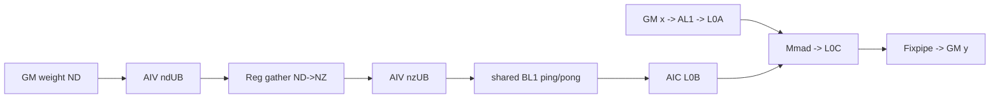
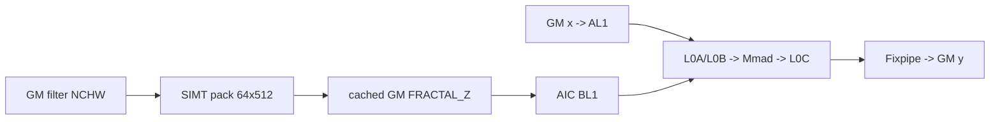

# Conv2D 950 Direct Invoke 算子知识

## 算子速览

| 项目 | 内容 |
|---|---|
| 实际入口 | `cann_bench::conv_2d`（Torch schema）→`conv_2d_npu`→`calc_conv_2d_tiling`→`launch_conv_2d_*`，Direct Invoke |
| 计算语义 | contiguous NCHW 二维互相关：`y[n,co,oh,ow]=bias[co]+Σ_ci,r,s x[n,ci,oh*sh-pt+r*dh,ow*sw-pl+s*dw]*filter[co,ci,r,s]`，越界输入视为 0 |
| 输入输出 | `x[N,C,H,W]`、`filter[Co,C,Kh,Kw]`、`bias[Co]`；FP16/FP32/BF16 同 dtype；`y[N,Co,Ho,Wo]`；当前 Direct 边界要求 `C=Co`、方形 kernel 及对称 stride/pad/dilation |
| 执行类型 | `AIC_CUBE`；R-003 为单 Kernel `MIX_CV`（AIC + 两个 AIV sub-block）；R-004/R-005 同图含 `SIMT` 节点；无通信节点 |
| Kernel 路线 | P0/R-001 full-load small；P1/R-002 常规 Conv2dBase Cube；P2/R-005 Cube→FP32 sparse repair；P3/R-003 weight-UB MIX_CV；P4/R-004 FRACTAL_Z pack→Cube |
| 核心资源 | GM；可选持久化 packed-filter GM；L1、L0A/L0B/L0C；R-003 的 UB/寄存器；SIMT 局部寄存器；Direct user workspace 为 0 |
| 来源闭包 | `direct_implementation_closed`：Direct Host/POD/launcher、20 行 NCHW tiling、1 行 BF16 FZ tiling、全部可达 Cube/AIV/SIMT body、同 stream 交接和三 TU 构建已闭合；官方源码与派生交付事实在正文中明确区分 |
| 复核边界 | 本卡完成固定源码与 canonical 交付件的静态闭包；frontmatter 不写入复核事件，本次知识改写也未执行构建、设备运行、数值或性能测试。 |

## 接口与语义

### 计算语义

输出空间为：

```text
Ho = floor((H + padTop + padBottom - dilationH*(Kh-1) - 1) / strideH) + 1
Wo = floor((W + padLeft + padRight - dilationW*(Kw-1) - 1) / strideW) + 1
```

对有效 `(n,co,oh,ow)`，按 `ci→r→s` 的逻辑约简域累加，padding 区贡献 0，最后加 `bias[co]`。官方 Conv2DV2 支持更广的 layout、groups 与属性域；本 Direct 入口只开放 contiguous NCHW、`groups=1` 的冻结子集，并额外要求 `C=Co`、`Kh=Kw`、两轴 stride/dilation 相同且四侧 pad 相同。FP16/BF16/FP32 的 Cube L0C 累加类型均为 FP32；Fixpipe 对 FP16/BF16 做 `F32→F16/BF16`，FP32 为 `NoQuant`。FP32 channel-tail 路线可令 `hf32Enable=1,hf32TransMode=0`；对齐且约简深度较大的 FP32 路线还可能在 Cube 输出后做稀疏重算。

### 输入、输出与属性

| 参数 | shape/layout | dtype | 约束、默认值与语义 |
|---|---|---|---|
| `x` | `[N,C,H,W]`，contiguous NCHW | FP16/FP32/BF16 | rank 4；NPU Tensor；当前冻结 key 必须精确命中 |
| `filter` | `[Co,C,Kh,Kw]`，contiguous NCHW | 与 `x` 相同 | rank 4；`filter.size(1)=C`；Direct tiler还要求 `Co=C,Kh=Kw` |
| `bias` | `[Co]`，contiguous ND | 与 `x` 相同 | rank 1；长度等于 Co；当前所有冻结 tiling 的 `hasBias=1` |
| `strides` | `[strideH,strideW]` | INT64 Host 属性 | 长度 2、正数；Direct tiler要求两轴相等 |
| `pads` | `[top,bottom,left,right]` | INT64 Host 属性 | 长度 4；Direct tiler要求四值相等 |
| `dilations` | `[dilationH,dilationW]` | INT64 Host 属性 | 长度 2、正数，默认 `[1,1]`；Direct tiler要求两轴相等 |
| `y` | `[N,Co,Ho,Wo]`，contiguous NCHW | 与 `x` 相同 | 新分配；`Ho>0 && Wo>0`，不提供零输出域 Route |

### 入口与版本

实际公开给框架的是自定义 Torch schema `cann_bench::conv_2d`，不是 ACLNN。Meta 与 PrivateUse1 共用 `CheckAndInfer`；PrivateUse1 在当前 NPU stream 上经 `OpCommand::RunOpApi("Conv2DDirect", callback)` 提交本地 launcher。950/950 与 CANN 9.1.0 是本卡边界；官方 README 明确 Conv2DV2 支持 Ascend 950PR/950DT，并明确 A2/A3 不支持。

官方相关源码提供 Conv2DV2 的 `Conv2DTilingData`、arch35 `Conv2dBase`/`Conv2dSmallKernel`、MIX_CV 权重转置和 950 构建配置。Direct Host、POD mirror、精确 key 表、`calc_conv_2d_tiling`、Torch plugin、SIMT pack/repair 与三个编译 TU 均是派生路线，不应解释成官方 ACLNN/Host 行为。小卷积 body 采用 source mapping 指向的较新官方固定提交；其余 Conv2DV2 主闭包采用主官方固定提交。

## Host/Launcher 执行流程

### 参数校验与前处理

`conv_2d_npu` 顺序为：建立 device guard→检查三 Tensor 同设备→dtype/rank/contiguous→属性长度、通道与 bias 长度→stride/dilation 正数→计算并检查 `Ho,Wo>0`→分配 `y`→填 `Conv2dLaunchConfig{}`→精确 key 查表。Direct 路线不调用 Contiguous/View/TransData，不读取 Tensor 数值。

`calc_conv_2d_tiling` 先拒绝空指针、`C!=Co`、非方形 kernel、非对称 stride/pad/dilation；再用 `(dtype,N,C,H,W,K,stride,pad,dilation)` 查冻结表。命中后可依次做 FP16 batch 分解、小卷积判定、HF32 位设置、FRACTAL_Z 收益判定；未命中返回 `-2`，前置约束失败返回 `-1`。

### 参数、Workspace 与生命周期

`Conv2DTilingData` 由冻结的官方 API tiling 完整行按值复制，避免在 Direct Host 重新拼装字段；`Conv2dLaunchConfig` 再追加 `blockDim/route/useFzWeight/useSmallKernel`。lambda 按值捕获 config；launcher 立即读取，AIC entry 接收 `Conv2DTilingData` by value。Direct 路线不向 Conv2dBase 传 user/system workspace：

```text
R-001/R-002/R-003/R-005: workspace_total = 0 B
R-004: workspace_total = 0 B
       packed_filter_GM = align_up(C,c0)*align_up(Co,16)*Kh*Kw*sizeof(T)
       c0 = 8(FP32) 或 16(FP16/BF16)
```

`packed_filter_GM` 是 thread-local `torch::Tensor` cache，不是 launcher workspace。cache key 包含原 filter 身份、version-counter 状态/版本和 stream；miss 时分配并在同一 stream 上 pack，hit 时复用。cache Tensor 持有内存直至替换或线程退出。`y` 由输出 Tensor 持有；R-005 SIMT 直接在 `y` 上读改写，无额外 slice。

### 启动图与失败传播

```text
cann_bench::conv_2d
  -> H0 CheckAndInfer / allocate y / exact lookup / derive flags
  -> H0.5 if dtype==FP32 || useFzWeight:
          dlopen sibling _conv2d_refine.abi3.so once
          resolve refine + weightFz symbols as one atomic runtime object
  -> H1 if useFzWeight && cache miss:
          R-004 SIMT pack -> packed_filter_GM
  -> H2 dtype dispatch（真实短路顺序）:
          if useSmallKernel: R-001 AIC-only Conv2dSmallKernel -> y
          else: call dtype launcher
                if useFzWeight: R-004 AIC-only FRACTAL_Z Conv2dBase -> y
                else if route==WEIGHT_UB: R-003 one MIX_CV launch -> y
                     AIV: filter GM -> UB ND->NZ -> shared L1
                     AIC: x/filter L1 -> L0A/L0B -> Mmad -> L0C -> Fixpipe
                else: R-002 conventional MIX-typed entry(AIV dormant) -> AIC Conv2dBase -> y
  -> H3 if dtype==FP32:
          call R-005 refine launcher
          if reduction/alignment guard fails: return and preserve H2 output
          else: SIMT sparse repair(in-place y)
```

R-004/R-005 节点使用同一 stream，顺序即 producer 对后继的可见性边；无 event 跨 stream。R-003 的同 launch AIC/AIV 由 `CrossCoreSetFlag/WaitFlag` 保护 L1 ping-pong。所有 FP32 调用都会装载 sibling DSO，即使 R-005 随后因 guard 不满足而不发射 SIMT；BF16 仅在 `useFzWeight!=0` 时需要该 DSO。Host 的 `TORCH_CHECK`、动态库装载/符号解析失败会在提交前终止；launcher 返回 `void`、callback 固定返回 0，源码没有逐 launch 同步错误检查，异步 Device 错误归 runtime/stream 边界。router 的 `default:return` 不报错，但内置 selector 只产生已接线叶实例。

### 调用层、裸 C ABI 与所有权边界

| 层级 | 负责生产/保证 | 不负责 | 失败或生命周期边界 |
|---|---|---|---|
| `conv_2d_meta` | 调用 `CheckAndInfer`，按输入 options 创建同 dtype/device 的逻辑输出 | 不做 tiling、stream、cache 或 Device launch | 只表达 shape/dtype 元信息 |
| `conv_2d_npu` | device guard、三 Tensor 同设备、元数据校验、输出分配、当前 stream、完整 `Conv2dLaunchConfig`、cache owner | 不读取 Tensor 数值，不做 layout 转换，不提供通用 tiler | `TORCH_CHECK` 阻止 callback；`y` 与 cache Tensor 由框架对象持有 |
| `calc_conv_2d_tiling` | 结构子集检查、20 行 exact lookup、可选 batch 重分解、small/HF32/FZ 派生 | 不校验 GM 指针、stream、Tensor owner，也不接受表外合法卷积 | `-1` 为结构失败，`-2` 为 key miss；只在命中后写完整 config |
| dtype launcher | 读取 `route/useFzWeight/useSmallKernel`，按 `blockDim` 发射已编译 entry | 不复查 dtype、POD、指针、alias、grid、route/POD 一致性 | 未知 route 静默 return；配置对象只需活到 launcher 读取完成 |
| sibling DSO | 同时导出 `launch_conv_2d_weight_fz` 与 `launch_conv_2d_float32_refine` | 不持有 Tensor，不管理 cache | `static` runtime 持有 `dlopen` handle 至进程结束；`RTLD_LOCAL` |
| Device entry | by-value 接收 376 B tiling；在给定 stream 上消费 GM | 不拥有 x/filter/bias/y；无同步错误返回 | 同 stream 顺序保护跨 kernel GM 边；调用方保护 buffer 生命周期与非预期 alias |

裸 C ABI 可直接调用 `calc_*`/`launch_*`，但 launcher 并不是校验层。尤其不能手工把 `useFzWeight=1` 配给 FP16：pack launcher虽会走16-bit位拷贝，FP16 dtype launcher却没有 FRACTAL_Z router，随后仍按 NCHW 解释权重。也不能把已编译但 selector 不产生的 entry 当成内置可达域；只有同时复现完整官方 POD、模板 route、buffer 深度和格式契约时，才属于条件直调。

cache 的状态机是单线程单槽，不是按 filter 建表：

```text
versionEnabled = filter.version_counter.enabled()
version = versionEnabled ? current_version : 0
hit = same TensorImpl identity
   && packed is defined
   && same raw stream handle
   && same versionEnabled
   && same version
if miss:
  allocate packed Tensor; overwrite the one-slot cache metadata
  inside callback: submit pack on stream
inside same callback: submit Cube consumer on the same stream
```

`cache.source` 与 `cache.packed` 都是强引用，故 source/packed GM 不会在异步消费前因局部变量退出而释放；另一个 filter 会替换整槽，跨线程不共享。cache 元数据在 callback 之前更新，而 pack/Cube launch 均无同步返回码，源码依赖 `RunOpApi` 正常执行 callback 并依赖同 stream 的异步顺序；它没有“pack 已成功提交”的独立完成位，也没有跨 stream event。

## Route 与参数设计

### 分核与资源计算

官方 tiler先由原始 shape/layout/dtype/属性产生 `Ho/Wo`、`singleCore*`、`ho/wo/k/n` 的 L1/L0 tile、`batch/group/n/ho/woDim`、`pBufferFlag` 与 `blockDim`；Direct 保存整行。Device 以 `blockIdx` 分解 batch、group、N 与 M/HW，tail core 以 `singleCore*` 和实际总维裁剪。

Direct 仅对 FP16 full-load row做可选 batch 重分解：`hoParts=32/batch`，`Mcore=align16(ceil(Ho*Wo/hoParts))`，`Cocore=align16(Co)`，`Cialign=align16(Ci)`；用

```text
outputRows=ceil((Mcore+Wo-1)/Wo)
inputRows=(outputRows-1)*strideH+dilationH*(Kh-1)+1
fmapBytes=inputRows*Wi*Cialign*2
weightBytes=Cialign*Kh*Kw*Cocore*2
biasBytes=Cocore*4
l0cBytes=Mcore*Cocore*4
```

这两项上界只准入该FP16 multi-batch重分解；通过后令每 core 单 batch，`blockDim=batch*(32/batch)`。普通小卷积不执行这项字节检查，只要求full-load route、`singleCoreBatch=1`、`nL0=nBL1`、各pad不大于对应kernel。

### 冻结 key 全域与最终叶实例

内置 selector 的支持域恰好是 `conv_2d_tiling_table.inc` 的 20 个 key；宏首参只是源码行 token，初始化时被丢弃，不进入 `Conv2dCaseKey`、POD 或 Device 参数。下表穷尽每个 key 在全部二次派生之后的最终叶实例，因而比只看原始 `route` 更准确：full-load 行会先转 small，BF16 FZ 行会整体替换 POD，FP32 repair 是 Cube 后置节点。

| 行 token | dtype | `(N,C,H,W,K,s,p,d)` | 原始 `blockDim/route` | H0 二次派生 | 最终节点图 |
|---:|---|---|---|---|---|
| 01 | FP16 | `(2,64,32,32,3,1,1,1)` | `32/r0` | small | R-001 small AIC |
| 02 | FP32 | `(4,128,64,64,3,1,1,1)` | `32/r1` | aligned moderate repair | R-002 r1 Cube → R-005 warp32 SIMT |
| 03 | BF16 | `(2,256,128,128,5,1,2,1)` | `32/r2` | weight-UB | R-003 MIX_CV |
| 04 | FP16 | `(8,512,64,64,3,2,1,1)` | `32/r2` | weight-UB | R-003 MIX_CV |
| 05 | FP32 | `(4,1024,32,32,3,1,2,2)` | `32/r5` | aligned deep repair | R-002 r5 Cube → R-005 warp32 SIMT |
| 06 | BF16 | `(2,2048,16,16,1,1,0,1)` | `32/r3` | conventional | R-002 r3 Cube |
| 07 | FP16 | `(3,63,31,31,3,1,1,1)` | `24/r0` | small | R-001 small AIC |
| 08 | FP32 | `(2,127,61,61,3,1,1,1)` | `32/r1` | HF32 channel tail | R-002 r1 Cube |
| 09 | BF16 | `(3,47,23,23,5,2,2,1)` | `27/r0` | small | R-001 small AIC |
| 10 | FP16 | `(5,97,43,43,3,1,1,2)` | `28/r0` | batch refactor→`30` blocks；small | R-001 small AIC |
| 11 | FP16 | `(2,65,33,33,3,1,1,1)` | `30/r0` | small | R-001 small AIC |
| 12 | FP32 | `(3,7,13,13,3,1,1,1)` | `24/r4` | tiny exact small | R-001 small AIC |
| 13 | FP32 | `(2,63,31,31,3,1,1,1)` | `32/r0` | HF32 small | R-001 small AIC |
| 14 | FP16 | `(2,11,13,17,3,1,1,1)` | `28/r4` | small | R-001 small AIC |
| 15 | BF16 | `(4,63,31,31,3,1,1,1)` | `32/r0` | small | R-001 small AIC |
| 16 | FP16 | `(2,64,31,31,3,1,1,1)` | `32/r0` | small | R-001 small AIC |
| 17 | FP32 | `(3,127,63,63,5,2,2,1)` | `32/r1` | HF32 channel tail | R-002 r1 Cube |
| 18 | BF16 | `(2,255,127,127,3,1,1,3)` | `32/r1` | 命中 BF16 FZ 收益式；整行替换为 `32/r5` | R-004 pack→FZ r5 Cube |
| 19 | FP16 | `(4,31,31,31,3,1,1,1)` | `32/r0` | small | R-001 small AIC |
| 20 | FP32 | `(2,127,127,127,3,1,1,2)` | `32/r1` | HF32 + FP32 FZ；repair因`C%8!=0`早退 | R-004 pack→FZ r1 Cube |

从内置 selector 的可达集合看，R-001 覆盖 11 行，R-002 conventional 覆盖 5 行，R-003 覆盖 2 行，R-004 覆盖 2 行，R-005 作为后置节点覆盖 2 行；R-002 与 R-005 的覆盖会重叠，因为后者不是 Cube 的替代路线。20 行中没有原始 key miss 后的通用 fallback。

### Route 选择

下表按重要性 P0→P4 排列；“Host 顺序”列独立保留真实 H0→H3 selector 次序，不能按表行顺序推断运行时短路。

| 重要性 | Route | 路线特征 | 适用域与实现前提 | Host 顺序、短路与 fallback |
|---:|---|---|---|---|
| P0 | R-001 full-load small | `Conv2dSmallKernel<T,T,T,T,half,false,false,NCHW,false>`，AIC-only全载 | 精确 key 命中；route∈{AB_FULL_DB,AB_FULL_SINGLE}；普通 small 只要求`singleCoreBatch=1`、`nL0=nBL1`及pad guard；仅FP16 multi-batch重分解另需L1/L0C上界准入；当前 key 与 FZ 互斥 | H0产生`useSmallKernel`；H2在各dtype分支中先检查small，命中即不走常规route switch；FP32仍进入H3；非法手工配置若同时置FZ，H1会先做无效pack |
| P1 | R-002 常规 Cube | route 0/1/3/4/5 的 NCHW `Conv2dBase` specialization；内置 selector 实际到达 r1/r3/r5 | 精确 key 命中；H2未命中small/FZ/weight-UB专用分支；r0/r4只保留条件直调叶 | H2最终fallback；unknown route在launcher内静默return；FP32随后仍调用H3 |
| P2 | R-005 Cube→FP32 repair | H2 Cube输出后的SIMT条件重算 | FP32；`reduction=C*Kh*Kw>=1024 && C%8==0`；3×3命中特化，否则scalar SIMT | H3仅在FP32分支调用；guard失败立即return并保留H2输出，不回跳其它Cube Route |
| P3 | R-003 weight-UB MIX_CV | route=WEIGHT_UB，`WeightUbTrans=1`，单launch AIC/AIV交接BL1 | 非small、非FZ；FP16/BF16冻结row选择route 2 | H2在small/FZ短路之后由route switch命中；不命中则落到R-002的其它route |
| P4 | R-004 FRACTAL_Z pack→Cube | 可选SIMT pack + FZ `Conv2dBase`，cache hit跳过pack | FP32收益式；或BF16非small、route=A_OTHER_B_FULL、收益式成立且存在完整FZ row | H0产生`useFzWeight`；H1先pack/cache；H2在small检查之后选择FZ Cube；BF16缺FZ row则保留原r1 config并走R-002 |

```text
H0: if direct structural checks fail: -1
    record = exact_lookup(dtype,N,C,H,W,K,stride,pad,dilation)
    if no record: -2
    maybe_refactor_fp16_batch(record)
    set useSmallKernel / hf32Enable / hf32TransMode
    set useFzWeight; BF16 may replace the complete tiling row
H1: if useFzWeight and cache miss: launch SIMT pack
H2: in each dtype branch:
      if useSmallKernel: launch R-001
      else if useFzWeight: launch R-004
      else if route==WEIGHT_UB: launch R-003
      else: launch R-002; unknown route returns
H3: if dtype==FP32: call R-005 launcher
      if its gate fails: return and preserve the H2 output
```

### 已编译 entry 的可达性闭包

`active` 表示 `conv_2d_npu→calc_conv_2d_tiling` 能产生；`conditional-direct` 表示符号和 router 已编译，但内置 selector 不产生该叶，只有外部调用者完整复现 POD/format 契约时才可直调；`dormant-helper` 表示没有任何 launcher 引用，不能算 Route。

| dtype/entry 族 | 已编译 route | 内置 active | conditional-direct | 关键原因 |
|---|---|---|---|---|
| FP16 conventional NCHW | r0、r2、r4 | r2 | r0、r4 | 当前 r0/r4 的所有冻结行都被 `useSmallKernel` 截获 |
| FP32 conventional NCHW | r0、r1、r4、r5 | r1、r5 | r0、r4 | 当前 r0/r4 行被 small 截获；r1/r5 可继续接 R-005 |
| BF16 conventional NCHW | r0、r1、r2、r3 | r2、r3 | r0、r1 | r0 被 small 截获；唯一 r1 冻结行被完整 BF16 FZ row 替换 |
| FP32 FRACTAL_Z | r0、r1、r4、r5 | r1 | r0、r4、r5 | 收益式在当前20个 key 中只令 token 20 到达 FZ r1 |
| BF16 FRACTAL_Z | r1、r5 | r5 | r1 | selector 从原 r1 key 查到的完整 FZ row 自身是 r5 |
| small NCHW | FP16、FP32、BF16 各一 entry | 三 dtype | 无 | full-load guard 后短路 dtype launcher；FP16 符号名含`fz`但模板 `WeightFmt=NCHW` |
| repair SIMT | scalar、warp32 | FP32 token 02/05 的 warp32 | scalar仅在未来满足总 gate、但不满足3×3几何时可由同 launcher 到达 | 内置 key 中两条 repair 都满足 warp32 geometry |
| pack SIMT | FP32位拷贝、16-bit位拷贝 | FP32/BF16 FZ | FP16 pack本身可发射但后继无FZ FP16 router，因此不构成合法路线 | `launch_conv_2d_weight_fz` 的 else 分支只是16-bit pack |
| warp8 helper | `conv_2d_fp32_compensate_warp8_flat3x3` | 无 | 无，`dormant-helper` | 源码定义但 `launch_conv_2d_float32_refine` 从不引用 |

这一区分还解释了为何“编译了 r0/r4”不能推导“内置 conventional r0/r4 可达”。selector 的 `useSmallKernel` 优先级、BF16 完整 FZ row 替换和 launcher 的 route switch 必须联合审计。

### 模板/实现执行矩阵

| 重要性 | Route | key/selector | dtype/shape/platform 完整命中条件 | 执行族与 kernel 节点 | 实际模板/body | 内存与同步特征 | tail/fallback |
|---:|---|---|---|---|---|---|---|
| P0 | R-001 small | full-load + 结构性 small predicate | FP16/FP32/BF16；950；NCHW；精确 key | AIC-only 单节点 | `Conv2dSmallKernel<...,NCHW,false>::Init/Process` | GM→L1全载→双缓冲L0A/B→Mmad→L0C→Fixpipe→GM | block/M/N/K tail；inactive core return；full-load r0/r4未满足small predicate只转R-002 |
| P1 | R-002 conventional | route 0/1/3/4/5 | 内置 active 为 FP32 r1/r5、BF16 r3；r0/r4和BF16 r1为conditional-direct | entry 标记 MIX 1:2，但`WeightUbTrans=0`时AIV不生产BL1；AIC Cube | `Conv2dBase` + `Conv2DV1Param`：r0=`<0,0,0,3,...>`，r1=`<2,0,1,3,...>`，r3=`<1,1,3,3,...>`，r4=`<0,0,0,0,...>`，r5=`<2,2,3,3,...>` | L1/L0 depth由模板和 POD；pipe event；无跨族数据边 | dimension/K/tile tail；未知 route 静默 return |
| P2 | R-005 repair | FP32 aligned deep reduction | `C%8=0 && C*Kh*Kw>=1024`；3×3特化或标量 fallback | H2 Cube→SIMT | Cube specialization + warp32 flat3x3或scalar compensate | `y` 是跨 kernel GM 边；同 stream；SIMT局部数组/warp shuffle | 只改 `abs(y)<gate`；其它元素保持 Cube；不满足早退 |
| P3 | R-003 weight-UB | route 2 | FP16/BF16；`Conv2DV1Param<2,2,3,3,1,0,0,0,1,...>` | 单 Kernel MIX_CV：1 AIC + 2 AIV sub-block | `WeightUbProcessTools` + `WeightLoadGM2UBTools/WeightND2NZTools/WeightUB2L1Tools` + Cube iterate | AIV GM→UB ND→NZ→L1；AIC wait L1→L0B；flag IDs随 ping-pong/vecId轮换 | UB K/N tail pad；route miss转 R-002 |
| P4 | R-004 FZ | amortization gate | FP32或BF16；cache hit/miss；FP32复用完整常规row，BF16替换为完整FZ row | miss: SIMT pack→AIC-only Cube；hit: AIC-only Cube | `conv_2d_weight_nchw_to_fz_*` + `RunOfficialConv2dFz<...>` | persistent packed GM；同 stream；Cube从 FZ GM直入 BL1 | C/Co pad置零；cache失效重包；BF16无FZ row或收益式不成立则保留原r1并走R-002 |

### 性能与安全 Guard

| Guard | Host/Tiling 条件 | Device/资源原因 | 影响 Route | 不满足时去向 | 源码符号 |
|---|---|---|---|---|---|
| 精确 key | dtype/九个几何属性逐项相等 | Direct 不运行通用 tiler | 全部 | `-2` | 派生 `calc_conv_2d_tiling` |
| 对称子集 | `C=Co,Kh=Kw,sh=sw,pads四值相等,dh=dw` | key 被压缩为单 K/stride/pad/dilation | 全部 | `-1` | 派生 `calc_conv_2d_tiling` |
| batch重分解资源 | FP16 full-load、`1<singleCoreBatch`、`1<batch<=32`、L1/L0C字节上界 | 小 kernel 全载并以 batch 参与 block 映射 | R-001 | 保留原 row | 派生 `calc_conv_2d_tiling` |
| small eligibility | full-load、单 batch、`nL0=nBL1`、pad≤kernel | 一次全载的 L1/L0/Fixpipe 路径 | R-001 | R-002 | 派生 `useSmallKernel` |
| HF32 channel tail | FP32、`C%8!=0`、非 `small && reduction<=128 && output<=8192` | channel tail路线启用HF32并显式建立寄存器状态 | R-001/R-002/R-004 | exact FP32 | 派生 `useHf32`；官方 `InitHf32Mode` |
| FP32 FZ收益 | `filterElems>=32768 && outputPos*8>=filterElems` | 一次 pack 需要由复用摊销 | R-004 | 常规 weight | 派生 `profitableFp32Fz` |
| BF16 FZ收益 | 非 small、route1、`filterElems>=32768 && outputPos*64>=filterElems` | 跳过每 spatial core 的 ND→NZ | R-004 | 保留原r1并走R-002 | 派生 `profitableBf16Fz` |
| repair | `reduction>=1024 && C%8==0` | 只处理 aligned FP32 cancellation domain | R-005 | launcher return | 派生 `launch_conv_2d_float32_refine` |
| warp 3×3 | 3×3、H/W≥2、stride1；moderate要求dilation1/pad1，deep要求对称 dilation=pad>0 | 固定有效窗口 2×2/2×3/3×2/3×3，常量除法 | R-005 | scalar SIMT fallback | 派生 `moderateWarp3x3/deepWarp3x3` |
| L1/L0 depth | `pBufferFlag`、`l1PingPong/l0PingPong`、tile尺寸 | 双缓冲容量与覆盖协议 | R-002/R-003/R-004 | 使用单缓冲 specialization | 官方 `InitBufferWithDoubleBuf` |

### POD/ABI

Direct mirror 使用自然 C++ 布局：`Conv2DTilingData sizeof=376,alignof=8`；`Conv2dLaunchConfig sizeof=392,alignof=8`。官方 tiling 头证明字段顺序；派生头未提供 `static_assert`，复用时应补 Host/Device 双侧 ABI 断言。下表每字段独立列出；除特别说明，producer 为冻结完整 tiling row，consumer 为 `Conv2dBase/Conv2dSmallKernel` 对应初始化、搬运或迭代逻辑。

| 结构 | 字段 | 类型/位宽 | ABI 布局 | 单位 | Host/launcher producer | Device consumer | 边界 |
|---|---|---|---|---|---|---|---|
| `Conv2DTilingData` | `orgHi` | u64 | off 0 | element | frozen row | 原输入H/offset | >0 |
| 同上 | `orgWi` | u64 | off 8 | element | frozen row | 原输入W/stride | >0 |
| 同上 | `orgHo` | u64 | off 16 | element | frozen row | 输出H/Host收益式 | >0 |
| 同上 | `orgWo` | u64 | off 24 | element | frozen row | 输出W/Host收益式 | >0 |
| 同上 | `orgHixWi` | u64 | off 32 | element | frozen row | fmap batch步长 | `orgHi*orgWi` |
| 同上 | `singleCoreBatch` | u64 | off 40 | batch | row；可被batch重分解改1 | core batch迭代 | ≥1 |
| 同上 | `singleCoreHo` | u64 | off 48 | M或Ho element | row；small重分解改写 | M/Ho tail | ≥1 |
| 同上 | `singleCoreWo` | u64 | off 56 | Wo element | row；M-mode可为0 | HW-mode tail | inactive时0 |
| 同上 | `unionDataXt` | u64 | off 64 | packed control | official tiler | Load3D参数 | 原样传递 |
| 同上 | `hin` | u64 | off 72 | element | frozen row | input H | >0 |
| 同上 | `win` | u64 | off 80 | element | frozen row | input W | >0 |
| 同上 | `hout` | u64 | off 88 | element | frozen row | output H | >0 |
| 同上 | `wout` | u64 | off 96 | element | frozen row | output W | >0 |
| 同上 | `orgCi` | u32 | off 104 | channel | frozen row | GM batch/组地址 | Direct等于C |
| 同上 | `orgCo` | u32 | off 108 | channel | frozen row | GM output地址 | Direct等于Co |
| 同上 | `singleCoreCi` | u32 | off 112 | channel | frozen row | K对齐/AL1 | >0 |
| 同上 | `singleCoreCo` | u32 | off 116 | channel | row；small重分解可改 | N tail/L1 bias | >0 |
| 同上 | `hoL1` | u32 | off 120 | M/Ho element | row；small重分解可改 | AL1 tile | >0 |
| 同上 | `woL1` | u32 | off 124 | Wo element | row；M-mode可0 | HW tile | inactive可0 |
| 同上 | `kAL1` | u32 | off 128 | K element | frozen row | A L1 K loop | >0 |
| 同上 | `kBL1` | u32 | off 132 | K element | frozen row | B L1 K loop | >0 |
| 同上 | `khL1` | u32 | off 136 | kernel row | frozen row | DMA/Load3D | route dependent |
| 同上 | `kwL1` | u32 | off 140 | kernel col | frozen row | DMA/Load3D | route dependent |
| 同上 | `nBL1` | u32 | off 144 | N element | row；small重分解可改 | BL1 extent | >0 |
| 同上 | `hoL0` | u32 | off 148 | M/Ho element | row；small重分解可改 | L0 M tile | >0 |
| 同上 | `woL0` | u32 | off 152 | Wo element | row；M-mode可0 | HW L0 tile | inactive可0 |
| 同上 | `kL0` | u32 | off 156 | K element | frozen row | K Mmad loop | >0 |
| 同上 | `nL0` | u32 | off 160 | N element | row；small重分解可改 | L0B/L0C N | >0 |
| 同上 | `pBufferFlag` | u32 | off 164 | bitset | frozen row | AL1/L0C depth | bits选择buffer |
| 同上 | `groups` | u32 | off 168 | group | frozen row | group调度 | Direct为1 |
| 同上 | `enlarge` | u32 | off 172 | group factor | frozen row | opt-group | 当前inactive |
| 同上 | `singleCoreGroups` | u32 | off 176 | group | frozen row | group迭代 | 当前inactive |
| 同上 | `singleCoreGroupOpt` | u32 | off 180 | group | frozen row | opt-group迭代 | 当前inactive |
| 同上 | `bUbNStep` | u32 | off 184 | N element | frozen row | R-003 UB N tile | 非R-003可0 |
| 同上 | `bUbKStep` | u32 | off 188 | K element | frozen row | R-003 UB K tile | 非R-003可0 |
| 同上 | `khUb` | u32 | off 192 | kernel row | frozen row | UB transform | route dependent |
| 同上 | `kwUb` | u32 | off 196 | kernel col | frozen row | UB transform | route dependent |
| 同上 | `kernelHxkernelW` | u32 | off 200 | element | frozen row | K展开/UB gather | `Kh*Kw` |
| 同上 | `kernelHxkernelWxkernelD` | u32 | off 204 | element | frozen row | 2D共用ABI | 2D等于Kh*Kw |
| 同上 | `aL1SpaceSize` | u32 | off 208 | byte | frozen row | AL1 buffer分配 | 含单份容量 |
| 同上 | `multiNBL1` | u32 | off 212 | loop | frozen row | BL1→L0B N次数 | ≥1 |
| 同上 | `cinAInCore` | u32 | off 216 | channel | frozen row | A core channel | route dependent |
| 同上 | `cinATailInCore` | u32 | off 220 | channel | frozen row | A channel tail | route dependent |
| 同上 | `cinBInCore` | u32 | off 224 | channel | frozen row | B core channel | route dependent |
| 同上 | `cinBTailInCore` | u32 | off 228 | channel | frozen row | B channel tail | route dependent |
| 同上 | `mStep` | u32 | off 232 | M element | frozen row | Mmad/L0C | >0 |
| 同上 | `kStep` | u32 | off 236 | K block | frozen row | LoadBL0 start | >0 |
| 同上 | `nStep` | u32 | off 240 | N block | frozen row | N迭代 | >0 |
| 同上 | `fmapKStride` | u32 | off 244 | element | frozen row | fmap GM/L1 stride | route dependent |
| 同上 | `weightKStride` | u32 | off 248 | element | frozen row | weight GM/L1 stride | route dependent |
| 同上 | `cinOffsetBlockInGM` | u32 | off 252 | element | frozen row | fmap GM offset | route dependent |
| 同上 | `coutOffsetBlock` | u32 | off 256 | element | frozen row | weight GM row stride | >0 |
| 同上 | `nL1DivBlockSize` | u32 | off 260 | block | frozen row | N对齐 | >0 |
| 同上 | `kernelH` | u32 | off 264 | element | frozen row | Load3D/refine/pack | >0 |
| 同上 | `kernelW` | u32 | off 268 | element | frozen row | Load3D/refine/pack | >0 |
| 同上 | `strideH` | u32 | off 272 | element | frozen row | 输入坐标 | >0 |
| 同上 | `strideW` | u32 | off 276 | element | frozen row | 输入坐标 | >0 |
| 同上 | `dilationH` | u32 | off 280 | element | frozen row | 输入坐标 | >0 |
| 同上 | `dilationW` | u32 | off 284 | element | frozen row | 输入坐标 | >0 |
| 同上 | `padTop` | u32 | off 288 | element | frozen row | Load3D/refine | ≥0 |
| 同上 | `padBottom` | u32 | off 292 | element | frozen row | tail window | ≥0 |
| 同上 | `padLeft` | u32 | off 296 | element | frozen row | Load3D/refine | ≥0 |
| 同上 | `padRight` | u32 | off 300 | element | frozen row | tail window | ≥0 |
| 同上 | `innerBatch` | u32 | off 304 | batch | frozen row | inner-batch specialization | 当前模板为0语义 |
| 同上 | `batch` | u32 | off 308 | batch | frozen row | core/refine索引 | >0 |
| 同上 | `cin` | u32 | off 312 | channel | frozen row | pack/refine/K | >0 |
| 同上 | `cout` | u32 | off 316 | channel | frozen row | pack/refine/N | >0 |
| 同上 | `kh` | u32 | off 320 | element | frozen row | small K展开 | >0 |
| 同上 | `kw` | u32 | off 324 | element | frozen row | small K展开 | >0 |
| 同上 | `batchDim` | u32 | off 328 | core dim | row；batch重分解可改 | blockIdx分解 | ≥1 |
| 同上 | `groupDim` | u32 | off 332 | core dim | frozen row | blockIdx分解 | Direct为1 |
| 同上 | `nDim` | u32 | off 336 | core dim | row；batch重分解可改1 | blockIdx分解 | ≥1 |
| 同上 | `hoDim` | u32 | off 340 | core dim | row；batch重分解可改 | blockIdx分解 | ≥1 |
| 同上 | `woDim` | u32 | off 344 | core dim | row；batch重分解可改1 | blockIdx分解 | ≥1 |
| 同上 | `cinOpt` | u32 | off 348 | channel | frozen row | opt-group | 当前inactive |
| 同上 | `coutOpt` | u32 | off 352 | channel | frozen row | opt-group | 当前inactive |
| 同上 | `groupOpt` | u32 | off 356 | group | frozen row | opt-group | 当前inactive |
| 同上 | `iterateMNOrder` | u8 | off 360 | enum | frozen row | M/N迭代序 | 0/1 |
| 同上 | `biasFullLoadFlag` | u8 | off 361 | bool | frozen row | bias L1容量 | 0/1 |
| 同上 | `fixpParamsFullLoadFlag` | u8 | off 362 | bool | frozen row | scale/relu L1 | 当前无scale |
| 同上 | `hf32Enable` | u8 | off 363 | bool | row；Direct改写 | AIC HF32状态 | 0/1 |
| 同上 | `hf32TransMode` | u8 | off 364 | enum | Direct写0 | AIC HF32转换 | 固定0 |
| 同上 | `hasBias` | u8 | off 365 | bool | frozen row | bias load/BT | 当前1 |
| 同上 | `hasScale` | u8 | off 366 | bool | frozen row | quant scale | 当前0 |
| 同上 | `dualOutput` | u8 | off 367 | bool | frozen row | second output | 当前0 |
| 同上 | `quantMode0` | u8 | off 368 | enum | frozen row | Fixpipe output0 | 当前0 |
| 同上 | `reluMode0` | u8 | off 369 | enum | frozen row | Fixpipe output0 | 当前0 |
| 同上 | `clipMode0` | u8 | off 370 | enum | frozen row | Fixpipe output0 | 当前0 |
| 同上 | `quantMode1` | u8 | off 371 | enum | frozen row | inactive output1 | 当前0 |
| 同上 | `reluMode1` | u8 | off 372 | enum | frozen row | inactive output1 | 当前0 |
| 同上 | `clipMode1` | u8 | off 373 | enum | frozen row | inactive output1 | 当前0 |
| 同上 | `offsetx` | i8 | off 374 | scalar | frozen row | Load3D padding值 | 当前0 |
| 同上 | `roundMode` | i8 | off 375 | enum | frozen row | Fixpipe | 当前0 |
| `Conv2dLaunchConfig` | `tiling` | 376 B POD | off 0 | struct | exact lookup | launcher→entry by value | 完整行 |
| 同上 | `blockDim` | u32 | off 376 | block | row；可重分解 | launch grid | >0 |
| 同上 | `route` | i32 | off 380 | enum | row | dtype launcher switch | 0..5且已实例化 |
| 同上 | `useFzWeight` | u32 | off 384 | bool |收益式/FZ row | pack和FZ router | 0/1 |
| 同上 | `useSmallKernel` | u32 | off 388 | bool | full-load结构性small predicate | small router | 0/1 |

POD 不是可独立调参的字段集合，至少要保持下列关系成组成立：

```text
geometry:
  orgHixWi == orgHi * orgWi
  kernelHxkernelW == kernelH * kernelW
  kernelHxkernelWxkernelD == kernelHxkernelW  # 2D, kd=1
  hout/orgHo and wout/orgWo describe the same output domain

grid ownership:
  blockDim covers batchDim * groupDim * nDim * hoDim * woDim
  singleCore{Batch,Co,Ho,Wo} clip that decomposition without overlap
  M-mode interprets hoDim as mDim and singleCoreHo as flattened M extent

Cube resource tuple:
  (kAL1,kBL1,kL0,nBL1,nL0,aL1SpaceSize,pBufferFlag)
  must match (FmapTiling,WeightTiling,L1PingPong,L0PingPong)

weight-UB tuple:
  route==2 && WeightUbTrans==1
  bUbKStep>0 && bUbNStep>0
  shared BL1 extent == 2 * nBL1 * kBL1 * sizeof(T)

format tuple:
  useFzWeight==0 -> filter pointer is NCHW ND
  useFzWeight==1 -> filter pointer is packed FRACTAL_Z
  BF16 FZ replaces the complete tiling row; never patch only route/format
```

`calc_conv_2d_tiling` 的事务顺序是“先找到完整 record→整体复制→受限地成组改写 batch/small/HF32/FZ”；key miss 时不产生半成品 config。复用时不能只搬 `M/N/K` 或 `blockDim`，否则最常见的失败不是 shape 立即报错，而是 L1/L0 buffer 深度、block 所有权或 filter layout 与模板发生静默错配。

### Route 源码闭包

| 重要性 | Route | Key/selector | Host/Tiling producer | POD/参数 | Kernel entry/router | Kernel body/直接依赖 | 构建接线 |
|---:|---|---|---|---|---|---|---|
| P0 | R-001 small | 派生 exact key + full-load结构性small predicate | 派生 lookup/batch refactor；官方 row来源为 API tiler | `Conv2DTilingData` by value | 派生 `conv_2d_*_small` | 官方 `Conv2dSmallKernel::Init/Process`（secondary commit） | 派生 small TU；官方 950 binary config为能力来源 |
| P1 | R-002 conventional | 派生 dtype+route switch | 冻结官方 tiling row | 同上 | 派生 `conv_2d_{dtype}_r*` | 官方 `Conv2dBase::RunConv2dKernel`→`IterateAll` | 派生 Cube TU；官方 Conv2DV2 CMake/config |
| P2 | R-005 repair | 派生 reduction/alignment/geometry gates | POD字段直传SIMT参数 | scalar launch args | 派生 Cube entry→SIMT entry | Cube为官方；repair为派生 SIMT | 派生 Cube TU + SIMT DSO |
| P3 | R-003 weight-UB | route 2 | 冻结官方 weight-UB row | `bUbNStep/bUbKStep/nBL1/kBL1/pBufferFlag` | 派生 r2 entry，MIX 1:2 | 官方 weight-UB process/instruction + common iterate | 同上，启用CV共享buffer编译选项 |
| P4 | R-004 FZ | 派生 amortization selector；BF16用完整FZ row | FP32沿用完整常规row；BF16使用official API tiler的完整FZ row | `useFzWeight` + tiling | 派生 SIMT pack entry→FZ Cube entry | pack为派生；Cube body为官方 `Conv2dBase` FZ specialization | 派生 refine DSO + Cube TU |

### 构建、DSO 与符号拓扑

同一份 `conv_2d_kernel.cpp` 由 CMake 生成三个只定义一个宏的 wrapper TU，不能合并为一种执行模式：

| TU | 宏/编译模式 | 产物与符号 | 关键约束 |
|---|---|---|---|
| Cube TU | `CONV2D_CUBE_TU`，`-xasc --npu-arch=dav-3510` | `calc_conv_2d_tiling`、三 dtype 常规 launcher、NCHW/FZ Cube entry | 与 small 一起进入主 `_C.abi3.so`；启用 SSBUF/CV 与官方 const-propagation flags |
| small TU | `CONV2D_SMALL_TU`，AIC-only entry | 三 dtype small launcher/body | 独立 TU 防止 small AIC-only feature set 继承 conventional MIX task type |
| refine TU | `CONV2D_REFINE_TU --enable-simt` | pack、scalar/warp repair、`launch_conv_2d_weight_fz/refine` | 单独链接 `_conv2d_refine.abi3.so`；cce linker 边界不把标准 AscendC launch 与 SIMT 放入同一 DSO |

Host plugin 位于主 DSO。它用 `dladdr(GetConv2dAuxRuntime)` 定位主 DSO 目录，再 `dlopen(RTLD_NOW|RTLD_LOCAL)` sibling；两个 `dlsym` 任一缺失都不构造 runtime。构建脚本把 sibling 复制到 Python 包目录，所以部署必须把主 DSO 与 sibling 成对保留，不能只复制 `_C.abi3.so`。

## Kernel 实现

### 公共执行流程

下列逐 Route 章节按重要性 P0→P4 排列，R-ID保持不变；这不是Host判断顺序，真实H0→H3短路见“Route 选择”。所有 Cube 路线都以 NCHW x、NCHW或FRACTAL_Z weight、ND bias、NCHW y实例化 `ConvType`；`Conv2DV1Param` 固定 `OutputOrder=M_MODE,IterOrder=MITER_FIRST,GroupType=NORMAL_CONV,FmapCopyMode=LOAD3D`。`Conv2dBase` 按 blockIdx 求 batch/N/M tail，设置 GM view，调用 `conv.Init`、`SetWeight/SetBias/SetFmap`、`IterateAll`、`End`。AIC 数据主链为 `GM→AL1/BL1→L0A/L0B→Mmad(FP32 L0C)→Fixpipe→GM y`。R-003 在 BL1 producer 前插入 AIV；R-004/R-005 在同一 stream 分别插入前置或后置 SIMT 节点。

### P0 / Route R-001：full-load small AIC

#### 适用条件

##### 选择证据

| 层级 | 文件 | 符号 | 源码谓词/参数 | 结果/下一跳 |
|---|---|---|---|---|
| Direct selector | 派生 `op_kernel/conv_2d_kernel.cpp` | `calc_conv_2d_tiling` | full-load + single batch + `nL0=nBL1` + pad guard | `useSmallKernel=1` |
| Direct router | 同上 | `launch_conv_2d_*_small` | dtype三分支 | 对应 AIC-only entry |
| 官方 body | `conv/conv2d_v2/op_kernel/arch35/conv2d_small_kernel.h` | `Conv2dSmallKernel<...,NCHW,false>` | `IsHwMode=false,WeightFmt=NCHW` | M-mode Process |

#### Device 数据流

##### 函数级调用链

```text
conv_2d_{fp16|fp32|bf16}_small(td)
  -> [FP32: SetHF32Mode/SetHF32TransMode]
  -> Conv2dSmallKernel::Init
  -> Conv2dSmallKernel::Process
    -> ProcessMMode
      -> LoadFmapL1MModeForGroup / LoadWeightL1ForGroup / LoadBiasScaleL1ForGroup
      -> SetupLoad3DBase
      -> MmadAccumulateTile(DoLoadAL0,DoLoadBL0,Mmad)
      -> CopyOutResult -> Fixpipe
```

##### 源码等价伪码

```text
decode blockIdx -> batch,group(=0),N,M; clip actualCo/actualM
L1 = [fmap][weight][aligned bias]
load NCHW fmap/weight to NZ L1; load bias
for each M tile:
  for each K tile with buf=(kIter&1):
    wait M->MTE1[buf]
    Load3D AL1->L0A; Load2D BL1->L0B
    signal/wait MTE1->M
    Mmad FP32; first tile may source bias BT
    release buf
  Fixpipe L0C(validM,actualCo,column-major NCHW) -> y
```

#### 内存与数据搬运

##### 资源与搬运表

| 层级/缓冲区 | offset/地址公式 | extent/容量公式 | dtype/layout | producer | consumer | owner/lifetime | 对齐/复用 |
|---|---|---|---|---|---|---|---|
| GM x/filter/bias | batch/N/M公式 | logical tensors | T NCHW/ND | caller | L1 loaders | caller | tail由actual值 |
| L1 fmap | byte 0 | `curHiLoadL1*Wi*align(C,GK0)*sizeof(T)` | NZ A1 | Dn2Nz | Load3D | core/launch | full load |
| L1 weight | `bl1OffBytes` | `ceil(K/GK0)*ceil(actualCo/16)*16*GK0*sizeof(T)` | NZ B1 | Nd2Nz/Dn2Nz | Load2D | core/launch | 紧随fmap |
| L1 bias | `align(afterBL1,32)` | `singleCoreCo*sizeof(FP32)` | bias T→BT | GM copy | Mmad source | core/launch | 32B对齐 |
| L0A/L0B | `buf*(L0A/B_SIZE/2)` | 两份各半，总计 `L0A_SIZE+L0B_SIZE` | Cube layout | LoadData | Mmad | K loop | `kIter&1` |
| L0C | offset 0 | 256 KiB物理容量；有效`align16(M)*align16(Co)*4` | FP32 | Mmad | Fixpipe | M tile | tile后覆盖；容量值仅在可选FP16 multi-batch重分解时作为Host准入上界 |
| UB/寄存器 | N/A | N/A | N/A | N/A | N/A | N/A | small不走AIV |
| GM y | batch/N/M输出偏移 | output tensor | T NCHW | Fixpipe | caller | output Tensor | validM/actualCo |

##### 分层内存布局


##### 字节账、交接边与复用顺序

```text
workspace_total = 0
L1_live = fmapBytes + weightBytes + alignedBiasBytes
L0_total = L0A_SIZE + L0B_SIZE + 256 KiB L0C
refactor_admission = (L1_live <= 512 KiB && valid_L0C <= 256 KiB)  # 仅FP16 multi-batch重分解
UB_total = 0
```

| 边/复用子区 | producer | offset/extent | dtype/layout | consumer | ordering/sync | owner/lifetime | 安全条件 |
|---|---|---|---|---|---|---|---|
| L0 ping-pong | Load3D/Load2D | half L0 per buf | T Cube | Mmad | `M_MTE1`、`MTE1_M` event 0/1 | core K-loop | Mmad后才复用 |
| L0C→y | Mmad | valid tile | FP32→T NCHW | Fixpipe | final `unitFlag` | output Tensor | K final/tail |

#### 同步、精度与尾块

##### 同步与数值边界表

| 阶段 | primitive/机制 | producer | consumer/等待点 | 保护对象 | 精度/尾块 |
|---|---|---|---|---|---|
| GM→L1 | MTE2→FIX/MTE1 flags | L1 copy | bias/LoadData | unified L1 | N/M/core tail |
| L1→L0→M | double event 0/1 | LoadData | Mmad | L0A/B | final K使用`curK` |
| M→GM | Fixpipe | FP32 L0C | y | output tile | FP16/BF16 cast；FP32 NoQuant |
| core tail | `coreActive_/actualCo_/actualM_` | Init | Process | output域 | inactive直接return |

#### 关键实现

##### 符号证据表

| 阶段 | 文件 | 符号/模板实例 | 实现事实 |
|---|---|---|---|
| Host/Tiling producer | 派生 `op_kernel/conv_2d_kernel.cpp` | `calc_conv_2d_tiling` | small/batch/HF32 guard |
| Kernel entry/router | 同上 | `conv_2d_*_small` | AIC-only、POD by value |
| Device body/helper | `conv/conv2d_v2/op_kernel/arch35/conv2d_small_kernel.h` | `ProcessMMode/MmadAccumulateTile/DoCopyOut` | 全载、双L0、Mmad/Fixpipe/tail |

### P1 / Route R-002：常规 Conv2dBase Cube

#### 适用条件

##### 选择证据

| 层级 | 文件 | 符号 | 源码谓词/参数 | 结果/下一跳 |
|---|---|---|---|---|
| Direct selector | 派生 kernel | exact row + `!small&&!FZ` | route 0/1/3/4/5 | dtype entry |
| Direct router | 派生 kernel | `launch_conv_2d_{dtype}` | switch route | r0/r1/r3/r4/r5 |
| 官方 body | `conv2d_v2.h` | `Conv2dBase::RunConv2dKernel` | NCHW normal M-mode | `IterateAll` |

#### Device 数据流

##### 函数级调用链

```text
conv_2d_{dtype}_r*(td)
 -> RunOfficialConv2d<T,FmapTiling,WeightTiling,L1PP,L0PP,0>
 -> Conv2dBase::RunConv2dKernel
 -> Conv2dKernelInit / InitBuffer
 -> Conv2dKernelImpl
 -> Conv2d::IterateAll -> IterateK -> LoadL0Module -> Mmad -> GetTensorC/Fixpipe
```

##### 源码等价伪码

```text
decode block -> batch,N,M; return on virtual tail
allocate AL1/BL1/L0A/L0B/L0C according to POD and template depth
for M/N tile in iterate order:
  load/reuse AL1 and BL1 at kAL1/kBL1 boundaries
  for K by kL0:
    LoadData AL1->L0A, BL1->L0B
    Mmad FP32, init from bias BT on first K, accumulate thereafter
  Fixpipe FP32 L0C -> output dtype NCHW
free queue events
```

#### 内存与数据搬运

##### 资源与搬运表

| 层级/缓冲区 | offset/地址公式 | extent/容量公式 | dtype/layout | producer | consumer | owner/lifetime | 对齐/复用 |
|---|---|---|---|---|---|---|---|
| GM | `batchIdxStart/nIdxStart/mIdxStart` | logical tensors | NCHW/ND | caller | common loaders | caller/output | POD tail |
| AL1 | queue slice | `aL1SpaceSize*(AL1_DB?2:1)` B | A1 NZ | LoadAL1 | L0A | kernel | pBuffer bit |
| BL1 | queue slice | `nBL1*kBL1*sizeof(T)*(bL1DB?2:1)` | B1 NZ | LoadBL1 | L0B | kernel | template L1PP |
| L0A/L0B | TBuf | `L0A_SIZE+L0B_SIZE` | Cube | LoadData | Mmad | kernel | L0PP选择子区 |
| L0C | TBuf | `L0C_SIZE` | FP32 | Mmad | Fixpipe | kernel | 普通路线整块复用 |
| bias BT | queue | `align(nL0*4,BT_SIZE)` | FP32 C2 | bias L1 | first Mmad | tile | hasBias |
| UB/寄存器 | N/A | N/A | N/A | N/A | N/A | N/A | 当前模板无AIV工作 |
| GM y | output offset | valid tile | T NCHW | Fixpipe | caller | output Tensor | N/M tail |

##### 分层内存布局


##### 字节账、交接边与复用顺序

```text
workspace_total = 0
L1_total = aL1SpaceSize*depthA1 + nBL1*kBL1*sizeof(T)*depthB1 + aligned_bias
L0_total = L0A_SIZE + L0B_SIZE + L0C_SIZE
UB_total = 0
```

| 边/复用子区 | producer | offset/extent | dtype/layout | consumer | ordering/sync | owner/lifetime | 安全条件 |
|---|---|---|---|---|---|---|---|
| AL1/BL1 queue | GM loaders | POD tile | T NZ | L0 loaders | TQue EnQue/DeQue/FreeTensor | kernel | load flag与K边界一致 |
| L0C→y | Mmad | M×N valid tile | FP32 | Fixpipe | final unitFlag/pipe | output Tensor | tail shape先更新 |

#### 同步、精度与尾块

##### 同步与数值边界表

| 阶段 | primitive/机制 | producer | consumer/等待点 | 保护对象 | 精度/尾块 |
|---|---|---|---|---|---|
| L1队列 | TQue event | MTE2 | MTE1 | AL1/BL1 | K/M/N tail |
| Cube | `MTE1_M/M_MTE1`与unitFlag | LoadData/Mmad | 下一tile/Fixpipe | L0A/B/C | FP32 accumulate |
| HF32 | `InitHf32Mode` | POD flags | AIC arithmetic | core control state | false时显式清零 |
| 输出 | Fixpipe | L0C | y | valid M/N | F32→T；无activation/quant |

#### 关键实现

##### 符号证据表

| 阶段 | 文件 | 符号/模板实例 | 实现事实 |
|---|---|---|---|
| Host/Tiling producer | `conv2d_v2_tiling.{h,cpp}` + 派生表 | `Conv2DTilingData` | 完整 row/字段 |
| Kernel entry/router | 派生 kernel | `RunOfficialConv2d`/r* entries | dtype/route到模板 |
| Device body/helper | `conv2d_v2.h`、`conv_common_func.h`、`conv_iterate_impl.h` | `Conv2dBase/IterateAll/ReduceK` | GM-L1-L0-Mmad-Fixpipe |

### P2 / Route R-005：Cube 后置 FP32 稀疏修复

#### 适用条件

##### 选择证据

| 层级 | 文件 | 符号 | 源码谓词/参数 | 结果/下一跳 |
|---|---|---|---|---|
| Direct launcher | 派生 kernel | `launch_conv_2d_float32_refine` | `reduction>=1024 && C%8==0` | SIMT launch |
| depth split | 同上 | `kDeepRefineReduction` | moderate `1024<=reduction<=4096`；deep `reduction>4096` | 选择 outer gate 与几何谓词 |
| geometry | 同上 | `moderateWarp3x3/deepWarp3x3` | 3×3边界谓词 | warp32或scalar；已定义的warp8无调用点 |
| value gate | SIMT body | `fabsf(cube_value)<limit` | moderate `2^-12`；deep outer `0.046875`；deep inner `2^-8` | recompute/keep与FMA/Kahan分叉 |

#### Device 数据流

##### 函数级调用链

```text
conventional Cube entry -> GM y
 -> launch_conv_2d_float32_refine
 -> conv_2d_fp32_compensate_warp32_flat3x3 或 conv_2d_fp32_compensate
 -> read x/filter/bias/y -> conditionally overwrite y
```

##### 源码等价伪码

```text
same stream after Cube
warp scans 32 output candidates; ballot(abs(y)<outerGate)
for each selected output:
  derive valid r/s window
  moderate: 32 term-mod streams, FMA
  deep and abs(cube)<1/256: 32 term-mod streams, FMA
  deep otherwise: 32 term-mod streams, per-stream Kahan
  lane0 sums streams in lane order, adds bias, overwrites y
scalar fallback uses 8 streams for moderate;
  deep inner uses 32 scalar-array FMA streams;
  deep outer uses one sequential Kahan accumulator
```

gate 读取的是已含 bias 的 Cube `y`，而重算从 x/filter 重新形成 reduction 后再加一次原 bias；它不是只根据无 bias partial sum 选候选。`fabsf(NaN)<limit` 与 `fabsf(Inf)<limit` 均为 false，因此这些 Cube 输出保持不写。warp 只让 lane0 写每个候选，scalar grid-stride 则令每个线性 index 只归属于一个线程，二者都不需要 atomic。

#### 内存与数据搬运

##### 资源与搬运表

| 层级/缓冲区 | offset/地址公式 | extent/容量公式 | dtype/layout | producer | consumer | owner/lifetime | 对齐/复用 |
|---|---|---|---|---|---|---|---|
| GM y edge | linear `((n*Co+co)*Ho+oh)*Wo+ow` | output tensor | FP32 NCHW | Cube Fixpipe | SIMT gate/overwrite | output Tensor | same stream |
| GM x/filter/bias | direct NCHW formulas | logical tensors | FP32 | caller | SIMT loads | caller | bounds checked per r/s |
| SIMT registers | per lane `partial,compensation` | warp32: 1-2 FP32/lane；scalar fallback arrays8/32 | FP32 | FMA/Kahan | warp shuffle/lane0 | thread/iteration | no shared/dynamic UB |
| L1/L0 | Cube阶段同R-002 | 同R-002 | Cube | Cube | y producer | first kernel | repair不访问 |

##### 分层内存布局


##### 字节账、交接边与复用顺序

```text
workspace_total = 0
SIMT grid = 64 blocks * 512 threads; dynamic_ub = 0
register state = warp path O(1) per lane; scalar fallback 8 or 32 FP32 sums per thread
```

| 边/复用子区 | producer | offset/extent | dtype/layout | consumer | ordering/sync | owner/lifetime | 安全条件 |
|---|---|---|---|---|---|---|---|
| Cube→SIMT | Fixpipe | full y tensor；SIMT仅读候选元素 | FP32 NCHW | magnitude gate | same stream launch order | output Tensor | Cube先完成可见写 |
| warp partial→lane0 | lanes 0..31 | one FP32/lane | FP32 | lane0 | `asc_shfl`固定source lane顺序 | warp iteration | selected output串行处理 |
| y overwrite | lane0/thread | one FP32 | FP32 | caller | unique selected index | output Tensor | 每候选仅一个warp写 |

#### 同步、精度与尾块

##### 同步与数值边界表

| 阶段 | primitive/机制 | producer | consumer/等待点 | 保护对象 | 精度/尾块 |
|---|---|---|---|---|---|
| inter-kernel | same stream | Cube | SIMT | y visibility | FP32原值是gate输入 |
| candidate | `asc_ballot` | 32 lanes | warp loop | candidate mask | `lane_index<output_count` |
| reduction | `fmaf`/Kahan + `asc_shfl` | lanes | lane0 | one output | valid window排除padding |
| preserve | magnitude predicate | Cube y | no write | noncandidate | NaN/Inf因比较为false而保留 |

#### 关键实现

##### 符号证据表

| 阶段 | 文件 | 符号/模板实例 | 实现事实 |
|---|---|---|---|
| Host/Tiling producer | 派生 kernel | `launch_conv_2d_float32_refine` | reduction/geometry/gate |
| Kernel entry/router | 派生 kernel | warp32/scalar entries | 64×512 SIMT |
| Device body/helper | 派生 kernel | shape macros、FMA/Kahan bodies | index、valid window、warp协作、in-place tail |

### P3 / Route R-003：weight-UB MIX_CV

#### 适用条件

##### 选择证据

| 层级 | 文件 | 符号 | 源码谓词/参数 | 结果/下一跳 |
|---|---|---|---|---|
| Direct row/router | 派生 kernel | route `WEIGHT_UB=2` | FP16/BF16、非small/FZ | r2 |
| Template | 派生 kernel | `Conv2DV1Param<2,2,3,3,1,0,0,0,1,...>` | `WeightUbTrans=1` | MIX_CV有效 |
| 官方 body | `conv2d_v2_weight_ub_trans_impl.h` | `WeightUbTransVecImpl` | AIV vecId 0/1 ping-pong | BL1 producer |

#### Device 数据流

##### 函数级调用链

```text
MIX entry
  AIV -> WeightUbTransVecInit -> WeightUbTransVecImpl
      -> LoadGM2UB -> WeightND2NZTools::TransND2NZ -> LoadUB2L1
      -> CrossCoreSetFlag(MTE3->MTE1)
  AIC -> Conv2dBase::IterateAll -> LoadBL1BaseModule
      -> CrossCoreWaitFlag(MTE3->MTE1)
      -> L1->L0B + AL1->L0A -> Mmad -> Fixpipe -> y
      -> WeightUbTransSyncSet(MTE1->MTE3)
```

##### 源码等价伪码

```text
AIV vecId owns matching ping/pong rounds:
  GM weight ND -> ndUB (aligned copy or NDDMA pad)
  gather registers transpose ND -> NZ -> nzUB
  wait AIC release for reused BL1 half
  nzUB -> shared BL1[ping/pong]
  signal BL1 ready
AIC:
  wait matching BL1-ready flag
  consume BL1 in K/N/M loops
  after last KBL1 segment signal corresponding half reusable
```

#### 内存与数据搬运

##### 资源与搬运表

| 层级/缓冲区 | offset/地址公式 | extent/容量公式 | dtype/layout | producer | consumer | owner/lifetime | 对齐/复用 |
|---|---|---|---|---|---|---|---|
| GM weight | `nBL1Iter*nBL1*coutOffsetBlock + kBL1Iter*kBL1 + vec offsets` | source tensor | T NCHW ND | caller | AIV GM2UB | caller | aligned或NDDMA pad |
| ndUB | 0 | `bUbKStep*bUbNStep*sizeof(T)` | ND | GM2UB | gather | AIV round | K/N tail补0 |
| nzUB | 0 | 同上 | NZ | register gather | UB2L1 | AIV round | currentN align16 |
| index UB/reg | 0 | `REG_SIZE` | u16/u32 indices | SetIndex | gather | AIV launch | first iterate init |
| shared BL1 | `aL1Bytes + ping*bL1Space*sizeof(T)` | `2*nBL1*kBL1*sizeof(T)` | NZ B1 | AIV MTE3 | AIC MTE1 | MIX launch | ping-pong |
| AL1/L0A/B/C | 同R-002 | 同R-002 | Cube | AIC | Mmad/Fixpipe | AIC | 与BL1同步 |
| GM y | output tile | valid output | T NCHW | AIC Fixpipe | caller | output Tensor | tail |

##### 分层内存布局



##### 字节账、交接边与复用顺序

```text
workspace_total = 0
UB_per_AIV = 2*bUbKStep*bUbNStep*sizeof(T) + REG_SIZE
UB_concurrent_for_two_AIV = 2*UB_per_AIV
L1_per_AIC = AL1(depth from pBuffer) + 2*nBL1*kBL1*sizeof(T) + bias
L0_per_AIC = L0A_SIZE + L0B_SIZE + L0C_SIZE
```

| 边/复用子区 | producer | offset/extent | dtype/layout | consumer | ordering/sync | owner/lifetime | 安全条件 |
|---|---|---|---|---|---|---|---|
| AIV→AIC BL1 | `LoadUB2L1` | `ping*bL1Space` / one BL1 tile | T NZ | `LoadBL1BaseModule` | set/wait `CV_SYNC_ID_MTE3_MTE1`，ID含ping/vecId | MIX kernel | 完整UB N/K tile发布 |
| AIC→AIV reuse | AIC K段完成 | 同一BL1 half | T NZ | 下轮UB2L1 | set/wait `CV_SYNC_ID_MTE1_MTE3` | MIX kernel | 仅KBL1边界翻转 |

#### 同步、精度与尾块

##### 同步与数值边界表

| 阶段 | primitive/机制 | producer | consumer/等待点 | 保护对象 | 精度/尾块 |
|---|---|---|---|---|---|
| GM→UB | `V_MTE2/MTE2_V` | copy | gather | ndUB | tail用NDDMA repeat pad |
| UB transform | `MTE3_V/V_MTE3` | gather | UB2L1 | nzUB | FP16/BF16逐bit重排 |
| CV handoff | CrossCore flags | AIV/AIC | opposite side | BL1 half | ping/vec双重ID防覆盖 |
| Cube | 同R-002 | AIC | Fixpipe | L0 | FP32累加、T输出 |

#### 关键实现

##### 符号证据表

| 阶段 | 文件 | 符号/模板实例 | 实现事实 |
|---|---|---|---|
| Host/Tiling producer | 派生 complete row | route2/POD UB fields | 激活weight-UB实例 |
| Kernel entry/router | 派生 kernel | fp16/bf16 r2 | MIX 1:2 |
| Device body/helper | official weight-UB process/instruction + iterate base | `WeightUbTransVecImpl/TransND2NZ/LoadBL1BaseModule` | UB字节、gather、CV flag闭环 |

### P4 / Route R-004：SIMT pack 后 FRACTAL_Z Cube

#### 适用条件

##### 选择证据

| 层级 | 文件 | 符号 | 源码谓词/参数 | 结果/下一跳 |
|---|---|---|---|---|
| Direct selector | 派生 kernel | `profitableFp32Fz/profitableBf16Fz` | filter/reuse阈值 | `useFzWeight=1` |
| Host cache | 派生 plugin | `PackedWeightCache` | tensor/version/stream | hit跳pack，miss pack |
| Cube template | 派生 kernel + official body | `RunOfficialConv2dFz` | WeightType FRACTAL_Z | AIC-only |

#### Device 数据流

##### 函数级调用链

```text
[cache miss] conv_2d_weight_nchw_to_fz_{fp32|16} SIMT
 -> packed_filter_GM
 -> conv_2d_{fp32|bf16}_fz_r*
 -> RunOfficialConv2dFz
 -> Conv2dBase::RunConv2dKernel
 -> LoadBL1FZTools -> Mmad -> Fixpipe -> y
```

##### 源码等价伪码

```text
for index = globalThread; index < C1*Kh*Kw*Co1*16*c0; index += gridStride:
  decode [ci1,r,s,co1,co0,ci0]
  packed[index] = (ci<C && co<Co) ? filter[((co*C+ci)*Kh+r)*Kw+s] : 0
same stream launches AIC FZ specialization using packed pointer
```

#### 内存与数据搬运

##### 资源与搬运表

| 层级/缓冲区 | offset/地址公式 | extent/容量公式 | dtype/layout | producer | consumer | owner/lifetime | 对齐/复用 |
|---|---|---|---|---|---|---|---|
| GM filter NCHW | conventional index | `Co*C*Kh*Kw` | T NCHW | caller | SIMT | caller | no mutation |
| packed GM | `[ci1,r,s,co1,co0,ci0]` | `align(C,c0)*align(Co,16)*Kh*Kw*sizeof(T)` | FRACTAL_Z | SIMT/cache | Cube BL1 loader | cache Tensor | C/Co tail zero |
| SIMT local | per thread scalars | O(1) registers | indices/T bits | thread | GM store | kernel | grid stride |
| Cube L1/L0 | 同R-002，BL1 source为FZ | POD公式 | T NZ/Cube | GM loader | Mmad | AIC | AIC-only |
| GM y | output tile | output tensor | T NCHW | Fixpipe | caller | output | tail |

##### 分层内存布局



##### 字节账、交接边与复用顺序

```text
workspace_total = 0
packed_filter = align(C,c0)*align(Co,16)*Kh*Kw*sizeof(T)
SIMT dynamic_ub = 0
Cube L1/L0 = 同R-002
```

| 边/复用子区 | producer | offset/extent | dtype/layout | consumer | ordering/sync | owner/lifetime | 安全条件 |
|---|---|---|---|---|---|---|---|
| pack→Cube | SIMT pack | whole packed tensor | T FRACTAL_Z | `LoadBL1FZTools` | same stream launch order | cache Tensor | miss时pack先提交；hit需相同stream/version |
| cache reuse | previous invocation | whole packed tensor | T FRACTAL_Z | later Cube | cache stream key | thread-local cache | tensor identity/version不变 |

#### 同步、精度与尾块

##### 同步与数值边界表

| 阶段 | primitive/机制 | producer | consumer/等待点 | 保护对象 | 精度/尾块 |
|---|---|---|---|---|---|
| pack | grid-stride SIMT | input bits | packed GM | weight layout | FP32按u32、FP16/BF16按u16搬运，不改数值位 |
| inter-kernel | same stream | pack | Cube launch | packed GM | C/Co尾置0 |
| Cube | AIC-only | BL1 | Mmad/Fixpipe | tile | FP32累加；HF32由POD |

#### 关键实现

##### 符号证据表

| 阶段 | 文件 | 符号/模板实例 | 实现事实 |
|---|---|---|---|
| Host/Tiling producer | 派生 plugin/kernel | cache +收益式/FZ完整row | owner、gate、POD |
| Kernel entry/router | 派生 kernel | pack entries + FZ r* | SIMT→AIC节点 |
| Device body/helper | 派生 pack；official `Conv2dBase/LoadBL1FZTools` | bitwise pack + FZ Cube | layout/tail/计算 |
## 算子特定优化

### Trick T-001：full-load small 路线用两份半 L0 隐藏 K 搬运

#### 触发与源码依据

- 适用 Route：R-001
- 触发条件：full-load、`singleCoreBatch=1`、`nL0=nBL1`及pad guard成立；若该单batch形态来自FP16 multi-batch重分解，重分解还须通过L1/L0C上界准入；Device `kL0MaxIter=ceil(K/kL0)`。
- 固定来源：[`conv2d_small_kernel.h:MmadAccumulateTile`](../../../../../../../cann-ops-raw/ascendc/ops-nn/955f8b33985b6d72989ebff341bb9c2c564a51bc/conv/conv2d_v2/op_kernel/arch35/conv2d_small_kernel.h)

**官方源码（固定 Commit 连续逐字摘录）**：

```cpp
uint32_t buf = kl0Iter & 1;
event_t ev = static_cast<event_t>(buf);

LocalTensor<FmapT> al0(TPosition::A2, buf * AL0_BUF_BYTES, AL0_BUF_ELEMS);
LocalTensor<WeightT> bl0(TPosition::B2, buf * BL0_BUF_BYTES, BL0_BUF_ELEMS);

WaitFlag<HardEvent::M_MTE1>(ev);

DoLoadAL0(al1, al0, kOff, curK);
DoLoadBL0(bl0, bl1, kOff, curK);
SetFlag<HardEvent::MTE1_M>(ev);
WaitFlag<HardEvent::MTE1_M>(ev);
```

#### 机制与设计原因

L0A/L0B 各拆成两个半区，`kIter&1`决定当前搬运/计算槽；Mmad完成后才释放同一 event。普通 full-load row 只用结构性 small predicate；Direct Host 的L1/L0C字节上界只准入可选FP16 multi-batch重分解，不是所有 small row 的附加 selector。

#### 迁移边界

- 适用：冻结full-load row中`singleCoreBatch=1`、`nL0=nBL1`且pad guard成立的NCHW卷积；其POD仍须与L1/L0C物理容量一致，但普通small选择不重新执行重分解的字节上界检查。
- 前提：950 AIC-only；POD的M/N/K tile与block映射一致；event 0/1协议保留。
- 失效：full-load r0/r4 的small predicate失败时只改用R-002。
- 复核边界：本次知识改写只做静态源码闭包，不新增构建、设备运行、数值或性能结论。

#### 错误做法

不能只复制 `Mmad` 循环而去掉 `M_MTE1/MTE1_M` wait/set；否则下一轮可在上一轮仍消费半区时覆盖L0。

### Trick T-002：MIX_CV 权重在 AIV 中 ND→NZ 并以 BL1 ping-pong 交给 AIC

#### 触发与源码依据

- 适用 Route：R-003
- 触发条件：`WeightUbTrans=1`，POD提供非零 `bUbKStep/bUbNStep`，entry为MIX 1:2。
- 固定来源：[`conv2d_v2_weight_ub_trans_impl.h:WeightUbTransVecImpl`](../../../../../../../cann-ops-raw/ascendc/ops-nn/955f8b33985b6d72989ebff341bb9c2c564a51bc/conv/conv2d_v2/op_kernel/arch35/conv2d_v2_weight_ub_trans_impl.h)

**官方源码（固定 Commit 连续逐字摘录）**：

```cpp
self->ctx.weightUbLoadGM2UBTools.LoadGM2UB();

eventId = static_cast<event_t>(self->ctx.pipe.FetchEventID(HardEvent::MTE2_V));
SetFlag<HardEvent::MTE2_V>(eventId);
WaitFlag<HardEvent::MTE2_V>(eventId);
eventId = static_cast<event_t>(self->ctx.pipe.FetchEventID(HardEvent::MTE3_V));
SetFlag<HardEvent::MTE3_V>(eventId);
WaitFlag<HardEvent::MTE3_V>(eventId);
self->ctx.weightUbTransND2NZTools.TransND2NZ();
```

#### 机制与设计原因

AIV先将NCHW权重分成 `bUbN×bUbK`，用寄存器 gather 变为NZ，再写共享BL1；AIC只在对应ready flag后取BL1。两个AIV sub-block按 `vecId`/ping-pong轮换，使布局转换与Cube消费形成显式producer-consumer，而非在每个AIC内重复ND→NZ。

#### 迁移边界

- 适用：ND权重、官方tiling明确选择weight-UB的FP16/BF16卷积。
- 前提：同一MIX_CV launch、共享L1可见、完整flag ID与轮次、UB容量公式成立。
- 失效：FZ权重直接由AIC加载；普通route不应激活AIV变换。
- 复核边界：本次知识改写只做静态源码闭包，不新增构建、设备运行、数值或性能结论。

#### 错误做法

只保留AIV的ready信号而删除AIC完成后的reuse信号会让AIV提前覆盖仍在消费的BL1半区。

### Trick T-003：POD 驱动的 L1/L0 深度 specialization

#### 触发与源码依据

- 适用 Route：R-002、R-003、R-004
- 触发条件：完整官方 row 与 `Conv2DV1Param` 的 L1/L0 ping-pong实参一致。
- 固定来源：[`conv_common_func.h:InitBufferWithDoubleBuf`](../../../../../../../cann-ops-raw/ascendc/ops-nn/955f8b33985b6d72989ebff341bb9c2c564a51bc/conv/common/op_kernel/arch35/conv_common_func.h)

**官方源码（固定 Commit 连续逐字摘录）**：

```cpp
if (!((self->ctx.convTilingData->pBufferFlag & AL1_DB_IDX) >> AL1_DB_OFFSET)) {
    self->ctx.pipe.InitBuffer(self->ctx.queueAL1, 1, self->ctx.convTilingData->aL1SpaceSize);
} else {
    self->ctx.pipe.InitBuffer(self->ctx.queueAL1, DOUBLE_BUF, self->ctx.convTilingData->aL1SpaceSize);
}
```

#### 机制与设计原因

Host row不只携带tile，还携带物理buffer深度；Device按同一位分配一份或两份AL1。Direct保留完整row而不是仅复制M/N/K，避免tile正确但buffer容量/轮次错误。

#### 迁移边界

- 适用：复用同一官方Conv2DV2 specialization和POD ABI。
- 前提：`pBufferFlag`、`aL1SpaceSize`、template L1/L0 ping-pong必须成组迁移。
- 失效：自行重算tile或改变dtype/layout后必须重新tiling，不能只改单字段。
- 复核边界：本次知识改写只做静态源码闭包，不新增构建、设备运行、数值或性能结论。

#### 错误做法

固定仓的单/双buffer分支即反例：无条件分配DOUBLE_BUF会扩大资源占用；无条件单buffer则破坏对应预取调度。

### Trick T-004：每次 FP32 launch 显式建立或清除 HF32 状态

#### 触发与源码依据

- 适用 Route：R-001、R-002、R-004 的FP32分支
- 触发条件：Direct selector写 `hf32Enable/hf32TransMode`；所有FP32 entry在计算前消费。
- 固定来源：[`conv2d_v2_common_func.h:InitHf32Mode`](../../../../../../../cann-ops-raw/ascendc/ops-nn/955f8b33985b6d72989ebff341bb9c2c564a51bc/conv/conv2d_v2/op_kernel/arch35/conv2d_v2_common_func.h)

**官方源码（固定 Commit 连续逐字摘录）**：

```cpp
if (self->ctx.convTilingData->hf32Enable) {
    SetHF32Mode(self->ctx.convTilingData->hf32Enable);
    SetHF32TransMode(self->ctx.convTilingData->hf32TransMode);
} else {
    SetHF32Mode(0);
    SetHF32TransMode(0);
}
```

#### 机制与设计原因

HF32是core控制状态而非普通局部变量。每次launch显式set/clear，避免前一个stream任务的模式泄漏；Direct channel-tail选择与tiny exact例外只决定POD位，状态生命周期仍由Device entry闭合。

#### 迁移边界

- 适用：FP32 950 Conv2D且误差策略允许HF32的route。
- 前提：Host必须为每次launch写两字段；small entry也必须执行同样建立动作。
- 失效：aligned exact/repaired FP32应写0，不能继承HF32。
- 复核边界：本次知识改写只做静态源码闭包，不新增构建、设备运行、数值或性能结论。

#### 错误做法

固定仓的`else`显式清零证明“只在enable时设置”不完整；这样会让后续exact route继承旧状态。

## 模板与实现对比

| 对比维度 | P0 / R-001 small | P1 / R-002 conventional | P2 / R-005 repair | P3 / R-003 weight-UB | P4 / R-004 FZ | 设计选择依据 |
|---|---|---|---|---|---|---|
| 命中条件/优先级 | full-load+结构性small predicate | 其它有效官方row | aligned FP32 reduction≥1024 | route2 | pack收益式 | 先节点图再按route区分 |
| 执行族/节点图 | AIC-only | AIC有效，MIX entry的AIV dormant | AIC→SIMT | 单Kernel MIX_CV | SIMT→AIC | producer/consumer拓扑不同不得合并 |
| M/N/K、tile与scheduler | full-load M-mode | row指定r0/r1/r3/r4/r5 | Cube row+输出线性SIMT | row指定r2+UB tile | 完整FZ row | 完整row优先于局部重算 |
| workspace/L1/L0/UB | 0；全载L1；双L0 | 0；POD深度 | 0；SIMT寄存器 | 0；额外双UB+index | cache GM；AIC L1/L0 | packed GM不是workspace |
| AIC/AIV或kernel交接 | N/A | N/A | y GM+same stream | shared BL1+CrossCore flag | packed GM+same stream | 显式offset/owner/order |
| 同步、精度与tail | pipe event；FP32/HF32 | queue/pipe；FP32 L0C | ballot/FMA/Kahan | CV双向flag | C/Co zero pad | tail和精度随route闭合 |
| fallback/失败边界 | full-load r0/r4 miss→R-002 | unknown route return | gate miss早退 | route miss | cache miss重包；BF16无row/无收益→原r1 R-002 | exact key miss为Host错误 |

## 平台差异

| 项目 | A2 | A3 | 950 |
|---|---|---|---|
| 支持状态 | 官方README明确不支持 | 官方README明确不支持 | 官方README支持950PR/950DT；本卡Direct交付目标为950 |
| Host/Launcher | N/A | N/A | 派生exact lookup、Direct launch、同stream多节点 |
| Kernel/资源 | N/A | N/A | arch35/dav-3510；AIC-only、MIX 1:2与SIMT分TU；512 KiB L1/256 KiB L0C上界只用于可选FP16 multi-batch重分解准入 |

## 限制与失败边界

- Direct 支持域是冻结 exact-key 集，不是官方 Conv2DV2 全域；同dtype但未列入表的合法卷积也返回 `-2`。
- 只支持 contiguous NCHW、FP16/FP32/BF16、bias必选、`groups=1`语义，并额外要求 `C=Co`、方形kernel、对称stride/pad/dilation；不执行自动format/contiguous转换。
- `CheckAndInfer` 只要求 stride/dilation 为正，不先拒绝负 pad 或零元素维；这些输入最终不会命中当前正值 key，但 `Ho/Wo` 会先参与有符号运算。
- `Ho/Wo`计算发生在Host有符号整数中；属性正数和输出正数已检查，但乘加、输出元素数、packed extent 及窄化到u32都没有通用 checked-arithmetic 证明，当前安全性依赖20个冻结 key。
- Direct router的unknown route只`return`，launch callback固定返回0；闭包依赖exact table永不生成未知route。扩展表时必须同时增加dtype specialization与错误传播。
- 已编译不等于内置可达：r0/r4 conventional、部分 FZ entry 与 scalar repair 只属于条件直调；warp8 helper没有 launcher 引用。外部调用者若手写 config，不会获得 selector fallback。
- `Conv2DTilingData` mirror无`static_assert(sizeof/offsetof)`；复用必须保证CANN 9.1.0 Host/Device ABI一致。
- R-004 cache为thread-local且只记一个source；跨线程不共享，同stream/version约束不满足就重包。源码没有显式event或`recordStream`，异步生命周期依赖框架allocator/stream语义。
- 主 DSO 依赖同目录 `_conv2d_refine.abi3.so`；所有 FP32 路径都会解析它，缺少 sibling 时即使无需 repair 也会在 Cube launch 前失败。
- R-005是派生数值修复，不属于官方Conv2DV2；其magnitude gate、FMA/Kahan顺序和warp lane归并均是精度ABI，不能视作可自由调参。
- 本次知识改写只做静态源码闭包，不新增构建、设备运行、数值或性能结论。

## 源码索引

### 链路索引

Frontmatter仅列固定提交的官方转换相关源码。canonical 源树的官方闭包共 54 个 header：`common/arch35` 19 个中 18 个与 primary commit 字节一致，`conv3d_v2/arch35` 14 个全一致，`op_kernel/arch35` 的20个主 Conv2DV2 header 与 primary commit 全一致，`conv2d_small_kernel.h` 与 secondary commit 一致。唯一改写的 `common/arch35/conv_iterate_impl.h` 只删除 NCDHW/NDHWC 条件分支内的 Conv3D-only include，并补文件末尾换行；当前 Direct 模板固定 NCHW，该分支编译期不活跃。下表中的“派生边界”说明Direct交付在何处改接；这些派生文件没有被伪装为官方URL。

| 链路阶段 | 文件 | 关键符号 | 支撑内容 |
|---|---|---|---|
| 入口声明/约束 | `conv/conv2d_v2/README.md` | 产品表/参数/公式 | 950支持、官方语义与上位约束 |
| 入口实现 | `conv/conv2d_v2/op_host/conv2d_v2_def.cpp` | `Conv2DV2` op def | 官方Host定义边界；Direct Torch schema为派生 |
| Host/Tiling | `conv/conv2d_v2/op_host/op_tiling/conv2d_v2_tiling.h` | `Conv2DTilingData` | POD字段顺序 |
| Host/Tiling | `conv/conv2d_v2/op_host/op_tiling/conv2d_v2_tiling.cpp` | tiling entry | 冻结row的官方producer族 |
| Host/Tiling | `conv/common/op_host/op_tiling/arch35/conv_base_numblocks_decision.cpp` | block decision | `blockDim`官方来源族 |
| Kernel entry | `conv/conv2d_v2/op_kernel/conv2d_v2.cpp` | `conv2dv2` | 官方format/task type/template入口；Direct改为by-value多entry |
| Kernel body | `conv/conv2d_v2/op_kernel/arch35/conv2d_v2.h` | `Conv2dBase` | block映射、GM view、调用序 |
| Kernel body | `conv/conv2d_v2/op_kernel/arch35/conv2d_v2_common_func.h` | `Init/InitHf32Mode` | tile变量、HF32状态 |
| Kernel interface | `conv/conv2d_v2/op_kernel/arch35/conv2d_v2_intf.h` | `Conv2dIntf` | compile-time route flags、API到实现分发 |
| Kernel body | `conv/conv2d_v2/op_kernel/arch35/conv2d_v2_weight_ub_trans_impl.h` | `WeightUbProcessTools` | MIX_CV AIV调度与flag |
| Kernel helper | `conv/conv2d_v2/op_kernel/arch35/conv2d_v2_instr_weight_ub_trans_impl.h` | GM2UB/ND2NZ/UB2L1 | UB、寄存器、NDDMA、tail |
| Kernel helper | `conv/common/op_kernel/arch35/conv_common_func.h` | `IterateAll/InitBufferWithDoubleBuf` | AIC buffer与Fixpipe主循环 |
| Kernel helper | `conv/common/op_kernel/arch35/conv_iterate_impl.h` | `ReduceK` | K循环、L1/L0/Mmad |
| Kernel helper | `conv/common/op_kernel/arch35/conv_iterate_base_impl.h` | `LoadBL1BaseModule` | AIC等待AIV BL1 |
| Kernel body | `conv/conv2d_v2/op_kernel/arch35/conv2d_small_kernel.h` | `Conv2dSmallKernel` | small全载body，来自mapping指定secondary commit |
| 构建接线 | `conv/conv2d_v2/op_host/config/ascend950/conv2d_v2_binary.json` | Ascend950 binary config | 官方950 kernel配置 |
| 构建接线 | `conv/conv2d_v2/CMakeLists.txt` | Conv2DV2 targets | 官方目录接线；Direct分Cube/small/SIMT TU为派生 |

### 实现复用检查

| 检查项 | 可复用事实 | 不得改变的约束 | 源码符号 |
|---|---|---|---|
| ABI/POD | 完整376 B tiling row可by-value直传 | 字段顺序/位宽/offset、完整row一致性、launcher 392 B布局 | official `Conv2DTilingData` +派生 mirror |
| 调用顺序 | validate→lookup→可选pack→Cube→可选repair | R-004/R-005同stream producer先于consumer | 派生 `conv_2d_npu` callback |
| workspace/内存 | Direct workspace为0；packed filter独立cache GM | packed extent、c0、owner/version/stream；L1/L0深度与POD成组 | `PackedWeightCache`、official `InitBufferWithDoubleBuf` |
| 同步 | small pipe event、R-003双向CV flag、跨kernel同stream | flag ID/轮次/ping-pong不可省；不能把Host顺序当跨stream同步 | `MmadAccumulateTile/WeightUbTransVecImpl/LoadBL1BaseModule` |
| 精度与尾块 | FP32 L0C、Fixpipe cast、HF32显式state、repair固定归并 | `hf32TransMode=0`、magnitude gate、term-mod streams、Kahan顺序、valid window | `InitHf32Mode` +派生 repair body |
| 失败边界 | structural `-1`、key miss `-2`、dlopen/dlsym异常 | unknown route不得静默扩展；异步错误归runtime | `calc_conv_2d_tiling`、Direct aux loader |
