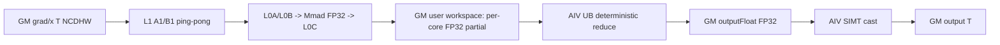
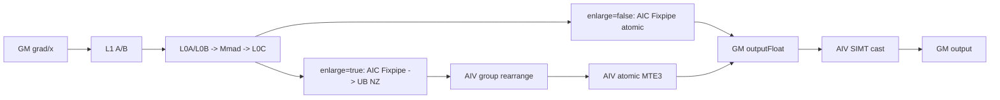
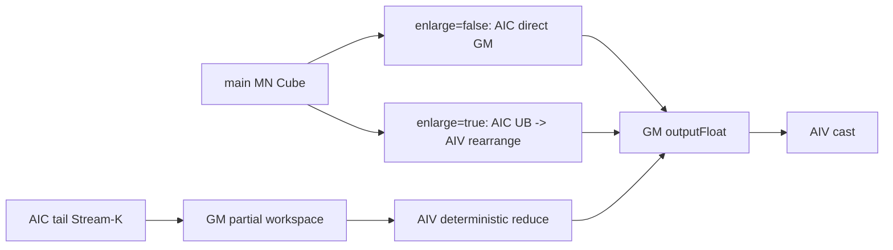
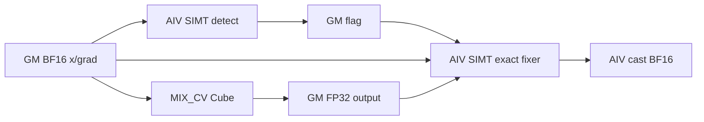
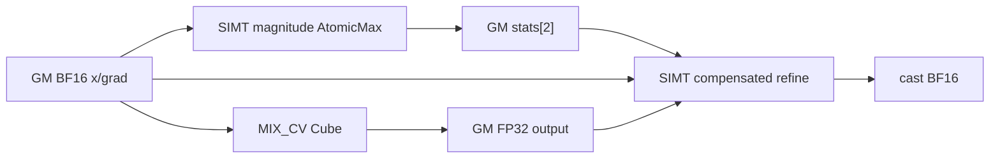

# Conv3DBackpropFilter 950 Direct Invoke 算子知识

## 算子速览

| 项目 | 内容 |
|---|---|
| 实际入口 | `cann_bench::conv_3d_backprop_filter`（Torch schema）→`conv3d_bpf_npu`→`launch_conv3d_bpf_half`/`launch_conv3d_bpf_bf16`，Direct Invoke |
| 计算语义 | 对 `N×Dout×Ho×Wo` 做乘积归约，生成 `[Cout,Cin/groups,Kd,Kh,Kw]` 的 filter gradient；主 Kernel 以 FP32 累加，Direct 图最后 cast 为输入 dtype |
| 输入输出 | contiguous NCDHW；`x`/`grad` 同为 FP16 或 BF16；Direct 输出同 dtype，shape 由 `filter_size` 指定 |
| 执行类型 | 主节点 `MIX_CV`（AIC Cube + AIV 初始化/Stream-K 确定性归约）；后继 cast 与 BF16 条件修正节点为 `AIV_VECTOR/SIMT` |
| Kernel 路线 | active：P0/R-001 纯 Stream-K、P1/R-002 MN/no-Stream、P2/R-003 MN+尾轮 Stream-K；conditional：P3/R-004 BF16 nonfinite、P4/R-005 BF16 cancellation；dormant：P5/R-006 Winograd |
| 核心资源 | GM 输入/FP32 中间/最终输出；16 MiB system workspace；Stream-K 双片 workspace；L1/L0A/L0B/L0C；整块 UB；SIMT 寄存器 |
| 来源闭包 | `direct_implementation_closed`：Direct schema/launcher、显式 tiling/POD、8 个官方 arch35 模板实例、MIX_CV body、条件 AIV 节点与构建平台映射闭合；官方源码 URL 使用固定提交映射，Direct 改写关系在正文逐项说明 |
| 证据边界 | 正文闭合固定官方源码与 Direct 转换源码可静态追踪的关系；运行时等价性、时延与吞吐不由源码阅读单独推出。 |

## 接口与语义

### 计算语义

令 `ci_g=Cin/groups`，输出线性布局为 NCDHW 风格的 `[Cout,ci_g,Kd,Kh,Kw]`。对合法输入坐标：

```text
dxw[co,ci_local,kd,kh,kw] =
  Σ_n Σ_od Σ_oh Σ_ow
    x[n, group(co)*ci_g+ci_local,
      od*stride_d-pad_front+kd*dilation_d,
      oh*stride_h-pad_up+kh*dilation_h,
      ow*stride_w-pad_left+kw*dilation_w]
    * grad[n,co,od,oh,ow]
```

越界的 `x` 坐标按 padding 零处理。每个 real group 的逻辑矩阵维是 `M=merged_Cout`、`N=merged_Cin*Kh*Kw`、`K=Ho*Wo`，物理 M/N 再按 C0=16 对齐；`N×Dout` 由外层归约，`Kd` 与 real group 进入基本块索引。FP16/BF16 乘法均累加到 FP32 `outputFloat`，Direct 图再转换为 FP16/BF16。BF16 的可选修正严格位于主 Cube 前后：输入扫描→主 FP32 计算→低幅值补偿归约→nonfinite 分类修正→最终 cast。

### 输入、输出与属性

| 参数 | shape/layout | dtype | 约束、默认值与语义 |
|---|---|---|---|
| `x` | `[N,Cin,Di,Hi,Wi]`，contiguous NCDHW | FP16/BF16 | rank 5；与 `grad` 同设备、同 dtype |
| `grad` | `[N,Cout,Dout,Ho,Wo]`，contiguous NCDHW | FP16/BF16 | batch 与 `x` 相等；空间维必须满足卷积输出公式 |
| `strides` | `[sd,sh,sw]` | int64 Host 属性 | 长度 3，所有值正数 |
| `pads` | `[front,back,up,down,left,right]` | int64 Host 属性 | 长度 6，所有值非负 |
| `dilations` | `[dd,dh,dw]` | int64 Host 属性 | 长度 3，所有值正数；某核轴长度为 1 时 Direct tiler 将对应 dilation 归一为 1 |
| `groups` | 标量 | int64 | `[1,65535]`；整除 `Cin` 和 `Cout` |
| `filter_size` | `[Cout,Cin/groups,Kd,Kh,Kw]` | int64 Host 数组 | 长度 5、均正；前两维必须与输入 channel/group 一致 |
| `outputFloat` | 同 `filter_size`，ND/NCDHW 线性 | FP32 | Direct 内部 GM 中间；主 MIX_CV 的正式输出 |
| `output` | 同 `filter_size`，ND/NCDHW 线性 | FP16/BF16 | Direct 对外输出；由独立 AIV cast 节点写入 |

空间一致性：`Dout=(Di+pf+pb-dd*(Kd-1)-1)/sd+1`，H/W 同理，且三个结果均正。所有维度进入 tiler 前还必须在 `(0,0x7ffffffe]`；乘积计算使用 64 位，但 serialized official POD 的 shape/tile 字段为 32 位。

### 入口与版本

该入口不是 ACLNN。`TORCH_LIBRARY_FRAGMENT` 声明 schema，PrivateUse1 实现 `conv3d_bpf_npu` 完成校验、分配、tiling 与同 stream launch；`OpCommand::RunOpApi("Conv3DBackpropFilterDirect950", aclCall)` 只包裹 Direct 提交。目标为 CANN 9.1.0、950/950、`dav-3510`。

转换来源以最终 Direct 载荷为准：其中 `official_arch35/**` 是官方 `conv/conv3d_backprop_filter_v2/op_kernel/arch35` 的当前源码闭包；context-free tiler转写官方 basic-block/Stream-K Host 算法，去掉 registry、knowledge-bank 与 `TilingContext`；Device 侧把官方 `GET_TPL_TILING_KEY` 变成三个显式值 `route/split_kernel_hw/group_enlarge`。固定提交映射仍保留 `stepM/stepN` 两个 POD 字段，而最终 Direct POD 对应更新后的官方 ABI，二者固定为 1 后已移除；因此不得把旧 POD 按字节传给 Direct entry。官方接口输出 FP32，而该 Direct 包装额外创建 FP32 中间并 cast 为输入 dtype，这是 Direct contract，不外推为官方 ACLNN 行为。

## Host/Launcher 执行流程

### 参数校验与前处理

`conv3d_bpf_npu` 的顺序是：同设备→rank/dtype/contiguous→属性长度→groups/channel/filter shape→stride/dilation/pad 取值→D/H/W 输出公式→填 `Conv3dBpfProblem`→从当前线程/设备取得 AIC/AIV 数→`calc_conv3d_bpf_tiling`→检查 `valid` 与 workspace 的 `int64_t` 上界→分配 `output`、FP32 `outputFloat`、byte workspace。它不执行 Contiguous、View 或 TransData；不连续输入直接失败。

### 参数、Workspace 与生命周期

`Conv3dBpfProblem` 与 `Conv3dBpfLaunchTiling` 均按值复制到 Direct wrapper/kernel。`outputFloat` 与 workspace 在当前 NPU stream 上 `recordStream`，owner 是框架 Tensor；Host 函数返回后仍保持到 stream 完成。

```text
system_prefix = 16 * 1024 * 1024 B
streamk_user  = streamkType!=0 ? 2 * usedCoreNum * L0C_bytes : 0
fix_slice     = (bf16_nonfinite_fix || bf16_cancellation_fix) ? 32 B : 0
workspace_total = system_prefix + streamk_user + fix_slice
nonfinite_flag_offset = system_prefix + streamk_user
output_elements = Cout * (Cin/groups) * Kd * Kh * Kw
```

主 entry 先 `SetSysWorkspaceForce(workspace)`，再以 `workspace+16 MiB` 作为官方 user workspace。Stream-K 的每核单片是 `TOTAL_L0C_SIZE` 字节，双片分别供 Cube partial 与 Vector 确定性归约。最后 32 B 同时作为 `uint32 flag[2]` 或 `uint32 magnitude_stats[2]`；两个 BF16 策略若同时被置位会复用并覆写该 slice，最终载荷没有显式互斥断言，复用次序是限制边界。

### 启动图与失败传播

```text
cann_bench::conv_3d_backprop_filter
  -> conv3d_bpf_npu / CheckAndInfer / SetRuntimeCoreCounts
  -> OfficialArch35Tiler::Run
  -> optional AIV clear + detect_nonfinite_bf16
  -> optional AIV clear + detect_magnitude_bf16
  -> MIX_CV conv3d_bpf_{half|bf16}_entry
       AIV: clear FP32 output -> flag 9
       AIC: wait flag 9 -> GM/L1/L0 Cube
       Stream-K tail: AIC partial workspace <-> AIV deterministic reduce
  -> optional AIV refine_cancellation_bf16
  -> optional AIV fix_nonfinite_bf16
  -> AIV cast_fp32_to_{half|bf16}
  -> output
```

所有节点提交到同一 stream，跨 kernel 可见性依赖同 stream 顺序；主 MIX 内部使用 cross-core flag 与 pipe event。Host 校验或 tiler 返回 `valid=0` 时不启动。wrapper 的 `<<<...>>>` 没有逐节点返回码检查，lambda 固定返回 0；异步 launch/device 错误由 runtime/stream 边界传播，源码不会在前驱失败后显式取消已排队后继。

## Route 与参数设计

### 分核与资源计算

`mag_factor` 先尝试把多个 group 合并到 16 对齐的 real group。随后：

```text
M = ceil((mag_factor*Cout/groups)/16) * 16
N = kh * kw * ceil((mag_factor*Cin/groups)/16) * 16
K = ho * wo
mCnt = ceil(M / singleCoreM)
nCnt = ceil(N / singleCoreN)
totalCnt = mCnt * nCnt * kd * realGroup
```

`baseM/baseN` 从不超过 256 的 16 对齐分块开始；`baseN` 保持 `Kh*Kw*16` 相关对齐。`baseK` 同时受 `L0A/(baseM*2*2)`、`L0B/(baseN*2*2)`、`align_up(K,16)` 与 `splitWo` 对齐约束。`dbL0C=2` 当且仅当 `2*baseM*baseN*4<=L0C`，否则为 1。L1 以 `depthA1=depthB1=16`、双缓冲起步，对称递减；不足时关双缓冲并重试，再 shrink K/M/N。最终 guard 是 `2*al1Bound*al1Pbuffer + 2*bl1Bound*bl1Pbuffer <= L1_bytes`。

`totalCnt<runtime_aic` 时优先纯 Stream-K；否则 MN 分核。尾块数 `tail=totalCnt%runtime_aic` 为 0 或大于半数时关闭 Stream-K；否则在 BatchDout 与 HWout 切分中选择分核更多、尾块比例更优者。无 Stream-K 时 `route` 强制为 MN。

### Route 选择

重要性只规定本文的阅读与迁移顺序，不改写 selector 或 launcher 的源码次序。可达性按最终 Direct Host、POD、启动器和 Device TU 的交集分类：R-001、R-002、R-003 是 active 且互斥的主 Route；R-004、R-005 是 conditional，可在已选主 Route 上附着；R-006 只有随包源码与官方 key 枚举，没有 Direct producer 或 entry，故为 dormant。

| 重要性 | 可达性 | Route | 关键特征 | 排序依据 | Host 顺序 |
|---|---|---|---|---|---|
| P0 | active | R-001 纯 Stream-K | 纯 Stream-K 调度；AIC partial；AIV 确定性归约；双片 user workspace | selector 的独立首分支，同时决定 Cube/Vector 交接、workspace 与性能调度 | H1 生成 `route=1,streamkType=1/2`；H4 router 首分支；随后 H6 cast |
| P1 | active | R-002 MN/no-Stream | MN grid-stride；FP32 atomic/Fixpipe；无 Stream-K user workspace | 覆盖所有关闭或退化 Stream-K 的合法主域，是唯一主路径安全落点 | H1 生成 `route=2,streamkType=0`；H4 `route!=1`；随后 H6 cast |
| P2 | active | R-003 MN+尾轮 Stream-K | MN 完整轮加 Stream-K 尾轮；主输出与双片 workspace 串接 | 在大于等于一整轮时保留小尾轮并行，需要前两条协议共同闭合 | H1 生成 `route=2,streamkType=1/2`；H4 MN 主轮后读 `streamkType`；随后 H6 cast |
| P3 | conditional | R-004 BF16 nonfinite 扩展 | channel tail、padding、HWout Stream-K；特殊值位级分类与修正 | 改变特殊值语义并跨越主 Cube 前后，只在精确 guard 命中时附着 | H2 flag；H3a clear/detect；H4 主 Route；H5b fix；H6 cast |
| P4 | conditional | R-005 BF16 cancellation 扩展 | groups=1；大归约和大输出；幅值扫描与补偿重算 | 不改变主 tile，只对低幅有限输出条件重算 | H2 flag；H3b clear/detect；H4 主 Route；H5a refine；H6 cast |
| P5 | dormant | R-006 Winograd | canonical 随包较新闭包存在 Winograd 顶层模板分支；Direct TU 未纳入 | 不在 Direct selector 可达域，不参与运行排序；仅保留恢复入口所需边界 | 无 Host 顺序；当前从 H0 即不可选 |

真实 Host selector/launcher 次序如下；表中短路只发生在当前阶段，不能把 R-004/R-005 误当成替代主 Route 的 fallback。

| Host 顺序 | Host/Device 决策点 | 精确顺序、短路与 fallback |
|---|---|---|
| H0 | `OfficialArch35Tiler::Run` 前半 | `Validate`→`CalcRealGroup`→shape/basic-block→`InitSplitWOI`→`MultiCoreSplitMN`；校验失败或所有资源降级均失败时立即返回 `valid=0`，不进入任何 Route |
| H1 | `DoStreamKTiling` | 先令 `route=(totalCnt<AIC ? 1 : 2)`；若 `tail==0 \|\| tail>AIC/2`，直接置 `streamkType=0,route=2`；否则先比较 BatchDout/HWout，再执行所选切分；切分维退化或 HWout L1 回调失败时置 `streamkType=0,route=2`。最终 `route==1` 是 R-001；`route==2 && streamkType==0` 是 R-002；`route==2 && streamkType!=0` 是 R-003 |
| H2 | `Run` 后半 | 在 H1 已定主 Route 后，先计算 R-004 flag，再 `WriteFinalTiling`，然后计算 R-005 flag；两者独立，不互相 `else` 短路；谓词为假仅省略对应扩展，主 Route 保持不变 |
| H3 | BF16 前置 launch | 先判断 R-004：命中则 clear→detect nonfinite；再判断 R-005：命中则再次 clear→detect magnitude。FP16 跳过整个 H3 |
| H4 | main launch/router | FP16/BF16 均只提交一次主 MIX_CV。Device 先判断 `route==1` 并进入 R-001；否则进入共同 MN 模板，`streamkType==0` 执行 R-002，非零则在主轮后执行 R-003 尾轮；`split` 后判 `enlarge` 选择唯一 specialization |
| H5 | BF16 后置 launch | 先判断 R-005 并可提交 refine，再判断 R-004 并可提交 fix；两者均不替换主 Route。FP16 跳过整个 H5 |
| H6 | final cast | FP16 直接在 H4 后 cast；BF16 在 H5 后 cast。此前任一 `if` 为假只短路该条件节点，不短路 cast |

R-006 不在上表的 H0–H6 图中：Direct main TU 直接包含 `conv3d_dw_v2_basic_block.h`，并按 `route/split_kernel_hw/group_enlarge` 实例化 8 组 basic-block 模板；它没有纳入 canonical 随包较新闭包中承载 Winograd 分支的 arch35 entry，也没有生成 Winograd 编译期 key。Frontmatter 固定到 `955f8b33985b6d72989ebff341bb9c2c564a51bc` 的 key 与 router 不含 Winograd，不能用来证明 R-006；本 Route 只陈述 canonical 转换载荷中的较新随包源码事实。

```text
validate -> groupEnlarge guard -> normal/splitW/splitKernelHW tiling
totalCnt = ceil(M/singleM)*ceil(N/singleN)*Kd*realGroup
if tail==0 or tail>AIC/2: route=MN, streamkType=0
else choose BatchDout(1) vs HWout(2)
     if split invalid or dimension==1: route=MN, streamkType=0
     else route = totalCnt<AIC ? STREAM_K : MN_STREAM_K
attach BF16 nonfinite/cancellation pre/post nodes by their independent guards
Winograd template flags exist only in the canonical newer bundled closure;
Direct selector emits no corresponding key
```

每个主 Route 再由 `split_kernel_hw∈{0,1}` 与 `group_enlarge∈{0,1}` 唯一实例化，共 8 个官方 arch35 compile-time key；dtype 再选择 `T=half` 或 `T=bfloat16_t`，输出模板固定为 `float`。

### 模板/实现执行矩阵

| 重要性 | 可达性 | Route | key/selector | dtype/shape/platform 完整命中条件 | Host 顺序 | 执行族与 kernel 节点 | 实际模板/body | 内存与同步特征 | tail/fallback |
|---|---|---|---|---|---|---|---|---|---|
| P0 | active | R-001 纯 Stream-K | `route=1 × split{0,1} × enlarge{0,1}` | 950；FP16/BF16；`totalCnt<AIC` 且 `0<tail<=AIC/2`，切分维有效且资源复核通过 | H1→H4 `route==1`→H6 | MIX_CV main→AIV cast；BF16 可附加修正节点 | `Conv3dDwBasicBlockStreamK<T,NCDHW,T,NCDHW,float,NCDHW,split,enlarge>` | AIC partial→per-core workspace；AIV deterministic reduce；CrossCore flags | K/BatchDout tail；Stream-K 失效改 R-002 |
| P1 | active | R-002 MN/no-Stream | `route=2,streamkType=0 × split × enlarge` | 合法输入且无合格 Stream-K 尾轮 | H1 fallback→H4 `route!=1` 且 body 读 `streamkType=0`→H6 | MIX_CV main→AIV cast | `Conv3dDwBasicBlockMNStreamK<...>` 的主轮 | `enlarge=false`：AIC Fixpipe/atomic→GM；`enlarge=true`：AIC L0C→UB，mode-4 flags 5/6 交给 AIV 重排并 atomic→GM | M/N/group/channel/Kd/Ho 尾块；enlarge 资源 guard 失败改 `false`；tiling 无安全块则失败 |
| P2 | active | R-003 MN+尾轮 Stream-K | `route=2,streamkType∈{1,2} × split × enlarge` | `totalCnt>=AIC` 且 `0<tail<=AIC/2`，切分维有效且资源复核通过 | H1→H4 `route!=1` 且 body 读 `streamkType!=0`→H6 | MIX_CV main+tail→AIV cast | 同 R-002，`CalBasicBlock` 后 `CalcStreamK` | 主轮沿用 R-002 的 direct-GM 或 group UB 重排；尾轮使用双片 workspace 与确定性归约 | 主轮 round + 尾轮；enlarge guard 失败改 `false`；Stream-K 无效改 R-002 |
| P3 | conditional | R-004 BF16 nonfinite | R-001/R-003 + nonfinite guard | BF16、channel tail、padding、`streamkType=2` | H2 flag→H3a clear/detect→H4→H5b fix→H6 | AIV clear→AIV SIMT detect→MIX_CV→AIV SIMT fix→AIV cast | `DetectNonfiniteBf16Vf`、主模板、`FixNonfiniteBf16Vf` | 32 B flag；1024 threads/block；修正输出单元逐点标量归约 | guard false 省略扩展；`flag==0` 时 fixer 立即返回；主 Route 不变 |
| P4 | conditional | R-005 BF16 cancellation | R-001/R-003 + cancellation guard | BF16、groups=1、reduction≥65536、output≥2097152、`streamkType!=0` | H2 flag→H3b clear/detect→H4→H5a refine→H6 | AIV clear→AIV SIMT magnitude→MIX_CV→AIV SIMT compensated refine→cast | `DetectMagnitudeBf16Vf`、主模板、`RefineCancellationBf16Vf` | stats 两个 AtomicMax；仅低幅有限值做 Kahan 风格重算 | guard false 省略扩展；幅值阈值外保留 Cube 结果；主 Route 不变 |
| P5 | dormant | R-006 Winograd | canonical 新闭包的 `WinoTilingFlag/WinoResidentFlag` 为编译期模板量；Direct 无对应 key/实例 | 当前 Direct 输入域无可达谓词 | 无 | 无 Direct launch | 随包 `Conv2dDwWinograd` 源码未被 main TU 实例化 | 复用 248 B official POD；变换 workspace 未进入 Direct sizing；保持不可选 |

### 生产 Guard 与退化边

| Guard | Host/Tiling 条件 | Device/资源原因 | 影响 Route | 不满足时去向 | 源码符号 |
|---|---|---|---|---|---|
| Direct ABI 输入 | 正维≤`0x7ffffffe`，pad≥0，group 整除，空间公式相等，`AIV>=AIC>0` | POD 字段窄化与 MIX 1:2 核配比 | 全部 | `valid=0` | `OfficialArch35Tiler::Validate` |
| group enlarge | `mag>1` 且 L0C、UB、256×256 basic block、L1 全满足 | 合并 group 后必须全载并允许 AIV 重排 | 4 个 `enlarge=true` key | `enlarge=false` | `CalcRealGroup` |
| large spec | `kh/kw/dilationH/W>255` 或 strideH/W>63 或 pad>255 或 `kh*kw*16>65536` | 普通 Load3D 字段范围 | `split=true` | split kernel+W；仍超 L1 则失败 | `CheckLargeSpecs/TrySplitKernel` |
| L1 | `2*al1Bound*dbA+2*bl1Bound*dbB<=L1` | A/B L1 ping-pong 不能越界 | 全部 Cube key | depth 降级→关 DB→shrink tile→splitW→splitKernelW→失败 | `SetStepK4SplitMN/IsCurBlockL1Invalid` |
| L0A/B | `baseK<=min(L0A/(baseM*4),L0B/(baseN*4))`，16 对齐 | 两个 dtype=2 B 的 L0 ping-pong | 全部 Cube key | 缩 `baseK` | `GetBaseK` |
| L0C DB | `2*baseM*baseN*4<=L0C` | FP32 accumulator 双缓冲 | 全部 Cube key | `cl0Pbuffer=1` | `InitBaseBlock` |
| Stream-K tail | `0<totalCnt%AIC<=AIC/2` | 只拆尾轮，避免多数核已有完整 tile 时额外归约 | R-001/R-003 | R-002 | `DoStreamKTiling` |
| HWout L1 recheck | HWout 切 K 后 `stepKa/stepKb` 递减可满足 L1 | 新 `singleCoreK/baseK` 改变 L1 bound | Stream-K type 2 | 回退 R-002 | `AdjustStepKForL1` |
| skipped flag count | 连续 skip 每 14 次 `PipeBarrier<PIPE_ALL>` | CrossCoreSetFlag 计数器最多 15 次 | R-001/R-003 | 原 route 内节流 | `CalcIterate::barrierThreshold` |
| BF16 nonfinite | channel tail、任一 padding、`streamkType==2` | padding/tail special-value 语义修正 | R-004 | 不启动 sidecar | `useBf16NonfiniteFix` |
| BF16 cancellation | groups=1、大 reduction/output、Stream-K | 只重算可能被抵消的低幅输出 | R-005 | 不启动 sidecar | `useBf16CancellationFix` |
| Winograd selector | Direct tiler 不生成 canonical 新闭包的 tile/resident 编译期 key，main TU 不实例化 Winograd entry，workspace 未按 shape 计入 | 现有 248 B official POD 已提供 shape；缺口在 key、entry 与容量，不在 POD 字段 | R-006 | 保持 dormant；不猜测映射到 basic-block key | canonical 新闭包顶层模板与 Direct `RunSelectedOfficialConv3dBpf` 对照 |

### POD/ABI

`Conv3dBpfProblem`：`sizeof=208`、`alignof=8`；前 25 个字段为连续 `int64_t`，最后两个 core 字段为 `uint32_t`。`Conv3dBpfLaunchTiling`：最终 Direct `official` 为 248 B，整个结构 `sizeof=304`、`alignof=8`。固定提交官方 POD 含额外 `stepM/stepN`，为旧 ABI；Direct 不接收它。canonical 新闭包的 Winograd body 同样读取现有 248 B `TConv3DDwTiling` 中的 batch/channel/H/W/pad/hf32 字段；tile 组合与 resident 目标由 `WinoTilingFlag/WinoResidentFlag` 编译期模板参数决定，`transX/transDy/nk1c1k0c0/tailGm` offsets 由这些 shape 和模板量在 Device 推导。故 R-006 的不可达原因不是 304 B launch POD 缺少变换字段，也不要求扩展 POD。

| 结构 | 字段 | 类型/位宽 | ABI 布局 | 单位 | Host/launcher producer | Device consumer | 边界 |
|---|---|---|---|---|---|---|---|
| `Conv3dBpfProblem` | `n` | int64/64 | off 0 | 元素维 | `x.size(0)` | BF16 sidecar/tiler | 正数、32 位可序列化 |
| 同上 | `cin` | int64/64 | off 8 | channel | `x.size(1)` | tiler/sidecar | group 整除 |
| 同上 | `di` | int64/64 | off 16 | 元素维 | `x.size(2)` | tiler/sidecar | 正数 |
| 同上 | `hi` | int64/64 | off 24 | 元素维 | `x.size(3)` | tiler/sidecar | 正数 |
| 同上 | `wi` | int64/64 | off 32 | 元素维 | `x.size(4)` | tiler/sidecar | 正数 |
| 同上 | `cout` | int64/64 | off 40 | channel | `grad.size(1)` | tiler/sidecar | group 整除 |
| 同上 | `dout` | int64/64 | off 48 | 元素维 | `grad.size(2)` | tiler/sidecar | 公式匹配 |
| 同上 | `ho` | int64/64 | off 56 | 元素维 | `grad.size(3)` | tiler/sidecar | 公式匹配 |
| 同上 | `wo` | int64/64 | off 64 | 元素维 | `grad.size(4)` | tiler/sidecar | 公式匹配 |
| 同上 | `kd` | int64/64 | off 72 | 元素维 | `filter_size[2]` | tiler/sidecar | 正数 |
| 同上 | `kh` | int64/64 | off 80 | 元素维 | `filter_size[3]` | tiler/sidecar | 正数 |
| 同上 | `kw` | int64/64 | off 88 | 元素维 | `filter_size[4]` | tiler/sidecar | 正数 |
| 同上 | `stride_d` | int64/64 | off 96 | 元素步长 | `strides[0]` | tiler/sidecar | 正数 |
| 同上 | `stride_h` | int64/64 | off 104 | 元素步长 | `strides[1]` | tiler/sidecar | 正数 |
| 同上 | `stride_w` | int64/64 | off 112 | 元素步长 | `strides[2]` | tiler/sidecar | 正数 |
| 同上 | `pad_front` | int64/64 | off 120 | 元素 | `pads[0]` | tiler/sidecar | 非负 |
| 同上 | `pad_back` | int64/64 | off 128 | 元素 | `pads[1]` | tiler/sidecar | 非负 |
| 同上 | `pad_up` | int64/64 | off 136 | 元素 | `pads[2]` | tiler/sidecar | 非负 |
| 同上 | `pad_down` | int64/64 | off 144 | 元素 | `pads[3]` | tiler/sidecar | 非负 |
| 同上 | `pad_left` | int64/64 | off 152 | 元素 | `pads[4]` | tiler/sidecar | 非负 |
| 同上 | `pad_right` | int64/64 | off 160 | 元素 | `pads[5]` | tiler/sidecar | 非负 |
| 同上 | `dilation_d` | int64/64 | off 168 | 元素步长 | `dilations[0]` | tiler/sidecar | 正数 |
| 同上 | `dilation_h` | int64/64 | off 176 | 元素步长 | `dilations[1]` | tiler/sidecar | 正数 |
| 同上 | `dilation_w` | int64/64 | off 184 | 元素步长 | `dilations[2]` | tiler/sidecar | 正数 |
| 同上 | `groups` | int64/64 | off 192 | group 数 | `groups` | tiler/sidecar | `[1,65535]` |
| 同上 | `runtime_aic_cores` | uint32/32 | off 200 | AIC 核 | ACL runtime/device capability | tiler | 0 表示使用平台值 |
| 同上 | `runtime_aiv_cores` | uint32/32 | off 204 | AIV 核 | ACL runtime/device capability | tiler/SIMT launch | `>=AIC` |
| `TConv3DDwTiling` | `batch` | uint32/32 | off 0 | batch | `SetShapeAttrs` | offset/loop | `n` 窄化后 |
| 同上 | `cin` | uint32/32 | off 4 | channel | 同上 | B/C offset | group 整除 |
| 同上 | `cout` | uint32/32 | off 8 | channel | 同上 | A/C offset | group 整除 |
| 同上 | `cin1G` | uint32/32 | off 12 | channel/real group | `CalcRealGroup` | M/N/group tail | raw channel，不是 C0 block |
| 同上 | `cout1G` | uint32/32 | off 16 | channel/real group | 同上 | M/group tail | raw channel |
| 同上 | `dout` | uint32/32 | off 20 | 元素维 | `SetShapeAttrs` | batchDout offset | 正数 |
| 同上 | `ho` | uint32/32 | off 24 | 元素维 | 同上 | K/Load3D | 正数 |
| 同上 | `wo` | uint32/32 | off 28 | 元素维 | 同上 | K/row split | 正数 |
| 同上 | `di` | uint32/32 | off 32 | 元素维 | 同上 | B offset | 正数 |
| 同上 | `hi` | uint32/32 | off 36 | 元素维 | 同上 | Load3D | 正数 |
| 同上 | `wi` | uint32/32 | off 40 | 元素维 | 同上 | Load3D/stride | 正数 |
| 同上 | `dk` | uint32/32 | off 44 | 元素维 | 同上 | block map/C offset | 正数 |
| 同上 | `hk` | uint32/32 | off 48 | 元素维 | 同上 | N/Load3D | 正数 |
| 同上 | `wk` | uint32/32 | off 52 | 元素维 | 同上 | N/Load3D | 正数 |
| 同上 | `group` | uint32/32 | off 56 | group 数 | `CalcRealGroup` | group branch | `[1,65535]` |
| 同上 | `realGroup` | uint32/32 | off 60 | 合并后 group | `CalcRealGroup` | block map | `ceil(group/mag)` |
| 同上 | `strideD` | uint32/32 | off 64 | 元素步长 | `SetShapeAttrs` | D offset | 正数 |
| 同上 | `strideH` | uint32/32 | off 68 | 元素步长 | 同上 | Load3D H | 正数 |
| 同上 | `strideW` | uint32/32 | off 72 | 元素步长 | 同上 | Load3D W | 正数 |
| 同上 | `padFront` | uint32/32 | off 76 | 元素 | 同上 | D tail | 非负 |
| 同上 | `padBack` | uint32/32 | off 80 | 元素 | 同上 | D shape | 非负 |
| 同上 | `padUp` | uint32/32 | off 84 | 元素 | 同上 | Load3D H | 非负 |
| 同上 | `padDown` | uint32/32 | off 88 | 元素 | 同上 | H shape | 非负 |
| 同上 | `padLeft` | uint32/32 | off 92 | 元素 | 同上 | Load3D W | 非负 |
| 同上 | `padRight` | uint32/32 | off 96 | 元素 | 同上 | W shape | 非负 |
| 同上 | `dilationD` | uint32/32 | off 100 | 元素步长 | 同上 | D offset | 核轴为 1 时为 1 |
| 同上 | `dilationH` | uint32/32 | off 104 | 元素步长 | 同上 | Load3D H | 核轴为 1 时为 1 |
| 同上 | `dilationW` | uint32/32 | off 108 | 元素步长 | 同上 | Load3D W | 核轴为 1 时为 1 |
| 同上 | `channelSize` | uint32/32 | off 112 | 元素 | `Run:16` | align helper | 16 |
| 同上 | `al0Pbuffer` | uint32/32 | off 116 | buffer depth | `Run:2` | L0A | 2 |
| 同上 | `bl0Pbuffer` | uint32/32 | off 120 | buffer depth | `Run:2` | L0B | 2 |
| 同上 | `cl0Pbuffer` | uint32/32 | off 124 | buffer depth | `InitBaseBlock` | L0C ping-pong | 1/2 |
| 同上 | `al1Pbuffer` | uint32/32 | off 128 | buffer depth | `SetStepK4SplitMN` | A1 buffers | 1/2 |
| 同上 | `bl1Pbuffer` | uint32/32 | off 132 | buffer depth | 同上 | B1 buffers | 1/2 |
| 同上 | `baseM` | uint32/32 | off 136 | 元素 | `WriteFinalTiling` | L1A/L0A/Mmad | 16 对齐 |
| 同上 | `baseK` | uint32/32 | off 140 | 元素 | 同上 | A/B L0/Mmad | 16 对齐 |
| 同上 | `baseN` | uint32/32 | off 144 | 元素 | 同上 | L1B/L0B/Mmad | 16 对齐 |
| 同上 | `m0` | uint32/32 | off 148 | 元素 | `Run:16` | A fractal | 16 |
| 同上 | `k0` | uint32/32 | off 152 | 元素 | `Run:16` | K fractal | 16 |
| 同上 | `n0` | uint32/32 | off 156 | 元素 | `Run:16` | B fractal | 16 |
| 同上 | `stepKa` | uint32/32 | off 160 | baseK 块 | `UpdateStepMNK` | A1 reuse loop | ≥1 |
| 同上 | `stepKb` | uint32/32 | off 164 | baseK 块 | 同上 | B1 reuse loop | ≥1 |
| 同上 | `iterateOrder` | uint32/32 | off 168 | enum | `M>N?1:0` | MN scheduler | 0/1 |
| 同上 | `bl1Bound` | uint32/32 | off 172 | dtype 元素 | `CalBL1Bound` | B1 `InitBuffer` | 乘 2 B 得字节 |
| 同上 | `al1Bound` | uint32/32 | off 176 | dtype 元素 | `CalAL1Bound` | A1 `InitBuffer` | 乘 2 B 得字节 |
| 同上 | `hf32Flag` | uint32/32 | off 180 | bool | Direct 固定 0 | Mmad config | FP16/BF16 route 为 0 |
| 同上 | `singleCoreDk` | uint32/32 | off 184 | Kd tile | Direct 固定 1 | block map | 1 |
| 同上 | `singleCoreGroup` | uint32/32 | off 188 | real group tile | Direct 固定 1 | block map | 1 |
| 同上 | `singleCoreCout` | uint32/32 | off 192 | channel | `singleCoreM` | offset/tail | 16 对齐主体 |
| 同上 | `singleCoreHo` | uint32/32 | off 196 | Ho 行 | `singleCoreK/wo` | Stream-K start | 整行切分 |
| 同上 | `splitWo` | uint32/32 | off 200 | Wo 元素 | split tiling | GM→L1 | 主块/尾块另算 |
| 同上 | `streamkType` | uint32/32 | off 204 | enum | `DoStreamKTiling` | Stream router | 0/1/2 |
| 同上 | `usedCoreNum` | uint32/32 | off 208 | AIC 核 | runtime AIC | block guard | >0 |
| 同上 | `singleCoreM` | uint32/32 | off 212 | 元素 | tiler | M block/tail | 32 位 |
| 同上 | `singleCoreN` | uint32/32 | off 216 | 元素 | tiler | N block/tail | 32 位 |
| 同上 | `singleCoreK` | uint32/32 | off 220 | 元素 | tiler | K/Stream split | 32 位 |
| 同上 | `singleCoreBatch` | uint64/64 | off 224 | batch | Direct 固定 1 | base class | 1 |
| 同上 | `singleCoreCin` | uint64/64 | off 232 | channel | `l1Cin1*16` | offset/tail | 16 对齐主体 |
| 同上 | `singleCoreBatchDout` | uint64/64 | off 240 | batch*dout | Stream tiler | K partition | ≥1 |
| `Conv3dBpfLaunchTiling` | `official` | struct/248 B | off 0 | POD | `WriteFinalTiling` | main MIX_CV | Direct 更新 ABI |
| 同上 | `route` | uint32/32 | off 248 | enum | `coreBindDirection` | explicit router | 1/2 |
| 同上 | `split_kernel_hw` | uint32/32 | off 252 | bool | split tiler | template bool | 0/1 |
| 同上 | `group_enlarge` | uint32/32 | off 256 | bool | group guard | template bool | 0/1 |
| 同上 | `aic_cores` | uint32/32 | off 260 | AIC 核数 | runtime/platform | main launch | >0 |
| 同上 | `aiv_cores` | uint32/32 | off 264 | AIV 核数 | runtime/platform | SIMT launches | `>=AIC` |
| 同上 | `valid` | uint32/32 | off 268 | bool | `Run` | Host gate | 0/1 |
| 同上 | `bf16_nonfinite_fix` | uint32/32 | off 272 | bool | correction guard | Host graph | 0/1 |
| 同上 | `bf16_cancellation_fix` | uint32/32 | off 276 | bool | correction guard | Host graph | 0/1 |
| 同上 | `workspace_bytes` | uint64/64 | off 280 | 字节 | `Run` | allocator | 16 MiB+slice |
| 同上 | `output_elements` | uint64/64 | off 288 | 元素 | shape product | cast/sidecar | 64 位乘积 |
| 同上 | `nonfinite_flag_offset` | uint64/64 | off 296 | 字节 | workspace layout | sidecars | 指向末尾 32 B |

### Route 源码闭包

| 重要性 | 可达性 | Route | Key/selector | Host 顺序 | Host/Tiling producer | POD/参数 | Kernel entry/router | Kernel body/直接依赖 | 构建接线 |
|---|---|---|---|---|---|---|---|---|---|
| P0 | active | R-001 | `route=1,split,enlarge` | H1→H4 stream 分支→H6 | Direct `OfficialArch35Tiler`；官方映射 `DoStreamKTiling/GetTilingKey` | `Conv3dBpfLaunchTiling` + 248 B official POD | `conv3d_bpf_{half\|bf16}_entry`→`RunSelectedOfficialConv3dBpf` | `Conv3dDwBasicBlockStreamK`→ConvBp helper | ascend950 binary config |
| P1 | active | R-002 | `route=2,streamkType=0,split,enlarge` | H1 fallback→H4 MN 分支→H6 | `MultiCoreSplitMN/DoStreamKTiling` | 同上 | 同上，MN 分支 | `CalBasicBlock/IterateAll`；enlarge 时 `LoadL0c2UbForGroup/Rearrange2Gm` | 同上 |
| P2 | active | R-003 | `route=2,streamkType=1/2,split,enlarge` | H1→H4 MN 主轮与尾轮→H6 | 同上 | 同上 + user workspace | 同上，MN 分支 | 同 R-002 主轮 + `CalcStreamK/DeterministicReduceKInUb` | 同上 |
| P3 | conditional | R-004 | 主 key + nonfinite flag | H2→H3a→H4→H5b→H6 | Direct correction guard | `Conv3dBpfProblem` + flag slice | clear/detect→main→fix→cast entries | SIMT detectors/fixer + 官方 main body | Direct 950 target + official ascend950 config |
| P4 | conditional | R-005 | 主 key + cancellation flag | H2→H3b→H4→H5a→H6 | Direct correction guard | `Conv3dBpfProblem` + stats slice | clear/magnitude→main→refine→cast | SIMT AtomicMax/Kahan-like refine + 官方 main body | 同上 |
| P5 | dormant | R-006 | canonical 新闭包有 tile/resident 模板组合，Direct 无 selector/key | 无 | 无 Direct producer | 复用现有 248 B official POD | 无 Direct entry/router | 随包 Winograd body 未被 main TU 引用 | 不进入 Direct target 的可达调用图；固定 `955f` 来源不承载该 Route |

## Kernel 实现

### 公共执行流程

主 entry 使用 `KERNEL_TYPE_MIX_AIC_1_2`。AIV 先以 `Conv3dDwInitOutput<float>` 按最多 `blockDim` 核清零 FP32 输出，并经 AIV all-core flag→flag 9 通知 AIC；AIC 等待后进入官方模板。公共 Cube 链为 `grad GM→A1`、`x GM→B1(load3d/padding)`、`A1/B1→L0A/L0B→Mmad(float)→L0C`。非 Stream 主轮在 `group_enlarge=false` 时由 AIC Fixpipe/atomic 直接写 `outputFloat`；`group_enlarge=true` 时由 AIC Fixpipe 把 L0C 写到共享 UB，再经 mode-4 flags 5/6 交给 AIV `Rearrange2Gm(...,enAtomic=1)` 写 GM。Stream-K partial 先写 user workspace，由 AIV 从 GM 搬入 UB 做确定性归约并提交 FP32 输出。主 launch 完成后独立 AIV SIMT kernel cast 到对外 dtype。

### Route R-001：纯 Stream-K MIX_CV

#### 适用条件

重要性：P0；可达性：active。Host 顺序：H1 在 `totalCnt<AIC`、`0<tail<=AIC/2` 且所选切分有效时产生 `route=1,streamkType=1/2`，H4 Device router 首分支执行 Stream-K specialization，BF16 条件扩展完成后由 H6 cast。若 Stream-K tail gate、切分维或 HWout L1 回调不成立，H1 短路到 R-002。

##### 选择证据

| 层级 | 文件 | 符号 | 源码谓词/参数 | 结果/下一跳 |
|---|---|---|---|---|
| Tiling | `op_host/op_tiling/arch35/conv3d_backprop_filter_v2_stream_k_tiling.cpp` | `DoStreamKTiling` | `totalCnt<AIC` 且有效尾块 | `coreBindDirection=STREAM_K` |
| Direct router | 转换后的 main TU | `RunSelectedOfficialConv3dBpf` | `launchTiling.route==1` | `Conv3dDwBasicBlockStreamK` |
| Template | `op_kernel/.../conv3d_backprop_filter_v2_tiling_key.h` | 8 个 `ASCENDC_TPL_ARGS_SEL` | `split/enlarge` 二布尔 | 唯一 specialization |

#### Device 数据流

##### 函数级调用链

```text
conv3d_bpf_{half|bf16}_entry
 -> Conv3dDwInitOutput<float>::Process (AIV clear / AIC wait)
 -> Conv3dDwBasicBlockStreamK<T,...,split,enlarge>::Init
 -> Process -> CalcStreamK -> CalcIterate
    AIC: CalcIterateCube -> dw.Compute -> GM partial
    AIV: ClearWorkspace -> dw.Iterate -> DeterministicReduceKInUb -> outputFloat
 -> cast entry -> RunCastFp32<T>
```

##### 源码等价伪码

```text
AIV clear outputFloat; signal flag9
AIC wait flag9
map block to one tail (M,N,Kd,realGroup,K-slice or BatchDout-slice)
for each M/N sub-iteration:
  AIC wait vector-ready
  AIC: GM grad/x -> L1 -> L0A/B -> Mmad FP32 -> L0C
       Fixpipe partial -> workspace[core,slice]; notify AIV
  AIV: clear target workspace, notify AIC, wait AIC
       GM partials -> UB deterministic tree/add -> outputFloat
same-stream AIV SIMT: output = cast<T>(outputFloat)
```

#### 内存与数据搬运

##### 资源与搬运表

| 层级/缓冲区 | offset/地址公式 | extent/容量公式 | dtype/layout | producer | consumer | owner/lifetime | 对齐/复用 |
|---|---|---|---|---|---|---|---|
| GM `grad` A | NCDHW offsets by batch/dout/group/m | logical input | T/NCDHW | caller | GM→A1 DataCopy | input Tensor | M/K tail guarded |
| GM `x` B | NCDHW offsets by batch/din/group/cin | logical input | T/NCDHW | caller | GM→B1 Load3D/DataCopy | input Tensor | padding/stride/dilation |
| L1 A ping/pong | 0 / `L1/2` | `align32(al1Bound*2)` each | T/NZ-like Cube A | MTE2 | L0A | kernel | pong only `al1Pbuffer=2` |
| L1 B ping/pong | `alignA` / `L1/2+alignA` | `align32(bl1Bound*2)` each | T/load3d layout | MTE2 | L0B | kernel | pong only `bl1Pbuffer=2` |
| L0A/L0B | half-buffer by ping-pong bit | each total 65536 B platform default | T/Cube fractal | LoadData | Mmad | AIC | K loop复用 |
| L0C | ping/pong queue | `cl0Pbuffer*baseM*baseN*4` | FP32/NZ | Mmad | Fixpipe | AIC | 1/2 buffers |
| user workspace | `offsetCubeWorkSpaceC=(deterIndex+coreIndex*deterCoreNum)*(L0C/4)` float index | `2*AIC*L0C_bytes` | FP32/NZ partial | AIC Fixpipe | AIV reduce | workspace Tensor | 每核双片 |
| UB `vecBuf_` | UB base | `TOTAL_UB_SIZE`（平台默认 245760 B） | FP32/route-specific | MTE2/Vector | reduce/MTE3 | AIV | 整块复用，非额外叠加 |
| GM `outputFloat` | filter offset | `output_elements*4` | FP32/ND | AIV reduce | cast/sidecar | Tensor | stream-recorded |
| GM `output` | 同逻辑 index | `output_elements*2` | FP16/BF16 | SIMT cast | caller | Tensor | thread tail guard |

##### 分层内存布局



##### 字节账、交接边与复用顺序

```text
workspace_total = 16 MiB + 2*usedCoreNum*L0C_bytes + optional 32 B
L1_active = al1Bound*2*al1Pbuffer + bl1Bound*2*bl1Pbuffer <= L1_bytes
L0_active = L0A(64 KiB) + L0B(64 KiB) + cl0Pbuffer*baseM*baseN*4
UB_total = TOTAL_UB_SIZE
```

| 边/复用子区 | producer | offset/extent | dtype/layout | consumer | ordering/sync | owner/lifetime | 安全条件 |
|---|---|---|---|---|---|---|---|
| AIC partial→AIV | `GetTensorC(...,atomic=1,sequential=true)` | per-core L0C-sized slice | FP32/NZ | `DeterministicReduceKInUb` | flags 6/8，PIPE_FIX/MTE2/MTE3 | workspace/launch | AIV clear→notify→AIC write→notify |
| L1 ping↔pong | GM loader | fixed half-L1 offsets | T/internal | LoadData | MTE2/MTE1/M events | kernel | bound×depth≤L1 |
| L0C ping↔pong | Mmad | base tile | FP32 | Fixpipe | M/FIX flags；双方同轮翻转 | kernel | `cl0Pbuffer` 一致 |
| FP32→output | main/sidecar | full logical extent | FP32→T ND | cast VF | same stream | output tensors | `begin<count` 与 element tail |

#### 同步、精度与尾块

##### 同步与数值边界表

| 阶段 | primitive/机制 | producer | consumer/等待点 | 保护对象 | 精度/尾块 |
|---|---|---|---|---|---|
| output clear | AIV all-core flag + mode2 flag 9 | InitOutput | AIC wait PIPE_FIX | FP32 output | 32 FP32/128 B 对齐块，末核裁尾 |
| Vector→Cube | flags 2→6 | AIV clear workspace | `CubeWaitVector` | 当前 partial slice | 每 14 个空轮次全 pipe barrier |
| Cube→Vector | flags 4→8 | AIC Fixpipe | `VecWaitCube` | 当前 partial | skip 也必须发信号 |
| Cube math | MTE1_M/M_MTE1 | L0 loaders/Mmad | 下一缓冲复用 | L0A/B/C | T×T→FP32；K tail≥一行 Wo |
| final cast | same stream + SIMT grid stride | outputFloat | output | GM extent | C++ static cast；每 block 1024 threads |

#### 关键实现

##### 符号证据表

| 阶段 | 文件 | 符号/模板实例 | 实现事实 |
|---|---|---|---|
| Host/Tiling producer | `op_host/op_tiling/arch35/conv3d_backprop_filter_v2_stream_k_tiling.cpp` | `DoStreamKTiling/GetWorkspaceSize` | tail policy、切分类型、双片 workspace |
| Kernel entry/router | `op_kernel/arch35/conv3d_backprop_filter_v2_arch35.h` | `TPL_STREAM_K` | official template mapping与输出初始化 |
| Device body/helper | `op_kernel/arch35/.../conv3d_dw_v2_basic_block.h` | `CalcStreamK/CalcIterate/CubeNotifyVector` | AIC/AIV 交接、tail、确定性归约 |

### Route R-002：MN/no-Stream MIX_CV

#### 适用条件

重要性：P1；可达性：active。Host 顺序：H1 将关闭、退化或无有效尾轮的 Stream-K 统一落到 `route=2,streamkType=0`；H4 进入 MN specialization，body 只执行主轮，随后 H6 cast。若 `MultiCoreSplitMN` 的完整降级链仍找不到安全 tile，则在 H0 返回 invalid，不启动 Kernel。

##### 选择证据

| 层级 | 文件 | 符号 | 源码谓词/参数 | 结果/下一跳 |
|---|---|---|---|---|
| Tiling | stream-k Host file | `DoStreamKTiling` | `tail==0 \|\| tail>AIC/2` 或 Stream-K 无效 | `streamkType=0,route=2` |
| Router | Direct main TU | `RunOfficialConv3dBpf<T,false,split,enlarge>` | `route!=1` | MN template |
| Body | basic-block header | `CalBasicBlock` | `calRound=ceil(totalCnt/AIC)` | 主轮 grid-stride basic block |

#### Device 数据流

##### 函数级调用链

```text
main entry -> InitOutput<float>
 -> Conv3dDwBasicBlockMNStreamK::Process
 -> CalBasicBlock -> CalSingleBasicBlock
 -> CalcOffset/ReCalDkCinSingleCoreShape
 -> dw.SetSingleShape/SetFmap/SetOutBackprop
 -> dw.IterateAll(outputFloat, atomic=1)
    enlarge=false: AIC GetTensorC -> LoadL0c2Gm* -> outputFloat
    enlarge=true : AIV flag5 -> AIC LoadL0c2UbForGroup -> flag6
                   -> AIV Rearrange2Gm(outputFloat,enAtomic=1)
 -> AIV SIMT cast
```

##### 源码等价伪码

```text
basicBlock = block_idx
repeat ceil(totalCnt/AIC):
  decode basicBlock -> (mCore,nCore,dk,realGroup)
  for BatchDout segments and Ho segments:
    derive A/B/C offsets; trim M/N/channel tails; skip padded D
    GM->L1->L0; FP32 Mmad
    if group_enlarge == false:
      AIC Fixpipe/atomic add FP32 tile directly into outputFloat
    else:
      AIV set mode4 flag5 (UB ready); AIC wait flag5
      AIC Fixpipe L0C(NZ) -> vecOutBuf source region; set mode4 flag6
      AIV subblock0 wait flag6
      AIV rearrange source -> tail-trimmed destination region
      AIV Rearrange2Gm(outputFloat,enAtomic=1)
  basicBlock += AIC
cast full outputFloat to T
```

#### 内存与数据搬运

##### 资源与搬运表

| 层级/缓冲区 | offset/地址公式 | extent/容量公式 | dtype/layout | producer | consumer | owner/lifetime | 对齐/复用 |
|---|---|---|---|---|---|---|---|
| GM/L1/L0A/B/C | 同 R-001 | 同 R-001 | 同 R-001 | 同 R-001 | 同 R-001 | kernel | 不分配 Stream-K partial |
| Stream-K user workspace | N/A | 0 B | N/A | N/A | N/A | N/A | 仅保留 16 MiB system prefix |
| GM outputFloat | filter C offset | `output_elements*4` | FP32/ND | non-enlarge：AIC Fixpipe/atomic；enlarge：AIV `Rearrange2Gm` atomic | cast | Tensor | 先清零；多 segment 累加 |
| UB source | `vecOutBuf_[0]` | 至多 `blockBaseN*blockBaseM*4` B | FP32/NZ | AIC `LoadL0c2UbForGroup` | AIV rearrange | `vecBuf_`，当前 Iterate | mode-4 flag6 前不可读；下一 flag5 前不可覆写 |
| UB rearranged destination | `vecOutBuf_[baseUseN*ceil(baseUseM/16)*16]` | Host 预留至多 `useBaseN*blockBaseM*4` B | FP32/group-filter ND staging | AIV scatter/gather | AIV MTE3→GM | `vecBuf_`，当前 Iterate | M/N/Cin/Cout/Kd/HkWk tail 后仅搬有效区 |
| UB index scratch | `TOTAL_UB_SIZE-VECTOR_REG_WIDTH` | `VECTOR_REG_WIDTH` B | int32 indices | AIV | AIV scatter/gather | `vecBuf_`，当前 Iterate | 不与 source/destination 区重叠 |

##### 分层内存布局



##### 字节账、交接边与复用顺序

```text
workspace_total = 16 MiB + optional correction 32 B
group_enlarge UB guard:
  (blockBaseN + useBaseN)*blockBaseM*4 + VECTOR_REG_WIDTH <= UB_bytes
non-enlarge does not consume the group source/destination/index layout
```

| 边/复用子区 | producer | offset/extent | dtype/layout | consumer | ordering/sync | owner/lifetime | 安全条件 |
|---|---|---|---|---|---|---|---|
| init→Cube | AIV InitOutput | entire FP32 output | FP32 ND | AIC/AIV main writer | flag 9 | outputFloat Tensor | 所有 AIC 等待清零完成 |
| non-enlarge accumulation | each L0C | valid M×N tile | FP32 | outputFloat | AIC Fixpipe atomic | output Tensor | padding/empty segment skip |
| enlarge UB ready | previous AIV Iterate | whole group staging layout | FP32 | next AIC Fixpipe | AIV→AIC mode-4 flag5：AIV `PIPE_MTE3` set，AIC `PIPE_FIX` wait | `vecBuf_` | 首轮也由 AIV 先发 flag5；防止 AIC 覆写仍被消费的 UB |
| enlarge UB full | AIC `LoadL0c2UbForGroup` | source region | FP32/NZ | AIV subblock0 | AIC→AIV mode-4 flag6：AIC `PIPE_FIX` set，AIV `PIPE_V` wait | `vecBuf_` | Fixpipe 完成后才开始 scatter/gather；subblock1 return |
| enlarge accumulation | AIV `Rearrange2Gm` | tail-trimmed destination region | FP32/ND staging | outputFloat | `enAtomic=1`，MTE3 atomic add | output Tensor | `baseUseM/baseUseN` 与 per-group channel extent裁尾；函数退出恢复 atomic none |
| outputFloat→cast | main MIX | full extent | FP32 ND | cast VF | same stream | two tensors | main completes first |

#### 同步、精度与尾块

##### 同步与数值边界表

| 阶段 | primitive/机制 | producer | consumer/等待点 | 保护对象 | 精度/尾块 |
|---|---|---|---|---|---|
| Init | flag 9 | AIV | AIC | outputFloat | clear tail |
| L1/L0 | pipe events | MTE | Mmad/Fixpipe | ping-pong tile | base/tail shape |
| non-enlarge GM accumulate | Fixpipe atomic | L0C | outputFloat | overlapping BatchDout/Ho segments | FP32；输出初值 0 |
| enlarge Cube→Vector | mode-4 flags 5/6 | AIV ready→AIC Fixpipe→AIV wait | shared UB | one handshake per `Iterate` | L0C FP32 NZ→UB；AIV 负责布局恢复和 atomic GM |
| group/MN tail | `ReCalSingleShapeWithGroup` + `baseUseM/baseUseN` | scheduler/AIV rearrange | Compute/MTE3 | last real group and last M/N tile | trim Cin/Cout/M/N；空 tile return；guard 失败在 Host 改 `group_enlarge=false` |

#### 关键实现

##### 符号证据表

| 阶段 | 文件 | 符号/模板实例 | 实现事实 |
|---|---|---|---|
| Host/Tiling producer | basic-block/stream-k Host files | `MultiCoreSplitMN/DoStreamKTiling` | MN route与资源降级 |
| Kernel entry/router | arch35 router | `TPL_MN_STREAM_K` | MN specialization |
| Device body/helper | basic-block header + store/helper | `CalSingleBasicBlock/IterateAll/LoadL0c2UbForGroup/Rearrange2Gm` | non-enlarge direct GM；enlarge mode-4 交接、UB 重排、atomic GM 与 tail |

### Route R-003：MN 主轮加尾轮 Stream-K

#### 适用条件

重要性：P2；可达性：active。Host 顺序：H1 在 `totalCnt>=AIC`、`0<tail<=AIC/2` 且所选切分有效时产生 `route=2,streamkType=1/2`；H4 先执行 MN 完整轮，再由同一 body 读取非零 `streamkType` 执行尾轮，随后 H6 cast。尾轮选择失效时 H1 短路到 R-002，不保留半配置的 R-003。

##### 选择证据

| 层级 | 文件 | 符号 | 源码谓词/参数 | 结果/下一跳 |
|---|---|---|---|---|
| Tiling | stream-k Host file | `DoStreamKTiling` | `totalCnt>=AIC` 且 `0<tail<=AIC/2` | `route=2,streamkType=1/2` |
| Body | basic-block header | `CalBasicBlock` | `calRound=floor(totalCnt/AIC)` 后 `CalcStreamK` | 主轮+尾轮 |
| Workspace | stream-k Host file | `GetWorkspaceSize` | `streamkType!=0` | `2*AIC*L0C` user bytes |

#### Device 数据流

##### 函数级调用链

```text
MN Process -> CalBasicBlock
 -> calRound times CalSingleBasicBlock
    enlarge=false: AIC Fixpipe/atomic -> outputFloat
    enlarge=true : AIC L0C->UB --mode4 flags5/6--> AIV rearrange/atomic -> outputFloat
 -> CalcStreamK(basicBlockIdx)
    -> AIC workspace partial <-> AIV deterministic reduce -> outputFloat
 -> cast
```

##### 源码等价伪码

```text
run floor(totalCnt/AIC) full MN rounds exactly as R-002:
  group_enlarge=false uses AIC direct-GM Fixpipe/atomic
  group_enlarge=true uses AIV flag5 -> AIC L0C-to-UB -> flag6
  -> AIV Rearrange2Gm(outputFloat,enAtomic=1)
if streamkType!=0:
  distribute only final tail basic blocks across K or BatchDout
  use the R-001 AIC/AIV handshake and workspace
  deterministically add tail partials into the same outputFloat tile;
  when group_enlarge=true, tail reduce also performs group-aware UB rearrange before atomic GM
cast once after both phases
```

#### 内存与数据搬运

##### 资源与搬运表

| 层级/缓冲区 | offset/地址公式 | extent/容量公式 | dtype/layout | producer | consumer | owner/lifetime | 对齐/复用 |
|---|---|---|---|---|---|---|---|
| Cube hierarchy | R-002 then R-001 | same specialization | T/FP32 | main and tail AIC/AIV | Fixpipe/AIV | one MIX launch | sequential phase reuse |
| main group UB | 与 R-002 相同的 source/destination/index layout | Host group-enlarge UB guard | FP32 NZ→ND staging | main AIC | main AIV | `vecBuf_`，仅主轮当前 Iterate | flags 5/6 控制复用；主轮结束后才进入 tail |
| user workspace | after 16 MiB | `2*AIC*L0C_bytes` | FP32 | tail AIC | tail AIV | workspace Tensor | 主轮不占该 slice |
| outputFloat | full logical output | `output_elements*4` | FP32 | main direct-GM 或 group AIV atomic + tail reduce | cast | Tensor | clear once before both phases |

##### 分层内存布局



##### 字节账、交接边与复用顺序

```text
workspace_total = 16 MiB + 2*usedCoreNum*L0C_bytes + optional 32 B
local memory = same L1/L0/UB allocation reused first by main, then tail
```

| 边/复用子区 | producer | offset/extent | dtype/layout | consumer | ordering/sync | owner/lifetime | 安全条件 |
|---|---|---|---|---|---|---|---|
| main enlarge handoff | main AIC/AIV | group UB layout | FP32/NZ→ND | outputFloat | 每 Iterate 使用 mode-4 flag5 AIV→AIC、flag6 AIC→AIV | UB/output | 最后一次 AIV `Rearrange2Gm` 返回后主轮才完成 |
| main→tail phase | `CalSingleBasicBlock` | outputFloat + released main UB | FP32 ND | tail reduce | same program order | MIX launch | `CalBasicBlock` 全部循环以及相应 AIV post-process 完成后才调用 `CalcStreamK` |
| tail partial→output | AIC/AIV | per-core workspace | FP32/NZ→ND | outputFloat | Stream-K flags 2/4/6/8 | workspace/output | R-001 protocol；与主轮 mode-4 flag6 分属不同相位 |

#### 同步、精度与尾块

##### 同步与数值边界表

| 阶段 | primitive/机制 | producer | consumer/等待点 | 保护对象 | 精度/尾块 |
|---|---|---|---|---|---|
| 主轮 non-enlarge | pipe/Fixpipe atomic | AIC | outputFloat | full rounds | FP32；M/N/group/channel tail由 store 参数裁剪 |
| 主轮 enlarge | mode-4 flags 5/6 + AIV atomic MTE3 | AIC L0C→UB | AIV `Rearrange2Gm`→outputFloat | shared UB/full rounds | FP32；`baseUseM/baseUseN` 与 per-group extent裁尾；Host guard 失败改 non-enlarge |
| phase order | control flow | `CalBasicBlock` main loop | `CalcStreamK` | local buffers/output | tail only |
| 尾轮 | flags 2/4/6/8 | AIC/AIV | reciprocal waits | workspace partial | deterministic FP32 reduction；group-enlarge specialization保持 group-aware 输出重排 |

#### 关键实现

##### 符号证据表

| 阶段 | 文件 | 符号/模板实例 | 实现事实 |
|---|---|---|---|
| Host/Tiling producer | stream-k Host file | `DoStreamKTiling/GetWorkspaceSize` | tail gate与workspace |
| Kernel entry/router | arch35 router | `TPL_MN_STREAM_K` | 同一模板容纳主轮和尾轮 |
| Device body/helper | basic-block/header/store helper | `CalBasicBlock/IterateAll/LoadL0c2UbForGroup/Rearrange2Gm/CalcStreamK` | 主轮两种 store 分支、mode-4 交接、phase order 与 tail |

### Route R-004：BF16 nonfinite 修正扩展

#### 适用条件

重要性：P3；可达性：conditional。Host 顺序：H2 在 BF16、`Cin%16!=0 || Cout%16!=0`、至少一个 pad 非零且 `streamkType==2` 时生成 flag；H3a 先于 R-005 的前置判断执行 clear/detect；H4 执行原主 Route；H5b 在 R-005 refine 之后执行 fix；H6 cast。guard 为假时只省略本扩展，不改变主 Route，也不阻止 R-005。

##### 选择证据

| 层级 | 文件 | 符号 | 源码谓词/参数 | 结果/下一跳 |
|---|---|---|---|---|
| Direct tiler | transformed Host tiler | `useBf16NonfiniteFix` | BF16 enable + channel tail + padding + HWout Stream-K | flag=1 |
| Host graph | Direct plugin | `conv3d_bpf_npu` | flag=1 | clear→detect→main→fix→cast |
| Device | Direct main TU | VF helpers | exponent bits all 1 | exact special classification |

#### Device 数据流

##### 函数级调用链

```text
clear_nonfinite_flag -> DetectNonfiniteBf16Vf
 -> if R-005 also selected: clear_same_slice -> DetectMagnitudeBf16Vf
 -> R-001/R-003 main FP32 graph
 -> if R-005 selected: RefineCancellationBf16Vf
 -> FixNonfiniteBf16Vf
 -> cast_bf16
```

##### 源码等价伪码

```text
flag[0:2]=0
parallel scan concat(x,grad): if bf16 exponent==0xff then flag=1
if cancellation route is also selected:
  clear the same flag/stats slice
  stats={maxFiniteMagnitude(x),maxFiniteMagnitude(grad)}
run official Cube path
if word0_of_shared_slice != 0:
  per output cell classify padded zero*special, NaN, +/-Inf products
  write exact FP32 NaN/+Inf/-Inf;
  if official output is nonfinite but exact classification finite, scalar FP32 recompute
cast FP32 to BF16
```

#### 内存与数据搬运

##### 资源与搬运表

| 层级/缓冲区 | offset/地址公式 | extent/容量公式 | dtype/layout | producer | consumer | owner/lifetime | 对齐/复用 |
|---|---|---|---|---|---|---|---|
| flag slice | `workspace+nonfinite_flag_offset` | reserved 32 B；active 8 B | uint32 ND | clear/detect | fix | workspace | 与 stats 复用 |
| SIMT register state | per thread/output | booleans + scalar sum | BF16 bits/FP32 | VF | GM outputFloat | thread | no shared UB |
| outputFloat | logical cell | 4 B/cell | FP32 | Cube | fixer/cast | Tensor | fixer只覆盖需修正 cell |

##### 分层内存布局



##### 字节账、交接边与复用顺序

```text
extra workspace = 32 B reserved
dynamic UB = 0（SIMT VF uses registers/GM）
threadsPerBlock = 1024; blocks = aiv_cores
```

| 边/复用子区 | producer | offset/extent | dtype/layout | consumer | ordering/sync | owner/lifetime | 安全条件 |
|---|---|---|---|---|---|---|---|
| detect→fix | detect kernel | flag offset/4 B active | uint32 | fix kernel | same stream，跨 main 保留 | workspace | 仅 R-004 命中时 flag 保留；若 R-005 同时命中则被 stats 覆写 |
| overlap gate | magnitude detector | stats[0] | finite x 最大幅值 bits | nonfinite fixer | same stream | shared slice | 两 Route 同时命中时 fixer 实际以 `stats[0]!=0` 为门；没有独立 nonfinite flag fallback |
| Cube→fix | main | full outputFloat | FP32 | fix | same stream | outputFloat | 门值非零才遍历重算 |

#### 同步、精度与尾块

##### 同步与数值边界表

| 阶段 | primitive/机制 | producer | consumer/等待点 | 保护对象 | 精度/尾块 |
|---|---|---|---|---|---|
| detection | volatile GM flag，非原子同值写 1 | SIMT threads | fixer | global predicate | early return allowed；chunk tail |
| shared-slice overlap | second clear + magnitude AtomicMax | R-005 pre-node | R-004 fixer gate | flag/stats word0 | 若 finite x 最大幅值为 0，R-004 即使早先发现 special 也会被跳过；当前无旁路 |
| special fix | same stream | main FP32 | fixer | output cell | bf16 bit exact classification；finite fallback FP32 scalar sum |
| thread map | block chunk + thread grid-stride | Host `aiv_cores` | VF | concatenated input/output | `begin>=total` return |

#### 关键实现

##### 符号证据表

| 阶段 | 文件 | 符号/模板实例 | 实现事实 |
|---|---|---|---|
| Host/Tiling producer | Direct transformed tiler | `useBf16NonfiniteFix` | 条件与 32 B slice |
| Kernel entry/router | Direct main TU | clear/detect/fix entries | 多 Kernel 顺序 |
| Device body/helper | Direct main TU | `DetectNonfiniteBf16Vf/FixNonfiniteBf16Vf` | bit classification与标量 fallback |

### Route R-005：BF16 cancellation 修正扩展

#### 适用条件

重要性：P4；可达性：conditional。Host 顺序：H2 在 BF16、`groups==1`、`N*Dout*Ho*Wo>=65536`、`output_elements>=2097152` 且 `streamkType!=0` 时生成 flag；H3b 在 R-004 前置节点之后执行 clear/detect；H4 执行原主 Route；H5a 先于 R-004 fix 执行 refine；H6 cast。guard 为假时只省略本扩展，不改变主 Route，也不阻止 R-004。

##### 选择证据

| 层级 | 文件 | 符号 | 源码谓词/参数 | 结果/下一跳 |
|---|---|---|---|---|
| Direct tiler | transformed Host tiler | `useBf16CancellationFix` | groups=1、大 reduction/output、Stream-K | flag=1 |
| Host graph | Direct plugin | `conv3d_bpf_npu` | flag=1 | magnitude→main→refine |
| Device | Direct main TU | `RefineCancellationBf16Vf` | finite且 `abs(original)<maxX*maxGrad/512` | compensated recompute |

#### Device 数据流

##### 函数级调用链

```text
clear_stats -> DetectMagnitudeBf16Vf(AtomicMax)
 -> R-001/R-003 main
 -> RefineCancellationBf16Vf(Kahan-like scalar reduction)
 -> cast_bf16
```

##### 源码等价伪码

```text
stats={0,0}; parallel AtomicMax finite bf16 magnitude bits for x and grad
threshold = bf16_to_fp32(stats.x) * bf16_to_fp32(stats.grad) / 512
for each output cell:
  if finite and abs(CubeResult)<threshold:
    sum=0; compensation=0
    for flattened N*Dout*Ho*Wo valid positions:
      corrected=x*grad-compensation
      next=sum+corrected
      compensation=(next-sum)-corrected
      sum=next
    outputFloat[cell]=sum
cast to BF16
```

#### 内存与数据搬运

##### 资源与搬运表

| 层级/缓冲区 | offset/地址公式 | extent/容量公式 | dtype/layout | producer | consumer | owner/lifetime | 对齐/复用 |
|---|---|---|---|---|---|---|---|
| stats slice | correction offset | 2×uint32 active in 32 B | BF16 magnitude bits | SIMT AtomicMax | refine | workspace | same slice as nonfinite flag |
| registers | per output | `sum,compensation` + indices | FP32/int64 | refine VF | outputFloat | thread | no UB/shared state |
| outputFloat | output index | 4 B/cell | FP32 | Cube | refine/cast | Tensor | threshold miss leaves unchanged |

##### 分层内存布局



##### 字节账、交接边与复用顺序

```text
extra workspace = 32 B reserved; active stats = 8 B
dynamic UB = 0; threadsPerBlock = 1024; blocks = aiv_cores
```

| 边/复用子区 | producer | offset/extent | dtype/layout | consumer | ordering/sync | owner/lifetime | 安全条件 |
|---|---|---|---|---|---|---|---|
| magnitude→refine | AtomicMax kernel | stats[0:2] | uint32 BF16 magnitude | refine | same stream | workspace | stats cleared first |
| Cube→refine | main | outputFloat | FP32 ND | refine | same stream | Tensor | only finite low-magnitude cells rewritten |

#### 同步、精度与尾块

##### 同步与数值边界表

| 阶段 | primitive/机制 | producer | consumer/等待点 | 保护对象 | 精度/尾块 |
|---|---|---|---|---|---|
| magnitude | `AscendC::Simt::AtomicMax` | all VF threads | stats | two maxima | skips BF16 special values |
| refinement | same stream | stats + Cube output | VF | output cell | compensated FP32 order固定为 flattened reduction |
| thread tail | chunk/grid-stride | AIV blocks | VF | output extent | begin/count guards |

#### 关键实现

##### 符号证据表

| 阶段 | 文件 | 符号/模板实例 | 实现事实 |
|---|---|---|---|
| Host/Tiling producer | Direct transformed tiler | `useBf16CancellationFix` | 大归约 guard |
| Kernel entry/router | Direct main TU | magnitude/refine entries | 同 stream 节点图 |
| Device body/helper | Direct main TU | `DetectMagnitudeBf16Vf/RefineCancellationBf16Vf` | AtomicMax 阈值与补偿求和 |

### Route R-006：Winograd（dormant）

重要性：P5；可达性：dormant。该 Route 只作为“源码存在但当前 Direct 不可达”的边界记录，不计入 active/conditional 主图。

不可达原因：canonical 随包较新闭包的 `conv3d_backprop_filter_v2_arch35` 顶层按 `WinoTilingFlag/WinoResidentFlag` 编译期模板量选择 `Conv2dDwWinograd`；但 Direct main TU 绕过该顶层，只显式实例化 `route × split_kernel_hw × group_enlarge` 的 8 组 basic-block 模板。Direct Host tiler 不生成 Winograd selector/key，launcher 没有 Winograd entry 实例，workspace 也只覆盖 system prefix、Stream-K 双片与 BF16 共享 slice。Winograd body 本可复用同一 248 B official POD，并从 shape 推导各 workspace offset；缺少的不是 POD 字段，而是 selector/key、entry 实例化和 workspace sizing。

来源边界：固定 HTTP sources 全部落在 commit `955f8b33985b6d72989ebff341bb9c2c564a51bc`，该提交的 tiling-key/router 不含 Winograd。下面只记录 canonical 转换载荷中较新随包闭包的 Direct 可达性事实，不把任何固定 HTTP source 归因为 Winograd 依据。

```text
canonical newer bundled top-level capability:
  if constexpr (WinoTilingFlag != DISABLE):
    Conv2dDwWinograd<T,float,WinoTilingFlag,WinoResidentFlag>(official248)
  else: basic-block / large-kernel route

  transX = userWorkspace
  transDy = transX + N*ceil(Cin/C0)*Hi*Wi*C0
  nk1c1k0c0 = transDy + N*ceil(Cout/C0)*Ho*Wo*C0
  tailGm = nk1c1k0c0 + shape(compile_time_tile,resident,input_shape)

current Direct reachable router:
  if route == STREAM_K: BasicBlockStreamK<T,split,enlarge>
  else:                 BasicBlockMNStreamK<T,split,enlarge>
  # no winograd selector/key, entry instance, or workspace sizing branch
```

重新启用必须同时满足以下接线条件，不能只添加一个模板调用：

- Host 为 canonical 新闭包的 Winograd body补齐 eligibility、tile/resident key 与失败回落规则；任一 shape、资源或格式 guard 不成立时在 launch 前回落 R-001/R-002/R-003，而不是进入半配置分支。若要把该选择称为官方映射，必须另补真正包含 Winograd 的固定 HTTP 源。
- 保持现有 248 B official POD 与 304 B Direct launch ABI；tile/resident 继续作为编译期实例参数，workspace offsets 继续由 POD shape 和模板量推导，不新增伪字段。
- workspace sizing 覆盖 x/dy 的 NC1HWC0 `transX/transDy`、`nk1c1k0c0`、Cube/逆变换 tail 区；Host 总字节账须与 Device 上述 shape-derived offset 的最后一个 extent 一致，且不得覆盖 16 MiB system prefix 或 BF16 slice。
- launcher 实例化 `Conv2dDwWinograd<T,float,WinoTilingFlag,WinoResidentFlag>` 所在 entry 及匹配 task type，补齐 Cube 变换乘法与 Vector 转置/逆变换之间的同步；核数、block/subblock 映射沿用该实例的编译期配置与现有 shape POD。
- Device 闭合 GM↔UB/L1/L0 的变换数据流、`N/K/C0` 尾块、3×3 filter 输出裁剪与 FP32 累加/最终 cast；BF16 sidecar 是否允许叠加必须重新推导共享 slice 与节点顺序。

## 算子特定优化

### Trick T-001：尾轮 Stream-K 按 BatchDout/HWout 自适应切分

#### 触发与源码依据

- 适用 Route：R-001、R-003
- 触发条件：`0<totalCnt%AIC<=AIC/2`，且选定切分维度大于 1、L1 重校验通过。
- 固定官方源码依据：[`conv3d_backprop_filter_v2_stream_k_tiling.cpp:337-377`](../../../../../../../cann-ops-raw/ascendc/ops-nn/955f8b33985b6d72989ebff341bb9c2c564a51bc/conv/conv3d_backprop_filter_v2/op_host/op_tiling/arch35/conv3d_backprop_filter_v2_stream_k_tiling.cpp)

**官方源码（固定 Commit 连续逐字摘录）**：

```cpp
uint64_t streamkCnt = totalCnt % platformInfo_.core_num;
if (streamkCnt == CONST_ZERO) {
    blockTiling_.streamkType = NO_STREAMK_CALC;
} else if (streamkCnt > (platformInfo_.core_num >> 1)) {
    blockTiling_.streamkType = NO_STREAMK_CALC;
} else {
    blockTiling_.coreStreamK = platformInfo_.core_num / streamkCnt;
}
```

#### 机制与设计原因

主轮仍以 MN basic block 独立完成，只把不足一轮的尾 basic block 沿 BatchDout 或 `Ho*Wo` 拆给空闲核。Direct 保留 `streamkType/singleCoreBatchDout/singleCoreK` 和双片 workspace，不把 Stream-K 误写成普通 split-K；AIC partial 与 AIV 确定性归约构成真实 MIX_CV 数据流。

#### 迁移边界

- 适用：NCDHW、FP16/BF16→FP32、尾块不超过半核、可提供双片 workspace 的 950 Cube 算子。
- 前提：完整 cross-core flag 协议、每核 L0C-sized workspace、K 切分保持整 Wo 行。
- 失效：无尾块、尾块超过半核、切分维度为 1 或 HWout 改写后 L1 无效，必须回退 R-002。
- 证据边界：该机制的运行时等价性、时延与吞吐不由源码关系单独推出。

#### 错误做法

只切 K 而省略 AIV 确定性归约会让多个 AIC partial 直接竞争正式输出，改变累加顺序和同步所有权。

### Trick T-002：L1 对称降深、关双缓冲与 tile shrink 的安全阶梯

#### 触发与源码依据

- 适用 Route：R-001、R-002、R-003 的全部 `split/enlarge` specialization。
- 触发条件：初始 A1/B1 depth=16、DB=2 时 `AL1_bytes+BL1_bytes>L1`。
- 固定官方源码依据：[`conv3d_backprop_filter_v2_basic_block_tiling_arch35.cpp:491-524`](../../../../../../../cann-ops-raw/ascendc/ops-nn/955f8b33985b6d72989ebff341bb9c2c564a51bc/conv/conv3d_backprop_filter_v2/op_host/op_tiling/arch35/conv3d_backprop_filter_v2_basic_block_tiling_arch35.cpp)

**官方源码（固定 Commit 连续逐字摘录）**：

```cpp
if ((depthA1 <= L1_DEPTH_2 || depthB1 <= L1_DEPTH_2) && !offDBL1) {
    offDBL1 = true;
    blockTiling_.dbL1A = DB_OFF;
    blockTiling_.dbL1B = DB_OFF;
    depthA1 = L1_DEPTH_16;
    depthB1 = L1_DEPTH_16;
}
```

#### 机制与设计原因

tiler 先保吞吐所需的双缓冲并同步降低 A/B depth；接近深度 2 仍不合法时，改用单缓冲重新搜索；最后才缩 `baseK/baseM/baseN` 或切 W/kernel-HW。每次都按真实 padding/stride/dilation 计算 `al1Bound/bl1Bound`，而不是用逻辑 `baseM*baseK` 代替物理 L1 footprint。

#### 迁移边界

- 适用：L1 A/B 共存且 Host 可精确计算物理 load bound 的 Cube 路线。
- 前提：Device `InitBuffer` 与 Host 的 half-L1 ping/pong布局一致。
- 失效：最小 16×16×16 与 split kernel+W 仍越界时只能 tiling 失败。
- 证据边界：该机制的运行时等价性、时延与吞吐不由源码关系单独推出。

#### 错误做法

仅检查 L0 tile 或只把 `depth` 写小而不改 `al1Pbuffer/bl1Pbuffer`，会使 Host 字节账与 Device 实际 pong 分配不一致。

### Trick T-003：group enlarge 以三层资源联合 Guard 换取 C0 对齐

#### 触发与源码依据

- 适用 Route：所有 `group_enlarge=1` specialization。
- 触发条件：`groups>1`、LCM 得到 `mag_factor>1`，且合并后的 L0C、UB、basic-block≤256 与 L1 均通过。
- 固定官方源码依据：[`conv3d_backprop_filter_v2_basic_block_tiling_arch35.cpp:167-221`](../../../../../../../cann-ops-raw/ascendc/ops-nn/955f8b33985b6d72989ebff341bb9c2c564a51bc/conv/conv3d_backprop_filter_v2/op_host/op_tiling/arch35/conv3d_backprop_filter_v2_basic_block_tiling_arch35.cpp)

**官方源码（固定 Commit 连续逐字摘录）**：

```cpp
bool exceedUbSize =
    (blockBaseN + useBaseN) * blockBaseM * FP32_DATA_SIZE + VECTOR_REG_WIDTH > platformInfo_.ub_size;
bool exceedBasicBlock = (blockBaseM > BASIC_BLOCK_SIZE_256) || (blockBaseN > BASIC_BLOCK_SIZE_256);
if (exceedUbSize || exceedBasicBlock || IsCurBlockL1Invalid(blockTilingTmp)) {
    disableGroupEnlarge();
    return;
}
```

#### 机制与设计原因

LCM 合并若干小 group，使合并后的 Cin/Cout 同时对齐 C0=16；Device 以 `realGroup` 调度，末 real group 再裁 Cin/Cout。主轮由 AIC 把 L0C Fixpipe 到 UB source 区，经 mode-4 flags 5/6 交给 AIV subblock0；AIV 在 UB destination 区恢复 group layout，并以 `Rearrange2Gm(...,enAtomic=1)` 累加到 GM。该优化同时改变模板布尔值、M/N、offset、UB 双区布局与 Vector 参与度，因此不能只修改 `realGroup`。

#### 迁移边界

- 适用：grouped filter-gradient，合并后 basic block 可全载。
- 前提：FP32 L0C、完整 UB 重排空间、输出 group layout 与 tail 裁剪一致。
- 失效：任一 L0C/UB/L1/256 guard 失败时使用 `group_enlarge=0`。
- 证据边界：该机制的运行时等价性、时延与吞吐不由源码关系单独推出。

#### 错误做法

只按 Cin 的 LCM 合并而忽略 Cout，或省略末 real-group tail，会把不同 group 的 filter gradient 写入错误的 channel 区间。

### Trick T-004：Direct 显式恢复 system workspace 与模板路由

#### 触发与源码依据

- 适用 Route：全部 Direct 主 Route。
- 触发条件：绕过 registry executor，直接 `<<<aic_cores,stream>>>` 启动 arch35 entry。
- 固定官方源码依据：[`conv3d_backprop_filter_v2_arch35.h:31-60`](../../../../../../../cann-ops-raw/ascendc/ops-nn/955f8b33985b6d72989ebff341bb9c2c564a51bc/conv/conv3d_backprop_filter_v2/op_kernel/arch35/conv3d_backprop_filter_v2_arch35.h)

**官方源码（固定 Commit 连续逐字摘录）**：

```cpp
SetSysWorkspace(workSpace);
GM_ADDR user1 = GetUserWorkspace(workSpace);
if (user1 == nullptr) {
    return;
}
```

#### 机制与设计原因

官方 entry 依赖 executor 提供 system/user workspace 边界与 tiling-key specialization。Direct 转换固定保留 16 MiB system 前缀，显式设置 system workspace，并将 `route/split/enlarge` 展开为 8 个 `if constexpr` 模板实例；这样没有 registry 仍能进入同一官方 body。额外 FP32→T cast 与 BF16 sidecar 是 Direct graph 的新增节点，不属于官方 entry。

#### 迁移边界

- 适用：能够保证 950 system prefix、POD ABI 和 MIX task type 的 raw launch。
- 前提：workspace 非空、user offset 恰为 16 MiB、task type 为 MIX AIC 1:2、Host 与 Device 使用同一 248 B official POD。
- 失效：旧固定提交的 256 B POD（含 `stepM/stepN`）、其它平台 system workspace 约定或 registry launch 不得直接套用。
- 证据边界：该机制的运行时等价性、时延与吞吐不由源码关系单独推出。

#### 错误做法

把 workspace 首地址直接传给 Stream-K body 会覆盖 system workspace；把旧 POD 字节传给新 Direct entry 会令 `stepKa` 之后的所有字段错位。

## 模板与实现对比

| 对比维度 | P0/R-001 纯 Stream-K | P1/R-002 MN/no-Stream | P2/R-003 MN+尾 Stream-K | P3/R-004 BF16 nonfinite | P4/R-005 BF16 cancellation | P5/R-006 Winograd |
|---|---|---|---|---|---|---|
| 可达性/命中 | active；`totalCnt<AIC` 且小尾块 | active；无/大尾块或回落 | active；`totalCnt>=AIC` 且小尾块 | conditional；channel tail+padding+HWout Stream-K | conditional；groups=1+大归约/输出+Stream-K | dormant；无 Direct 命中谓词 |
| Host 顺序 | H1→H4 stream→H6 | H1 fallback→H4 MN no-tail→H6 | H1→H4 MN main+tail→H6 | H2→H3a→H4→H5b→H6 | H2→H3b→H4→H5a→H6 | 无；H0 前即不可选 |
| 执行族/节点图 | MIX_CV→AIV cast | MIX_CV→AIV cast | MIX_CV main+tail→AIV cast | 增加 AIV SIMT detect/fix | 增加 AIV SIMT magnitude/refine | 随包 body 无 Direct entry |
| M/N/K、tile 与 scheduler | 全部核服务一个或少量 tail basic block | MN grid-stride 完整轮；enlarge 分支增加 AIC→UB→AIV 重排 | MN 完整轮沿用同一 enlarge 分支，再做尾轮切 K | 主 tile 不变，逐输出特殊值修正 | 主 tile 不变，逐输出条件补偿 | Winograd tile 是 canonical 新闭包的编译期模板量，不是 POD 字段 |
| workspace/L1/L0/UB | 16 MiB+双片；完整 hierarchy | 仅 16 MiB；完整 hierarchy | 16 MiB+双片；完整 hierarchy | 再加共享 32 B；SIMT 无动态 UB | 再加共享 32 B；SIMT 无动态 UB | 变换 workspace 未计入 Direct 字节账 |
| AIC/AIV 或 kernel 交接 | flags 2/4/6/8 | init flag9；enlarge 使用 mode-4 flags 5/6 | init；主轮 enlarge flags 5/6；尾轮 flags 2/4/6/8 | same-stream GM flag/output | same-stream GM stats/output | Direct 未实例化 canonical 新闭包 entry |
| 同步、精度与 tail | deterministic FP32 reduce | non-enlarge AIC atomic；enlarge AIV atomic 与 group tail | 主轮同左+deterministic tail | bit-exact special classification/fix | compensated FP32 refine | 重启前闭合转置/变换/逆变换尾块；workspace offsets 按 shape 推导 |
| fallback/失败边界 | Stream-K 失效→R-002 | 最小 tile 仍失败→拒绝 | tail 策略失效→R-002 | guard false 省略；不替换主 Route | guard false 省略；不替换主 Route | 保持 dormant；重启后任一 guard 失败须回落 active 主 Route |

## 平台差异

| 项目 | A2 | A3 | 950 |
|---|---|---|---|
| 支持状态 | 官方 README 支持，但不属于本 Direct 卡 | 官方 README 支持，但不属于本 Direct 卡 | 官方 README 与 ascend950 binary config 支持；本卡目标 |
| Host/Launcher | 固定仓有其它架构 Host 路线；本 Direct launcher 不适用 | 同左 | context-free arch35 tiler；runtime AIC/AIV 核数；`dav-3510` |
| Kernel/资源 | 非 arch35 body | 非 arch35 body | MIX AIC 1:2；默认资源 tuple 为 AIC/AIV 32/64、L0A/B 64 KiB、L0C 256 KiB、L1 512 KiB、UB 240 KiB，运行时平台查询可覆盖 |

## 限制与失败边界

- Direct contract 仅接受 contiguous NCDHW FP16/BF16，输出同 dtype；官方固定仓还描述 NDHWC、FP32 与 FP32 输出，不能据此扩大 Direct 支持面。
- `Conv3dBpfLaunchTiling` 的 248 B official POD 与固定提交的旧 256 B POD 不兼容；字段名相同也不能混传。
- Direct `workspace==nullptr`、`userWorkspace==nullptr` 会让 Device 直接返回；Host 正常路径分配至少 16 MiB，外部 raw caller 必须自行满足。
- 最小 tile/split-kernel-W 仍不能满足 L1 时 tiler 返回 invalid；没有 ACLNN、CPU 或其它算子 fallback。
- 两个 BF16 策略复用同一个 32 B slice。源码按 nonfinite detect→再次清零→magnitude detect→main→cancellation refine→nonfinite fix 排序；同时命中时原 nonfinite flag 被 stats 覆写，fixer 以 `stats[0]!=0` 为门。若 finite x 最大幅值为 0，先前发现的 special 仍可能被跳过，当前没有 fallback；扩大 shape 域前必须证明 guard 互斥、分离 slice，或保留独立 OR flag。
- Winograd 仅在 canonical 较新随包闭包中可见；固定 `955f` key/router 不含该分支。Direct 缺 selector/key、entry 实例和 workspace sizing，但不缺新的 POD 字段；不得用现有 HTTP sources 或 8 个 basic-block key 推出该 Route 已启用。
- SIMT detect 对 flag 的多线程写是同值 1 的 volatile store，不是原子 OR；其正确性依赖只需“是否存在”的幂等语义和 same-stream consumer。
- 直接 wrapper 不检查每次 kernel launch 返回值；异步失败传播属于 runtime 边界。
- 证据边界：运行时等价性、时延与吞吐不由源码关系单独推出。

## 源码索引

### 链路索引

| 链路阶段 | 文件 | 关键符号 | 支撑内容 |
|---|---|---|---|
| 入口声明/约束 | `conv/conv3d_backprop_filter_v2/README.md` | 产品表、公式、参数表 | 950 支持、官方语义与格式边界 |
| 构建/平台约束 | `op_host/config/ascend950/conv3d_backprop_filter_v2_binary.json` | NCDHW BF16/FP16→FP32 binary entries | ascend950 dtype/layout 接线 |
| Host/Tiling | `op_host/op_tiling/arch35/conv3d_backprop_filter_v2_basic_block_tiling_arch35.cpp` | `CalcRealGroup/SetStepK4SplitMN/GetTilingKey` | group、资源、8 key |
| Host/Tiling | `op_host/op_tiling/arch35/conv3d_backprop_filter_v2_stream_k_tiling.cpp` | `DoStreamKTiling/GetWorkspaceSize` | Route、Stream-K、workspace |
| Kernel entry | `op_kernel/conv3d_backprop_filter_v2.cpp` | `conv3d_backprop_filter_v2` | arch35 dispatch 边界 |
| Kernel router | `op_kernel/arch35/conv3d_backprop_filter_v2_arch35.h` | `conv3d_backprop_filter_v2_arch35` | system workspace、init、模板实例 |
| POD | `op_kernel/arch35/conv3d_backprop_filter_v2/conv3d_backprop_filter_v2_tiling_data.h` | `TConv3DDwTiling` | 官方固定提交 ABI 对照 |
| Tiling key | `op_kernel/arch35/conv3d_backprop_filter_v2/conv3d_backprop_filter_v2_tiling_key.h` | `TPL_STREAM_K/TPL_MN_STREAM_K` | 固定 `955f` 来源只支撑 Direct 可达的 8 个 basic-block specialization；不支撑 R-006 |
| Kernel body | `op_kernel/arch35/conv3d_backprop_filter_v2/conv3d_dw_v2_basic_block.h` | `CalBasicBlock/CalcStreamK/CalcIterate` | 主轮、尾轮、AIC/AIV sync |
| Cube mainloop | `op_kernel/arch35/conv3d_backprop/conv_bp_func_common.h` | `ComputeLoop/ExecuteMmad` | L1→L0、Mmad、pipe |
| Cube orchestration | `op_kernel/arch35/conv3d_backprop/conv_bp_func.h` | `ComputeNormal/IterateAll/GetTensorC/VecPostProcess` | GM/L1/L0 调用序；group-enlarge mode-4 flags 5/6 与 AIC/AIV 输出分发 |
| local memory | `op_kernel/arch35/conv3d_backprop/impl/conv_bp_filter_sub_func.h` | `InitTque/MmadLocal` | L1/L0/UB allocation |
| GM→L1 dispatch | `op_kernel/arch35/conv3d_backprop/impl/conv_bp_filter_sub_func_load_gm_to_l1.h` | `LoadToA1/LoadToB1` | A/B load gate、ping-pong 与源地址 |
| GM→A1 body | `op_kernel/arch35/conv3d_backprop/impl/conv_bp_filter_sub_func_load_a1.h` | `LoadToA1*` | grad ND/DN→NZ 与 M/K tail |
| GM→B1 body | `op_kernel/arch35/conv3d_backprop/impl/conv_bp_filter_sub_func_load_b1.h` | `LoadToB1*` | fmap Load3D、padding、Cin/H/W tail |
| L1→L0 | `op_kernel/arch35/conv3d_backprop/impl/conv_bp_filter_sub_func_load_l1_to_l0.h` | `LoadL12L0a/LoadL12L0b` | LoadData offset/stride 与 ping-pong |
| Cube output | `op_kernel/arch35/conv3d_backprop/impl/conv_bp_filter_sub_func_store_l0c.h` | `LoadL0c2Gm*/LoadL0c2UbForGroup` | non-enlarge Fixpipe→GM；enlarge Fixpipe→UB、layout 与 tail |
| deterministic reduce | `op_kernel/arch35/conv3d_backprop/impl/conv_bp_sub_func_deterministic_calculate.h` | `DeterministicAddFunc` | workspace→UB→GM 归约 |
| deterministic helper | `op_kernel/arch35/conv3d_backprop/impl/conv_bp_sub_func_deterministic_common.h` | `Rearrange2Gm/MovOutL0cForDeterministicRefactor/DeterministicUb2Gm` | group UB scatter/gather、partial layout、UB/GM 搬运与 atomic 状态 |

每行只写一个文件，且均存在于 Frontmatter `sources`；Direct 转换文件没有可用的固定官方 blob URL，因此不把本地或不可达地址写入 `sources`。

### 实现复用检查

| 检查项 | 可复用事实 | 不得改变的约束 | 源码符号 |
|---|---|---|---|
| ABI/POD | 248 B official POD + 304 B launch POD | 字段顺序、32/64 位、旧 `stepM/N` 差异、by-value copy | `TConv3DDwTiling/Conv3dBpfLaunchTiling` |
| 调用顺序 | optional scans→MIX main→optional fixes→cast | FP32 main必须先于修正/cast；所有节点同 stream | `conv3d_bpf_npu` launch lambda |
| workspace/内存 | 16 MiB system + `2*AIC*L0C` + 32 B | user offset、per-core slice、owner/recordStream | `GetWorkspaceSize/RunSelectedOfficialConv3dBpf` |
| 同步 | init flag9；Stream-K flags 2/4/6/8；pipe events | wait/set方向、每14 skip barrier、双方 pong 同步翻转 | `SyncAllCores/CalcIterate` |
| 精度与尾块 | T×T→FP32；main/tail归约；末尾 cast | M/N/K/group/channel padding tail、BF16 sidecar 顺序 | `CalcSingleShape/ReCalSingleShapeWithGroup` |
| 失败边界 | invalid tiling与 null workspace 安全返回 | 不补造 ACLNN/CPU fallback；异步 launch错误仍属 runtime | `Validate/MultiCoreSplitMN/main entry` |
