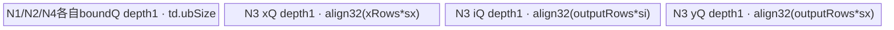

# Gather 950 Direct Invoke 算子知识

## 算子速览

| 项目 | 内容 |
|---|---|
| 实际入口 | `cann_bench.gather` → `torch.ops.cann_bench.gather` → `cann_bench::gather_npu` → `calc_gather_tiling` → `launch_gather`；Direct Invoke。 |
| 计算语义 | `y.shape=index.shape`；输出坐标 `q` 上，`y[q]=x[q_0,…,index[q],…,q_(n-1)]`，`index[q]` 替换 `dim` 维坐标。 |
| 输入输出 | contiguous；等 rank 1–8；index 为 int32/int64；可启动 x dtype 为 fp16/fp32/bf16/int8/int32/int64。 |
| 执行类型 | R-006 SIMT；R-003 `NDDMA→NDDMA→AIV_VECTOR→NDDMA`；R-007 为带 512 B AIV UB 参数准备的 SIMT；R-001/R-002 AIV_VECTOR；R-005/R-004 SIMT。无可达 Cube/AIC 或 MIX_CV。 |
| Kernel 路线 | R-006 key200；R-003 key244；R-007 key301；R-001 key1210；R-002 key1320；R-005 key100；R-004 key230。 |
| 核心资源 | full-load 三个 depth=2 TQue；key244 三个 GM 临时 Tensor、NDDMA bound queue 与中间三队列；key301 512 B TBuf；其余 SIMT 直访 GM。 |
| 来源闭包 | `direct_implementation_closed`：Direct binding、selector/POD、全部可达 entry/body/helper、多 Kernel GM 边、同步及构建接线闭合；官方固定 Commit 仅作 GatherElements 相关映射。 |
| 验证状态 | 已完成源码闭包检查；本次知识提取未执行编译、真机、数值或性能测试。 |

## 接口与语义

### 计算语义

设 rank 为 `n`、规范化轴为 `a`、`q` 为 `index` 的有效坐标：

```text
y.shape = index.shape
y[q] = x[q0,...,q(a-1),index[q],q(a+1),...,q(n-1)]
```

令连续布局步长 `Sx[k]=product(x.shape[k+1:])`、`Si[k]=product(index.shape[k+1:])`，把输出线性位置 `p` 解码为 `q` 后，等价源地址为：

```text
src(p) = sum(k != a, q[k] * Sx[k]) + index[p] * Sx[a]
y[p]   = x[src(p)]
```

这条式子是所有 Route 的共同不变量。SIMT Route 在线程内直接计算它；full-load Route 把相关 x 行搬进 UB 后计算同一相对 offset；key244 先交换二维行列，再按列计算同一映射。非轴维约束 `index.size(k)<=x.size(k)` 保证 `q[k]` 也是 x 的有效坐标，但不约束轴上的 `index[p]`。

### axis、连续布局与越界契约

| 契约 | Host 责任 | Device 假设 | 违反后的实际边界 |
|---|---|---|---|
| axis | 接受 `[-n,n)`，负值只加一次 `n` | POD/模板看到规范化后的非负 axis | Host 抛错，不启动。 |
| layout | x/index 必须 contiguous，y 由 `empty` 创建为 contiguous | 使用逻辑 shape 生成的连续 stride，不读取 Tensor storage stride | 非连续输入在 Host 被拒绝；不能仅传 data pointer 复用此 Kernel。 |
| 非轴 shape | 等 rank；`index.shape[k]<=x.shape[k]` (`k!=a`) | 输出线性坐标可直接映射到 x 的同名非轴坐标 | Host 抛错。 |
| index 值域 | 有效输入必须逐元素满足 `0<=index[p]<x.shape[a]` | 所有 Route 均省略逐元素检查 | Direct 实现没有定义越界输出，也不会可靠地产生框架级异常；可能读到 x 之外。 |
| dtype | index 仅 int32/int64；x 的可启动集合见下表 | Gather 是位模式搬运，不做数值 cast | 未接线 dtype 在 launcher 抛错。 |

负 index 不能按 Python 负下标解释。不同 Route 对 index 的低位提取和整数收窄并不相同：key100 可直接用有符号下标，key200/230/301 转为 `uint32`，full-load/key244 的 MicroAPI 路径会取低 32 位，1/2-byte x 又把 offset 收窄为 16 位。因此越界值的表现是未定义边界，不能把某条 Route 上观察到的回绕行为写入算子语义。若上层语义要求越界报错，应在进入 Direct Kernel 前另做校验；给 index 做 clamp 会静默改变算子语义。

### 输入、输出与属性

| 参数 | shape/layout | dtype | 约束、默认值与语义 |
|---|---|---|---|
| `x` | rank 1–8，contiguous | fp16/fp32/bf16/int8/int32/int64 | 数据源；Meta 未限制，但 launcher 仅接线这些 dtype。 |
| `index` | 与 x 同 rank，contiguous | int32/int64 | 决定输出 shape；非轴维不大于 x；值域由调用方保证。 |
| `dim` | Host 标量 | int64 | 默认 0；范围 `[-rank,rank)`，负值加 rank。 |
| `y` | `index.shape`，contiguous | 与 x 相同 | `torch::empty(index.sizes(),x.options())` 创建。 |

### 入口与版本

Python 入口只转发注册算子；Meta/PrivateUse1 分派分别绑定 `gather_meta/gather_npu`。本卡固定 CANN 9.1.0、950/Ascend 950，不把它补写成 ACLNN。Direct README 明列 Ascend 950，CMake 将 `ascend950` 映射为 `dav-3510`。官方 Commit `955f8b33985b6d72989ebff341bb9c2c564a51bc` 的 `index/gather_elements` 仅是算法与 950 binary 配置的相关映射；Direct wrapper、补充 selector 与 key244 图以本卡闭合的 Direct 源码为事实边界，不伪称官方入口。

## Host/Launcher 执行流程

### 参数校验与前处理

1. `gather_meta` 检查 rank、dim、index dtype 与非轴维，并创建 y。
2. `gather_npu` 绑定 x device，要求 x/index contiguous，规范化轴，把 shape 与元素字节数交给 `calc_gather_tiling`。
3. tiler 检查等 rank、rank 1–8、轴、`AIV coreNum>0`、`UB>32 KiB`；先尝试 full-load，谓词不成立才合轴并生成基础 key，再依次尝试 grid-stride 与 NDDMA 覆盖。
4. 生产 selector 在 240～244 中只可能产出 key244；`gather_npu` 仍保留 key240/242 的三临时 Tensor、key241 workspace、key243 单 xTranspose 的分配分支，但 240～243 都没有完整 selector producer，属于 dormant。
5. `OpCommand::RunOpApi("Gather",aclCall)` 用当前 NPU stream 调 `launch_gather`；未知 key/dtype 抛异常。

这里的“失败”要分两类：专用覆盖的 tiling 失败会保留先前可用 key；full-load 一旦谓词成立就提前返回，即使生成的 full-load key 没有 launcher body 也不会回退。当前真正接线的 full-load key 只有 1210、1320。

### Host checked arithmetic 与窄化证明

快照实现使用普通 `int64_t` 连乘、`int` 合轴乘积和 `(a+b-1)/b`，只在 key244 的部分维度上显式检查 `UINT32_MAX`。这些是实现边界，不是可迁移的安全契约。复刻 selector 时应先用 checked arithmetic 形成 64 位事实，再按 Route 证明 POD 和 Device 窄化；检查失败应抛出确定性参数错误，或只在已有可用基础 key 时放弃专用覆盖。

```text
checked_mul(a,b,L): require a>=0 && b>=0 && (a==0 || b<=L/a); return a*b
checked_align(v,A,L): require A>0 && v<=L-(A-1); return ((v+A-1)/A)*A
checked_ceil_div(a,b): require a>=0 && b>0; return a/b + (a%b != 0)

Sx, Si, xNumel, yNumel = checked products in uint64/int64 domain
if yNumel == 0: use an explicit zero-output Host return; current Device selector is not zero-safe
normalize/merge shapes using int64, never int
choose route only after every value consumed as uint32/uint16 is proven representable
serialize zero-initialized POD; launch only a key with a connected body
```

| 值/关系 | 生产位置 | 必须证明的条件 | 消费与失败策略 |
|---|---|---|---|
| `Sx[k]`,`Si[k]`,`xAfterAxis`,`idxAfterAxis`,`ySize` | shape 连乘 | 非负、无 int64/uint64 溢出；参与 `log2/div` 的 stride 必须 `>0` | 所有地址、magic/shift；零输出应 Host 短路，不能进入当前 `log2(0)`/除零路径。 |
| `Bx/Bi/By` 与 `2*(Bx+Bi+By)` | 字节乘法+32B align | `dim*elementSize`、align 加法、三项求和和乘2均无溢出，分母非零且不超过 UB | full-load guard；不满足即不选 full-load。 |
| 合并维 | `MergeAxis` | 每段 product 以 int64 checked multiply 生成 | 当前源码用 `int val`；安全实现不得让溢出后的形状进入 key 选择。 |
| `usedCore/perCoreNum/tailCoreNum` | 分核 | `1<=usedCore<=coreNum`；ceil-div 分母正；`tail` 在 `(0,perCore]` | `blockDim:uint32` 及 SIMT 参数；不满足不得启动。 |
| SIMT `i/stride/offset` | key100/200/230/301 | 四路的 yNumel、per-core 区间须可转 uint32；key200/230/301 的 stride、magic 输入和最大源 offset 还须可在32位地址表达式中表示；key100 的 index 则须在自身 INDEX_T 中合法 | 超域不能依赖 launcher cast 或 Device 乘法截断。 |
| full-load DMA | key1210/1320 | `rows<=UINT16_MAX`；`dataLen*sizeof(T)<=UINT32_MAX`；repeat 数可表示；MicroAPI offset 位宽覆盖最大 UB 内地址 | `DataCopyExtParams` 与 register gather；当前 `x.shape[axis]<=65535` 只覆盖部分证明。 |
| key244 维度与临时字节 | NDDMA 图 | xRows/outputRows/columns/ySize 及 NDDMA POD 窄字段可表示；三份 Tensor 的 numel×elementSize checked；`bytesPerColumn*2` 无溢出 | 任一专用 guard 失败保留 key230/200；若基础 key 自身也超域则确定性报错。 |

POD 不能承担“晚检查”职责：Host 一旦把 64 位负值或超大值写入字段，launcher/body 中的 `static_cast<uint32_t>` 已经丢失信息。正确顺序是先证明、再写 POD、最后按同一 `key`/dtype 启动。

### 参数、Workspace 与生命周期

`calc_gather_tiling` 从 `PlatformAscendCManager` 读取 AIV 数与 UB 字节。key244 的 GM 边是：xT `[columns,xRows]`、iT `[columns,outputRows]`、yT `[columns,outputRows]`，字节分别为 x/index/y 的 numel×元素字节；均由 `gather_npu` 局部 Tensor 持有。它们至少存活至 `RunOpApi` 入流完成，异步回收依赖 torch_npu allocator。

Transpose tiler 会在 `TransposeLaunchParams.workspaceSize` 记录 16 MiB，但 key244 的 `TransposeCutTwoAxis` entry 不接收 workspace，launcher也不分配该 slice；真实交接介质是三份 GM Tensor。顶层 `workspaceBytes` 仅供 dormant key241，所有可达 Route 为 0。

### 启动图与失败传播

```text
key244:
N1 gather_nddma_transpose_x<X>(x -> xT)
 ->[same stream] N2 gather_nddma_transpose_x<I>(index -> iT)
 ->[same stream] N3 gather_transposed_ub<X,I>(xT,iT -> yT)
 ->[same stream] N4 gather_nddma_transpose_x<X>(yT -> y)
```

三份 transpose POD 均须 key10003/CUT_TWICE，否则启动前失败。源码未检查各 `<<<>>>` 的异步 Device 返回；跨节点可见性来自同 stream 提交顺序。单 Kernel Route 直接在相同 stream 启动。

## Route 与参数设计

### 分核与资源计算

```text
Xafter=product(x[axis:]); Iafter=product(index[axis:])
Xprefix=product(x[1:axis]); Iprefix=product(index[1:axis])  # 源码有意排除dim0与axis，空积为1
Bx=align32(Xafter*sx); Bi=align32(Iafter*si); By=align32(Iafter*sx)
load=floor(UBraw/(2*(Bx+Bi+By)))
```

full-load：`outputPrefix=product(index[:axis])`，`blockDim=min(coreNum,outputPrefix)`，`perCoreNum=ceil(outputPrefix/blockDim)`，最后核用 `tailCoreNum`。非 full-load 合并轴外连续相等维，令 `ySize=product(mergedIndex)`；小域单核，否则按 `perCoreNum=ceil(ySize/coreNum)` 均分。key244 三次 `[r,c]`、`perm=[1,0]` transpose 的 tiling UB 是 `min(UBraw,192 KiB)`，中间 gather 按 `usedCore=min(columns,coreNum)` 列循环。

### 原坐标到 merged 坐标

`MergeAxis` 只合并“不含 axis 且 x/index 对应维完全相等”的最大连续段。设一段为 `[l,r)`，则：

```text
mergedX[t] = mergedIndex[t] = product(shape[l:r])
axis' = axis - sum(位于 axis 前方的每段长度-1)
```

它保持输出线性序 `p`、连续地址和 axis 替换语义不变。不得跨 axis 合并，也不得合并 `x[k]!=index[k]` 的维；后者虽然满足 `index[k]<=x[k]`，但合并后会丢失 x 与 index 的不同 stride。Host 当前先在原 shape 上判断 full-load，只有未命中时才执行此变换。

| 原始形态 | 合并结果 | 连接 Route | 说明 |
|---|---|---|---|
| `x,index:[N]`, axis0 | `[N]`, axis0 | key100 | 1D direct。 |
| `x:[R,C]`,`index:[K,C]`, axis0 | rank2/axis0 | key200，可能被230/244覆盖 | 非轴列相同但只有单维，不能再降 rank。 |
| `x:[B,H,S,D]`,`index:[B,H,K,D]`, axis2 | `x:[B*H,S,D]`,`index:[B*H,K,D]`, axis1 | key301 | axis 前连续等长段 `[B,H]` 合并，axis 从2变1；尾部单个 D 保留。 |
| `x:[B,S]`,`index:[B,K]`, axis1 | rank2/axis1 | full-load 命中时1210；否则基础 key201 | key201 未接线；当前实现不是任意尾轴的 SIMT fallback。 |
| rank3/axis2 尾轴 | 原 shape 先尝试 full-load | 命中时1320；否则常落到未接线 key | H1 早返回和 H2 接线域必须分别审计。 |

因此“通用 Route”表示三种已连接的 merged 形态，而不是 rank 1–8 全覆盖。对任意输入，应在 Host 明确验证最终 key 属于 `{100,200,230,244,301,1210,1320}`；不能把公式可表达误当作 launcher 已接线。

### 完整合法域与 Route 可达性

这里把“合法”分成两层：接口语义合法只要求前述 rank/shape/dtype/layout/index 值域契约；Direct 可启动还要求 selector 最终生成已接线 key 及其全部位宽/资源条件。语义合法但落入其它 key 的输入会在 launcher 确定性失败，不构成新的 Device Route。

full-load 的生产谓词按源码整数运算精确写为：

```text
F = load>0
 && x.shape[a] <= 65535
 && Iafter > 32
 && rank-a <= 3
 && Xprefix/Iprefix <= 2
 && Xafter/Iafter < 32

F true : key = 1000 + originalRank*100 + originalAxis*10，立即返回
F false: MergeAxis；baseKey = mergedRank*100 + mergedAxis
```

`Iprefix`、`Iafter` 和各 stride 必须为正才能安全执行这些除法；当前源码对零域没有完整短路。下表中的 `active` 表示生产 selector 有直接 producer，`conditional` 专指在已有 active 基础 key 上追加 guard 后事务式覆盖、失败可安全保留基础 key；两类都属于可达路线。

### Route 选择

下表按实现复用的重要性降序排列；P0～P6 不代表 selector 判断顺序。`Host 顺序`独立保留源码中的真实先返回、后覆盖和 fallback 关系：H1 检查 full-load 并直接返回；H2 合轴后写入基础 key；H3 可把 key200 覆盖为 key230；H4 最后尝试 key244，成功时覆盖 H2/H3，失败时保留已有 key；H5 只处理不可达的 key240 准备分支。

| 重要性 | 状态 | Route | 特征 | 适用域 | 实现前提 | Key/模板 | Host 顺序、短路与 fallback |
|---|---|---|---|---|---|---|---|
| P0 | active | R-006 2D axis0 direct | 2D axis0 的通用单 Kernel 主干，SIMT 直接从 GM 取 index 与 x | `!F`；合轴后 dim2/axis0，且后续专用覆盖均未生效 | 32 位 magic/shift 与 shape 乘积可表示；1024-thread entry 可用 | 200/`GatherDim2Direct<...,0>` | H2 先写 key200；H3 guard 真时转 R-004；H4 成功时再转 R-003，H4 失败保留 key200 或 key230。 |
| P1 | conditional | R-003 CUT_TWICE 图 | 三次 NDDMA 转置包围按列 full-load gather，以 GM 中间 Tensor 串联四节点 | `!F`；合轴后 dim2/axis0；`ySize>=2^24`；si∈{4,8}、sx∈{1,4,8}；index 首维为 2 幂；各维与 `ySize` 不超过 UINT32 | 三份 transpose tiling 都成功且 key10003；N3 UB guard 成功；三份 GM 临时 Tensor 已分配 | 244/3×`TransposeCutTwoAxis`+`FullLoad<2,1>` | H4 最后尝试并覆盖 H2 的 key200 或 H3 的 key230；任一 guard 失败都原样保留 H2/H3 结果。 |
| P2 | active | R-007 3D axis1 | 合轴后 3D 中轴 SIMT，先在 UB 准备参数再直访 GM | `!F`；合轴后 dim3/axis1 | 512 B TBuf 与 UB barrier 可用；2048-thread entry 可用 | 301/`GatherElementsKernel<...,3,1>` | H2 写 key301；H3/H4 仅检查 dim2/axis0，因此不覆盖；launcher 未知 key 才失败。 |
| P3 | active | R-001 2D 尾轴 full-load | x/index 行驻 UB，masked register gather 后连续回写 | 原始 rank2/axis1 且 `F` | 三个 depth2 TQue 总账可驻 UB；`x[axis]<=65535`；有效 offset 可由 uint16/uint32 表示 | 1210/`FullLoad<2,1>` | H1 命中即写 key1210并返回，不执行合轴及 H2～H5；H1 为假会继续到 H2，但常生成未接线 key201，不等于可用 SIMT fallback。 |
| P4 | active | R-002 3D 尾轴 full-load | 与 R-001 同族，增加二维 prefix 解码 | 原始 rank3/axis2 且 `F` | 同 R-001，并要求 prefix 解码与 stride 乘积有效 | 1320/`FullLoad<3,2>` | H1 命中即写 key1320并返回；H1 为假才合轴，最终 key 若不在已接线集合中会失败。 |
| P5 | active | R-005 1D direct | 最短 1D SIMT 直接索引路径 | `!F`；合轴后 dim1/axis0 | 基础分核参数有效；512-thread entry 可用 | 100/`GatherDim1Direct` | H2 写 key100；H3/H4 均不适用，不再覆盖；launcher 未知 key 才失败。 |
| P6 | conditional | R-004 大 2D grid-stride | 大 2D axis0 的 512-thread grid-stride 中间候选 | `!F`；合轴后 dim2/axis0；`ySize>=2^25`；si=4；index 首维为 2 幂 | UINT32 地址域与 magic/shift 有效；R-003 未成功覆盖 | 230/`GatherDim2GridStrideDirect` | H3 在 H2 key200 之后覆盖为 key230；H4 随后仍可覆盖为 R-003，H4 失败则保留 key230。 |

```text
H1 full-load? -> key=1000+originalRank*100+originalAxis*10 -> early return
              -> 1210/1320 可启动；其它 full-load key 在 launcher 失败，无 fallback
else MergeAxis -> H2 base key=mergedRank*100+mergedAxis
               -> 只有100/200/301已接线；其它基础 key 无 body
-> H3 optional 230 override -> H4 optional 244 override (专用失败保留 H2/H3)
-> H5 dormant 240 preparation -> 244/230/100/200/301 or launcher error
```

### tail 与 fallback 闭合

| 层级 | tail 所有者 | 关系式/机制 | 不变量 | fallback 边界 |
|---|---|---|---|---|
| Host 分核 | `perCoreNum`,`tailCoreNum` | `tail=ySize-(usedCore-1)*perCore` | 各核区间不重叠，区间并集恰为 `[0,ySize)` | 只处理规模尾，不修复 unsupported key。 |
| SIMT key100/200/301 | 最后核+线程循环 | `end=coreOffset+(last?tail:perCore)`；`i+=threads` | 只在 `i<end` 时读写 | 无 Device fallback；Host 必须先选对 key。 |
| SIMT key230 | 每线程 grid-stride | `i=block*512+thread; i<total; i+=usedCore*512` | 任意非整 grid 的最后迭代由 `i<total` 裁掉 | H4 key244 成功才覆盖；H4 失败保留230。 |
| full-load 1210/1320 | 最后核、最后 UB 批、最后 vector repeat | prefix 剩余行决定 `rows`，`UpdateMask` 决定末 repeat 有效 lane，CopyOut 只写有效元素 | pad lane 不得写回 GM；queue slot 消费后才复用 | H1 命中后没有退路；Kernel 内也不降级成 SIMT。 |
| key244 N1/N2/N4 | CUT_TWICE main/input-tail/output-tail/both-tail | transpose POD 为四类区域给出 factor/offset | 每个边界 tile 只搬有效 blockLen，pad 不进入下一节点的逻辑域 | 只在启动前 tiling 阶段可回退到230/200。 |
| key244 N3 | 列循环+末 repeat mask | `column=block; column<columns; column+=usedCore`；mask裁 `outputRows` | 每列 x/index 先入队，计算后 y 出队 | N3 已启动后无 fallback；错误只能沿 stream 暴露。 |

Route 间共同不变量是输出的线性顺序不变、每个有效 `p` 恰写一次、只替换 axis 坐标、x 的位模式不变。专用 Route 的 fallback 必须回到已经完整生成的基础 Gather POD。短路求值可能让未激活的 transpose 字段部分写入，但 fallback key 绝不能读取它们；更稳妥的实现是在局部临时 POD 中完成全部专用 tiling 后一次提交。

### Dormant key 240～243

这些 key 在 C ABI launcher 中有 entry/body，但 `calc_gather_tiling` 不会完成相应 key 与 POD 的生产链；它们不是合法输入域中的 conditional fallback。`gather_npu` 的临时区分配分支只说明 wrapper 为这些值留了槽位，不能反推 selector 可达。

| key | 已存在的 launch/body 图 | 不可达原因 | 重新启用必须补齐的契约 |
|---|---|---|---|
| 240 | `transpose_i32_index` + `transpose_X` → `gather_transposed_X` → `transpose_Y`；三份 GM temp，同 stream | `if (result.key==240)` 只会填 `transposeX/index/Y`，此前没有语句把 key 设为240 | selector guard；int32 index 验证；三份 `MakeTranspose2DTiling` POD；`blockDim/xRows/outputRows/columns/outputRowsShift`；`outputRows` 的2幂前提；三临时 Tensor 生命周期与三次 transpose tail。 |
| 241 | 单 `GatherElementsV2TransposeKernel<int32,int32>`，使用 workspace | `MakeGatherElementsV2TransposeTiling` 有定义但无调用，`v2/workspaceBytes/key` 无 producer | 限定 int32 x/index；生成 `v2`、非零 blockDim 和 checked workspaceBytes；plugin 分配 workspace；闭合 V2 内部 UB/workspace tail 后才可设 key241。 |
| 242 | index/x 两次 `KernelTransDataTo5HD<int32>` → `gather_transposed_i32` → y 反变换；三份 GM temp | `vconvX/index/Y` 从未生成，launcher 也没有 dtype guard | selector 必须限定 int32 x/index；生成三份 VCONV POD、shape/shift/blockDim；补 dtype fail-fast、三临时 Tensor 与四节点 same-stream 生命周期。 |
| 243 | `TransposeCutTwoAxis<X>(x→xT)` → `GatherFromNddmaTransposedXDirect<X>`；仅 xTranspose | 无 key243 producer，也无 `transposeNddmaX/xRows/outputRows/columns` 生产链 | 限定 int32 index、X∈{int8,int32,fp32位模式}；CUT_TWICE key10003；columns 为2幂以满足 `i&(columns-1)`；checked `outputRows*columns`、单 GM temp、NDDMA tail 与 same-stream handoff。 |

```text
# launcher 中存在但生产 selector 不会发出的分支
240: iT=transpose(index); xT=transpose(x); yT=gather_last_dim(xT,iT); y=transpose(yT)
241: y=GatherElementsV2Transpose<int32,int32>(x,index,workspace)
242: iT=vconv(index); xT=vconv(x); yT=gather_last_dim(xT,iT); y=vconv(yT)
243: xT=nddma_transpose(x); y[p]=xT[(p&(columns-1))*xRows+index[p]]
```

### 模板/实现执行矩阵

| 重要性 | Route | Host 顺序 | key/selector | dtype/shape/platform 完整命中条件 | 执行拓扑与 Kernel 节点 | 实际模板/body | 内存与同步特征 | tail/fallback |
|---|---|---|---|---|---|---|---|---|
| P0 | R-006 | H2→H3/H4 | 200 | 2D axis0；后续 230/244 覆盖均未生效 | 单 SIMT | `GatherDim2Direct<...,0>` | 无UB，1024线程 | core tail；H3/H4 可覆盖。 |
| P1 | R-003 | H4 覆盖 H2/H3 | 244 | 上表全部 guard；X code1/3/4/6 | NDDMA、NDDMA、AIV_VECTOR、NDDMA | 3×`TransposeCutTwoAxis`+`gather_transposed_ub` | 三GM边、same-stream、bound queue | transpose四类tail；tiling失败保留 H2/H3 key。 |
| P2 | R-007 | H2 | 301 | 3D axis1 | 单 SIMT | `GatherElementsKernel<...,3,1>`→`GatherDim3Compute` | 512 B TBuf+UB barrier，2048线程 | core tail。 |
| P3 | R-001 | H1 return | 1210 | full-load rank2/axis1；六种X×两种I | 单 AIV_VECTOR | `FullLoad<X,I,2,1>` | 三个depth2 TQue | core/UB tail；其它 full-load key失败。 |
| P4 | R-002 | H1 return | 1320 | full-load rank3/axis2 | 单 AIV_VECTOR | `FullLoad<X,I,3,2>` | 同左，地址多一维 | 同左。 |
| P5 | R-005 | H2 | 100 | 1D axis0 | 单 SIMT | `GatherDim1Direct` | 无UB，512线程 | core tail。 |
| P6 | R-004 | H3；H4 可覆盖 | 230 | 大2D axis0、int32 index、幂次行；244未覆盖 | 单 SIMT | `GatherDim2GridStrideDirect` | 无UB，512线程 | `i<total`；H4失败保留230。 |

### Route 资源 Guard

| Guard | Host/Tiling 条件 | Device/资源原因 | 影响 Route | 不满足时去向 | 源码符号 |
|---|---|---|---|---|---|
| CUT_TWICE | 三 transpose key均10003 | launcher 固定 `TransposeCutTwoAxis` | R-003 | 保留230/200 | `DoSplitUB/launch_gather` |
| transpose UB cap | `min(UBraw,192KiB)` | 避免形状选择非10003 key | R-003 | 回退 | `calc_gather_tiling` |
| N3 UB | `UBraw>=2*(align32(xRows*sx)+align32(outputRows*si)+align32(outputRows*sx))` | 三个队列与offset范围 | R-003 | 230/200 | `MakeTransposedFullLoadTiling` |
| full-load UB | `load>0` | 三双队列总量≤UB | R-001/2 | 继续合轴 selector；最终 key 可能未接线 | `calc_gather_tiling` |
| offset | `x[axis]<=65535` | 1/2-byte X 用uint16 gather offset | R-001/2/3-N3 | SIMT或失败 | `isFullLoad/GatherValue` |
| grid | y≥2^25、si=4、幂次行 | 512线程grid-stride | R-004 | 200 | `calc_gather_tiling` |
| 空域 | 无完整零维guard | 除法/log2/core计算要求正量 | 全部 | 异常或无效参数 | `calc_gather_tiling` |

### POD/ABI

`GatherElementsTilingData` 全为 64 位顺序字段，`sizeof=448`、`alignof=8`：

| 结构 | 字段 | 类型/位宽 | ABI 布局 | 单位 | Host/launcher producer | Device consumer | 边界 |
|---|---|---|---|---|---|---|---|
| `GatherElementsTilingData` | `axis` | int64/64 | off0 | axis | selector | full-load | 模板轴限定。 |
| 同上 | `usedCore` | int64/64 | off8 | core | 分核 | 全部 | >0。 |
| 同上 | `perCoreNum` | int64/64 | off16 | element/row | ceil分核 | 循环 | tail另算。 |
| 同上 | `tailCoreNum` | int64/64 | off24 | element/row | 余数 | 末核 | 非负。 |
| 同上 | `xLoadInUbNum` | int64/64 | off32 | row | UB公式 | xQueue | SIMT inactive。 |
| 同上 | `indexLoadInUbNum` | int64/64 | off40 | row | UB/perCore上限 | index/y queue | SIMT inactive。 |
| 同上 | `xUbFactor` | int64/64 | off48 | element | `Xafter*xLoad` | full-load缓存 | 不直接分配。 |
| 同上 | `indexUbFactor` | int64/64 | off56 | element | `Iafter*iLoad` | full-load缓存 | 同上。 |
| 同上 | `xAfterAxis` | int64/64 | off64 | element/row | shape乘积 | DMA/offset | 溢出未查。 |
| 同上 | `idxAfterAxis` | int64/64 | off72 | element/row | shape乘积 | DMA/offset | 必须正。 |
| 同上 | `xStrideArr[8]` | int64[8] | off80 | element | `ComputeEightDim` | 地址 | 前补1。 |
| 同上 | `indexStrideArr[8]` | int64[8] | off144 | element | 同上 | 解码 | 前补1。 |
| 同上 | `magic[7]` | uint64[7] | off208 | ratio | reciprocal公式 | 200/230；301重算 | stride非零。 |
| 同上 | `shift[7]` | uint64[7] | off264 | bit | ceil(log2) | 同上 | stride正。 |
| 同上 | `indexShape[8]` | int64[8] | off320 | element | Host shape | body | rank表示依Route。 |
| 同上 | `xShape[8]` | int64[8] | off384 | element | Host shape | body | 同上。 |

`GatherElementsLaunchTiling` 的字段依次是 `data`、三份 `transposeNddma*`、三份 dormant `transpose*`、三份 dormant `vconv*`、dormant `v2`、`key:uint64`、`blockDim/transposeBlockDim/xRows/outputRows/columns/columnShift/outputRowsShift:uint32`、`workspaceBytes:uint64`。同一 header 供 Host/Device 使用；源码无顶层 `static_assert(sizeof/offsetof)`，故不写未经编译确认的绝对 offset。可达 consumer：`key/blockDim` 全路线；三份 NDDMA POD 与 `xRows/outputRows/columns` 仅 R-003；`columnShift/outputRowsShift` 在 R-003 写入但不读取；`workspaceBytes=0`。

每个 `TransposeLaunchParams` 含 `blockDim:int64`、`tilingKey:uint64`、`workspaceSize/dataSize:size_t` 与 `alignas(8) data[2048]`。其 payload 是 `TransposeOpTilingData`：19个 int64 标量及 input/output/perm/base/expanded/inUb main/input-tail/output-tail/both-tail 数组；`FillTilingData` 逐字段生产，`TransposeCutTwoAxis` 消费。

#### POD 生产—消费与 ABI 约束

安全复刻时推荐把每条专用 Route 当作事务提交：

```text
result{}                  # 整体清零，未激活 union-like 分支保持零
produce result.data      # 基础/full-load Gather POD
produce optional PODs    # 仅专用 Route guard 内写 transpose payload
set key last             # key 是有效字段集合的判别器
dispatch by key+dtype    # 只读取该 key 对应字段
```

`GatherElementsLaunchTiling` 不是显式 C++ union，但使用方式等价于“key 判别的多分支 POD”。key244 成功时 `result.data` 被 `transposedGatherTiling` 整体替换；失败时不替换，因此 key200/230 的 stride/magic/分核仍保持完整。失败尝试可能在 `transposeNddma*` 留下部分 payload，但基础 key 不读取它们；实现 fallback 时必须维持 `key` 判别与 `data` 的提交点语义。

| ABI/字段组 | Host 表示 | Device/launcher 实际表示 | 落地约束 |
|---|---|---|---|
| `data.usedCore/perCore/tail` | int64 | key100/200/230 宏显式 cast uint32；key301 的 `COM_T` 为 uint32 | Host 写入前完成 uint32 证明。 |
| `data.magic/shift/stride` | uint64/int64 | key200/230 cast uint32；key301 cast `COM_T=uint32` | stride 必须正且可表示；magic 必须按同一 32 位除法算法生成。 |
| `data.xShape/indexShape` | int64[8] | key230 先相乘再 cast uint32；full-load 按 int64 读 | 应先 checked product；不能依赖 Device 表达式溢出。 |
| `blockDim` | uint32 | launch grid | 必须非零且不超过平台 AIV 数；和 `data.usedCore` 一致。 |
| `xRows/outputRows/columns` | uint32 | key244 Kernel 参数 uint32 | 三字段与 transpose POD 的 shape 必须来自同一 merged shape 快照。 |
| transpose payload | `alignas(8) byte[2048]` | reinterpret 为共享结构 | `dataSize<=2048`、生产者/消费者字段序和对齐一致；建议构建时 `static_assert` size/align/关键 offsetof。 |

Host 与 Kernel 共用 header 只能降低漂移概率，不能替代 ABI 证明。尤其 `size_t` 会受 Host ABI 影响；可移植实现应固定编译目标并对共享 POD 做静态断言，序列化后不得由另一套不同 packing 的声明解释。

### Route 源码闭包

| 重要性 | Route | Host 顺序 | Key/selector | Host/Tiling producer | POD/参数 | Kernel entry/router 节点 | Kernel body/直接依赖 | 构建接线 |
|---|---|---|---|---|---|---|---|---|
| P0 | R-006 | H2→H3/H4 | 200 | `calc_gather_tiling` | Gather POD | generated `_200` | `GatherDim2Direct` | `gather/CMakeLists.txt` |
| P1 | R-003 | H4 覆盖 H2/H3 | 244 | `calc_gather_tiling/calc_transpose_tiling/TransposeNddmaTiling` | Launch POD+3×Transpose POD | 3×`gather_nddma_transpose_x`+`gather_transposed_ub` | `TransposeCutTwoAxis/ComputeDim1Vf` | 同上；Host tiler由plugin同TU include |
| P2 | R-007 | H2 | 301 | `calc_gather_tiling` | Gather POD | generated `_301` | `GatherElementsKernel/GatherDim3Compute` | 同上 |
| P3 | R-001 | H1 return | 1210 | 同上 | 同上 | generated `_1210` | `gather_elements_full_load.h` | 同上 |
| P4 | R-002 | H1 return | 1320 | 同上 | 同上 | generated `_1320` | `gather_elements_full_load.h` | 同上 |
| P5 | R-005 | H2 | 100 | 同上 | 同上 | generated `_100` | `GatherDim1Direct` | 同上 |
| P6 | R-004 | H3；H4 可覆盖 | 230 | 同上 | 同上 | generated `_230` | `GatherDim2GridStrideDirect` | 同上 |

## Kernel 实现

### 公共执行流程

torch dtype code 1/3/4/5/6/15 分别分派 int8/int32/int64/half/float/bfloat16，index code 3/4 分派 int32/int64。key244 先走专用多 Kernel router，其余 key 进入生成的 `launch_X_I`。Kernel 标注 AIV_ONLY，但 `asc_vf_call` 内线程算法按 SIMT 族记录；无通信、Cube 或 MIX_CV。

全部 active/conditional Route 的 `L1=0`、`L0A/L0B/L0C=0`：SIMT 路径直接 GM 访存，full-load 与 key244 只使用 UB queue/TBuf；key244 的跨节点介质是 GM 临时 Tensor，NDDMA bound queue 也位于 UB，不应补写 Cube 或 L1 staging。

### P0 · Route R-006：2D axis0 直接 SIMT

#### 适用条件

##### 选择证据

| 层级 | 文件 | 符号 | 源码谓词/参数 | 结果/下一跳 |
|---|---|---|---|---|
| Host/Router | `gather_kernel.cpp` | `calc_gather_tiling/BODY_200` | merged rank2/axis0且未被244/230覆盖 | 1024-thread direct |

#### Device 数据流

##### 函数级调用链

`launch_X_I -> gather_X_I_200 -> asc_vf_call<GatherDim2Direct<X,I,0>>(1024)`

##### 源码等价伪码

```text
for i in 本核区间 stride1024:
 row=UintDiv(i,magic[6],shift[6]); col=i-row*indexStride[6]
 y[i]=x[index[i]*xStride[6]+col]
```

#### 内存与数据搬运

##### 资源与搬运表

| 层级/缓冲区 | offset/地址公式 | extent/容量公式 | dtype/layout | producer | consumer | owner/lifetime | 对齐/复用 |
|---|---|---|---|---|---|---|---|
| GM x/index/y | 伪码公式 | 单元素 | X/I/X | caller/thread | thread/caller | caller | 无UB |

##### 分层内存布局

N/A：线程直接 GM→GM。

##### 字节账与复用顺序

`UB_total=0; dynamic_ub=N/A; workspace_total=0`。无复用子区。

#### 同步、精度与尾块

##### 同步与数值边界表

| 阶段 | primitive/机制 | producer | consumer/等待点 | 保护对象 | 精度/尾块 |
|---|---|---|---|---|---|
| 坐标解码 | `Simt::UintDiv` | Host magic/shift | 地址计算 | x offset | core tail；无cast/atomic。 |

#### 关键实现

##### 符号证据表

| 阶段 | 文件 | 符号/模板实例 | 实现事实 |
|---|---|---|---|
| Host/Tiling producer | `gather_kernel.cpp` | `ComputeEightDim/calc_gather_tiling` | stride/magic/key200。 |
| Kernel entry/router | 同上 | `BODY_200` | 1024线程。 |
| Device body/helper | 同上 | `GatherDim2Direct<...,0>` | 2D地址/tail。 |

### P1 · Route R-003：CUT_TWICE NDDMA 四节点

#### 适用条件

##### 选择证据

| 层级 | 文件 | 符号 | 源码谓词/参数 | 结果/下一跳 |
|---|---|---|---|---|
| Host | `gather_kernel.cpp` | `calc_gather_tiling` | 大2D axis0、dtype/幂次/uint32 guard | 三次transpose tiling |
| Tiling | `transpose_tiling_arch35.cpp` | `DoSplitUB` | `outCutIndex>FindOutIndex(inCutIndex)` | key10003 |
| Router | `gather_kernel.cpp` | `launch_gather` | key244且三份10003 | N1→N2→N3→N4 |

#### Device 数据流

##### 函数级调用链

```text
N1 TransposeCutTwoAxis<X>(x->xT) -> N2 TransposeCutTwoAxis<I>(index->iT)
 -> N3 gather_transposed_ub<X,I>(xT,iT->yT) -> N4 TransposeCutTwoAxis<X>(yT->y)
```

##### 源码等价伪码

```text
N1/N2: [rows,columns]转为[columns,rows]
N3: for column=core; column<columns; column+=usedCore:
      DMA xT[column,:],iT[column,:]; masked MicroAPI gather整列；DMA yT[column,:]
N4: [columns,outputRows]转回[outputRows,columns]
CUT_TWICE各节点把循环域分为main/input-tail/output-tail/both-tail，MultiCopy GM->UB，DataCopyPad UB->GM
```

#### 内存与数据搬运

##### 资源与搬运表

| 层级/缓冲区 | offset/地址公式 | extent/容量公式 | dtype/layout | producer | consumer | owner/lifetime | 对齐/复用 |
|---|---|---|---|---|---|---|---|
| xT/iT/yT GM | mixed-radix/`column*rows` | x/index/y原字节数 | 转置2D | N1/N2/N3 | N3/N3/N4 | torch Tensor | same-stream边 |
| NDDMA bound queue | 0 | `td.ubSize`，depth1 | 当前T | MultiCopy | DataCopyPad | 节点TPipe | 每tile复用 |
| N3 x/i/y queue | 0 | `align32(xRows*sx)`/`align32(outputRows*si)`/`align32(outputRows*sx)`，depth1 | X/I/X | DMA/compute | compute/DMA | N3 TPipe | 每列复用 |

##### 分层内存布局



##### 字节账与复用顺序

```text
N1/N2/N4 UB_total(each)=td.ubSize<=min(UBraw,192KiB)
N3 UB_total=align32(xRows*sx)+align32(outputRows*si)+align32(outputRows*sx); selector要求2*N3_UB<=UBraw
dynamic_ub=N/A
workspace_total(GM临时)=numel(x)*sx+numel(index)*si+numel(y)*sx
```

| 复用子区 | 写入者 | 读取者/消费点 | 下一次覆盖 | 同步或释放依据 | 安全条件 |
|---|---|---|---|---|---|
| boundQ/N3 queues | MultiCopy/DMA/compute | DataCopyPad/compute/DMA | 下一tile/列 | EnQue→DeQue→Free | 消费后覆盖。 |
| xT/iT/yT | 前序Kernel | 后序Kernel | Route后回收 | same-stream | allocator感知stream。 |

#### 同步、精度与尾块

##### 同步与数值边界表

| 阶段 | primitive/机制 | producer | consumer/等待点 | 保护对象 | 精度/尾块 |
|---|---|---|---|---|---|
| 跨节点 | current stream | N1/N2/N3 | N3/N4 | GM临时 | 位模式；无cast。 |
| NDDMA内 | boundQ+loop mode | MultiCopy | DataCopyPad | UB tile | main/input/output/both-tail，blockLen/stride为byte。 |
| N3 | TQue+mask | row DMA | gather/copy | UB row | 最后repeat裁到outputRows。 |

#### 关键实现

##### 符号证据表

| 阶段 | 文件 | 符号/模板实例 | 实现事实 |
|---|---|---|---|
| Host/Tiling producer | `gather_kernel.cpp`、`transpose_tiling_arch35.cpp` | `calc_gather_tiling/DoSplitUB/FillTilingData` | 244、三transpose、四类tail POD。 |
| Kernel entry/router | `gather_kernel.cpp` | `launch_gather` key244 | 四节点顺序。 |
| Device body/helper | `transpose_cut_two_axis.h`、`gather_kernel.cpp` | `TransposeCutTwoAxis/gather_transposed_ub` | 5D MultiCopy与逐列gather。 |

### P2 · Route R-007：3D axis1 SIMT

#### 适用条件

##### 选择证据

| 层级 | 文件 | 符号 | 源码谓词/参数 | 结果/下一跳 |
|---|---|---|---|---|
| Host/Router | `gather_kernel.cpp` | `calc_gather_tiling/BODY_301` | merged rank3/axis1 | `GatherElementsKernel<...,3,1>` |

#### Device 数据流

##### 函数级调用链

```text
gather_X_I_301 -> GatherElementsKernel<X,I,uint32,3,1>::Init/Process
 -> GetUintDivMagicAndShift -> DataSyncBarrier<UB> -> asc_vf_call<GatherDim3Compute>(2048)
```

##### 源码等价伪码

```text
for i in 本核区间 stride2048:
 d0=UintDiv(i,m5,s5); rem=i-d0*iStride5; d1=UintDiv(rem,m6,s6); d2=rem-d1*iStride6
 y[i]=x[d0*xStride5+index[i]*xStride6+d2]
```

#### 内存与数据搬运

##### 资源与搬运表

| 层级/缓冲区 | offset/地址公式 | extent/容量公式 | dtype/layout | producer | consumer | owner/lifetime | 对齐/复用 |
|---|---|---|---|---|---|---|---|
| `magicAndShiftBuf` | 0 | 512 B | uint32 local | Init/Process | 参数准备 | TPipe | Kernel期；DIM3实际用成员寄存器 |
| GM x/index/y | 伪码公式 | 单元素 | X/I/X | caller/thread | thread/caller | caller | 无GM staging |

##### 分层内存布局


##### 字节账与复用顺序

`UB_total=512 B; dynamic_ub=N/A; workspace_total=0`。buffer 在 Kernel 结束后释放；当前 DIM3 SIMT 用 `m_/shift_`，不读取其数组视图。

#### 同步、精度与尾块

##### 同步与数值边界表

| 阶段 | primitive/机制 | producer | consumer/等待点 | 保护对象 | 精度/尾块 |
|---|---|---|---|---|---|
| 参数/线程 | UB DSB+per-core interval | AIV准备/thread | SIMT call | local/y | 最后核tail；无cast/atomic。 |

#### 关键实现

##### 符号证据表

| 阶段 | 文件 | 符号/模板实例 | 实现事实 |
|---|---|---|---|
| Host/Tiling producer | `gather_kernel.cpp` | `calc_gather_tiling` | key301/分核。 |
| Kernel entry/router | 同上 | `BODY_301` | `<3,1>`。 |
| Device body/helper | `gather_elements.h` | `Init/Process/GatherDim3Compute` | 512B、barrier、2048线程。 |

### P3 · Route R-001：2D 尾轴 full-load

#### 适用条件

##### 选择证据

| 层级 | 文件 | 符号 | 源码谓词/参数 | 结果/下一跳 |
|---|---|---|---|---|
| Host | `op_kernel/gather_kernel.cpp` | `calc_gather_tiling` | full-load 且 rank2/axis1 | key1210 |
| Router/Entry | 同上 | `DEFINE_LAUNCH/BODY_1210` | `t.key==1210` | `FullLoad<X,I,2,1>` |

#### Device 数据流

##### 函数级调用链

```text
launch_gather -> launch_X_I -> gather_X_I_1210
 -> FullLoad<2,1>::Init -> Process -> CopyInIdx/CopyInX -> ComputeDim1Vf/GatherValue -> CopyOut
```

##### 源码等价伪码

```text
for UB批 in 本核prefix行:
  DMA有效index行与对应x行到双缓冲队列
  for row,repeat: mask尾lane; load/deinterleave index; DataCopyGather(xLocal,indexReg); store yLocal
  DMA仅有效rows*Iafter到y
```

#### 内存与数据搬运

##### 资源与搬运表

| 层级/缓冲区 | offset/地址公式 | extent/容量公式 | dtype/layout | producer | consumer | owner/lifetime | 对齐/复用 |
|---|---|---|---|---|---|---|---|
| GM x/index/y | prefix stride | 有效行×axis后长度 | X/I/X row-major | caller/DMA | DMA/caller | caller | tail精确 |
| xQueue/indexQueue/yQueue | aligned row slice | `Bx*xLoad`/`Bi*iLoad`/`By*iLoad`，各depth2 | X/I/X | DMA/compute | compute/DMA | TPipe | EnQue→DeQue→Free |

##### 分层内存布局


##### 字节账与复用顺序

```text
UB_total=2*(Bx*xLoad+Bi*iLoad+By*iLoad)<=UBraw; dynamic_ub=N/A; workspace_total=0
```

| 复用子区 | 写入者 | 读取者/消费点 | 下一次覆盖 | 同步或释放依据 | 安全条件 |
|---|---|---|---|---|---|
| 三queue slot | DMA/Compute | Compute/CopyOut | 下一UB批 | EnQue/DeQue/FreeTensor | 消费后才覆盖。 |

#### 同步、精度与尾块

##### 同步与数值边界表

| 阶段 | primitive/机制 | producer | consumer/等待点 | 保护对象 | 精度/尾块 |
|---|---|---|---|---|---|
| 搬运/计算 | TQue+MicroAPI mask | DMA/index load | DeQue/gather | queue/lane | 位模式搬运；末核与末repeat裁尾；不查index值。 |

#### 关键实现

##### 符号证据表

| 阶段 | 文件 | 符号/模板实例 | 实现事实 |
|---|---|---|---|
| Host/Tiling producer | `op_kernel/gather_kernel.cpp` | `calc_gather_tiling` | UB、分核、1210。 |
| Kernel entry/router | 同上 | `BODY_1210` | key→模板。 |
| Device body/helper | `op_kernel/gather_elements_full_load.h` | `Init/Process/ComputeDim1Vf/GatherValue` | 双队列、masked gather、tail。 |

### P4 · Route R-002：3D 尾轴 full-load

#### 适用条件

##### 选择证据

| 层级 | 文件 | 符号 | 源码谓词/参数 | 结果/下一跳 |
|---|---|---|---|---|
| Host | `op_kernel/gather_kernel.cpp` | `calc_gather_tiling` | full-load 且 rank3/axis2 | key1320 |
| Router/Entry | 同上 | `DEFINE_LAUNCH/BODY_1320` | `t.key==1320` | `FullLoad<X,I,3,2>` |

#### Device 数据流

##### 函数级调用链

```text
launch_X_I -> gather_X_I_1320 -> FullLoad<3,2>::Init/Process
 -> 二维prefix解码 -> CopyIn -> ComputeDim1Vf -> CopyOut
```

##### 源码等价伪码

```text
prefix=core*perCore+loop*iLoad; (d0,d1)=divmod(prefix,indexShape[1])
xOffset=d0*xStride[5]+d1*xStride[6]
成批载入有效prefix行，沿最后轴masked gather，跳过超出index前缀域的x坐标，写有效y行
```

#### 内存与数据搬运

##### 资源与搬运表

| 层级/缓冲区 | offset/地址公式 | extent/容量公式 | dtype/layout | producer | consumer | owner/lifetime | 对齐/复用 |
|---|---|---|---|---|---|---|---|
| GM与三queue | `d0*xStride[5]+d1*xStride[6]` | 同R-001 | X/I/X | DMA/compute | compute/DMA | caller/TPipe | 32B、depth2、逐批复用 |

##### 分层内存布局


##### 字节账与复用顺序

```text
UB_total=2*(Bx*xLoad+Bi*iLoad+By*iLoad)<=UBraw; dynamic_ub=N/A; workspace_total=0
```

| 复用子区 | 写入者 | 读取者/消费点 | 下一次覆盖 | 同步或释放依据 | 安全条件 |
|---|---|---|---|---|---|
| 三queue slot | DMA/Compute | Compute/CopyOut | 下一prefix批 | queue生命周期 | 同R-001。 |

#### 同步、精度与尾块

##### 同步与数值边界表

| 阶段 | primitive/机制 | producer | consumer/等待点 | 保护对象 | 精度/尾块 |
|---|---|---|---|---|---|
| prefix/gather | div/mod+TQue+mask | POD/DMA | 地址/compute | GM/UB/lane | 二维prefix guard、末核/末批/末repeat裁尾。 |

#### 关键实现

##### 符号证据表

| 阶段 | 文件 | 符号/模板实例 | 实现事实 |
|---|---|---|---|
| Host/Tiling producer | `op_kernel/gather_kernel.cpp` | `calc_gather_tiling` | 1320与原shape。 |
| Kernel entry/router | 同上 | `BODY_1320` | `FullLoad<3,2>`。 |
| Device body/helper | `gather_elements_full_load.h` | `Process` 3D axis2 | prefix地址、队列、tail。 |

### P5 · Route R-005：1D 直接 SIMT

#### 适用条件

##### 选择证据

| 层级 | 文件 | 符号 | 源码谓词/参数 | 结果/下一跳 |
|---|---|---|---|---|
| Host/Router | `gather_kernel.cpp` | `MergeAxis/calc_gather_tiling/BODY_100` | merged rank1/axis0 | 512-thread direct |

#### Device 数据流

##### 函数级调用链

`launch_X_I -> gather_X_I_100 -> asc_vf_call<GatherDim1Direct>(512)`

##### 源码等价伪码

```text
begin=block*perCore; end=begin+(last?tailCore:perCore)
for i=thread+begin; i<end; i+=512: y[i]=x[index[i]]
```

#### 内存与数据搬运

##### 资源与搬运表

| 层级/缓冲区 | offset/地址公式 | extent/容量公式 | dtype/layout | producer | consumer | owner/lifetime | 对齐/复用 |
|---|---|---|---|---|---|---|---|
| GM x/index/y | `index[i]`/`i`/`i` | 单元素 | X/I/X | caller/thread | thread/caller | caller | 无UB |

##### 分层内存布局

N/A：线程直接 GM→GM。

##### 字节账与复用顺序

`UB_total=0; dynamic_ub=N/A; workspace_total=0`。无复用子区；输出 i 唯一归属。

#### 同步、精度与尾块

##### 同步与数值边界表

| 阶段 | primitive/机制 | producer | consumer/等待点 | 保护对象 | 精度/尾块 |
|---|---|---|---|---|---|
| SIMT interval | per-core range | thread | N/A | y[i] | 最后核tail；无cast/barrier。 |

#### 关键实现

##### 符号证据表

| 阶段 | 文件 | 符号/模板实例 | 实现事实 |
|---|---|---|---|
| Host/Tiling producer | `gather_kernel.cpp` | `calc_gather_tiling` | 分核/key100。 |
| Kernel entry/router | 同上 | `BODY_100` | 512线程。 |
| Device body/helper | 同上 | `GatherDim1Direct` | 1D gather/tail。 |

### P6 · Route R-004：大 2D grid-stride SIMT

#### 适用条件

##### 选择证据

| 层级 | 文件 | 符号 | 源码谓词/参数 | 结果/下一跳 |
|---|---|---|---|---|
| Host/Router | `gather_kernel.cpp` | `calc_gather_tiling/BODY_230` | 230 guard且244未覆盖 | 512-thread grid-stride |

#### Device 数据流

##### 函数级调用链

`launch_X_i32 -> gather_X_i32_230 -> asc_vf_call<GatherDim2GridStrideDirect>(512)`

##### 源码等价伪码

```text
for i=block*512+thread; i<total; i+=usedCore*512:
 row=UintDiv(i,magic,shift); col=i-row*columns; y[i]=x[index[i]*columns+col]
```

#### 内存与数据搬运

##### 资源与搬运表

| 层级/缓冲区 | offset/地址公式 | extent/容量公式 | dtype/layout | producer | consumer | owner/lifetime | 对齐/复用 |
|---|---|---|---|---|---|---|---|
| GM x/index/y | 伪码公式 | 单元素/迭代 | X/int32/X | caller/thread | thread/caller | caller | 无UB |

##### 分层内存布局

N/A：线程直接访问 GM。

##### 字节账与复用顺序

`UB_total=0; dynamic_ub=N/A; workspace_total=0`。无复用子区；每个 i 唯一写 y[i]。

#### 同步、精度与尾块

##### 同步与数值边界表

| 阶段 | primitive/机制 | producer | consumer/等待点 | 保护对象 | 精度/尾块 |
|---|---|---|---|---|---|
| SIMT loop | grid stride | thread | 自身下一i | y[i] | `i<total`；无barrier/atomic/cast。 |

#### 关键实现

##### 符号证据表

| 阶段 | 文件 | 符号/模板实例 | 实现事实 |
|---|---|---|---|
| Host/Tiling producer | `gather_kernel.cpp` | `calc_gather_tiling` | 230 guard/magic。 |
| Kernel entry/router | 同上 | `BODY_230` | 512线程。 |
| Device body/helper | 同上 | `GatherDim2GridStrideDirect` | 地址与tail。 |

## 算子特定优化

### Trick T-001：UB full-load 后做 masked register gather

#### 触发与源码依据

- 适用 Route：R-001、R-002。
- 触发条件：完整 full-load guard 且 key1210/1320。
- 相关官方源码：[`index/gather_elements/op_kernel/arch35/gather_elements_full_load.h:74-76`](../../../../../../../cann-ops-raw/ascendc/ops-nn/955f8b33985b6d72989ebff341bb9c2c564a51bc/index/gather_elements/op_kernel/arch35/gather_elements_full_load.h#L74-L76)

**官方相关映射源码（固定 Commit；Direct 路线选择以本卡闭合源码为准）**：

```cpp
pipe_.InitBuffer(xQueue_, BUFFER_NUM, ops::CeilAlign(xAfterAxis_ * sizeof(X_T), static_cast<uint64_t>(blockSize)) * tilingData_->xLoadInUbNum);
pipe_.InitBuffer(indexQueue_, BUFFER_NUM, ops::CeilAlign(idxAfterAxis_ * sizeof(INDEX_T), static_cast<uint64_t>(blockSize)) * tilingData_->indexLoadInUbNum);
pipe_.InitBuffer(yQueue_, BUFFER_NUM, ops::CeilAlign(idxAfterAxis_ * sizeof(X_T), static_cast<uint64_t>(blockSize)) * tilingData_->indexLoadInUbNum);
```

#### 机制与设计原因

Host 以 `UB/(2*(Bx+Bi+By))` 决定驻留行数，Device 成批驻留 x/index/y 行；`oneRepeatSize=GetVecLen()/sizeof(I)`（64位X时按8字节），末repeat由 `UpdateMask` 裁尾，`DataCopyGather` 从驻留 x 行取值，减少逐输出随机 GM 读取。

#### 迁移边界

- 适用：轴后数据可成批入 UB 且同一 x 行被多个 index lane 复用。
- 前提：双缓冲字节账、x轴≤65535、index合法、offset位宽匹配。
- 失效：guard 不成立只表示继续执行合轴 selector；只有最终 key 落在100/200/230/244/301时才有可用通用路径。典型2D/axis1会得到未接线201，而不是自动转 SIMT；不能只缩输出 mask 绕过 offset 上限。
- 未验证：本次知识提取未执行编译、真机、数值或性能测试。

#### 错误做法

Host 若生成非1210/1320的 full-load key，Direct router 会抛 `Unexpected GatherElements tiling key`；不得假定其它模板已接线。

### Trick T-002：大 2D axis0 先转置再按列 full-load

#### 触发与源码依据

- 适用 Route：R-003。
- 触发条件：R-003 的完整规模、dtype、uint32、三次CUT_TWICE与UB guard。
- 官方相关映射：[`index/gather_elements/op_kernel/arch35/gather_elements_full_load.h:144-163`](../../../../../../../cann-ops-raw/ascendc/ops-nn/955f8b33985b6d72989ebff341bb9c2c564a51bc/index/gather_elements/op_kernel/arch35/gather_elements_full_load.h#L144-L163)

**官方相关映射源码（固定 Commit；四节点组合是本卡闭合的 Direct 实现事实）**：

```cpp
MicroAPI::DataCopyGather(RegY, xPtr, RegGatherIndex, maskRegInput);
MicroAPI::DataCopy(yPtrOffset, RegY, maskRegInput);
```

#### 机制与设计原因

三个 CUT_TWICE transpose 把 axis0 的跨行访问改为连续列，N3 一次载入整列 x/index 后在 UB 内 gather，再转回输出布局。源码可证明它把随机 GM gather 改为连续 NDDMA 搬运加 UB gather；未给出性能结论。

#### 迁移边界

- 适用：大2D axis0且三个 transpose 都选10003。
- 前提：X字节1/4/8、I字节4/8、三GM临时量、same-stream顺序。
- 失效：任一tiling或N3 UB guard失败，保留230/200；half/bf16不进入。
- 未验证：本次知识提取未执行编译、真机、数值或性能测试。

#### 错误做法

不可把 transpose 的 16 MiB workspace metadata 当作已分配 workspace；真实边是三个 Tensor。也不可把转换新增 key244 伪称固定官方 Commit 的公开入口。

## 模板与实现对比

| 重要性 | Route | Host 顺序 | 模板与 dtype | 循环与分核 | Queue/TBuf/GM 临时区 | 搬运与执行 API | 同步、精度与 tail | fallback/失败边界 |
|---|---|---|---|---|---|---|---|---|
| P0 | R-006 | H2→H3/H4 | `GatherDim2Direct`；六X×两I | 1024-thread 本核区间 | 无 UB 临时区 | SIMT GM 直访 | 位模式；core tail | H3/H4 可覆盖；其它 base key 失败。 |
| P1 | R-003 | H4 覆盖 H2/H3 | `TransposeCutTwoAxis`+full-load；X code1/3/4/6，I两类 | 三次 mixed-radix 转置+逐列 gather | boundQ、N3 三Q、三份 GM 临时 Tensor | MultiCopy/DataCopyPad+MicroAPI | same-stream、queue、四类 tail | 失败保留 key230/key200。 |
| P2 | R-007 | H2 | `GatherElementsKernel<...,3,1>`；六X×两I | 2048-thread 本核区间 | 512 B TBuf | SIMT GM 直访 | UB DSB；core tail | 其它 base key 失败。 |
| P3 | R-001 | H1 return | `FullLoad<2,1>`；六X×两I | prefix/UB 批 | 三个 depth2 TQue；`2*(Bx+Bi+By)` | DMA+MicroAPI gather | queue/mask/core tail | 其它 full-load key 失败。 |
| P4 | R-002 | H1 return | `FullLoad<3,2>`；六X×两I | 二维 prefix/UB 批 | 同 R-001 | DMA+MicroAPI gather | queue/mask/core tail | 其它 full-load key 失败。 |
| P5 | R-005 | H2 | `GatherDim1Direct`；六X×两I | 512-thread 本核区间 | 无 UB 临时区 | SIMT GM 直访 | 位模式；core tail | 其它 base key 失败。 |
| P6 | R-004 | H3；H4 可覆盖 | `GatherDim2GridStrideDirect`；六X、int32 I | 512-thread grid-stride | 无 UB 临时区 | SIMT GM 直访 | 位模式；loop guard | H4 成功转 R-003，失败保留 key230。 |

## 平台差异

| 项目 | A2 | A3 | 950 |
|---|---|---|---|
| 支持状态 | 本卡不覆盖；转换README虽列910B/910_93，不作本卡结论。 | 本卡不覆盖。 | 转换README/CMake明确 `ascend950/dav-3510`；官方相关映射含ascend950 binary config。 |
| Host/Launcher | 未提取 | 未提取 | Platform manager读取AIV/UB；当前NPU stream直调。 |
| Kernel/资源 | 未提取 | 未提取 | AIV_VECTOR、SIMT、NDDMA与四节点图；`--npu-arch=dav-3510 -xasc`。 |

## 限制与失败边界

- Meta 不限制 x dtype，launcher 只接线 fp16/fp32/bf16/int8/int32/int64。
- tiler 可生成更多 full-load/generic key，但 router 只接线1210/1320/100/200/230/301；其它 key 失败。
- 240–243 有 launcher/body 无 selector producer，为 dormant。
- 不检查 index 值域；负值不具备负下标语义，越界结果未定义，且各 Route 的32/16位收窄行为不同。
- 零维 guard 不完整；除法、log2、usedCore 依赖正量。
- shape 连乘未查 int64 溢出；`MergeAxis` 用 `int` 保存合并乘积；key244仅检查自身uint32字段。
- `blockLen` 收窄uint32、full-load `rows` 收窄uint16，Host未逐处证明乘积位宽。
- full-load H1 是早返回：生成未接线 key 时不会回到 merged SIMT；专用 H4 失败才会可靠保留 H2/H3。
- key244 的 fp32 以 int32 模板搬运等宽位模式；不得在该图加入算术。
- 临时 Tensor 异步回收无显式 event/recordStream，安全性属于 torch_npu allocator 边界。
- 固定官方 Commit 只作 GatherElements 相关映射，Direct wrapper/selector/key244 以本卡闭合的 Direct 源码为准。
- 本次知识提取未执行编译、真机、数值或性能测试。

## 源码索引

### 链路索引

| 链路阶段 | 文件 | 关键符号 | 支撑内容 |
|---|---|---|---|
| 入口声明/约束 | `cann_bench/__init__.py` | `gather` | Python入口。 |
| 入口实现 | `csrc/ops/gather/op_plugin/gather_plugin.cpp` | `gather_meta/gather_npu` | 校验、输出、临时量、stream。 |
| Host/Tiling/Launcher | `csrc/ops/gather/op_kernel/gather_kernel.cpp` | `calc_gather_tiling/launch_gather` | selector、七Route、graph。 |
| Host/Tiling/Launcher | `csrc/ops/gather/op_host/transpose_direct_tiling.cpp` | `calc_transpose_tiling` | Direct context/POD序列化。 |
| Host/Tiling/Launcher | `csrc/ops/gather/op_host/transpose_tiling_arch35.cpp` | `TransposeNddmaTiling` | CUT_TWICE/分核/tail。 |
| POD/ABI | `csrc/ops/gather/op_kernel/gather_elements_tilingdata.h` | POD structs | 共享ABI。 |
| Kernel entry/body | `csrc/ops/gather/op_kernel/gather_elements.h` | `GatherElementsKernel` | R-007。 |
| Kernel entry/body | `csrc/ops/gather/op_kernel/gather_elements_full_load.h` | `FullLoadKernel` | R-001/2与N3。 |
| Kernel entry/body | `csrc/ops/gather/op_kernel/transpose_nddma/arch35/transpose_cut_two_axis.h` | `TransposeCutTwoAxis` | R-003 NDDMA。 |
| 构建接线 | `csrc/ops/gather/CMakeLists.txt` | `register_direct_launch_op` | kernel/plugin注册。 |
| 平台相关映射 | `index/gather_elements/op_host/config/ascend950/gather_elements_binary.json` | 950 config | 官方固定Commit相关映射，不证明Direct wrapper。 |

### 实现复用检查

| 检查项 | 可复用事实 | 不得改变的约束 | 源码符号 |
|---|---|---|---|
| ABI/POD | Gather POD 448B；Launch POD同头共享 | 字段顺序/位宽、payload 8B对齐与2048B上限 | `gather_elements_tilingdata.h` |
| 调用顺序 | key244 N1→N2→N3→N4 | same-stream；N3等待两输入，N4等待N3 | `launch_gather` |
| workspace/内存 | 三双Q；key244三GM temp | depth计入；16MiB metadata非实际workspace | `InitBuffer/gather_npu` |
| 同步 | TQue、boundQ、same-stream、R-007 DSB | 不省略handoff或跨Kernel顺序 | `Process*/launch_gather` |
| 精度与尾块 | 位模式、mask、core/UB/NDDMA四类tail | index解包、有效mask、四分区 | `GatherValue/GetIntervalInfoForCutTwice` |
| 失败边界 | 仅七key可达且接线 | 不把dormant 240–243或官方完整key视为Direct可达 | `calc_gather_tiling/DEFINE_LAUNCH` |