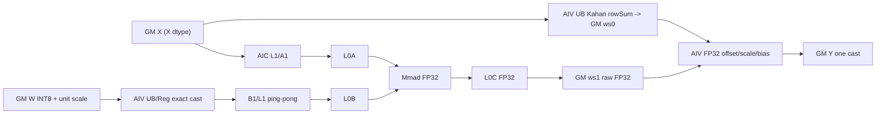
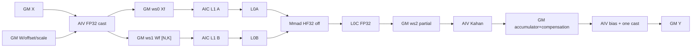

# WeightQuantBatchMatmul 950 Direct Invoke 算子知识

## 算子速览

| 项目 | 内容 |
|---|---|
| 实际入口 | `launch_weight_quant_batch_matmul`，C ABI Direct Invoke；Device entry 按 Route/dtype 为 `wqbmm_prepare_*`、`wqbmm_raw_*`、`wqbmm_fp32_matmul`、`wqbmm_accumulate_fp32_chunk`、`wqbmm_finish_*` |
| 计算语义 | `Y = cast_X(X_fp32 @ ((W_int8+offset)_fp32*scale_fp32) + bias_fp32)`；offset/bias 可空，scale/offset 为 per-channel |
| 输入输出 | `X[M,K]` FP16/BF16 ND，`W[K,N]` INT8 ND，scale/offset `[N]` 或 `[1,N]` 且同 X dtype，bias 为 FP16（X=FP16）或 FP32（X=BF16），`Y[M,N]` 同 X dtype |
| 执行类型 | R-001：AIV_VECTOR → MIX_CV（AIC:AIV=1:2）→ AIV_VECTOR；R-002：AIV_VECTOR → AIC_CUBE/AIV_VECTOR 多 Kernel 循环 → AIV_VECTOR |
| Kernel 路线 | 两条 active 且互斥的生产 Route：P0 / R-001 `M<16` factorized exact-operands CMCT；P1 / R-002 `M>=16` FP32 dequant + K=16 Cube partial + Kahan。dtype、offset、bias 只是 Route 内条件分支；无第三条 fallback Route |
| 核心资源 | GM、三段 route-specific workspace、R-001 的 UB/寄存器与 512 KiB L1/L0A/B/C、R-002 的 FP32 GM intermediates 与 Matmul `CONFIG_MDL` L1/L0A/B/C |
| 来源闭包 | `direct_implementation_closed`：Direct 校验/分核/分配 → launcher selector → 全部 AIV/MIX_CV/AIC 节点及 stream 边 → CMCT arch35 specialization、Cube 层级、同步、精度和 tail → 950 构建来源 |
| 验证状态 | 已完成源码闭包检查；本次知识提取未执行编译、真机、数值或性能测试。 |

## 接口与语义

### 计算语义

定义 `Xf=FP32(X)`、`Wf[k,n]=(FP32(W[k,n])+FP32(offset[n]))*FP32(scale[n])`；offset 缺省时省略加法，bias 缺省时省略末尾加法。目标语义为：

```text
Yf[m,n] = sum_k Xf[m,k] * Wf[k,n]
Y[m,n]  = cast_to_X_dtype(Yf[m,n] + FP32(bias[n]))
```

R-001 利用实数恒等式 `X@((W+offset)*scale)=(X@W+rowSum(X)*offset)*scale`。它在 FP32 中求 `rowSum`，以单位 scale、无 offset/bias 的 CMCT 求 FP32 `X@W`，再在 FP32 中依次做 offset correction、scale、bias，最后只 cast 一次。INT8 可被 FP16/BF16 精确表示，X 本身已是该 16 位源值；但该重排不保证与逐元素 FP32 反量化逐 bit 同序。

R-002 严格保持 FP32 反量化顺序：先把 X 转 FP32，把 `(W+offset)*scale` 转为 FP32 并由 `[K,N]` 写成 `[N,K]`，关闭 HF32；每 16 个 K 产生一个 FP32 `M×N` partial，用 FP32 Kahan 累积，最后加 bias 并 cast 一次。

### 输入、输出与属性

| 参数 | shape/layout | dtype | 约束、默认值与语义 |
|---|---|---|---|
| `x` | `[M,K]` contiguous ND | FP16/BF16 | `1<=M<=512`，`1<=K<=65535`；不做 Contiguous/View 修复 |
| `weight` | `[K,N]` contiguous ND | INT8 | `weight.size(0)==K`，`1<=N<=65535`；不支持 NZ、INT4/F8/FP4 |
| `antiquant_scale` | `[N]` 或 `[1,N]` ND | 同 x | 必选 per-channel scale |
| `antiquant_offset` | 同 scale | 同 x | 可空；有值时 shape 必须与 scale 完全相同 |
| `bias` | `[N]` 或 `[1,N]` ND | FP16（x FP16）/FP32（x BF16） | 可空 |
| `y` | `[M,N]` contiguous ND | 同 x | Direct glue 分配；无输出量化 |
| `workspace0/1/2` | byte tensors | UINT8 backing | 由 Route 独占，均由调用端持有到当前 stream 完成 |
| `stream` | 当前 NPU stream | pointer | 所有节点同 stream 顺序提交 |

### 入口与版本

本卡只描述 CANN 9.1.0、Ascend 950/DAV3510 上的 Direct Invoke `launch_weight_quant_batch_matmul`，不是 ACLNN/V3 的别名，也不继承公开 V3 的全 dtype、batch、group、transpose 或 NZ 能力。Direct TU 将固定提交的 AdaptiveSplit/CMCT arch35 路线改为 by-value POD 和命名 entry，并新增 R-001/R-002 数值路线；官方 `weight_quant_batch_matmul_v2` entry、注册 key 与 Direct entry 不可互换。

## Host/Launcher 执行流程

### 参数校验与前处理

Direct binding 依序检查：所有 tensor defined、同设备、strided contiguous ND；x/weight 为二维；x 为 FP16/BF16、weight 为 INT8；K 相等；M/K/N 范围；scale 为同 x dtype 的 channel shape；可选 offset 同 dtype 且 shape 与 scale 相同；bias channel shape 与 dtype 合法。Meta 与 PrivateUse1 注册都走 `CheckInputs`/`AllocateOutput`；NPU 路径额外建立 `OptionalDeviceGuard`，通过 `OpCommand::RunOpApi("WeightQuantBatchMatmulDirect", direct_call)` 在 current stream 提交 Direct launcher。无 transpose、reformat、broadcast materialization 或外部算子前处理。缺省 offset/bias 的指针占位为 x，但 `has_antiquant_offset/has_bias` 与运行时布尔确保不读占位地址。

Host 还生成 R-002 Cube grid：

```text
nCore = clamp(ceil(N/512), 1, 18)
mCore = clamp(M, 1, floor(36/nCore))
singleCoreM = ceil(M/mCore)
singleCoreN = align16(ceil(N/nCore))
blockDim = mCore*nCore <= 36
```

### 参数、Workspace 与生命周期

```text
if M < 16:
  ws0 = align32(N*2) + M*4                 # unit_scale + row_sum
  ws1 = M*N*4                              # raw X@W FP32
  ws2 = 16*1024*1024                       # CMCT/system reserve
else:
  ws0 = M*K*4                              # X FP32
  ws1 = K*N*4                              # dequantized W [N,K] FP32
  ws2 = 3*M*N*4                            # accumulator | compensation | partial
```

三块独立分配，无 alias。`direct_call` 只 odr-use 并按值捕获九个 GM 裸指针、HostParams 副本和 stream，没有捕获 `torch::Tensor` 对象；workspace 局部 tensor 对象仅明确活到 `RunOpApi` 返回。适配层没有显式 event 或 `recordStream`，因此提交后的存储复用安全性依赖 NPU allocator/current-stream 语义；独立复制 C ABI 时，调用方必须保持输入、输出和 workspace 到 stream 中最后一个消费者完成。R-001 的 16 MiB `workspace2` 传入 CMCT entry，但当前 `ScmcKernel` 的参数构造未读取该指针；它仍是 Direct ABI 保留区，不能复作其它活跃对象。R-002 的三个 `M×N` slice 连续、不对齐填缝，offset 分别为 `0`、`M*N*4`、`2*M*N*4`。

### 启动图与失败传播

```text
Direct binding / current stream
  -> validate
  -> allocate: if M<16 use factorized workspace, else use full-FP32 workspace
  -> launch_weight_quant_batch_matmul(params by pointer)
    -> first Host guard: if M>=16:
         prepare_{f16|bf16}<<<72>>> [AIV, VF_CALL 256 threads]
         -> for k0=0; k0<K; k0+=16:
              fp32_matmul<<<blockDim>>> [AIC Cube]
              -> accumulate_fp32_chunk<<<72>>> [AIV, VF_CALL 256 threads]
         -> finish_{f16|bf16}<<<72>>> [AIV, VF_CALL 256 threads]
         -> return（短路，不落入 R-001）
       fallthrough, therefore M<16:
         MakeRawAdaptiveSplitTiling(p) [Host；平台资源检查，按值生成 AS POD]
         -> prepare_factor_{f16|bf16}<<<M>>> [AIV, VF_CALL 256 threads]
         -> raw_{f16|bf16}<<<cubeM*cubeN>>> [MIX_CV 1:2]
         -> finish_factor_{f16|bf16}<<<72>>> [AIV, VF_CALL 256 threads]
```

同 stream launch 顺序提供跨 kernel GM 交接；R-001 的 MIX_CV 内部另用 CrossCore flag 和 HardEvent。空域在 binding 被 `M,K,N>=1` 拒绝，launcher 另有 `params==nullptr` Host guard。校验和平台资源异常抛错并停止；Direct callback 固定返回 0，TU 未显式查询每次 `<<<>>>` 的 launch status，因此异步 launch/device 错误依赖 runtime/stream 层上报，不能宣称逐节点失败会被 launcher 立即截获。

## Route 与参数设计

### 分核与资源计算

R-001 的 raw CMCT tiling 从平台读取 AIC、L0A/L0B。`cubeNumBlocksN=min(aicNum,ceil(N/256))`；因 `M<16`，`cubeNumBlocksM=1`。`singleCoreM=M`，`baseM=min(256,align16(M))`；`singleCoreN=baseN=min(256,align16(ceil(N/cubeNumBlocksN)))`；`baseK=64`，初始 `stepKa=stepKb=ceil(256/64)=4`、`depthA1=depthB1=8`、`dbL0A=dbL0B=2`、`dbL0C=1`。若 `baseM*align16(K)*2<=256 KiB`，tiling 会把 `stepKa=ceil(align16(K)/64)`、`depthA1=stepKa`；Device 只在 `stepKa>stepKb` 时选 A single-buffer/full-load，其余仍走 DB 分支。main/first-tail 由 N 和 `singleCoreN` 计算，second-tail 为 0。

R-002 的 AIV 节点固定 72 blocks，每 block 以 256 SIMT threads 做 grid-stride。AIC `block = nIndex*mCoreCount+mIndex`，每 shard 的 `M<=singleCoreM`、`N<=singleCoreN`，尾块为 `min(remaining,singleCore*)`。静态 Matmul specialization 为 `GM ND float × GM ND float(transB=true) -> GM ND float`、`CONFIG_MDL`、shape params `(64,512,32768; base 64,128,64)`；实际 contraction tail `chunkK<=16`，`SetHF32(false,0)`。

### Route 选择

Route 穷尽以“Host 可达 launch site”为边界：本 TU 定义 12 个 `__global__` entry，全部只被下表两条节点图引用；其它 CMCT header 仅提供模板库，没有第三个 launcher 出边。P0/P1 综合可达输入域、小 M 低物化复用价值、大 M 安全路线价值与实现复用性；`Host 顺序` 则单独保留 launcher 源码真实控制流，所以 P0/P1 不改写 `if` 的判断顺序。

| 优先级 | Route | Route 特征 | 适用域 | 实现前提 | Host 顺序、短路与 fallback |
|---|---|---|---|---|---|
| P0 | R-001 factorized CMCT | row-sum factorization；单位 scale 的 FP32 raw CMCT；FP32 offset/scale/bias epilogue | 全部接口校验通过且 `1<=M<16`；FP16/BF16、INT8 ND、per-channel | `InvokeKernel<XType,int8_t,XType,float,3,false,false,PER_CHANNEL,false,false,false>`；raw route 无 offset/bias；rowSum 与 raw workspace 可用 | Host 第 2 段默认分支：第 1 个 `if (p.m>=16)` 为 false 后才到达；执行后函数自然结束。无其它 fallback，节点/资源失败不切到 R-002 |
| P1 | R-002 compensated FP32 | FP32 dequant/transpose；HF32-off Cube K=16 partial；FP32 Kahan | 全部接口校验通过且 `16<=M<=512`；静态 Matmul 已证明子域另见 Guard | `MatmulImpl<GM/ND/float,GM/ND/float/transB,GM/ND/float,CONFIG_MDL>`；三段 FP32 workspace；合法 Cube grid | Host 第 1 个显式 guard：`if (p.m>=16)` 命中后完整执行并 `return`，短路 R-001。无 fallback，失败不落入默认分支 |

```text
validate_or_fail
if M >= 16:                              # Host 顺序 1
  dtype==FP16 ? R-002/f16 : R-002/bf16
  return                                 # short-circuit
else:                                    # Host 顺序 2 / fallthrough
  dtype==FP16 ? R-001/f16 : R-001/bf16
# no route fallback
```

offset/bias 不是 Route：它们由 `has_*` 控制可选 FP32 correction；dtype 仅选择类型实例，不改变节点图。

#### Route 分类与 dormant 边界

| 分类 | 候选族 | 生产可达性 | 不另立 Route 的原因 / 重新启用条件 |
|---|---|---|---|
| active | R-001 | `M<16` 时必达；dtype 选 f16/bf16 命名 entry | 两个 dtype entry 共用同一 selector、POD、tiling 和节点图，不拆 Route |
| active | R-002 | `M>=16` 时必达并 `return` | prepare/finish 的 dtype entry 与 offset/bias runtime 布尔不改变 Cube→Kahan 主图 |
| conditional | offset / bias | 两 Route 内可选；R-001 raw CMCT 总是 no-offset/no-bias，correction 在 finish；R-002 offset 在 prepare、bias 在 finish | 只改变对应 AIV body 中的 `if (p.has_*)`，没有独立 launch/key/workspace |
| dormant | CMCT per-tensor/per-group/MX、NZ、INT4/FP8、bias/fixpipe/stream-K/iter-batch 等已打包模板 | Host 不产生其 key，Direct TU 唯一 `InvokeKernel` 实例固定 `int8_t`、ND、`PER_CHANNEL(2)`、`TransA/B=false`、`HasOffset=false`、`IsBiasFp32=false`、`IsWeightNz=false` | header 存在不构成生产 Route；重启必须同时增加接口校验、Host selector、POD/tiling producer、命名 entry/launch site、workspace 与精度/tail 审计 |
| fallback | CPU、ACLNN、其它算子或 Route 间退避 | 不存在 | 校验/资源异常直接失败；已命中 R-002 不会落入 R-001 |

### 模板/实现执行矩阵

| 优先级 / Route | Host 顺序 / key | dtype/shape/platform 完整命中条件 | 执行族与 kernel 节点 | 实际模板/body | 内存与同步特征 | tail/fallback |
|---|---|---|---|---|---|---|
| P0 / R-001 factorized CMCT | 2 / first guard false，`M<16` + f16/bf16 | 950；接口表约束；per-channel INT8 ND；无 transpose；raw specialization固定无 offset/bias、FP32 C | AIV prepare → 单 MIX_CV raw（AIC:AIV 1:2）→ AIV finish | `PrepareFactorized`；`ScmcKernel<256,4,false,false,PER_CHANNEL,false,false,false>`；`FinishFactorized` | ws0 unit scale/row sum、ws1 raw FP32、ws2 16MiB；MIX 内 UB→L1 flag，跨 kernel 同 stream | K row-sum grid-stride；CMCT K/N/M tail；无 fallback |
| P1 / R-002 compensated FP32 | 1 / `if (M>=16)`，完成后 return | 950；接口表约束；`blockDim<=36`；每个 chunk `1..16`；静态模板上界见 Guard | AIV prepare → `ceil(K/16)`×(AIC Cube→AIV Kahan) → AIV finish | `PrepareFp32`；`WqbmmFp32Matmul::Process`；`AccumulateFp32Chunk`；`FinishFp32` | ws0/1 全 FP32；ws2 三个 M×N FP32 slice；跨节点同 stream | M/N shard tail，末 K chunk；无 fallback且不落入R-001 |

### 实现 Guard

| Guard | Host/Tiling 条件 | Device/资源原因 | 影响 Route | 不满足时去向 | 源码符号 |
|---|---|---|---|---|---|
| shape split | launcher 首先判断 `p.m>=16`；true 执行 R-002 并 return，false 才落入 R-001 | 保留大 M 精度保守路线与小 M 低物化路线的互斥域 | R-001/2 | 互斥 Route；任一路内部失败均无 fallback | `launch_weight_quant_batch_matmul` |
| Direct contract | contiguous 2D ND；dtype/optional shape 如接口表 | 所有 entry 按线性 ND 地址直接访问，无 layout fallback | 全部 | 抛错 | `CheckInputs` |
| AIC/L0 availability | platform 非空、`GetCoreNumAic()>0`、L0A/L0B 非零 | R-001 tiling 要据此计算 Cube blocks/baseK | R-001 | 抛错 | `MakeRawAdaptiveSplitTiling` |
| AIC grid | `nCore<=18`、`mCore<=36/nCore`、`blockDim<=36` | R-002 每 block 唯一覆盖 M/N shard | R-002 | Host 夹紧；非法 shape 已拒绝 | `CheckInputs` |
| N shard alignment | `singleCoreN=align16(ceil(N/nCore))` | 后续 B/C shard GM base 与 Cube tile 对齐 | R-002 | 无未对齐 variant | `CheckInputs` |
| Matmul 静态上界 | specialization 声明每核 `(M,N,K)<=(64,512,32768)`；Host 未显式检查 `singleCoreM<=64 && singleCoreN<=512 && K<=32768` | `GetMMConfig(CONFIG_MDL)` 的静态 shape contract | R-002 | 固定源码无 fallback；超界是未证明接受域 | `WQBMM_FP32_MM_SHAPES`/`CheckInputs` |
| contraction order | `strict_chunk_k=16` | 每个 AIC node 只产生一个 K=16 FP32 partial，避免长 K 一次累加 | R-002 | 无更大 chunk variant | launcher K loop |
| HF32 | `SetHF32(false,0)` | FP32 operands 不降到 HF32 | R-002 | 无 HF32 route | `WqbmmFp32Matmul::Process` |
| CMCT UB config | `TemplateCustom=3` → `UB_MTE2_INNER_SIZE=256`、`UB_MTE2_BUF_NUM=4` | AIV INT8/scale staging 与 VF/MTE3 ping-pong | R-001 | 无其它 templateCustom | `InvokeKernel` |
| CMCT resource | `baseK=64`；L0A/B double，L0C single；L1 总 512KiB | 固定 DAV3510 AdaptiveSplit specialization | R-001 | 资源非法时抛错 | `MakeRawAdaptiveSplitTiling`/`BlockMmad` |

### POD/ABI

`WeightQuantBatchMatmulHostParams` 是 12 个连续 `int32_t`：`sizeof=48`、`alignof=4`，offset 每项递增 4。Binding 先生成 `checked.params`，再把 `params` 副本按值捕获进 callback；callback 传 `&params`，launcher 入口立即检查并复制成局部 `p`，最后每个 kernel 又按值获得 `p` 或 `chunk_p`。因此 Host pointer 不跨异步 Device 寿命；它只需在 launcher 调用期间有效。各字段如下。

| 结构 | 字段 | 类型/位宽 | ABI 布局 | 单位 | Host/launcher producer | Device consumer | 边界 |
|---|---|---|---|---|---|---|---|
| `WeightQuantBatchMatmulHostParams` | `m` | int32/32 | size 48, align 4, off 0 | elements | `CheckInputs=x.size(0)` | 所有节点索引/Route | 1..512 |
| 同上 | `k` | int32/32 | off 4 | elements | `x.size(1)` | prepare、row sum、Cube org stride | 1..65535 |
| 同上 | `n` | int32/32 | off 8 | elements | `weight.size(1)` | 所有输出/scale 索引 | 1..65535 |
| 同上 | `x_dtype` | int32/32 | off 12 | enum | FP16→1，BF16→27 | launcher dtype entry | 仅 1/27 |
| 同上 | `has_antiquant_offset` | int32/32 | off 16 | bool | optional presence | prepare/finish | 0/1 |
| 同上 | `has_bias` | int32/32 | off 20 | bool | optional presence | finish | 0/1 |
| 同上 | `single_core_m` | int32/32 | off 24 | elements/core | `ceil(M/mCore)` | R-002 AIC shard/tail | R-001 inactive但初始化 |
| 同上 | `single_core_n` | int32/32 | off 28 | elements/core | `align16(ceil(N/nCore))` | R-002 AIC shard/tail | >=16 |
| 同上 | `m_core_count` | int32/32 | off 32 | cores | Host clamp | R-002 block→M/N | >=1 |
| 同上 | `block_dim` | int32/32 | off 36 | blocks | `mCore*nCore` | R-002 launch | 1..36 |
| 同上 | `k_offset` | int32/32 | off 40 | elements | launcher per K loop | R-002 A/B GM base、Kahan init | 0,16,... |
| 同上 | `chunk_k` | int32/32 | off 44 | elements | `min(16,K-kOffset)` | R-002 `SetTail` | 1..16 |

R-001 另按值传 `WeightQuantBatchMatmulV2ASTilingDataParams`。固定头用 pack(8)：前十个 uint32 offset 为 0..36，随后五个 uint64 offset 40、48、56、64、72，`matmulTiling` offset 80；最终 `sizeof/alignof` 依赖外部 `TCubeTiling` 定义，固定 ops-nn 文件未给出数值，不能猜测。

| 结构 | 字段 | 类型/位宽 | ABI 布局 | 单位 | Host/launcher producer | Device consumer | 边界 |
|---|---|---|---|---|---|---|---|
| `ASTiling` | `cubeNumBlocksM` | uint32/32 | off 0, pack 8 | logical AIC blocks | raw tiling | tail scheduler | R-001，当前为 1 |
| 同上 | `cubeNumBlocksN` | uint32/32 | off 4 | logical AIC blocks | `min(aic,ceil(N/256))` | scheduler | >=1 |
| 同上 | `hasBias` | uint32/32 | off 8 | bool | 固定 0 | BlockMmad | raw route 不融合 bias |
| 同上 | `firstTailBlockCount` | uint32/32 | off 12 | blocks | N tail 公式 | scheduler | 可 0 |
| 同上 | `secondTailBlockCount` | uint32/32 | off 16 | blocks | 固定 0 | scheduler | inactive |
| 同上 | `weightL2Cacheable` | uint32/32 | off 20 | bool | 固定 1 | prologue CopyIf cache mode | 1 |
| 同上 | `mainBlockL1Size` | uint32/32 | off 24 | elements N | `singleCoreN` | scheduler/prologue | <=256 |
| 同上 | `firstTailBlockL1Size` | uint32/32 | off 28 | elements N | `singleCoreN` | scheduler/prologue | <=256 |
| 同上 | `secondTailBlockL1Size` | uint32/32 | off 32 | elements N | 固定 0 | inactive scheduler | 0 |
| 同上 | `aPreloadSize` | uint32/32 | off 36 | elements | 固定 0 | `PreloadA` | 当前禁用 |
| 同上 | `groupSize` | uint64/64 | off 40 | elements K | 固定 0 | prologue layout | per-channel inactive |
| 同上 | `mainBlockCount` | uint64/64 | off 48 | blocks | N main 公式 | scheduler | 可 0 |
| 同上 | `mSize` | uint64/64 | off 56 | elements | M | converter/scheduler | 1..15 |
| 同上 | `kSize` | uint64/64 | off 64 | elements | K | prologue/BlockMmad | 1..65535 |
| 同上 | `nSize` | uint64/64 | off 72 | elements | N | converter/scheduler | 1..65535 |
| 同上 | `matmulTiling` | `TCubeTiling` | off 80；总 size 固定仓不可见 | tile/step/depth | raw tiling | BlockMmad/MatmulImpl | 仅 R-001 |

### Route 源码闭包

| 优先级 / Route | Host 顺序 / Key | Host/Tiling producer | POD/参数 | Kernel entry/router | Kernel body/直接依赖 | 构建接线 |
|---|---|---|---|---|---|---|
| P0 / R-001 factorized CMCT | 2 / first guard false，`M<16`、dtype entry、TemplateCustom 3 | Direct `CheckInputs` + `MakeRawAdaptiveSplitTiling`；公式映射自官方 AdaptiveSplit | HostParams + arch35 AS POD | `wqbmm_prepare_factor_*` → `wqbmm_raw_*` → `wqbmm_finish_factor_*` | `PrepareFactorized`/`FinishFactorized` + arch35 `cmct_convertor` → `KernelMatmulAPrefetchBAntiquant` → prologue/BlockMmad/scheduler | Direct registration；官方来源 target 为 `op_kernel/CMakeLists.txt` 的 ascend950 arch35/CMCT closure |
| P1 / R-002 compensated FP32 | 1 / `M>=16` 后 return、dtype entry、K=16 | Direct `CheckInputs` + launcher K loop | HostParams by value | `wqbmm_prepare_*` → (`wqbmm_fp32_matmul` → `wqbmm_accumulate_fp32_chunk`)* → `wqbmm_finish_*` | SIMT VF bodies + `WqbmmFp32Matmul::Process` + AscendC Matmul API | Direct registration；950 Matmul primitive能力由同固定官方构建族锚定 |

#### 官方原生与 Direct 转换边界

| 层次 | 实际关系 | 可复用结论 | 不得外推 |
|---|---|---|---|
| 官方原生 | 固定 ops-nn 中的 AdaptiveSplit 公式、arch35 AS POD、CMCT scheduler/prologue/BlockMmad 和 950 构建接线 | DAV3510 上 ND per-channel antiquant 的模板类型、L1/L0/UB 分层、tail 与 AIV↔AIC 协议 | 官方源未定义本 Direct 的 `M<16`/`M>=16` selector、workspace 或 Kahan 节点图 |
| Direct-invoke 适配 | Host 新增 Torch schema/校验/分配/current-stream callback 与 48-byte POD；converter 把原来的 `DTYPE_*` 编译宏改为显式类型模板参数，把 GM tiling 解包改为 AS POD by-value，并把 `KERNEL_TASK_TYPE_DEFAULT` 从 converter 移到 `wqbmm_raw_*` entry | 同一 CMCT body 可被 f16/bf16 命名 entry 复用，Host 和 Device 的 POD 字段生产/消费可直接对照 | 这些是转换适配，不是官方原 entry 的逐字实现 |
| Device 派生补充 | R-001 的 unit-scale raw + row-sum correction，以及 R-002 的 FP32 materialization、K=16 partial 和 Kahan，均由 Direct TU 新增 | 可复用其明确的代数分解、节点图、workspace 交接和顺序约束 | 固定官方 CMCT 只能锚定其 raw Cube 子图，不自动证明 Direct 派生路线的数值等价性 |

## Kernel 实现

### 公共执行流程

两个 Route 都按 dtype 选择 FP16/BF16 entry，所有跨 kernel 中间量写 GM workspace，并依赖同 stream program order。AIV 节点统一 `VF_CALL<Body>(Dim3(256), ..., core=GetBlockIdx(), cores=GetBlockNum())`，线程全局 lane 为 `core*256+tid`，步长为 `blocks*256`；除 R-001 row sum 的 256-float UB 数组外，没有 TQue/TBuf。输出节点只写有效 `M*N` 元素。

### Route P0 / R-001：M<16 factorized exact-operands CMCT

#### 适用条件

##### 选择证据

| 层级 | 文件 | 符号 | 源码谓词/参数 | 结果/下一跳 |
|---|---|---|---|---|
| Direct Host | Direct binding | `CheckInputs` | 2D contiguous ND、dtype/shape/optional 约束 | 参数或失败 |
| Launcher | Direct TU | `launch_weight_quant_batch_matmul` | Host 顺序 1 的 `if (p.m >= 16)` 未命中 | fallthrough 到 R-001；不存在从 R-001 到 R-002 的运行时 fallback |
| Tiling | 映射自 `...adaptive_split_tiling.cpp` | `SetDefaultMatmulTiling/ComputeCubeSplit/ComputeBasicTiling` | transA/B=false、per-channel、ND、INT8；raw 无 bias | AS POD |
| Router | `...arch35/cmct_convertor.h` | `InvokeKernel/ScmcKernel` | `<XType,int8_t,XType,float,3,false,false,2,false,false,false>` | MIX_CV 1:2，UB 256×4 |

#### Device 数据流

##### 函数级调用链

```text
Host MakeRawAdaptiveSplitTiling
  -> PlatformAscendCManager AIC/L0A/L0B -> WqbmmTiling by value
prepare_factor_{f16|bf16}
  -> DispatchPrepareFactorized -> VF_CALL<PrepareFactorized>(256)
raw_{f16|bf16}
  -> RunRawWeightMatmul
    -> InvokeKernel<..., DtypeY=float, TemplateCustom=3, no offset/bias>
      -> ScmcKernel -> KernelMatmulAPrefetchBAntiquant
        AIV: BlockPrologue -> CopyGmToUb -> Antiquant(unit scale) -> L1 B
        AIC: BlockMmad -> GM A->L1 A -> Matmul/Mmad -> L0C -> GetTensorC(GM FP32)
finish_factor_{f16|bf16}
  -> DispatchFinishFactorized -> VF_CALL<FinishFactorized>(256)
```

##### 源码等价伪码

```text
# prepare, M blocks; each block owns one row
for n = core*256+tid; n < N; n += M*256: unitScale[n] = 1
sum_tid = Kahan_sum(x[row, tid::256])
UB partial[tid] = sum_tid; syncthreads
balanced_reduce(UB partial); if tid==0: rowSum[row]=partial[0]

# MIX raw matmul
AIV0/AIV1: int8 W GM -> UB -> exact cast XType -> multiply unitScale
             -> NZ-like B1/L1 ping-pong -> signal AIC
AIC: wait both AIV -> X GM->A1/L1->L0A; B1->L0B
     -> Mmad FP32 L0C -> GM raw[M,N] float -> ack AIV

# finish, 72*256 lanes
v = raw[i]
if hasOffset: v += rowSum[i/N] * FP32(offset[i%N])
v *= FP32(scale[i%N])
if hasBias: v += FP32(bias[i%N])
y[i] = cast_X(v)
```

#### 内存与数据搬运

##### 资源与搬运表

| 层级/缓冲区 | offset/地址公式 | extent/容量公式 | dtype/layout | producer | consumer | owner/lifetime | 对齐/复用 |
|---|---|---|---|---|---|---|---|
| GM x/W/scale/offset/bias | ND row/channel offsets | `M*K*2`,`K*N`,`N*2`,optional | X/INT8/X/ND | caller | AIV/AIC | call | contiguous |
| ws0 unit scale | 0 | `N*2` | X/channel | prepare AIV | CMCT AIV | call | followed by align32 |
| ws0 row sum | `align32(N*2)` | `M*4` | FP32/[M] | prepare AIV | finish AIV | call | disjoint |
| ws1 raw | 0 | `M*N*4` | FP32/ND | MIX AIC | finish AIV | call | exact extent |
| ws2 reserve | 0 | 16 MiB | bytes | caller | current CMCT不读取 | call | 不可与活跃对象混用 |
| prepare UB | core-local | `256*4=1024 B` | FP32 | SIMT threads | tree reduce | prepare kernel | one row/core；barrier |
| prologue UB | policy offsets | 4×INT8 input slices + 2×high-bit output + scale/offset slices | INT8/X/register layout | MTE2/VF | VF/MTE3 | K/N tile | TemplateCustom=3，inner=256 |
| L1 B | parity `cvLoop&1` | 每块 `baseN*stepKb*baseK*2`；P0 从 0 起，P1 从 `(512KiB/2B-weightL1Space)` 个 half 起 | X/B1 NZ-like | AIV MTE3 | AIC MTE1 | K tile | AIC ACK 后覆盖 |
| L1 A | `weightL1Space` 个 half 后 | 无 bias/raw C 下，两个 A 半区与两端 B 区共分 512KiB；logical `align16(M)*stepKa*baseK*2` | X/A1 NZ | AIC MTE2 | L0A | tile/call | `stepKa>stepKb` 选 single-buffer/full-load，否则 DB |
| L0A | Matmul API internal | logical tile `baseM*baseK*2`, dbL0A=2 | X | L1 load | Mmad | K tile | tail pad to 16 |
| L0B | Matmul API internal | logical tile `baseK*baseN*2`, dbL0B=2 | X | L1 load | Mmad | K tile | tail pad to 16 |
| L0C | Matmul API internal | `baseM*baseN*4`, dbL0C=1 | FP32 | Mmad | output/fixpipe stage | output tile | only valid M/N stored |
| GM y | `m*N+n` | `M*N*2` | X/ND | finish AIV | caller | output | one final cast |

##### 分层内存布局



##### 字节账、交接边与复用顺序

```text
workspace_total = align32(2*N)+4*M + 4*M*N + 16MiB
L1_total = 512KiB physical shared partition
L0 logical stages = 2*(baseM*baseK*2) + 2*(baseK*baseN*2) + baseM*baseN*4
prepare_UB = 1024B/core
CMCT_UB = 174KiB INT8 input + 66KiB high-bit output + 4KiB scale + 4KiB reserved offset = 248KiB
```

| 边/复用子区 | producer | offset/extent | dtype/layout | consumer | ordering/sync | owner/lifetime | 安全条件 |
|---|---|---|---|---|---|---|---|
| prepare→raw unit scale | prepare AIV | ws0 `[0,2N)` | X/[N] | CMCT AIV | same stream | binding/call | prepare完成后raw启动 |
| prepare→finish row sum | prepare AIV | ws0 `[align32(2N),+4M)` | FP32/[M] | finish AIV | same stream | binding/call | one row由一block归约 |
| AIV→AIC B tile ready | CMCT prologue | L1 parity/valid N×K tile | X/B1 | BlockMmad | `SYNC_MODE4`，AIV 在 `PIPE_MTE3` set flag 9/25，AIC 在 `PIPE_MTE1` wait 9/25 | MIX kernel/tile | 两 AIV 都 signal |
| AIC→AIV reuse ACK | BlockMmad | control only | flag | prologue next parity reuse | AIC 在 `PIPE_MTE1` set flag 8/24，AIV 在 `PIPE_MTE3` wait 8/24 | MIX kernel/tile | AIC 消费后才可覆盖 |
| raw→finish | MIX AIC | ws1 `[0,4MN)` | FP32/ND | finish AIV | same stream | binding/call | raw kernel完成可见 |

#### 同步、精度与尾块

##### 同步与数值边界表

| 阶段 | primitive/机制 | producer | consumer/等待点 | 保护对象 | 精度/尾块 |
|---|---|---|---|---|---|
| row sum | `asc_syncthreads` 每级 | 256 threads | next tree level | UB partial[256] | per-thread Kahan + balanced FP32 tree；K grid tail |
| GM→UB/VF | `MTE2_V`、`V_MTE2` HardEvent | MTE2/VF | VF/next MTE2 | prologue UB ring | K/N real sizes；无效 second AIV也推进 flag index |
| VF→L1 | `V_MTE3`、`MTE3_V` | VF/MTE3 | store/reuse | high-bit UB | INT8→X exact；unit scale 不改值 |
| AIV↔AIC | CrossCore ready 9/25、ACK 8/24，两 subblock IDs | AIV/AIC | peer wait | L1 B parity | K tail align16；防半 tile/覆盖 |
| Cube | Matmul `SetTail/Iterate/GetTensorC` | L1/L0/Mmad | GM raw | L0C/output tile | FP32 accumulate/output；M/N/K tail |
| kernel edges | same stream | preceding kernel | next launch | GM ws0/ws1 | no event needed；无跨 stream |
| epilogue | SIMT grid-stride | raw/rowSum | y store | each output element | FP32 correction→scale→bias→single X cast |

#### 关键实现

##### 符号证据表

| 阶段 | 文件 | 符号/模板实例 | 实现事实 |
|---|---|---|---|
| Host/Tiling producer | `...adaptive_split_tiling.cpp` | `SetDefaultMatmulTiling/ComputeCubeSplit/ComputeBasicTiling` | base/step/depth、AIC split、main/tail 公式的官方来源 |
| Kernel entry/router | `...arch35/cmct_convertor.h` | `InvokeKernel/ScmcKernel` | TemplateCustom→UB config，MIX 1:2，layout/type/scheduler |
| Device body/helper | `...kernel_matmul_a_prefetch_b_antiquant.h` | AIV/AIC `operator()` | 同 launch 两侧循环和 tile 选择 |
| Device body/helper | `...block_mmad_a_prefetch_b_prologue.h` | `BlockMmad::operator()/LaunchMatmul` | GM→L1→L0→Mmad→L0C→GM、tail、flags |
| Device body/helper | `...block_prologue_b_antiquant_scmc_nd_kn.h` | `CopyGmToUb/WeightAntiQuantCompute` | UB ring、AIV 切 K、L1 producer 与同步 |

### Route P1 / R-002：M>=16 compensated FP32

#### 适用条件

##### 选择证据

| 层级 | 文件 | 符号 | 源码谓词/参数 | 结果/下一跳 |
|---|---|---|---|---|
| Direct Host | Direct binding | `CheckInputs` | 同公共约束，生成 `mCore/nCore/singleCore/blockDim` | 参数或失败 |
| Launcher | Direct TU | `launch_weight_quant_batch_matmul` | Host 顺序 1：`p.m >= 16` | R-002；完成后 `return`，短路 R-001；失败无 fallback |
| Router | Direct TU | dtype branch + K loop | FP16/BF16；`kOffset+=16`，`chunkK=min(16,K-kOffset)` | 对应 entry/node sequence |
| AIC | Direct TU | `WqbmmFp32Matmul` | A/B/C 均 GM ND float，B transposed，CONFIG_MDL，HF32 off | AIC Cube partial |

#### Device 数据流

##### 函数级调用链

```text
prepare_{f16|bf16} -> DispatchPrepare -> VF_CALL<PrepareFp32>(256)
for each K chunk:
  fp32_matmul -> WqbmmFp32Matmul::Process
    -> InitCurObj(MatmulImpl) -> SetHF32(false)
    -> SetOrgShape/SetTail -> SetTensorA/B -> IterateAll -> End
  accumulate_fp32_chunk -> VF_CALL<AccumulateFp32Chunk>(256)
finish_{f16|bf16} -> DispatchFinish -> VF_CALL<FinishFp32>(256)
```

##### 源码等价伪码

```text
# prepare
parallel i in M*K: ws0[i] = FP32(x[i])
parallel (k,n) in K*N:
  v = FP32(weight[k,n])
  if hasOffset: v += FP32(offset[n])
  ws1[n*K+k] = v * FP32(scale[n])

# each K=16 chunk, AIC shards M/N
partial[m,n] = MatmulHF32Off(ws0[m,K][k0:k0+chunk],
                             ws1[n,K][k0:k0+chunk]^T)

# Kahan accumulation
if k0==0: sum=partial; compensation=0
else: corrected=partial-compensation; next=sum+corrected
      compensation=(next-sum)-corrected; sum=next

# finish
v=sum[m,n]; if hasBias: v += FP32(bias[n]); y=cast_X(v)
```

#### 内存与数据搬运

##### 资源与搬运表

| 层级/缓冲区 | offset/地址公式 | extent/容量公式 | dtype/layout | producer | consumer | owner/lifetime | 对齐/复用 |
|---|---|---|---|---|---|---|---|
| GM inputs | x `[m*K+k]`, W `[k*N+n]`, channel n | contract extents | source dtypes/ND | caller | prepare AIV | call | contiguous |
| ws0 Xf | 0 | `M*K*4` | FP32/[M,K] ND | prepare AIV | AIC | call | chunk base `m*K+kOffset` |
| ws1 WfT | 0 | `K*N*4` | FP32/[N,K] ND | prepare AIV | AIC B transposed | call | shard base `nOffset*K+kOffset`，N shard align16 |
| ws2 accumulator | 0 | `M*N*4` | FP32/ND | Kahan AIV | finish AIV | stream DAG | persists all chunks |
| ws2 compensation | `M*N*4` | `M*N*4` | FP32/ND | Kahan AIV | next Kahan | stream DAG | initialized on kOffset 0 |
| ws2 partial | `2*M*N*4` | `M*N*4` | FP32/ND | AIC | Kahan AIV | one chunk | overwritten only after consumer；slice 间无额外对齐 padding |
| AIC L1 | MatmulImpl-owned | logical A tile <=`64*64*4`、B tile <=`64*128*4` per base stage | FP32/internal Cube layout | GM MTE | L0 load | kernel/tile | CONFIG_MDL buffer depth is library boundary |
| L0A | MatmulImpl-owned | logical `64*64*4=16KiB` per base tile | FP32 | L1 | Mmad | tile | actual K<=16，padding internal |
| L0B | MatmulImpl-owned | logical `64*128*4=32KiB` per base tile | FP32 | L1 | Mmad | tile | B transposed |
| L0C | MatmulImpl-owned | logical `64*128*4=32KiB` per base tile | FP32 | Mmad | output stage | tile | only M/N tail committed |
| UB/register | no explicit queue | scalar FP32 registers per SIMT lane | FP32 | AIV load | AIV store | vector kernel | grid-stride tail guard |
| GM y | `m*N+n` | `M*N*2` | X/ND | finish AIV | caller | output | one cast |

##### 分层内存布局



##### 字节账、交接边与复用顺序

```text
workspace_total = 4*M*K + 4*K*N + 12*M*N
one logical Cube base footprint = 16KiB L0A + 32KiB L0B + 32KiB L0C
L1 logical base payload <= 16KiB A + 32KiB B; physical ping-pong/depth由固定 CANN Matmul API specialization管理
AIV explicit UB queue = N/A; SIMT lane registers only
```

| 边/复用子区 | producer | offset/extent | dtype/layout | consumer | ordering/sync | owner/lifetime | 安全条件 |
|---|---|---|---|---|---|---|---|
| prepare→AIC Xf/WfT | prepare AIV | ws0 whole/ws1 whole | FP32 ND/[M,K],[N,K] | every AIC chunk | same stream | framework allocator / stream DAG | prepare先完成 |
| AIC→Kahan partial | AIC | ws2 offset `2*4MN`, extent `4MN` | FP32/ND | immediately following AIV | same stream | one chunk | Kahan完成后下一AIC方可覆盖 |
| Kahan state | AIV | ws2 slice0/1 | FP32/ND | next AIV or finish | same stream | all K chunks | kOffset 0 initializes both |
| sum→finish | last Kahan | ws2 slice0 | FP32/ND | finish AIV | same stream | call | all `ceil(K/16)` chunks consumed |

#### 同步、精度与尾块

##### 同步与数值边界表

| 阶段 | primitive/机制 | producer | consumer/等待点 | 保护对象 | 精度/尾块 |
|---|---|---|---|---|---|
| prepare→Cube | same stream | AIV prepare | first AIC launch | ws0/ws1 | FP32 cast、add、mul；W转 `[N,K]` |
| Cube hierarchy | Matmul pipeline | GM/L1/L0 loaders | Mmad/output | internal tiles | HF32 disabled；chunk K 1..16；M/N tail |
| partial reuse | same stream program order | AIC partial | following AIV Kahan | ws2 partial slice | no atomic；每输出元素一个 lane |
| Kahan | scalar FP32 compensation | previous sum/partial | next chunk | ws2 sum/comp | first chunk initializes；末 K tail |
| finish | same stream | final Kahan | AIV finish | accumulator | optional FP32 bias，single FP16/BF16 cast |
| SIMT tails | loop `i=lane;i<count;i+=lanes` | each lane | GM store | valid logical count | no padding store/atomic/conflict |

#### 关键实现

##### 符号证据表

| 阶段 | 文件 | 符号/模板实例 | 实现事实 |
|---|---|---|---|
| Host/Tiling producer | Direct adapter，公式能力锚定 `...adaptive_split_tiling.cpp` | `CheckInputs`/grid formula | blockDim<=36、M/N shard、workspace |
| Kernel entry/router | Direct adapter | `launch_weight_quant_batch_matmul` | `M>=16`、dtype、K=16 node loop |
| Device body/helper | Direct adapter | `PrepareFp32/AccumulateFp32Chunk/FinishFp32` | FP32 dequant、Kahan、bias/cast |
| Device body/helper | Direct adapter；Matmul primitive约束由固定 `...cmct/policy/dispatch_policy.h` 与 arch35源锚定 | `WqbmmFp32Matmul::Process` | GM float type traits、CONFIG_MDL、HF32 off、tail、GM partial |

## 算子特定优化

### Trick T-001：把官方 CMCT 固定成“精确原始操作数”子图

#### 触发与源码依据

- 适用 Route：R-001
- 触发条件：`M<16`，INT8 ND per-channel，Direct 传单位 scale，模板固定无 offset/bias、FP32 C。
- 固定来源：[`cmct_convertor.h:488-510`](../../../../../../../cann-ops-raw/ascendc/ops-nn/955f8b33985b6d72989ebff341bb9c2c564a51bc/matmul/weight_quant_batch_matmul_v2/op_kernel/arch35/cmct_convertor.h#L488-L510)

**官方源码（固定 Commit 连续逐字摘录）**：

```cpp
static constexpr uint32_t UB_MTE2_BUF_NUM =
    TemplateCustom == 0 || TemplateCustom == 2 || (TemplateCustom == 4 && B8) || TemplateCustom == 5 ? 2 : 4;
ScmcKernel<UB_MTE2_INNER_SIZE, UB_MTE2_BUF_NUM, TransA, TransB, ANTIQUANT_TYPE,
    HasAntiquantOffset, IsBiasFp32, IsWeightNz>{}(KERNEL_PARAMS);
```

#### 机制与设计原因

Direct 适配保留 `TemplateCustom=3` 的 256-inner、4-buffer CMCT specialization，却把 scale 固定为 1、offset/bias template 固定为 false、C 改为 FP32。这样 AIV 的 INT8→X cast 对原始整数无误差，AIC 完成真正的 Cube `X@W` 并物化 FP32 raw；易引入低精度舍入的 per-channel correction 后移到独立 FP32 epilogue。

#### 迁移边界

- 适用：W 的整数域能被 Cube 高位输入 dtype 精确表示，scale/offset 沿 N channel 广播。
- 前提：Direct converter 保持官方 layout、scheduler、AIV:AIC=2:1 与 AS POD；raw C 必须为 FP32。
- 失效：per-group/per-token scale、INT4/FP8、batch/NZ/transpose 或非线性 weight transform 不能使用该恒等式。
- 未验证：本次知识提取未执行编译、真机、数值或性能测试。

#### 错误做法

把原始 scale/offset 重新传给 CMCT 会在 X dtype 中先反量化，再做 FP32 Cube；这改变本 Route 的精度闭包。

### Trick T-002：两 AIV producer 与 AIC 的双向 L1 防覆盖协议

#### 触发与源码依据

- 适用 Route：R-001
- 触发条件：DAV3510 非 310R6，`SUB_BLOCK_NUM=2`，每个 K-L1 tile 由两个 AIV 子核共同生产。
- 固定来源：[`block_mmad_a_prefetch_b_prologue.h:424-437`](../../../../../../../cann-ops-raw/ascendc/ops-nn/955f8b33985b6d72989ebff341bb9c2c564a51bc/matmul/common/cmct/block/block_mmad_a_prefetch_b_prologue.h#L424-L437)

**官方源码（固定 Commit 连续逐字摘录）**：

```cpp
if constexpr (AIV_NUM == 2) {
    CrossCoreWaitFlag<SYNC_MODE4, PIPE_MTE1>(SYNC_AIC_AIV_FLAG + FLAG_ID_MAX);
}
CrossCoreWaitFlag<SYNC_MODE4, PIPE_MTE1>(SYNC_AIC_AIV_FLAG);
```

#### 机制与设计原因

AIV0/AIV1 各自产生 B tile 的一个 K 子区并发往同一 parity L1 区写；AIV 在 `PIPE_MTE3` set ready flag 9 与 `9+FLAG_ID_MAX=25`，AIC 在 `PIPE_MTE1` 等待两者后才启动 Matmul。AIC 消费后在 `PIPE_MTE1` set ACK 8/24，两个 AIV 在 `PIPE_MTE3` wait 后才复用 parity 区。HardEvent 再约束各 AIV 内部 MTE2→VF→MTE3，形成 GM→UB→L1→L0 的完整 happens-before。注意常量名以“等待方←发送方”命名；不能把 8/9 的方向按字面猜反。

#### 迁移边界

- 适用：MIX_AIC_1_2 且两个 AIV 共同生产一个 B tile。
- 前提：ready 9/25、ACK 8/24、`FLAG_ID_MAX=16`、PIPE_MTE1/MTE3、subBlock K offset 和 parity `cvLoop&1` 全部保持一致。
- 失效：AIC-only R-002、1:1 kernel 或每 AIV 独占 tile 的设计需要另一同步图。
- 未验证：本次知识提取未执行编译、真机、数值或性能测试。

#### 错误做法

只等待一个 flag 会让 AIC 读取半完成的 B tile；在 AIC ACK 前覆盖 parity 区会破坏在途 MTE1。

### Trick T-003：A 全载与双缓冲由 L1 容量公式切换

#### 触发与源码依据

- 适用 Route：R-001
- 触发条件：`baseM*align16(K)*sizeof(X)<=256 KiB` 时 Direct tiling 把 A 的 `stepKa/depthA1` 改为覆盖全 K；Device 再以 `stepKa>stepKb` 选 single-buffer/full-load，否则保持 DB 分支。
- 固定来源：[`weight_quant_batch_matmul_v2_adaptive_split_tiling.cpp:209-246`](../../../../../../../cann-ops-raw/ascendc/ops-nn/955f8b33985b6d72989ebff341bb9c2c564a51bc/matmul/weight_quant_batch_matmul_v2/op_host/op_tiling/arch35/weight_quant_batch_matmul_v2_adaptive_split_tiling.cpp#L209-L246)

**官方源码（固定 Commit 连续逐字摘录）**：

```cpp
tilingData_->matmulTiling.dbL0A = DOUBLE_BUFFER_NUM;
tilingData_->matmulTiling.dbL0B = DOUBLE_BUFFER_NUM;
tilingData_->matmulTiling.dbL0C = SINGLE_BUFFER_NUM;
```

#### 机制与设计原因

raw CMCT 的 A 不需要反量化。容量 guard 先令 `stepKa=ceil(align16(K)/64)`、`depthA1=stepKa`；当该 `stepKa>stepKb(=4)` 时，`BlockMmad` 的 `al1DbNum_` 才变为 1，完整 A 以 single-buffer 装入后按 K offset 取块。对 `K<=256` 的容量命中，`stepKa<=stepKb`，Device 仍在 DB 分支，但本来只有一个 `kbL1Size=256` 的有效 K loop，不会引入额外重载。容量不命中时 A 用 parity DB 与 B 同步推进。该选择不改变 B 的双 AIV producer 或 FP32 L0C 精度。

#### 迁移边界

- 适用：A 为 contiguous ND、M 小、L1 512 KiB、baseK=64 的当前 raw specialization。
- 前提：容量公式使用物理 `align16(K)` 和 2-byte X，且 BlockMmad 的 L1 partition 不变。
- 失效：bias/quantScale 占 L1、不同 baseN/baseK、4-byte A 或更小 L1 必须重算。
- 未验证：本次知识提取未执行编译、真机、数值或性能测试。

#### 错误做法

只按逻辑 `M*K` 判断而忽略 16 对齐、element bytes 和 L1 其它分区，可能让 A full-load 覆盖 B/bias 区。

## 模板与实现对比

| 对比维度 | P0 / R-001 factorized CMCT | P1 / R-002 compensated FP32 | 设计选择依据 |
|---|---|---|---|
| 重要性 / Host 顺序 | P0；Host 顺序 2，首 guard false 后 fallthrough | P1；Host 顺序 1，命中后 return | 重要性与 selector 检查顺序分开记录 |
| 命中条件 | `1<=M<16` | `16<=M<=512` | 单一 M guard，Route 互斥 |
| 执行族/节点图 | AIV → MIX_CV 1:2 → AIV | AIV → `(AIC→AIV)*ceil(K/16)` → AIV | 小 M 复用 CMCT；大 M 显式 FP32 partial |
| M/N/K、tile 与 scheduler | N-first，baseK64，main+first tail，M block=1 | M/N grid<=36；base 64×128×64，actual K<=16 | 950 AIC数、对齐和数值顺序 |
| workspace/L1/L0/UB | `align32(2N)+4M` + `4MN` + 16MiB；CMCT L1/L0/UB | `4MK+4KN+12MN`；Matmul L1/L0，AIV lane regs | 避免小 M 的 K×N FP32 workspace |
| AIC/AIV 或 kernel 交接 | 同 kernel CrossCore flags；跨 kernel stream | 全部中间在 GM，same-stream node edges | producer/consumer可见性 |
| 同步、精度与 tail | row Kahan+tree；exact raw operands；FP32 correction；M/N/K tail | FP32 dequant；HF32 off；K=16 partial+Kahan；M/N/K tail | 只在最后 cast |
| fallback/失败边界 | 不回退；资源异常抛错 | 不回退；接口非法失败 | Direct 无 ACLNN/其它算子 fallback |

## 平台差异

| 项目 | A2 | A3 | 950 |
|---|---|---|---|
| 支持状态 | 本 Direct 载荷未接线 | 本 Direct 载荷未接线 | 支持；目标为 Ascend 950/DAV3510 |
| Host/Launcher | N/A | N/A | `PlatformAscendCManager` 读取 AIC/L0；grid 上限 36 AIC、72 AIV |
| Kernel/资源 | N/A | N/A | arch35 CMCT MIX 1:2、512KiB L1；R-002 AIC FP32 Matmul + AIV SIMT VF |

## 限制与失败边界

- 名称含 Batch，但 Direct contract 只接受二维 `[M,K]@[K,N]`；不支持 batch/broadcast、transpose、NZ、per-group/per-token、INT4/F8/FP4、output quant 或 activation。
- `M` 限 1..512，K/N 限 1..65535；所有 tensor 必须同设备且 contiguous ND。没有 Contiguous、TransData 或 ACLNN fallback。
- R-002 的静态 Matmul shape 声明每核最大 `M=64,N=512,K=32768`；Host grid 公式不保证所有已接受输入都满足该式（例如 N 很大时 `singleCoreN` 可超过 512），也没有超界 fallback。因此可由当前 specialization 直接证明的 R-002 子域还需 `singleCoreM<=64 && singleCoreN<=512 && K<=32768`；接口接受但超出该子域的行为固定源码未闭合，移植时必须补 guard、重新 tiling 或更换模板。
- R-001 的 factorized 公式在实数上等价，但 FP32 运算结合顺序不同；卡只记录源码机制，不把它外推成逐 bit 等价。
- R-002 的 K=16 是 Direct 数值 guard，不是官方 AdaptiveSplit key；改变 chunk 必须同时重审 partial 切分、Kahan顺序、workspace lifetime 与误差。
- R-002 Matmul API 的物理 L1/L0 buffer depth、内部 load/fixpipe 指令由固定 CANN Matmul library specialization拥有；本卡闭合了当前 type traits、base tile、HF32、GM交接和 tail，不伪造库内未公开 offset。官方 `BlockEpilogueFixpipe` 是同 CMCT 库的输出阶段参考，R-001 当前实例实际经 `MatmulImpl::GetTensorC` 写 FP32 raw，并未实例化该类。
- Direct callback 固定返回 0，未逐 launch 查询同步 status；异步错误依赖 runtime/stream 上报。平台资源无效、`params==nullptr` 或输入校验失败时则在相应 Host 阶段抛错。
- Callback 捕获的是 GM 裸指针而非 tensor owner；本适配依赖 current-stream allocator 防止局部 workspace 存储在消费者完成前被不安全复用。若脱离该框架直调 C ABI，必须由调用方持有所有 GM 对象至 stream 完成。
- 本次知识提取未执行编译、真机、数值或性能测试。

## 源码索引

### 链路索引

| 链路阶段 | 文件 | 关键符号 | 支撑内容 |
|---|---|---|---|
| Host/Tiling 来源 | `matmul/weight_quant_batch_matmul_v2/op_host/op_tiling/arch35/weight_quant_batch_matmul_v2_adaptive_split_tiling.cpp` | `SetDefaultMatmulTiling/ComputeCubeSplit/ComputeBasicTiling` | R-001 AS tile/base/depth/main-tail 转换依据 |
| POD | `matmul/weight_quant_batch_matmul_v2/op_kernel/arch35/weight_quant_batch_matmul_v2_arch35_tiling_data.h` | `WeightQuantBatchMatmulV2ASTilingDataParams` | R-001 by-value POD 字段/pack |
| 官方 arch35 entry | `matmul/weight_quant_batch_matmul_v2/op_kernel/arch35/weight_quant_batch_matmul_v2.cpp` | `weight_quant_batch_matmul_v2`/arch35 macro routes | Direct 命名 entry 的 specialization 来源 |
| Kernel converter | `matmul/weight_quant_batch_matmul_v2/op_kernel/arch35/cmct_convertor.h` | `InvokeKernel/ScmcKernel` | type/layout/UB/MIX/scheduler 实例 |
| MIX kernel body | `matmul/common/cmct/kernel/kernel_matmul_a_prefetch_b_antiquant.h` | AIV/AIC `operator()` | 同 launch 任务图 |
| Cube block | `matmul/common/cmct/block/block_mmad_a_prefetch_b_prologue.h` | `BlockMmad/LaunchMatmul` | L1/L0/Mmad/output、flag、tail |
| AIV prologue | `matmul/common/cmct/prologue/block_prologue_b_antiquant_scmc_nd_kn.h` | `CopyGmToUb/WeightAntiQuantCompute` | UB、VF、MTE3、L1 producer |
| quant micro-body | `matmul/common/cmct/prologue/tile/antiquant_nd_kn.h` | per-channel `AntiquantImpl` | cast→offset→scale顺序；R-001用unit scale/no offset |
| scheduler | `matmul/common/cmct/block/block_scheduler_tail_resplit_expanded.h` | `BlockSchedulerTailResplitExpanded` | main/first/second N tile mapping |
| dispatch policy | `matmul/common/cmct/policy/dispatch_policy.h` | `MmadAPrefetchBAntiquantScmc`/`CONFIG_MDL` | 当前 CMCT scheduler/Matmul policy |
| Fixpipe 边界 | `matmul/common/cmct/epilogue/block_epilogue_fixpipe.h` | `BlockEpilogueFixpipe` | 官方 CMCT 输出阶段对照；当前 raw route不实例化 |
| 构建接线 | `matmul/weight_quant_batch_matmul_v2/op_kernel/CMakeLists.txt` | ascend950/arch35 target | 950 官方来源闭包 |

每行文件均在 Frontmatter `sources` 中；Direct adapter 自身无固定官方 blob URL，因此不伪造交付链接，只以实际入口/符号记录新增的 selector、workspace 和节点图。

### 实现复用检查

| 检查项 | 可复用事实 | 不得改变的约束 | 源码符号 |
|---|---|---|---|
| ABI/POD | 48-byte HostParams、pack(8) AS POD前缀 | 12字段顺序/位宽、AS `matmulTiling` offset 80、by-value kernel参数 | `WeightQuantBatchMatmulHostParams`/`ASTiling` |
| 调用顺序 | R-001 三节点；R-002 prepare→成对循环→finish | 同 current stream、K chunk必须紧邻其Kahan consumer | launcher |
| workspace/内存 | 两 Route 精确三块公式和 ws2 slices | offset、extent、不 alias、owner活到stream完成 | binding allocation/launcher slicing |
| 同步 | same-stream跨kernel；R-001 双 AIV ready 9/25 + ACK 8/24 + HardEvent | 两个 producer ready 都到达、ACK 后覆盖、parity/event ID | `BlockMmad/BlockPrologue` |
| 精度与尾块 | R-001 exact raw + FP32 correction；R-002 FP32 dequant/HF32 off/K=16 Kahan | offset→scale→bias顺序、一次最终cast、M/N/K有效域 | `Prepare*/Process/Accumulate*/Finish*` |
| 失败边界 | 校验/资源错误终止，无外部算子 fallback | 不把缺省指针占位当有效tensor；不扩展到batch/NZ/group | `CheckInputs/MakeRawAdaptiveSplitTiling` |

- [SetHF32](../../../../apis/simd_api/adv_api/cube_compute/matmul_kernel/set_hf32.md)
